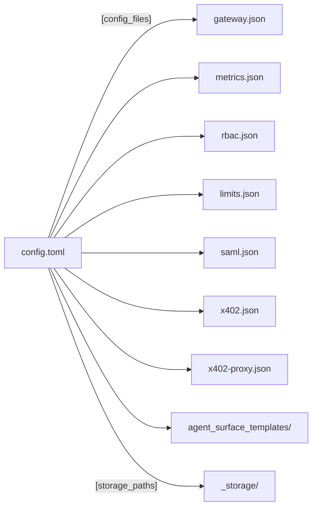

# Configuration Files

What each configuration file controls, when the gateway reads it, and what changes when
you set a field.

Use the hosted [Agent Gateway reference](https://docs.affinidi.com/products/affinidi-trust-fabric/agent-gateway/reference/)
for the supported operator-facing fields of the deployed product. This page describes
the files as the checked-out source reads them, including fields that exist in the
source but are not part of the product surface.

For the reload machinery, see [`CONFIGURATION_RELOAD.md`](CONFIGURATION_RELOAD.md). For
worked examples of every file, see [`config/examples/`](../config/examples/).

## Configuration files

The bootstrap TOML is the entry point. Everything else is named from it.

| File | Controls | Read |
| --- | --- | --- |
| `config.toml` | Bootstrap: storage paths, TLS, encryption, protocol defaults, server mode | Startup only |
| `gateway.json` | Listeners, routes, WebAuthn, DID domain, STS runtime | Startup only |
| `metrics.json` | OpenTelemetry, CloudWatch, and metrics export | Startup |
| `rbac.json` | Which management role each permission requires | Startup |
| `limits.json` | Resource count ceilings per record kind | Startup |
| `saml.json` | SAML identity provider, when `auth_mode = "saml"` | Startup |
| `x402.json` | x402 payment networks, assets, and facilitator settings | Startup |
| `x402-proxy.json` | Networks and wallets for the x402 proxy; read, but not used | Startup |
| `test-endpoints.json` | Payment requirements for the x402 test endpoints, which are not served | Not read |
| `agent_surface_templates/` | Surface templates seeded into the template store | Startup |

**No configuration file is re-read after startup.** `POST /v1/config/reload` rebuilds the
running surface set from `_storage/agent_surfaces/` and reuses the bootstrap and gateway
configuration already in memory
([`load_base_gateway_config`](../src/identity/handlers/config.rs)). Editing any file in
this table takes effect only on restart. See
[`CONFIGURATION_RELOAD.md`](CONFIGURATION_RELOAD.md).

## Locating the files

`config.toml` names the others in its `[config_files]` table. A relative path resolves
against the directory holding `config.toml`, not the working directory. An absolute path
is used as given.

```toml
[config_files]
gateway = "../gateway.json"
metrics = "metrics.json"
rbac = "rbac.json"
limits = "limits.json"
saml = "saml.json"
x402 = "x402.json"
x402_proxy = "x402-proxy.json"
agent_surface_templates_dir = "agent_surface_templates"
```



Path resolution is in
[`BootstrapConfig::from_file`](../src/config/bootstrap.rs). Most `[storage_paths]` keys
resolve the same way. `policy_definitions`, `global_policies`, `issuers`, `authorities`,
`credential_providers`, `delegation_vault` and `[encryption] key_file` resolve a relative
value against the working directory, and `backup_restore` resolves against
`--base-folder` when it is set. Use absolute paths in a deployment; see
[Storage](DEPLOYMENT_REQUIREMENTS.md#storage).

## Settings with non-obvious effects

Each of these behaves differently from the obvious reading of the field.
`config.example.toml` also notes each one in a comment.

| Field | Behaviour |
| --- | --- |
| `server_mode` | Must be a top-level key, before any `[table]` header. Placed after one, TOML nests it under that table and the setting is silently ignored. |
| `a2a.message_expires_seconds` | Should be strictly greater than `a2a.fabric_gateway_timeout_ms / 1000`. Nothing validates this. When it is not, a fabric message expires at the mediator while the sending gateway is still waiting, and the failure looks like a timeout with no cause. |
| `backup_encryption_key` | Required. The service does not start without a resolvable value. |
| Unknown top-level keys | Ignored, not rejected. A misspelled key takes no effect and produces no error. |
| `encryption.key_source = "local"` | Does not encrypt. It writes plaintext `ENC[0::…]` envelopes and is for development only. |
| `encryption.field_encryption_enabled` | Reserved and not wired to any field. Leave it false. |

## Secret references

Any field documented as accepting a loader reference resolves through
[`src/config/loaders/`](../src/config/loaders/).

| Scheme | Resolves to |
| --- | --- |
| `env://NAME` | The value of environment variable `NAME` |
| `file://PATH` | The contents of `PATH` |
| `aws_secrets://NAME` | An AWS Secrets Manager secret |
| `aws_parameter_store://NAME` | An AWS Systems Manager parameter |
| `string://VALUE` | The literal value |
| anything else | Treated as a literal value |

A bare literal is accepted so that a value without a scheme still works. Prefer an
explicit scheme, because a literal key in a shared repository is a leaked key.

## Environment variables

| Variable | Used for | Required |
| --- | --- | --- |
| `AG_BACKUP_ENCRYPTION_KEY` | Encrypts the whole `.agbak` archive, AES-256-GCM. Referenced from `backup_encryption_key`. | Yes, unless that field resolves another way |
| `AG_MASTER_KEY` | Master key for encryption at rest when `encryption.key_source = "environment"`. Named by `encryption.key_env_var`. | When encryption at rest is enabled |
| `AG_IDENTITY_HASH_PEPPER` | HMAC pepper for agent DIDs derived from a credential: the `from_mtls`, `from_api_key`, and `from_jwt_claim` managed identity modes, and A2A proxy identities other than Entra agents. Payload extraction does not use it. When encryption at rest is off, it also keys the seal on the OAuth delegation `state`. Hex, or a loader reference, decoding to at least 32 bytes. Set the same value on every node of a multi-node gateway (see [`CAPABILITIES.md`](CAPABILITIES.md#high-availability)). | No. Without it, or with a value that is too short or cannot be resolved, an ephemeral pepper is used: those DIDs change on every restart, and with encryption at rest off, an OAuth consent started before a restart or on another replica fails at the callback. |
| `AG_LEGACY_BACKUP_KEYS` | Up to four comma-separated previous backup keys, tried after the current one. Only read when `legacy_backup_encryption_keys` names it. | No, migration only |
| `AFFINIDI_TERMS_REFRESH_INTERVAL_SECONDS` | How often the Affinidi Terms metadata is refreshed. Clamped to 60 to 3600 seconds in release builds. See [`TERMS_AND_CONSENT.md`](TERMS_AND_CONSENT.md#refresh-and-outage-behaviour). | No. Defaults to a random point between 55 and 60 minutes. |
| `AG_EVENT_HOOK_URL` | Turns on the [event hook](INTEGRATIONS.md#event-hook) and sets the receiver endpoint it posts Connection Point events to. `http` is accepted only for a loopback host; any other host needs `https` and `AG_EVENT_HOOK_SECRET`, otherwise the hook is disabled. | No. Unset means no events. |
| `AG_EVENT_HOOK_SECRET` | HMAC key that signs event hook calls when set, at least 32 characters. A plain value or a loader reference. | Only for a loopback receiver, where unset sends unsigned calls. Any other host requires it. A value that is too short or cannot be resolved disables the hook. |
| `AG_EVENT_HOOK_TIMEOUT_MS` | HTTP timeout of one event hook delivery attempt. | No. Defaults to `5000`. |
| `AG_MEDIATOR_DIRECTORY_FIRST_CALL_RETRY_ATTEMPTS` | Only for a mediator the [mediator directory](INTEGRATIONS.md#mediator-directory) lists, which may admit a DID only after the directory's operator has registered it in response to the `creation_started` notification: how many times a new Connection Point's first call to it is repeated, with the same DID, while it refuses the DID. Any other mediator's refusal is final and fails at once ([details](INTEGRATIONS.md#event-hook)). `0` to `20`. | No. Defaults to `5`; `0` never repeats. |
| `AG_MEDIATOR_DIRECTORY_FIRST_CALL_RETRY_DELAY_MS` | Wait before each repeat of that call (directory-listed mediators only, as above), `1` to `30000`. The whole retry sequence is capped at 45 s. Read from the environment the first time a Connection Point is created on a directory mediator after the gateway starts. | No. Defaults to `2000`. |
| `AG_MEDIATOR_DIRECTORY_URL` | Turns on the [mediator directory](INTEGRATIONS.md#mediator-directory): the endpoint the gateway reads extra mediators from. Same target rules and `AG_EVENT_HOOK_SECRET` as the event hook. | No. Unset means only stored mediators are listed. |
| `AG_ALLOW_LOCAL_OOB` | Permits out-of-band invitations pointing at local addresses. Development only; must not be set in production. | No |
| `AG_ALLOW_LOCAL_A2A_PROXY` | Permits an A2A proxy to reach a local or private `base_url`. Development only; must not be set in production. | No |

Variables prefixed `AG_TEST_` and `AG_BDD_` exist for the test suites and have no role in
a deployment.

## `config.toml`

The bootstrap file. Startup only; changes need a restart.

| Section | Controls |
| --- | --- |
| top level | `channel_config_source`, AWS region and profile, `secrets_backend`, `backup_encryption_key`, `auth_mode`, session timeout, WebSocket auth and buffer, metrics retention and cache, `server_mode` |
| `[tenancy.trusted_tenant_header]` | Declares that an authenticated edge writes the tenant header. Enables broad header-derived PAT selectors. |
| `[encryption]` | Encryption at rest: on or off, key source, KMS settings |
| `[config_files]` | Where the other configuration files are |
| `[storage_paths]` | Where each record kind is persisted under `_storage/`. The Trust Recorder status store has no key: it sits beside the identities directory as `trust_recorder_status/`. |
| `[did_cache]` | DID document cache TTL, size, staleness, and path; whether DID resolution may contact private hosts |
| `[tls]` | Certificate and key paths, upstream verification |
| `[mcp]` | Default MCP revision, validation, timeouts, SSE and stdio transports. Gateway-originated `2026-07-28` consent needs `[mcp.continuations]`; see [`MCP_METADATA.md`](MCP_METADATA.md#protected-continuations). |
| `[reconnect_policy]` | Backoff for DIDComm connection points |
| `[oob_connection]` | How long an out-of-band pairing invitation stays pending |
| `[a2a]` | Default A2A revision, body size, timeouts, fabric timeouts and envelope lifetime, inbound cache sizing |
| `[logging]` | Level, JSON output, log directory |
| `[extension_inspection]` | Whether to parse A2A extensions, and which URIs to watch |

Fields and defaults are defined in [`src/config/bootstrap.rs`](../src/config/bootstrap.rs).
`config.example.toml` documents each field inline and is the most complete field-level
description that exists today.

### Fields worth understanding before a deployment

| Field | Effect |
| --- | --- |
| `server_mode` | `active` serves traffic. `standby` drops listeners and returns 503 on `/api/v1/health` while `/api/v1/alive` stays 200. `SIGUSR1` promotes, `SIGUSR2` steps down. |
| `cache_refresh_interval_secs` | Above 0, DashMap-backed stores reconcile with disk on that interval, so manual `_storage/` edits are picked up without a reload. Policy definitions and global policies do not participate. |
| `auth_mode` | `passkey` uses WebAuthn. `saml` requires `saml.json` and a configured identity provider. |
| `secrets_backend` | `filesystem` keeps secrets under `_storage/`. `aws` uses AWS. |
| `encryption.enabled` | Writes whole storage files as `.json.enc`. Losing the master key loses the data. |
| `metrics_retention_minutes` | Parsed but not used. Retention is the value in `_storage/settings/settings.json`, set from the dashboard, which defaults to 360 minutes whatever this field says. |
| `websocket_require_auth` | Off means an unauthenticated client can open the dashboard event stream. |
| `did_cache.allow_private_hosts` | Off (the default) refuses `did:web` and `did:webvh` on loopback, private-network and link-local hosts. On is needed for a local stack whose mediator lives on `localhost`, and reopens SSRF through attacker-supplied DIDs, cloud metadata included, so keep it off wherever an instance metadata service is reachable. See [`POLICY.md`](POLICY.md#did-resolution-host-policy). |

## `gateway.json`

Network topology and the surfaces served. The largest configuration file; the example is
1,343 lines.

| Key | Controls |
| --- | --- |
| `listeners` | Named bind addresses and ports. Access Points and Transit Points reference these. |
| `channels` | Route prefixes. The legacy wire name for surface routes. The dashboard offers them as an Access Point's **Surface Prefix**, in this order, and preselects the first for a new surface. A prefix, or a `proxy` route, whose first segment is a page of the dashboard (`/payments`, `/policies`, `/surfaces`, `/settings` and the others in `SPA_RESERVED_TOP_LEVEL`, [`src/proxy/paths.rs`](../src/proxy/paths.rs)) stops the gateway at startup, since it would answer a reload of that page with a proxy `404`. The error names each prefix and the page it shadows: rename the channel (for `/payments`, to something such as `/svc/payments`) and the clients that call it, then restart. |
| `routes` | Route categories and their types, prefixes, and fallbacks |
| `mcp_proxies` | Route prefixes for MCP proxy endpoints |
| `did` | The domain used when generating `did:web` and `did:webvh` identifiers |
| `webauthn` | Relying-party ID and external origin for passkey registration |
| `integration` | Notification and webhook integration settings |
| `sts` | Security Token Service runtime settings. See [`STS.md`](STS.md). |
| `cli_login_throttle` | Optional per-client-IP limit on each `fabric` CLI login endpoint: `enabled` (default `false`) and `per_ip` `{requests, window_secs}` (default 20 per 60 seconds). Behind a load balancer, set `client_ip.trusted_proxies` first. |
| `payment_gate` | `breaker_failures` (default `5`, 1 to 1000) consecutive failed calls to one agent-pay gateway open its circuit breaker for `breaker_open_secs` (default `30`, 1 to 3600); the gate then answers `503` at once. Read at startup. Opening and closing are logged and counted (see [`OBSERVABILITY.md`](OBSERVABILITY.md#settlement-breaker-and-ledger-metrics)). |
| `payment_ledger` | `retention_days` (default `7`, 1 to 400): how long the payments ledger keeps its hourly segments. `max_size_mb` (default `2048`, 16 to 1,048,576): the oldest segments are deleted early while the ledger is larger. Read at startup; a value out of range is clamped and logged as a warning. See [Taking the payment](#taking-the-payment). |
| `client_ip` | `trusted_proxies`: proxy CIDRs whose `X-Forwarded-For` gives the client IP for the SAML and CLI login limits (default empty, so the TCP peer is the client). Each listed proxy must append the address it saw to `X-Forwarded-For` or overwrite it; `Forwarded` is read only when `X-Forwarded-For` is absent. Separate from `tls.client_auth.trusted_proxies`. |
| `facilitator_mode` | x402 facilitator behaviour. `facilitator_via_fabric`, `facilitator_via_http` and `enable_test_endpoints` are ignored, and a warning is logged when any is set: a peer's fabric x402 verify and settle requests are refused with `facilitator_disabled`, and `/api/x402/*` and the x402 test endpoints are not served. x402 payments already in the transaction store still settle. |
| `cors` | Permitted dashboard origins |
| `terms`, `affinidi_terms_url` | Whether Terms acceptance is enforced, and where metadata is fetched |
| `logging` | Log redaction rules. Only `redaction` is read here; level, JSON output, and directory come from `config.toml`. |
| `oauth_callback_route` | Where OAuth redirects land |

The example file also carries `oob_connection` and `secrets` blocks, which `NetworkConfig`
does not read. Out-of-band invitation expiry is set by `[oob_connection]` in `config.toml`.
`NetworkConfig` also parses an `encryption` block but never uses it: encryption at rest is
set only by `[encryption]` in `config.toml`, so an `encryption` block in `gateway.json` leaves
storage unencrypted.

One listener can serve several Access Points, and one transit listener several Transit
Points. A request is matched to its surface by route.


The type is [`NetworkConfig`](../src/config/network.rs). Surfaces themselves are stored
records rather than file content; see [`src/config/agent_surface.rs`](../src/config/agent_surface.rs).

`webauthn.external_origin` is the value a browser must be visiting for passkey
registration to succeed. A mismatch is the most common local-setup failure, and
[`development/GETTING_STARTED.md`](development/GETTING_STARTED.md) treats the generated
value as the source of truth.

## `rbac.json`

Maps each management permission to the minimum role that holds it. Roles are
`administrator`, `poweruser`, and `user`.

```json
{
  "permissions": {
    "gateways.view": "user",
    "gateways.edit": "poweruser",
    "secrets.view": "administrator"
  }
}
```

The file is merged over the built-in defaults in `RbacConfig::default()`, so it only needs
the permissions you change; the example above lowers `gateways.edit`, which defaults to
`administrator`. A role value other than the three names denies the permission to every
role, `administrator` included. The file is read at startup, so a change needs a restart.

A missing or unparseable file does not stop startup: the gateway logs a warning and runs
with the built-in defaults. A misspelled permission key is accepted without an error and
matches nothing, so the permission it meant to change keeps its default. Check the startup
log before relying on tightened permissions.

Lowering a permission to a weaker role grants it to everyone at that role and above,
appliance-wide. Enforcement and the permissions response contract are in
[`RBAC.md`](RBAC.md). Management tokens narrow this further; see
[`ACCESS_TOKENS.md`](ACCESS_TOKENS.md).

## `limits.json`

Ceilings on how many records of each kind may exist. Each entry carries an operator-facing
`name` and `description` alongside the `limit`.

```json
{
  "limits": {
    "secrets": { "name": "Secrets (total)", "description": "…", "limit": 20 },
    "secrets.apikeys": { "name": "API Keys", "description": "…", "limit": 5 },
    "surfaces": { "name": "Surfaces (total)", "description": "…", "limit": 10 }
  }
}
```

Keys are hierarchical, and the two levels constrain different counts rather than the
same one. Adding a record checks the leaf dimension against its own count, and then, when
the key is dotted, checks the umbrella parent against the rollup total. With
`secrets.apikeys` at 5 and `secrets` at 20, you may hold 5 API keys and still add secrets
and certificates until the three together reach 20.

The umbrella total is a directly registered counter when one exists, otherwise the sum of
every registered `parent.*` child
([`enforce_add`](../src/config/limits_config.rs)).

| Situation | Result |
| --- | --- |
| Dimension listed in the file | Its `limit` applies |
| Dimension not listed | `DEFAULT_LIMIT` of 1,000,000 applies, which is effectively unconstrained |
| Dimension with no registered counter | Skipped, and the check passes |
| Limit reached | Creation fails. Existing records are unaffected. |

Counters are registered at startup in
[`src/server/orchestrator.rs`](../src/server/orchestrator.rs).

## `saml.json`

Read when `auth_mode = "saml"`. Ignored otherwise.

| Group | Fields |
| --- | --- |
| Identity provider | `idp_entity_id`, `idp_sso_url`, `idp_slo_url`, `idp_cert_path` |
| Service provider | `sp_entity_id`, `sp_acs_url`, `sp_key_path`, `sp_cert_path` |
| Security | `sign_requests`, `require_encrypted_assertions` |
| Sign-in throttle | `login_throttle`: `enabled` (default `false`) and `per_ip` `{requests, window_secs}` (default 20 per 60 seconds) per client IP for `/saml/login`. Behind a load balancer, set `client_ip.trusted_proxies` in `gateway.json` first. |
| Claims | `attribute_mapping` from SAML claim URI to user field |
| Roles | `role_mapping` from identity-provider role to gateway role |
| Directory | `graph_api` for Microsoft Entra ID group and profile lookup |

`role_mapping` decides what an authenticated user may do. A mapping that sends an
unexpected identity-provider role to `administrator` grants full management access, so
treat it as a security-relevant setting rather than a convenience.

Each SAML sign-in sets the user's role from the identity provider, with one exception: the
first user to sign in becomes the primary administrator and keeps that role whatever the
identity provider sends later, so a missing or changed role claim cannot remove the only
guaranteed administrator. A sign-in that would have changed it logs a warning instead
([`saml/user_provisioning.rs`](../src/auth/saml/user_provisioning.rs)).

## `x402.json` and `x402-proxy.json`

`x402.json` configures payment networks, assets, and facilitator behaviour for the x402
protocol. `x402-proxy.json` configures the `networks` and `wallets` the x402 proxy used,
each network carrying a CAIP-2 `id`, `chain_type`, and `rpc_endpoint`; it is still read at
startup, but nothing uses it.

Two `x402.json` sections control x402 storage. If `x402.json` fails to parse, the gateway
logs a warning and starts neither.

| Section | Effect |
| --- | --- |
| `settlement_storage` | Its presence starts the settlement worker, using `batch_size` (default 100), `settlement_interval_seconds` (default 60), and `max_retries` (default 3) |
| `transaction_storage` | When present, transaction records are stored at `filesystem_path` (default `_storage/x402-transactions`) instead of `[storage_paths].x402_transactions`; `retention_days` (default 7) sets how long the daily cleanup keeps them |

Transaction records are always kept on the filesystem; other keys in these sections are
ignored.

These files only matter to x402 payments that were verified locally earlier: the settlement
and recovery workers keep running so those payments can still settle. A surface cannot charge
through local x402; see
[Surface payment policy](#surface-payment-policy).

`test-endpoints.json` (`[config_files].test_endpoints`) fed the unauthenticated x402 test
endpoints. Those endpoints are not served, whatever `facilitator_mode.enable_test_endpoints`
says, so the file is not read.

A network entry pointing at mainnet moves real value. The demo scripts and a worked walkthrough are in
[`scripts/x402/README.md`](../scripts/x402/README.md); protocol behaviour is in
[`PROTOCOLS.md`](PROTOCOLS.md).

## `metrics.json`

Telemetry export. Three independent sinks, each with its own `enabled` flag.

| Sink | Controls |
| --- | --- |
| `opentelemetry` | Endpoint, service name, environment, and separate `traces`, `metrics`, and `logs` blocks |
| `cloudwatch` | Region, namespace, and dimensions |
| Remaining keys | Local metric collection and retention |

`opentelemetry.traces.sample_rate` is a fraction, so `0.1` records one span in ten.
`opentelemetry.traces.record_caller_identity` adds `caller.auth_method`,
`caller.principal`, and `caller.did` to the root HTTP span. It is off by default because
those values identify the caller; turning it on puts caller identity into your tracing
backend. See [`OBSERVABILITY.md`](OBSERVABILITY.md).

## `agent_surface_templates/`

Every `*.json` file in the directory is seeded into the template store at boot and marked
`builtin: true`, which stops the API deleting or overwriting it. Files with any other
extension are ignored. The storage filename comes from the template's `id` field, not
from the source filename, so two files sharing an `id` collide and only the last one
seeded survives.

Full loading rules are in
[`config/examples/agent_surface_templates/README.md`](../config/examples/agent_surface_templates/README.md).

## Surface payment policy

A surface charges for requests through `target.payment_policy` (or a variant's
`overrides.target.payment_policy`). The only supported policy delegates payment to a
payment surface on a connected agent-pay gateway, which owns the price, the payment methods,
verification and settlement. This gateway decides whether a request is chargeable, and
agent-pay takes the payment; see [Taking the payment](#taking-the-payment).

```json
"payment_policy": {
  "type": "agent_pay",
  "payment_gateway_id": "<connected Remote gateway id>",
  "payment_surface_id": "<payment surface id>[$<alias>]",
  "mcp_payment_triggers": { "mode": "match", "patterns": ["^premium_"] },
  "a2a_method_filters": [{ "method": "message/send", "message_patterns": [] }],
  "require_all": false,
  "timeout_ms": 15000,
  "share_payer_email": false
}
```

| Field | Default | Behaviour |
| --- | --- | --- |
| `payment_gateway_id` | required | A user-created Remote gateway the caller's tenant and token scope may reference |
| `payment_surface_id` | required | The payment surface on that gateway. `payment_channel_id` is read as an alias. A `$alias` suffix names one of its variants. |
| `mcp_payment_triggers` | none, which charges every `tools/call` | Which MCP `tools/call` requests are chargeable: `all`, `match` or `exclude` with regex `patterns`. The patterns are checked on save. Blank patterns are ignored. A policy with no triggers, and a stored `match` with no non-blank pattern, charge every `tools/call`; saving a `match` with no non-blank pattern is refused with `400`, code `invalid_payment_policy`. |
| `a2a_method_filters` | none, which charges `message/send` and `message/stream` | Which A2A methods, and optionally which messages, are chargeable. Each entry has a `method` and optional `message_patterns`: plain text, matched case-sensitively and exactly against the text parts of the message joined by single spaces, never as a regular expression, so any text is accepted. Blank patterns are ignored, and an entry with no non-blank `message_patterns` charges every message of its method. A policy with no filter, an empty list or only entries without a method charges `message/send` and `message/stream` (in either spelling). |
| `require_all` | `false` | Charge every request, whatever the triggers say |
| `timeout_ms` | `15000` | How long to wait for agent-pay; 1000 to 120000. A card or wallet charge goes over the fabric and then to the provider and often takes several seconds: below 5000 the gateway can stop waiting after the payment was taken and answer `payment_unconfirmed` (the caller then repeats the same request with the same credential within agent-pay's 120-second replay window). The dashboard warns below 5000. |
| `share_payer_email` | `false` | Send the caller's email to agent-pay, which pseudonymises it |
| `manifest_snapshot` | server-written | The payment surface's Payment Manifest as last fetched |

Every save (create, update, merge `PATCH`, and every variant operation) checks each
`agent_pay` policy and fetches the payment surface's manifest over the fabric:

- A manifest that is missing or offers no payment point refuses the save with `400`, code
  `payment_manifest_invalid`. A malformed policy or an unusable gateway is `400`, code
  `invalid_payment_policy`.
- The manifest is fetched afresh on every save, never taken from the one-minute cache, and
  replaces `manifest_snapshot`; a value sent by the client is discarded.
- When the payment gateway cannot be reached, the save goes ahead and the response carries
  `"warnings": [{"code": "payment_unverified", "message": "..."}]` beside the saved record. A
  policy that names the same payment gateway and payment surface as the stored one keeps the
  snapshot already verified, so an edit made while agent-pay is down loses neither the price in
  `input.payment` and the payment request nor the check below; a policy with no verified snapshot
  is saved without one.
- A surface that uses A2A, `jwt_bearer` source authentication on `Authorization` and an
  agent-pay payment surface that takes only MPP is refused with `400`, since MPP's
  `Authorization: Payment` credential cannot be sent beside a Bearer token.

Every 15 minutes, on an Active node, the gateway re-fetches each referenced manifest and
stores a change in what it offers (the price, the payment points and the variants; the signed
`credential` agent-pay attaches to every answer and a label do not count), logging how the price
or payment points drifted. An unchanged manifest stores nothing and reloads nothing. A manifest
that cannot be fetched leaves the snapshot as it was. A snapshot that would make the surface fail
the check above, such as a payment surface that has become MPP-only, is not stored, and a warning
says so. Only the snapshots are written, and only while the stored surface is the one that was
read: an edit made through the API in the meantime is never overwritten, and the refresh waits for
a save in progress. A save and a delete wait for each other and for a refresh in the same way.
`GET /v1/gateways/{id}/surfaces/{surface_id}/payment-manifest` (permission `gateways.view`,
same tenant scoping as the other gateway routes) returns `{gateway_id, surface_id, manifest}`
for a payment surface; a payable manifest is reused for a minute, and `?force_refresh=true` skips
that cache, but one manifest is forced at most once every 10 seconds: inside that time the cached
manifest is served with `"refresh_throttled": true`. A missing payment surface or a manifest with
no payment point is never reused, so fixing the payment surface takes effect on the next request.
At most 4 requests wait on payment gateways at once; the others are answered `429`
`payment_manifest_busy`. It answers `404` `gateway_not_found` or `payment_manifest_not_found`,
`502` `payment_manifest_rejected`, or `503` `payment_gateway_unavailable`.

### Taking the payment

A request is chargeable when `require_all` is set, or when it matches the triggers: an MCP
`tools/call` whose tool matches `mcp_payment_triggers`, an A2A request whose method (and message)
matches `a2a_method_filters` (a body the filters cannot be read from is charged), and every
request on a surface of any other protocol. A policy that names no trigger for its protocol
charges that protocol's default operations (every `tools/call`; `message/send` and
`message/stream`), so no trigger configuration never means free. A `GET` or `HEAD` for a
discovery path, one that ends in `/discovery`, `/agent.json`, `/agent-card.json`,
`/.well-known/agent.json`, `/.well-known/agent-card.json`, `/.well-known/agent-card` or
`/.well-known/ucp`, is never charged. A request that is not chargeable makes no call to
agent-pay.

A JSON-RPC batch is charged once when any of its messages is, and its payment credential is
read from, and removed from, every message. A batch is refused with `400`, error `-32600`,
before any call to agent-pay on an MCP, A2A or AP2 surface that would charge it; MCP admission
refuses a batch earlier still, so only an A2A surface with validation `off` reaches the gate.

A chargeable request is charged last, immediately before it is forwarded: after gateway and
surface policy, MCP tool policies and gating, consent preparation, target authentication and
credential delegation, after the Target's circuit breaker is found closed, and, on an MCP proxy or
A2A proxy Target, after the proxy is found and the request has been checked against it: an A2A
proxy serves only `message/send` with a message that has text, and an MCP proxy needs a readable
spec and base URL, a known method and, for `tools/call`, a tool its spec defines. That holds on the
direct Access Point, on a `fabric://` Target, on an MCP proxy or A2A proxy Target, and on Fabric
receive, so a request refused for any of those reasons is never charged. A request that fails
after it was charged, such as an upstream error, a response refused by response policy or a tool
the proxy does not have, still carries its receipt.

The gateway sends the payment surface a `forward-request` whose body is only
`{"kind":"payment_request","protocol":"mcp|a2a|http","resource":"<tool, method or path>","caller_surface_id":"..."}`,
never the caller's payload. `resource` and the forwarded `path` are the request path without its
query string. The only headers sent are the payment credential (the x402 credential as
`PAYMENT-SIGNATURE`, an MPP credential as `authorization: Payment ...`), `content-type`, a
`traceparent` for the egress trace, and the caller's `x-request-id`.

The credential is read from the `PAYMENT-SIGNATURE` header (or the configured x402 header),
`Authorization: Payment ...` (the scheme in any case), or the request body: on an MCP `tools/call`
the `payment_signature` (x402) or `payment_credential` (MPP) argument, and on any JSON-RPC
request `_meta["org.paymentauth/credential"]` at the message root or in `params._meta`, or A2A
`params.metadata` or `params.message.metadata`. Whichever way it arrives, it is removed from the
request before the request is forwarded, whether or not the request is chargeable. A top-level
`payment_context` carries:

- `principal_chain`, only when the client supplied one in MCP
  `_meta["org.paymentauth/payment_context"]` or A2A `metadata["org.paymentauth/payment_context"]`
  and this gateway verified the caller's agent DID and the chain ends at it; a chain from a caller
  that is not a verified agent, however it authenticated, is dropped. The gateway never builds one.
- `payer_identity`: `did` when the caller's identity binding was verified and no chain is sent,
  since agent-pay takes the payer from the chain's root; `jwt_claims` with `iss`, `tid` and
  `oid` (or `sub`) from the source-auth token; `email` only with `share_payer_email`.
- `intent`: `merchant` (this surface id), `resource_id`, and `amount` / `currency` from the
  manifest snapshot.
- `correlation`: `idempotency_key`, only when a credential is presented: the hex SHA-256 of the
  surface id, the payment surface id, a digest of the request and the credential, each followed by
  a newline except the credential. The digest covers the HTTP method, the path and query as
  received, the surface variant and the body without any credential. A JSON-RPC body counts only
  through its `method` and `params`, with object keys in sorted order, so a retry under a new
  JSON-RPC `id` is the same request while another tool, other arguments or another path is not;
  any other body counts as its bytes. `thid` (the egress trace id) and `trace_context` (the
  `traceparent`) complete it. The audit trail, the ledger and the credentials this gateway issues
  carry its own trace id, never the egress one.

A payment buys one forwarded request. This gateway claims the idempotency key of a paid answer
and holds the claim until the request is dispatched to the Target, the proxy or the fabric peer;
a request that fails or is cancelled before that gives the claim up, so the client can retry the
same request with the same credential and agent-pay, which replays its paid answer for 120
seconds, answers it again without charging twice. When agent-pay answers a credential and request
as paid and a request was already dispatched for the same key in the last 10 minutes (100,000 keys
per process, the oldest forgotten first), it does not forward again: it asks agent-pay for a
fresh challenge and answers as for an unpaid request, `402` with reason `payment_already_used`
(HTTP `error`, JSON-RPC `data.failure.reason`), recorded as rejected. That holds when agent-pay
replays a stored paid answer for a retry, and after a dispatch that failed, so a client whose
dispatch failed pays again. When another request holds the claim, the answer is `409`
`payment_in_progress`, to be retried (see below). The claims are kept per gateway process, so
"exactly one forward" holds per process: a second gateway replica, or this one restarted, inside
agent-pay's 120-second replay window has no memory of a key and forwards a second request for
it. Continuation evidence carried by a modern MCP consent round is not a payment and is
unaffected.

The wait is `timeout_ms`, capped by the caller's deadline on Fabric receive; a deadline with less
than a second left is refused with `504` without a call. Nothing is retried automatically. After 5
consecutive transport failures to one payment gateway, requests on every surface using it are
answered at once with `503 payment_unavailable` and `Retry-After` for 30 seconds. After that
time exactly one request at a time is let through to find out whether agent-pay is back, and the
others stay refused with `Retry-After: 1`; the probe's success closes the breaker, its failure
opens it again, and a probe cut short by the caller's deadline hands the probe to the next
request. A wait cut short by a caller's own deadline, that is a peer deadline shorter than the
wait, says nothing about agent-pay and neither counts as a failure nor resets the count. An
answer over 64 KiB of body or 16 KiB of headers is refused with `502`.

An answer that does not say whether the payment was taken, because agent-pay did not answer
in time, answered with something unusable (too large, no usable receipt, an unexpected message
or an unrecognised `202`), or failed with a `503` or other `5xx` after the request carried a
credential, is `payment_unconfirmed`. It carries `Retry-After: 2` and tells the client to
retry the same request with the same credential within the replay window of 120 seconds: HTTP
`{"error":"payment_unconfirmed","detail","retry_same_request":true,"retry_after":2,"replay_window_secs":120}`
with status `504`, `502` or `503`, and for JSON-RPC callers error `-32603` with `data
{httpStatus, error: "payment_unconfirmed", detail, retryAfter, replayWindowSecs}`. After the
window the credential is gone and the money, if it was taken, has to be reconciled with the
payment gateway. It is recorded with the ledger outcome `unconfirmed`, the audit stage
`unconfirmed`, the integration event `payment.unconfirmed` and the metric outcome
`unconfirmed`. Nothing is `unconfirmed` when no credential was presented, when no request
reached agent-pay (the breaker is open, the caller's deadline is too short, the policy is
misconfigured, the gateway is not connected) or when agent-pay answered a `503
idempotency_store_full`: those are `unavailable`. A call that made no request to agent-pay adds
to the outcome counter but records no latency sample.

| agent-pay answers | HTTP caller | MCP or A2A (JSON-RPC) caller |
| --- | --- | --- |
| `200` with `Payment-Receipt` | Forwarded; the receipt is returned as `PAYMENT-RESPONSE` for an x402 credential or `Payment-Receipt` for MPP, with agent-pay's `cache-control` | Forwarded; also `result._meta["org.paymentauth/receipt"]` (MCP) or `metadata["org.paymentauth/receipt"]` of the message or task that is the A2A result (A2A 0.3) or sits inside the `message`, `task`, `statusUpdate` or `artifactUpdate` wrapper of a 1.0 result, never on the wrapper. Only a buffered JSON or event-stream body of known size carries it; a streamed body carries the headers only. |
| `402` challenge, or problem `payment-expired` | `402` with the `payment-required`, `www-authenticate`, `retry-after` and `content-type` headers and the body | `402`, error `1001` (`-32042` on the legacy MCP revision) with `data {httpStatus, challenges[], x402?}` |
| `400 invalid_payment`, or `402` problem `verification-failed`, `malformed-credential`, `invalid-challenge`, `invalid-payload`, `payment-action-required` or `session/*` | `402` with any fresh challenge headers | `402`, error `1002` (`-32043` on the legacy MCP revision) with `data.failure {reason, detail}` and the fresh challenge |
| `202 held_for_oversight` | `202 {"status","case_id","reason"}` | `200`, error `1003` with `data {httpStatus: 202, case_id, reason}` |
| `403` `rejected_by_oversight` or `delegated_mandate_denied`, `409` `idempotency_key_conflict`, `410` | The same status, `{"error": "<reason>"}`; `410` is `payment_session_gone` | Same status, error `1002` (`-32043` on the legacy MCP revision) with `data.failure.reason` |
| `409` `idempotency_key_in_use` (also when another request holds this gateway's claim) | `409 {"error":"payment_in_progress","retry_same_request":true}` with `Retry-After` (1 unless agent-pay sent one) | `409`, error `-32603` with `data {httpStatus: 409, error: "payment_in_progress", retryAfter}`; recorded as `unconfirmed` |
| any other `403` (exposure, gateway authorization, source authentication, policy) | `502 {"error":"payment_unavailable","detail"}`, as a configuration problem, not a refused payment | Same status, error `-32603` with `data.error = "payment_unavailable"` |
| `429` | `429 {"error":"rate_limited"}` with `retry-after` | `429`, error `-32603` with `data.retryAfter` |
| `404`, an answer that was refused before it took anything, open breaker | `502` / `503 {"error":"payment_unavailable","detail"}` | Same status, error `-32603` with `data.error = "payment_unavailable"` |
| no answer in time, an unusable answer, `503` or other `5xx` after a credential was presented | `504` / `502` / `503 {"error":"payment_unconfirmed",...}` with `Retry-After: 2` | Same status, error `-32603` with `data.error = "payment_unconfirmed"` |

Legacy MCP callers (requests with no MCP protocol version) are answered with the
`-32042` and `-32043` codes of the MPP MCP transport; modern MCP and A2A callers are answered
with `1001`, `1002` and `1003`. On the legacy MCP SSE transport the answer is delivered to the
client on its event stream, like any other response.

Every refusal carries `cache-control: no-store`. A modern MCP request whose consent continuation
already holds a payment is not charged again on a later round. Each call is audited, counted and
recorded in the payments ledger (`GET /api/admin/payments`, see [`RBAC.md`](RBAC.md)); an
access-grant credential is issued only for a paid request. An audit event or credential names
the rail of the credential the caller presented, else the only rail the manifest offers, else
`x402`; the ledger and the integration events leave it empty when it is not known. The audit
payer is the verified agent DID, or a peppered hash of the authenticated principal, which changes
at every restart unless `AG_IDENTITY_HASH_PEPPER` is set.

The ledger outcome is `paid`, `challenge`, `held`, `rejected`, `unconfirmed` or `unavailable`.
The ledger keeps its newest 50,000 rows in memory, which is what `GET /api/admin/payments` lists
(`total` counts the matching rows among them), and writes every row to an append-only segment file
per UTC hour, `ledger-YYYY-MM-DDTHH.jsonl` under `_storage/payments_ledger/`, owner-only. Recording
a row only appends it in memory; a background worker writes the rows recorded since its last pass
every second, in one write and one sync per segment, and the gateway writes what is left if the
server returns. On `SIGTERM` or `SIGINT` it writes what is left (waiting at most 5 seconds) and
ends with status 143 or 130; a process stopped by `SIGKILL`, or that crashes, loses the rows
recorded in the last second. `GET /api/admin/payments/{id}` reads a row that
has left the window from the one segment its time-ordered id names. A segment is deleted when its
whole hour is older than `payment_ledger.retention_days` (seven days unless set in
`gateway.json`), and the oldest segments are deleted early while the ledger holds more than
`payment_ledger.max_size_mb` (2 GiB unless set); the list still serves only the in-memory window,
so a longer retention keeps older rows readable by id and on disk, not in the list; a segment stops taking rows at 256 MiB, and rows past that, or recorded
while more than 20,000 rows wait for the disk, are served from memory only until restart.

For a held payment, `GET /api/admin/payments/{id}` adds `case_status: {status, checked_at}` to the
row, taken from agent-pay's `https://affinidi.com/atm/client-actions/payment-case-status` answer
for the case. `status` is `held`, `approved`, `captured`, `rejected`, `voided` or `capture_failed`
(the capture failed or its outcome is unknown: reconcile it before asking the payer to pay
again), and `checked_at` is when agent-pay was asked. The query waits at most 3 seconds, an answer
is reused for 15 seconds, and at most 8 queries wait on agent-pay at once. `case_status` is left
out, never an error, when the payment gateway is down, does not answer, does not know the case,
answers something unusable or is already being asked too much. The list does not carry it, and a
payment that is not held, or has no case, is never asked about.

### Capture on delivery

A payment surface on agent-pay with `capture_mode: "on_delivery"` holds the funds instead of
taking them. Its answer then carries `payment-authorization: <id>` and
`payment-capture-deadline: <RFC 3339>` (15 minutes when absent or unreadable, and held to between
1 minute and 7 days from now); an answer without `payment-authorization` was captured already and
is handled as before. Neither header is relayed to the caller. With held funds:

1. The ledger row is `authorized`, written to disk before the request is forwarded.
2. When the Target delivered (see below), the gateway sends a fabric `payment-settle` request
   (`https://affinidi.com/atm/client-actions/payment-settle`, body
   `{"authorization_id","action":"capture"}`) and waits up to `timeout_ms`. A `captured` answer
   makes the row `paid` and its `receipt` replaces the receipt on the response. `failed` makes it
   `capture_failed`: the caller still gets the delivered response, and the audit event, the
   `payment.capture_failed` integration event and the settlement metric record it. No answer, or
   `unconfirmed`, makes it `unconfirmed`. An `authorized` answer (agent-pay could not record the
   action, `reason: "store_unavailable"`, and did not call the rail) leaves the row `authorized`
   with its intent, and the reconciler sends the same action again.
3. Any other answer, a response policy refusal, a timeout, a refused connection or an open breaker
   sends `{"action":"void","reason":"not_delivered"}`; the row becomes `voided` and the error
   response carries no receipt. A request whose receipt is dropped without either (a cancelled
   request) is voided too.
4. The decision is taken once: the first of capture or void wins, and the capture or void runs as
   its own task, so a caller that disconnects mid-capture cannot cancel it or turn it into a void.
   The action is written to the row (`settle_intent`) before it is sent; when that write fails
   nothing is sent and the reconciler finishes the row. A void never replaces a recorded capture
   intent.
5. A gate step cancelled after agent-pay was asked and before its answer was recorded leaves an
   `unconfirmed` row under the request's idempotency key, which the reconciler asks agent-pay about
   and voids when funds are held. A shutdown loses only unsent decisions, which the reconciler
   finishes from the rows after the restart.

**What counts as delivered.** The response status must be `2xx`. On MCP, A2A and AP2 the body is
then read for JSON-RPC errors: a message with a non-null `error` is not delivered, even beside a
`result`, and one error in a JSON-RPC batch makes the whole batch undelivered (a surface that
charges refuses batches anyway). A buffered `application/json` or `text/event-stream` body up to
8 MiB is read before the response is returned. A larger buffered body, or any other content type,
is judged by its status alone. Other protocols are judged by status alone.

**Streamed responses.** A successful response whose body streams (no known length: SSE from an
MCP or A2A Target, chunked JSON) is returned at once, with the authorization receipt in its
`PAYMENT-RESPONSE` / `Payment-Receipt` header and in each JSON-RPC result's `_meta` / `metadata`
(`org.paymentauth/receipt`), since the headers and earlier events are sent before the capture.
The gateway watches the stream: it captures when the stream completes without a JSON-RPC error
event, and voids when an event carries an error, the upstream stream fails, or the client
disconnects before it completes. An event stream then ends with one more event, after the capture
answered:

```
event: payment-receipt
data: {"rail":"x402","receipt":"<capture receipt>","authorization_id":"<id>"}
```

Clients that read only `message` events skip it. A streamed body that is not an event stream has
no place for the capture receipt; the caller reads it from the poll endpoint below
(`receipt`) or the operator from the ledger row.

The answer (`payment-settle-response`) is `{"authorization_id","status","receipt"?,"reason"?}`,
`status` one of `captured`, `voided`, `failed`, `unconfirmed`, `expired` or `unknown`.

Every 30 seconds the Active node reconciles open rows, four at a time: an `authorized` row with
an intent is sent it again; one without an intent is left alone while this node still has its
request in flight (a long Target call or stream) up to its capture deadline, and is otherwise
voided once untouched for twice `timeout_ms` (a request lost to a restart);
an `unconfirmed` row is asked about with `payment-settlement-status`
(`{"authorization_id"}`, or `{"idempotency_key"}` for a payment the gate could not confirm) and
settled to `paid`, `voided`, `capture_failed` or `rejected`. An unconfirmed row whose request was
retried and settled by a later row is marked `superseded_by` that row. After the capture deadline
(24 hours for a row without one) a row that still cannot be settled is marked
`reconcile_failed`, and the `payment.reconcile_failed` integration event is raised.

`GET /api/admin/payments` and `/api/admin/payments/{id}` return the outcome and these fields:
`reason` (why a `rejected`, `unavailable`, `unconfirmed`, `voided` or `capture_failed` payment was
refused, failed or released: agent-pay's reason or the gate's own, at most 200 characters, with
control characters removed and any word shaped like a credential, a JWT or a run of 32 or more
base64 or hex characters, replaced by `[redacted]`; a row whose reconciliation gave up keeps
`reconcile_failed: …`), `caller_principal` (a peppered hash of the authenticated caller, never the
caller), `idempotency_key`, `settle_timeout_ms`,
`authorization_id`, `capture_deadline`, `settle_intent`, `settle_attempts`, `updated_at`,
`superseded_by`, `reconcile_failed`, and `price_mismatch` when agent-pay's receipt names a
different price than the manifest snapshot (the row then records the receipt's `amount` and
`currency`, and the snapshot's as `quoted_amount` / `quoted_currency`). Prices are compared as
numbers (`0.5` is `0.50`) with the same currency, ignoring case. A receipt amount is read in base
units when the receipt names its `decimals`, or when it is a whole number that matches only as base
units of its currency: 2 decimals for a three-letter fiat code, 0 for JPY, KRW and other
zero-decimal currencies, 3 for BHD, KWD and the like, 6 for USDC, USDT, PYUSD and EURC, 18 for
ETH. So a receipt of `50` USD matches a manifest price of `0.50` USD, and `75` USD does not.
A held row in the list carries `case_status` when a detail request asked agent-pay for it in the
last 15 seconds; the list itself never asks. Poll `GET /api/admin/payments/{id}` for a held
payment's live review state; it is scoped like the list to the caller's tenant and token.

`GET /api/admin/payments/summary?surface_id=&hours=` counts the rows in the in-memory window
created in the last `hours` (default 24, 1 to 9,600) by outcome: `{since, total, counts}`, with
only the outcomes that occurred. `GET /api/admin/payments/breakers/{payment_gateway_id}` returns
that gateway's circuit breaker: `state` (`closed`, `open`, or `half_open` once the open time has
passed and the next call decides), `consecutive_failures`, `retry_after_secs` while open,
`failures_to_open` and `open_secs`; a gateway never called reads `closed`. Both are scoped like
the list: a tenant caller or a resource-scoped token counts only its visible rows and reads only
the breaker of a gateway a visible row names (`404` otherwise).

`GET /api/admin/payments/audit` lists the `payment` records the VP Audit Log keeps, newest first,
filtered by `surface_id`, `stage` (`challenge_issued`, `verify_attempt`, `verified`, `failed`,
`held`, `unconfirmed`, `authorized`, `voided`, `settled`, `settlement_failed`), `trace_id`,
`since` and `until` (RFC 3339), and paged with `page` and `page_size` (default 50, at most 500):
`{events, total, page, page_size, total_pages}`. An unknown stage or an unreadable time is `400`.
A record leaves with its `vp_fingerprint` only, never `vp_jwt`. It reads only what the log keeps,
so it is empty unless the VP Audit Log selects the `payment` event. A tenant caller sees the
records of surfaces whose ledger rows it may see; a record of a surface with no row in the ledger
window, or with no surface, is shown to operator callers only.

The ledger writes and syncs a money row (`paid`, `authorized`, `voided`, `capture_failed`,
`unconfirmed`) and every change to a row before the request goes on; other rows are written once a
second. Changes to a row are applied one at a time, and a change is written to the row's segment
even when that segment is full. The in-memory window never drops a row that is still `authorized`
or `unconfirmed`, and a restart loads such rows from the last eight days of segments even when
they are older than the window, so the reconciler always sees them. A row the disk did not take stays queued in memory and is counted by
`agent_gateway_payment_ledger_unwritten_rows_total`.

The idempotency keys of payments this node dispatched a request for are written to
`_storage/payment_claims/dispatched.jsonl` and read back at startup, so a restart does not forward
a paid request again within ten minutes. The file is per node. Each dispatch line is synced to
the disk before the request is dispatched, so it survives a power loss; concurrent dispatches
share the disk's flushes. A revocation line is not synced: losing one only refuses a retry of a
request that never reached its Target.

### Polling a held payment (caller)

A caller whose paid request was held for review (`202`, `case_id`) can poll it on the same surface
listener, with the same source authentication:

```
GET <surface route>/.well-known/payment-cases/{case_id}
200 {"status":"held","case_status":"approved","receipt":"pi_123"}
```

`status` is the ledger outcome, `case_status` agent-pay's live review state (as in the admin
detail; `null` when not held or not known) and `receipt` the receipt reference of the payment, or
`null`. Nothing else of the row is returned. The row records a peppered hash of the authenticated
caller (`caller_principal`) when the paid request is made; the poll answers only a caller with the
same source-auth principal on the same surface, and `404` for any other case, caller, surface, or
an unauthenticated caller. It is served on the HTTP listener only; a fabric caller asks its own
gateway.

Two settings are required for callers to poll:

- **Source authentication on the surface** (`access_point.caller_authentication`). Without it
  every poll is `404`; the gateway logs a startup warning for each active surface with an
  `agent_pay` policy and no source authentication.
- **`AG_IDENTITY_HASH_PEPPER`**. Without it the pepper is per process, so a case recorded before a
  restart no longer matches its caller and is `404`.

The poll finds a case in the in-memory window and, after the row has left it, through the case
index `case-index.jsonl` in the ledger directory: an append-only `case_id` to row id file, synced
with each row that carries a case id. The row is then read from the one segment its id names. A
missing index is rebuilt at startup from the segments of the last 8 days; entries whose segment
was deleted are dropped at startup, and their cases are `404`.

### Migrating older policies

- `{"type": "x402", "provider": "agent_pay", ...}` loads as `agent_pay`, keeping
  `payment_gateway_id`, `payment_surface_id`, `mcp_payment_triggers` and
  `a2a_method_filters`; `delegated_rail` is dropped. Loading a stored surface rewrites it in the
  new shape. The legacy policy relayed every request to agent-pay, which charged by its own
  triggers, so a trigger the record leaves out is written out as the default of the surface's
  protocol, the one any policy with no trigger gets: MCP `mcp_payment_triggers` `{"mode": "all"}`, A2A
  and AP2 `a2a_method_filters` for `message/send` and `message/stream` with no patterns (a legacy
  `a2a_methods` list becomes the filters, and an empty list counts as unset), and every other
  protocol is always charged. One warning per surface names what was applied. A node that runs
  an older release cannot read a surface record rewritten this way, so every node that shares a
  storage directory must be upgraded before any of them loads its surfaces: a rolling upgrade, with
  old and new nodes on one storage, is not supported.
- An enabled local `x402` or `mpp` policy still loads, but the surface answers every request,
  over HTTP and over the fabric, with `503 {"error": "payment_unavailable"}`, and the
  dashboard reports `payment_status: "unsupported_legacy"`. Saving it, on the surface or
  on a variant, is refused with `400`, code `local_payment_unsupported`, until the policy
  is replaced with `agent_pay`. A disabled one charges nothing and is left alone.
- `target.mpp_auto_pay`, `target.mpp_auto_pay_max_amount` and
  `transit.points[*].payment_policy` are refused on save with the same code. A stored
  `mpp_auto_pay` is ignored: a `402` from a `fabric://` Target is passed back to the caller.

## Remote gateway records

Gateway records live in `_storage/gateways/`, not in a configuration file, and are managed
through `/v1/gateways`. Two fields of a Remote record decide which local surfaces that peer
reaches over Fabric:

| Field | Values | Behaviour |
| --- | --- | --- |
| `exposure_mode` | `all`, `none`, `list` | `none` for every newly paired peer. A record without the field is migrated on boot: an empty list becomes `all`, a non-empty list `list`. |
| `exposed_channels` | Surface ids | Used only in `list` mode. An empty list in `list` mode reaches nothing. |

A manual edit is picked up as described in
[`CONFIGURATION_RELOAD.md`](CONFIGURATION_RELOAD.md). See
[`FABRIC.md`](FABRIC.md#peer-exposure).

## Related

- [`CONFIGURATION_RELOAD.md`](CONFIGURATION_RELOAD.md): what a reload does and does not re-read.
- [`config/examples/README.md`](../config/examples/README.md): the example files and their roles.
- [`../ARCHITECTURE.md`](../ARCHITECTURE.md): where configuration is parsed and applied.
