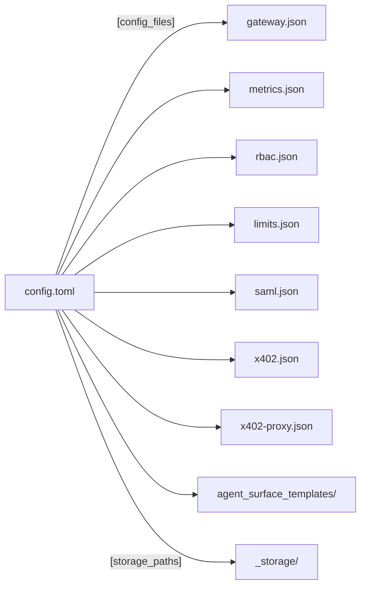
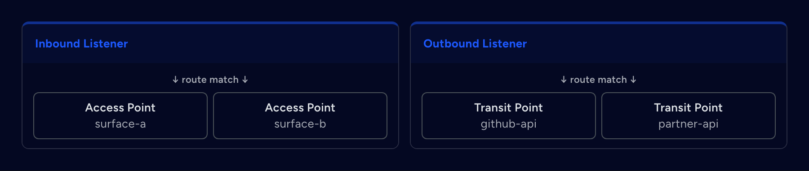

# Configuration Files

What each configuration file controls, when the gateway reads it, and what changes when
you set a field.

Use the hosted [Agent Gateway reference](https://docs.affinidi.com/products/affinidi-trust-fabric/agent-gateway/reference/)
for the supported operator-facing fields of the deployed product. This page describes
the files as the checked-out source reads them, including fields that exist in the
source but are not part of the product surface.

For the reload machinery, see [`CONFIGURATION_RELOAD.md`](CONFIGURATION_RELOAD.md). For
worked examples of every file, see [`config/examples/`](../config/examples/).

## Configuration files

The bootstrap TOML is the entry point. Everything else is named from it.

| File | Controls | Read |
| --- | --- | --- |
| `config.toml` | Bootstrap: storage paths, TLS, encryption, protocol defaults, server mode | Startup only |
| `gateway.json` | Listeners, routes, WebAuthn, DID domain, STS runtime | Startup only |
| `metrics.json` | OpenTelemetry, CloudWatch, and metrics export | Startup |
| `rbac.json` | Which management role each permission requires | Startup |
| `limits.json` | Resource count ceilings per record kind | Startup |
| `saml.json` | SAML identity provider, when `auth_mode = "saml"` | Startup |
| `x402.json` | x402 payment networks, assets, and facilitator settings | Startup |
| `x402-proxy.json` | Networks and wallets for the x402 proxy | Startup |
| `test-endpoints.json` | Payment requirements for the x402 test endpoints, when `facilitator_mode.enable_test_endpoints` is on | Startup |
| `agent_surface_templates/` | Surface templates seeded into the template store | Startup |

**No configuration file is re-read after startup.** `POST /v1/config/reload` rebuilds the
running surface set from `_storage/agent_surfaces/` and reuses the bootstrap and gateway
configuration already in memory
([`load_base_gateway_config`](../src/identity/handlers/config.rs)). Editing any file in
this table takes effect only on restart. See
[`CONFIGURATION_RELOAD.md`](CONFIGURATION_RELOAD.md).

`mpp.example.json` is not in this list. It is an example of the `mpp_policy` block that
belongs inside a surface record, not a file the gateway loads. See
[`config/examples/README.md`](../config/examples/README.md).

## Locating the files

`config.toml` names the others in its `[config_files]` table. A relative path resolves
against the directory holding `config.toml`, not the working directory. An absolute path
is used as given.

```toml
[config_files]
gateway = "../gateway.json"
metrics = "metrics.json"
rbac = "rbac.json"
limits = "limits.json"
saml = "saml.json"
x402 = "x402.json"
x402_proxy = "x402-proxy.json"
agent_surface_templates_dir = "agent_surface_templates"
```



Path resolution is in
[`BootstrapConfig::from_file`](../src/config/bootstrap.rs). Most `[storage_paths]` keys
resolve the same way. `policy_definitions`, `global_policies`, `issuers`, `authorities`,
`credential_providers`, `delegation_vault` and `[encryption] key_file` resolve a relative
value against the working directory, and `backup_restore` resolves against
`--base-folder` when it is set. Use absolute paths in a deployment; see
[Storage](DEPLOYMENT_REQUIREMENTS.md#storage).

## Settings with non-obvious effects

Each of these behaves differently from the obvious reading of the field.
`config.example.toml` also notes each one in a comment.

| Field | Behaviour |
| --- | --- |
| `server_mode` | Must be a top-level key, before any `[table]` header. Placed after one, TOML nests it under that table and the setting is silently ignored. |
| `a2a.message_expires_seconds` | Should be strictly greater than `a2a.fabric_gateway_timeout_ms / 1000`. Nothing validates this. When it is not, a fabric message expires at the mediator while the sending gateway is still waiting, and the failure looks like a timeout with no cause. |
| `backup_encryption_key` | Required. The service does not start without a resolvable value. |
| Unknown top-level keys | Ignored, not rejected. A misspelled key takes no effect and produces no error. |
| `encryption.key_source = "local"` | Does not encrypt. It writes plaintext `ENC[0::…]` envelopes and is for development only. |
| `encryption.field_encryption_enabled` | Reserved and not wired to any field. Leave it false. |

## Secret references

Any field documented as accepting a loader reference resolves through
[`src/config/loaders/`](../src/config/loaders/).

| Scheme | Resolves to |
| --- | --- |
| `env://NAME` | The value of environment variable `NAME` |
| `file://PATH` | The contents of `PATH` |
| `aws_secrets://NAME` | An AWS Secrets Manager secret |
| `aws_parameter_store://NAME` | An AWS Systems Manager parameter |
| `string://VALUE` | The literal value |
| anything else | Treated as a literal value |

A bare literal is accepted so that a value without a scheme still works. Prefer an
explicit scheme, because a literal key in a shared repository is a leaked key.

## Environment variables

| Variable | Used for | Required |
| --- | --- | --- |
| `AG_BACKUP_ENCRYPTION_KEY` | Encrypts the whole `.agbak` archive, AES-256-GCM. Referenced from `backup_encryption_key`. | Yes, unless that field resolves another way |
| `AG_MASTER_KEY` | Master key for encryption at rest when `encryption.key_source = "environment"`. Named by `encryption.key_env_var`. | When encryption at rest is enabled |
| `AG_IDENTITY_HASH_PEPPER` | HMAC pepper for agent DIDs derived from a credential: the `from_mtls`, `from_api_key`, and `from_jwt_claim` managed identity modes, and A2A proxy identities other than Entra agents. Payload extraction does not use it. When encryption at rest is off, it also keys the seal on the OAuth delegation `state`. Hex, or a loader reference, decoding to at least 32 bytes. Set the same value on every node of a multi-node gateway (see [`CAPABILITIES.md`](CAPABILITIES.md#high-availability)). | No. Without it, or with a value that is too short or cannot be resolved, an ephemeral pepper is used: those DIDs change on every restart, and with encryption at rest off, an OAuth consent started before a restart or on another replica fails at the callback. |
| `AG_LEGACY_BACKUP_KEYS` | Up to four comma-separated previous backup keys, tried after the current one. Only read when `legacy_backup_encryption_keys` names it. | No, migration only |
| `AFFINIDI_TERMS_REFRESH_INTERVAL_SECONDS` | How often the Affinidi Terms metadata is refreshed. Clamped to 60 to 3600 seconds in release builds. See [`TERMS_AND_CONSENT.md`](TERMS_AND_CONSENT.md#refresh-and-outage-behaviour). | No. Defaults to a random point between 55 and 60 minutes. |
| `AG_EVENT_HOOK_URL` | Turns on the [event hook](INTEGRATIONS.md#event-hook) and sets the receiver endpoint it posts Connection Point events to. `http` is accepted only for a loopback host; any other host needs `https` and `AG_EVENT_HOOK_SECRET`, otherwise the hook is disabled. | No. Unset means no events. |
| `AG_EVENT_HOOK_SECRET` | HMAC key that signs event hook calls when set, at least 32 characters. A plain value or a loader reference. | Only for a loopback receiver, where unset sends unsigned calls. Any other host requires it. A value that is too short or cannot be resolved disables the hook. |
| `AG_EVENT_HOOK_TIMEOUT_MS` | HTTP timeout of one event hook delivery attempt. | No. Defaults to `5000`. |
| `AG_MEDIATOR_DIRECTORY_FIRST_CALL_RETRY_ATTEMPTS` | Only for a mediator the [mediator directory](INTEGRATIONS.md#mediator-directory) lists, which may admit a DID only after the directory's operator has registered it in response to the `creation_started` notification: how many times a new Connection Point's first call to it is repeated, with the same DID, while it refuses the DID. Any other mediator's refusal is final and fails at once ([details](INTEGRATIONS.md#event-hook)). `0` to `20`. | No. Defaults to `5`; `0` never repeats. |
| `AG_MEDIATOR_DIRECTORY_FIRST_CALL_RETRY_DELAY_MS` | Wait before each repeat of that call (directory-listed mediators only, as above), `1` to `30000`. The whole retry sequence is capped at 45 s. Read from the environment the first time a Connection Point is created on a directory mediator after the gateway starts. | No. Defaults to `2000`. |
| `AG_MEDIATOR_DIRECTORY_URL` | Turns on the [mediator directory](INTEGRATIONS.md#mediator-directory): the endpoint the gateway reads extra mediators from. Same target rules and `AG_EVENT_HOOK_SECRET` as the event hook. | No. Unset means only stored mediators are listed. |
| `AG_ALLOW_LOCAL_OOB` | Permits out-of-band invitations pointing at local addresses. Development only; must not be set in production. | No |
| `AG_ALLOW_LOCAL_A2A_PROXY` | Permits an A2A proxy to reach a local or private `base_url`. Development only; must not be set in production. | No |

Variables prefixed `AG_TEST_` and `AG_BDD_` exist for the test suites and have no role in
a deployment.

## `config.toml`

The bootstrap file. Startup only; changes need a restart.

| Section | Controls |
| --- | --- |
| top level | `channel_config_source`, AWS region and profile, `secrets_backend`, `backup_encryption_key`, `auth_mode`, session timeout, WebSocket auth and buffer, metrics retention and cache, `server_mode` |
| `[tenancy.trusted_tenant_header]` | Declares that an authenticated edge writes the tenant header. Enables broad header-derived PAT selectors. |
| `[encryption]` | Encryption at rest: on or off, key source, KMS settings |
| `[config_files]` | Where the other configuration files are |
| `[storage_paths]` | Where each record kind is persisted under `_storage/`. The Trust Recorder status store has no key: it sits beside the identities directory as `trust_recorder_status/`. |
| `[did_cache]` | DID document cache TTL, size, staleness, and path; whether DID resolution may contact private hosts |
| `[tls]` | Certificate and key paths, upstream verification |
| `[mcp]` | Default MCP revision, validation, timeouts, SSE and stdio transports. Gateway-originated `2026-07-28` consent needs `[mcp.continuations]`; see [`MCP_METADATA.md`](MCP_METADATA.md#protected-continuations). |
| `[reconnect_policy]` | Backoff for DIDComm connection points |
| `[oob_connection]` | How long an out-of-band pairing invitation stays pending |
| `[a2a]` | Default A2A revision, body size, timeouts, fabric timeouts and envelope lifetime, inbound cache sizing. The body size and `timeout_seconds` also bound the [Agent card preview](SOURCE_AUTH.md#agent-card-preview) fetch. |
| `[logging]` | Level, JSON output, log directory. Log redaction is not read here; see [Log redaction](#log-redaction). |
| `[extension_inspection]` | Whether to parse A2A extensions, and which URIs to watch |

Fields and defaults are defined in [`src/config/bootstrap.rs`](../src/config/bootstrap.rs).
`config.example.toml` documents each field inline and is the most complete field-level
description that exists today.

### Fields worth understanding before a deployment

| Field | Effect |
| --- | --- |
| `server_mode` | `active` serves traffic. `standby` drops listeners and returns 503 on `/api/v1/health` while `/api/v1/alive` stays 200. `SIGUSR1` promotes, `SIGUSR2` steps down. |
| `cache_refresh_interval_secs` | Above 0, DashMap-backed stores reconcile with disk on that interval, so manual `_storage/` edits are picked up without a reload. Policy definitions and global policies do not participate. |
| `auth_mode` | `passkey` uses WebAuthn. `saml` requires `saml.json` and a configured identity provider. |
| `secrets_backend` | `filesystem` keeps secrets under `_storage/`. `aws` uses AWS. |
| `encryption.enabled` | Writes whole storage files as `.json.enc`. Losing the master key loses the data. |
| `metrics_retention_minutes` | Parsed but not used. Retention is the value in `_storage/settings/settings.json`, set from the dashboard, which defaults to 360 minutes whatever this field says. |
| `websocket_require_auth` | Off means an unauthenticated client can open the dashboard event stream. |
| `did_cache.allow_private_hosts` | Off (the default) refuses `did:web` and `did:webvh` on loopback, private-network and link-local hosts. On is needed for a local stack whose mediator lives on `localhost`, and reopens SSRF through attacker-supplied DIDs, cloud metadata included, so keep it off wherever an instance metadata service is reachable. See [`POLICY.md`](POLICY.md#did-resolution-host-policy). |

## `gateway.json`

Network topology and the surfaces served. The largest configuration file; the example is
1,314 lines.

| Key | Controls |
| --- | --- |
| `listeners` | Named bind addresses and ports. Access Points and Transit Points reference these. A `bind_address` must be an IPv4 or IPv6 address such as `0.0.0.0`, `127.0.0.1`, `::` or `::1`; any other value stops the gateway from loading its network configuration. Each port is served by one listener task, and the first listener configured on the port decides whether it is inbound or outbound, whether it uses TLS and, for an outbound port, the one address it binds; the other listeners on the port do not change these, so an inbound listener on an outbound port is not served. An inbound port binds the distinct `bind_address` of every inbound listener on it, each on its own address; one of them that an unspecified address on the same port already covers, such as `127.0.0.1` beside `0.0.0.0`, is served through that one. An IPv4 caller accepted on an IPv6 address, such as `::` on a dual-stack host, matches the IPv4 entries of `client_ip.trusted_proxies` and `tls.client_auth.trusted_proxies`. |
| `channels` | Route prefixes. The legacy wire name for surface routes. The dashboard offers them as an Access Point's **Surface Prefix**, in this order, and preselects the first for a new surface. |
| `routes` | Route categories and their types, prefixes, and fallbacks |
| `mcp_proxies` | Route prefixes for MCP proxy endpoints |
| `did` | The domain used when generating `did:web` and `did:webvh` identifiers |
| `webauthn` | Relying-party ID and external origin for passkey registration |
| `integration` | Notification and webhook integration settings |
| `sts` | Security Token Service runtime settings. See [`STS.md`](STS.md). |
| `cli_login_throttle` | Optional per-client-IP limit on each `fabric` CLI login endpoint: `enabled` (default `false`) and `per_ip` `{requests, window_secs}` (default 20 per 60 seconds). Behind a load balancer, set `client_ip.trusted_proxies` first. |
| `transit_token_max_lifetime_secs` | The longest lifetime, in seconds, a surface may set for its transit tokens in `transit.transit_token_lifetime_secs`, and the longest the Access Point issues, from 30 to 900; 300 when unset. Read once, when the gateway starts: anything but a whole number from 30 to 900 stops it from starting, and a change takes a restart, as a reload keeps the startup value and logs a warning while the file differs from it. A stored surface lifetime above it gets tokens living this long, with a warning; it never stops the gateway. A Transit Point does not read it, so instances with different values accept each other's tokens. The shortest lifetime, 30, is fixed. Upgrade every instance that shares surface storage before raising it above 300 or setting any surface lifetime: an earlier release refuses tokens living longer than 300 seconds and drops a stored surface lifetime when it saves the surface. See [`SOURCE_AUTH.md`](SOURCE_AUTH.md#transit-token-lifetime). |
| `client_ip` | `trusted_proxies`: proxy CIDRs whose `X-Forwarded-For` gives the client IP for the SAML and CLI login limits (default empty, so the TCP peer is the client). Each listed proxy must append the address it saw to `X-Forwarded-For` or overwrite it; `Forwarded` is read only when `X-Forwarded-For` is absent. Separate from `tls.client_auth.trusted_proxies`. |
| `facilitator_mode` | x402 facilitator behaviour |
| `cors` | Permitted dashboard origins |
| `terms`, `affinidi_terms_url` | Whether Terms acceptance is enforced, and where metadata is fetched |
| `logging` | Log redaction, for every configuration source. Only `redaction` is read here; level, JSON output, and directory come from `config.toml`. See [Log redaction](#log-redaction). |
| `oauth_callback_route` | Where OAuth redirects land |

The example file also carries `oob_connection` and `secrets` blocks, which `NetworkConfig`
does not read. Out-of-band invitation expiry is set by `[oob_connection]` in `config.toml`.
`NetworkConfig` also parses an `encryption` block but never uses it: encryption at rest is
set only by `[encryption]` in `config.toml`, so an `encryption` block in `gateway.json` leaves
storage unencrypted.

One listener can serve several Access Points, and one transit listener several Transit
Points. A request is matched to its surface by route.

Some paths are reserved. A `channels` or `proxy` route prefix that shadows a dashboard page, or a
`channels`, `routes` (of any type, `redirect` and `static` included) or `mcp_proxies` prefix
at or under `/.well-known/oauth-protected-resource`, stops the gateway at startup with exit
code `2` and a banner naming each prefix. Every served inbound listener serves protected resource
metadata on that path itself (see
[`MCP_METADATA.md`](MCP_METADATA.md#authorization-server-discovery-for-caller-authentication)).
A configuration reload refuses a `gateway.json` with such a metadata path prefix and keeps the
running configuration (see [Reserved routes](CONFIGURATION_RELOAD.md#reserved-routes)). A
stored surface whose route is at or under this path is logged as an error and not mounted;
change its route.



The type is [`NetworkConfig`](../src/config/network.rs). Surfaces themselves are stored
records rather than file content; see [`src/config/agent_surface.rs`](../src/config/agent_surface.rs).

An MCP, A2A or AP2 Access Point declares its OAuth protection with
`access_point.caller_authentication.protected_resource`, next to a JWT Bearer method:

| Field | Required | Meaning |
| --- | --- | --- |
| `resource` | Yes | The canonical HTTPS URL of the Access Point on a public origin of its listener, with the route as its path. It is the one audience a token must name and the resource the metadata and challenge publish. |
| `authorization_servers` | No | Absent, the document names the JWT verification strategy's `expected_issuer`. A save that sends or changes it must send exactly `["<expected_issuer>"]`, or it is refused; a stored list that the save leaves unchanged is kept and reported as `authorization_servers_stale`. |
| `scopes` | No | Extra scopes advertised as `scopes_supported` after the method's `required_scopes`; never enforced. |

The setting makes the Access Point refuse a failed caller at source authentication; see
[Authorization server discovery](MCP_METADATA.md#authorization-server-discovery-for-caller-authentication)
and [`SOURCE_AUTH.md`](SOURCE_AUTH.md#declaring-an-access-point). Before rolling back to a release
up to v1.0.3, read the downgrade notes there: a setting stored without
`authorization_servers` cannot be read by those releases, and an A2A or AP2 surface with the
setting answers `503` on them.

`webauthn.external_origin` is the value a browser must be visiting for passkey
registration to succeed. A mismatch is the most common local-setup failure, and
[`development/GETTING_STARTED.md`](development/GETTING_STARTED.md) treats the generated
value as the source of truth.

### Log redaction

`logging.redaction` masks values before they leave the gateway: in stderr, in the log
file, in exported OTLP spans (span names, string attributes and events) and in exported
OTLP log records (body and string attributes). It is read from `gateway.json` with every
configuration source, `local` and `dynamodb`. A `[logging.redaction]` table in
`config.toml` is ignored, and startup logs a warning about it. To keep rules set there, move
them to `rules` in `gateway.json` `logging.redaction`; they replace the built-in rules, so
also copy any built-in rules you still want from
[`config/examples/gateway.example.json`](../config/examples/gateway.example.json).

| Setting | Effect |
| --- | --- |
| No `logging.redaction` block, or no `enabled` | Redaction is on. |
| `"enabled": false` | Redaction is off for every destination. |
| No `rules` | The built-in rules below apply. |
| `rules` | Your rules replace the built-in rules and run in order. An empty list applies no pattern. |

A rule whose pattern does not compile is skipped with a warning on stderr. At startup
stderr reports the number of rules in use, or a warning when redaction is off, and the
`Startup configuration` log line shows `log_redaction=on` or `off`.

The built-in rules, applied in this order:

| Rule | Masks |
| --- | --- |
| JWT tokens | Three-part `eyJ…` tokens |
| Authorization header values | The credential after `Authorization:` or `Proxy-Authorization:` and a `Bearer`, `Basic`, `Digest`, `Token` or `ApiKey` scheme |
| Password fields | The value of a `password`, `passwd` or `pwd` assignment |
| Access and refresh tokens | The value of an `access_token`, `refresh_token` or `token` assignment |
| Session identifiers | The value of a `session_id`, `sessionid`, `sid`, `jsessionid` or `connect.sid` assignment |
| API key and secret assignments | The value after `api_key`, `api-key`, `apikey` or `secret` and an `=` or `:` |
| Quoted credential fields | The JSON-quoted value of a key naming a credential, such as `"authorization": "Bearer …"`, `"x-api-key": "…"` or `"cookie": "…"`, also with escaped quotes |
| Personal access tokens | `agpat_…` tokens |
| Private key material (PEM) | PEM private key blocks |
| Email addresses | Email addresses |

The patterns are `BUILT_IN_RULES` in
[`src/observability/log_redact.rs`](../src/observability/log_redact.rs).
`config/examples/gateway.example.json` lists a broader set that adds IP addresses, phone
numbers, DIDs, wallet addresses, card and national ID numbers. The built-in set leaves
those out because they also match ordinary log text, such as listen addresses,
timestamps and module paths, and the access log keeps client IP addresses by design.

In OTLP exports, an attribute whose name is a credential name is replaced with
`<redacted>` whatever its value, because a rule pattern cannot match a structured
attribute by its name. The names, ignoring case, are `authorization`, `cookie`, `token`,
`session_id`, `sessionid`, `jsessionid`, `password`, `passwd`, `secret`, `secret_key`,
`api_key`, `apikey`, `private_key`, `credential` and `credentials`, alone or after a `.`,
`_` or `-`: `http.request.header.authorization`, `x-api-key` and `mcp_session_id` match,
`token_count` and `secret_id` do not. Fields named like a credential lose the
8-character prefix the gateway logs for correlation, in local logs as well as in OTLP
exports.

## `rbac.json`

Maps each management permission to the minimum role that holds it. Roles are
`administrator`, `poweruser`, and `user`.

```json
{
  "permissions": {
    "gateways.view": "user",
    "gateways.edit": "poweruser",
    "secrets.view": "administrator"
  }
}
```

The file is merged over the built-in defaults in `RbacConfig::default()`, so it only needs
the permissions you change; the example above lowers `gateways.edit`, which defaults to
`administrator`. A role value other than the three names denies the permission to every
role, `administrator` included. The file is read at startup, so a change needs a restart.

A missing or unparseable file does not stop startup: the gateway logs a warning and runs
with the built-in defaults. A misspelled permission key is accepted without an error and
matches nothing, so the permission it meant to change keeps its default. Check the startup
log before relying on tightened permissions.

Lowering a permission to a weaker role grants it to everyone at that role and above,
appliance-wide. Enforcement and the permissions response contract are in
[`RBAC.md`](RBAC.md). Management tokens narrow this further; see
[`ACCESS_TOKENS.md`](ACCESS_TOKENS.md).

## `limits.json`

Ceilings on how many records of each kind may exist. Each entry carries an operator-facing
`name` and `description` alongside the `limit`.

```json
{
  "limits": {
    "secrets": { "name": "Secrets (total)", "description": "…", "limit": 20 },
    "secrets.apikeys": { "name": "API Keys", "description": "…", "limit": 5 },
    "surfaces": { "name": "Surfaces (total)", "description": "…", "limit": 10 }
  }
}
```

Keys are hierarchical, and the two levels constrain different counts rather than the
same one. Adding a record checks the leaf dimension against its own count, and then, when
the key is dotted, checks the umbrella parent against the rollup total. With
`secrets.apikeys` at 5 and `secrets` at 20, you may hold 5 API keys and still add secrets
and certificates until the three together reach 20.

The umbrella total is a directly registered counter when one exists, otherwise the sum of
every registered `parent.*` child
([`enforce_add`](../src/config/limits_config.rs)).

| Situation | Result |
| --- | --- |
| Dimension listed in the file | Its `limit` applies |
| Dimension not listed | `DEFAULT_LIMIT` of 1,000,000 applies, which is effectively unconstrained |
| Dimension with no registered counter | Skipped, and the check passes |
| Limit reached | Creation fails. Existing records are unaffected. |

Counters are registered at startup in
[`src/server/orchestrator.rs`](../src/server/orchestrator.rs).

## `saml.json`

Read when `auth_mode = "saml"`. Ignored otherwise.

| Group | Fields |
| --- | --- |
| Identity provider | `idp_entity_id`, `idp_sso_url`, `idp_slo_url`, `idp_cert_path` |
| Service provider | `sp_entity_id`, `sp_acs_url`, `sp_key_path`, `sp_cert_path` |
| Security | `sign_requests`, `require_encrypted_assertions` |
| Sign-in throttle | `login_throttle`: `enabled` (default `false`) and `per_ip` `{requests, window_secs}` (default 20 per 60 seconds) per client IP for `/saml/login`. Behind a load balancer, set `client_ip.trusted_proxies` in `gateway.json` first. |
| Claims | `attribute_mapping` from SAML claim URI to user field |
| Roles | `role_mapping` from identity-provider role to gateway role |
| Directory | `graph_api` for Microsoft Entra ID group and profile lookup |

`role_mapping` decides what an authenticated user may do. A mapping that sends an
unexpected identity-provider role to `administrator` grants full management access, so
treat it as a security-relevant setting rather than a convenience.

Each SAML sign-in sets the user's role from the identity provider, with one exception: the
first user to sign in becomes the primary administrator and keeps that role whatever the
identity provider sends later, so a missing or changed role claim cannot remove the only
guaranteed administrator. A sign-in that would have changed it logs a warning instead
([`saml/user_provisioning.rs`](../src/auth/saml/user_provisioning.rs)).

## `x402.json` and `x402-proxy.json`

`x402.json` configures payment networks, assets, and facilitator behaviour for the x402
protocol. `x402-proxy.json` configures the `networks` and `wallets` the x402 proxy uses,
each network carrying a CAIP-2 `id`, `chain_type`, and `rpc_endpoint`.

Two `x402.json` sections control x402 storage. If `x402.json` fails to parse, the gateway
logs a warning and starts neither.

| Section | Effect |
| --- | --- |
| `settlement_storage` | Its presence starts the settlement worker, using `batch_size` (default 100), `settlement_interval_seconds` (default 60), and `max_retries` (default 3) |
| `transaction_storage` | When present, transaction records are stored at `filesystem_path` (default `_storage/x402-transactions`) instead of `[storage_paths].x402_transactions`; `retention_days` (default 7) sets how long the daily cleanup keeps them |

Transaction records are always kept on the filesystem; other keys in these sections are
ignored.

`test-endpoints.json` (`[config_files].test_endpoints`) feeds the unauthenticated x402 test
endpoints, which are mounted only when `facilitator_mode.enable_test_endpoints` is on. Its `evm`,
`solana_devnet`, and `solana_mainnet` entries each give a `network`, `rpc_endpoint`,
`token_address`, `recipient`, and `amount`; each endpoint issues and verifies against one `exact`
requirement built from them. The `evm` entry also takes `payment_method`, and optional `token_name`
and `token_version`, issued as the EIP-712 `extra.name` and `extra.version` that `/protected`
(EIP-3009) needs.

Both reach live payment infrastructure. A network entry pointing at mainnet moves real
value. The demo scripts and a worked walkthrough are in
[`scripts/x402/README.md`](../scripts/x402/README.md); protocol behaviour is in
[`PROTOCOLS.md`](PROTOCOLS.md).

## `metrics.json`

Telemetry export. Three independent sinks, each with its own `enabled` flag.

| Sink | Controls |
| --- | --- |
| `opentelemetry` | Endpoint, service name, environment, and separate `traces`, `metrics`, and `logs` blocks |
| `cloudwatch` | Region, namespace, and dimensions |
| Remaining keys | Local metric collection and retention |

`opentelemetry.traces.sample_rate` is a fraction, so `0.1` records one span in ten.
`opentelemetry.logs.targets` lists the log targets exported over OTLP: an exact target,
such as `policy_audit`, or a module path, such as `agent_gateway`, which also covers
`agent_gateway::proxy::handler`. `"*"`, the default, exports every target. Exported log
records carry the level set by `[logging] level` in `config.toml` and the same
[redaction](#log-redaction) as local logs. The list is applied at startup and again
whenever the OpenTelemetry settings are saved from the dashboard.
`opentelemetry.traces.record_caller_identity` adds `caller.auth_method`,
`caller.principal`, and `caller.did` to the root HTTP span. It is off by default because
those values identify the caller; turning it on puts caller identity into your tracing
backend. See [`OBSERVABILITY.md`](OBSERVABILITY.md).

## `agent_surface_templates/`

Every `*.json` file in the directory is seeded into the template store at boot and marked
`builtin: true`, which stops the API deleting or overwriting it. Files with any other
extension are ignored. The storage filename comes from the template's `id` field, not
from the source filename, so two files sharing an `id` collide and only the last one
seeded survives.

Full loading rules are in
[`config/examples/agent_surface_templates/README.md`](../config/examples/agent_surface_templates/README.md).

## Remote gateway records

Gateway records live in `_storage/gateways/`, not in a configuration file, and are managed
through `/v1/gateways`. Two fields of a Remote record decide which local surfaces that peer
reaches over Fabric:

| Field | Values | Behaviour |
| --- | --- | --- |
| `exposure_mode` | `all`, `none`, `list` | `none` for every newly paired peer. A record without the field is migrated on boot: an empty list becomes `all`, a non-empty list `list`. |
| `exposed_channels` | Surface ids | Used only in `list` mode. An empty list in `list` mode reaches nothing. |

A manual edit is picked up as described in
[`CONFIGURATION_RELOAD.md`](CONFIGURATION_RELOAD.md). See
[`FABRIC.md`](FABRIC.md#peer-exposure).

## Related

- [`CONFIGURATION_RELOAD.md`](CONFIGURATION_RELOAD.md): what a reload does and does not re-read.
- [`config/examples/README.md`](../config/examples/README.md): the example files and their roles.
- [`../ARCHITECTURE.md`](../ARCHITECTURE.md): where configuration is parsed and applied.
