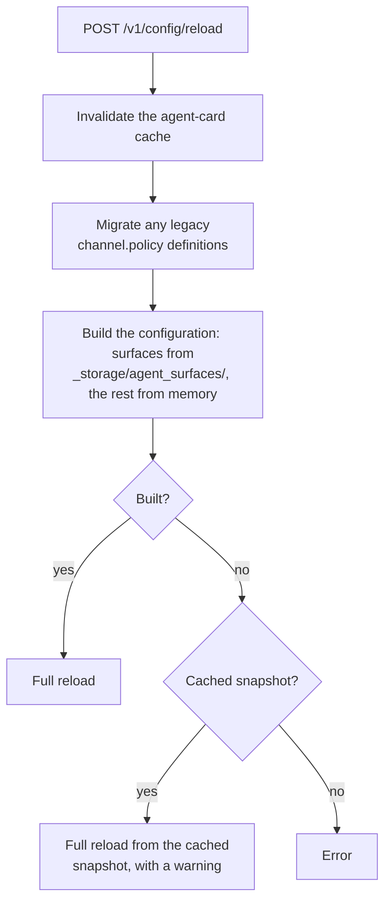

# Configuration Reload

This page documents implementation behavior for the checked-out source revision. Use the hosted
[Agent Gateway reference](https://docs.affinidi.com/products/affinidi-trust-fabric/agent-gateway/reference/)
for supported configuration fields and operator guidance.

## Scope

This page describes runtime configuration reload behavior: what a reload re-reads, what it does
not, and how listener state is swapped. It also documents the `[a2a]` bootstrap table (see
[A2A settings](#a2a-settings)) and the `[audit]` one (see
[Audit log rotation](#audit-log-rotation)). For what each configuration file controls and the effect of
its fields, see [`CONFIGURATION_REFERENCE.md`](CONFIGURATION_REFERENCE.md). The source of truth for
accepted fields and defaults is the configuration types under [`src/config/`](../src/config/).

## Bootstrap parsing

`BootstrapConfig::from_file` reads the bootstrap TOML at process startup and resolves relative
configuration, storage, and TLS paths against the bootstrap file's directory. Unknown top-level
keys are ignored, which lets a newer configuration remain readable by an older binary. Operators
should still validate changes carefully because a misspelled key will not take effect. Nested
configuration types define their own parsing rules, so this page is not a complete field schema.

`server_mode` selects the `active` or `standby` mode (see [Server mode](#server-mode)). In a
shared-storage deployment, `cache_refresh_interval_secs` controls periodic reconciliation for
DashMap-backed filesystem caches; `0` disables that refresh. Policy-definition and global-policy
stores are not part of the periodic cache-refresh loop and reconcile from disk at startup. An
explicit configuration reload uses their current in-memory state rather than refreshing those two
stores from disk.

## A2A settings

The bootstrap `[a2a]` table maps to `A2aConfig` in [`src/config/types.rs`](../src/config/types.rs).
`A2aConfig::validate` runs at startup, and an invalid value fails startup with
`Invalid [a2a] config: …` (or `Invalid [a2a] config in <path>: …`) naming the field. An absent table or field takes the default below.

| Field | Default | Behavior |
| --- | --- | --- |
| `default_version` | `"1.0"` | The `protocolVersion` of the agent cards the Gateway generates. Must resolve on `Major.Minor` to `0.3` or `1.0` (`1.0.1` resolves to `1.0`). It is installed once at startup and held in a `OnceLock`, so a configuration reload does not change it; changing it needs a restart. It does not change which versions are accepted (each A2A surface sets that), and a Managed Agent's own card keeps its own version. A generated card never names a version its endpoint refuses: the A2A proxy card names only the versions its surface accepts, whatever this setting says. |
| `validate_messages` | — | Deprecated. Validation is set per A2A surface (`access_point.a2a.validation`; see [A2A surface settings](PROTOCOLS.md#a2a-surface-settings)). It is only applied to A2A surfaces loaded without their own settings, which are then written with `validation = "off"` when it is `false` and `"envelope"` otherwise (A2A-proxy surfaces always get `"envelope"`). It applies only with `channel_config_source = "local"`; with DynamoDB it is not applied, and the startup warning says so. A startup warning names it; remove it once every surface has its own settings. |
| `max_body_size` | `10485760` (10 MiB) | At least `1`; `0` is refused at startup. Caps a request body as it is read, and a larger one is refused with HTTP `413`: on an Access Point, `fabric://` targets included, on a Transit Point (recorded as a `request_rejected` with reason `body_too_large`), and on the `/outbound/...` hop an inbound listener sharing a host name with an outbound listener passes on, which refuses a larger declared `Content-Length` without reading the body and streams a longer body on, so the Transit Point refuses and records it, stopping it after the chunk that takes it 512 KiB past the cap (see [`CONFIGURATION_REFERENCE.md`](CONFIGURATION_REFERENCE.md)). An MCP Transit Point takes its `mcp_http.max_request_bytes` instead, above or below this value, except on that hop, where a larger limit holds only up to 512 KiB and one chunk past this value, for a chunked body. An MCP Access Point reads up to its `mcp_http.max_request_bytes` and, unless its target is `fabric://`, still refuses a body over this value. It also caps every upstream response the gateway buffers (HTTP `502` when larger), on the Access Point, Transit Point and Fabric receive paths alike, including agent-card fetches, and one incomplete event of an event stream the gateway parses. A Legacy SSE session and MCP Proxy tool discovery always use the default (10 MiB), whatever is configured. It is read once at startup, and a reload keeps that value, so changing it needs a restart on every path. |
| `timeout_seconds` | `30` | Request timeout in seconds. |
| `stream_max_lifetime_secs` | `3600` | Longest an A2A event stream from a direct Target is forwarded, in seconds; must be between `1` and `86400`. A stream still open at that point ends with an error event, and a streaming call to the Target is bounded by this plus the request timeout; the Target's headers must arrive within the request timeout. See [Event streams](PROTOCOLS.md#event-streams). |
| `fabric_gateway_timeout_ms` | `60000` | How long the sending gateway waits for a response over the fabric when the surface sets no request timeout. |
| `message_expires_seconds` | `90` | DIDComm message lifetime; must be strictly greater than `fabric_gateway_timeout_ms`, or the mediator could drop a response the sender is still waiting for. See [Fabric envelope lifetime](#fabric-envelope-lifetime). |
| `max_inflight_dispatches` | `256` | Fabric requests one Connection Point listener dispatches concurrently; must be greater than `0`. When every slot is busy, a forward request the listener would admit is answered at once with HTTP `503` and `retry-after: 1`, which the sending gateway returns to its caller; the sender does not retry it. A redelivered or replayed forward request is dropped without a reply, and an expired or unauthorized one gets its usual `504` or `403`. Other messages wait for a slot. |
| `sdk_inbound_cache_count` | `1024` | Unprocessed DIDComm messages the SDK inbound cache holds before it stops draining the websocket; must be greater than `0`. |
| `sdk_inbound_cache_bytes` | `104857600` (100 MiB) | Bytes the SDK inbound cache holds before applying back-pressure; must be greater than `0`. |

Which A2A versions a surface accepts, and whether it validates messages, are not TOML fields. They
are the surface's `access_point.a2a` settings, saved with the surface and applied without a restart.
See [A2A surface settings](PROTOCOLS.md#a2a-surface-settings).

## Reload entry points

The runtime implementation is in
[`src/proxy/surface_manager.rs`](../src/proxy/surface_manager.rs). Some method names retain
`channel` as a legacy code term; their managed object is an Agent Surface.

| Method | Typical caller | Behavior |
| --- | --- | --- |
| `reload_channels` | Full-reload implementation | Replaces the complete runtime surface set and swaps the router of every bound listener. |
| `reload_channels_with_fallback` | `POST /v1/config/reload` | Loads the requested configuration and uses the cached snapshot only when loading the requested source fails. |
| `reload_single_channel` | `reload_single_channel_with_fallback` | Rebuilds one surface and swaps it into the current inbound listener state. |
| `reload_single_channel_with_fallback` | `POST /v1/config/reload/{config_id}` and surface mutation paths | Serializes and applies the single-surface update; a source-load error is returned rather than silently substituting another surface. |

Full and single-surface reloads share a reload lock so they cannot concurrently mutate listener
state or swap the router of the same port.

## Full reload

A full reload rebuilds the router of every port listener but keeps each listener bound, so no
connection is refused while it runs, on the inbound ports, the management API they serve, or the
shared outbound ports:

1. Load the configured source and inject active Agent Surface records.
2. Reload network configuration. A channel, MCP proxy, `proxy` route or `redirect` route whose
   prefix shadows a dashboard page is left out of the rebuilt routers, as at startup (see
   `channels` in [`CONFIGURATION_REFERENCE.md`](CONFIGURATION_REFERENCE.md)): the reload logs an
   error and returns a `warning` naming each prefix and the page it shadows, and serves everything
   else. A `gateway.json` in which two entries use the same prefix fails
   the reload here, naming each pair, before anything is replaced.
3. Clear stale task-monitor entries; rebuilding the routers registers them again.
4. Replace the shared `GatewayConfig` and save the successful snapshot to the configuration cache.
5. Group active surfaces by listener and rebuild derived surface state. Each surface's outbound
   state is updated in place rather than replaced: a surface that still has Transit Points on an
   outbound listener gets its new configuration written into its state, and the state of one that no longer has any, because it was deleted, disabled or
   emptied, is retired, so its routes refuse each request with `404`.
6. Build a new router for each configured inbound and outbound port, retaining each inbound
   listener's `MultiSurfaceProxyState` for later single-surface updates, and swap it into the
   listener already bound on that port. Only active surfaces' Transit Points are served, so a
   deleted or disabled surface's never are. An outbound port with no active Transit Points
   serves no proxy routes, as at startup, so its liveness route remains available. Each
   outbound router registers its surfaces' outbound state before the reload returns, so a
   surface deleted right after it is retired there too.
7. Stop the listener of a port no longer configured.

A listener is bound again only when its port's bind addresses or TLS setting change in
`gateway.json`, or stopped when its port is removed. Requests using it while it is rebound can
be interrupted, and a connection it accepted is not carried over: a plain HTTP connection is
closed, and the next request on a TLS connection, which outlives its listener, is refused with
`503` and `Connection: close`, so the client reconnects to the listener now bound. A TLS
listener that stays bound reloads the gateway certificate and serves it from the next handshake
on; if the certificate cannot be loaded, it keeps the one it has and the error is logged. A TLS
port whose addresses change while the certificate cannot be loaded keeps its listener on its old
addresses. A port that cannot be bound serves nothing, and its task-monitor entries, its Transit
Points' included, are removed.

Each request runs on the router current when it arrives, so a connection kept alive across a
reload, plain HTTP or TLS, has its next request routed by the new router: a removed Transit Point
or Access Point route refuses it with `404`, and a changed one is served with its new
configuration. A request already being handled when the router is swapped completes on the
router it started on; because that router holds the outbound state updated in step 5, a removed
Transit Point refuses it with `404`.

If the requested configuration source cannot be loaded,
`reload_channels_with_fallback` attempts to load the cached `GatewayConfig`. If neither source is
available, reload returns an error. A port whose router cannot be rebuilt keeps serving the router
it had and its task-monitor entries, and the error is logged and returned as the reload's
warning, which `POST /v1/config/reload` answers with; single-surface changes keep updating that
router, so a surface added or changed on the port afterwards is served.

With `channel_config_source = "local"`, a reload first re-reads the Agent Surface records from disk,
and each record that changed on disk is then also applied as a single-surface change, as a change
picked up by [cache refresh](#cache-refresh) is. That change applies the surface as it is stored
when the change runs, not the copy read from disk, and an A2A surface stored without its own
settings is given the carried-over ones in memory, as a load gives them (see
[A2A surface settings](PROTOCOLS.md#a2a-surface-settings)).

An explicit `POST /v1/config/reload`, the reload a node runs when it becomes Active, a surface
change made through the API, and a change from storage are applied one at a time, under a surface
reload lock held outside the listener reload lock above. A change from storage that a reload raised
therefore runs only after that reload has finished, and cannot replace what the reload serves with
an older surface.

## Single-surface reload

A single-surface reload keeps the existing inbound listener bound:

1. Replace or add the surface in the shared `GatewayConfig` and save the updated cache snapshot.
2. Resolve the surface's Access Point listener from its `listen_address`.
3. Rebuild its `SurfaceInfo`, including identity selectors and variant engines.
4. Replace the matching entry in `MultiSurfaceProxyState.channels` under its write lock.
5. Refresh task-monitor entries and any existing outbound surface state.

Concurrent inbound requests retain the listener and observe either the previous or replacement
surface state around the brief write-lock acquisition. If Transit Point routes were added,
removed, renamed, or moved, the router of each affected outbound listener is rebuilt, because its
Axum routes are static, and swapped into the listener, which stays bound. An update that leaves
the surface without Transit Points also retires its outbound state, as a delete does.

Single-surface reload assumes the Access Point still maps to a running inbound listener. Changes
that require a different listener topology belong to a full reload.

## Deleting a surface

A surface delete takes its Transit Points out of service for new requests before the API
answers, whichever path applies it:

1. Retire the surface's outbound state: every route still holding it, on a new connection or
   one kept alive, refuses each request with `404`.
2. Evict the surface's compiled policies, MCP tool gating, rate limiters (per-caller ones too) and circuit breaker,
   its variants' and its Transit Points' included.

A surface without variants is removed in place: its Access Point leaves the running inbound
listener and no listener is rebound, so the outbound listener its Transit Points shared with
other surfaces' keeps serving them without interruption, and its retired routes stay on that
listener, refusing with `404`, until its router is next rebuilt. Deleting a surface with
variants takes a full reload, because its variant routes are baked into the inbound listener's
router; the listener stays bound.
Disabling a surface retires its outbound state and evicts its compiled policies, MCP tool
gating, rate limiters and circuit breaker the same way. Removing all of a surface's Transit
Points retires its outbound state, but does not evict its compiled policies.

A request admitted before the delete has already read the surface, so it can still reach the
Transit Point's target, with its credentials, until it completes or times out. A `tools/call` to
a Transit Point configured with MCP tool gating whose gating was evicted meanwhile is refused.

## Transit token lifetime on reload

A reload keeps the `transit_token_max_lifetime_secs` the gateway started with. A change to it
in `gateway.json` takes a restart, and a reload never fails on it, even when the file holds a
value startup would refuse by then, such as `0`, `901` or `"600"`. While the file holds a value
other than the one in force, every load of `gateway.json`, a reload's included, logs a `WARN`
naming both values, saying a restart is needed, and, for a value startup would refuse, saying
so.

On every full or single-surface reload, a stored `transit.transit_token_lifetime_secs` below 30
seconds gets tokens living 30 seconds, and one above that longest lifetime gets tokens living
the longest, with one `WARN` per surface naming the surface and both values, so the surface
keeps serving. At
startup the same `WARN` is logged for every stored surface, disabled ones included, and the
gateway starts. See [`SOURCE_AUTH.md`](SOURCE_AUTH.md#transit-token-lifetime).

## Dashboard events

Neither full nor single-surface reload broadcasts `WsUpdate::RefreshDashboard`. Dashboard state
converges through its periodic `DashboardDelta` stream or an explicit refetch. The actual
`RefreshDashboard` producers are documented in [Observability Internals](OBSERVABILITY.md).

## Server mode

A node runs in one of two modes, set by `server_mode` in the bootstrap config (default `active`):

- **Active** serves traffic, runs the fabric and trust listeners, and writes the governance audit
  journal.
- **Standby** keeps the fabric and trust listeners inactive, keeps no audit records, and reports not
  ready. It takes over the audit journal when it becomes Active (see
  [Governance audit delivery](OBSERVABILITY.md)). It opens no trust registry connection: creating or
  reconnecting a trust registry returns 503 before anything is written.

On becoming Active, before the audit pipeline starts, a node re-reads the dashboard settings
(`settings.json`) from disk and empties its integration cache. The audit sinks are then built from
those settings and the integrations listed from disk, and deliveries load each integration as it is
stored now, so a promoted node never forwards with the VP Audit Log selection or integration
configuration it loaded before the other node changed them. Readiness does not wait for the
pipeline: the node admits traffic after one start attempt and, if that start is refused (the
integrations cannot be listed, or the other node still holds the journal), keeps trying in the
background.

Also on becoming Active, before it reloads its configuration, a node reconciles with disk its
policy definitions, global policies, agent surfaces, gateways and API keys. API keys another node
created, rotated or revoked while this node was Standby therefore authenticate, or stop
authenticating, without a restart. A store that cannot be reconciled is logged and keeps what it
held. The node then revokes the API keys of surfaces that no longer exist, as it does when it
boots Active; a Standby node and a configuration reload revoke none (see
[Provider keys when a surface goes live](SOURCE_AUTH.md#provider-keys-when-a-surface-goes-live)).

Both modes build the source authentication middleware at startup, so a node whose JWT
verification strategy store cannot be opened refuses to start in either mode (see
[Source authentication](SOURCE_AUTH.md#source-authentication)).

The default API mount exposes `GET /api/v1/health` (200 when Active and ready, 503 when Standby)
and `GET /api/v1/alive` (always 200); the router-relative paths are `/v1/health` and `/v1/alive`.

### Cache refresh

Set `cache_refresh_interval_secs` in the bootstrap config (default `0` = disabled) so every
**DashMap-backed** cached filesystem store periodically reconciles its cache with disk and picks up
changes written by another node sharing the storage. Only DashMap-backed stores refresh on this
interval; the RwLock-backed policy-definition and global-policy stores are **not** on the periodic
loop and reconcile with disk only at startup; an explicit reload uses their in-memory state. Each
store's periodic scans are serialized by a shared per-store lock, so two overlapping refreshes can
never apply out of order and revert a record to an older on-disk snapshot.

A surface that derives its own DID from API Key Provider keys rereads their status from disk on
its own schedule, even when the interval is `0`; see
[Provider keys when a surface goes live](SOURCE_AUTH.md#provider-keys-when-a-surface-goes-live).
A key a caller presents is checked against the cache only.

Nodes sharing storage must run the same version. A newer node can write a field an older one
rejects; the older node's refresh then drops that record from its cache while it is still serving.
Per-surface A2A settings are such a field: a newer node writes `access_point.a2a` into stored A2A
surfaces on its first start. Upgrade nodes that share storage together, or set
`cache_refresh_interval_secs` to `0` on the older node until it is upgraded (see
[A2A surface settings](PROTOCOLS.md#a2a-surface-settings)).

## Credential policy

The bootstrap `[credential_policy]` table maps to `CredentialPolicyConfig` in
[`src/config/credential_policy.rs`](../src/config/credential_policy.rs). It is read once at startup
and held for the life of the process, so a configuration reload does not change it; changing it
needs a restart.

| Key | Default | Effect |
| --- | --- | --- |
| `token_endpoint_https` | `"warn"` | `"warn"` or `"enforce"`. Whether a credential provider's token endpoint must use https; see [https token endpoints](CREDENTIAL_DELEGATION.md#https-token-endpoints). |
| `tenant_credential_isolation` | `"warn"` | `"warn"` or `"enforce"`. Whether credential providers may use only secrets of their own tenant, and tenant surfaces (including their custom metadata and the credential providers they bind) and tenant A2A Proxies only their own tenant's secrets and providers; see [Provider secrets belong to the provider's tenant](CREDENTIAL_DELEGATION.md#provider-secrets-belong-to-the-providers-tenant) and [Tenant isolation on a surface's upstream legs](CREDENTIAL_DELEGATION.md#tenant-isolation-on-a-surfaces-upstream-legs). |
| `target_https` | `"warn"` | `"warn"` or `"enforce"`. Whether a Target credential (a static secret or a credential provider) may only be sent to an `https` Target or Transit Point endpoint. A `fabric://` or `a2a-proxy://` endpoint is not https; a `proxy://` Target is judged by its MCP proxy's `base_url`. In `enforce` the credential is withheld at request time and `target.auth.fallback` decides the request; see [Target credential rules on the request path](CREDENTIAL_DELEGATION.md#target-credential-rules-on-the-request-path). |
| `target_source_auth` | `"warn"` | `"warn"` or `"enforce"`. Whether a Target credential may only be sent from a leg that checks its callers: the Access Point (at least one `caller_authentication` method, or `mcp_http.authorization`) for the Target, the Transit Point itself (a transit token, `source_auth` or `mcp_http.authorization`) for a Transit Point. It also holds the Direct Line credential an A2A proxy sends for an `a2a-proxy://` Target of an A2A or AP2 surface, which `target_https` does not. In `enforce` the credential is withheld at request time, except on the gateway's own agent card fetch; see [Target credential rules on the request path](CREDENTIAL_DELEGATION.md#target-credential-rules-on-the-request-path). |
| `insecure_token_endpoints` | `[]` | Exact token endpoint URLs that may use http deliberately. It relaxes only the https rule: a token endpoint that resolves to loopback or cloud metadata is refused whatever the list says. Honoured in both modes. An entry that is not a valid URL, is not `http`, or carries a user name or password fails startup, naming the entry. |
| `token_request_timeout_secs` | `30` | Seconds a credential provider token request may take, from 1 to 120; `0` or a larger value fails startup. Applies to service grants and their refreshes, the legacy delegated refresh, the legacy code exchange and the `2026-07-28` consent exchange. It does not apply to the connect API's grant code exchange and refresh, which keep a fixed 30 seconds. The no-redirect rule is unchanged. |

`"warn"` keeps stored configurations that break a rule working and logs a warning; new or changed
configurations that break `token_endpoint_https` or `tenant_credential_isolation` are refused on
save (for `token_endpoint_https`, this includes an update that changes a kept http provider's type to an OAuth type or makes it start sending a client secret, see [https token endpoints](CREDENTIAL_DELEGATION.md#https-token-endpoints)), while ones that break `target_https` or `target_source_auth` are saved with a warning.
`"enforce"` refuses all of them on save and also at runtime. For `tenant_credential_isolation`
that means a tenant surface sending an appliance-wide secret or credential provider; for
`target_https` and `target_source_auth`, a request whose Target credential breaks the rule goes
out without it or is refused, as `target.auth.fallback` says (see
[Target authentication rules](CREDENTIAL_DELEGATION.md#target-authentication-rules)). A
reference to another tenant's is refused in both modes (see
[Tenant isolation on a surface's upstream legs](CREDENTIAL_DELEGATION.md#tenant-isolation-on-a-surfaces-upstream-legs)). A
stored surface that derives a DID from another tenant's API Key Provider key, from the key of a
surface with no tenant, from another surface's key of its own tenant, or from a key whose owning
surface is gone, keeps serving under `"warn"` and answers `503` under `"enforce"`; one deriving
it from a revoked key or from a key id no key has, such as a deleted key, answers `503` in both
modes; see
[Provider keys when a surface goes live](SOURCE_AUTH.md#provider-keys-when-a-surface-goes-live).
To move to `"enforce"` safely, run `"warn"`, read the report's `provider_key_tenant` lines, fix
those surfaces, then restart with `"enforce"`. An
unknown value fails startup, and an absent section means every rule is `"warn"`. The report also names a stored JWT Bearer provider without a subject under a fifth rule, `jwt_subject`, which only warns and has no setting. A provider with
an `issuer` always needs public `https` endpoints, whatever `insecure_token_endpoints` says, and
its issuer metadata and revocation calls have their own 10 second timeouts, not
`token_request_timeout_secs`. `external_consent_resource_origins`, `external_consent_issuers` and
`external_consent_issuer_patterns` are read once at startup and need a restart, see
[`CONFIGURATION_REFERENCE.md`](CONFIGURATION_REFERENCE.md#gatewayjson).

## Audit log rotation

The bootstrap `[audit]` table maps to `AuditConfig` in
[`src/config/types.rs`](../src/config/types.rs). `AuditConfig::validate` runs at startup, and an
invalid value fails startup with `Invalid [audit] config: …` naming the field. An absent table or
field takes the default below. Every field is **read once at startup**, when the VP
Audit Log is opened, and held for the life of the process: a configuration reload re-reads none of
them, nothing in the dashboard changes them, and changing one needs a restart. A reload never fails
on them either, so a `config.toml` edited in place keeps the values the gateway started with until
it is restarted — an operator who lowers `vp_audit_log_keep` and reloads sees nothing happen.

| Field | Default | Behavior |
| --- | --- | --- |
| `vp_audit_log_max_bytes` | `8388608` (8 MiB) | Bytes the live log may reach before it is rotated. `0` switches rotation off; any other value below `65536` fails startup. Read once when the log is opened, so a restart is what changes the size at which the live file is rotated. |
| `vp_audit_log_keep` | `0` | Rotated files kept beside the live one, oldest deleted first; `0` keeps every one of them. Read once when the log is opened. Lowering it takes a restart, and the records past the new bound are then deleted in the next rotation. |
| `vp_audit_log_soft_cap_bytes` | `1073741824` (1 GiB) | The advisory size the Audit page shows the history against; `0` shows no mark. Advisory only — it changes no behaviour. Read once at startup and published to the audit API from there, so a changed value reaches the page only after a restart. |

What each value does to the log on disk, and what a read of it returns, is in
[`CONFIGURATION_REFERENCE.md`](CONFIGURATION_REFERENCE.md#configtoml) and
[Governance audit forwarding](OBSERVABILITY.md#governance-audit-forwarding).

## Fabric envelope lifetime

A `forward-request` sent over the fabric carries a DIDComm `expires_time`. The sending gateway
derives it from the request timeout — `target.networking.timeout.request_secs`, or on an Access
Point request to a `fabric://` Target `a2a.message_expires_seconds` when the surface sets no
timeout; a Transit Point uses its own `networking.timeout`, then the surface timeout, then 30 s —
and caps it at 3480 s
([`sent_envelope_lifetime_secs`](../src/gateways/connection_points/envelope_replay.rs)). The
receiving gateway refuses an envelope whose `expires_time` lies more than 3600 s ahead of its own
clock, and the 120 s between the two caps absorbs clock skew. A request timeout above the cap still
works: the caller deadline (`deadline_ms`) keeps the full timeout, only the envelope has to be
delivered within 58 minutes of being sent. Neither `TimeoutConfig` nor `A2aConfig::validate` rejects
larger values; every send, the payment retry included, clamps them.
