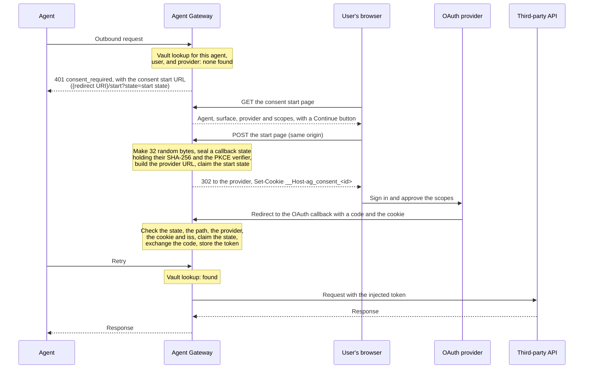

# Credential Delegation

How the gateway lets a managed agent call a third-party API with credentials the agent
never holds. For a user-facing flow, the credentials belong to the human the agent acts
for, and are obtained with that person's consent.

Use the hosted [per-caller credential delegation guide](https://docs.affinidi.com/products/affinidi-trust-fabric/agent-gateway/how-to-guides/setup/configure-per-caller-credential-delegation/)
for the operator procedure. This page documents the implementation in
[`src/credential_providers/`](../src/credential_providers/),
[`src/delegation_vault/`](../src/delegation_vault/), and
[`src/proxy/credential_delegation.rs`](../src/proxy/credential_delegation.rs).

## Moving parts

| Part | What it is |
| --- | --- |
| Credential provider | A configured OAuth 2.0 or API-key provider, such as Google or GitHub. Defined once and referenced by any number of surfaces. |
| Outbound credential binding | An entry in a surface's `outbound_credentials` naming a provider, the scopes, when it applies, and how the token is injected. |
| Delegation vault | Where obtained tokens are kept, one per agent, user, and provider. |
| Delegation audit log | A record of every lookup, consent prompt, refresh, and injection. |

## Credential providers

`CredentialProvider` ([`src/credential_providers/mod.rs`](../src/credential_providers/mod.rs))
has five types, set by `provider_type`.

| Type | Flow | Consent |
| --- | --- | --- |
| `oauth2_authorization_code` | Three-legged OAuth. The user signs in to the provider and approves the scopes. | Required, per user |
| `oauth2_client_credentials` | Two-legged, machine to machine. The gateway authenticates as the client with a client secret. | None |
| `oauth2_jwt_bearer` | JWT Bearer grant (RFC 7523 section 2.1). The gateway signs a JWT with the provider's private key and posts it as the `assertion`. It sends no client identity unless the provider sets a `client_authentication`. A Google service account for Vertex AI Agent Engine works this way; an Ory Hydra client, which Hydra needs identified, sets one. | None |
| `oauth2_client_credentials_jwt_auth` | Client Credentials grant whose client authenticates with a signed JWT (`private_key_jwt`, RFC 7523 section 2.2) instead of a client secret. An Entra certificate credential (key named by certificate thumbprint) and an Ory `private_key_jwt` client (key named by `kid`) work this way. | None |
| `api_key` | A static key resolved from the secrets store. No OAuth. | None |

A provider carries its authorization and token endpoints and its default scopes. Its
client ID, client secret, signing key and certificate are **references** into the secrets
store, such as `GOOGLE_CLIENT_SECRET`, and are never stored in the provider record itself.

An `oauth2_authorization_code` or `oauth2_client_credentials` provider without an `issuer`
needs a `token_endpoint`, a `client_id_secret_ref` and a `client_secret_secret_ref`, and an
`api_key` provider needs an `api_key_secret_ref`. A create and an update both check the
provider as it would be stored, and a missing client or API key reference answers 400 with the
same message in both (for example
`client_id_secret_ref and client_secret_secret_ref are required for OAuth providers`). An update
therefore cannot clear one of these references with an empty string, and a retype to one of
these types must send the references the provider does not store yet. A stored provider that
already lacks one is refused every update until the update names it.

### Records that are still in use

A credential provider or secret is not deleted while another record uses it, so a surface or
provider does not fail on its next request. A JWT verification strategy is not deleted while a
credential provider uses it; surface caller authentication methods are not checked, so repoint
them at another strategy before deleting one.

| Request | Refused with `409` while | Override |
| --- | --- | --- |
| `DELETE /api/v1/credential-providers/{id}` | A surface binds the provider or uses it for Target authentication; the answer is the `provider_in_use` one described in [Deleting a provider](#deleting-a-provider), not the body below | None: remove the references first |
| `PUT /api/v1/credential-providers/{id}` that changes the type from one that sends the gateway's own credential to one that needs a user's consent (`oauth2_authorization_code`) | A surface uses the provider for Target authentication, which refuses such a provider | None. A provider used only in bindings may change type |
| `DELETE /api/v1/secrets/{id}` | A surface names the secret (Target authentication, caller authentication, managed identity, caller key), a credential provider references it, an A2A proxy's Direct Line backend uses it, or an STS client's `client_secret_ref` names it; tenant and appliance-wide secrets alike | `?force=true` deletes it anyway, logs a warning with the secret id and the referrers' ids, and records a `secret_force_deleted` event in the VP Audit Log (see [Auditing a forced secret delete](#auditing-a-forced-secret-delete)). It does not override an integration endpoint that references the secret, which still answers `409` with its own message (see [`INTEGRATIONS.md`](INTEGRATIONS.md)) |
| `DELETE /api/v1/jwt-verification-strategies/{id}` | A credential provider's `consent_confirmation.jwt_verification_strategy_id` or `consent_identity_strategy_id` names the strategy. Surface methods are not checked | None: point the providers at another strategy first |
| `PUT /api/v1/jwt-verification-strategies/{id}` that changes `expected_issuer` | A credential provider names the strategy and its own save would refuse the new issuer: for `consent_confirmation`, this gateway's own `sts.mcp_issuer` or an Entra issuer while a caller is named by `sub`; for `consent_identity_strategy_id`, an issuer that is not a canonical https URL: `https`, with a host, no credentials, query or fragment, and in no form the URL parser rewrites, such as a bare host with no path (`https://idp.example`), an upper-case host or an explicit `:443`. The issuer is also compared exactly with every token's `iss`, so an identity provider whose `iss` is a bare host cannot back `consent_identity_strategy_id`; adding a trailing slash its tokens don't carry refuses every caller of the strategy | None: point the providers at another strategy first |

The other refusals answer a `409` body that keeps the `message` field current clients show:

```json
{
  "message": "The secret is in use; remove its references first, or delete it with force=true",
  "references": [{"kind": "surface", "id": "<surface_id>", "name": "Orders"}],
  "hidden_references": 0
}
```

`kind` is `surface`, `credential_provider`, `a2a_proxy` or `sts_client`. `references` lists
only the referrers the caller may read: its role, and an access token's scopes if it lists
any, hold the view permission of that kind (`surfaces.view`, `credential_providers.view`,
`a2a_proxies.view` or `sts_clients.view`, see [`RBAC.md`](RBAC.md)), and the record is in the
caller's tenant or appliance-wide and within its resource pattern. The rest are counted in
`hidden_references` (see [Access tokens](ACCESS_TOKENS.md#references-between-records)). The messages are:

- provider type change: `The credential provider is used for Target authentication, which cannot use a provider that needs a user's consent`
- secret delete: `The secret is in use; remove its references first, or delete it with force=true`
- JWT verification strategy delete: `The strategy is used by credential providers; remove their references to it first`

The scan reads every surface, provider, A2A proxy and STS client at the time of the request
([`credential_providers/references.rs`](../src/credential_providers/references.rs)); a lookup
that fails answers `500` and deletes nothing. A secret delete and a save of a surface,
credential provider, A2A proxy or STS client that names the secret do not overlap on the node
that serves the admin API, which serialises them with an in-process lock: a save stored first
makes the delete answer `409` unless the delete adds `force=true`, and a save whose check found
the secret before the delete removed it is refused with `400`, as a reference to a missing
secret is. A strategy delete takes no such lock.

### Auditing a forced secret delete

A `DELETE /api/v1/secrets/{id}?force=true` that deletes the secret records a
`secret_force_deleted` event in the VP Audit Log, whether or not a record still used the
secret: every forced delete is recorded, so a forced delete is never missing from the log. The
record names the management caller as `actor`, the secret's `secret_id`, `force` (`true`) and
`referrers`, each record that used it as `{kind, id}` with `kind` one of `surface`,
`credential_provider`, `a2a_proxy` or `sts_client`, in kind and id order (an empty list when
nothing used it). It carries the referrers of every kind, not only the kinds the caller may
view, and never the secret's value or a referrer's name. A delete without `force`, a forced
delete the gateway refuses (an integration endpoint that references the secret, a secret outside
the token's scope, a failed lookup) and a delete outside a management request record nothing.
See [`OBSERVABILITY.md`](OBSERVABILITY.md#governance-audit-forwarding) for the record.

### Redirect URI and issuer of an authorization code provider

An `oauth2_authorization_code` provider without an `issuer` grants its credential through the
gateway's [consent flow](#consent-flow). Its redirect URI is its `callback_url`, or, without
one, the gateway's `https://{did.domain}` followed by its `callback_path`, which the gateway
sets at create to `{oauth_callback_route}/{id}`, the provider's own id, and never changes. Each
new provider's redirect URI is therefore its own, whatever its tenant and `provider_id`. Providers
stored before keep their `{oauth_callback_route}/{provider_id}` path, so their vendor
registrations still match.

Create refuses such a provider's `callback_url` with `400`, since its `callback_path` is not known
until the create returns it; set the `callback_url` with an update. An update that changes the
redirect URI refuses with `400`:

- a `callback_url` that is not an `https` URL with a host, or carries credentials, a query or a
  fragment, or whose path does not end in the provider's `callback_path`; a reverse proxy prefix
  before it is kept, so `https://gw.example/prefix/v1/identity/oauth/callback/{id}` is accepted
  for `/v1/identity/oauth/callback/{id}`. The path comparison is exact and case-sensitive;
- a redirect URI that another such provider, of any tenant, already has. Two providers stored
  with the same `provider_id` path, in different tenants, can share one.

Create, and an update that changes either, also refuse with `400` an `authorization_endpoint` or
`additional_params` that break the rules in [The start page](#the-start-page). A provider without
an `authorization_endpoint` is accepted but gets no consent link.

An update that keeps the stored redirect URI, or the stored `authorization_endpoint` and
`additional_params`, is not checked against those rules, so a stored provider that breaks them
can still be renamed or otherwise edited before it is fixed.

A stored provider that breaks either rule gets no consent link (the binding is unavailable, see
[When a credential cannot be resolved](#when-a-credential-cannot-be-resolved)) and is refused at the
start page with `redirect_uri_invalid` until it is fixed. When two stored providers share a
redirect URI, both fail closed, and the gateway logs an `ERROR` at startup and on every
configuration reload naming each such pair by provider id. A stored provider whose redirect URI
or authorization endpoint breaks the rules here or in [The start page](#the-start-page) is
logged the same way, as an `ERROR` naming its provider id and the rule it breaks, never its
URLs or parameters. The remedy is to give one of them a
`callback_url` on a distinct host, or to recreate it, which gives it a path of its own; either
way, register the new redirect URI with the vendor. A tenant move changes neither rule's outcome, so
it is not checked again.

`authorization_response_issuer` is the `iss` (RFC 9207) the provider's authorization server puts
on its authorization responses, set by the operator through the API, for example
`https://github.com/login/oauth` for GitHub. When set, the callback requires that exact `iss`;
unset, `iss` is ignored. It is accepted only on an `oauth2_authorization_code` provider without
an `issuer`, as an `https` URL with a host and no query or fragment, on create and update; an
update with a blank value clears it. It does not make the provider an external consent provider
and no metadata is fetched for it.

### https token endpoints

Every type except `api_key` sends its client secret, assertion or code to the token endpoint,
so the endpoint must be an https URL. An http endpoint meets the rule only when the bootstrap
`[credential_policy] insecure_token_endpoints` lists it exactly (compared as parsed URLs, so
another port or path does not match), or, under `AG_TEST_MODE=true`, when
`AG_BDD_OAUTH_ENDPOINT_ALLOWLIST` lists it exactly. `insecure_token_endpoints` relaxes only the
scheme: an endpoint it names must still resolve to neither loopback nor cloud metadata
([Service tokens](#service-tokens)). `credential_policy.token_endpoint_https`
sets how the rule is applied (see [Credential policy](CONFIGURATION_RELOAD.md#credential-policy)):

| | `warn` (default) | `enforce` |
| --- | --- | --- |
| Create, or an update that sets a new token endpoint or changes the provider type (an `api_key` provider turning into an OAuth type, or one OAuth type into another) | 400 `token_endpoint must be an https URL` | The same |
| Update that keeps a stored http endpoint and the provider type | Saved | 400 |
| Update that keeps a stored http endpoint not listed in `insecure_token_endpoints` and sets `client_authentication` to `client_secret_basic` or `client_secret_post` on an `oauth2_jwt_bearer` provider that sent no client secret before | 400 `token_endpoint must be an https URL` | The same |
| `POST /api/v1/credential-providers/validate` | 400, before the endpoint is contacted | The same |
| Token request, refresh or code exchange of a stored http provider | Sent, with a warning log | Refused before any secret is read |

The check runs before the provider's secrets are read. In `warn` mode every use of a stored
http provider logs a warning, and a legacy binding's audit detail gains
` insecure_token_endpoint` (for example `client_credentials_cached insecure_token_endpoint`,
`after_refresh insecure_token_endpoint`). In `enforce` mode a service token reports
`TokenEndpointNotHttps` ("credential provider token endpoint is not https"), even for a token
already cached, the legacy code exchange and refresh fail with `token_endpoint must be an https
URL`, and the `2026-07-28` consent exchange answers an invalid record. Move such providers to
https, or list a deliberate http endpoint, before switching to `enforce`.

In `warn` mode a stored http provider therefore cannot start sending a client secret by turning on
a `client_authentication` that sends one, and cannot change its type to an OAuth type: a retype
must meet the rule like a new provider. Setting `client_authentication` to `none`, clearing it,
or switching between `client_secret_basic` and `client_secret_post` is still saved. Listing the
endpoint in `insecure_token_endpoints` allows the change on purpose.

The rule does not compare `client_secret_secret_ref`. A stored http provider may point it at
another secret of its tenant, which is a rotation and is saved, and a secret's value can already
change through the secrets API without any check by a provider, so pinning the reference would
not pin what the endpoint receives. What a stored provider cannot do is lose the reference:
`oauth2_client_credentials` and `oauth2_authorization_code` providers need it, so an update that
clears it is refused (see [Credential providers](#credential-providers)), and a provider cannot
be emptied of its client secret and given one again later on an endpoint that is still http.

### Provider secrets belong to the provider's tenant

Every secret a provider references (client ID, client secret, API key, signing key,
certificate) must belong to the provider's own tenant: a tenant provider uses its tenant's
secrets, an appliance-wide provider uses appliance-wide secrets. `credential_policy.tenant_credential_isolation`
sets how the rule is applied (see [Credential policy](CONFIGURATION_RELOAD.md#credential-policy)):

| | `warn` (default) | `enforce` |
| --- | --- | --- |
| Create, or an update that sets a reference to another tenant's or an appliance-wide secret on a tenant provider | 400 `Secret reference is not accessible` | The same |
| Update that keeps a stored reference in the same field, with the type, token and authorization endpoints, `resource`, `additional_params`, `default_scopes` and JWT issuer, subject and audience unchanged | Saved, except on a provider with an `issuer`, which never keeps a secret outside its own tenant | 400 |
| `POST /api/v1/credential-providers/validate` | 400 for a signing key or certificate outside the provider's tenant (another tenant's or, for a tenant provider, an appliance-wide one), before the key is read | The same |
| Authorization URL, code exchange, refresh, service token grant or API key read | The secret is read, with a warning log naming the provider and secret id | Refused before the secret's value is used |

A stored reference is kept only while it goes where it went before. An update that changes one
of those settings, or moves a stored reference to another field (a client secret becoming the
signing key, say), treats every such reference as new and answers 400, so a tenant cannot send
an appliance-wide secret, or an assertion signed with an appliance-wide key, to an endpoint or
audience of its choosing. A kept reference pins that destination, `default_scopes` included, but
not the scopes a surface's Target authentication requests, which replace the default scopes on
that leg.

In `enforce` mode a service token or API key whose secret is outside the provider's tenant
reports `SecretUnavailable`, and no token request is sent. A cached service token is checked
against the same rule on every use, reading each secret the type sends by id, so it stops being
served as soon as the rule is enforced. Move such secrets into the provider's tenant before
switching to `enforce`.

The save rule above covers every reference the provider stores. A leftover reference in a field
the provider's type does not send, such as an `api_key_secret_ref` kept after a provider changed
from `api_key`, is ignored at runtime (see [Service tokens](#service-tokens)), but it still counts
for the provider save rule, for the surface save rule in
[Tenant isolation on a surface's upstream legs](#tenant-isolation-on-a-surfaces-upstream-legs)
and for the startup credential policy report.

### Providers that sign a JWT

The two JWT types share the settings in `JwtAssertionSettings`; create and update refuse a
record that misses a required one.

| Field | `oauth2_jwt_bearer` | `oauth2_client_credentials_jwt_auth` |
| --- | --- | --- |
| `jwt_signing_key_secret_ref` | Required: a PEM private key (PKCS#1 or PKCS#8 for RSA, PKCS#8 for EC), or a Google service account JSON key file, whose `private_key` is used | Required |
| `jwt_signing_algorithm` | `RS256` (default) or `ES256` | `PS256` (default) or `RS256` |
| `jwt_issuer` | Required: the `iss` claim, a service account's `client_email` | Not used: `iss` and `sub` are the client ID |
| `jwt_subject` | Required: the `sub` claim, the account the token is issued for (with domain-wide delegation, the user to act as; without it, a Google service account's own `client_email`, the same value as `jwt_issuer`). Create, update and `validate` refuse a blank one with 400 `jwt_subject is required for this provider type`. A provider stored without it still signs its grant without `sub`, but every update of it through the provider update endpoint, a signing key rotation included, must name one | Not used |
| `jwt_certificate_secret_ref` | Not used | Optional: the PEM certificate, whose SHA-256 thumbprint goes in the `x5t#S256` header. Entra needs it; issuers that find the key by `kid`, such as Ory, do not |
| `client_authentication` | Optional: how the grant's client identifies itself. `none` is a public client: `client_id` in the form body. `client_secret_basic` is HTTP Basic with the client ID and secret, each form-urlencoded (RFC 6749 section 2.3.1). `client_secret_post` puts `client_id` and `client_secret` in the form body. Unset sends no client identity and leaves the client references unread. An update that omits it keeps the stored value, and an empty string clears it. An update that changes `provider_type` away from `oauth2_jwt_bearer` and omits it drops the stored value | Refused with 400 `client_authentication is only for oauth2_jwt_bearer providers`, as on every type but this one |
| `client_id_secret_ref` | Required with a `client_authentication` (400 `client_id_secret_ref is required for this client_authentication`), and sent as `client_id` or inside the Basic credentials; not used without one. An empty string clears it, which the dashboard sends while Not sent is chosen, so a cleared provider holds no reference that would block deleting the secret | Required, sent as `client_id` |
| `client_secret_secret_ref` | Required with `client_secret_basic` and `client_secret_post` (400 `client_secret_secret_ref is required for this client_authentication`), refused with `none` (400 `client_secret_secret_ref is not allowed with client_authentication none`); not used without a `client_authentication`. An update that omits it keeps the stored reference, so an update that switches a stored provider from a secret method to `none` must also send an empty string to clear it, as the dashboard does | Refused, so a misconfiguration cannot fall back to a client secret |
| `jwt_audience` | Optional `aud`; the token endpoint when unset | The same |
| `jwt_key_id` | Optional `kid` header. It overrides the `private_key_id` of a JSON key file, which is the default `kid` | Optional `kid` header, such as the `kid` of the key in an Ory client's JWKS. The dashboard warns when neither it nor a certificate is set, since the server may then not find the key |

Create and update resolve the referenced key and certificate after checking the caller may
use them, and refuse with 400 a key that cannot sign with the algorithm or a certificate that
is not PEM, so a wrong format fails the save rather than the first token request. A JSON key
file is checked the same way; the key secret may be at most 16 KiB.
`POST /api/v1/credential-providers/validate` runs the same check before a save: it needs the
credential provider edit permission, applies the caller's tenant to the secrets it names, and
answers `"key_material": "ok"` beside the token endpoint's reachability. It reaches the token
endpoint through the same pinned client as a token request, so a loopback or cloud metadata
endpoint answers 400 `token_endpoint rejected: it must be an http(s) URL without a user name or password whose host resolves to neither loopback nor cloud metadata`
without being contacted,
and an unreachable one answers `"reachable": false` with the fixed error `token_endpoint could
not be reached`; the detail is only logged. It takes no client references, so it does not check
a `client_authentication`; create and update do. JWK keys are not
accepted. The provider API never returns the key or certificate; the list leaves out
their references and the client references too, and shows a JWT Bearer provider's
`client_authentication`.

RFC 7523 makes client authentication optional in a JWT Bearer grant, and servers differ. A Google
service account needs none. Ory Hydra answers a grant that names no client with 400
`invalid_request`: set `none` for a public client, and `client_secret_basic` or
`client_secret_post` to match the `token_endpoint_auth_method` the client is registered with. A
provider that sets no client authentication keeps sending a client-less grant even when it stores client
references, such as those left from another type. Create and update refuse a method whose
references are missing: the client ID for every method, and the client secret for
`client_secret_basic` and `client_secret_post`. A provider that sets a client authentication
also names its scopes in the `scope` form field, which servers such as Hydra grant scopes from:
without it Hydra issues an empty scope, and the gateway refuses a token whose scopes differ
from those requested. A provider that sets no client authentication sends its scopes only in the assertion's
`scope` claim, as before.

#### Ory Hydra

Register the OAuth client in Hydra with the JWT bearer grant type
`urn:ietf:params:oauth:grant-type:jwt-bearer` and a `token_endpoint_auth_method` that matches the
provider's `client_authentication`:

| `client_authentication` | The gateway sends | Register the client with |
| --- | --- | --- |
| unset | No client identity | Not accepted by Hydra: it answers 400 `invalid_request` |
| `none` | `client_id` in the form body | `token_endpoint_auth_method` `none` |
| `client_secret_basic` | HTTP Basic with the client ID and secret | `client_secret_basic` |
| `client_secret_post` | `client_id` and `client_secret` in the form body | `client_secret_post` |

Hydra also needs a trust relationship for the assertion's issuer (the provider's `jwt_issuer`):
its public key, the subject, and the scopes it may grant. Hydra refuses a grant that names no
client, so a Hydra provider must set a `client_authentication`.

A 401 `invalid_client` from the token endpoint usually means the provider's
`client_authentication` does not match how the client is registered, or the client ID or secret
is wrong. The warning "Provider token request rejected" carries a `client_authentication` field
(`none`, `client_secret_basic`, `client_secret_post` or `unset`) next to the HTTP status and the
OAuth error code.

Existing providers are unchanged: their `client_authentication` is unset and they send the same
grant as before. A gateway without the setting ignores it, and its next save of that provider
drops it.

Every token request signs a fresh assertion that lives 5 minutes (`iat`, `exp`, a random
UUID `jti` so the issuer can refuse a replayed assertion, and for a client assertion `nbf`);
only the issued access token is cached. A JWT Bearer grant sends the scopes in the `scope` claim, and in the `scope` form
field too when the provider sets a `client_authentication`; a client assertion sends them in the `scope` form
field (Entra: `<audience>/.default`). Entra needs the tenant-specific v2.0 token endpoint, not
`common`. An update that sends a reference or JWT field as an empty string clears it, unless
the provider's type needs that reference (see above); that is how a client-credentials provider
switches to `oauth2_client_credentials_jwt_auth`, which needs no client secret reference. A
create reads an empty reference as none.

### Service tokens

`oauth2_client_credentials`, `oauth2_jwt_bearer`, `oauth2_client_credentials_jwt_auth` and
`api_key` give the gateway a credential of its own, with no user.
[`service_token::acquire`](../src/delegation_vault/service_token.rs) obtains it for every path
that needs one: legacy and `2026-07-28` delegation bindings, and target authentication.

- An API key is read from the secrets store on every use and never cached.
- Every token request (Client Credentials, JWT Bearer, `private_key_jwt` and refresh) is sent
  on a client pinned to the addresses the token endpoint resolved to when it was checked, with
  redirects off and any HTTP proxy ignored, since a proxy would resolve the host again; a host
  that needs `HTTPS_PROXY` to reach the internet must allow direct egress to its token
  endpoints, and a startup warning says so when a proxy is set
  ([Other pinned egress sinks](POLICY.md#other-pinned-egress-sinks)). A host resolving
  to loopback, an unspecified address or cloud metadata is refused before any request,
  reported as `TokenEndpointRefused` ("credential provider token endpoint refused by egress
  policy"), and creating or updating a provider with such a token endpoint answers 400.
  Private networks are allowed, so a token endpoint inside the operator's network works. Under `AG_TEST_MODE=true`,
  `AG_BDD_OAUTH_ENDPOINT_ALLOWLIST` admits listed loopback test endpoints (never cloud
  metadata).
- An issued token is cached in the delegation vault and renewed half its lifetime before its
  `expires_at`, but at most 5 minutes and at least 60 seconds before (a one-hour token is
  renewed 5 minutes early, a 100-second one 60 seconds early). One request renews it while the
  others keep using the cached token. When the renewal fails at the token endpoint
  (`TokenRequestFailed`, `TokenRequestRejected`, `ScopeMismatch`) or is held back by the retry
  backoff, the cached token
  is still used, marked stale, until 60 seconds before it expires; after that the request fails.
  A legacy binding's audit detail then reads `<grant>_stale` (for example
  `client_credentials_stale`) in place of `<grant>_cached` or `<grant>_fresh`, and each use
  logs a warning.
  A changed provider, a missing secret, a provider setting or signing key the grant cannot use
  (`ProviderMisconfigured`, reported as a failed token request), a secrets store or vault error, or a token endpoint the
  egress or https rule refuses never serves the stale token. Its key is `<purpose>:<hash>`, where the hash is the hex SHA-256
  of the provider's digest, the sorted, deduplicated scopes, and the id, tenant and `updated_at`
  of each secret the provider's type sends: the client ID and secret of `oauth2_client_credentials`,
  the signing key and certificate of `oauth2_jwt_bearer` (after its client ID, and its client
  secret too for `client_secret_basic` and `client_secret_post`, when it sets a
  `client_authentication`), and the client ID, signing key and
  certificate of `oauth2_client_credentials_jwt_auth`. Editing the provider, rotating one of
  those secrets or moving one to another tenant therefore requests a new token instead of
  reusing one issued under the old settings. A reference the type does not send, such as an
  `api_key_secret_ref` kept after a provider changed from `api_key`, is neither read nor part of
  the key, so rotating or deleting its secret changes nothing at runtime; it still counts for the
save rules and the startup report ([Provider secrets belong to the provider's
tenant](#provider-secrets-belong-to-the-providers-tenant)).
  Each use looks up only those secrets, one read each (decrypted when
  encryption at rest is on), and a token request reads each secret it sends once more by its
  id; neither asks the store for a listing, though the filesystem store rescans its directory to
  rebuild its id index when it is asked for an id it does not know. A secret the type sends that
  no longer exists reports `SecretUnavailable` and a secrets store error `StoreUnavailable`;
  neither serves the cached token nor sends a request.
- The expired tokens of the same agent, provider and purpose (those left by earlier
  settings, scopes or secret versions) are removed from the vault in the same step that
  stores the new token, under the same vault lock and the same read of the vault, so a fresh
  token costs one scan of the vault, not two. Unexpired tokens, user grants and pending
  consents are kept, and so are the refresh claims of the tokens that are kept. A failure to remove them is logged as a warning only and does
  not fail the store. A token response without `expires_in`, with an empty token, or
  with a `token_type` other than `Bearer` is refused, as is a response over 64 KiB or slower
  than `credential_policy.token_request_timeout_secs` (30 by default); only the response's OAuth `error` code is logged (see _Logging token endpoint errors_ below).
- When scopes were requested, the issued `scope` must name the same set, or the token is
  refused; when none were requested, the issued scopes are kept.
- The provider is read again after the token request, and a provider changed meanwhile
  refuses the token.
- `resource` is sent only when the provider sets it, on every path including legacy bindings.
  The Microsoft identity platform v2.0 token endpoint rejects it (AADSTS901002): put the audience
  in the scopes as `<resource>/.default` instead. An [external consent
  provider](#external-consent-providers) must set `resource`, which binds where its grants go,
  and cannot change it: for such an issuer, create it with `send_resource: false`, so its code
  exchange and refresh leave the parameter out. The dashboard warns on the provider form and
  list when a provider's token requests send `resource` to an Entra v2.0 token endpoint: a
  provider without an issuer is told to move the audience into its scopes and clear `resource`,
  and an external consent provider to be re-created with `send_resource: false`. An external
  consent provider with `send_resource: false` is not warned.

Each replica sends one token request per cache key at a time. Requests that miss the cache
meanwhile wait for it, then read the vault again, so they reuse the token it stored, or one
another replica stored, instead of requesting their own. Requests for other scopes, providers or
surfaces do not wait. A key's place in this queue is kept while any request holds or waits for it,
however many keys are in use. Replicas do not coordinate, so each may request one token for the same key.

After a token request fails, or its issued scopes do not match (`TokenRequestFailed`,
`TokenRequestRejected`, `ScopeMismatch`), the next request for the same cache key (surface, provider, scopes and secret
versions) waits 1 second from the end of the failed request, doubling after each further failure
up to 60 seconds. A request arriving before then fails at once with `TokenRequestFailed`, without
contacting the provider. A successful request clears the wait, and editing the provider or
rotating a secret the provider's type sends starts a new key with no wait. Failures found before any request is sent never start a wait: a
missing or refused secret (`SecretUnavailable`), a secrets store or vault error
(`StoreUnavailable`), a token endpoint the egress or https rule refuses (`TokenEndpointRefused`,
`TokenEndpointNotHttps`), a provider changed during the request (`ProviderChanged`) or an
unsupported provider type. The wait is kept in memory on each replica and resets on restart, and the
count of failures is forgotten 10 minutes after the retry time, so the next failure waits 1 second again.

A Target that answers a request carrying a Target authentication service token as
`Authorization: Bearer <token>` with `401` and a Bearer challenge whose `error` is
`invalid_token` (RFC 6750 section 3.1; quoted or not, in any `WWW-Authenticate` header) has
refused that token before it expired, for example after the issuer revoked it. The gateway deletes the token's vault row
([`service_token::invalidate`](../src/delegation_vault/service_token.rs)), so the next request
asks the provider for a new token, with these limits:

- The row is deleted only while it still holds the token that was sent (same row id and token
  value), checked and deleted in one step under the vault's mutation lock, so a gateway sharing
  the vault that renews the row meanwhile keeps its new token. A renewal keeps the row id, so a
  late refusal of a token already renewed or dropped changes nothing.
- Only that row and its refresh claim are removed. Unlike a revocation, it revokes no staged
  consent, leaves the revocation epoch as it is and ends no MCP subscription.
- A token issued less than 30 seconds ago (`MIN_INVALIDATION_AGE_SECS`) is kept: a Target that
  refuses a token just issued refuses every token, and dropping each one would send the
  provider a token request per call.
- Nothing is deleted while a renewal of that token is running.
- The retry wait of the cache key is kept, so a failing token endpoint is still held back.

The refused request is answered as the Target answered it and is not retried. A `401` without
`invalid_token`, a `403`, a static secret or `api_key` credential, and a provider token sent in
another header or scheme change nothing: a Bearer challenge speaks only about the `Authorization`
Bearer token, which in that case may be the caller's. The direct path, Fabric receive and the
agent card fetch check the answer, and so does a `proxy://` MCP Target, direct or on Fabric
receive, legacy or `2026-07-28`: its tool call's REST backend answers the token, while the
caller gets that answer as a tool result with `isError` set. A Transit Point and the Fabric send
leg do not: their refusals leave the token in place until it is renewed. The Target and a Transit
Point that use the same provider and scopes on one surface share one cached token, so only the
Target's own answers can drop it. To keep a Transit Point's token unusable at the Target, give the
Transit Point a provider whose `resource` names its own server.

### Logging token endpoint errors

A credential provider's token endpoint can answer an error response that echoes the request or
explains it in free text. The gateway keeps only its OAuth `error` code (RFC 6749 section 5.2):
1 to 64 bytes of `%x20-21 / %x23-5B / %x5D-7E`, or `unrecognized_error` when the code is missing or
breaks that rule. `error_description`, `error_uri` and the rest of the body are never logged,
returned in an error message or written to a delegation audit detail. This holds for code
exchange, refresh, service token grants, the Microsoft Graph API token used for SAML avatars and
the `error` an authorization callback carries.

A service token request the token endpoint answers with an error status and an OAuth `error`
code reports `TokenRequestRejected` carrying that code, which the
[VP Audit Log](OBSERVABILITY.md#governance-audit-forwarding) records as `oauth_error` when it is a
registered code and as `other` otherwise; any other failed answer reports `TokenRequestFailed`.

Logs about a token request may name the provider id, the surface id, the HTTP status and the
OAuth error code. They never carry a secret, a client assertion, a token, the response body or
`error_description`.

A provider's `provider_id` slug is unique per tenant, and among the untenanted providers. The
slug is compared as stored, trimmed and in lower case.

### External consent providers

A provider with an `issuer` is an external consent provider: one OAuth client of one
authorization server, whose grants another system obtains through the browser with the
[connect API](#the-connect-api) and the gateway keeps in the vault by binding. Its fields:

| Field | Rule |
| --- | --- |
| `provider_type` | `oauth2_authorization_code` |
| `issuer` | An `https` issuer without credentials, query or fragment |
| `authorization_endpoint`, `token_endpoint` | Required |
| `revocation_endpoint` | The RFC 7009 endpoint, exactly when the issuer's metadata names one |
| `client_id` | Required, a plain value: a client id is not a secret. `client_id_secret_ref` is refused |
| `token_endpoint_auth_method` | `none`, `client_secret_basic`, `client_secret_post` or `private_key_jwt`. `client_secret_secret_ref` is required for `client_secret_basic` and `client_secret_post` and refused for the others |
| `jwt_signing_key_secret_ref`, `jwt_certificate_secret_ref`, `jwt_key_id`, `jwt_signing_algorithm` | Only with `private_key_jwt`, the [signed-JWT settings](#providers-that-sign-a-jwt) of an `oauth2_client_credentials_jwt_auth` provider: the signing key is required and the algorithm is `PS256` (the default) or `RS256`. The key and certificate are checked when the provider is created. `jwt_audience` is refused, since the assertion is always addressed to the issuer, and so are `jwt_issuer` and `jwt_subject`, since the client is the issuer and subject of its assertion. Without `private_key_jwt` all are refused |
| `callback_url` | Required, `https`: the redirect URI the other system registered |
| `resource` | Required, a canonical public `https` URI (RFC 8707): the protected resource the grants are for. Its origin is the only one a Transit Point sends the provider's grants to ([External consent on a Transit Point](#external-consent-on-a-transit-point)), and it must be permitted for the issuer (below). The API returns it as `resource_origin`, so a client can show the person where the grant will go |
| `allow_unadvertised_pkce` | Optional, `false` by default. `true` admits an issuer whose metadata does not list `code_challenge_methods_supported`; see below |
| `scope_comparison` | Optional, `exact` by default: how the scopes the token endpoint grants are compared with those asked for ([Granted scopes](#granted-scopes)) |
| `revocation_ends_authorization` | Optional, `false` by default. `true` for a vendor whose revocation of any one token ends the person's whole authorization of the client, as Google's does ([Revoking grants at the vendor](#revoking-grants-at-the-vendor)) |
| `send_resource` | Optional, `true` by default: the code exchange and every refresh send `resource` to the token endpoint, which binds the token's audience to it (RFC 8707). `false` sends it on neither, so the token carries no such binding and its audience follows the scopes alone (Entra: `<resource>/.default`); use it only for a token endpoint that refuses the parameter, such as the Microsoft identity platform v2.0 one (AADSTS901002). It never loosens where the grants may be sent: `resource` is still required and is still the only origin they go to. The API names it only when `false` |
| `additional_params`, `consent_identity_strategy_id`, `consent_confirmation`, `api_key_secret_ref` | Refused |

An external consent provider uses its own tenant's secrets only, for its client secret, its
signing key and its certificate: never an untenanted secret, nor another tenant's, since its
client authenticates at endpoints its tenant chose. An untenanted provider uses untenanted
secrets only. Both are checked when the provider is created and again on every use, so a
provider moved to another tenant stops using the secrets of the one it left. For the rule on
other providers, and when a stored reference is kept, see
[Provider secrets belong to the provider's tenant](#provider-secrets-belong-to-the-providers-tenant).

Every endpoint, and `resource`, must be an `https` URL without credentials or fragment whose
host is no literal loopback, private, link-local or cloud-metadata address (the Strict egress
posture's static check). At create only the issuer's metadata fetch resolves a name; a vendor
name that resolves to a blocked address is refused when the gateway calls it, since every call
to a vendor endpoint goes through pinned Strict egress. A provider without an `issuer` cannot
set `revocation_endpoint`, `token_endpoint_auth_method`, `client_id`, `allow_unadvertised_pkce`,
`scope_comparison`, `revocation_ends_authorization` or `send_resource: false`, the last four of
which are fixed for the provider's life.

A provider's resource must be permitted for its issuer. By default its host must be the
issuer's host or one of its subdomains: for the issuer `https://mcp.notion.com`, a resource on
`mcp.notion.com` or `api.mcp.notion.com`, but not `api.notion.com`, `evil-notion.com`,
`mcp.notion.com.evil.example` or a look-alike name. Hosts are compared as the URL parser
normalises them, in lower case and with international names in punycode, label by label; an IP
address permits only itself. Any other resource origin must be listed for the issuer's origin
in `external_consent_resource_origins` in `gateway.json`, which only the operator's file sets:

```json
"external_consent_resource_origins": {
  "https://accounts.google.com": ["https://www.googleapis.com"]
}
```

Each key and value is an exact `https` origin: no wildcard, path, userinfo, query or fragment,
and a host that is an IP address or a plain DNS name (letters, digits and `-` in each label).
List each host on its own: `https://*.googleapis.com` is not a wildcard. An entry that is not
such an origin permits nothing, not even the literal origin it spells, and is named in an `ERROR`
at startup. The value is read once, when the gateway starts: provider create, surface save and
every request use it, and a configuration reload keeps it, with a `WARN` when the file says
otherwise, so a change takes a restart. A pattern of `external_consent_issuer_patterns`
([Permitted issuers](#permitted-issuers)) lists resource origins the same way, for each issuer
it matches.
The rule is checked when the provider is created (`400`, `provider_resource_not_permitted`),
when a surface binds the provider (`400`), and again whenever a grant is released: a provider
whose resource is no longer permitted, because its entry was removed, releases nothing, and the
log names the reason `resource_not_permitted_for_issuer`. The default compares hosts rather
than registrable domains, so an issuer and a resource on sibling subdomains of one site need an
entry: telling a site's own subdomains from other customers' on a shared suffix needs the public
suffix list, which the gateway does not carry.

When the provider is created, the gateway reads the issuer's authorization server metadata
(RFC 8414, then OpenID Connect discovery) under the client profile of
[`authz_metadata`](SOURCE_AUTH.md#authorization-server-metadata-module-developer-reference),
through a pinned, bounded fetch under the Strict posture, and refuses the provider unless:

- the metadata's `issuer` equals the provider's byte for byte;
- the authorization, token and revocation endpoints are the ones the metadata names, byte for
  byte, a revocation endpoint included exactly when the metadata names one;
- `token_endpoint_auth_methods_supported` lists the provider's method, or, when the metadata
  lists none, the method is `client_secret_basic` (the RFC 8414 default), so `private_key_jwt`
  needs a server that lists it;
- `code_challenge_methods_supported` includes `S256`. A document that does not list the methods
  is refused too: the MCP authorization specification (`2025-11-25` and later) tells clients to
  refuse to proceed with such a server, and a server that ignores `code_challenge` would void
  the PKCE verifier. The one exception is a provider that sets `allow_unadvertised_pkce: true`,
  for a server known to enforce S256 without listing it, such as Microsoft Entra ID. The
  exception never admits a list without `S256`.

The gateway records the metadata's `authorization_response_iss_parameter_supported` (RFC 9207)
on the provider; a request cannot set it. A connect for such a provider is completed only with
the `iss` the authorization response carried ([The connect API](#the-connect-api)). So is a
connect for a provider created before the gateway recorded it: nothing says its issuer omits
`iss`. Recreate such a provider for an issuer that sends none.

#### Granted scopes

A token answer's `scope` names what the token holds, in the vendor's own words. Vendors add
standard identity scopes nobody asked for, and rename the ones asked for, so a byte-for-byte
comparison would refuse grants that are no wider. A provider names its vendor's habits with
`scope_comparison` ([`src/credential_providers/scope_comparison.rs`](../src/credential_providers/scope_comparison.rs)):

| `scope_comparison` | Compared as | Not taken for a wider grant |
| --- | --- | --- |
| `exact` (default) | Written, case included (RFC 6749 scope tokens are case-sensitive) | Nothing |
| `oidc` | Written | `openid`, `offline_access` |
| `google` | Written | `openid`, `email`, `profile`, and Google's spelling of the last two, `https://www.googleapis.com/auth/userinfo.email` and `.../userinfo.profile` |
| `microsoft` | Without case, and without the resource that qualifies a name: `https://graph.microsoft.com/Mail.Read` is `mail.read`, as is `Mail.Read` (an Entra token is for one resource) | `openid`, `profile`, `email`, `offline_access`, `User.Read`, which reads the signed-in person's own profile and which Entra gives every app registration by default |

Whatever the comparison, a granted scope that is neither one asked for nor one of those is a
wider grant, and refused (`scope_widened` on a connect, `connect_required` on a refresh, the
tokens revoked). That includes a scope the person consented to the same client for another
connect, which Entra reports with every grant and Google with `include_granted_scopes`. The
default is the safe one: a vendor whose habits nobody vouched for gets nothing beyond what was
asked for, in the very words asked for. The grant keeps both: `scopes`, as the vendor named
them, and the scopes the connect asked for, which every refresh asks for again.

`microsoft` is for Microsoft Entra ID only. It takes `https://outlook.office.com/Mail.Read` and
`https://graph.microsoft.com/Mail.Read` for one scope, which is safe at Entra, whose token is for
the one resource the provider pins; at a vendor whose scopes are URL paths it would take
different scopes, such as `.../projects/read` and `.../admin/read`, for one.

#### Permitted issuers

The checks above show that a provider matches its issuer's metadata, not that the issuer is a
vendor anyone meant to trust: whoever creates a provider can name an issuer whose metadata it
serves itself, with its own token endpoint, which would then receive the authorization code and
the PKCE verifier, and with a resource on its own host. On a gateway whose provider creators
are not the operator, such as a pool gateway that another system provisions, the operator lists
the issuers it trusts in `external_consent_issuers` in `gateway.json`, which only the
operator's file sets:

```json
"external_consent_issuers": {
  "https://mcp.linear.app": [],
  "https://mcp.notion.com": [],
  "https://accounts.google.com": ["https://oauth2.googleapis.com"]
}
```

Each key is an issuer identifier, compared with the provider's `issuer` exactly, as RFC 8414
compares issuers; it must be an `https` issuer with a plain host and no credentials, query or
fragment. Its value lists the origins, exact as in `external_consent_resource_origins`, that the
issuer's authorization, token and revocation endpoints and its metadata's `jwks_uri` may use
when they are not on the issuer's own host (any port of that host; a subdomain is another host).
With the setting, a provider is permitted only when its issuer is listed and each of those
endpoints is on the issuer's host or has a listed origin. An empty object permits no issuer.
Without the setting, an operator's token may name any issuer whose metadata the provider
matches, as before, but a tenant's token cannot create a provider with an issuer at all (`400`,
`external_consent_issuers_required`, telling the operator to set the list), since the tenant
would choose the endpoints its client authenticates at. An
entry that is not a plain `https` issuer or origin permits nothing and is named in an `ERROR` at
startup; the startup log says whether the setting is on. The value is read once, when the
gateway starts: provider create, surface save, the connect API and every request use it, and a
configuration reload keeps it, with a `WARN` when the file says otherwise, so a change takes a
restart.

A vendor whose issuer carries the customer's tenant, such as Microsoft Entra ID
(`https://login.microsoftonline.com/<tenant id>/v2.0`), cannot be listed issuer by issuer. The
operator names it once in `external_consent_issuer_patterns`, also set only by the operator's
file and read once at startup in the same way:

```json
"external_consent_issuer_patterns": [
  {"issuer": "https://login.microsoftonline.com/{tenant}/v2.0", "tenant": "uuid",
   "resource_origins": ["https://graph.microsoft.com"]},
  {"issuer": "https://{tenant}.my.salesforce.com", "tenant": "label"}
]
```

- `issuer` is an `https` issuer written as the URL parser writes it (lower-case host, no default
  port, no `.` segments), with no credentials, query, fragment or `%`, and exactly one
  `{tenant}`: either a whole path segment after a fixed host, or the whole leftmost label of a
  fixed host that has at least two labels besides it, so `https://{tenant}.com` is refused. A
  wildcard host is refused. The two-label rule does not make every such host safe: the gateway
  carries no public suffix list, so it cannot tell a vendor's own host from a public suffix such
  as `co.uk` or a shared hosting suffix such as `github.io` or `herokuapp.com`, under which
  anyone can create a label and serve metadata naming itself. Use a host label pattern only for
  a fixed host under which the vendor alone creates labels, such as `my.salesforce.com`.
- `tenant` says what may stand for `{tenant}`: `uuid`, a UUID in its canonical 8-4-4-4-12 hex
  form in either case, or `label`, 1 to 63 lower-case letters, digits and `-`, not starting or
  ending with `-`. Neither can hold `/`, `.`, `:`, `@`, `?`, `#` or `%`, so the value is always
  one segment or one label: `https://login.microsoftonline.com/<id>/extra/v2.0`,
  `https://login.microsoftonline.com//v2.0` and `https://evil.acme.my.salesforce.com` match
  nothing.
- `endpoint_origins` (empty by default) count, for an issuer the pattern matches, as the origins
  `external_consent_issuers` lists for an issuer, and `resource_origins` (empty by default) as
  those `external_consent_resource_origins` lists for it. Both are exact origins.

An issuer is matched byte for byte, apart from the value standing for `{tenant}`, as an exact
entry is compared. With either setting, a provider is permitted when its issuer is listed or
matches a pattern and each endpoint is on the issuer's host or has an origin listed for it by
either; a pattern list that is set, even empty, counts as a list, so a tenant's token may then
create a provider whose issuer matches a pattern. Without both, nothing changes from the rules
above. A pattern that breaks these rules, or an origin it lists that is not a plain `https`
origin, permits nothing and is named in an `ERROR` at startup. While patterns are set, the
credential policy report at startup and on a configuration reload names, in a `WARN` with its
record id, slug and the field refused, each stored external consent provider that neither list
permits, so a pattern written too narrowly, or an exact entry removed in its favour, shows before
its grants stop being released.

The rule is checked when a provider is created, before its issuer's metadata is fetched, so an
unlisted issuer is never called (`400`, `provider_issuer_not_permitted`, `field` naming the
issuer or the endpoint); when a surface binds the provider (`400`); when a connect starts and
when it completes; and whenever a grant is refreshed or released. A provider that is no longer
permitted, because its entry was removed, connects, refreshes and releases nothing, and the log
names the reason `issuer_not_permitted`. Set it on every gateway whose providers another
system creates: it is what keeps a compromised provisioner from naming an issuer of its own. It
cannot help an issuer whose own host serves content its users control.

| Refusal (`400`) | `code` | Also |
| --- | --- | --- |
| A rule in the table above | `invalid_provider` | |
| The metadata could not be read or is not acceptable | `provider_metadata_unavailable` | `reason`: `invalid_url`, `unreachable`, `http_status`, `too_large`, `invalid_document` or `issuer_mismatch`. A failure before the server answered is always `unreachable`, so the answer never says whether a name resolves to a blocked address; the log has the detail |
| The provider differs from the metadata | `provider_metadata_mismatch` | `field` names the field |
| An update changes a fixed field | `provider_field_immutable` | `field` names the field |
| The resource is not permitted for the issuer | `provider_resource_not_permitted` | |
| `external_consent_issuers` and `external_consent_issuer_patterns` do not permit the issuer or an endpoint | `provider_issuer_not_permitted` | `field`: `issuer`, `authorization_endpoint`, `token_endpoint`, `revocation_endpoint` or `jwks_uri` |
| A tenant's token creates a provider with an issuer while `external_consent_issuers` and `external_consent_issuer_patterns` are unset | `external_consent_issuers_required` | |

`issuer`, the endpoints, `client_id`, `token_endpoint_auth_method`, the secret references, the
signed-JWT settings, `callback_url`, `resource`, `send_resource`, `allow_unadvertised_pkce`,
`provider_type` and the refused fields never change: an update that
sends another value is refused, and one that sends the stored value, such as a round trip of
the whole record, is accepted. The name, description, default scopes and
`token_refresh_enabled` stay editable. A change to the client or its server is a new
provider. An existing provider without an `issuer` cannot take one. So a token that can edit
providers cannot point a provider whose grants are stored at an endpoint of its choosing.

## Binding a provider to a surface

Each entry in `AgentSurface.outbound_credentials`
([`OutboundCredentialBinding`](../src/config/types.rs)) decides four things.

| Field | Options | Default |
| --- | --- | --- |
| `required_for` | `all` outbound requests, or `tools`: a list of MCP tool names, matched against `params.name` of a `tools/call` on Access Points and Fabric receive, never on Transit Points | `all` |
| `consent_mode` | `on_demand`, `pre_authorize`, or `elicit`; `external` on a Transit Point's `transit_credentials` ([external consent on a Transit Point](#external-consent-on-a-transit-point)), or as the only binding of `outbound_credentials`, for the Access Point's Target ([external consent on the Access Point Target](#external-consent-on-the-access-point-target)) | `on_demand` |
| `inject_as` | `bearer_header`, `custom_header { name, format }`, or `meta { field }` | `bearer_header` |
| `scopes` | Scopes to request | The provider's defaults |
| `max_consent_age_secs` | Seconds a person's consent may be used through the binding, from 60 to 31,536,000 ([Consent time limit](#consent-time-limit)) | The provider's limit, else the gateway's |

`custom_header` takes a format string, so a provider that expects `token {value}` rather
than `Bearer {value}` still works. `meta` writes the token into a JSON-RPC `_meta` field
instead of a header.

A binding carries no destination, so where it applies depends on the hop.

- **Access Points and Fabric receive** forward only to their own Target, so a `tools`
  binding applies to a `tools/call` whose `params.name` it lists.
- **Transit Points** never apply a `tools` binding. A partner upstream names its own tools,
  so matching its tool names would hand it a credential meant for the Target's tools. A
  `tools` binding that lists a JSON-RPC method, such as `tools/call` or `message/send`,
  does not apply there either.

An `all` binding in `outbound_credentials` applies on every Transit Point of the surface, so
every partner upstream behind them receives the delegated credential; use it only when every
Transit Point's upstream should hold the credential. A surface with no `outbound_credentials`
applies each Transit Point's own `transit_credentials` on that Transit Point only. A surface
with `outbound_credentials` ignores `transit_credentials`.

### Credential headers on a Transit Point

A Transit Point sends its target at most one value of each credential header, by the same
rule over HTTP and Fabric. It starts from the managed agent's headers, without the agent's
`Authorization` and `Cookie`, and without any header, every value of it, compared without
regard to case or to `_` against `-`, named like the Transit Point's `target_auth` header or like the
`custom_header` of any credential binding that can apply on it: every binding in the
surface's `outbound_credentials`, `tools` bindings included, or else its own
`transit_credentials`. Those headers are withheld whether or not the gateway adds a value to
this request. It then adds the `target_auth` header, and then the `bearer_header` and
`custom_header` credentials of its bindings, each replacing any earlier header of the same
name. On a `2026-07-28` MCP request, the credentials prepared for `outbound_credentials` are
applied last in the same way. So the managed agent can neither supply nor replace a
credential, and a delegated credential under the same name as `target_auth` replaces it;
give them different names to send both.

A credential header value that is not ASCII is sent to an HTTP target byte for byte. A Fabric
target can carry only text header values, so a Transit Point refuses a Fabric request whose
`target_auth` header cannot be carried with `502`, and one whose delegated credential header
cannot be carried with `503`, rather than forwarding it without the credential.

An Access Point and Fabric receive apply the same rule to the caller's headers: a caller
header named like the Target's `target_auth` header, or like the `bearer_header`
(`Authorization`) or `custom_header` of any credential binding in the surface's
`outbound_credentials` other than an external-consent one, is never forwarded, including
`Authorization` kept by `forward_source_auth_header`, whether or not the gateway adds a value
to this request. The `target_auth` header and each delegated credential header the gateway
adds replace every value of that header already on the request, so the target receives one
value of each, the gateway's. When the credential
cannot be resolved and `fallback` is `passthrough`, the Target receives no value of that
name. This holds on the direct Target path, the agent card fetch, an Access Point's Fabric
send to a `fabric://` Target and the Fabric receiving gateway's forward to its Target. An MCP
Proxy (`proxy://`) never forwards caller headers to its upstream, so it has nothing to strip.

Every one of these comparisons, on a Transit Point too, treats `_` and `-` as the same
character, since some servers read `X_Api_Key` as `X-Api-Key`.

### The caller on a Transit Point

A Transit Point looks a grant up by the caller's identity hash and the managed agent's DID.
The caller is the transit token's when the request carries a valid transit token, and it has
no caller when that token carries no `user_identity_hash`: the request is refused with `403`,
and the client the Transit Point authenticated is not used instead. When the request carries
no valid transit token and the Transit Point's own `source_auth` verified the caller (see
[`SOURCE_AUTH.md`](SOURCE_AUTH.md#transit-point-source-authentication)), it is that caller's
[identity hash](#the-callers-identity-hash), the value the Access Point computes for a caller
it authenticated the same way. So:

- an agent that calls the Transit Point with a JWT from the same issuer, for the same value of
  the same principal claim (`sub` by default),
  as a user who consented through the Access Point is given that user's grant; a JWT from
  another issuer, or the same name verified another way, is another caller;
- an API-key caller is one identity: every request with a key from the same `api_key`
  secret, or with the same `api_key_provider` key, shares one set of grants;
- a JWT without a non-empty string in its strategy's principal claim names no caller and is
  given no grant.

A caller verified by a resource access token (`mcp_http.authorization`) keys a grant only on
a `2026-07-28` MCP request, and a `2026-07-28` MCP request keys a grant only that way. A
Transit Point cannot have both a resource access token and `source_auth`, so when the
surface has an outbound credential binding for every request (`required_for: all`), every
`2026-07-28` MCP request to a Transit Point whose caller `source_auth` verified, or that a
transit token alone names, is refused with `403` and JSON-RPC error `-32001`, whatever its
method, `tools/list` included, and never reaches the target; a save of such a Transit Point
answers with a `Warning` header. Bindings scoped to tools never apply on a Transit Point, so a
surface with only those sends the request on without delegated credentials. Such a caller
uses delegated credentials on legacy MCP, A2A and HTTP requests. The agent half of the key is the Transit Point's
[managed identity](SOURCE_AUTH.md#managed-identity), else the caller DID the transit token
carries, so a `source_auth` caller without a transit token needs a managed identity for the
Transit Point.

A transit token the gateway issued for a request that arrived over Fabric (see
[`SOURCE_AUTH.md`](SOURCE_AUTH.md#transit-token)) keys a grant only on a Transit Point that
sets `delegated_credentials_for_fabric_callers: true` (off by default), and then only by its
`fabric.principal_hash`: the caller the receiving surface's own `source_auth` or resource token
verified on that request, the same identity hash its Access Point computes for the same
credential. The receiving surface sets it only when its caller authentication tells a partner's
users apart, and the Transit Point checks its own surface again at call time, so a surface stored
with the switch and an API key, for example through a file, releases nothing to partners. The
caller DID or pseudonym the peer gateway sent, and a top-level
`user_identity_hash`, never key a grant, and the caller DID is never the agent half of a key
either, so such a call needs the Transit Point's managed identity: its own `managed_identity`,
or the surface's when the Transit Point injects a VP, in any mode but `from_jwt_claim`. Without
one, a binding that applies refuses every Fabric caller with `403`, and a save of a Transit
Point that sets the switch, on the surface or in an enabled variant, answers with a `Warning`
header saying so.

The switch releases anything only when the receiving surface verifies a per-user credential on
each Fabric request. Only two kinds of caller authentication can tell a partner's users apart: a
resource token (`mcp_http.authorization`), and a `jwt_bearer` method that names an audience (its
own `audiences`, or the resource `protected_resource` binds), matched against `aud`, through a JWT
verification strategy that names an issuer. Every other method the Access Point lists must be one of them, or mTLS,
which never verifies a request over Fabric and so leaves it with no verified caller. The
receiving surface normally verifies the credential the peer's `target_auth` presents. With
`api_key`, the identity hash is the secret's id, so every key in that secret, the partner's and
those of the surface's direct callers alike, would be one caller with one grant; an
`api_key_provider` key names the client that holds it; a `did_auth` session names the DID that
signed in, not the user a partner acts for; and a `jwt_bearer` method with no audience, or one
whose `audience_claim` is `client_id` or `azp`, accepts a token the identity provider issued for
another service. A save of a Transit Point that sets the
switch where the surface's caller authentication, on the surface or in the variant the Transit
Point belongs to, cannot tell users apart is accepted with a `Warning` header saying so, and the
Transit Point releases nothing to Fabric callers there. A JWT whose `sub` is the end user, with
an audience naming this gateway, keys each user apart. A `PUT` that omits the switch keeps it
while the Transit Point requires the transit token, since the Surface Builder does not show it.

A Fabric caller gets only a grant that already exists. It is the grant that user's direct calls
through that Transit Point use: the Transit Point's managed identity and the same identity hash.
Consent is never started for a Fabric caller, since a person consents by connecting to this
gateway directly, never through a partner, and whoever completes an authorization URL binds
their provider account to the user. An opted-in caller with no grant yet is refused with `403`
and the fixed reason `consent_not_available_for_partners`, with no authorization URL and nothing
stored: a JSON-RPC error (`-32001`, the request's id, `data.reason`) on an MCP Transit Point and
an `application/problem+json` body with `reason` otherwise, recorded as a `request_rejected`
audit event at the `admission` stage. So the user first calls the surface's Access Point
directly, with the same credential the receiving surface verifies (the same JWT issuer and
`sub`), and completes the consent the agent's call through that Transit Point asks for; the
partner's calls for that user then use that grant.

Without the switch, or when the receiving surface verified no caller, a binding that applies
refuses the call with `403` and the target is not called. The log says delegated credentials
are not released for requests that arrived over Fabric
(`reason=delegated_credentials_for_fabric_callers=false`), or that the receiving surface
verified no caller of the request (`reason=no_fabric_caller_verified`). The token decides the
caller half of the key, as any transit token does, so a client the Transit Point's own
`source_auth` verified on the same call keys no grant either: without the switch the call is
refused, never served with the grant of the Transit Point's client. Static `target_auth`
credentials are added as for any caller. A release that predates the switch, or
`fabric.principal_hash`, keys no grant by a Fabric-issued token. During a rolling upgrade, a
`PUT` of the surface through a node that predates the switch saves it without the switch, which
turns it off.

On a `fabric://` Transit Point the two switches are independent:
`delegated_credentials_for_fabric_callers` decides whether a Fabric caller's grant is looked up
at all, and `fabric_delegated_credentials` whether a resolved credential crosses to the next
peer (see [Across Fabric](#across-fabric)).

A `2026-07-28` MCP call keys its grant by the Transit Point's resource-token caller, so a
Fabric-issued token there follows the same rule and one more: without the switch, or without
a caller the receiving surface verified, a binding that applies refuses the call with `403`
(`-32001`), and with them the call goes on only when the resource-token caller has the same
identity hash as `fabric.principal_hash`. The grant of a resource-token caller is never
released for a Fabric caller it is not. As on legacy calls, only a grant that already exists is
released: a Fabric caller with none, or one whose consent is still pending, gets `403` (`-32001`)
with `consent_not_available_for_partners`, never `input_required`, and no consent is issued; see
[`FABRIC.md`](FABRIC.md#delegated-credentials-over-fabric) for what the agent receives.

### The caller on Fabric receive

The receiving gateway looks up its Target's grants for a legacy Fabric request only by what it
verified itself: the caller its surface's own `source_auth` or resource token verified on the
request, and the surface. A pseudonym, a DID or a presentation the peer's request names never
selects a grant: any paired gateway can name any caller, and a connection issuer can sign a
presentation for any DID. Neither does a transit token the peer sends, which receive removes.

Per-user grants (`oauth2_authorization_code` providers) reach a partner's request only on a view
whose Target sets `delegated_credentials_for_fabric_callers: true` (off by default), on the
surface or in the variant that serves the request, and whose caller authentication tells a
partner's users apart, by the same rule as a Transit Point's switch (see
[The caller on a Transit Point](#the-caller-on-a-transit-point)). The switch applies only to a
Target whose endpoint is an `http://` or `https://` URL exactly as written (a lower-case scheme
with nothing before it), the only URL Fabric receive dials through a client pinned to the address
it vetted. On any other Target the view behaves as with the switch off: a `fabric://` or other
non-HTTP Target refuses a per-user binding with `delegation_not_enabled_for_partners`, and a
legacy request to a `proxy://` or `a2a-proxy://` Target is forwarded before any binding applies,
so Fabric receive sends it no delegated credential at all. The served view is checked on
every request, so turning the switch off refuses the next partner request. A view that releases
its grants this way keeps each person's grant per person and surface: the agent half of the key is
the surface's id, on legacy direct calls too, whatever agent a request names, and the user half is
the caller's [identity hash](#the-callers-identity-hash). A `2026-07-28` direct request on an MCP
surface still keys its grant by the agent DID the request names, with the consenting user's
identity, so that grant never reaches a partner's request. So:

- a person connects once, by calling the surface's Access Point directly with a legacy request
  and the credential the surface verifies over Fabric (a JWT from the same issuer, for the same
  `sub`, on a surface of the same tenant), and completing the consent that call asks for;
- the partner then forwards that person's own token with each request it sends for them, a JWT
  whose audience the surface accepts or a resource token, and the receiving gateway sends the
  person's access token, never the refresh token, to its Target;
- every agent that acts for the person on that surface, with a legacy direct request or through
  a partner, uses the one grant, and every view of the surface that sets the switch shares it.

The per-request check accepts any `jwt_bearer` method that names a verification strategy and an
audience as telling users apart, whoever the token names. Never pair the switch with a partner
that presents a static `target_auth` JWT: it names one caller for every request, so every one of
that partner's users gets the grant of whoever connected with that JWT. An Agent Gateway peer
strips its caller's own token from a legacy Fabric send and presents only its `target_auth`
credential, so two Agent Gateways cannot use the switch yet.

Turning the switch on moves the key of the view's grants from the agent a legacy direct request
names to the surface, so a person whose grant was kept under that agent connects once more;
turning it off moves it back. Neither deletes a grant. A grant a direct caller made without an
agent identity is kept under the surface already, so it reaches partners as soon as the switch is
on: the operator's switch is the consent to partner use, so tell users before turning it on. Turn
it on only beside a JWT with an audience or resource tokens, and only for peers the surface is
exposed to on purpose: a partner that holds several people's valid tokens can use each one's grant
while the tokens last, swap one person's token for another's, and learn from the refusals which of
them have connected. A save of a surface whose Target sets the switch, on the surface or in an
enabled variant, is accepted with a `Warning` header naming the view and the reason where the
switch releases nothing: that view's caller authentication cannot tell a partner's users apart,
its JWT verification strategy names no issuer, or its Target is not an `http://` or `https://`
URL, to which Fabric receive sends no delegated credential. Only the save reads the
strategy's issuer. Each request checks the switch, the Target's scheme and the caller
authentication rule, never the issuer, and a strategy that names no issuer, or cannot be read,
verifies no caller with an identity hash, so its requests get no grant either. In the dashboard
the switch is **Release per-user grants to Fabric callers** on the Managed Agent panel, shown for
an HTTP or HTTPS Target on a surface with credential bindings.

A legacy Fabric request a binding applies to is refused with `403`, before the Target is called,
when:

| Reason | When |
| --- | --- |
| `delegation_not_enabled_for_partners` | A per-user binding applies and the view does not release its Target's grants to partners: its Target does not set the switch or is not an HTTP or HTTPS URL, or its caller authentication cannot tell a partner's users apart. Checked first, so a caller the surface did not verify gets this reason on such a view. |
| `partner_caller_not_verified` | The surface verified no caller of the request, on a view that releases its Target's grants or where only service-level bindings apply, as a direct call with no verified caller is refused. |
| `consent_not_available_for_partners` | A per-user binding applies and the caller has no grant for it: they never connected, the grant was removed, or the vendor refused to refresh it. Every binding that applies needs a grant before any is sent. |

The reason is the only part of the refusal the peer sees: a JSON-RPC error with `-32001`, the
request's id and `data.reason` on an MCP surface, an `application/problem+json` body with
`reason` otherwise, with no authorization URL. Each is recorded as a `request_rejected` audit
event at the `admission` stage, with the reasons `delegation_not_enabled_for_partners`,
`consent_identity_required` and `consent_not_available_for_partners`. Service-level bindings
(`api_key`, `oauth2_client_credentials`, `oauth2_jwt_bearer`,
`oauth2_client_credentials_jwt_auth`) key no caller's grant and reach a partner's request once
the surface verified a caller, without the switch. Consent is never started for a legacy Fabric
request, and a binding with `consent_mode: elicit` never sends a partner's session a prompt:
whoever completes an authorization URL binds their account to the caller, and on Fabric it would
travel through the partner. An agent card or other discovery read releases no credential and is
never refused for one.

An earlier release kept the grants and service tokens of legacy Fabric requests under the
Target's endpoint URL as the agent half, including grants people consented to through a partner.
They are never looked up again, but their tokens stay in the vault: list the vault
(`GET /api/v1/delegation-vault`) and revoke each entry whose `agent_did` is a Target's endpoint
URL (`DELETE /api/v1/delegation-vault/{id}`). Service tokens are fetched again when next needed.

On a `2026-07-28` MCP request the user half of the key is the resource-token caller the surface
verified, and the agent half is a caller DID only when a presentation from one of the
connection's issuers proved it; otherwise the request is refused with `403` (`-32001`). Its
consent verifies the consenting user, so the Target's switch does not apply to it. Grants stored
under a caller the peer named, before this rule, are never looked up again; remove them as in
[Removing grants keyed by the old identity hash](#removing-grants-keyed-by-the-old-identity-hash).

## Target authentication from a credential provider

A Target's `target.auth` or a Transit Point's `target_auth` can take its credential from a
credential provider instead of a static secret:

```json
{
  "method": {
    "credential_provider": {
      "provider_id": "<credential provider id>",
      "header_name": "Authorization",
      "header_format": "Bearer {value}",
      "scopes": ["https://www.googleapis.com/auth/cloud-platform"]
    }
  },
  "fallback": "reject"
}
```

`header_name` defaults to `Authorization`, `header_format` to `Bearer {value}`, and `scopes`
to the provider's default scopes. The provider can be any type but
`oauth2_authorization_code`, which needs a user's consent; a surface save refuses that type, a
provider the surface's tenant cannot reference, and the never-implemented `credential_lookup`
method, which still loads from storage. The provider is a reference of the surface, so it
cannot be deleted, or moved to another tenant, while a surface uses it ([Deleting a
provider](#deleting-a-provider)), nor changed to a type that needs consent while a surface uses
it for Target authentication ([Records that are still in use](#records-that-are-still-in-use)).
That type change holds the provider bindings lock from its last check of the surfaces until the
provider is stored, and a surface save checks under the same lock that no provider of its
Target authentication (the Target and every Transit Point, in the base surface and each variant)
needs consent, so of a type change and a save that overlap, one is refused.

The token is a service token (see above), cached in the vault under the agent half
`surface:<surface_id>` and the user half `__target_auth__:<hash>` of the provider, its scopes
and its secret versions. Changing the provider or one of the secrets its type sends changes the hash, so a
token issued under the old settings is never reused; a Target and a Transit Point that use one
provider with different scopes each keep their own token. The token shows in the Credential Tokens tab like any other. The credential is sent only on a
request the gateway vetted (`CallerAssertion`), so a provider token is never spent on an
unauthenticated discovery request, except on the gateway's own agent card fetch. On Fabric
receive that fetch is only a `GET` of exactly `/.well-known/agent-card.json` or the surface's
configured card location; a `HEAD`, a query, `/discovery` and every other discovery read get no
credential, the legacy
`/.well-known/agent.json` fallback of a Fabric card read included. A token that
cannot be obtained follows `fallback`: `reject` answers 502 "Target authentication failed",
`passthrough` forwards without the credential, and either way a `target_auth_failed` record in the VP Audit Log names the cause. A `401` from the
target evicts the cached token only when it refuses that token as `invalid_token` ([see
above](#service-tokens)).
The [agent card preview](PROTOCOLS.md#agent-card-preview) fetches the card with the same Target
Authentication and reports whether the credential was sent or why it could not be obtained, never
the token.

`POST /v1/mcp-proxies/discover-tools`, the Surface Builder's design-time tool listing, still
accepts only `static_secret` target authentication, so listing the tools of an MCP server behind
an OAuth-protected endpoint needs a static secret for now. A tenant caller may use only its own
tenant's secret there: an appliance-wide one is refused with `400` in `warn` mode too, since the
request goes to an endpoint the caller chose and nothing is stored to keep working.

### Target authentication rules

A surface save (create, `PUT` or `PATCH`) checks the
`static_secret` and `credential_provider` Target authentication of the Target and of every
Transit Point, in the base surface and in each variant, and refuses a breach with `400`. The
header and format rules (the first five rows below) refuse in every mode. The https and caller
rules (the last three rows) belong to the `target_https` and `target_source_auth`
[credential policy](CONFIGURATION_RELOAD.md#credential-policy) rules: they refuse only while that
rule is `enforce`; in `warn` (the default) the save succeeds, the gateway logs a warning naming
the surface, the rule and the `details` below, and the response carries the same text in a
`Warning: 299` header, as on every save while the breach remains. A save that keeps a breach
the stored surface already had, while its rule is `enforce`, answers with a `Warning` header too,
saying the credential is withheld. A stored surface whose breaches cannot be listed, such as
one with a variant that cannot be resolved, keeps none: a save that repairs it is held to every
rule. The `details` field names the setting:
`target.auth`, `transit.points['<alias>'].target_auth`, `target` for an A2A proxy Target, or
any of them prefixed with `variants['<alias>'].`. Header names are compared without regard to
case or to `_` against `-`, as the request path compares them. The first refused breach is
reported, in this order:

| Rule | `details` |
| --- | --- |
| `header_name` is an HTTP field name (an RFC 9110 token) | `<field>.header_name must be an HTTP header name` |
| `header_name` is not reserved, in any case or spelling `-` as `_`: a framing header (`Host`, `Content-Length`, `Transfer-Encoding`, `Connection`, `Keep-Alive`, `Proxy-Connection`, `Proxy-Authorization`, `Proxy-Authenticate`, `TE`, `Upgrade`, `Trailer`, `Trailers`) or one the gateway strips or sets itself upstream (`X-Transit-Token`, `X-Gateway-Fabric-Hops`, the caller-info headers `X-Caller-Did`, `X-Caller-Identity-Source`, `X-Caller-Dna-Uai`, `X-Gateway-Did`, `X-Did-Identity`, `X-Did-Signed-Identity`, and `X-Gateway-Trace-Id`, `X-Mirrored-Request`, `Mcp-Session-Id`) | `<field>.header_name must not be the reserved header <Name>` |
| No other credential on the same leg sends that header, in any case or spelling `-` as `_`: a credential binding (`outbound_credentials`, sent on the Target and on every Transit Point that does not withhold delegated credentials, or the Transit Point's `transit_credentials`), a header the leg's `header_metadata_mapping` reads, or the token header of any JWT Bearer method with `forward_header` (a request forwards only the method it was verified by, and any of them can be that method, so each is checked) | `<field>.header_name <name> is already sent by a credential binding`, `... by header metadata mapping` or `... by source authentication` |
| `header_format` has no CR, LF or NUL | `<field>.header_format must not contain CR, LF or NUL` |
| `header_format` contains `{value}` exactly once | `<field>.header_format must contain {value} exactly once` |
| `target_https`: the leg's Target, or the Transit Point's target endpoint, is an `https://` URL with a host; `http://`, `fabric://` and `a2a-proxy://` are not. A `proxy://` Target meets it when its MCP proxy's `base_url` is an `https://` URL with a host, since that is where the credential goes; one naming an MCP proxy that does not exist does not | `<field> sends a credential, so its Target must be an https URL` (`... so its target endpoint must be ...` for a Transit Point, `... so its MCP proxy's base_url must be ...` for a `proxy://` Target) |
| `target_source_auth`: the Access Point checks its callers: at least one `caller_authentication` method, or `mcp_http.authorization` | `<field> sends a credential, so it needs source authentication on the Access Point` |
| `target_source_auth`: the Transit Point checks its callers: it requires a transit token, or sets `source_auth` or `mcp_http.authorization`. One that sets `allow_unauthenticated_callers` does not | `<field> sends a credential, so it needs a Transit Point that authenticates its callers` |
| `target_source_auth`: an A2A or AP2 surface whose Target is `a2a-proxy://`, whose A2A proxy sends its Direct Line credential on each request with or without `target.auth`, has an Access Point that checks its callers. `target_https` does not apply to it | `target is an A2A proxy that sends its backend credential, so it needs source authentication on the Access Point` |

A caller credential the gateway consumes, read by any of the Access Point's methods, is removed
before the Target credential is added, so only a forwarded JWT Bearer token collides with it.
The header and format rules (the first five rows) apply to every save, a stored setting
included: a stored Target authentication with an invalid or reserved `header_name`, a header
another credential on the leg sends, or a `header_format` without exactly one `{value}` or with
CR, LF or NUL is refused on its next save, even unchanged, and the request path never sends it
([below](#target-credential-rules-on-the-request-path)). Only the https and caller rules are
kept for a stored surface: a `target_https` or `target_source_auth` breach the stored surface
already had on the same leg (the Target or Transit Point of the base surface or a variant,
identified by `id`), with the same Target authentication and endpoint (for an A2A proxy Target,
the same `a2a-proxy://` endpoint), does not block a save, so a stored surface that predates
those rules still saves unchanged; editing that Target authentication or endpoint, or a change
elsewhere that creates a new breach on the leg (removing source authentication, say), is
checked as new: refused, or in `warn`, saved with a warning. Because the id names the leg, a save with two Transit
Points sharing an `id`, in the surface or in one variant's overrides, is refused with `400`
`transit.points[<i>]: duplicate id '<id>'. Each transit point id must be unique within the
surface.` (prefixed with `variants['<alias>'].` for a variant), so a
new Transit Point cannot take over a stored one's exemption. The predicates live in
[`config/target_auth_rules.rs`](../src/config/target_auth_rules.rs), and the request path uses
the same ones. The startup and reload credential policy report logs each stored surface that
breaks a header or format rule, with rule `target_auth_header` and `enforced` true, beside its
`target_https` and `target_source_auth` breaches.

### Target credential rules on the request path

Before a `static_secret` or `credential_provider` credential is read or a token is requested,
the request checks the header and format rules of the save: a `header_name` that is not an HTTP
field name or is reserved, or a `header_format` without exactly one `{value}` or with CR, LF or
NUL, is never sent, on the direct path, a `proxy://` MCP Target, the Fabric send leg, Fabric
receive, the agent card fetch and a Transit Point. It is treated as a credential that cannot be
obtained: `fallback` `reject` answers 502 "Target authentication failed", `passthrough` forwards
the request without it, as for a secret that cannot be read, and either way a
`target_auth_failed` record names the outcome. The agent card preview reports it as
`invalid_header`. The rule against a header another credential on the leg sends is checked at
save only, since the leg's other credential headers are not known to the credential lookup.

A stored surface that predates the rules, or one saved while the rule was `warn`, can still send
a credential to a Target that is not https, or for callers nobody checks. Two `[credential_policy]` keys (see
[Credential policy](CONFIGURATION_RELOAD.md#credential-policy)) decide what each request does:

| Rule | Broken when | `warn` (default) | `enforce` |
| --- | --- | --- | --- |
| `target_https` | The leg's endpoint is not an `https://` URL with a host (`http://`, `fabric://`, `a2a-proxy://`), or is a `proxy://` Target whose MCP proxy's `base_url` is not one or whose MCP proxy cannot be loaded | The credential is sent; a warning naming the surface id, the surface variant the request resolved to, and the Transit Point alias on a Transit Point leg, is logged once per leg (the base surface, or a variant, each with its own Target and Transit Points) and rule until the gateway restarts | The credential is withheld |
| `target_source_auth` | The leg checks no caller: for the Target, the Access Point has no `caller_authentication` method and no `mcp_http.authorization`; for a Transit Point, it requires no transit token and sets neither `source_auth` nor `mcp_http.authorization` | As above | The credential is withheld |

The warning is logged only when the credential is sent: a leg where another rule is `enforce` and
withholds the credential logs none for a rule still in `warn`.

The gateway's own agent card fetch has no caller to check, so `target_source_auth` never
withholds its credential; `target_https` does. On Fabric receive only a `GET` of exactly
`/.well-known/agent-card.json` or the surface's configured card location counts as that fetch;
any other discovery read, the `/.well-known/agent.json` fallback included, is a caller's request
and never gets the credential, so a remote Target that serves its card only at that path and requires its credential there is reported as `AGENT_CARD_UNAVAILABLE`. A credential withheld under `enforce` is treated
as one that cannot be resolved: no token is requested, and `target.auth.fallback` decides the
request (`reject` answers 502, `passthrough` forwards it without the credential), on the direct
path, a `proxy://` MCP Target, the Fabric send leg, Fabric receive, the agent card fetch and a
Transit Point. The [agent card preview](PROTOCOLS.md#agent-card-preview) reports it as
`forbidden`. A `target.auth` or Transit Point `target_auth` credential that is withheld or
cannot be obtained is recorded in the VP Audit Log as a `request_rejected` record with reason
`target_auth_failed` (see [`OBSERVABILITY.md`](OBSERVABILITY.md#governance-audit-forwarding)), and
so is a request refused for leaving the Target base path, with outcome `rejected` whatever the
`fallback`. An
`a2a-proxy://` Target sends its A2A proxy's Direct Line credential rather than `target.auth`:
that credential follows `target_source_auth` (withheld with a warning, the request goes on
without it and no audit record is written), on the direct path and Fabric receive alike, and
`target_https` does not apply to it because it goes to the proxy's own Direct Line endpoint. A
caller whose authentication failed, including one that carries credentials for more than one
`caller_authentication` method (`ambiguous_credentials`), and a public discovery read, never get
the credential in either mode. Only an A2A or AP2 surface sends requests to its `a2a-proxy://`
Target, on the direct path and Fabric receive alike; a request of any other surface is never
dispatched to the A2A proxy.

### Auditing Target authentication changes

Every surface write through the management API (create, `PUT`, `PATCH`, a variant create,
update, patch or delete, and a surface delete) records a `target_auth_changed` event in the VP
Audit Log for each leg whose Target authentication it added, changed or removed: the Target or a
Transit Point (by `transit_point_id` and alias), of the base surface (`surface_variant` `_base_`)
or of a variant as it resolves (by `variant_id` and alias). A change to the base that a variant
inherits is recorded for that variant too, since its requests now send the new credential. The
record names the management caller as `actor`, the method before and after (`static_secret`,
`credential_provider`, `credential_lookup` or `none`), the credential provider id before and
after, and for a changed setting the parts it replaced (`changed`). It never carries a secret id,
header name, header format or any value. A write that leaves every Target authentication as it
was, or changes only the dashboard's `auth_type` hint, records nothing, and so do writes outside
a management request (startup migrations, replication, a configuration reload). See
[`OBSERVABILITY.md`](OBSERVABILITY.md#governance-audit-forwarding) for the record.

### External consent on a Transit Point

A Transit Point's `transit_credentials` with `consent_mode: external` binds an
[external consent provider](#external-consent-providers) and releases the
[grant the vault keeps for that binding](#grants-by-binding). Another system obtains the grant
through the browser with the [connect API](#the-connect-api); the gateway never builds an
authorization URL for such a binding.

| Field | Rule |
| --- | --- |
| `consent_mode` | `external` |
| `subject` | Required: `owner` for one grant every caller of the Transit Point uses, or `caller` for one grant per caller, selected by the caller's [identity hash](#the-callers-identity-hash). Refused with every other consent mode |
| `credential_provider_id` | A provider with an `issuer` and the surface's own tenant, exactly: an untenanted provider for an untenanted surface |
| `scopes`, `inject_as` | As for any binding |
| `mcp_proxy_pin` | For a `proxy://` Transit Point only: the `grant_pin` of its MCP Proxy the binding is pinned to ([Through an MCP Proxy](#through-an-mcp-proxy)). A write may send the proxy's current `grant_pin` to pin the binding to the proxy as it is; any other value is refused, and leaving it out keeps the stored pin (a new binding is pinned to the proxy as it is). Cleared on every other binding |

The Transit Point itself must send the grant only where it belongs:

| Field | Rule |
| --- | --- |
| `target_endpoint` | A public `https` URL with the origin (scheme, host and port) of the provider's `resource`, or `proxy://<id>`, an MCP Proxy whose `base_url` has that origin ([Through an MCP Proxy](#through-an-mcp-proxy)). A `fabric://` route is refused: a grant never crosses Fabric |
| No presentation of the agent | No identity VP (`identity_injection.inject_vp`, or a `managed_identity` of the Transit Point's own) and no enabled `workload_binding`, as on the Access Point Target ([below](#external-consent-on-the-access-point-target)): a presentation of the managed agent would describe the agent to the vendor, which could present it elsewhere. A Transit Point injects no DID of the surface's, so there is no DID mode to refuse. One stored outside the API with a presentation answers `connector_unavailable` and reads no grant |
| `id` | Names one Transit Point in one place. It appears once, in the surface's points or in one variant's `overrides.transit.points`, and in no other list, whatever the target or binding there. A grant is kept under the Transit Point's id and used under that one Transit Point's settings, so no copy in another variant, with weaker gating or policy, may use it. The exception is a variant that lists no Transit Points of its own: it serves the surface's under the same ids, and so releases the same grants, even when it overrides `transit.shared` (transit policy, rate limit, OPA policy, source auth) or the Access Point. Only a surface editor can set this up, and could weaken the surface itself just as well, so it is allowed: a save answers with a `Warning` header for each Transit Point with `consent_mode: external` that an enabled variant, with transit on, keeps this way. To offer the binding in two variants, give each its own Transit Point id: each then has its own grants. A variant created from another gets new ids for these Transit Points. The id `target` is reserved for the grants of the surface's Access Point Target, which share its key space |

A variant that does not list its own Transit Points (`overrides.transit.points`) keeps the
surface's, and so uses their grants under its own shared transit settings (`transit_policy`,
`rate_limit`, `opa_policy_definition_id`, `source_auth` and the extension rules in
`overrides.transit.shared`) and its own Access Point. Only a surface editor can set this up, and
they could weaken the surface's own settings just as well, so it is not refused. A save adds a
`Warning` header (`299`) for each Transit Point with `consent_mode: external` that an enabled
variant keeps while it overrides `transit.shared` or its Access Point, unless the variant turns
transit off. To keep a variant's callers apart, give the variant its own Transit Points, with
new ids and so their own grants.

A save of the surface, its base or a variant, is refused with `400` when the binding or its
Transit Point breaks a rule above, when the surface also has `outbound_credentials` (which apply
on every Transit Point), or while the vault cannot keep grants: [at-rest
encryption](#grants-by-binding) is not active, or `AG_IDENTITY_HASH_PEPPER` is not set. The same
checks run on every write: `POST /surfaces`, `PUT`, `PATCH`, the variant routes, and a surface's
tenant reassignment (refused there with `409`). Surface-level `outbound_credentials` ask for
`external` only for the Access Point's Target ([below](#external-consent-on-the-access-point-target)),
and a provider with an `issuer` is bound by no other consent mode, on a Transit Point or in
`outbound_credentials`. A save gives a Transit Point sent without an `id` a new one,
in a variant's list as in the surface's, and refuses a Transit Point with `consent_mode:
external` whose id is empty.

Each call through such a Transit Point that reaches its grant is audited `connector_call`: the
Transit Point, provider, surface and its tenant, the caller's identity hash, whose grant it is
(`subject`), the tool of an MCP `tools/call`, and either `forwarded` with the class of the vendor's
answer or `refused` with the reason the caller was told and its cause. It carries no argument,
token or text from the vendor.
[`OBSERVABILITY.md`](OBSERVABILITY.md) lists the fields.

A surface with such a binding cannot move to another tenant: the binding's provider must be of
the surface's own tenant, and a bound provider cannot move ([Deleting a
provider](#deleting-a-provider)), so the reassignment answers `409`. Remove the binding, which
removes and revokes its grants, move the surface and the provider, then bind it again.

A binding with external consent, on a Transit Point or the Access Point Target, needs callers
authenticated by something the gateway can check. A surface whose Access Point, in its base or
any variant, has a `did_auth` method without `allowed_dids`, which accepts any DID that signs
its challenge, or a `jwt_bearer` method without `audiences`, or whose `audience_claim` is
`client_id` or `azp`, while it publishes no `protected_resource` (which binds the audience), so
that a token its issuer minted for any other service is accepted, is refused such a binding, `owner` or `caller`. A `caller` binding is
also refused on a surface whose Access Point takes the gateway's resource access tokens
(`mcp_http.authorization`): they name a caller by the subject its sign-in stated, under the
gateway's issuer, so callers of two identity providers with the same subject would share a
grant. An `owner` binding may be used there. A surface stored outside the API that breaks one
of these rules answers `connector_unavailable` and reads no grant, and so does one saved through
the API before these rules applied. Its grants are kept, not revoked: none is released while
the rule is broken. Tightening the caller authentication (`allowed_dids`, `audiences`) releases
them again. Removing the binding removes them and revokes them at the vendor.

A request through such a Transit Point needs a caller it identifies, as every delegated
credential does: a transit token naming one, or a caller its `source_auth` verified; without
one it is refused with `403` (`-32001` on MCP), so an anonymous caller never acts as the owner.
No managed agent identity is needed: the grant is keyed by the binding, not by an agent DID. The
grant is injected as `inject_as` says, in place of any `Authorization` the agent sent. A grant
whose access token is due a refresh is refreshed first ([Refreshing a grant](#refreshing-a-grant)).

A call whose grant cannot be released is refused before it is forwarded, with a fixed reason and
never a URL or the vendor's words. On an MCP Transit Point the answer is a JSON-RPC error for
the request's id, with the reason in its `data`; on any other (`http`, A2A) it is an
`application/problem+json` body (RFC 9457) whose members carry the same reason. Both are
`no-store`, and the log names the cause.

| `reason` | Status, JSON-RPC code | When | Also |
| --- | --- | --- | --- |
| `connect_required` | `403`, `-32001` | No grant is stored for the binding and principal; it expired and cannot be refreshed; its refresh token was refused (`invalid_grant`, which deletes and revokes it); the authorization server refused its refresh otherwise as often as `external_consent_refresh_refusals` allows since it last succeeded, and the grant cannot be used (it is kept: [Refreshing a grant](#refreshing-a-grant)); a refresh died part way, which may have spent the refresh token; its consent ended at its [time limit](#consent-time-limit), which deletes and revokes it; or it was asked for beyond the binding's scopes as saved now (a binding narrowed since: below) | `subject`: `owner` or `caller`. `cause`: `consent_expired`, for a grant whose consent ended. For `caller`, `hint`: 16 bytes, base64url, of the SHA-256 of `agent-gateway-connect-hint\n` and the caller's identity hash, so whoever runs the connect can check that the person who signs in is that caller |
| `scope_insufficient` | `403`, `-32001` | The vendor answered `403` with a `Bearer` challenge whose `error` is `insufficient_scope` | `scope`, when the challenge names one made of scope names only (letters, digits and `._:/-+=@`, at most 512 characters); a wider scope is never asked for silently |
| `connector_unavailable` | `503`, `-32603` | Anything a new connect would not fix: the token endpoint cannot be reached, failed or refused the client (`invalid_client`), the client's secret cannot be resolved, the grant is waiting out a refresh failure, the vendor answered `401` without a `Bearer` challenge that rejects the token (`invalid_token`), or again after the grant was refreshed, the grant was refreshed or connected again while the vendor refused an earlier token, the provider is gone, has no issuer, is of another tenant or is [no longer permitted](#permitted-issuers), the Transit Point's target is not a public `https` URL with the origin of the provider's `resource` nor an MCP Proxy that sends there, or that MCP Proxy has changed since its binding was pinned or its spec has a method override header ([Through an MCP Proxy](#through-an-mcp-proxy)), the binding names no subject, the surface also has `outbound_credentials`, its Access Point's callers are not ones a grant may go to ([above](#external-consent-on-a-transit-point)), at-rest encryption is not active, the identity hash pepper is not configured or the grants stored were written under another pepper ([Grants by binding](#grants-by-binding)), or the resource is no longer permitted for its issuer | |

A `caller` binding is refused, `connector_unavailable`, for a caller named by anything but an
identity hash. A binding that some other path reached with a provider that has an `issuer`, the
agent-keyed bindings of the legacy and the `2026-07-28` paths included, is refused with `503`
"Delegated credentials unavailable", so such a provider's grants are reached only by binding. A `2026-07-28` MCP request to such a Transit Point is refused with `-32022`
(`Unsupported protocol version`): its vendor is reached over a session revision.

When the vendor answers `401` with a `Bearer` challenge that rejects the token
(`error="invalid_token"`), the gateway refreshes the grant, single-flight, and sends the call
once more with the new token; an MCP server checks the token before it acts, so a `401` means
nothing ran. When another call has refreshed the grant, or the person has connected again,
meanwhile, that grant is used without a refresh. A refresh token the authorization server
refuses (`invalid_grant`) removes the grant, revoking it at the vendor, and so does a caller's
grant that cannot be refreshed; an owner's grant that cannot be refreshed is kept. Either way the
call answers `connect_required`; a removal happens only while the grant still holds the token
the vendor refused, so a grant refreshed or connected again meanwhile is kept, and the call
answers `connector_unavailable` instead. A second `401`, to the call sent again with a token the
authorization server has just issued or another call or a reconnect has just stored, refuses
that request, not the connection: the grant is kept, nothing is revoked, and the call answers
`connector_unavailable`. Any caller of an owner binding can send a request a resource refuses,
so no such answer ends the owner's grant; a dead authorization shows at the next refresh. An
owner's grant the vendor keeps refusing is still sent with each call, and each call answers
`connect_required`, until the owner connects again or its access token expires; one whose token
never expires lasts until a reconnect, or until the grant is [removed](#removing-grants). A
`401` without such a challenge, as a front proxy, a firewall or a path that is not the vendor's
answers, or with one that names no `error`, which RFC 6750 keeps for a request that carried no
token, is not taken for a refused token: the grant is kept and the call answers
`connector_unavailable`. Nor is a refresh that fails for a reason a new connect would not fix,
the client refused (`invalid_client`), its secret unresolved, the token endpoint unreachable or
failing: the grant is kept, its refresh retried after a wait, and the call answers
`connector_unavailable`, until the authorization server has refused it often enough to ask for
a new connect ([Refreshing a grant](#refreshing-a-grant)). A body
larger than 1 MiB, such as an upload, is not sent twice: the grant is refreshed for the next
call, and this one answers `connector_unavailable`, so the agent tries again. The vendor's
`WWW-Authenticate` and `Set-Cookie` never reach the agent. An MCP Transit Point asks its target
for an uncompressed answer (`Accept-Encoding: identity`), whatever the agent accepts, since the
gateway reads the body as sent for tool gating, and refuses one compressed all the same with
`502`.

A grant is released only while the scopes its connect asked for lie within its binding's
`scopes` as saved now, or its provider's `default_scopes` when the binding names none: a grant
left by a binding narrowed since answers `connect_required`, since a new connect asks within the
binding ([When a binding is removed](#when-a-binding-is-removed)). A surface stored outside the
API may serve one Transit Point id in its base and in an enabled variant, with other scopes; the
grant must then lie within the binding in every place, the narrower deciding. A connect, the
release and the sweep all decide by this one rule.

A release records the grant's last use on a task of its own, and only when the last use
recorded is an hour old or more, so a busy Transit Point does not rewrite its grant on every
call.

The destination is checked again when the request is sent. A request carrying a grant by
binding is forwarded only to the origin of its provider's `resource`, through pinned Strict
egress: `https` only, internal addresses refused, the connection pinned to the vetted
addresses, redirects returned rather than followed, and no proxy. It is never forwarded over
Fabric. A `fabric://` Transit Point withholds delegated credentials unless
`fabric_delegated_credentials` is set, and with it set the grant is refused, so a grant never
reaches a stored surface that predates these rules.

#### Through an MCP Proxy

A vendor with a REST API and no MCP server of its own, such as Google Drive, is reached through
one of the gateway's MCP Proxies: an OpenAPI spec served as MCP tools whose calls go to the
proxy's `base_url`. A Transit Point whose `target_endpoint` is `proxy://<id>` is answered by
that MCP Proxy ([`src/proxy/outbound_handler.rs`](../src/proxy/outbound_handler.rs),
`step_forward_request_mcp_proxy`): `initialize` and `tools/list` come from its spec, a
notification is accepted (`202`) with nothing sent, a `tools/call` calls the proxy's backend,
any method but `POST` answers `405`, and a `2026-07-28` request is refused with `-32022` before
any credential is prepared. The id is everything after `proxy://`, and a surface save refuses
one an MCP Proxy cannot have (letters, digits, `-` and `_` only, so `proxy://drive/x` is
refused), so the proxy a save checks is the one a call is sent to. The surface must be able to
reference the proxy, as it must a `proxy://` Target: one of its own tenant, or an
appliance-wide one for a tenant's surface. A surface save refuses a Transit Point that names any
other, and a call to a missing proxy or one the surface may not reference answers `503` (`This
Transit Point is unavailable`), with the reason in the log. The surface's own timeout, retry,
circuit breaker and mirroring belong to its Access Point's Target and do not apply: the Transit
Point's `networking.timeout`, or the surface's timeout when the Transit Point sets none, bounds
the call, and its `mcp_http` the backend's request and answer.

Every tool call, with a grant or without, goes to the backend through pinned Strict egress, as a
grant goes to an `https` target: `https` only, internal addresses (loopback, private ranges,
link-local, cloud metadata) refused after DNS resolution, the connection pinned to the vetted
addresses, redirects refused (the call answers a tool error), no proxy. The OpenAPI library's
own client, which follows redirects, is never used for a Transit Point.

A `proxy://` Transit Point speaks MCP and sends its MCP Proxy's backend no credential but the
grant of a `consent_mode: external` binding: no `target_auth`, no binding of another consent
mode, and no surface-level `outbound_credentials`, which apply on every Transit Point. One that
breaks this is refused when the surface is saved (`400`, on the surface and in every variant),
and one stored outside the API is refused when it is called (`503`), before any credential is
read. Its `consent_mode: external` binding's grant goes to the backend under the same rules as
an `https` target's:

| Field | Rule |
| --- | --- |
| `protocol` | `mcp` |
| The MCP Proxy | Of the surface's own tenant, exactly, and served only through surfaces (`direct_access: false`), so its backend is reached with the grant only through the Transit Point that holds it. A proxy anyone can call on its own route is refused |
| Its `base_url` | A public `https` URL with the origin (scheme, host and port) of the provider's `resource` |
| Its spec | No tool with a header parameter named `X-HTTP-Method-Override`, `X-HTTP-Method` or `X-Method-Override`, and no tool with a query parameter or declared request body field named `_method` or one of those three (any case): many REST APIs, Google's among them, run the method such a header names, and web frameworks such as Rails, Laravel and Express's method-override run the one `_method` names, so an agent could turn an allowed `GET` tool into a `DELETE` behind the same tool name, past name-based tool gating. A spec that does not load serves no tool and passes. A body field the spec does not declare is still sent, so a tool call that carries the grant is also refused when it is sent (`connector_unavailable`) if its body has a top-level key of one of those names |
| Its pin | The proxy as it was when the binding was pinned: below |
| `inject_as` | A header: `bearer_header` (the default) or `custom_header`, never `meta`. The grant is the call's only credential |
| `target_auth` | None |

They are checked when the surface is saved (`400`), when a connect starts (`409`,
`binding_not_servable`), and on every call: when the grant is released, and again with the proxy
record the call is sent through (the spec when the call is sent). So a proxy edited afterwards
to point elsewhere, another `base_url` or `direct_access` turned on, is never sent the grant: the
call answers `connector_unavailable`. Only a tool call carries the grant, and only to that
origin, never outside the proxy's base path. A save checks the proxy as it is now even when the
binding keeps a pin the proxy no longer has (below), so a proxy edited to break one of these
rules refuses every save of the surface until it is put right.

**The pin.** Whoever may edit an MCP Proxy (`mcp_proxies.edit`, or a token scoped to that one
proxy) can change which operation a tool name calls, its path, its description and the server
name the agent is told, on the same origin, without touching the surface. So each `consent_mode:
external` binding of a `proxy://` Transit Point is pinned to the proxy as a surface save saw it:
its `mcp_proxy_pin` is the proxy's `grant_pin`, `sha256:` and 64 lowercase hex digits, a SHA-256
digest of the proxy's `base_url`, its OpenAPI spec as stored, `flatten_post_params` and `name`.
Every MCP Proxy answer carries `grant_pin`: create, update, `GET` of one and the list. A save
settles the pin of each such binding, on the surface and in each variant:

| The write sends | The binding's pin |
| --- | --- |
| `mcp_proxy_pin` equal to the proxy's current `grant_pin` | That pin: the binding is pinned to the proxy as it is |
| Any other `mcp_proxy_pin` (stale, or wrong), but the one stored for the binding | The save is refused: `400`, `code` `mcp_proxy_pin_not_current`, naming the Transit Point (`transit.points[0] ('drive')`, or `variant 'beta' transit.points[0] ...`) and the proxy, never its spec |
| No `mcp_proxy_pin`, or the one stored for the binding sent back, and the binding has one stored | The stored pin, even when the proxy has changed since, so a save made for another reason never approves an edited proxy. The save answers a `Warning` header naming the Transit Point when the kept pin is stale |
| No `mcp_proxy_pin`, and the binding has none stored (a new binding, a variant copy, or one stored outside the API) | The proxy's current `grant_pin` |

The stored binding is the one of the same Transit Point id that names the same proxy; a Transit
Point moved to another proxy is a new binding. A merge `PATCH`, a variant create, update, patch,
delete or promote, and a tenant transfer start from the stored surface, so a pin they carry from
it is not one they sent: only a pin in the request body itself is compared. A client that `GET`s
a surface and `PUT`s it back, as the dashboard does, sends the stored pin, which is kept as if
not sent: the save approves no edit to the proxy, and answers the `Warning` when it is stale.
A tenant transfer of a surface with such a binding is refused (`409`) until its MCP Proxy is
transferred first, because the proxy is not of the new tenant; the pin does not cover the tenant,
so after the proxy's transfer the surface's keeps its pin. A pin is compared only with a proxy of the surface's own tenant: for a missing proxy or another tenant's, it is not compared,
and the save is refused as for any binding to such a proxy, so the answer tells nothing of
another tenant's proxy. The gateway never stores a pin it did not compute or compare.

While the proxy's `grant_pin` differs from the binding's pin, after any edit to one of the four
(even whitespace in the spec, so a renamed or added parameter as well), the Transit Point answers nothing through the proxy: the connect
start answers `409`, and every `POST`, `initialize`, `tools/list` and notifications as well as a
tool call, answers `connector_unavailable`, so an edited description or server name never
reaches the agent either. The log names the Transit Point and the proxy
(`mcp_proxy_changed_since_it_was_pinned`). A binding with no pin, as one stored outside the API,
is refused the same way until a surface save pins it. A save that sends the proxy's current `grant_pin`
pins it as it is. Fields outside the pin are shown to the agent by nothing on this path, or are
checked on their own: `description`, `status` (a disabled proxy only refuses),
`channel_prefix`, `endpoint_path`, the proxy's own `mcp_http` (the Transit Point's applies), the
timestamps and `managed_by` are not part of it, and `tenant_id` and `direct_access` are checked
on every call. A client that writes the proxy and then the surface with the `grant_pin` the
proxy write answered pins exactly the proxy it wrote, or is refused if the proxy changed in
between.

Each save that changes a pin, a new binding pinned or a stale pin replaced by the proxy's current
one, records an `mcp_proxy_pin_changed` event in the VP Audit Log and logs it at info, with the
surface, the Transit Point's id and alias, the variant, the proxy's id and the previous and new
pins, never the proxy's spec, `base_url` or name.

**What a request releases.** Only a tool call, a `POST` of one JSON-RPC object with an `id` and
the method `tools/call`, is released the grant. `initialize`, `tools/list`, notifications, other
methods, a `GET` and a body that is not one object never carry it, so they neither refresh it nor
record a use, and they are answered before the person has connected (while the pin holds). The
`token_injected` audit record and the grant's last use are written only when a tool call that
carries the grant went out to the backend, after the proxy, the pin, the call's URL and Strict
egress passed: once for the call, and once more for its retry after a refresh. A call refused
by any of them records nothing.

**On real vendor traffic.** The rules above fail closed, and some legitimate calls fail with a
generic tool error:

- A redirect is refused, never followed with the grant. An API that answers a download or an
  export with a `3xx` to another host (Google may, to `*.googleusercontent.com`) fails.
- A call stays under the proxy's `base_url` path. With `https://www.googleapis.com/drive/v3`,
  uploads (`/upload/drive/v3/...`) and `files.download`'s `/download/drive/v3/...` are outside
  it; a proxy that needs them uses `https://www.googleapis.com/` with a spec that lists only the
  operations allowed, which the pin then fixes.
- The answer is capped by the Transit Point's `mcp_http.max_response_bytes`, 1 MiB by default,
  so larger exports and downloads fail unless it is raised.
- The call is made directly: `HTTPS_PROXY` and other egress proxy settings are not used, so a
  deployment that must reach the vendor through an HTTP proxy cannot use this path.
- `https` only, and no internal address: an MCP Proxy that wraps an internal or private-address
  REST API works as an Access Point Target, whose Configured egress allows it, but not behind a
  Transit Point.

The backend's answer to a tool call is the tool's result, a `403` for anything but scope
included, except an answer that refuses the grant, which is handled as an `https` vendor's
([above](#external-consent-on-a-transit-point)): a `401` whose `Bearer` challenge rejects the
token gets one refresh and one retry through the proxy, a second `401`, or one without such a
challenge, answers `connector_unavailable`, and a `403` whose challenge says
`insufficient_scope` answers `scope_insufficient`. The backend's body is not passed on in these
cases. The Access Point's Target is never an MCP Proxy with a grant: a `proxy://` Target's
binding is refused ([below](#external-consent-on-the-access-point-target)).

### External consent on the Access Point Target

When the vendor's server is itself the surface's Target, the Access Point sends it a grant by
binding for each caller request ([`src/proxy/target_grant.rs`](../src/proxy/target_grant.rs)).
The binding is the surface's `outbound_credentials` with `consent_mode: external`, and its
grants are kept under the hop `target`, as a Transit Point's are kept under its id: the connect
API, the grants report and their removal take `"hop": "target"`.

```json
"target": {"endpoint": "https://mcp.vendor.example/mcp"},
"outbound_credentials": [{"credential_provider_id": "<provider record id>", "consent_mode": "external",
  "subject": "caller", "scopes": ["read"]}]
```

| Rule | |
| --- | --- |
| `subject`, `credential_provider_id`, `scopes` | As on a Transit Point ([above](#external-consent-on-a-transit-point)): `owner` or `caller`, a provider with an `issuer` of the surface's own tenant, scopes within which every grant is asked for |
| `inject_as` | `bearer_header` or `custom_header`. The grant goes in a header, which replaces any of the same name; `meta`, which would put it in the body, is refused |
| The only binding | `outbound_credentials` holds no other binding, and the surface has no Transit Points, its own or a variant's: `outbound_credentials` would apply on every Transit Point |
| In place of every other credential | The Target has no `target.auth`, and the Access Point does not forward the caller's JWT (`forward_header`). The caller's own `Authorization`, and the header its credential came in, never reach the vendor |
| Callers | Authenticated by something the gateway can check, as on a Transit Point ([above](#external-consent-on-a-transit-point)): no `did_auth` without `allowed_dids`, no `jwt_bearer` without `audiences` or with an `audience_claim` other than `aud` unless the Access Point publishes `protected_resource`, and for `subject: caller` no `mcp_http.authorization` |
| No presentation of the agent | No identity VP (`target.identity_injection.inject_vp`, or `identity_slots.inbound`), no enabled `target.workload_binding`, and the surface's DID, if it has one, injected in a header rather than `protocol_native`. A presentation of the managed agent, minted without an audience or a nonce, would describe the agent to the vendor, which could present it elsewhere |
| No custom metadata | No enabled `target.custom_metadata`, which would send the vendor values of the gateway's, secrets-store references among them, in `_meta` or `X-Gateway-*` headers beside the grant |
| No payment | No enabled `target.payment_policy`, x402 or MPP, local or delegated. A payment is settled before the surface's policy and before the grant is released, and the release can still be refused (no grant, a refused refresh, a Fabric caller); settling it later would hide it from the policies that read it |
| `target.endpoint` | A public `https` URL with the origin of the provider's `resource`, as a Transit Point's `target_endpoint`; never `fabric://`, `proxy://` or `a2a-proxy://`. On an A2A or AP2 Access Point, whose requests carry the grant at or under the endpoint path, not the root of its origin (`/` or no path), where that would be every path of the vendor's: the A2A operation paths (`/tasks`, `/v1/...`) are ones a vendor's other APIs use too |
| One place | The binding is held in the surface's `outbound_credentials` or in one variant's `overrides.outbound_credentials`, never in two: its grants are kept under one hop and used under one place's settings. A variant created from one that holds it does not copy it, and is created disabled, with a `Warning` header (`299`) saying so, since it keeps the copied Target and would send it requests without the grant. While the binding is served, every save that leaves an enabled view sending requests to its Target's origin without the binding or a credential of its own (`target.auth`, another binding, or `forward_header` on every caller authentication method) answers with a `Warning` header (`299`) naming it, since that view sends the vendor its callers' own headers and no grant: enabling such a copy, a variant with `outbound_credentials: []`, or the surface's own route beside a variant that holds the binding, unless a `default_variant_id` serves the base route instead. The dashboard shows it in the save-warnings banner. A variant that keeps the surface's `outbound_credentials` serves the surface's binding, and is checked with its own Target, Access Point and Transit Points. For an `owner` binding, whose every caller acts as the owner, such a variant keeps what of the surface's chooses those callers: its caller authentication, `access_point.inbound_policy`, `access_point.trust_check_list` and `target.policy`. One of its own, or one a `complete` override clears, is refused, enabled or not, since which is wider cannot be told. A save adds a `Warning` header (`299`) for an enabled variant that keeps the binding while it overrides its Access Point or Target otherwise, since its callers then use the Target's grants under the variant's own tool gating and response policy, and, for a `caller` binding, its own caller authentication and policies |

A save that breaks a rule, or the rules every binding with external consent keeps (encryption
at rest, the identity hash pepper, a permitted resource and issuer), is refused with `400` on
every surface write, as for a Transit Point. The Target's grants are removed and revoked when
its binding goes, changes subject or provider, narrows its scopes, or is held only by a disabled
variant, as a Transit Point's are ([When a binding is removed](#when-a-binding-is-removed)), and
the daily sweep keeps them only while the surface serves the binding.

At run time a request to the Target:

- is sent the owner's grant, for `subject: owner`, or the caller's own, keyed by its [identity
  hash](#the-callers-identity-hash), for `subject: caller`, only when the Access Point identified
  the caller with its caller authentication (or its resource access token). A caller it did not
  identify, as when its caller authentication failed and policy let the request on, is refused
  `403`, so it never acts as the owner or as another caller; a caller with no grant is answered
  `connect_required` with the hint of itself, never given another caller's;
- goes only to the origin of the provider's `resource`, checked again on every request, through
  pinned Strict egress, as a Transit Point's request carrying a grant does; the legacy SSE
  fallback, which would send the body by another client, is not used;
- goes to the Target's endpoint path on MCP, and at or under it on A2A and AP2, and has no
  query string: one with a query is refused `400`, so a parameter the caller sent, a page
  token among them, is never dropped unseen. The vendor must read every request's path after the route as the
  gateway does, so a path with a dot segment, plain or percent-encoded (`..`, `%2e%2e`), a
  segment made only of dots and spaces, which servers that trim them read as one (`...`,
  `..%20`), anything not ASCII once decoded (an overlong `%c0%ae`, a fullwidth dot
  `%ef%bc%8e`), an encoded separator (`%2f`, `%5c`), an empty segment (`//`, a trailing `/`), a
  `;` parameter or a second encoding (`%25`) is refused `400`, discovery reads included. A
  request carrying the
  grant has a method its protocol sends it with, `POST` on MCP and `GET`, `POST` or `DELETE` on
  A2A and AP2, else it is refused `405` with `Allow`. The gateway still answers an MCP
  notification-stream `GET` and a session `DELETE` itself, and the vendor is sent no request
  without the grant but a public discovery read;
- carries, of the caller's headers, only the protocol headers its requests need:
  `Content-Type`, `Accept`, `MCP-Protocol-Version`, `Mcp-Session-Id`, `A2A-Version`,
  `A2A-Extensions` and `X-A2A-Extensions`, never the header the caller's credential came in.
  Every other header the caller set stays behind: `Cookie`, `Authorization`,
  `Proxy-Authorization`, `x-caller-*` and `x-did-*`, a method override, a header a vendor may
  read as another path or host (`X-Original-URL`, `X-Rewrite-URL`, `X-Forwarded-*`,
  `Forwarded`), `User-Agent`, `Last-Event-ID` and the caller's own `X-Gateway-Trace-Id`. The
  gateway adds no caller-info or DID header of its own, and asks for an uncompressed answer
  (`Accept-Encoding: identity`); one compressed all the same is refused `connector_unavailable`,
  since tool gating and the response checks read the body as it is sent;
- is refreshed, retried and refused by the same code as a Transit Point's: a grant due a refresh
  is refreshed first, single-flight, on a task of its own, and a call that finds another call's
  refresh running waits for it; the Target's `401` whose `Bearer` challenge says
  `invalid_token` gets one refresh and one retry for a body within 1 MiB, and a second `401`
  refuses that request, `connector_unavailable`, and keeps the grant; a refresh token the
  authorization server refuses removes and revokes the grant, and refusals of its refresh are
  counted against `external_consent_refresh_refusals`; a `403` whose challenge says
  `insufficient_scope` answers `scope_insufficient`; anything a new connect would not fix
  answers `connector_unavailable` and keeps the grant;
- marks the grant used, at most hourly as every release does, and audits it `token_injected`,
  with the binding's subject in the detail
  (`grant_by_binding:owner:target` or `grant_by_binding:caller:target`), under the identity hash
  of the caller it was released for, on the first send and on the one retry alike;
- is answered, when refused, before anything is sent, with the fixed reasons of the table above:
  on an MCP Access Point a JSON-RPC error for the request's id, otherwise (A2A, AP2) an
  `application/problem+json` body, `no-store` either way. A refusal for its path (`400`), its
  method (`405`) or a rule the surface breaks (`503`) is also audited `request_rejected` at
  admission, as `target_path_refused`, `target_method_refused` or `connector_unavailable`
  ([`OBSERVABILITY.md`](OBSERVABILITY.md));
- never passes the Target's `Set-Cookie` or `WWW-Authenticate` to the caller.

A public discovery read (an agent card, `/.well-known/ucp`, `/discovery`) carries no caller,
no grant and no query string, and of the caller's headers only those a request carrying the
grant would; an agent
card is fetched from the Target's own card URL, whatever path the caller named. A `2026-07-28`
MCP request is refused with `-32022`: the vendor is reached over a
session revision. A request that arrived over Fabric is refused `403` as one whose caller the
gateway did not identify, before any payment is asked for or verified: the caller a peer gateway
asserts never keys a grant. A public discovery read over Fabric is refused the same way, since
it would carry the peer's headers to the vendor, and no request
over Fabric can use the Target. Each such refusal is audited `request_rejected` at admission, as
`consent_identity_required`. A surface whose binding breaks a rule above, as one edited by hand
might, answers `connector_unavailable` before any payment is asked for or settled, and reads no
grant.

### Target base path

The Target credential is sent only to URLs under the Target endpoint, and a Target's redirect is
returned, never followed. A request whose path climbs out, such as `{route}/%2e%2e/admin` against
`https://api.example.com/base`, is refused with 502 and nothing is forwarded, whatever the
`fallback`, and recorded in the VP Audit Log as a `target_auth_failed` refusal with outcome
`rejected`. This covers the direct path, Fabric send and receive, Transit Points and MCP proxy
tool calls; the rules and each path's answer are in
[Target Credential Scope](PROTOCOLS.md#target-credential-scope).

## Caller keys

A Target that keeps data for each caller, such as an agent's memory of each signed-in user,
can encrypt each caller's data with a key the gateway derives and its own operator cannot. A
surface's `caller_key` names a secret in the secrets store; on each request whose caller
presented a JWT the gateway verified on that request, by JWT Bearer source authentication or
by the Resource Server token of `mcp_http.authorization`, the Target receives
HKDF-SHA256(secret, salt `agent-gateway-caller-key-v2`, info) in the surface's header,
`x-caller-key` by default, as 32 bytes of base64url without padding. The info is the surface
id, the key source, the audience claim, the accepted audiences, the token's `iss`, the claim's
name and its value, each field preceded by its 4-byte big-endian length and each audience by
its own, so no field can be read as part of another. The claim is the first of
`identity_claims` (`["sub"]` by default) the token carries as a non-empty string; a token
without a string `iss`, or without any of the claims as such a string, gets no key. The same
caller on the same surface gets the same key on every request, every variant of the surface
included; another caller, another issuer, another surface, another secret, another key source
or another audience set gives another key. The setting and its rules
are in [`CONFIGURATION_REFERENCE.md`](CONFIGURATION_REFERENCE.md#surface-caller-keys), and the
derivation in [`proxy/caller_key.rs`](../src/proxy/caller_key.rs).

- **Bound to how the token was verified.** The token's `iss` is only what the token says, and
  whoever can edit a JWT verification strategy can point it at a key set of their own and sign
  a token with the real `iss` and any caller's subject. So the key is also bound to the key
  source that verified the token: `jwks_uri:` and the strategy's JWKS URI as configured, which
  the issuer's own key rotation behind that URI does not change, or `inline_jwks:sha256:` and
  the SHA-256 of the RFC 8785 canonical JSON of a key set configured inline; an MCP Resource
  Server token is verified against the gateway's own signing keys, an inline key set by the
  same rule. It is bound as well to the audience claim and the audiences the token was accepted
  against, sorted and without duplicates, so adding an audience to accept another
  application's tokens changes every key. A forged token under a substituted key set, or one
  accepted only through an added audience, gets a key no caller had.
- **Who gets a key.** Only a caller with a JWT verified on the request. A caller identified by an
  API key, an API Key Provider key, DID Auth or mTLS gets none, nor does a caller without a
  credential or whose credential failed on a public Access Point. A Target bound by external
  consent is a third party and never gets one, nor does a mirror endpoint.
- **Where it is sent.** On the request to an HTTP(S) Target, from the Access Point and on Fabric
  receive, where the receiving gateway derives it for the JWT it verified. A `fabric://` Target
  is not sent the sending gateway's key; a `proxy://` MCP proxy's backend and an `a2a-proxy://`
  backend are sent none, and a REST MCP proxy tool argument cannot set a header of the caller key
  family. As a Target credential, the key follows `credential_policy.target_https`: under
  `enforce` only an `https://` URL with a host gets it, and under `warn` an `http` Target gets it
  with a logged warning. A save warns
  when a Target of the surface or a variant is `http` or never receives a key.
- **A caller cannot supply one.** A surface's caller key header is always of the caller key
  family: `x-caller-key`, or `x-caller-key-` followed by lower-case words, such as
  `x-caller-key-memory`. The Access Point, mirror, Fabric send and receive, Transit Point, agent
  card and MCP proxy request filters drop every header of the family, any header whose name,
  lower-cased with `_` read as `-`, is `x-caller-key` or starts with `x-caller-key-`, from what a
  caller, an agent or a peer sent, on every surface, whether or not it sets `caller_key`. So no
  surface's choice of header changes what another surface, of the same tenant or another,
  forwards. Every other header, such as `x-api-key` or `x-caller-keys`, passes as before. A
  managed agent that passes on the headers it received does not leak its callers' keys through a
  Transit Point.
- **Behaviour change.** A caller, an agent or a peer gateway can no longer send any header of
  the caller key family through the gateway, even to a surface without `caller_key`. A Target
  that read such a header from its callers must take it under another name.
- **When the secret cannot be read.** A missing secret, one outside the surface's tenant, one of
  fewer than 32 bytes, or a secrets store that fails, leaves the header out and logs a warning
  naming the surface and the reason, never the secret, and counts it in
  `agent_gateway_caller_key_secret_unreadable_total` (see
  [Caller key secret metric](OBSERVABILITY.md#caller-key-secret-metric)). The request is
  forwarded.
- **A Target must refuse a request without the key.** A verified caller's request can reach the
  Target without a key: when the secret cannot be read, and when `credential_policy.target_https`
  withholds it. A Target that relies on the key to keep each caller's data apart must refuse
  such a request, never treat it as anonymous or store the caller's data unkeyed.
- **The secret must be random.** A save checks only its length, so a typed 32-character
  passphrase passes; anyone who guesses the secret can derive every caller's key. Make it at
  least 32 random bytes, such as the output of `openssl rand -base64 32`.
- **The secret stays in the store.** The surface holds only its `secret_id`; the value is read
  from the secrets store for each derivation, and is never logged or returned by the admin API. Deleting a secret a
  surface's `caller_key` names is refused with `409` unless forced, as for any other secret a
  surface names (see [Records that are still in use](#records-that-are-still-in-use)). The derived key is
  not logged; the log redaction rules treat a `caller_key` field or attribute as a credential.
- **Changing the setting.** By design, replacing the secret's value, the claims or the surface,
  and changing the key source (the strategy's JWKS URI, or its inline keys, an inline key
  rotation included) or the audience claim or audiences the token is accepted against, changes
  every caller's key, so the Target can no longer read what it encrypted with the old keys. For
  a Resource Server token that includes a change of the gateway's own signing keys. Keep these
  fixed for the surface's life, and prefer a JWKS URI over inline keys.

## Tenant isolation on a surface's upstream legs

A surface owned by a tenant sends only credentials of its own tenant. The check covers
`static_secret` and `credential_provider` Target authentication on a Target, a Transit Point,
Fabric receive and the agent card fetch, `outbound_credentials` and `transit_credentials`
bindings on the legacy and modern delegation paths, and every whole-string `$SECRET:<id>` value
in custom metadata: the Target's `custom_metadata` and `response_custom_metadata`, the Access
Point's `response_custom_metadata` and the Transit Points' shared `custom_metadata`, at any depth
of the payload. Response custom metadata is returned to the caller, so it follows the same rule.
The gateway does not inject the Access Point's `response_custom_metadata`, but a save still checks
it as response metadata sent to the caller.
A custom metadata secret that cannot be sent fails its injection as a secret that does not exist
does, and the outcome depends on the path:

| Path | Outcome |
| --- | --- |
| Direct MCP request, and an MCP request a gateway receives over Fabric | `500` "MCP metadata injection failed" |
| Transit Point request, A2A or MCP | `500` (`MetadataInjectionFailed`) |
| MCP request a gateway forwards over Fabric | Forwarded without the metadata, and logged |
| MCP response, direct, Fabric or gateway-to-gateway | `502` "MCP response metadata injection failed" |
| A2A request, direct or over Fabric | Forwarded without the metadata, and logged |
| A2A response, direct or gateway-to-gateway, and A2A stream event | Forwarded without the metadata, and logged |
| A2A response received over Fabric | Payload added as configured, with `$SECRET:` helpers left unresolved: the caller receives the helper string, no secret value is sent, and nothing is logged |

- A secret or provider of another tenant is always refused.
- An appliance-wide secret or provider is refused according to the bootstrap
  `tenant_credential_isolation` rule (see
  [Credential policy](CONFIGURATION_RELOAD.md#credential-policy)). With `"warn"` (default) it
  keeps working and logs a warning, and a delegation audit detail gains the note
  `(appliance_wide_credential)`. With `"enforce"` it is refused.
- For delegation, only providers that send the gateway's own credential are held to the rule:
  `api_key`, `oauth2_client_credentials`, `oauth2_client_credentials_jwt_auth` and
  `oauth2_jwt_bearer`. An appliance-wide `oauth2_authorization_code` provider sends the end
  user's token and stays usable on a tenant surface, except a provider with an `issuer`
  ([External consent providers](#external-consent-providers)), which must be of the surface's
  own tenant exactly.
- Appliance-wide surfaces are unaffected. Their custom metadata may name a secret of any
  tenant, at runtime and on save, until a reassignment gives the surface a tenant.

Saving a surface applies the same rule: a save that adds a reference breaking it is refused
with `400` "reference is not accessible", while a reference the stored surface already held
is kept in `warn` mode and refused in `enforce` mode. A stored reference is kept only on the
legs that already sent it and only while each keeps its endpoint: the Target of the base
surface or of a variant, or a Transit Point, identified by the variant's and the Transit Point's
`id`, so renaming or reordering them keeps it. Surface `outbound_credentials` are sent on the
Target and every Transit Point. A secret in the Target's custom metadata belongs to the Target's
leg, and one in the shared transit custom metadata to every Transit Point. A secret in either
response custom metadata goes to the caller, a destination of its own for the base surface and
for each variant, so a secret the Target leg already sent as Target authentication or request
metadata is not kept when it is moved or copied into response metadata, while one already stored
in response metadata is kept there when the Target's endpoint changes. Only enabled custom
metadata counts as already sent, so enabling stored metadata is checked as a new reference; a
save still checks every reference in disabled metadata, and keeps one named only there when the
stored surface held it at the same destination, in enabled or disabled metadata. A save that
changes the endpoint of a leg that sends a kept appliance-wide reference, moves the reference to
another leg, or adds a leg that would send it is refused with `400` in `warn` mode too. On a
tenant surface a `$SECRET:` that names no existing secret is refused like another tenant's secret, whether it is new or already
stored, in `warn` mode too, so a save never keeps a reference to a secret that was deleted.
Deleting a secret does not check the surfaces that name it, so a surface stored before the
deletion keeps the reference until its next save. A surface with no tenant may still name a
missing secret. A tenant reassignment that would create a reference breaking the rule answers
`409`, and so does giving a surface whose custom metadata names a missing secret a different
tenant. See [Access tokens](ACCESS_TOKENS.md#what-a-tenant-pat-may-do-with-global-records).

A tenant provider that sends the gateway's own credential and still holds a secret outside its
tenant, kept from before in `warn` mode, is held to the same rule on a tenant surface as an
appliance-wide provider: a save keeps it only on the legs that already sent it at the same
endpoint, refuses it on a new or redirected leg with `400` "Credential provider reference is not
accessible", and refuses it everywhere in `enforce` mode. The startup credential policy report
names such a surface. A provider holding only its own tenant's secrets attaches freely.

A2A Proxies hold their own secret. An MCP Proxy holds no credential of its own: its upstream
authentication is the surface's Target authentication, checked above, or behind a `proxy://`
Transit Point the grant of its `consent_mode: external` binding ([Through an MCP
Proxy](#through-an-mcp-proxy)). An A2A Proxy holds its
Direct Line secret, which must belong to the proxy's own tenant. Saving a tenant proxy that names
another tenant's or a new appliance-wide secret answers `400` "A2A proxy secret is not
accessible"; an update that keeps the stored appliance-wide secret and `base_url` is saved with
a warning in `warn` mode and refused in `enforce` mode, where a request through the proxy also
fails as target unavailable, as for a missing secret, before its value is used. An
appliance-wide A2A Proxy that an operator published stays usable by tenant surfaces in both
modes, with its appliance-wide secret, as a shared bot: a tenant can neither change where it
sends the secret nor read it. A tenant reassignment that would give a tenant proxy an
appliance-wide Direct Line secret answers `409`, whether the proxy moves into a tenant or its
secret becomes appliance-wide.

A refused Target authentication follows the usual 502 "Target authentication failed" (or
`fallback`), and a `target_auth_failed` record in the VP Audit Log names the cause. A refused legacy binding records
`provider_unavailable` with detail `provider_forbidden`, raised before any cached token is read
or grant is requested, and answers as in
[When a credential cannot be resolved](#when-a-credential-cannot-be-resolved). On a modern MCP
request the binding is refused as a binding mismatch.

## When a token is missing

Delegation needs a user to key the token by, so a surface with delegation but no
authenticated source identity rejects the request with HTTP 403 `identity-required`. For an
authenticated caller, the consent mode decides what happens the first time.

| Mode | Behaviour |
| --- | --- |
| `on_demand` | The request fails with HTTP 401 and an `application/problem+json` `consent_required` body carrying the authorization URL. The caller has to interpret this payload itself; it is not the MCP elicitation mechanism. |
| `pre_authorize` | The session is refused at bind or `initialize` time until every binding's token already exists. After that, runtime traffic never sees a consent prompt. |
| `elicit` | Spec-compliant MCP elicitation. The gateway sends `elicitation/create` back over the open Streamable HTTP or SSE stream, with the authorization URL in the message, and waits up to `elicit_timeout_secs` (300 by default) for the user to finish or decline. Accepted risk: the stream and the pending prompt are keyed by surface and `Mcp-Session-Id`, not bound to the caller, so within one surface a caller holding another user's session id can receive that user's authorization URL, or answer or cancel their prompt. Isolation relies on the upstream issuing unguessable session ids; see "MCP session ownership" under Recorded Decisions in `docs/MCP_METADATA.md`. |

Each entry of the `consent_required` list names the provider (`provider_name`), the consent
start page (`authorization_url`) and the `scopes`. Under a [consent time limit](#consent-time-limit)
it also says how long the consent asked for may be used (`max_consent_age_secs`), and, for a
caller who consented before, why it is asked again (`reason`: `consent_expired` or
`consent_too_old`). The elicitation message says the same in words.

`elicit` needs an MCP client that advertised the `elicitation` capability during
`initialize`, and a capability record for its session. `elicit_fallback` decides
what happens when either is missing, or when the client has no open stream to send the
prompt on: `on_demand`, the default, degrades to the 401 response, and `fail` records
`elicitation_unsupported` and refuses the tool call as a credential that cannot be resolved
(see below), never forwarding it without the credential. Elicit falls back when:

- the client did not advertise `elicitation`;
- the upstream returned a session id already in use on the surface (see "MCP session
  ownership" in `docs/MCP_METADATA.md`);
- the gateway has no capability record for the session, because the upstream answered
  `initialize` with SSE, sent an unusable `Mcp-Session-Id`, or the gateway restarted
  after the session opened;
- the session has no open SSE stream to deliver `elicitation/create` on.

A user who declines or cancels the elicitation, or does not answer before
`elicit_timeout_secs`, has the call refused the same way, whatever `elicit_fallback` says;
the delegation audit records `elicitation_declined`, `elicitation_cancelled` or
`elicitation_timed_out`.

### When a credential cannot be resolved

A binding that applies but whose credential cannot be resolved refuses the request rather
than forwarding it without the credential. That covers a deleted or unreadable provider, an
API key whose secret cannot be read, a failed client-credentials token request, a vault read
error, consent that is needed but cannot be asked for because no consent link can be minted,
and an `elicit` prompt that fails as described above. A consent link is minted only when its
start POST could complete: the provider's redirect URI follows the rules in
[Redirect URI and issuer of an authorization code provider](#redirect-uri-and-issuer-of-an-authorization-code-provider)
and no other provider has it, its client ID can be read, and its authorization URL can be built
(see [The start page](#the-start-page)); otherwise the binding records `provider_unavailable`. A failed token request records `client_credentials_failed`,
`jwt_bearer_failed` or `client_credentials_jwt_auth_failed` by provider type. An Access Point and
Fabric receive answer `503`: on an MCP surface a JSON-RPC error (`-32603`, `Delegated
credentials unavailable`) carrying the request's id, otherwise an `application/problem+json`
body. The delegation audit records the binding's outcome, and `provider_unavailable` names a
provider that cannot be used.

A Transit Point refuses such a request with `503`, and also refuses with `403` one that names
no caller, because neither a transit token with a caller identity nor the Transit Point's
`source_auth` identifies one. That includes every request to a Transit Point that serves callers it
does not authenticate and every request to one that sets `require_transit_token: false` without
`source_auth` (a valid transit token sent there names the caller to policy and to the per-caller rate limit
only, not to delegation), or for which neither its managed identity nor the transit token's caller DID gives
the agent half of the vault key. It also refuses when its delegation
stores are not available. An MCP Transit Point answers with a JSON-RPC error (`-32603` for
`503`, `-32001` for `403`) carrying the request's id, and any other Transit Point with an
`application/problem+json` body. A missing token still gets the consent answer above.

A Transit Point discovery read, a `GET` or `HEAD` of a discovery document directly below the
Transit Point (see [`SOURCE_AUTH.md`](SOURCE_AUTH.md#transit-token)), is forwarded without a
transit token check, so it carries no caller, and without a delegated credential or the
`target_auth` one. Any other path, a discovery document below another segment included,
needs a transit token and carries the credentials.

Outside these checks a request is still forwarded without the credential: on an Access Point
or Fabric receive whose delegation stores
are not available. Fabric receive refuses a request whose
caller its surface did not verify, a per-user binding unless the view releases its grants to
Fabric callers, and consent (see [The caller on Fabric receive](#the-caller-on-fabric-receive)).
A Target bound by external consent is the exception: what cannot be released is refused, never
forwarded without the grant ([External consent on the Access Point
Target](#external-consent-on-the-access-point-target)).

A grant is looked up by the managed agent's DID, the caller's identity hash and the provider,
not by surface or Transit Point. Surfaces that share an agent DID, such as surfaces whose
managed identity is derived from the same JWT claim, therefore release to each other the
grants a user consented to on either. On a view whose Target releases its grants to Fabric
callers the agent half is the surface's id instead, for legacy direct requests and Fabric callers
alike; a `2026-07-28` direct request on an MCP surface keeps the agent DID, with its consent
identity, so its grant never reaches a partner's request (see
[The caller on Fabric receive](#the-caller-on-fabric-receive)). A Transit Point never looks a
grant up under a placeholder agent.

## Across Fabric

When a surface's Target or Transit Point is `fabric://`, its delegated credential reaches the peer
only if that Target or Transit Point opts in with `fabric_delegated_credentials: true`. The setting
is off by default, including on existing surfaces. With it off, the caller's own token is still
stripped and the peer receives no delegated credential.

With it on, the access token, never the refresh token, crosses to the peer, which can use it until
it expires. On the Target only a modern (`2026-07-28`) request carries it, inside the encrypted
framed stream; a legacy MCP or A2A request never does. On a Transit Point, every protocol carries
it, including A2A through header injection. A Transit Point on a surface without `outbound_credentials` uses only its own
`transit_credentials`, never another Transit Point's, whatever its destination. The surface's
Target uses only `outbound_credentials`, never a Transit Point's `transit_credentials`. Consent, refresh
and revocation stay on the sending gateway. See
[Delegated credentials over Fabric](FABRIC.md#delegated-credentials-over-fabric).

A grant by binding never crosses Fabric: a Target or Transit Point bound by external consent must
be a public `https` URL, and a surface whose Target is bound by external consent refuses every
request that arrives over Fabric, public discovery reads included, with `403`: its caller is
the one the peer gateway asserts, which never keys a grant.

## Consent flow

For an authorization-code provider in `on_demand` mode:



The `consent_required` answer and the MCP elicitation carry the gateway's consent start page,
not the provider's authorization URL: `{redirect URI}/start?state=…`, where the redirect URI is
the provider's `callback_url`, or the gateway's `https://{did.domain}` followed by its
`callback_path`. An agent that checked the authorization URL's host for the provider's will
find the gateway's instead, and a provider's mobile-app handoff no longer starts from that link.

### The start page

`GET {callback_path}/start` shows the agent DID, the surface, the provider
and the scopes, and under a [consent time limit](#consent-time-limit) how long the agent may
use the consent, with a button that POSTs the page back. It claims nothing and sets no cookie,
so a link scanner or a chat unfurler may fetch it any number of times. It is sent with
`Cache-Control: no-store`, `Referrer-Policy: same-origin`, `X-Frame-Options: DENY` and a
`Content-Security-Policy` with `frame-ancestors 'none'`, so another site cannot frame it.

The POST is accepted only as the person's click on the start page: the browser's
`Sec-Fetch-Site: same-origin`, `Sec-Fetch-User: ?1` and `Sec-Fetch-Dest: document`, or, from a
browser that sends no fetch metadata, an `Origin` equal to the redirect URI's origin. Any other
POST, including one with neither header, with `Origin: null`, or without `Sec-Fetch-User: ?1`, is
refused with `403`, so neither another site's form nor script on the gateway's own origin can
skip the page. The POST then:

1. makes 32 random bytes and a PKCE verifier, and seals a callback state with a fresh nonce,
   the verifier and the bytes' SHA-256, expiring at the start state's expiry or ten minutes
   from now, whichever is sooner;
2. builds the provider's authorization URL, with the client ID read from the secrets store; a
   POST refused here leaves the start state unused;
3. claims the start state's nonce, so a second POST of the same link is refused with `400`;
4. answers `302` to the provider's authorization URL, with `Cache-Control: no-store`,
   `Referrer-Policy: no-referrer` and the bytes, base64url-encoded, in the cookie
   `__Host-ag_consent_<id>`, where `<id>` is the first 16 characters of the base64url SHA-256 the
   callback state holds, with `Path=/`, no `Domain`, `Secure; HttpOnly; SameSite=Lax` and a `Max-Age` of the callback
   state's remaining lifetime. `__Host-` keeps the cookie on the gateway's own host, so a sibling
   subdomain cannot set one, and each consent has a cookie of its own, so two consents started
   in one browser both complete.

The binding cookie never leaves the gateway. On every listener, inbound and outbound, a request
loses any `ag_consent…` cookie (with or without a `__Secure-` or `__Host-` prefix) before a
handler reads its headers, so no Access Point, Transit Point, MCP or A2A proxy, Fabric send or
card fetch forwards it, and a response loses any such `Set-Cookie` the gateway did not write
itself, so no managed agent, target or Fabric peer can set one in the person's browser. The
callback alone reads the cookies taken.

The provider's `authorization_endpoint` must be an `https` URL with a host and no credentials or fragment;
it and `additional_params` together hold at most 32 parameters, none of `response_type`,
`client_id`, `redirect_uri`, `scope`, `state`, `code_challenge` or `code_challenge_method`, none
repeated, with names of at most 128 bytes and values of at most 2048. The URL uses PKCE with the
`S256` challenge method.

### The callback

Every check runs before the code is exchanged:

- the `state` is a callback state this gateway sealed, not expired, carrying a browser binding;
  a start state, or any state without a browser binding, is refused;
- the provider the state names still has that id and slug, is `oauth2_authorization_code`, has
  no `issuer`, and its `callback_path` ends in the callback's path segment;
- the browser presents the state's own cookie, `__Host-ag_consent_<id>`, whose SHA-256,
  compared in constant time, is the state's (no other consent cookie is read): a callback URL opened in another browser, forwarded or leaked, is
  refused with `403`;
- when the provider has an `authorization_response_issuer`, the callback carries that exact `iss`
  (RFC 9207); without one, `iss` is ignored;
- a `code` is present, and the state's nonce has not been used.

A provider's `error` answer is refused too, and logged only when it is `[A-Za-z0-9_]{1,128}`;
`error_description` is never shown or logged. Every refusal, at the start page, its POST or the
callback, shows the same fixed page, which reflects nothing from the request, the provider or an
error, with `400` (or `403` as above), `Cache-Control: no-store` and `Referrer-Policy:
no-referrer`; at the callback, when the state names its cookie, that cookie is cleared, and no
other cookie is set. Every refusal is logged as a `WARN` with the reason and the provider only,
never the state, the code, the cookie or `iss`. It is also recorded as a `delegation_failed`
audit event whose `reason` names the check, but only when the request carried a state this
gateway sealed for that stage; a request with a missing, forged, expired or other-stage state is
only logged, so a stream of such requests cannot flood the audit log or its integrations. The log
and the event name the provider by its `provider_id` when the path's segment is the sealed
state's own credential provider id, as it is at a callback path ending in that id; otherwise they
name it by the path's segment. The audit routes therefore show a refusal only to appliance-wide
callers, while `consent_granted`, which names the provider's record id, also reaches the
provider's tenant ([`ACCESS_TOKENS.md`](ACCESS_TOKENS.md#delegation-audit-records)):

| `reason` | Refused because |
| --- | --- |
| `consent_state_invalid` | The state is missing, not sealed by this gateway, expired, or of another stage, or the start POST's binding cookie cannot be sent; or the provider's [`consent_confirmation`](#consent-confirmation) or its strategy changed since the link was minted, or, at `/confirm`, the surface it was minted on is gone or now another tenant's |
| `consent_state_reused` | The start state or callback state was already used on this process |
| `consent_provider_mismatch` | The path's last segment is not that of the state's provider's `callback_path`, or that provider is gone or changed |
| `browser_binding_mismatch` | The callback or the confirmation callback has no binding cookie, or another browser's (`403`) |
| `iss_missing`, `iss_mismatch` | The callback lacks, or differs from, the provider's `authorization_response_issuer`; or the confirmation callback carries an `iss` other than its strategy's `expected_issuer` |
| `consent_response_invalid` | The callback is malformed, carries no code, or an `error` outside `[A-Za-z0-9_]{1,128}` |
| `consent_denied` | The provider, or the identity provider of a consent confirmation, answered with an `error` |
| `consent_identity_missing` | The consent confirmation sign-in gave no ID token, one that fails verification, or one without the claim that names the caller (`403`) |
| `consent_identity_mismatch` | The consent confirmation ID token names another caller than the one the link was minted for (`403`) |
| `redirect_uri_invalid` | The provider's redirect URI breaks the rules in [Redirect URI and issuer of an authorization code provider](#redirect-uri-and-issuer-of-an-authorization-code-provider) or is another provider's |
| `authorization_url_invalid` | The provider's authorization endpoint or `additional_params` break the rules in [The start page](#the-start-page) |
| `cross_site_consent_start` | The start POST did not come from the start page's origin |
| `credentials_unavailable` | The provider, its client ID, the consent confirmation strategy, its JWKS or the login client's secret could not be read, or the login client ID no longer has the format the save checks |
| `token_exchange_failed` | The provider's token endpoint, or the consent confirmation login client's, refused or failed the exchange |
| `vault_store_rejected` | The token was obtained but could not be stored (`500`) |

Once the state is claimed the code is exchanged; an exchange that fails uses the state up, as
it uses up the code. A callback refused before the claim leaves the state unused, but the
refusal clears the browser's binding cookie, so the person starts the consent again from the
agent rather than reopening the same callback.

### What the start page and the cookie protect against

They stop a forwarded or leaked callback URL or provider URL from storing a grant once the
person has opened the start page, a second opener of a start link already used, link scanners
using up a link, a callback whose path names another provider, a missing or wrong `iss` from a
provider whose operator recorded its issuer, and content spoofing through reflected error text.
A sibling subdomain cannot plant a binding cookie (`__Host-`), a managed agent, target or peer
cannot set one with `Set-Cookie`, and none is forwarded to them.

They do not stop a person who opens and confirms a start link someone else sent them, nor
someone who opens a forwarded start link before its intended person: the browser that confirms
the start page first is the one the grant is bound to, and the grant is stored under the agent
and user the link was made for. The start page names the agent, surface and provider so a
person can notice a link that is not theirs. A provider with
[consent confirmation](#consent-confirmation) also has the person sign in at the callers'
identity provider first, and refuses anyone but the caller the link was minted for. Single use of start and callback states is
remembered per gateway process, for 15 minutes, so a restart or another replica behind the same
callback URL does not know a state was used; see
[Network](DEPLOYMENT_REQUIREMENTS.md#network). Script served on the gateway's own origin, such
as the dashboard, could still set a binding cookie, since `__Host-` only keeps other hosts out,
though in a browser that sends fetch metadata it cannot confirm a start page without the
person's click.

### Consent confirmation

A provider's `consent_confirmation` has the person sign in at the callers' identity provider
before the gateway sends them to the vendor. The gateway checks that the ID token names the
caller the consent link was minted for, by recomputing that caller's
[identity hash](#the-callers-identity-hash). For a caller it can confirm
([Who is confirmed](#who-is-confirmed)), anyone else who opens the link is refused before the
vendor, so the vendor issues them no token. The setting is off by default and is set per
provider. It changes how new consent is obtained, not how stored grants are found or sent.

#### The setting

| Field | Meaning |
| --- | --- |
| `client_id_secret_ref` | The secret ID of the client ID of the gateway's login client at the callers' identity provider, checked with the provider's other [secret references](#provider-secrets-belong-to-the-providers-tenant). The secret's value is the client ID |
| `client_secret_secret_ref` | The secret ID of the login client's secret, checked with the provider's other [secret references](#provider-secrets-belong-to-the-providers-tenant). The code exchange sends it in the form body, so register the login client with `client_secret_post` |
| `authorization_endpoint` | The identity provider's authorization endpoint |
| `token_endpoint` | The identity provider's token endpoint. The code exchange goes through the provider egress |
| `jwt_verification_strategy_id` | The JWT verification strategy that verifies the ID token. Its `expected_issuer` and `principal_claim` decide which callers are confirmed |
| `id_token_principal_claim` | Optional. The ID-token claim that holds the caller's value, when it is not the strategy's `principal_claim` (see [Which claim names the caller](#which-claim-names-the-caller)) |
| `require` | Optional, `false` by default. When `true`, a caller the setting cannot confirm gets no consent link and the request is refused, rather than a link that goes straight to the vendor (see [Who is confirmed](#who-is-confirmed)). It acts on new links only: a grant already stored for such a caller is still used, and a link minted before it was set stays usable until it expires; delete the provider's vault entries to have those callers consent again. Whether it is set or not, JWT callers get no link while the setting confirms nobody |

Register `{redirect URI}/confirm` as the login client's redirect URI at the identity provider,
where `{redirect URI}` is the provider's own
([Redirect URI and issuer of an authorization code provider](#redirect-uri-and-issuer-of-an-authorization-code-provider)).
The dashboard's credential provider editor shows this Confirmation redirect URI to register.

On create and update, a provider with the setting is refused with `400` and this `error`:

| Refused when | `error` |
| --- | --- |
| The provider is not legacy consent | `consent_confirmation is allowed only on an oauth2_authorization_code provider without issuer` |
| `AG_IDENTITY_HASH_PEPPER` is not set | `consent_confirmation needs AG_IDENTITY_HASH_PEPPER to be set` |
| A required field is blank | `consent_confirmation needs client_id_secret_ref, client_secret_secret_ref and jwt_verification_strategy_id` |
| `client_id_secret_ref` or `client_secret_secret_ref` names no secret of the provider's own tenant, or one the token's scope does not cover | `Secret reference is not accessible` |
| The client ID in `client_id_secret_ref` is longer than 2048 characters or has whitespace or control characters | `consent_confirmation.client_id_secret_ref must hold a client ID of at most 2048 characters, without whitespace` |
| `id_token_principal_claim` names no caller | `consent_confirmation.id_token_principal_claim: …` |
| `authorization_endpoint` is not an `https` URL with a host and no query or fragment | `consent_confirmation.authorization_endpoint: …`, or `consent_confirmation.authorization_endpoint must be an https URL with a host and no query or fragment` |
| `token_endpoint` breaks the [token endpoint rules](#https-token-endpoints) | `consent_confirmation.token_endpoint: …`, or `consent_confirmation.token_endpoint must be an https URL` |
| The strategy does not exist, the provider's tenant or the token's scope cannot reference it, or its `principal_claim` names no caller | `Consent confirmation strategy is invalid or not accessible` |
| The strategy expects this gateway's own `sts.mcp_issuer` | `consent_confirmation cannot confirm callers of this gateway's own MCP issuer, who sign in nowhere else` |
| An Entra caller is named by `sub` | `consent_confirmation cannot name an Entra caller by sub, which Entra issues per application: use oid` |
| A caller is named by `email` | `consent_confirmation cannot name a caller by email, which the sign-in does not ask for` |
| The ID-token claim is one a person can change ([Which claim names the caller](#which-claim-names-the-caller)) | `consent_confirmation cannot name a caller by a claim the person can change at their identity provider: use an immutable claim the identity provider assigns, such as sub or oid` |

On update, an absent `consent_confirmation` keeps the stored setting, `null` clears it, and a
value replaces it. Every update checks the setting it keeps. Once `AG_IDENTITY_HASH_PEPPER` is
unset or the provider's tenant can no longer reference the strategy, every edit of the provider
is therefore refused until the update sends `consent_confirmation: null`.

#### Who is confirmed

A consent link confirms its caller when all of these hold:

- the request reached the surface's Access Point;
- the provider is still legacy consent, the pepper is set, and the setting's strategy still
  exists, can be referenced by the provider's tenant and passes the strategy and claim rules
  above (not at mint: the start POST checks the authorization endpoint and reads the login
  client ID, and `/confirm` reads the login client ID and secret and calls the token endpoint;
  both refuse a login client ID without the format the save checks);
- the caller is a `jwt_bearer` caller whose `iss` is the strategy's `expected_issuer` and whose
  principal claim is the strategy's `principal_claim`;
- the caller's identity hash is the one the strategy gives that caller.

Which strategy verified the caller does not matter. Another strategy with the same issuer and
claim gives the same identity hash, so its callers are confirmed too.

A reason that holds for every caller of the provider (`NotLegacyConsent`, `PepperUnset`,
`StrategyUnavailable`, `GatewayIssuer`, `EntraCallerNamedBySub`, `IdTokenClaimInvalid`,
`EditableClaim`) is a setting that confirms nobody. The save refuses each of them, so they arise
only after the save: the pepper is missing after a redeploy, `sts.mcp_issuer` or the strategy
changed, or a later release refuses the claim. No link is minted then for a JWT caller, and
the request is refused as when the strategy cannot be read. A Transit Point or Fabric request
and a caller that is not a JWT caller are told apart first, so they keep getting links as
below. The gateway logs `Consent confirmation confirms no
caller of this provider: consent links to JWT callers are refused` at `WARN`, once per provider, surface and
reason.

With `require: true`, every other caller is refused the same way, and the gateway logs `Consent
link refused: consent confirmation requires every caller to be confirmed` at `WARN`, once per
provider, surface and reason. That includes API key, mTLS and DID callers, and consent through a
Transit Point or over Fabric, so set it only on a provider whose callers can all be confirmed.
A Fabric partner's request is then refused with the same `503` as the others, not the partner
consent refusal (`consent_not_available_for_partners`) it gets without `require`.

Without `require`, any other caller is minted a link as if the provider had no setting, and its
start page leads straight to the vendor. The gateway logs this once per provider, surface and reason, with the
provider and surface ids and no detail of the caller. `PathNotCovered` is logged at `WARN` as
`Consent link minted unconfirmed for a Transit Point or Fabric caller: a Transit Point caller's
grant can also be released to the surface's Access Point callers when the Transit Point has no
managed identity of its own`. `NotJwtCaller` is logged at `WARN` as `Consent link minted
unconfirmed for a caller that is not a JWT Bearer caller`, so a setting on a surface whose
callers use API keys, mTLS or DIDs shows in the log.
`OtherIssuer` and `OtherPrincipalClaim` are logged at `WARN` as `Consent link minted
unconfirmed: the caller's issuer or principal claim is not the confirming strategy's`. It is
expected on a surface that also accepts callers of another strategy; on a surface whose
callers all use the confirming strategy, it means the strategy's issuer or claim differs from
theirs and confirms nobody. `OtherIdentityHash` concerns one caller and is logged at `DEBUG` as
`Consent link minted without confirming its caller at their identity provider`.
A strategy that cannot be read also mints no link. The reasons are checked in the table's order,
and the first that holds decides, with one exception: an `id_token_principal_claim` that names no
caller (`IdTokenClaimInvalid`) is found before a strategy `principal_claim` that names none
(`StrategyUnavailable`), `GatewayIssuer` and `EntraCallerNamedBySub`. Every link of a provider with the setting is also counted in
`agent_gateway_consent_confirmation_links_total` ([Consent confirmation link
metric](OBSERVABILITY.md#consent-confirmation-link-metric)).

| `reason` | No link is minted, or the link does not confirm its caller, because |
| --- | --- |
| `PathNotCovered` | The request came through a Transit Point or over Fabric |
| `NotJwtCaller` | The caller is not a `jwt_bearer` caller, or there is none |
| `NotLegacyConsent` | The provider is no longer legacy consent |
| `PepperUnset` | `AG_IDENTITY_HASH_PEPPER` is not set |
| `StrategyUnavailable` | The strategy is gone, the provider's tenant cannot reference it, or its `principal_claim` names no caller |
| `GatewayIssuer` | The strategy expects this gateway's own `sts.mcp_issuer` |
| `EntraCallerNamedBySub` | The strategy or `id_token_principal_claim` names an Entra caller by `sub` |
| `IdTokenClaimInvalid` | `id_token_principal_claim` names no caller |
| `EditableClaim` | The strategy or the ID token names the caller by `email`, or the ID token by another claim a person can change |
| `OtherIssuer`, `OtherPrincipalClaim`, `OtherIdentityHash` | The caller's issuer, principal claim or identity hash is not the strategy's |

Consent confirmation therefore does not confirm the following; with `require: true` they are
refused instead:

- API key, mTLS and DID callers;
- consent through a Transit Point or over Fabric, which is not confirmed. A grant obtained
  through a Transit Point can also be released to the surface's Access Point callers when the
  Transit Point has no managed identity of its own. A Fabric caller's grant is looked up only
  under the Transit Point's managed identity, so it is not shared with Access Point callers;
- callers holding this gateway's own STS tokens, who sign in at no other identity provider;
- a person who signs in as themselves on a link minted for them. They are confirmed, whoever
  sent them the link;
- an identity provider with pairwise `sub` and no claim that is the same in both clients (see
  below).

#### The flow

1. The start page says the person signs in to their identity provider first, and its button
   reads "Sign in, then continue to {provider}".
2. The start POST checks the setting again. The setting must still name the sealed strategy,
   the strategy must exist with the provider's tenant able to reference it, and its issuer,
   JWKS source and principal claim must be unchanged, and the setting must still pass the save
   rules for the strategy and claims, as at `/confirm`. The `authorization_endpoint` must pass
   the save rules, without its host being resolved. The login client ID is read from
   `client_id_secret_ref` as the provider's other
   [secrets](#provider-secrets-belong-to-the-providers-tenant) are read; a secret that
   cannot be read refuses the POST with `credentials_unavailable`. The POST then answers `302`
   to the `authorization_endpoint` with `response_type=code`, the login `client_id`,
   `redirect_uri={redirect URI}/confirm`, `scope`, a confirmation `state`, a random `nonce`
   sealed in that state, a PKCE `S256` challenge and `response_mode=query`. The scope is
   `openid` when the ID-token claim is `sub`, and `openid profile` otherwise. The binding
   cookie is set as for the vendor. A POST refused here leaves the start state unused.
3. `GET {callback_path}/confirm` checks, in order:
   - the `state` is a confirmation state this gateway sealed;
   - the browser presents its binding cookie;
   - the surface the link was minted on still exists and is still of the sealed tenant, or
     the request is refused with `consent_state_invalid`. Every copy of the surface the gateway
     holds, in the surface store and among those served from the gateway configuration (static
     or the configured source), must be of the sealed tenant, so a copy of another tenant
     refuses the request whichever copy is served; a surface store that cannot be read refuses the
     request with `credentials_unavailable` and logs a `WARN` with the provider and surface ids;
   - the state has not been used. It is claimed now, so every later refusal, an identity
     provider `error` included, uses it up;
   - the provider is unchanged, and its setting still names the sealed strategy;
   - the identity provider sent no `error`, and sent a `code`;
   - the strategy still exists, the provider's tenant can reference it, its issuer, JWKS
     source and principal claim are unchanged, and the setting still passes the save rules;
   - an `iss` (RFC 9207), when sent, is the strategy's `expected_issuer`. A response without
     `iss` is accepted, since no identity provider metadata is fetched;
   - the login client ID and secret can be read as at the start POST, or the request is
     refused with `credentials_unavailable` before the exchange;
   - the code exchange at `token_endpoint`, with the login client's id and secret and the PKCE
     verifier, through the pinned provider egress within its timeout, answers an `id_token`.
     A failed exchange is logged as a `WARN` with its cause, or with the HTTP status and the
     OAuth `error` code the token endpoint answered;
   - the strategy verifies the ID token: its signature, `typ` `JWT` when set, `iss`, an `aud`
     naming the login client (and `azp` naming it when set or when there are several
     audiences), `exp`, an `iat` no earlier than the sign-in began less clock skew, and the
     sealed `nonce`. A token that fails is refused with `consent_identity_missing` and logged
     as a `WARN` with a coarse `cause` (`token`, `issuer`, `audience`, `expired`, `claims`,
     `nonce`, `iat` or `malformed`, or `no_id_token` for an answer without one) and no claim
     value. A JWKS that cannot be fetched refuses
     the request with `credentials_unavailable` instead (`cause` `jwks_unavailable`);
   - the identity hash recomputed from the ID token is the sealed one. The value is the
     ID-token claim's, and it is hashed under the strategy's claim name, as the caller's access
     token was.

   The gateway then answers `302` to the vendor with a new vendor state on the same browser
   binding, so the cookie stays as it is, with a fresh nonce and PKCE verifier. It expires
   with the start state or ten minutes from now, whichever is sooner, so the sign-in and the
   vendor's consent both fit in the start link's lifetime. The gateway reads only the
   `id_token` from the exchange and drops it after the check. It logs and audits nothing of
   it, and creates no session.

The vendor callback accepts that vendor state, or a callback state of a link minted without
confirmation. It refuses any other state with `400` `consent_state_invalid`: a start state, a
confirmation state, and a state in the format of links without confirmation that carries a
confirmation stage. It stores nothing and leaves the binding cookie, which expires with its
state. Such a state is not one sealed for the callback, so the refusal is logged but not
audited.

Refusals at `/confirm` show the fixed refusal page, clear the binding cookie when the state
names it, store nothing,
and use the reasons in the table under [The callback](#the-callback). `consent_identity_mismatch`,
`consent_identity_missing` and `browser_binding_mismatch` answer `403`. The others, which are
about the state, the strategy or the setting, answer `400`. For `consent_identity_mismatch` the
page also says that the account signed in at the identity provider is not the one the link was
issued to, and to sign out of it or switch account there before starting again: the gateway sends
no `prompt`, so an identity provider that keeps the other account's session signs the person in as
that account again. The page names neither person.

#### Which claim names the caller

The strategy's `principal_claim` names the caller in the access token, and the ID token must
name the same person by the same value.

| Identity provider | `principal_claim` |
| --- | --- |
| Google, Okta, Auth0, Keycloak | `sub` |
| Microsoft Entra | `oid`. `sub` is refused, since Entra issues it per application. This holds on every Entra host: `login.microsoftonline.com`, `sts.windows.net`, `login.microsoftonline.us`, `login.chinacloudapi.cn`, `login.partner.microsoftonline.cn` and the subdomains of `ciamlogin.com`. Use v2 tokens, so the access token and the ID token carry the same `iss` ([Which claim names a JWT caller](SOURCE_AUTH.md#which-claim-names-a-jwt-caller)) |
| Any | `email` is refused, as the strategy's claim or as `id_token_principal_claim` |

The ID-token claim must be immutable and assigned by the identity provider. A claim a person
can change is refused as the ID-token claim: `preferred_username`, `nickname`, `name`,
`given_name`, `family_name`, `upn`, `unique_name`, `email` and `phone_number`.
The gateway refuses only these standard claims. It cannot tell whether a custom attribute is
editable, so check that before naming one: a Cognito `custom:` attribute the app client can
write, an Auth0 claim built from `user_metadata`, or a Keycloak user-profile attribute users
can edit lets a person set their own value to another caller's and be confirmed as that
caller.

`id_token_principal_claim` only chooses which ID-token claim supplies the value. The value is
always hashed under the strategy's claim name. Use it for an identity provider whose ID token
names the person under another claim than its access token. For example, an access token
names the person by `sub` and the ID token by `uid`: the strategy keeps `sub`, and
`id_token_principal_claim` is `uid`.

An identity provider with pairwise `sub` gives the login client a different `sub` from the one
in the caller's access token. Name callers by a claim that is the same for both clients.
Otherwise every confirmation is refused with `consent_identity_mismatch`.

#### Turning it on

- Enable the setting only after every gateway instance runs a release that supports it. An
  older instance cannot open the states a confirming link uses, and refuses them.
- Links minted before the setting was turned on do not confirm their caller. They stay usable
  for the rest of their ten-minute lifetime.
- A strategy's `principal_claim` is fixed when it is created
  ([Which claim names a JWT caller](SOURCE_AUTH.md#which-claim-names-a-jwt-caller)), so changing
  it means a new strategy. Every caller's identity hash then changes, and every caller consents
  again (see
  [Removing grants keyed by the old identity hash](#removing-grants-keyed-by-the-old-identity-hash)).
  On Entra, use `oid` from the start.
- When replacing a strategy, point `consent_confirmation.jwt_verification_strategy_id` at the
  new one before deleting the old
  ([Which claim names a JWT caller](SOURCE_AUTH.md#which-claim-names-a-jwt-caller)).
  `DELETE /api/v1/jwt-verification-strategies/{id}` answers `409` while a credential provider's
  `consent_confirmation.jwt_verification_strategy_id` or `consent_identity_strategy_id` names
  the strategy ([Records that are still in use](#records-that-are-still-in-use)).
- Before rolling back to a release without the setting, switch it off. An older release
  ignores it and mints every link unconfirmed, with no `WARN`. After rolling forward again,
  check that the provider still stores the setting.
- A start link's ten-minute lifetime covers both sign-ins: the vendor state expires with the
  start state. A link opened late can expire at the vendor callback after the person
  authorized at the vendor; they then start again from the agent.
- Grants stored before the setting was enabled are kept as they are. To have callers consent
  again through the confirmation, list the provider's vault entries and delete each one
  ([Management API](#management-api)).
- An identity provider `redirect_uri` error right after the start page means
  `{redirect URI}/confirm` is not registered on the login client.

### State

`state` is an `OAuthState` carrying the agent DID, the user identity hash, the surface, the
provider, the scopes, the consent time limit when there is one, a random nonce and an expiry;
the callback state adds the PKCE code verifier and the browser binding. The callback therefore needs no server-side session to know
which request it completes.

`state` is always sealed with AES-256-GCM before it is base64url-encoded, so neither the
provider nor anyone else who sees a URL can read it (the PKCE code verifier included) or forge
one naming a different agent or user. When encryption at rest is enabled, its key seals the
state; otherwise a key derived from `AG_IDENTITY_HASH_PEPPER` does, so gateways that share the
pepper can open each other's states. A state with a consent stage (the confirm start, the
confirmation and the confirmed vendor state of [consent confirmation](#consent-confirmation)) is
always sealed under its own label with a key derived from `AG_IDENTITY_HASH_PEPPER`, whether or
not encryption at rest is enabled
([`encode_oauth_state`, `decode_start_state`, `decode_confirmation_state`, `decode_callback_state`, `claim_oauth_state`](../src/delegation_vault/oauth.rs)).

The code exchange, the legacy and `2026-07-28` refresh, and the `2026-07-28` consent exchange
use the same pinned client as service tokens (see _Service tokens_): redirects are not
followed, and a token endpoint resolving to a blocked address is refused before any request.

The start page and the callback live under `/v1/identity/oauth/callback` unless `gateway.json`
sets `oauth_callback_route`; a reverse proxy in front of the gateway must forward
`{route}/{segment}`, `{route}/{segment}/start` and, for [consent confirmation](#consent-confirmation),
`{route}/{segment}/confirm`, where `{segment}` is the provider's id for a
new provider and its `provider_id` for one stored before. On success the gateway stores the
token and issues a `DelegationCredential`, a verifiable credential recording the
delegation chain, kept with the token as `delegation_vc`. For a consent under a
[time limit](#consent-time-limit) its `validUntil` is the end of the consent.

## Consent time limit

A consent can be given an end. Until then the gateway uses the stored credential and refreshes
it as before. From then on the credential is never injected and never refreshed, even when the
vendor would still refresh it: the gateway removes it, and the person is asked to consent
again. Without a limit nothing changes, and a consent is used until it is revoked. The rule
lives in [`src/delegation_vault/consent_age.rs`](../src/delegation_vault/consent_age.rs).

### Where the limit is set

| Where | Field | Limits |
| --- | --- | --- |
| A credential provider | `max_consent_age_secs` | Every consent given to the provider. Only an `oauth2_authorization_code` provider takes one, since no other type is consented to (`400` otherwise). An update sets it with a number, removes it with `0` and keeps it when the field is left out |
| A binding: an entry of `outbound_credentials`, or a Transit Point's `transit_credentials` | `max_consent_age_secs` | The consents used through that binding |
| `config.toml` | `[credential_policy] default_max_consent_age_secs` | The consents of a provider that sets no limit |
| `config.toml` | `[credential_policy] max_consent_age_ceiling_secs` | Every consent: no limit reaches past it, and a consent nothing else limits takes it |

Each is a number of seconds from 60 to 31,536,000, one minute to 365 days. A value outside
that is refused with `400` when the provider or the surface is saved, and fails startup in
`config.toml`, as does a default above the ceiling. The two `[credential_policy]` keys are read
once, at startup. In the dashboard, the credential provider editor sets a provider's limit as
**Consent time limit**; a binding's limit is set through the API, and the Surface Builder shows
it and keeps it when the surface is saved.

The connection's limit is the provider's, else the default, else the ceiling, and never more
than the ceiling. A consent given through a binding lasts the shorter of the binding's limit
and the connection's.

### When a consent ends

The end is fixed when the person consents: the consent time plus the limit in force then. It
is stored with the credential as `consent_expires_at`, beside the consent time
(`consent_granted_at` of an agent-keyed token, `created_at` of a grant by binding). A refresh
changes neither.

A consent has ended once its stored end has passed, or once it is older than the connection's
limit as set now, whichever comes first. So:

- a limit that is shortened, or set for the first time, also ends the consents older than it,
  the next time they are needed;
- a limit that is lengthened or removed never extends a consent already given, whose stored
  end still holds.

A consent time more than five minutes ahead of the gateway's clock counts as ended whenever a
limit applies, and so does one that no limit can be added to.

The vault list and read (`GET /api/v1/delegation-vault` and `GET /api/v1/delegation-vault/{id}`)
and the grants report (`GET /api/v1/delegation-vault/grants`) show this end as
`consent_expires_at`, as the limits set now make it, so a limit shortened since the consent
shows the sooner end. The field is absent for a consent nothing limits, and for a service
token, which nobody consented to. While the credential providers cannot be read, the vault list
and read show the end stored with each token.

### What happens at the end

The check runs whenever a credential is read to be injected or refreshed, before the refresh
decision, on an Access Point, a Transit Point and Fabric receive alike.

| Stored credential | At its end |
| --- | --- |
| Agent-keyed token (`on_demand`, `pre_authorize`, `elicit`, and a `2026-07-28` MCP binding) | The token is deleted from the vault, with its refresh token, while it still holds the access token that was read. The caller gets the consent answer of its mode: `consent_required` whose entry has `reason` `consent_expired`, or an elicitation or a `2026-07-28` input request whose message says so. No vendor is called: these providers name no revocation endpoint, so an access token already sent stays valid at the vendor until it expires there |
| Grant by binding (`external`) | The grant is deleted and revoked at the vendor as every removed grant is ([Revoking grants at the vendor](#revoking-grants-at-the-vendor)). The caller gets `connect_required` with `cause` `consent_expired` |

A removal that fails leaves the request refused all the same, and the next request tries it
again. A request that read the credential a moment before its end finishes its call: the
limit is checked when the credential is released, not while a response streams.

A consent no request needs again is removed all the same. Once an hour, the first time ten
minutes after startup and only while the node is active, the vault removes every ended consent
it still holds ([`src/delegation_vault/sweep.rs`](../src/delegation_vault/sweep.rs)): an
agent-keyed token is deleted, and a grant by binding is deleted under its surface's lock and
revoked at the vendor. So while a node is active, a refresh token outlives its consent in the
vault by about an hour at most.
A binding's own shorter limit removes no agent-keyed token here either. A token whose provider
was deleted ends at the end stored with it, and a service token is never touched. A grant the
surface no longer serves is left to [the daily sweep](#the-daily-sweep), and no grant is removed
while the gateway does not derive the ids the grants were written under, as that sweep
explains.

### A binding with a shorter limit

An agent-keyed token is shared by every binding of its agent, user and provider. A binding
whose own limit is shorter than the consent's remaining life does not end the consent for the
others: it refuses with the consent answer and `reason` `consent_too_old`, and the token
stays. The new consent the person gives through it replaces the token and ends at that
binding's limit. A grant by binding has one binding, so a consent too old for it has ended.

### What the person is told

- The consent start page adds a **Time limit** line, and the page shown after the callback
  says until when the agent has access, in UTC.
- An elicitation's message, and the `2026-07-28` input request's, say that the earlier access
  ended or is too old, and how long the new one may be used.
- The connect API answers with the limit and the end
  ([The connect API](#the-connect-api)).

### Audit

An ended consent is recorded as `consent_expired`, never as `token_revoked` or
`user_tokens_revoked`: the agent, the caller's identity hash (or `owner`), the provider, the
surface, the scopes, the token or grant id, and in `detail`
`consent_granted_at:<time>,consent_expired_at:<time>,source:<source>`, where `source` is
`release` for a request that needed the credential and `sweep` for the hourly removal, which
names no surface for an agent-keyed token. A request served by a
binding that only finds the consent too old records nothing but its usual `consent_required`.
For a grant by binding the vendor revocation that follows is recorded as its own
`token_revoked`, whose `detail` ends `,consent_expired`, so it reads as the outcome of the
expiry and not as someone's revocation. `consent_expired` is selected for the VP Audit Log and
for integrations like every other delegation event
([`OBSERVABILITY.md`](OBSERVABILITY.md)).

## Delegation vault

A `DelegationToken` ([`src/delegation_vault/mod.rs`](../src/delegation_vault/mod.rs)) is
keyed by three values.

| Key | Source |
| --- | --- |
| `agent_did` | The managed agent the delegation is for. For the surface's Target, the agent a direct caller's request identifies, else the surface's id; the surface's id for a legacy direct request on a view whose Target releases its grants to Fabric callers (a `2026-07-28` MCP request keeps the agent DID), and on Fabric receive. For a Transit Point, see [The caller on a Transit Point](#the-caller-on-a-transit-point) |
| `user_identity_hash` | The caller's [identity hash](#the-callers-identity-hash), from the identity source authentication established |
| `credential_provider_id` | The provider |

With API-key or mTLS source authentication, every caller presenting the same key or
certificate identity therefore shares one set of delegated tokens.

### The caller's identity hash

`user_identity_hash` is the lowercase hex SHA-256 of the JSON array
`[method, issuer, tenant, subject]`, written as RFC 8785 canonical JSON (no spaces). For a
`jwt_bearer` caller whose verification strategy names a `principal_claim` other than `sub`, the
claim's name is appended: `[method, issuer, tenant, subject, claim]`. One value in two claims, such
as one person's `sub` and another person's `preferred_username` under two strategies for the same
issuer, is therefore two callers. A strategy that names `sub`, or no claim, keeps the four-element
form and every hash it gave before.

| Source authentication | `method` | `issuer` | `subject` |
| --- | --- | --- | --- |
| `jwt_bearer` | `jwt_bearer` | The token's `iss` | The value of the verification strategy's `principal_claim` in the token (`sub` unless the strategy names another claim: [Which claim names a JWT caller](SOURCE_AUTH.md#which-claim-names-a-jwt-caller)) |
| A resource access token | `jwt_bearer` | The token's `iss` | The token's `sub` |
| `api_key` | `api_key` | `""` | The `secret_id` |
| `api_key_provider` | `api_key_provider` | The API Key Provider agent id | The key's id |
| `did_auth` | `did_auth` | `""` | The DID |
| `mtls` | `mtls` | The lowercase hex SHA-256 of the subject and public key of the CA certificate its chain ends at, or with pinned trust of the pinned certificate | The principal the `identity_binding` derives |

`tenant` is the surface's `tenant_id`, or `null` on a surface with none. The same subject named
by another method, issuer, API Key Provider agent or tenant is therefore another caller, with
grants of its own. An mTLS caller is keyed by the subject and key of the CA the gateway trusted, not by the
issuer name its certificate states, so renewing a CA with the same subject and key keeps its callers' identity
hashes, and a CA with another key gives them new ones. With pinned trust, replacing a pinned
certificate gives its caller a new hash. A JWT without a non-empty string in its strategy's principal claim (`sub` by default), or without an `iss`, names no caller: it has
no identity hash, so it is given no delegated credential: an Access Point answers `403`
`identity-required`, and a Transit Point `403`.

The transit token carries the same value, a policy reads it as
`input.transit.caller.user_identity_hash`, and a Workload Binding with `caller_source: did`
puts it in `user_hash`. To compute it for a JWT subject `alice` from
`https://login.example.com` on a surface with no tenant:

```sh
printf '%s' '["jwt_bearer","https://login.example.com",null,"alice"]' | shasum -a 256
```

#### Computing the identity hash outside the gateway

A system that runs the connect for a caller, such as the page that hosts the person's connect
and the authorization server's redirect, passes the caller's identity hash as the `principal`
of a connect and of a grant removal, and reads it from a grant report. It computes the hash
itself from the ID token the person signed in with. Only the `jwt_bearer` form is meant to be
computed outside the gateway: take the token's `iss`, the surface's `tenant_id` (or `null`),
and the value of the strategy's `principal_claim` (`sub` by default), followed by the claim's
name when it is not `sub`. The ID token must carry that claim with the same value, and the same
`iss`, as the tokens the agent's callers present. Microsoft Entra puts `oid` in an ID token only
when the sign-in requests the `profile` scope, and its `iss` is the v2 issuer only from the v2.0
endpoint, which must match the strategy's `expected_issuer`.

The form is a compatibility surface. It is not changed without a documented migration, since
a changed form orphans every stored grant. No pepper is part of it, and the
only setting that is, the strategy's `principal_claim`, is fixed when the strategy is created:
the same inputs always give the same hash, on every gateway. (The pepper derives the ids
grants are stored under, never the hash itself.) These values are held by
tests, and a change to the form fails them:

| `method` | `issuer` | `tenant` | `subject` | `claim` | Identity hash |
| --- | --- | --- | --- | --- | --- |
| `jwt_bearer` | `https://login.example.com` | `null` | `alice` | none (`sub`) | `42628a381c35947c51d560b24315c5590c6f3c217701fcabd95f9fd9697bcd3f` |
| `jwt_bearer` | `https://login.example.com` | `tenant-1` | `alice` | none (`sub`) | `88710eb7ec7b0a9bd06ab2201d049690db79712dec6f0a41cd26deb1cd003738` |
| `jwt_bearer` | `https://login.example.com` | `tenant-1` | `a"b\c` then `é` then a line feed | none (`sub`) | `37dd94b7e0f0a61a89b39d4d2794129d7d0111b709fe0de494786c6c1af5a353` |
| `jwt_bearer` | `https://login.example.com` | `null` | `00000000-0000-0000-0000-0000000000aa` | `oid` | `37a52b25adcb2d469f5c33df9a69cb443149cac11316ac04b38e88fdf7cbe36f` |
| `api_key` | `""` | `null` | `partner-key` | none | `67275e0a53fe45efca324e6d40d55cb40f103b0d2774429c61f32a80f773b2db` |

The fourth row is the hash of
`["jwt_bearer","https://login.example.com",null,"00000000-0000-0000-0000-0000000000aa","oid"]`.
The third row shows RFC 8785 escaping: the subject is written with `\"` for the quote, `\\` for the
backslash, the character `é` as itself in UTF-8, and `\n` for the line feed.

The `hint` of a `connect_required` refusal for a caller is computed from the identity hash the
same way on both sides: the first 16 bytes of the SHA-256 of the UTF-8 text
`agent-gateway-connect-hint`, a line feed, and the identity hash as its lowercase hex text,
written as base64url without padding (22 characters). It has the same compatibility promise:

| Identity hash | Hint |
| --- | --- |
| `42628a381c35947c51d560b24315c5590c6f3c217701fcabd95f9fd9697bcd3f` | `WXYw1wqFnUD93SdLiPtFyA` |
| `88710eb7ec7b0a9bd06ab2201d049690db79712dec6f0a41cd26deb1cd003738` | `YvFEO7T_9N80_y4j8sxMVA` |
| `37a52b25adcb2d469f5c33df9a69cb443149cac11316ac04b38e88fdf7cbe36f` | `bjXra_R6O-9aJ7DUY5xpnA` |

Delegated credentials stored by a release that keyed them by an earlier form of the identity
hash are never looked up again, but their access and refresh tokens stay in the vault until
they are removed. After upgrading, list the vault (`GET /api/v1/delegation-vault`, or the
Credential Tokens tab on the dashboard's Credentials page) and revoke each entry created before
the upgrade (`DELETE /api/v1/delegation-vault/{id}`, or its delete button), except service tokens (those under
`__client_credentials__:`, `__mcp_client_credentials__:` or `__target_auth__:`), which are unchanged. Users connect their accounts again the next time
a credential is needed.

Service tokens have no user, so a legacy binding caches them under the user hash
`__client_credentials__:<hash>`, a `2026-07-28` binding under `__mcp_client_credentials__:<hash>`,
and target authentication under `__target_auth__:<hash>` with the agent half
`surface:<surface_id>`, where the hash covers the provider, the scopes and the secret versions
(see [Service tokens](#service-tokens)). Service tokens cached by an earlier release, under
`__client_credentials__` alone or an identity without secret versions, are not looked up again:
each binding requests one new token after the upgrade, and the old entries are removed once they
have expired and a new token for the same provider is stored.

A lookup has four outcomes.

| Result | What the gateway does |
| --- | --- |
| Found and valid | Injects the token |
| Expired, with a refresh token | Refreshes it through the provider's token endpoint |
| Expired, no refresh token | Treats it as missing and applies the consent mode |
| Not found | Applies the consent mode |

For a service token, one within 60 seconds of expiry counts as expired and is replaced by a
fresh one, since no user is involved. It is renewed up to 5 minutes before that and, while the
renewal fails, served stale until then (see [Service tokens](#service-tokens)).

### Grants by binding

The grants of [external consent providers](#external-consent-providers) are kept apart from
the agent-keyed tokens above, in the vault's `delegated_grants` directory. A grant
([`src/delegation_vault/grants.rs`](../src/delegation_vault/grants.rs)) is keyed by the binding
it serves and whose account it is:

| Key | Source |
| --- | --- |
| `tenant_id` | The surface's tenant, `null` for an untenanted surface |
| `surface_id` | The surface |
| `hop` | The Transit Point's `id`, or `target` for the surface's [Access Point Target](#external-consent-on-the-access-point-target), an id no Transit Point with external consent may take |
| `credential_provider_id` | The provider's record id |
| `principal` | `owner` for the one grant every caller of the binding uses, or a caller's [identity hash](#the-callers-identity-hash) |

No agent DID is involved, so a grant is never released on another surface, another Transit
Point, the Target instead of a Transit Point, or another tenant, even when two Transit Points
share a managed identity. A record's id is
`grant-<provider>-<binding>-<key>`, three lowercase hex values under keys derived from
`AG_IDENTITY_HASH_PEPPER`:

| Part | Value |
| --- | --- |
| `<provider>` | The first 32 hex digits of an HMAC-SHA256 of the provider's record id |
| `<binding>` | The first 32 hex digits of an HMAC-SHA256 of the RFC 8785 JSON array `[tenant, surface, hop, provider]` |
| `<key>` | The HMAC-SHA256 of the RFC 8785 JSON array `[tenant, surface, hop, provider, principal]` |

The id reveals nothing of the key beyond which grants share a provider or a binding. A lookup
is one read and one decrypt, never a scan, and the grants of one binding, or of one provider,
are found by their file names: removing them reads and decrypts no other grant. A record whose
own key is not the one its id was derived from is never released. Storing a grant for a key that
has one replaces it, and the replaced grant is handed back so its tokens can be revoked.

Grants are kept only while at-rest encryption is active: `[encryption] enabled = true` with a
key from the environment, a file or AWS KMS. The development `local` key source writes
plaintext, so it does not count. They are also kept only while `AG_IDENTITY_HASH_PEPPER` is set:
a grant's id derives from the pepper, and a pepper generated for one process changes on
restart, which would orphan every grant. Set the same value on every node. Without either, the
vault refuses to store or release a grant and logs a warning at startup, and the admin API
refuses a binding that needs one.

The vault writes a fingerprint of the pepper, a keyed hash that reveals nothing of it, to
`delegated_grants/pepper-fingerprint` beside the first grant it stores. A gateway whose pepper
does not match the fingerprint while grants are stored logs an `ERROR` at startup naming the
cause, and then stores no grant, releases none (`identity_hash_pepper_mismatch`), and refuses
every change that removes an external consent binding or deletes an external consent provider
with `503`: it cannot find their grants under its own ids. Restore the pepper the grants were
written under, or [purge them](#removing-grants). A fingerprint with no grant
beside it is replaced by the next gateway that stores one. When the fingerprint file is missing
while grants are stored, the grants decide, and every one of them is read:

- If any grant does not have the id the gateway's pepper derives, the gateway treats them all as
  written under another pepper in every way above, and never records its own fingerprint over
  them. It remembers this until a grant is removed, so a purge takes effect without a restart.
- If every grant has that id, the gateway records its fingerprint, and later checks read the
  fingerprint alone.
- If no grant has another pepper's id but one cannot be read, which pepper they were written
  under is not known. The startup `ERROR` names the unreadable grant, not the pepper, and a
  release, removal or provider delete that finds no grant fails as the vault being unavailable
  until that grant can be read or is purged.

A fingerprint, or a `delegated_grants` directory, that cannot be read at startup is named in an
`ERROR`, and the vault starts all the same: agent-keyed tokens are unaffected. Each grant
operation that needs the fingerprint reads it again, so while it cannot be read no grant is
stored, and a release, a removal or a provider delete that finds no grant fails rather than
answering none. A grant found under the current pepper's id is released and removed as usual. A
`delegated_grants` directory that cannot be opened at all, or whose plaintext records cannot be
encrypted, is named the same way, and then every grant read and write fails until it is fixed
and the gateway restarted; so are the directories of pending connects, claimed connects and
deferred revocations, whose connects, or revocations, then fail the same way. Without `AG_IDENTITY_HASH_PEPPER` the startup `ERROR` about grants
written under another pepper says the pepper was generated for the process: such grants can be
neither found nor listed after a restart, so set the variable and restore the pepper, or purge
them.

Grants and agent-keyed tokens restored in plaintext, from a portable backup, are encrypted when
the vault starts. Storage exports leave the `delegated_grants` and `pending_connects`
directories out, and `delegated_grant_refreshes` and `delegated_grant_revocations`. Grants are
made only through [the connect API](#the-connect-api).

A grant records, beside its tokens and scopes, when it was created, when its consent ends
under a [time limit](#consent-time-limit) (`consent_expires_at`), when its access token was
obtained (`refreshed_at`), when it was last used, and, after a refresh failed, when and how many
times in a row, how many of those the authorization server refused, and when it may be tried
again. A connect whose token answer carries an OpenID Connect ID token of the provider's issuer
for its client records the vendor account it names (its `sub`), never shown by the API
([Revoking grants at the vendor](#revoking-grants-at-the-vendor)). The management API reports
its `state`: `live`, or `refresh_failed` once a refresh has failed since its access token was
obtained.

### Refreshing a grant

A grant is refreshed when its access token has less than a minute, or less than a tenth of its
life, left, whichever comes first; a grant with no expiry never is. The refresh is claimed once
across every node that shares the vault, under the vault's lock, for the grant's current version
and refresh token, and recorded in `delegated_grant_refreshes`; only the claim's holder sends it.
The claim is timed when the lock is held, and is another call's refresh in progress until its
45-second window ends, whatever clock read its start: two calls falling due together, or nodes
whose clocks differ a little, never take a running refresh for a dead one. A claim of an earlier
version of the grant, left by a crash or a delete that failed, ended when the grant was written
since, and the next claim replaces it. The refresh runs on a task of its own, so a call dropped
while it waits, as when its client gives up, leaves the refresh to finish and write what it
obtained. A call that finds a refresh running uses the current token while it is valid, and
otherwise waits up to ten seconds for the refreshed one: a refresh on the same node wakes it as
soon as it ends, and one on another node is seen when it reads the grant again, after a wait
that grows from a quarter of a second to two seconds. The request
([`src/delegation_vault/token_endpoint.rs`](../src/delegation_vault/token_endpoint.rs)) goes to
the provider's `token_endpoint` with the refresh token, the scopes the connect asked for (in the
spelling the person consented to, not the vendor's) that the grant still holds, as its provider
compares them ([Granted scopes](#granted-scopes)), so a grant the person consented to more
narrowly is never refreshed for a scope it was not granted (RFC 6749 section 6), and the
provider's `resource` unless its `send_resource` is `false`, through pinned Strict egress, the
client authenticating as at revocation (a `private_key_jwt` client with a new signed assertion). An answer that names no scope keeps
the scopes the grant held. The request is sent and read by `post_token_request`, with a fixed
30-second timeout and a 64 KiB cap on the answer, which must be a `Bearer` token. The service
token requests use the same routine, but within `credential_policy.token_request_timeout_secs`. The rotated tokens are written
under the lock, for the version the claim was made for, before the new access token is sent,
however late the answer comes, as long as no other call took the claim over. Once the grant is
written the refresh is done, even if its claim cannot be cleared afterwards. A refresh that
would widen the grant's scopes, as its provider compares them ([Granted
scopes](#granted-scopes)), is refused, the grant never refreshed again, and the wider tokens
revoked; when the person connected again while it ran, the call uses the new grant.

- `invalid_grant` deletes the grant, and revokes its tokens at the vendor (the refresh token is
  dead; the access token may not be), and the call answers `connect_required`; but only while
  the grant is still the version the refresh was claimed for. A grant the person connected
  again while the refresh ran is kept, and the call uses it.
- Any other failure (the endpoint unreachable, a `5xx`, the client refused, its secret
  unresolved, another refusal) keeps the grant and marks it `refresh_failed`; the refresh is
  tried again after 30 seconds, doubling with each failure in a row up to 15 minutes, never
  longer. Meanwhile the current token is used while it is valid, and an expired one answers
  `connector_unavailable`.
- A refusal by the authorization server other than `invalid_grant` (`invalid_client`, a `401`,
  or another `4xx`, as some vendors answer a revoked refresh token) is counted. Once the
  refusals since the grant's last refresh reach gateway.json's
  `external_consent_refresh_refusals` (3 by default,
  [`CONFIGURATION_REFERENCE.md`](CONFIGURATION_REFERENCE.md)), a call that cannot use the grant,
  its token expired or refused by the vendor, answers `connect_required`, so the person is asked
  to connect again. The grant is kept, and its refresh still retried after the wait, until a
  connect replaces it or [the daily sweep](#the-daily-sweep) removes it, 30 days after its token
  expired. A failure that says nothing of the grant (unreachable, `5xx`, `429`, an unusable
  answer, a secret unresolved) is not counted.
- Tokens a refresh obtained but did not write, because the grant was connected again or removed
  meanwhile, or the vault could not be locked or read, are revoked, never dropped; a refresh
  token the grant still holds, as an authorization server that does not rotate answers it again,
  is kept, and so is one when the grant stored now cannot be read to tell. Tokens whose write
  failed part way may be the grant's now, and are never revoked.
- A claim of the grant's current version that another call finds past its 45-second window
  means a refresh may have died between the authorization server's answer and the write, so the
  refresh token may be spent: the grant is never refreshed again, and once its access token
  expires the call answers `connect_required`.
- A provider with `token_refresh_enabled: false`, or a grant without a refresh token, is never
  refreshed: once its access token expires, `connect_required`. A connect for a provider with
  `token_refresh_enabled` keeps no grant whose access token expires without a refresh token
  (`no_refresh_token`, [The connect API](#the-connect-api)), so a grant without one is one whose
  token never expires, or one connected while its provider's `token_refresh_enabled` was
  `false`.

Each refresh is audited, `token_refreshed` or `refresh_failed` with the cause in `detail`.

### The connect API

Another system, such as the one that hosts the person's connect page and the authorization
server's redirect, runs the browser leg of an OAuth authorization code grant; the gateway holds
the PKCE verifier, redeems the code, and keeps the grant
([`src/delegation_vault/connect_api.rs`](../src/delegation_vault/connect_api.rs)). The API is
server to server only, under a management session or access token, and never returns a token.

`POST /api/v1/delegation-vault/connects` starts a connect:

```json
{"surface_id": "crm", "hop": "<Transit Point id, or target>", "credential_provider_id": "<provider record id>",
 "subject": "caller", "principal": "<caller identity hash>", "scopes": ["read"],
 "redirect_uri": "https://connect.example/api/v1/connect/callback/linear"}
```

- The surface must serve, at `hop`, a `consent_mode: external` binding of that provider and
  subject: a Transit Point's, at its id, or the Access Point Target's, at `target`.
  `principal` is the caller's identity hash for `subject: caller`, and absent or `owner` for
  `subject: owner`.
- `scopes` must lie within the binding's `scopes`, or the provider's `default_scopes` when the
  binding names none; left out, they are those.
- `redirect_uri` must be the provider's `callback_url`.
- The provider must still be [permitted](#permitted-issuers), its resource permitted for its
  issuer, and the Transit Point's target, or the Target's endpoint, its resource's origin.
- A binding may have at most 32 connects open, and each principal of it at most 4, so one caller
  who opens the connect link again and again never blocks the binding's other callers; claimed
  and expired ones do not count. They are counted from the connects' file names, which name
  their binding, a tag of their principal and their expiry: counting reads, and decrypts, no
  connect.

The gateway keeps a pending connect in the vault, encrypted at rest and under the vault's lock,
holding a fresh verifier (32 random bytes) for ten minutes, and answers `201` with only its
challenge: `{connect_id, code_challenge, code_challenge_method: "S256", expires_at}`, and
`max_consent_age_secs` when a [consent time limit](#consent-time-limit) applies, so the connect
page can say how long the grant will last. The other
system builds the authorization request with that challenge and its own `state`. It names the
provider's `resource` there (RFC 8707) unless the provider's `send_resource` is `false`, whose
token endpoint refuses the parameter, as Entra v2.0's authorization endpoint does too. For a
provider with `token_refresh_enabled` it also asks for a refresh token the way the vendor wants
it, such as the `offline_access` scope at Entra and other OpenID Connect servers or
`access_type=offline` at Google; otherwise the vendor issues none and the connect is refused
`no_refresh_token`. An `offline_access` the vendor reports back is not taken for a wider grant
under `scope_comparison` `oidc` or `microsoft` ([Granted scopes](#granted-scopes)).

`POST /api/v1/delegation-vault/connects/{connect_id}/complete` with `{code, iss}` completes it.
The code's shape, the provider (still an external consent provider of the connect's tenant, and
[permitted](#permitted-issuers)) and `iss` (step 1 below) are checked first; a completion they
refuse leaves the connect open, so it can be completed again with the right values. The connect
is then claimed once, which moves it, its verifier wiped, to the claimed connects
(`pending_connects/claimed`), kept until it expires so a second claim answers `already_used`:
the connect is read and decrypted, and its claimed copy written, outside the vault's lock, which
only decides, by the file names, which claim came first. Then:

1. `iss`, the authorization response's RFC 9207 parameter, must equal the provider's `issuer`
   when it is sent, and must be sent unless the issuer's metadata said its responses do not
   carry it (a provider created before that was recorded needs it too).
2. The code is redeemed at the provider's pinned token endpoint with the verifier, the
   connect's `redirect_uri` and the provider's `resource` (left out when its `send_resource` is
   `false`), as a refresh is sent.
3. The scopes granted, the answer's `scope` or else those asked for, must lie within those asked
   for, as the provider compares them ([Granted scopes](#granted-scopes)).
4. For a provider with `token_refresh_enabled` (the default), an answer whose access token
   expires (`expires_in`) must carry a refresh token: without one the grant could never be
   refreshed, and the person would be asked to connect again once its token expired. An answer
   without `expires_in` is kept without one: its grant is never refreshed on a schedule, only
   when the vendor refuses its token ([External consent on a Transit
   Point](#external-consent-on-a-transit-point)), which a grant with a refresh token survives
   and one without answers with `connect_required`. A provider with `token_refresh_enabled:
   false` keeps an answer without a refresh token too. An empty refresh token makes the whole
   answer unusable (`invalid_token_response`).
5. The grant is kept only while the surface still serves its binding, and the scopes asked for
   still lie within the binding's (or the provider's default scopes when it names none), checked
   under the surface's lock; a grant it replaces for the same key is revoked.

Tokens obtained but not kept, because the scopes were wider, no refresh token came with an
access token that expires, or the binding was removed or narrowed while the person consented,
are revoked. The answer is `{"status": "connected", "grant_id", "scopes",
"expires_at"}`, with `consent_expires_at` when the grant's consent has an end, or
`{"status": "failed", "reason"}` with a fixed reason; the authorization
server's words are never echoed or logged, with one exception. A `scope_widened` answer adds
`widened_scopes`, the scopes granted beyond those asked for (as the provider compares them), so
the operator can see what the vendor added and set the provider's comparison: only names spelled
entirely as RFC 6749 scope tokens (`%x21 / %x23-5B / %x5D-7E`, so no space, quote, backslash or
control character), 1 to 128 bytes each and at most 16, in the vendor's order; any other is left
out. The connect's log line names the same, and a refresh refused for a wider grant logs them too.

| Status | `reason` | When |
| --- | --- | --- |
| `409` | `already_used` | The connect was completed, or tried, before |
| `410` | `expired` | Ten minutes passed |
| `400` | `iss_mismatch`, `iss_missing` | `iss` is not the provider's, or is missing for an issuer that sends it; the connect is not claimed, and stays open |
| `502` | `invalid_client`, `invalid_grant`, `token_endpoint_refused`, `token_endpoint_unreachable`, `invalid_token_response`, `client_unavailable`, `scope_widened`, `no_refresh_token` | The token endpoint refused the client (re-register it) or the code, refused otherwise, could not be reached or failed, answered something that is not a `Bearer` token, the client's secret cannot be resolved, more scopes were granted than asked for, or an access token that expires came without a refresh token for a provider with `token_refresh_enabled` (ask the vendor for offline access, or turn the provider's refresh off) |
| `409` | `binding_removed`, `binding_changed`, `provider_unavailable` | The binding or the provider went away, or the binding was narrowed below the scopes asked for, while the person consented |
| `403` | `issuer_not_permitted`, `resource_not_permitted` | The operator's rules no longer permit the provider |

`GET /api/v1/delegation-vault/grants?surface_id=[&hop=][&principal=]` reports each
`consent_mode: external` binding the surface serves: its `hop`, `credential_provider_id` and
`subject`; for an owner binding, `connected` and its grant; for a caller binding, `callers`, the
number of callers connected, counted from file names, and, with `principal`, that caller's own
grant. A `principal` that is neither `owner` nor an identity hash is refused `400`
`invalid_principal`, as on a connect or a removal. A grant is reported as metadata only: `grant_id`, `principal`, `scopes`, `created_at`,
`refreshed_at`, `last_used_at`, `expires_at` and `state` (`live`, `refresh_failed`, or
`unreadable`), and `consent_expires_at` for a grant whose consent has an end
([When a consent ends](#when-a-consent-ends)). Removing grants is described in
[Removing grants](#removing-grants).

Every refusal of a request names a fixed `code`: `surface_not_found` (`404`, also for a surface
the caller may not manage), `binding_not_found` (`404`), `subject_mismatch`,
`invalid_principal`, `redirect_uri_mismatch`, `scope_not_permitted`, `invalid_code` (`400`),
`binding_not_servable` (`409`), `connect_not_found` (`404`), `too_many_pending_connects` (`429`)
and `grants_unavailable` (`503`, while the vault cannot keep grants).

Who may call it:

- Starting and completing a connect, and the report, need `delegation_vault.connect`, and
  removal `delegation_vault.delete`; only administrators hold them by default. A token
  provisioned for the connect API never needs `delegation_vault.view`, which also reads the
  agent-keyed tokens: every tenant's for an appliance-wide caller, and only its own tenant's for
  a tenant's token (see [`ACCESS_TOKENS.md`](ACCESS_TOKENS.md#delegation-vault-tokens)).
- A tenant's access token reaches only its own tenant's surfaces and their connects and grants,
  and within its resource pattern, which names them as `delegation-vault:<surface id>` (for
  example `TENANT:${x-tenant}:(?:delegation-vault:.*|...)`); another tenant's surface answers
  `404`. See [`ACCESS_TOKENS.md`](ACCESS_TOKENS.md).
- The node that serves the admin API completes connects: the surface's lock serialises that
  node only.

The gateway does not authenticate the person who connects: the calling system does, and the
gateway keeps the grant for the `principal` it names. The calling system must:

- name as `principal` the person signed in to it, computed from the token they signed in with
  ([Computing the identity hash outside the gateway](#computing-the-identity-hash-outside-the-gateway)),
  never a value the browser sends;
- bind the authorization request's `state` to that person's browser session, and complete a
  connect only from a redirect that returns it in the session that started it, so a code another
  person obtained is never kept under this principal;
- start a connect for an `owner` binding only for the binding's owner, since every caller of the
  binding acts with the account connected.

### Revoking grants at the vendor

A grant by binding is removed when [its provider is deleted](#deleting-a-provider), [a surface
change removes its binding](#when-a-binding-is-removed), it is [removed through the
API](#removing-grants), a connect replaces it, the vendor refuses a caller's token and it cannot
be refreshed ([External consent on a Transit Point](#external-consent-on-a-transit-point)), or [the
daily sweep](#the-daily-sweep) finds it can never be released; tokens a connect or a refresh
obtained but no grant keeps are revoked too. Each is revoked at its authorization server (RFC 7009,
[`src/delegation_vault/revocation.rs`](../src/delegation_vault/revocation.rs)) at the provider's
`revocation_endpoint`: its refresh token with `token_type_hint=refresh_token`, then its access
token with `token_type_hint=access_token`, so a server that does not cascade the first
revocation still ends the access token. A grant without a refresh token has only its access
token revoked. A server that does not revoke access tokens answers that request with an error,
which changes nothing else. The client authenticates as its `token_endpoint_auth_method`
says: `client_id` in the form for `none`, the id and secret in the form for
`client_secret_post`, HTTP Basic for `client_secret_basic`, and for `private_key_jwt` the id with
a client assertion (RFC 7523 section 2.2) signed for each request by the same code an
`oauth2_client_credentials_jwt_auth` provider uses: issuer and subject the client id, audience
the provider's `issuer` (the authorization server's issuer identifier, as RFC 7523bis requires,
never an endpoint), a `jti` of its own and a five-minute lifetime. The secret or key is resolved
from the provider's own tenant only. The call goes
through the pinned Strict egress client, `https` only, without redirects, ignoring any proxy,
with a 10-second timeout per request, and its response body is never read or logged. One
grant's revocation ends within 30 seconds wherever it waits, resolving its client's secret and
the endpoint's address included; one that takes longer is `unreachable`. When many grants are
removed at once, at most eight are revoked at a time.

A surface change deletes the grants it removes from the vault while it is saved, which ends
their release at once, and revokes at the vendor what the vault deleted only once the change is
saved. When the save fails, or the change is refused because a deletion failed, the deleted
grants are put back, unrevoked, before the surface's lock is released, so a change that fails
never costs a person their grant. A grant that cannot be put back, because the vault refuses
to store it, is revoked instead, and the log says so at `ERROR`: no copy of it is left, so it
must not stay valid at the vendor. The deletions, the wait for the save and the revocations run
on one task of their own. The request waits only for the deletions, never on a vendor, however
slow or unreachable. A request dropped part way, as when its client disconnects or a proxy
times it out, stops none of it: when a change is dropped before it reported its save, the task
reads the stored surface again, still under the surface's lock, and revokes the grants when the
surface stored serves the bindings of the change, with its scopes, since a save can finish after
its client is gone, and puts them back otherwise. A read that fails counts as saved, so the grants are
revoked. Each grant is read and deleted in one step, under the vault's lock, and the copy
deleted is the one revoked, so a grant whose tokens a refresh rotated after the change read it
has its current tokens revoked; a grant the person connected again after the removal read it is
a connection the removal never saw, and is kept. A provider delete works the same way: it
deletes its grants and the provider, then revokes the grants once the provider is deleted, and
never waits on a vendor ([Deleting a provider](#deleting-a-provider)).

Before any of a batch of removed grants is revoked, each is kept, encrypted, in the vault's
`delegated_grant_revocations` directory as a pending revocation, and forgotten once its
revocation reached the vendor, whatever the vendor answered, or the grant was otherwise decided
(below). A grant a change removes is kept as soon as it is deleted, while the change is saved,
and forgotten when the change is not saved and the grant is put back. A gateway that stops while revocations are in flight, as in a deploy, tries them again
when it starts and each time it becomes active, and the daily sweep tries any left. A revocation
the sweep decides is kept the same way, as a pending one. A revocation that could not reach its vendor
(`unreachable`, the 30-second limit included) or that the vendor refused for now (`429` or a `5xx`,
recorded `refused`) is kept and tried again the same way, at most five
times in all: its `token_revoked` event ends `,retry:pending` while it will be tried again and
`,retry:exhausted` on the last, after which its tokens stay valid until they expire or the person
removes the app at the vendor. A pending revocation whose grant the vault holds again, with any
of its tokens, is forgotten unrevoked, so a retry never ends a connection in use. The vault
keeps a pending revocation only while at-rest encryption is active, as it keeps grants, so no
token is written in plaintext; one it cannot keep is revoked all the same, and a stop before it
ends loses it, which the log says at `WARN`. A grant is deleted before its pending revocation is
written, so a stop in between, a matter of milliseconds, still loses that grant's revocation: it
has a deletion in the logs but no `token_revoked` event.

Revocation is best effort: whatever its outcome the grant is deleted. A `token_revoked`
delegation audit event records the grant's id, the caller that made the change (`caller`: the
console user and, on an access token, its id), and `detail` `vendor_revocation:<outcome>` for
the refresh token, or the access token of a grant without one, followed by
`,access_token:<outcome>` when the access token was revoked as well, or `,reason:<reason>` when
it was skipped. An outcome is one of `revoked`, `refused` (the server answered another status),
`unreachable` (no connection, or the egress policy refused the endpoint), `not_supported` (the
provider names no revocation endpoint), `client_unavailable` (the client's secret could not be
resolved) or `skipped`, with the reason `no_secrets_store` (no secrets store is configured, so a
client that authenticates with a secret cannot), `provider_missing` (the grant's provider no
longer exists), `purged` (an operator purged the grant without reading it),
`authorization_in_use` or `deferred` (below), followed by `,retry:pending` or
`,retry:exhausted` for a revocation that could not reach its vendor (above). Tokens a connect or a refresh obtained but no
grant keeps are recorded under the id of the grant they were for, which may still be connected,
so their `detail` ends `,unkept_tokens`, for example
`vendor_revocation:revoked,access_token:revoked,unkept_tokens`: such a record is no disconnect. A grant purged
with its binding also has the binding: `surface_id` and `provider_id` in their own fields, and
`,tenant:<tenant>` (for a tenanted surface) and `,transit_point:<hop>` (`"target"` for the Access
Point Target's) after the reason, each value a JSON string, for example
`vendor_revocation:skipped,reason:purged,tenant:"tenant-a",transit_point:"crm"`. A public client
is still revoked without a secrets store. The log says the outcome: `INFO` for `revoked`,
`not_supported` and a `deferred` revocation, `WARN` otherwise. A token a vendor does not revoke
stays alive: an access token until it expires, a refresh token until the vendor ends it, which
at some vendors, Google's among them, is only after months unused or when the person removes the
app at the vendor.

At some vendors, Google's among them, revoking any one token ends the whole authorization the
vendor account gave the client: every token issued to the client for that account, on any
surface and for any caller, stops working. A provider for such a vendor sets
`revocation_ends_authorization: true`. "The same authorization" is the same provider and the
same vendor account: a connect records the account as the `sub` of the OpenID Connect ID token in
its token answer, read only when the token's `iss` is the provider's issuer and its `aud` names
the provider's client (asking for `openid` gets one from Google and Entra). The token comes
straight from the pinned token endpoint, which OpenID Connect Core accepts in place of checking
its signature, and is used for nothing else. The gateway then leaves a removed grant unrevoked
while another grant of the same tenant and vendor account is stored, whoever holds it: a
reconnect with the same account leaves the grant it replaced unrevoked, and so do tokens a
connect or a refresh did not keep while the account's grant is stored, and a removal of one
grant of an account that holds another, on any surface or for any caller. Such a grant is
recorded `skipped`, with the reason `authorization_in_use`; its tokens stay valid at the vendor
as part of the authorization the other grant uses, and end with it. A grant whose account is
not known (no ID token, or one of another issuer or client) is revoked, as is the account's last
grant, a grant replaced by a reconnect with another account, and every grant when the provider
is deleted. Whether another grant of the account is stored is read once for each batch of
removals. When the vault cannot tell, as during a key service outage or while another grant of
the provider cannot be read, the removed grant is kept, encrypted, in the vault's
`delegated_grant_revocations` directory and recorded `skipped`, with the reason `deferred`;
[the daily sweep](#the-daily-sweep) decides it once the vault can tell, and revokes it after 30
days all the same. A revocation is delayed, never lost; when the vault cannot keep the grant
either, it is revoked at once. Unset, as by default, every grant removed is revoked: at a vendor
that ends whole authorizations this fails closed, ending the account's other grants of the
client, which must be connected again, and never leaves a token live that the gateway no longer
holds. A refresh token such a vendor issued stays valid while the client is authorized, which is
why the gateway never forgets one it could not tell about.

### When a binding is removed

A grant lives only as long as its binding
([`src/identity/handlers/surface_grants.rs`](../src/identity/handlers/surface_grants.rs)). A
surface change that removes a `consent_mode: external` binding deletes that binding's grants
while the change is saved, then revokes them once it is, or puts them back when it is not
([Revoking grants at the vendor](#revoking-grants-at-the-vendor)): the surface deleted, the
Transit Point removed, its binding removed or given another consent mode, its `subject` or
provider changed, or the variant that holds it disabled, or its transit turned off
(`overrides.transit.disabled`). A binding is kept while the surface, or an enabled variant that
serves transit, still has it, with the same Transit Point id, provider and subject: a disabled
variant's Transit Points are not served, so they keep no grant, and enabling the variant again
needs a new consent. Disabling stays quick and always allowed. The Access Point Target's binding
follows the same rules under the hop `target`: it is removed with its surface, when it leaves
`outbound_credentials` or changes consent mode, subject or provider, when the surface moves to
another tenant, and when the variant that holds it is disabled.

A grant follows its Transit Point's `id`, not its alias. A `PUT` or merge `PATCH`, of the
surface or a variant, that leaves out the `id` of a Transit Point with `consent_mode:
external`, or sends it empty, keeps the id stored for the Transit Point with the same alias in
the same place (the surface's points, or the same variant's), so a client that does not send
ids back never revokes a person's grants by saving. A Transit Point whose id is sent keeps that
id, and any other Transit Point sent without its id is a new one, as before. Since it keeps its
id, such a Transit Point also keeps the stored settings a `PUT` keeps for a Transit Point sent
with its id when it leaves them out: `source_auth`, `allow_unauthenticated_callers` and
`delegated_credentials_for_fabric_callers`, each under its usual rule ([Transit Point
callers](SOURCE_AUTH.md#transit-point-callers)). Send them to change them, or
`"source_auth": null` to remove it.

A change that adds a binding deletes any grant already stored under it, left by an earlier
binding of the same surface, Transit Point id and provider, so re-adding a binding, or creating
a surface again under the same id, needs a new consent; an old grant is never re-armed. A change
of a binding's `scopes` keeps only the grants whose connects asked for scopes within the new
ones (or within the provider's default scopes, for a binding that names none): narrowing a
binding removes, and revokes, the others; widening it removes none. Where a surface stored
outside the API serves one Transit Point id in its base and a variant, a grant must lie within
the binding's scopes in every place, so narrowing either place removes the grants beyond it. A
connect completed after the binding was narrowed is refused (`binding_changed`), and a grant
left beyond its binding's scopes by any other path is never released ([External consent on a
Transit Point](#external-consent-on-a-transit-point)) and is removed by the daily sweep.

Each surface write takes the surface's lock, reads the stored surface under it, and removes the
grants of every binding that differs between that stored surface and the one being saved, so a
write built from an earlier read still removes the grants of a binding a concurrent write added
and this one drops. Surface writes also hold a provider lock shared, which a provider delete or
tenant move holds exclusively for its whole check and change, and a write that binds a provider
deleted, or moved to a tenant the surface may not reference, since its references were checked
is refused with `400`. The locks serialise the writes
of the node that serves the admin API.

Only the grants of the bindings a change removes or adds are read. When one of them cannot be
read, the change is refused and nothing is saved, and only changes that need that grant are
refused: the surface's other edits, and every other surface and tenant, are unaffected. The
answer is `503` and names the grant's id and its Transit Point. A grant cannot be read when at-rest encryption is now off, when it
cannot be decrypted with the current key (a backup restored under another key, a key source
changed without re-encrypting) or when it cannot be parsed. Make it readable again (for
encryption, enable `[encryption]` with the key it was written under), or [purge
it](#removing-grants). A change is also refused when the vault is
unavailable, or the grants stored were written under another identity hash pepper. Without a
secrets store a change still removes its grants; a client that needs a secret is then not
revoked (`skipped`, `no_secrets_store`).

### Deleting a provider

`DELETE /api/v1/credential-providers/{id}` is refused with `409` and `code`
`provider_in_use` while a surface binds the provider, in its base or a variant, through
`outbound_credentials` or a Transit Point's `transit_credentials`, or uses it for the
`credential_provider` target authentication of its Target or a Transit Point. Only the surfaces that may
reference the provider are read: those of its own tenant, or every surface for an untenanted
provider. Bindings are read from the surface's stored lists, its own and each variant's, so a
surface whose variants cannot be resolved still counts by the providers it names. The answer
names the binding `surface_id` when the caller may see that surface. Remove the bindings first.
While the surface store is unavailable the bindings cannot be checked, so every provider
delete, of any type, answers `503` and keeps the provider.

A permitted delete of a provider with an `issuer` deletes every grant made with it, then the
provider, and answers; the grants are revoked afterwards, on a task of their own, reading only
that provider's grants. The same task then decides the revocations the vault kept for that
provider's earlier removals, pending or deferred to the daily sweep, while it still holds the
provider: none of its grants is stored any more, so each is revoked. One that cannot reach its
vendor then is kept with a copy of its provider's configuration, secret references only, taken
when it was kept, and is tried again by the retry and the daily sweep after the provider is
gone. A kept revocation of a provider deleted before that copy existed is forgotten by the sweep. The provider lock is held while the bindings are checked and the grants
and the provider deleted, never while a vendor is called, so a vendor that is slow or hangs
keeps no surface write waiting. Surface creates, updates and deletes of every tenant do wait
while the provider's grants are read, deleted and kept for revocation, and while the
revocations the vault kept are read; with KMS envelope
encryption each grant read and each kept is a round trip to the key service, so deleting a
provider with many grants holds up surface writes for that long. A delete dropped part way puts the grants
back when the provider is still stored, and revokes them when it is gone. It answers `503` and keeps the provider when the
vault cannot list or delete the grants, or read every revocation it kept (the answer names
that case: while one cannot be read, as with at-rest encryption off, it could never be revoked
once the provider is gone), when the grants stored were written under another
identity hash pepper, and when one of its grants cannot be read, for example because at-rest
encryption is now off: it could not be revoked. The answer names that grant. Make it readable
again, or [purge it](#removing-grants), then delete the provider. Another
provider's unreadable grant never blocks the delete.

A provider that any surface binds or uses for target authentication, of any tenant, cannot move
to another tenant either: the tenant reassignment answers `409`. Its bindings would name another
tenant's provider, and moving it back would serve their grants again. Remove the bindings first.
Nor can a provider move into a tenant that already has a provider with its `provider_id`
(`409`), since slugs are unique per tenant. A provider delete or move holds the provider lock
for its whole check and change, so no surface write binds the provider in between; a delete
releases it before its grants are revoked.

A move carries the provider's agent-keyed vault entries and delegation audit records into the
new tenant's view and out of the old one's, since they belong to their provider's current tenant
([`ACCESS_TOKENS.md`](ACCESS_TOKENS.md#delegation-vault-tokens)). An appliance-wide provider's
entries and records can belong to any tenant's callers: revoke its entries before moving it into
a tenant, which then also reads its audit history.

A delete takes them out of every tenant's view the same way. The deleted provider's remaining
agent-keyed vault entries and its delegation audit records are no longer any tenant's, so a
tenant's access token stops reading them, while sessions and appliance-wide access tokens still
read them. Who reads a record is decided when it is read, from the provider's tenant at that
moment, not when it was written.

### Removing grants

Grants by binding are removed one by one or by binding, and each removed grant is deleted, then
revoked at its authorization server ([Revoking grants at the vendor](#revoking-grants-at-the-vendor)).
Both routes need `delegation_vault.delete`. A tenant's access token removes only its own
tenant's grants, of the surfaces its resource pattern names; an operator's removes any. An
operator is a session, or an access token with neither a tenant nor a resource pattern: a
resource-scoped token that names no tenant is refused on both routes, as on the vault's other
writes.

| Route | Removes |
| --- | --- |
| `DELETE /api/v1/delegation-vault/grants/{grant_id}` | One grant, by its id (as the report or a refusal names it): `204`, `404` when there is none or it is another tenant's, `400` for an id that is not a grant's. It removes the connection it read, refreshed since or not; a grant the person connected again in between is kept |
| `DELETE /api/v1/delegation-vault/grants?surface_id=&hop=[&credential_provider_id=][&principal=][&tenant_id=]` | Every grant of one binding, the owner's and each caller's, or only `principal`'s (`owner`, or a caller's identity hash). `transit_point_id` is accepted for `hop`. `credential_provider_id` may be left out while the surface still binds a provider at `hop`; name it for a binding the surface no longer has. An operator names the `tenant_id` of a surface that no longer exists; a tenant's token always means its own. Answers `{"removed": n, "grant_ids": [...], "purged": [...]}`, or `503` `surfaces_unavailable` while the surface cannot be read |

The binding need not be saved any more, so the grants a removed binding left behind can be
removed. Both routes read and delete the grants under the surface's lock, as a surface write and
the sweep do, so a surface write that deleted a grant and puts it back when its save fails has
settled first: the grant it puts back is removed too, never released again after the person was
told it is gone. A grant gone by then was removed, and is revoked, by whoever removed it, and
the answer is still `204`. A grant that cannot be read now because the vault's disk or key service fails, as
during an AWS KMS outage or throttling, is neither removed nor purged, even by an operator: the
removal answers `503` (`grants_unavailable`), removes nothing, and says to try again. Only a
grant that cannot be read whenever it is asked again, one that does not decrypt under the
current key (AES-GCM refuses it, or KMS answers that the wrapped key is not one it can decrypt)
or does not parse, is taken for unreadable. Such a grant cannot be revoked:

- An operator's removal purges it, deleting it without reading it, so it no longer blocks the
  removal of its binding or provider. It stays valid at the vendor: its access token until it
  expires, its refresh token until the vendor ends it or the person removes the app there. It
  is audited as `token_revoked` with `detail`
  `vendor_revocation:skipped,reason:purged` and the operator as `caller`; a removal by binding
  also records the binding. Purged grants are listed under `purged`.
- A tenant's removal is refused with `409` (`grant_unreadable`), and a removal by binding then
  removes none of the binding's grants.

A key configuration that no longer matches the grants also makes them unreadable: after an
operator changes the KMS `key_id`, or moves from a local key to KMS, without re-encrypting the
vault, every grant reads as unreadable, and an operator's removal purges grants that the old key
could still read, unrevoked. Put the old key configuration back before removing grants.

A grant's id is its file name in the vault's `delegated_grants` directory, without `.json.enc`
(`grant-` and three hex values; `pepper-fingerprint` is not a grant). After the identity hash
pepper changed, a removal by binding cannot derive the binding's ids, so it answers `409` with
`code` `identity_hash_pepper_mismatch` rather than removing nothing: restore the pepper, or have
an operator remove each grant by its id, read from the file names. The report lists only the
grants of the bindings a surface serves. When the key or the pepper the grants were written
under is lost for good, an operator can instead delete the vault's `delegated_grants` directory
while the gateway is stopped; those grants are then not revoked at the vendor either.

### The daily sweep

Once a day, the first time ten minutes after startup, and only while the node is active, the
vault removes ([`src/delegation_vault/sweep.rs`](../src/delegation_vault/sweep.rs)):

- pending connects that expired, claimed or not;
- grants whose binding the surface no longer serves, as after a surface file was edited by hand
  or a surface deleted outside the admin API, or whose binding no longer permits the scopes they
  were asked for;
- grants written under an earlier identity hash pepper, which can never be released again;
- grants whose access token expired and that cannot be refreshed;
- grants whose access token expired more than 30 days ago and whose refresh has failed ever
  since, which answer `connector_unavailable` or `connect_required` and which nobody connected
  again.

While `AG_IDENTITY_HASH_PEPPER` is not set, or the grants stored were written under another
pepper ([Grants by binding](#grants-by-binding)), every grant's id differs from the one the
gateway derives, so the sweep removes no grant at all and logs a warning: a lost or mistyped
pepper on one node never deletes or revokes the grants, whether or not the fingerprint file is
still there. Restore the pepper they were written
under, or [purge them](#removing-grants). Pending connects and kept revocations are still swept.

Each grant removed is revoked, as every removal is. The sweep also decides the revocations a
removal left to it (`deferred`, [Revoking grants at the vendor](#revoking-grants-at-the-vendor)),
with their providers, revoking each whose vendor account no other stored grant holds, and each
that waited 30 days, as pending revocations, so one that cannot reach its vendor is kept and
tried again; and it tries again the pending revocations kept, which the gateway also tries when
it starts and each time it becomes active; those whose provider cannot be read wait for the next
sweep, and the others are decided. The sweep goes binding by binding, found by
file name: it reads one of the binding's grants to learn its surface, takes the surface's lock,
and only then reads the binding's grants and decides, so a grant the person connected again
while the sweep waited is the one it decides on. It finishes revoking one binding's removals
before it goes on to the next, and stops between bindings once the node is no longer active. The daily sweep decrypts every grant once or twice, and the hourly removal of ended consents ([What happens at the end](#what-happens-at-the-end)) reads every grant and every agent-keyed token once each time. A
grant that cannot be read is left, and counted, for an operator to remove. A binding whose
surface or provider cannot be read is left as it is, and counted as skipped, until the next
sweep: a provider store that fails is never taken for a provider that is gone. The log line
`Swept the delegation vault's grants by binding` counts each kind.

### Storage

The vault uses **uncached** storage: tokens are read from disk on each lookup and are not
held in the in-memory cache, so they do not linger in process memory.

The vault is encrypted at rest **only when at-rest encryption is enabled** in the
bootstrap configuration (`[encryption] enabled = true`), because it uses the global
storage configuration like every other store. The default is off. With the default,
access and refresh tokens are written to `_storage/` as plaintext JSON, and the vault logs a
warning at startup saying so. Enable encryption at rest on any appliance that holds real user
tokens; grants by binding need it. See
[`CONFIGURATION_REFERENCE.md`](CONFIGURATION_REFERENCE.md#configtoml).

Beside the agent-keyed tokens, the vault directory holds `delegated_grants` (grants by binding
and the pepper fingerprint), `pending_connects` (connects waiting for their code, with their
PKCE verifiers, and in `pending_connects/claimed` the connects claimed, their verifiers wiped),
`delegated_grant_refreshes` (claims of running refreshes: a grant's id and a digest of its
refresh token) and `delegated_grant_revocations` (removed grants whose revocation is under way,
waits to be tried again, or waits for the daily sweep, with their tokens, kept only while
at-rest encryption is active). Storage exports
leave out all four.

## Management API

| Route | Purpose |
| --- | --- |
| `GET /api/v1/delegation-vault` | List vault entries, as metadata only, without tokens; a tenant's access token lists only its own tenant's |
| `GET`, `DELETE /api/v1/delegation-vault/{id}` | Read or revoke one entry; a tenant's access token reads only its own tenant's, and only an appliance-wide caller revokes. A revoke is audited as `token_revoked` with who revoked it and whose access it ended: the entry's agent, user identity hash, provider and scopes |
| `DELETE /api/v1/delegation-vault/by-user/{user_hash}` | Revoke every delegation one user has granted; only an appliance-wide caller revokes. It is audited as `user_tokens_revoked` with who revoked them, the user identity hash and how many were revoked |
| `POST /api/v1/delegation-vault/connects`, `POST /api/v1/delegation-vault/connects/{connect_id}/complete` | Start and complete an external consent connect ([The connect API](#the-connect-api)) |
| `GET /api/v1/delegation-vault/grants?surface_id=...` | Report a surface's grants by binding, as metadata only |
| `DELETE /api/v1/delegation-vault/grants/{grant_id}`, `DELETE /api/v1/delegation-vault/grants?...` | Remove and revoke a grant by binding, or one binding's grants; an operator also purges one that cannot be read ([Removing grants](#removing-grants)) |
| `GET /api/v1/delegation-audit` | The delegation audit log; a tenant's access token reads only its own tenant's records |

On these routes, a vault entry and an audit record belong to the tenant of their credential provider; see
[Delegation vault tokens](ACCESS_TOKENS.md#delegation-vault-tokens) and
[Delegation audit records](ACCESS_TOKENS.md#delegation-audit-records) in `ACCESS_TOKENS.md`.

### Removing grants keyed by the old identity hash

Before the [identity hash](#the-callers-identity-hash) took the method, issuer and tenant, it
was the lowercase hex SHA-256 of the subject alone. A grant stored under that hash is never
found again: the user connects the account again, and the old entry stays in the vault, with
its refresh token, until it is revoked. Both hashes are 64 hex characters, so the vault list
does not show which entries are old. Service token entries (under `__client_credentials__`) are not affected.

For each user who connected an account before the upgrade, compute the old hash from the
subject (the JWT `sub`, the API key `secret_id` or key id, the DID, or the mTLS principal) and
revoke it:

```sh
OLD_HASH=$(printf '%s' 'alice' | shasum -a 256 | cut -d' ' -f1)
curl -X DELETE "$GATEWAY/api/v1/delegation-vault/by-user/$OLD_HASH" -H "Authorization: Bearer $TOKEN"
```

When the subjects are not known, list the vault and revoke by `id` every entry, other than
service tokens (under `__client_credentials__`), whose `created_at` is before the upgrade. Do this after every
instance runs the new release, as an instance still on the old one writes the old hash.

Credential providers have their own management routes in
[`src/credential_providers/router.rs`](../src/credential_providers/router.rs), gated on
the `credential_providers.*` permissions. A provider a surface binds cannot be deleted
([Deleting a provider](#deleting-a-provider)).

In the dashboard these live on the Credentials page, under the **Credential Providers**,
**Credential Tokens**, **Delegated Access**, and **Credential Delegation Audit** tabs. Credential
Tokens lists every agent-keyed token, service tokens included, with when each consent was given
and when it ends, and revokes one entry or every entry of a user. Delegated Access lists only
the access a person gave that an agent can still use, by system, with when it ends; access that
ended or was revoked is in the audit tab, which its **History** button opens.

## Related

- [`SOURCE_AUTH.md`](SOURCE_AUTH.md): the source authentication that supplies the user identity.
- [`STS.md`](STS.md): token exchange, a different way of acting on a caller's behalf.
- [`../ARCHITECTURE.md`](../ARCHITECTURE.md): where outbound credentials sit in the request path.
