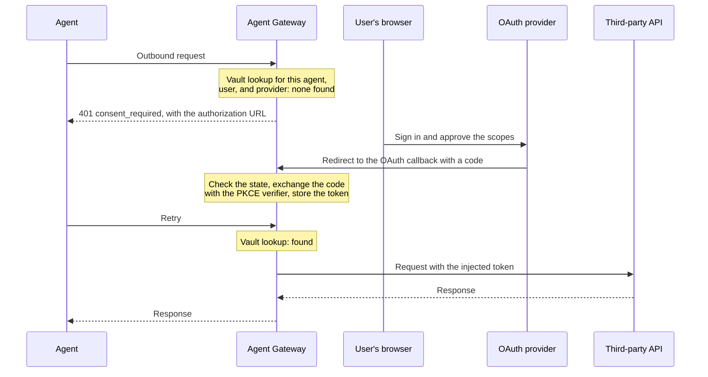

# Credential Delegation

How the gateway lets a managed agent call a third-party API with credentials the agent
never holds. For a user-facing flow, the credentials belong to the human the agent acts
for, and are obtained with that person's consent.

Use the hosted [per-caller credential delegation guide](https://docs.affinidi.com/products/affinidi-trust-fabric/agent-gateway/how-to-guides/setup/configure-per-caller-credential-delegation/)
for the operator procedure. This page documents the implementation in
[`src/credential_providers/`](../src/credential_providers/),
[`src/delegation_vault/`](../src/delegation_vault/), and
[`src/proxy/credential_delegation.rs`](../src/proxy/credential_delegation.rs).

## Moving parts

| Part | What it is |
| --- | --- |
| Credential provider | A configured OAuth 2.0 or API-key provider, such as Google or GitHub. Defined once and referenced by any number of surfaces. |
| Outbound credential binding | An entry in a surface's `outbound_credentials` naming a provider, the scopes, when it applies, and how the token is injected. |
| Delegation vault | Where obtained tokens are kept, one per agent, user, and provider. |
| Delegation audit log | A record of every lookup, consent prompt, refresh, and injection. |

## Credential providers

`CredentialProvider` ([`src/credential_providers/mod.rs`](../src/credential_providers/mod.rs))
has five types, set by `provider_type`.

| Type | Flow | Consent |
| --- | --- | --- |
| `oauth2_authorization_code` | Three-legged OAuth. The user signs in to the provider and approves the scopes. | Required, per user |
| `oauth2_client_credentials` | Two-legged, machine to machine. The gateway authenticates as the client with a client secret. | None |
| `oauth2_jwt_bearer` | JWT Bearer grant (RFC 7523 section 2.1). The gateway signs a JWT with the provider's private key and posts it as the `assertion`; no client ID or secret. A Google service account for Vertex AI Agent Engine works this way. | None |
| `oauth2_client_credentials_jwt_auth` | Client Credentials grant whose client authenticates with a signed JWT (`private_key_jwt`, RFC 7523 section 2.2) instead of a client secret. An Entra certificate credential (key named by certificate thumbprint) and an Ory `private_key_jwt` client (key named by `kid`) work this way. | None |
| `api_key` | A static key resolved from the secrets store. No OAuth. | None |

A provider carries its authorization and token endpoints and its default scopes. Its
client ID, client secret, signing key and certificate are **references** into the secrets
store, such as `GOOGLE_CLIENT_SECRET`, and are never stored in the provider record itself.

### Providers that sign a JWT

The two JWT types share the settings in `JwtAssertionSettings`; create and update refuse a
record that misses a required one.

| Field | `oauth2_jwt_bearer` | `oauth2_client_credentials_jwt_auth` |
| --- | --- | --- |
| `jwt_signing_key_secret_ref` | Required: a PEM private key (PKCS#1 or PKCS#8 for RSA, PKCS#8 for EC) | Required |
| `jwt_signing_algorithm` | `RS256` (default) or `ES256` | `PS256` (default) or `RS256` |
| `jwt_issuer` | Required: the `iss` claim, a service account's `client_email` | Not used: `iss` and `sub` are the client ID |
| `jwt_subject` | Optional `sub` (domain-wide delegation) | Not used |
| `jwt_certificate_secret_ref` | Not used | Optional: the PEM certificate, whose SHA-256 thumbprint goes in the `x5t#S256` header. Entra needs it; issuers that find the key by `kid`, such as Ory, do not |
| `client_id_secret_ref` | Not used | Required, sent as `client_id` |
| `client_secret_secret_ref` | Not used | Refused, so a misconfiguration cannot fall back to a client secret |
| `jwt_audience` | Optional `aud`; the token endpoint when unset | The same |
| `jwt_key_id` | Optional `kid` header, a Google key's `private_key_id` | Optional `kid` header, such as the `kid` of the key in an Ory client's JWKS. The dashboard warns when neither it nor a certificate is set, since the server may then not find the key |

Create and update resolve the referenced key and certificate after checking the caller may
use them, and refuse with 400 a key that cannot sign with the algorithm or a certificate that
is not PEM, so a wrong format fails the save rather than the first token request.
`POST /api/v1/credential-providers/validate` runs the same check before a save: it needs the
credential provider edit permission, applies the caller's tenant to the secrets it names, and
answers `"key_material": "ok"` beside the token endpoint's reachability. JWK keys are not
accepted. The provider API never returns the key or certificate; the list leaves out
their references too.

Every token request signs a fresh assertion that lives 5 minutes (`iat`, `exp`, and for a
client assertion `nbf` and a random `jti`); only the issued access token is cached. A JWT
Bearer grant sends the scopes in the `scope` claim, a client assertion in the `scope` form
field (Entra: `<audience>/.default`). Entra needs the tenant-specific v2.0 token endpoint, not
`common`. An update that sends a reference or JWT field as an empty string clears it, which
is how a client-credentials provider switches to `oauth2_client_credentials_jwt_auth`; a create
reads an empty reference as none.

### Service tokens

`oauth2_client_credentials`, `oauth2_jwt_bearer`, `oauth2_client_credentials_jwt_auth` and
`api_key` give the gateway a credential of its own, with no user.
[`service_token::acquire`](../src/delegation_vault/service_token.rs) obtains it for every path
that needs one: legacy and `2026-07-28` delegation bindings, and target authentication.

- An API key is read from the secrets store on every use and never cached.
- An issued token is cached in the delegation vault until 60 seconds before its `expires_at`,
  then a new one is requested. A token response without `expires_in`, with an empty token, or
  with a `token_type` other than `Bearer` is refused, as is a response over 64 KiB or slower
  than 30 seconds; only the response's OAuth `error` fields are logged.
- When scopes were requested, the issued `scope` must name the same set, or the token is
  refused; when none were requested, the issued scopes are kept.
- The provider is read again after the token request, and a provider changed meanwhile
  refuses the token.
- `resource` is sent only when the provider sets it, on every path including legacy bindings.
  The Microsoft identity platform v2.0 token endpoint rejects it (AADSTS901002): put the audience
  in the scopes as `<resource>/.default` instead. The dashboard warns on the provider form and
  list when an Entra v2.0 provider sets `resource`.

Concurrent requests that all miss the cache each request a token; the last one stored wins.

## Binding a provider to a surface

Each entry in `AgentSurface.outbound_credentials`
([`OutboundCredentialBinding`](../src/config/types.rs)) decides four things.

| Field | Options | Default |
| --- | --- | --- |
| `required_for` | `all` outbound requests, or `tools`: a list of MCP tool names, matched against `params.name` of a `tools/call` on Access Points and Fabric receive, never on Transit Points | `all` |
| `consent_mode` | `on_demand`, `pre_authorize`, or `elicit` | `on_demand` |
| `inject_as` | `bearer_header`, `custom_header { name, format }`, or `meta { field }` | `bearer_header` |
| `scopes` | Scopes to request | The provider's defaults |

`custom_header` takes a format string, so a provider that expects `token {value}` rather
than `Bearer {value}` still works. `meta` writes the token into a JSON-RPC `_meta` field
instead of a header.

A binding carries no destination, so where it applies depends on the hop.

- **Access Points and Fabric receive** forward only to their own Target, so a `tools`
  binding applies to a `tools/call` whose `params.name` it lists.
- **Transit Points** never apply a `tools` binding. A partner upstream names its own tools,
  so matching its tool names would hand it a credential meant for the Target's tools. A
  `tools` binding that lists a JSON-RPC method, such as `tools/call` or `message/send`,
  does not apply there either.

An `all` binding in `outbound_credentials` applies on every Transit Point of the surface, so
every partner upstream behind them receives the delegated credential; use it only when every
Transit Point's upstream should hold the credential. A surface with no `outbound_credentials`
applies each Transit Point's own `transit_credentials` on that Transit Point only. A surface
with `outbound_credentials` ignores `transit_credentials`.

### Credential headers on a Transit Point

A Transit Point sends its target at most one value of each credential header, by the same
rule over HTTP and Fabric. It starts from the managed agent's headers, without the agent's
`Authorization` and `Cookie` and without a header named like the Transit Point's
`target_auth` header, whether or not the gateway adds that header to this request. It then
adds the `target_auth` header, and then the `bearer_header` and `custom_header` credentials of
its bindings, each replacing any earlier header of the same name. On a `2026-07-28` MCP
request, the credentials prepared for `outbound_credentials` are applied last in the same
way. So the managed agent can neither supply nor replace a credential, and a delegated
credential under the same name as `target_auth` replaces it; give them different names to
send both.

### The caller on a Transit Point

A Transit Point looks a grant up by the caller's identity hash and the managed agent's DID.
The caller is the transit token's when the request carries a valid transit token with a
`user_identity_hash`. Otherwise, when the Transit Point's own `source_auth` verified the
caller (see [`SOURCE_AUTH.md`](SOURCE_AUTH.md#transit-point-source-authentication)), it is
that caller's [identity hash](#the-callers-identity-hash), the value the Access Point computes
for a caller it authenticated the same way. So:

- an agent that calls the Transit Point with a JWT from the same issuer, for the same `sub`,
  as a user who consented through the Access Point is given that user's grant; a JWT from
  another issuer, or the same name verified another way, is another caller;
- an API-key caller is one identity: every request with a key from the same `api_key`
  secret, or with the same `api_key_provider` key, shares one set of grants;
- a JWT without a `sub` names no caller and is given no grant.

A caller verified by a resource access token (`mcp_http.authorization`) keys a grant only on
a `2026-07-28` MCP request. The agent half of the key is the Transit Point's
[managed identity](SOURCE_AUTH.md#managed-identity), else the caller DID the transit token
carries, so a `source_auth` caller without a transit token needs a managed identity for the
Transit Point.

## Target authentication from a credential provider

A Target's `target.auth` or a Transit Point's `target_auth` can take its credential from a
credential provider instead of a static secret:

```json
{
  "method": {
    "credential_provider": {
      "provider_id": "<credential provider id>",
      "header_name": "Authorization",
      "header_format": "Bearer {value}",
      "scopes": ["https://www.googleapis.com/auth/cloud-platform"]
    }
  },
  "fallback": "reject"
}
```

`header_name` defaults to `Authorization`, `header_format` to `Bearer {value}`, and `scopes`
to the provider's default scopes. The provider can be any type but
`oauth2_authorization_code`, which needs a user's consent; a surface save refuses that type, a
provider the surface's tenant cannot reference, and the never-implemented `credential_lookup`
method, which still loads from storage. The provider is a reference of the surface, so it
cannot be deleted while a surface uses it.

The token is a service token (see above), cached in the vault under the agent half
`surface:<surface_id>` and the user half `__target_auth__:<provider digest>:<scope hash>`, where
the scope hash is the SHA-256 (hex) of the sorted, deduplicated scopes joined by spaces.
Changing the provider changes the digest, so a token issued under the old settings is never
reused; a Target and a Transit Point that use one provider with different scopes each keep
their own token. The token shows in the Credential Tokens tab like any other. The credential is sent only on a
request the gateway vetted (`CallerAssertion`), so a provider token is never spent on an
unauthenticated discovery request, except on the gateway's own agent card fetch. A token that
cannot be obtained follows `fallback`: `reject` answers 502 "Target authentication failed",
`passthrough` forwards without the credential, and the cause is logged only. A `401` from the
target does not evict the cached token.

`POST /v1/mcp-proxies/discover`, the Surface Builder's design-time tool listing, still accepts
only `static_secret` target authentication, so listing the tools of an MCP server behind an
OAuth-protected endpoint needs a static secret for now.

## When a token is missing

Delegation needs a user to key the token by, so a surface with delegation but no
authenticated source identity rejects the request with HTTP 403 `identity-required`. For an
authenticated caller, the consent mode decides what happens the first time.

| Mode | Behaviour |
| --- | --- |
| `on_demand` | The request fails with HTTP 401 and an `application/problem+json` `consent_required` body carrying the authorization URL. The caller has to interpret this payload itself; it is not the MCP elicitation mechanism. |
| `pre_authorize` | The session is refused at bind or `initialize` time until every binding's token already exists. After that, runtime traffic never sees a consent prompt. |
| `elicit` | Spec-compliant MCP elicitation. The gateway sends `elicitation/create` back over the open Streamable HTTP or SSE stream, with the authorization URL in the message, and waits up to `elicit_timeout_secs` (300 by default) for the user to finish or decline. Accepted risk: the stream and the pending prompt are keyed by surface and `Mcp-Session-Id`, not bound to the caller, so within one surface a caller holding another user's session id can receive that user's authorization URL, or answer or cancel their prompt. Isolation relies on the upstream issuing unguessable session ids; see "MCP session ownership" under Recorded Decisions in `docs/MCP_METADATA.md`. |

`elicit` needs an MCP client that advertised the `elicitation` capability during
`initialize`, and a capability record for its session. `elicit_fallback` decides
what happens when either is missing: `on_demand`, the default, degrades to the 401
response, and `fail` records `elicitation_unsupported` and forwards the tool call without
the credential. Elicit falls back when:

- the client did not advertise `elicitation`;
- the upstream returned a session id already in use on the surface (see "MCP session
  ownership" in `docs/MCP_METADATA.md`);
- the gateway has no capability record for the session, because the upstream answered
  `initialize` with SSE, sent an unusable `Mcp-Session-Id`, or the gateway restarted
  after the session opened.

A user who declines or cancels the elicitation, or does not answer before
`elicit_timeout_secs`, also has the call forwarded without it.

### When a credential cannot be resolved

A binding that applies but whose credential cannot be resolved refuses the request rather
than forwarding it without the credential. That covers a deleted or unreadable provider, an
API key whose secret cannot be read, a failed client-credentials token request, a vault read
error, and consent that is needed but cannot be asked for because no authorization URL can be
built, for example when the provider has no `authorization_endpoint`. A failed token request
records `client_credentials_failed`, `jwt_bearer_failed` or `client_credentials_jwt_auth_failed`
by provider type. An Access Point and
Fabric receive answer `503`: on an MCP surface a JSON-RPC error (`-32603`, `Delegated
credentials unavailable`) carrying the request's id, otherwise an `application/problem+json`
body. The delegation audit records the binding's outcome, and `provider_unavailable` names a
provider that cannot be used.

A Transit Point refuses such a request with `503`, and also refuses with `403` one that names
no caller, because neither a transit token with a caller identity nor the Transit Point's
`source_auth` identifies one. That includes every request to a Transit Point that serves callers it
does not authenticate and every request to one that sets `require_transit_token: false` without
`source_auth` (a valid transit token sent there names the caller to policy only, not to
delegation), or for which neither its managed identity nor the transit token's caller DID gives
the agent half of the vault key. It also refuses when its delegation
stores are not available. An MCP Transit Point answers with a JSON-RPC error (`-32603` for
`503`, `-32001` for `403`) carrying the request's id, and any other Transit Point with an
`application/problem+json` body. A missing token still gets the consent answer above. A
Transit Point forwards a `GET` of a public discovery path, such as an agent card, without
checking a transit token, so it carries no caller, and it is forwarded without a delegated
credential, as it is without the `target_auth` one.

Outside these checks a request is still forwarded without the credential: on an Access Point
or Fabric receive whose delegation stores
are not available, on Fabric receive for a request with no user identity, and on the `elicit`
outcomes above.

A grant is looked up by the managed agent's DID, the caller's identity hash and the provider,
not by surface or Transit Point. Surfaces that share an agent DID, such as surfaces whose
managed identity is derived from the same JWT claim, therefore release to each other the
grants a user consented to on either. A Transit Point never looks a grant up under a
placeholder agent.

## Across Fabric

When a surface's Target or Transit Point is `fabric://`, its delegated credential reaches the peer
only if that Target or Transit Point opts in with `fabric_delegated_credentials: true`. The setting
is off by default, including on existing surfaces. With it off, the caller's own token is still
stripped and the peer receives no delegated credential.

With it on, the access token, never the refresh token, crosses to the peer, which can use it until
it expires. On the Target only a modern (`2026-07-28`) request carries it, inside the encrypted
framed stream; a legacy MCP or A2A request never does. On a Transit Point, every protocol carries
it, including A2A through header injection. A Transit Point on a surface without `outbound_credentials` uses only its own
`transit_credentials`, never another Transit Point's, whatever its destination. The surface's
Target uses only `outbound_credentials`, never a Transit Point's `transit_credentials`. Consent, refresh
and revocation stay on the sending gateway. See
[Delegated credentials over Fabric](FABRIC.md#delegated-credentials-over-fabric).

## Consent flow

For an authorization-code provider in `on_demand` mode:



The authorization URL uses PKCE with the `S256` challenge method. The `state` parameter is
an `OAuthState` carrying the agent DID, the user identity hash, the surface, the provider,
a random nonce, an expiry, and the PKCE code verifier. The callback therefore needs no
server-side session to know which request it completes.

`state` is always sealed with AES-256-GCM before it is base64url-encoded, so neither the
provider nor anyone else who sees the authorization URL can read it (the PKCE code verifier
included) or forge one naming a different agent or user. When encryption at rest is
enabled, its key seals the state; otherwise a key derived from `AG_IDENTITY_HASH_PEPPER`
does, so gateways that share the pepper can open each other's states. The callback refuses
a `state` this gateway did not seal, an expired one, and one whose nonce was already used
([`encode_oauth_state`, `decode_oauth_state`, `claim_oauth_state`](../src/delegation_vault/oauth.rs)).
Used nonces are remembered in the gateway process for 15 minutes, longer than a state
lives, so a restart or a different gateway instance does not know about them. A state is
used up only when its credential is stored, so a callback that fails before then, for
example at the token exchange, can be retried with the same state.

The callback lands on `/v1/identity/oauth/callback` unless `gateway.json` sets
`oauth_callback_route`. On success the gateway stores the
token and issues a `DelegationCredential`, a verifiable credential recording the
delegation chain, kept with the token as `delegation_vc`.

## Delegation vault

A `DelegationToken` ([`src/delegation_vault/mod.rs`](../src/delegation_vault/mod.rs)) is
keyed by three values.

| Key | Source |
| --- | --- |
| `agent_did` | The managed agent the delegation is for |
| `user_identity_hash` | The caller's [identity hash](#the-callers-identity-hash), from the identity source authentication established |
| `credential_provider_id` | The provider |

With API-key or mTLS source authentication, every caller presenting the same key or
certificate identity therefore shares one set of delegated tokens.

### The caller's identity hash

`user_identity_hash` is the lowercase hex SHA-256 of the JSON array
`[method, issuer, tenant, subject]`, written as RFC 8785 canonical JSON (no spaces):

| Source authentication | `method` | `issuer` | `subject` |
| --- | --- | --- | --- |
| `jwt_bearer`, and a resource access token | `jwt_bearer` | The token's `iss` | The token's `sub` |
| `api_key` | `api_key` | `""` | The `secret_id` |
| `api_key_provider` | `api_key_provider` | The API Key Provider agent id | The key's id |
| `did_auth` | `did_auth` | `""` | The DID |
| `mtls` | `mtls` | The lowercase hex SHA-256 of the certificate the client certificate was verified against: the configured CA certificate its chain ends at, or with pinned trust the pinned certificate | The principal the `identity_binding` derives |

`tenant` is the surface's `tenant_id`, or `null` on a surface with none. The same subject named
by another method, issuer, API Key Provider agent or tenant is therefore another caller, with
grants of its own. An mTLS caller is keyed by the certificate the gateway trusted, not by the
issuer name its certificate states, so replacing a trusted CA certificate, or a pinned
certificate, gives its callers new identity hashes. A JWT without a non-empty `sub`, or without an `iss`, names no caller: it has
no identity hash, so it is given no delegated credential: an Access Point answers `403`
`identity-required`, and a Transit Point `403`.

The transit token carries the same value, a policy reads it as
`input.transit.caller.user_identity_hash`, and a Workload Binding with `caller_source: did`
puts it in `user_hash`. To compute it for a JWT subject `alice` from
`https://login.example.com` on a surface with no tenant:

```sh
printf '%s' '["jwt_bearer","https://login.example.com",null,"alice"]' | shasum -a 256
```

Delegated credentials stored by a release that keyed them by an earlier form of the identity
hash are never looked up again, but their access and refresh tokens stay in the vault until
they are removed. After upgrading, list the vault (`GET /api/v1/delegation-vault`, or the
Credential Tokens tab on the dashboard's Credentials page) and revoke each entry created before
the upgrade (`DELETE /api/v1/delegation-vault/{id}`, or its delete button), except service tokens (those under
`__client_credentials__`, `__mcp_client_credentials__:` or `__target_auth__:`), which are unchanged. Users connect their accounts again the next time
a credential is needed.

Service tokens have no user, so a legacy binding caches them under the fixed user hash
`__client_credentials__`, a `2026-07-28` binding under `__mcp_client_credentials__:<provider
digest>`, and target authentication under `__target_auth__:<provider digest>:<scope hash>` with
the agent half `surface:<surface_id>`.

A lookup has four outcomes.

| Result | What the gateway does |
| --- | --- |
| Found and valid | Injects the token |
| Expired, with a refresh token | Refreshes it through the provider's token endpoint |
| Expired, no refresh token | Treats it as missing and applies the consent mode |
| Not found | Applies the consent mode |

For a service token, one within 60 seconds of expiry counts as expired and is replaced by a
fresh one, since no user is involved.

### Storage

The vault uses **uncached** storage: tokens are read from disk on each lookup and are not
held in the in-memory cache, so they do not linger in process memory.

The vault is encrypted at rest **only when at-rest encryption is enabled** in the
bootstrap configuration (`[encryption] enabled = true`), because it uses the global
storage configuration like every other store. The default is off. With the default,
access and refresh tokens are written to `_storage/` as plaintext JSON. Enable encryption
at rest on any appliance that holds real user tokens. See
[`CONFIGURATION_REFERENCE.md`](CONFIGURATION_REFERENCE.md#configtoml).

## Management API

| Route | Purpose |
| --- | --- |
| `GET /api/v1/delegation-vault` | List vault entries, as metadata only, without tokens |
| `GET`, `DELETE /api/v1/delegation-vault/{id}` | Read or revoke one entry |
| `DELETE /api/v1/delegation-vault/by-user/{user_hash}` | Revoke every delegation one user has granted |
| `GET /api/v1/delegation-audit` | The delegation audit log |

### Removing grants keyed by the old identity hash

Before the [identity hash](#the-callers-identity-hash) took the method, issuer and tenant, it
was the lowercase hex SHA-256 of the subject alone. A grant stored under that hash is never
found again: the user connects the account again, and the old entry stays in the vault, with
its refresh token, until it is revoked. Both hashes are 64 hex characters, so the vault list
does not show which entries are old. Entries under `__client_credentials__` are not affected.

For each user who connected an account before the upgrade, compute the old hash from the
subject (the JWT `sub`, the API key `secret_id` or key id, the DID, or the mTLS principal) and
revoke it:

```sh
OLD_HASH=$(printf '%s' 'alice' | shasum -a 256 | cut -d' ' -f1)
curl -X DELETE "$GATEWAY/api/v1/delegation-vault/by-user/$OLD_HASH" -H "Authorization: Bearer $TOKEN"
```

When the subjects are not known, list the vault and revoke by `id` every entry, other than
`__client_credentials__`, whose `created_at` is before the upgrade. Do this after every
instance runs the new release, as an instance still on the old one writes the old hash.

Credential providers have their own management routes in
[`src/credential_providers/router.rs`](../src/credential_providers/router.rs), gated on
the `credential_providers.*` permissions.

In the dashboard these live on the Credentials page, under the **Credential Providers**,
**Credential Tokens**, and **Credential Delegation Audit** tabs.

## Related

- [`SOURCE_AUTH.md`](SOURCE_AUTH.md): the source authentication that supplies the user identity.
- [`STS.md`](STS.md): token exchange, a different way of acting on a caller's behalf.
- [`../ARCHITECTURE.md`](../ARCHITECTURE.md): where outbound credentials sit in the request path.
