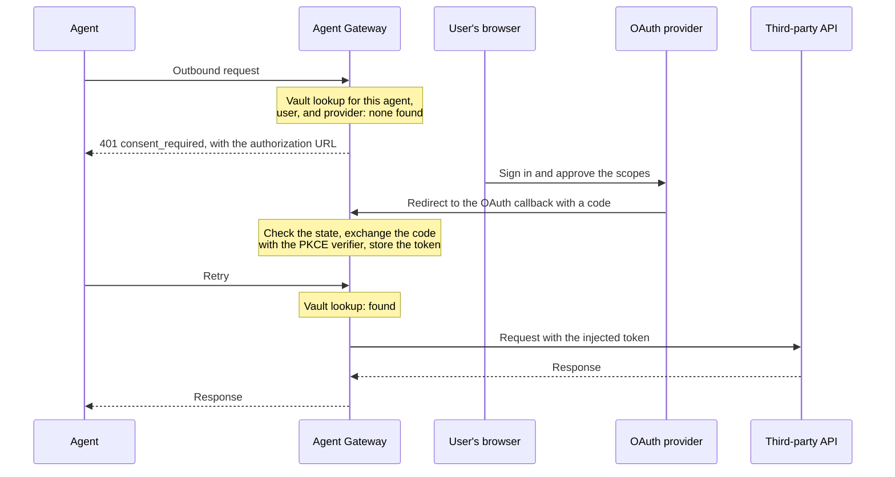

# Credential Delegation

How the gateway lets a managed agent call a third-party API with credentials the agent
never holds. For a user-facing flow, the credentials belong to the human the agent acts
for, and are obtained with that person's consent.

Use the hosted [per-caller credential delegation guide](https://docs.affinidi.com/products/affinidi-trust-fabric/agent-gateway/how-to-guides/setup/configure-per-caller-credential-delegation/)
for the operator procedure. This page documents the implementation in
[`src/credential_providers/`](../src/credential_providers/),
[`src/delegation_vault/`](../src/delegation_vault/), and
[`src/proxy/credential_delegation.rs`](../src/proxy/credential_delegation.rs).

## Moving parts

| Part | What it is |
| --- | --- |
| Credential provider | A configured OAuth 2.0 or API-key provider, such as Google or GitHub. Defined once and referenced by any number of surfaces. |
| Outbound credential binding | An entry in a surface's `outbound_credentials` naming a provider, the scopes, when it applies, and how the token is injected. |
| Delegation vault | Where obtained tokens are kept, one per agent, user, and provider. |
| Delegation audit log | A record of every lookup, consent prompt, refresh, and injection. |

## Credential providers

`CredentialProvider` ([`src/credential_providers/mod.rs`](../src/credential_providers/mod.rs))
has five types, set by `provider_type`.

| Type | Flow | Consent |
| --- | --- | --- |
| `oauth2_authorization_code` | Three-legged OAuth. The user signs in to the provider and approves the scopes. | Required, per user |
| `oauth2_client_credentials` | Two-legged, machine to machine. The gateway authenticates as the client with a client secret. | None |
| `oauth2_jwt_bearer` | JWT Bearer grant (RFC 7523 section 2.1). The gateway signs a JWT with the provider's private key and posts it as the `assertion`; no client ID or secret. A Google service account for Vertex AI Agent Engine works this way. | None |
| `oauth2_client_credentials_jwt_auth` | Client Credentials grant whose client authenticates with a signed JWT (`private_key_jwt`, RFC 7523 section 2.2) instead of a client secret. An Entra certificate credential (key named by certificate thumbprint) and an Ory `private_key_jwt` client (key named by `kid`) work this way. | None |
| `api_key` | A static key resolved from the secrets store. No OAuth. | None |

A provider carries its authorization and token endpoints and its default scopes. Its
client ID, client secret, signing key and certificate are **references** into the secrets
store, such as `GOOGLE_CLIENT_SECRET`, and are never stored in the provider record itself.

### https token endpoints

Every type except `api_key` sends its client secret, assertion or code to the token endpoint,
so the endpoint must be an https URL. An http endpoint meets the rule only when the bootstrap
`[credential_policy] insecure_token_endpoints` lists it exactly (compared as parsed URLs, so
another port or path does not match), or, under `AG_TEST_MODE=true`, when
`AG_BDD_OAUTH_ENDPOINT_ALLOWLIST` lists it exactly. `credential_policy.token_endpoint_https`
sets how the rule is applied (see [Credential policy](CONFIGURATION_RELOAD.md#credential-policy)):

| | `warn` (default) | `enforce` |
| --- | --- | --- |
| Create, or an update that sets a new token endpoint or turns an `api_key` provider into an OAuth type | 400 `token_endpoint must be an https URL` | The same |
| Update that keeps a stored http endpoint | Saved | 400 |
| `POST /api/v1/credential-providers/validate` | 400, before the endpoint is contacted | The same |
| Token request, refresh or code exchange of a stored http provider | Sent, with a warning log | Refused before any secret is read |

The check runs before the provider's secrets are read. In `warn` mode every use of a stored
http provider logs a warning, and a legacy binding's audit detail gains
` insecure_token_endpoint` (for example `client_credentials_cached insecure_token_endpoint`,
`after_refresh insecure_token_endpoint`). In `enforce` mode a service token reports
`TokenEndpointNotHttps` ("credential provider token endpoint is not https"), even for a token
already cached, the legacy code exchange and refresh fail with `token_endpoint must be an https
URL`, and the `2026-07-28` consent exchange answers an invalid record. Move such providers to
https, or list a deliberate http endpoint, before switching to `enforce`.

### Provider secrets belong to the provider's tenant

Every secret a provider references (client ID, client secret, API key, signing key,
certificate) must belong to the provider's own tenant: a tenant provider uses its tenant's
secrets, an appliance-wide provider uses appliance-wide secrets. `credential_policy.tenant_credential_isolation`
sets how the rule is applied (see [Credential policy](CONFIGURATION_RELOAD.md#credential-policy)):

| | `warn` (default) | `enforce` |
| --- | --- | --- |
| Create, or an update that sets a reference to another tenant's or an appliance-wide secret on a tenant provider | 400 `Secret reference is not accessible` | The same |
| Update that keeps a stored reference in the same field, with the type, token and authorization endpoints, `resource`, `additional_params`, `default_scopes` and JWT issuer, subject and audience unchanged | Saved, except on a provider with an `issuer`, which never keeps a secret outside its own tenant | 400 |
| `POST /api/v1/credential-providers/validate` | 400 for a signing key or certificate outside the provider's tenant (another tenant's or, for a tenant provider, an appliance-wide one), before the key is read | The same |
| Authorization URL, code exchange, refresh, service token grant or API key read | The secret is read, with a warning log naming the provider and secret id | Refused before the secret's value is used |

A stored reference is kept only while it goes where it went before. An update that changes one
of those settings, or moves a stored reference to another field (a client secret becoming the
signing key, say), treats every such reference as new and answers 400, so a tenant cannot send
an appliance-wide secret, or an assertion signed with an appliance-wide key, to an endpoint or
audience of its choosing. A kept reference pins that destination, `default_scopes` included, but
not the scopes a surface's Target authentication requests, which replace the default scopes on
that leg.

In `enforce` mode a service token or API key whose secret is outside the provider's tenant
reports `SecretUnavailable`, and no token request is sent. A cached service token is checked
against the same rule on every use, reading each secret the type sends by id, so it stops being
served as soon as the rule is enforced. Move such secrets into the provider's tenant before
switching to `enforce`.

The save rule above covers every reference the provider stores. A leftover reference in a field
the provider's type does not send, such as an `api_key_secret_ref` kept after a provider changed
from `api_key`, is ignored at runtime (see [Service tokens](#service-tokens)), but it still counts
for the provider save rule, for the surface save rule in
[Tenant isolation on a surface's upstream legs](#tenant-isolation-on-a-surfaces-upstream-legs)
and for the startup credential policy report.

### Providers that sign a JWT

The two JWT types share the settings in `JwtAssertionSettings`; create and update refuse a
record that misses a required one.

| Field | `oauth2_jwt_bearer` | `oauth2_client_credentials_jwt_auth` |
| --- | --- | --- |
| `jwt_signing_key_secret_ref` | Required: a PEM private key (PKCS#1 or PKCS#8 for RSA, PKCS#8 for EC), or a Google service account JSON key file, whose `private_key` is used | Required |
| `jwt_signing_algorithm` | `RS256` (default) or `ES256` | `PS256` (default) or `RS256` |
| `jwt_issuer` | Required: the `iss` claim, a service account's `client_email` | Not used: `iss` and `sub` are the client ID |
| `jwt_subject` | Optional `sub` (domain-wide delegation) | Not used |
| `jwt_certificate_secret_ref` | Not used | Optional: the PEM certificate, whose SHA-256 thumbprint goes in the `x5t#S256` header. Entra needs it; issuers that find the key by `kid`, such as Ory, do not |
| `client_id_secret_ref` | Not used | Required, sent as `client_id` |
| `client_secret_secret_ref` | Not used | Refused, so a misconfiguration cannot fall back to a client secret |
| `jwt_audience` | Optional `aud`; the token endpoint when unset | The same |
| `jwt_key_id` | Optional `kid` header. It overrides the `private_key_id` of a JSON key file, which is the default `kid` | Optional `kid` header, such as the `kid` of the key in an Ory client's JWKS. The dashboard warns when neither it nor a certificate is set, since the server may then not find the key |

Create and update resolve the referenced key and certificate after checking the caller may
use them, and refuse with 400 a key that cannot sign with the algorithm or a certificate that
is not PEM, so a wrong format fails the save rather than the first token request. A JSON key
file is checked the same way; the key secret may be at most 16 KiB.
`POST /api/v1/credential-providers/validate` runs the same check before a save: it needs the
credential provider edit permission, applies the caller's tenant to the secrets it names, and
answers `"key_material": "ok"` beside the token endpoint's reachability. JWK keys are not
accepted. The provider API never returns the key or certificate; the list leaves out
their references too.

Every token request signs a fresh assertion that lives 5 minutes (`iat`, `exp`, and for a
client assertion `nbf` and a random `jti`); only the issued access token is cached. A JWT
Bearer grant sends the scopes in the `scope` claim, a client assertion in the `scope` form
field (Entra: `<audience>/.default`). Entra needs the tenant-specific v2.0 token endpoint, not
`common`. An update that sends a reference or JWT field as an empty string clears it, which
is how a client-credentials provider switches to `oauth2_client_credentials_jwt_auth`; a create
reads an empty reference as none.

### Service tokens

`oauth2_client_credentials`, `oauth2_jwt_bearer`, `oauth2_client_credentials_jwt_auth` and
`api_key` give the gateway a credential of its own, with no user.
[`service_token::acquire`](../src/delegation_vault/service_token.rs) obtains it for every path
that needs one: legacy and `2026-07-28` delegation bindings, and target authentication.

- An API key is read from the secrets store on every use and never cached.
- Every token request (Client Credentials, JWT Bearer, `private_key_jwt` and refresh) is sent
  on a client pinned to the addresses the token endpoint resolved to when it was checked, with
  redirects off. The pin holds when no HTTP proxy is configured: a client that honours
  `HTTPS_PROXY`, `HTTP_PROXY` or `ALL_PROXY` lets the proxy resolve the host
  ([Other pinned egress sinks](POLICY.md#other-pinned-egress-sinks)). A host resolving to loopback, an unspecified address or cloud metadata is
  refused before any request, reported as `TokenEndpointRefused` ("credential provider token
  endpoint refused by egress policy"); RFC 1918 addresses stay allowed. Under
  `AG_TEST_MODE=true`, `AG_BDD_OAUTH_ENDPOINT_ALLOWLIST` admits listed loopback test endpoints
  (never cloud metadata).
- An issued token is cached in the delegation vault and renewed half its lifetime before its
  `expires_at`, but at most 5 minutes and at least 60 seconds before (a one-hour token is
  renewed 5 minutes early, a 100-second one 60 seconds early). One request renews it while the
  others keep using the cached token. When the renewal fails at the token endpoint
  (`TokenRequestFailed`, `ScopeMismatch`) or is held back by the retry backoff, the cached token
  is still used, marked stale, until 60 seconds before it expires; after that the request fails.
  A legacy binding's audit detail then reads `<grant>_stale` (for example
  `client_credentials_stale`) in place of `<grant>_cached` or `<grant>_fresh`, and each use
  logs a warning.
  A changed provider, a missing secret, a provider setting or signing key the grant cannot use
  (`ProviderMisconfigured`, reported as a failed token request), a secrets store or vault error, or a token endpoint the
  egress or https rule refuses never serves the stale token. Its key is `<purpose>:<hash>`, where the hash is the hex SHA-256
  of the provider's digest, the sorted, deduplicated scopes, and the id, tenant and `updated_at`
  of each secret the provider's type sends: the client ID and secret of `oauth2_client_credentials`,
  the signing key and certificate of `oauth2_jwt_bearer`, and the client ID, signing key and
  certificate of `oauth2_client_credentials_jwt_auth`. Editing the provider, rotating one of
  those secrets or moving one to another tenant therefore requests a new token instead of
  reusing one issued under the old settings. A reference the type does not send, such as an
  `api_key_secret_ref` kept after a provider changed from `api_key`, is neither read nor part of
  the key, so rotating or deleting its secret changes nothing at runtime; it still counts for the
save rules and the startup report ([Provider secrets belong to the provider's
tenant](#provider-secrets-belong-to-the-providers-tenant)).
  Each use looks up only those secrets, one read each (decrypted when
  encryption at rest is on), and a token request reads each secret it sends once more by its
  id; neither asks the store for a listing, though the filesystem store rescans its directory to
  rebuild its id index when it is asked for an id it does not know. A secret the type sends that
  no longer exists reports `SecretUnavailable` and a secrets store error `StoreUnavailable`;
  neither serves the cached token nor sends a request.
- The expired tokens of the same agent, provider and purpose (those left by earlier
  settings, scopes or secret versions) are removed from the vault in the same step that
  stores the new token, under the same vault lock and the same read of the vault, so a fresh
  token costs one scan of the vault, not two. Unexpired tokens, user grants and pending
  consents are kept, and so are the refresh claims of the tokens that are kept. A failure to remove them is logged as a warning only and does
  not fail the store. A token response without `expires_in`, with an empty token, or
  with a `token_type` other than `Bearer` is refused, as is a response over 64 KiB or slower
  than `credential_policy.token_request_timeout_secs` (30 by default); only the response's OAuth `error` code is logged (see _Logging token endpoint errors_ below).
- When scopes were requested, the issued `scope` must name the same set, or the token is
  refused; when none were requested, the issued scopes are kept.
- The provider is read again after the token request, and a provider changed meanwhile
  refuses the token.
- `resource` is sent only when the provider sets it, on every path including legacy bindings.
  The Microsoft identity platform v2.0 token endpoint rejects it (AADSTS901002): put the audience
  in the scopes as `<resource>/.default` instead. The dashboard warns on the provider form and
  list when an Entra v2.0 provider sets `resource`.

Each replica sends one token request per cache key at a time. Requests that miss the cache
meanwhile wait for it, then read the vault again, so they reuse the token it stored, or one
another replica stored, instead of requesting their own. Requests for other scopes, providers or
surfaces do not wait. A key's place in this queue is kept while any request holds or waits for it,
however many keys are in use. Replicas do not coordinate, so each may request one token for the same key.

After a token request fails, or its issued scopes do not match (`TokenRequestFailed`,
`ScopeMismatch`), the next request for the same cache key (surface, provider, scopes and secret
versions) waits 1 second from the end of the failed request, doubling after each further failure
up to 60 seconds. A request arriving before then fails at once with `TokenRequestFailed`, without
contacting the provider. A successful request clears the wait, and editing the provider or
rotating a secret the provider's type sends starts a new key with no wait. Failures found before any request is sent never start a wait: a
missing or refused secret (`SecretUnavailable`), a secrets store or vault error
(`StoreUnavailable`), a token endpoint the egress or https rule refuses (`TokenEndpointRefused`,
`TokenEndpointNotHttps`), a provider changed during the request (`ProviderChanged`) or an
unsupported provider type. The wait is kept in memory on each replica and resets on restart, and the
count of failures is forgotten 10 minutes after the retry time, so the next failure waits 1 second again.

### Logging token endpoint errors

A credential provider's token endpoint can answer an error response that echoes the request or
explains it in free text. The gateway keeps only its OAuth `error` code (RFC 6749 section 5.2):
1 to 64 bytes of `%x20-21 / %x23-5B / %x5D-7E`, or `unrecognized_error` when the code is missing or
breaks that rule. `error_description`, `error_uri` and the rest of the body are never logged,
returned in an error message or written to a delegation audit detail. This holds for code
exchange, refresh, service token grants, the Microsoft Graph API token used for SAML avatars and
the `error` an authorization callback carries.

Logs about a token request may name the provider id, the surface id, the HTTP status and the
OAuth error code. They never carry a secret, a client assertion, a token, the response body or
`error_description`.

A provider's `provider_id` slug is unique per tenant, and among the untenanted providers. The
slug is compared as stored, trimmed and in lower case.

### External consent providers

A provider with an `issuer` is an external consent provider: one OAuth client of one
authorization server, whose grants another system obtains through the browser with the
[connect API](#the-connect-api) and the gateway keeps in the vault by binding. Its fields:

| Field | Rule |
| --- | --- |
| `provider_type` | `oauth2_authorization_code` |
| `issuer` | An `https` issuer without credentials, query or fragment |
| `authorization_endpoint`, `token_endpoint` | Required |
| `revocation_endpoint` | The RFC 7009 endpoint, exactly when the issuer's metadata names one |
| `client_id` | Required, a plain value: a client id is not a secret. `client_id_secret_ref` is refused |
| `token_endpoint_auth_method` | `none`, `client_secret_basic`, `client_secret_post` or `private_key_jwt`. `client_secret_secret_ref` is required for `client_secret_basic` and `client_secret_post` and refused for the others |
| `jwt_signing_key_secret_ref`, `jwt_certificate_secret_ref`, `jwt_key_id`, `jwt_signing_algorithm` | Only with `private_key_jwt`, the [signed-JWT settings](#providers-that-sign-a-jwt) of an `oauth2_client_credentials_jwt_auth` provider: the signing key is required and the algorithm is `PS256` (the default) or `RS256`. The key and certificate are checked when the provider is created. `jwt_audience` is refused, since the assertion is always addressed to the issuer, and so are `jwt_issuer` and `jwt_subject`, since the client is the issuer and subject of its assertion. Without `private_key_jwt` all are refused |
| `callback_url` | Required, `https`: the redirect URI the other system registered |
| `resource` | Required, a canonical public `https` URI (RFC 8707): the protected resource the grants are for. Its origin is the only one a Transit Point sends the provider's grants to ([External consent on a Transit Point](#external-consent-on-a-transit-point)), and it must be permitted for the issuer (below). The API returns it as `resource_origin`, so a client can show the person where the grant will go |
| `allow_unadvertised_pkce` | Optional, `false` by default. `true` admits an issuer whose metadata does not list `code_challenge_methods_supported`; see below |
| `scope_comparison` | Optional, `exact` by default: how the scopes the token endpoint grants are compared with those asked for ([Granted scopes](#granted-scopes)) |
| `revocation_ends_authorization` | Optional, `false` by default. `true` for a vendor whose revocation of any one token ends the person's whole authorization of the client, as Google's does ([Revoking grants at the vendor](#revoking-grants-at-the-vendor)) |
| `additional_params`, `consent_identity_strategy_id`, `api_key_secret_ref` | Refused |

An external consent provider uses its own tenant's secrets only, for its client secret, its
signing key and its certificate: never an untenanted secret, nor another tenant's, since its
client authenticates at endpoints its tenant chose. An untenanted provider uses untenanted
secrets only. Both are checked when the provider is created and again on every use, so a
provider moved to another tenant stops using the secrets of the one it left. For the rule on
other providers, and when a stored reference is kept, see
[Provider secrets belong to the provider's tenant](#provider-secrets-belong-to-the-providers-tenant).

Every endpoint, and `resource`, must be an `https` URL without credentials or fragment whose
host is no literal loopback, private, link-local or cloud-metadata address (the Strict egress
posture's static check). At create only the issuer's metadata fetch resolves a name; a vendor
name that resolves to a blocked address is refused when the gateway calls it, since every call
to a vendor endpoint goes through pinned Strict egress. A provider without an `issuer` cannot
set `revocation_endpoint`, `token_endpoint_auth_method`, `client_id`, `allow_unadvertised_pkce`,
`scope_comparison` or `revocation_ends_authorization`, the last three of which are fixed for the
provider's life.

A provider's resource must be permitted for its issuer. By default its host must be the
issuer's host or one of its subdomains: for the issuer `https://mcp.notion.com`, a resource on
`mcp.notion.com` or `api.mcp.notion.com`, but not `api.notion.com`, `evil-notion.com`,
`mcp.notion.com.evil.example` or a look-alike name. Hosts are compared as the URL parser
normalises them, in lower case and with international names in punycode, label by label; an IP
address permits only itself. Any other resource origin must be listed for the issuer's origin
in `external_consent_resource_origins` in `gateway.json`, which only the operator's file sets:

```json
"external_consent_resource_origins": {
  "https://accounts.google.com": ["https://www.googleapis.com"]
}
```

Each key and value is an exact `https` origin: no wildcard, path, userinfo, query or fragment,
and a host that is an IP address or a plain DNS name (letters, digits and `-` in each label).
List each host on its own: `https://*.googleapis.com` is not a wildcard. An entry that is not
such an origin permits nothing, not even the literal origin it spells, and is named in an `ERROR`
at startup. The value is read once, when the gateway starts: provider create, surface save and
every request use it, and a configuration reload keeps it, with a `WARN` when the file says
otherwise, so a change takes a restart.
The rule is checked when the provider is created (`400`, `provider_resource_not_permitted`),
when a surface binds the provider (`400`), and again whenever a grant is released: a provider
whose resource is no longer permitted, because its entry was removed, releases nothing, and the
log names the reason `resource_not_permitted_for_issuer`. The default compares hosts rather
than registrable domains, so an issuer and a resource on sibling subdomains of one site need an
entry: telling a site's own subdomains from other customers' on a shared suffix needs the public
suffix list, which the gateway does not carry.

When the provider is created, the gateway reads the issuer's authorization server metadata
(RFC 8414, then OpenID Connect discovery) under the client profile of
[`authz_metadata`](SOURCE_AUTH.md#authorization-server-metadata-module-developer-reference),
through a pinned, bounded fetch under the Strict posture, and refuses the provider unless:

- the metadata's `issuer` equals the provider's byte for byte;
- the authorization, token and revocation endpoints are the ones the metadata names, byte for
  byte, a revocation endpoint included exactly when the metadata names one;
- `token_endpoint_auth_methods_supported` lists the provider's method, or, when the metadata
  lists none, the method is `client_secret_basic` (the RFC 8414 default), so `private_key_jwt`
  needs a server that lists it;
- `code_challenge_methods_supported` includes `S256`. A document that does not list the methods
  is refused too: the MCP authorization specification (`2025-11-25` and later) tells clients to
  refuse to proceed with such a server, and a server that ignores `code_challenge` would void
  the PKCE verifier. The one exception is a provider that sets `allow_unadvertised_pkce: true`,
  for a server known to enforce S256 without listing it, such as Microsoft Entra ID. The
  exception never admits a list without `S256`.

The gateway records the metadata's `authorization_response_iss_parameter_supported` (RFC 9207)
on the provider; a request cannot set it. A connect for such a provider is completed only with
the `iss` the authorization response carried ([The connect API](#the-connect-api)). So is a
connect for a provider created before the gateway recorded it: nothing says its issuer omits
`iss`. Recreate such a provider for an issuer that sends none.

#### Granted scopes

A token answer's `scope` names what the token holds, in the vendor's own words. Vendors add
standard identity scopes nobody asked for, and rename the ones asked for, so a byte-for-byte
comparison would refuse grants that are no wider. A provider names its vendor's habits with
`scope_comparison` ([`src/credential_providers/scope_comparison.rs`](../src/credential_providers/scope_comparison.rs)):

| `scope_comparison` | Compared as | Not taken for a wider grant |
| --- | --- | --- |
| `exact` (default) | Written, case included (RFC 6749 scope tokens are case-sensitive) | Nothing |
| `oidc` | Written | `openid`, `offline_access` |
| `google` | Written | `openid`, `email`, `profile`, and Google's spelling of the last two, `https://www.googleapis.com/auth/userinfo.email` and `.../userinfo.profile` |
| `microsoft` | Without case, and without the resource that qualifies a name: `https://graph.microsoft.com/Mail.Read` is `mail.read`, as is `Mail.Read` (an Entra token is for one resource) | `openid`, `profile`, `email`, `offline_access`, `User.Read`, which reads the signed-in person's own profile and which Entra gives every app registration by default |

Whatever the comparison, a granted scope that is neither one asked for nor one of those is a
wider grant, and refused (`scope_widened` on a connect, `connect_required` on a refresh, the
tokens revoked). That includes a scope the person consented to the same client for another
connect, which Entra reports with every grant and Google with `include_granted_scopes`. The
default is the safe one: a vendor whose habits nobody vouched for gets nothing beyond what was
asked for, in the very words asked for. The grant keeps both: `scopes`, as the vendor named
them, and the scopes the connect asked for, which every refresh asks for again.

`microsoft` is for Microsoft Entra ID only. It takes `https://outlook.office.com/Mail.Read` and
`https://graph.microsoft.com/Mail.Read` for one scope, which is safe at Entra, whose token is for
the one resource the provider pins; at a vendor whose scopes are URL paths it would take
different scopes, such as `.../projects/read` and `.../admin/read`, for one.

#### Permitted issuers

The checks above show that a provider matches its issuer's metadata, not that the issuer is a
vendor anyone meant to trust: whoever creates a provider can name an issuer whose metadata it
serves itself, with its own token endpoint, which would then receive the authorization code and
the PKCE verifier, and with a resource on its own host. On a gateway whose provider creators
are not the operator, such as a pool gateway that another system provisions, the operator lists
the issuers it trusts in `external_consent_issuers` in `gateway.json`, which only the
operator's file sets:

```json
"external_consent_issuers": {
  "https://mcp.linear.app": [],
  "https://mcp.notion.com": [],
  "https://accounts.google.com": ["https://oauth2.googleapis.com"]
}
```

Each key is an issuer identifier, compared with the provider's `issuer` exactly, as RFC 8414
compares issuers; it must be an `https` issuer with a plain host and no credentials, query or
fragment. Its value lists the origins, exact as in `external_consent_resource_origins`, that the
issuer's authorization, token and revocation endpoints and its metadata's `jwks_uri` may use
when they are not on the issuer's own host (any port of that host; a subdomain is another host).
With the setting, a provider is permitted only when its issuer is listed and each of those
endpoints is on the issuer's host or has a listed origin. An empty object permits no issuer.
Without the setting, an operator's token may name any issuer whose metadata the provider
matches, as before, but a tenant's token cannot create a provider with an issuer at all (`400`,
`external_consent_issuers_required`, telling the operator to set the list), since the tenant
would choose the endpoints its client authenticates at. An
entry that is not a plain `https` issuer or origin permits nothing and is named in an `ERROR` at
startup; the startup log says whether the setting is on. The value is read once, when the
gateway starts: provider create, surface save, the connect API and every request use it, and a
configuration reload keeps it, with a `WARN` when the file says otherwise, so a change takes a
restart.

The rule is checked when a provider is created, before its issuer's metadata is fetched, so an
unlisted issuer is never called (`400`, `provider_issuer_not_permitted`, `field` naming the
issuer or the endpoint); when a surface binds the provider (`400`); when a connect starts and
when it completes; and whenever a grant is refreshed or released. A provider that is no longer
permitted, because its entry was removed, connects, refreshes and releases nothing, and the log
names the reason `issuer_not_permitted`. Set it on every gateway whose providers another
system creates: it is what keeps a compromised provisioner from naming an issuer of its own. It
cannot help an issuer whose own host serves content its users control.

| Refusal (`400`) | `code` | Also |
| --- | --- | --- |
| A rule in the table above | `invalid_provider` | |
| The metadata could not be read or is not acceptable | `provider_metadata_unavailable` | `reason`: `invalid_url`, `unreachable`, `http_status`, `too_large`, `invalid_document` or `issuer_mismatch`. A failure before the server answered is always `unreachable`, so the answer never says whether a name resolves to a blocked address; the log has the detail |
| The provider differs from the metadata | `provider_metadata_mismatch` | `field` names the field |
| An update changes a fixed field | `provider_field_immutable` | `field` names the field |
| The resource is not permitted for the issuer | `provider_resource_not_permitted` | |
| `external_consent_issuers` does not permit the issuer or an endpoint | `provider_issuer_not_permitted` | `field`: `issuer`, `authorization_endpoint`, `token_endpoint`, `revocation_endpoint` or `jwks_uri` |
| A tenant's token creates a provider with an issuer while `external_consent_issuers` is unset | `external_consent_issuers_required` | |

`issuer`, the endpoints, `client_id`, `token_endpoint_auth_method`, the secret references, the
signed-JWT settings, `callback_url`, `resource`, `allow_unadvertised_pkce`, `provider_type` and
the refused fields never change: an update that
sends another value is refused, and one that sends the stored value, such as a round trip of
the whole record, is accepted. The name, description, default scopes and
`token_refresh_enabled` stay editable. A change to the client or its server is a new
provider. An existing provider without an `issuer` cannot take one. So a token that can edit
providers cannot point a provider whose grants are stored at an endpoint of its choosing.

## Binding a provider to a surface

Each entry in `AgentSurface.outbound_credentials`
([`OutboundCredentialBinding`](../src/config/types.rs)) decides four things.

| Field | Options | Default |
| --- | --- | --- |
| `required_for` | `all` outbound requests, or `tools`: a list of MCP tool names, matched against `params.name` of a `tools/call` on Access Points and Fabric receive, never on Transit Points | `all` |
| `consent_mode` | `on_demand`, `pre_authorize`, or `elicit`; `external` on a Transit Point's `transit_credentials` ([external consent on a Transit Point](#external-consent-on-a-transit-point)), or as the only binding of `outbound_credentials`, for the Access Point's Target ([external consent on the Access Point Target](#external-consent-on-the-access-point-target)) | `on_demand` |
| `inject_as` | `bearer_header`, `custom_header { name, format }`, or `meta { field }` | `bearer_header` |
| `scopes` | Scopes to request | The provider's defaults |

`custom_header` takes a format string, so a provider that expects `token {value}` rather
than `Bearer {value}` still works. `meta` writes the token into a JSON-RPC `_meta` field
instead of a header.

A binding carries no destination, so where it applies depends on the hop.

- **Access Points and Fabric receive** forward only to their own Target, so a `tools`
  binding applies to a `tools/call` whose `params.name` it lists.
- **Transit Points** never apply a `tools` binding. A partner upstream names its own tools,
  so matching its tool names would hand it a credential meant for the Target's tools. A
  `tools` binding that lists a JSON-RPC method, such as `tools/call` or `message/send`,
  does not apply there either.

An `all` binding in `outbound_credentials` applies on every Transit Point of the surface, so
every partner upstream behind them receives the delegated credential; use it only when every
Transit Point's upstream should hold the credential. A surface with no `outbound_credentials`
applies each Transit Point's own `transit_credentials` on that Transit Point only. A surface
with `outbound_credentials` ignores `transit_credentials`.

### Credential headers on a Transit Point

A Transit Point sends its target at most one value of each credential header, by the same
rule over HTTP and Fabric. It starts from the managed agent's headers, without the agent's
`Authorization` and `Cookie`, and without any header, every value of it, compared without
regard to case, named like the Transit Point's `target_auth` header or like the
`custom_header` of any credential binding that can apply on it: every binding in the
surface's `outbound_credentials`, `tools` bindings included, or else its own
`transit_credentials`. Those headers are withheld whether or not the gateway adds a value to
this request. It then adds the `target_auth` header, and then the `bearer_header` and
`custom_header` credentials of its bindings, each replacing any earlier header of the same
name. On a `2026-07-28` MCP request, the credentials prepared for `outbound_credentials` are
applied last in the same way. So the managed agent can neither supply nor replace a
credential, and a delegated credential under the same name as `target_auth` replaces it;
give them different names to send both.

A credential header value that is not ASCII is sent to an HTTP target byte for byte. A Fabric
target can carry only text header values, so a Transit Point refuses a Fabric request whose
`target_auth` header cannot be carried with `502`, and one whose delegated credential header
cannot be carried with `503`, rather than forwarding it without the credential.

An Access Point and Fabric receive apply the same rule to the caller's headers: a caller
header named like the Target's `target_auth` header is never forwarded, including
`Authorization` kept by `forward_source_auth_header`, and the `target_auth` header and each
delegated credential header the gateway adds replace every value of that header already on
the request, so the target receives one value of each, the gateway's.

### The caller on a Transit Point

A Transit Point looks a grant up by the caller's identity hash and the managed agent's DID.
The caller is the transit token's when the request carries a valid transit token, and it has
no caller when that token carries no `user_identity_hash`: the request is refused with `403`,
and the client the Transit Point authenticated is not used instead. When the request carries
no valid transit token and the Transit Point's own `source_auth` verified the caller (see
[`SOURCE_AUTH.md`](SOURCE_AUTH.md#transit-point-source-authentication)), it is that caller's
[identity hash](#the-callers-identity-hash), the value the Access Point computes for a caller
it authenticated the same way. So:

- an agent that calls the Transit Point with a JWT from the same issuer, for the same `sub`,
  as a user who consented through the Access Point is given that user's grant; a JWT from
  another issuer, or the same name verified another way, is another caller;
- an API-key caller is one identity: every request with a key from the same `api_key`
  secret, or with the same `api_key_provider` key, shares one set of grants;
- a JWT without a `sub` names no caller and is given no grant.

A caller verified by a resource access token (`mcp_http.authorization`) keys a grant only on
a `2026-07-28` MCP request, and a `2026-07-28` MCP request keys a grant only that way. A
Transit Point cannot have both a resource access token and `source_auth`, so when the
surface has an outbound credential binding for every request (`required_for: all`), every
`2026-07-28` MCP request to a Transit Point whose caller `source_auth` verified, or that a
transit token alone names, is refused with `403` and JSON-RPC error `-32001`, whatever its
method, `tools/list` included, and never reaches the target; a save of such a Transit Point
answers with a `Warning` header. Bindings scoped to tools never apply on a Transit Point, so a
surface with only those sends the request on without delegated credentials. Such a caller
uses delegated credentials on legacy MCP, A2A and HTTP requests. The agent half of the key is the Transit Point's
[managed identity](SOURCE_AUTH.md#managed-identity), else the caller DID the transit token
carries, so a `source_auth` caller without a transit token needs a managed identity for the
Transit Point.

A transit token the gateway issued for a request that arrived over Fabric (see
[`SOURCE_AUTH.md`](SOURCE_AUTH.md#transit-token)) keys a grant only on a Transit Point that
sets `delegated_credentials_for_fabric_callers: true` (off by default), and then only by its
`fabric.principal_hash`: the caller the receiving surface's own `source_auth` or resource token
verified on that request, the same identity hash its Access Point computes for the same
credential. The receiving surface sets it only when its caller authentication tells a partner's
users apart, and the Transit Point checks its own surface again at call time, so a surface stored
with the switch and an API key, for example through a file, releases nothing to partners. The
caller DID or pseudonym the peer gateway sent, and a top-level
`user_identity_hash`, never key a grant, and the caller DID is never the agent half of a key
either, so such a call needs the Transit Point's managed identity: its own `managed_identity`,
or the surface's when the Transit Point injects a VP, in any mode but `from_jwt_claim`. Without
one, a binding that applies refuses every Fabric caller with `403`, and a save of a Transit
Point that sets the switch, on the surface or in an enabled variant, answers with a `Warning`
header saying so. The switch has an effect only on a Transit Point that also sets
`allow_fabric_callers`, since a token issued for a partner's request opens no other.

The switch releases anything only when the receiving surface verifies a per-user credential on
each Fabric request. Only two kinds of caller authentication can tell a partner's users apart: a
resource token (`mcp_http.authorization`), and a `jwt_bearer` method that names an audience (its
own `audiences`, or the resource `protected_resource` binds) through a JWT verification strategy
that names an issuer. Every other method the Access Point lists must be one of them, or mTLS,
which never verifies a request over Fabric and so leaves it with no verified caller. The
receiving surface normally verifies the credential the peer's `target_auth` presents. With
`api_key`, the identity hash is the secret's id, so every key in that secret, the partner's and
those of the surface's direct callers alike, would be one caller with one grant; an
`api_key_provider` key names the client that holds it; a `did_auth` session names the DID that
signed in, not the user a partner acts for; and a `jwt_bearer` method with no audience accepts a
token the identity provider issued for another service. A save of a Transit Point that sets the
switch where the surface's caller authentication, on the surface or in the variant the Transit
Point belongs to, cannot tell users apart is accepted with a `Warning` header saying so, and the
Transit Point releases nothing to Fabric callers there. A JWT whose `sub` is the end user, with
an audience naming this gateway, keys each user apart. A `PUT` that omits the switch keeps it
while the Transit Point requires the transit token, since the Surface Builder does not show it.

A Fabric caller gets only a grant that already exists. It is the grant that user's direct calls
through that Transit Point use: the Transit Point's managed identity and the same identity hash.
Consent is never started for a Fabric caller, since a person consents by connecting to this
gateway directly, never through a partner, and whoever completes an authorization URL binds
their provider account to the user. An opted-in caller with no grant yet is refused with `403`
and the fixed reason `consent_not_available_for_partners`, with no authorization URL and nothing
stored: a JSON-RPC error (`-32001`, the request's id, `data.reason`) on an MCP Transit Point and
an `application/problem+json` body with `reason` otherwise, recorded as a `request_rejected`
audit event at the `admission` stage. So the user first calls the surface's Access Point
directly, with the same credential the receiving surface verifies (the same JWT issuer and
`sub`), and completes the consent the agent's call through that Transit Point asks for; the
partner's calls for that user then use that grant.

Without the switch, or when the receiving surface verified no caller, a binding that applies
refuses the call with `403` and the target is not called. The log says delegated credentials
are not released for requests that arrived over Fabric
(`reason=delegated_credentials_for_fabric_callers=false`), or that the receiving surface
verified no caller of the request (`reason=no_fabric_caller_verified`). The token decides the
caller half of the key, as any transit token does, so a client the Transit Point's own
`source_auth` verified on the same call keys no grant either: without the switch the call is
refused, never served with the grant of the Transit Point's client. Static `target_auth`
credentials are added as for any caller. A release that predates the switch, or
`fabric.principal_hash`, keys no grant by a Fabric-issued token. During a rolling upgrade, a
`PUT` of the surface through a node that predates the switch saves it without the switch, which
turns it off.

On a `fabric://` Transit Point the two switches are independent:
`delegated_credentials_for_fabric_callers` decides whether a Fabric caller's grant is looked up
at all, and `fabric_delegated_credentials` whether a resolved credential crosses to the next
peer (see [Across Fabric](#across-fabric)).

A `2026-07-28` MCP call keys its grant by the Transit Point's resource-token caller, so a
Fabric-issued token there follows the same rule and one more: without the switch, or without
a caller the receiving surface verified, a binding that applies refuses the call with `403`
(`-32001`), and with them the call goes on only when the resource-token caller has the same
identity hash as `fabric.principal_hash`. The grant of a resource-token caller is never
released for a Fabric caller it is not. As on legacy calls, only a grant that already exists is
released: a Fabric caller with none, or one whose consent is still pending, gets `403` (`-32001`)
with `consent_not_available_for_partners`, never `input_required`, and no consent is issued; see
[`FABRIC.md`](FABRIC.md#delegated-credentials-over-fabric) for what the agent receives.

### The caller on Fabric receive

The receiving gateway never releases its Target's per-user grants (`oauth2_authorization_code`
providers) to a legacy Fabric request. The caller its surface verifies is normally the
credential the peer's `target_auth` presents, often the partner's own key, which names every one
of the partner's users alike, and a pseudonym, a DID or a presentation the peer's request names
never identifies a caller: any paired gateway can name any caller, and a connection issuer can
sign a presentation for any DID. A partner's calls use a person's grant only through a Transit
Point that opts in (see [The caller on a Transit Point](#the-caller-on-a-transit-point)).

A legacy Fabric request a binding applies to is refused with `403`, before the Target is called,
when:

| Reason | When |
| --- | --- |
| `delegation_not_enabled_for_partners` | A per-user binding applies. |
| `partner_caller_not_verified` | A service-level binding applies and the surface verified no caller of the request, as a direct call with no verified caller is refused. |

The reason is the only part of the refusal the peer sees: a JSON-RPC error with `-32001`, the
request's id and `data.reason` on an MCP surface, an `application/problem+json` body with
`reason` otherwise. Each is recorded as a `request_rejected` audit event at the `admission`
stage, with the reasons `delegation_not_enabled_for_partners` and `consent_identity_required`.
Service-level bindings (`api_key`, `oauth2_client_credentials`, `oauth2_jwt_bearer`,
`oauth2_client_credentials_jwt_auth`) key no caller's grant and reach a partner's request once
the surface verified a caller. Consent is never started for a legacy Fabric request: whoever
completes an authorization URL binds their account to the caller, and on Fabric it would travel
through the partner. An agent card or other discovery read releases no credential and is never
refused for one.

On a `2026-07-28` MCP request the user half of the key is the resource-token caller the surface
verified, and the agent half is a caller DID only when a presentation from one of the
connection's issuers proved it; otherwise the request is refused with `403` (`-32001`). Its
consent verifies the consenting user, so the switch does not apply to it. Grants stored under a
caller the peer named, before this rule, are never looked up again; remove them as in
[Removing grants keyed by the old identity hash](#removing-grants-keyed-by-the-old-identity-hash).

## Target authentication from a credential provider

A Target's `target.auth` or a Transit Point's `target_auth` can take its credential from a
credential provider instead of a static secret:

```json
{
  "method": {
    "credential_provider": {
      "provider_id": "<credential provider id>",
      "header_name": "Authorization",
      "header_format": "Bearer {value}",
      "scopes": ["https://www.googleapis.com/auth/cloud-platform"]
    }
  },
  "fallback": "reject"
}
```

`header_name` defaults to `Authorization`, `header_format` to `Bearer {value}`, and `scopes`
to the provider's default scopes. The provider can be any type but
`oauth2_authorization_code`, which needs a user's consent; a surface save refuses that type, a
provider the surface's tenant cannot reference, and the never-implemented `credential_lookup`
method, which still loads from storage. The provider is a reference of the surface, so it
cannot be deleted, or moved to another tenant, while a surface uses it ([Deleting a
provider](#deleting-a-provider)).

The token is a service token (see above), cached in the vault under the agent half
`surface:<surface_id>` and the user half `__target_auth__:<hash>` of the provider, its scopes
and its secret versions. Changing the provider or one of the secrets its type sends changes the hash, so a
token issued under the old settings is never reused; a Target and a Transit Point that use one
provider with different scopes each keep their own token. The token shows in the Credential Tokens tab like any other. The credential is sent only on a
request the gateway vetted (`CallerAssertion`), so a provider token is never spent on an
unauthenticated discovery request, except on the gateway's own agent card fetch. A token that
cannot be obtained follows `fallback`: `reject` answers 502 "Target authentication failed",
`passthrough` forwards without the credential, and the cause is logged only. A `401` from the
target does not evict the cached token.
The [agent card preview](PROTOCOLS.md#agent-card-preview) fetches the card with the same Target
Authentication and reports whether the credential was sent or why it could not be obtained, never
the token.

`POST /v1/mcp-proxies/discover-tools`, the Surface Builder's design-time tool listing, still
accepts only `static_secret` target authentication, so listing the tools of an MCP server behind
an OAuth-protected endpoint needs a static secret for now. A tenant caller may use only its own
tenant's secret there: an appliance-wide one is refused with `400` in `warn` mode too, since the
request goes to an endpoint the caller chose and nothing is stored to keep working.
### External consent on a Transit Point

A Transit Point's `transit_credentials` with `consent_mode: external` binds an
[external consent provider](#external-consent-providers) and releases the
[grant the vault keeps for that binding](#grants-by-binding). Another system obtains the grant
through the browser with the [connect API](#the-connect-api); the gateway never builds an
authorization URL for such a binding.

| Field | Rule |
| --- | --- |
| `consent_mode` | `external` |
| `subject` | Required: `owner` for one grant every caller of the Transit Point uses, or `caller` for one grant per caller, selected by the caller's [identity hash](#the-callers-identity-hash). Refused with every other consent mode |
| `credential_provider_id` | A provider with an `issuer` and the surface's own tenant, exactly: an untenanted provider for an untenanted surface |
| `scopes`, `inject_as` | As for any binding |

The Transit Point itself must send the grant only where it belongs:

| Field | Rule |
| --- | --- |
| `target_endpoint` | A public `https` URL with the origin (scheme, host and port) of the provider's `resource`. A `fabric://` route is refused: a grant never crosses Fabric |
| No presentation of the agent | No identity VP (`identity_injection.inject_vp`, or a `managed_identity` of the Transit Point's own) and no enabled `workload_binding`, as on the Access Point Target ([below](#external-consent-on-the-access-point-target)): a presentation of the managed agent would describe the agent to the vendor, which could present it elsewhere. A Transit Point injects no DID of the surface's, so there is no DID mode to refuse. One stored outside the API with a presentation answers `connector_unavailable` and reads no grant |
| `id` | Names one Transit Point in one place. It appears once, in the surface's points or in one variant's `overrides.transit.points`, and in no other list, whatever the target or binding there. A grant is kept under the Transit Point's id and used under that one Transit Point's settings, so no copy in another variant, with weaker gating or policy, may use it. The exception is a variant that lists no Transit Points of its own: it serves the surface's under the same ids, and so releases the same grants, even when it overrides `transit.shared` (transit policy, rate limit, OPA policy, source auth) or the Access Point. Only a surface editor can set this up, and could weaken the surface itself just as well, so it is allowed: a save answers with a `Warning` header for each Transit Point with `consent_mode: external` that an enabled variant, with transit on, keeps this way. To offer the binding in two variants, give each its own Transit Point id: each then has its own grants. A variant created from another gets new ids for these Transit Points. The id `target` is reserved for the grants of the surface's Access Point Target, which share its key space |

A variant that does not list its own Transit Points (`overrides.transit.points`) keeps the
surface's, and so uses their grants under its own shared transit settings (`transit_policy`,
`rate_limit`, `opa_policy_definition_id`, `source_auth` and the extension rules in
`overrides.transit.shared`) and its own Access Point. Only a surface editor can set this up, and
they could weaken the surface's own settings just as well, so it is not refused. A save adds a
`Warning` header (`299`) for each Transit Point with `consent_mode: external` that an enabled
variant keeps while it overrides `transit.shared` or its Access Point, unless the variant turns
transit off. To keep a variant's callers apart, give the variant its own Transit Points, with
new ids and so their own grants.

A save of the surface, its base or a variant, is refused with `400` when the binding or its
Transit Point breaks a rule above, when the surface also has `outbound_credentials` (which apply
on every Transit Point), or while the vault cannot keep grants: [at-rest
encryption](#grants-by-binding) is not active, or `AG_IDENTITY_HASH_PEPPER` is not set. The same
checks run on every write: `POST /surfaces`, `PUT`, `PATCH`, the variant routes, and a surface's
tenant reassignment (refused there with `409`). Surface-level `outbound_credentials` ask for
`external` only for the Access Point's Target ([below](#external-consent-on-the-access-point-target)),
and a provider with an `issuer` is bound by no other consent mode, on a Transit Point or in
`outbound_credentials`. A save gives a Transit Point sent without an `id` a new one,
in a variant's list as in the surface's, and refuses a Transit Point with `consent_mode:
external` whose id is empty.

A surface with such a binding cannot move to another tenant: the binding's provider must be of
the surface's own tenant, and a bound provider cannot move ([Deleting a
provider](#deleting-a-provider)), so the reassignment answers `409`. Remove the binding, which
removes and revokes its grants, move the surface and the provider, then bind it again.

A binding with external consent, on a Transit Point or the Access Point Target, needs callers
authenticated by something the gateway can check. A surface whose Access Point, in its base or
any variant, has a `did_auth` method without `allowed_dids`, which accepts any DID that signs
its challenge, or a `jwt_bearer` method without `audiences` while it publishes no
`protected_resource` (which binds the audience), so that a token its issuer minted for any
other service is accepted, is refused such a binding, `owner` or `caller`. A `caller` binding is
also refused on a surface whose Access Point takes the gateway's resource access tokens
(`mcp_http.authorization`): they name a caller by the subject its sign-in stated, under the
gateway's issuer, so callers of two identity providers with the same subject would share a
grant. An `owner` binding may be used there. A surface stored outside the API that breaks one
of these rules answers `connector_unavailable` and reads no grant.

A request through such a Transit Point needs a caller it identifies, as every delegated
credential does: a transit token naming one, or a caller its `source_auth` verified; without
one it is refused with `403` (`-32001` on MCP), so an anonymous caller never acts as the owner.
No managed agent identity is needed: the grant is keyed by the binding, not by an agent DID. The
grant is injected as `inject_as` says, in place of any `Authorization` the agent sent. A grant
whose access token is due a refresh is refreshed first ([Refreshing a grant](#refreshing-a-grant)).

A call whose grant cannot be released is refused before it is forwarded, with a fixed reason and
never a URL or the vendor's words. On an MCP Transit Point the answer is a JSON-RPC error for
the request's id, with the reason in its `data`; on any other (`http`, A2A) it is an
`application/problem+json` body (RFC 9457) whose members carry the same reason. Both are
`no-store`, and the log names the cause.

| `reason` | Status, JSON-RPC code | When | Also |
| --- | --- | --- | --- |
| `connect_required` | `403`, `-32001` | No grant is stored for the binding and principal; it expired and cannot be refreshed; its refresh token was refused (`invalid_grant`, which deletes and revokes it); the authorization server refused its refresh otherwise as often as `external_consent_refresh_refusals` allows since it last succeeded, and the grant cannot be used (it is kept: [Refreshing a grant](#refreshing-a-grant)); a refresh died part way, which may have spent the refresh token; or it was asked for beyond the binding's scopes as saved now (a binding narrowed since: below) | `subject`: `owner` or `caller`. For `caller`, `hint`: 16 bytes, base64url, of the SHA-256 of `agent-gateway-connect-hint\n` and the caller's identity hash, so whoever runs the connect can check that the person who signs in is that caller |
| `scope_insufficient` | `403`, `-32001` | The vendor answered `403` with a `Bearer` challenge whose `error` is `insufficient_scope` | `scope`, when the challenge names one made of scope names only (letters, digits and `._:/-+=@`, at most 512 characters); a wider scope is never asked for silently |
| `connector_unavailable` | `503`, `-32603` | Anything a new connect would not fix: the token endpoint cannot be reached, failed or refused the client (`invalid_client`), the client's secret cannot be resolved, the grant is waiting out a refresh failure, the vendor answered `401` without a `Bearer` challenge that rejects the token (`invalid_token`), or again after the grant was refreshed, the grant was refreshed or connected again while the vendor refused an earlier token, the provider is gone, has no issuer, is of another tenant or is [no longer permitted](#permitted-issuers), the Transit Point's target is not a public `https` URL with the origin of the provider's `resource`, the binding names no subject, the surface also has `outbound_credentials`, its Access Point's callers are not ones a grant may go to ([above](#external-consent-on-a-transit-point)), at-rest encryption is not active, the identity hash pepper is not configured or the grants stored were written under another pepper ([Grants by binding](#grants-by-binding)), or the resource is no longer permitted for its issuer | |

A `caller` binding is refused, `connector_unavailable`, for a caller named by anything but an
identity hash. A binding that some other path reached with a provider that has an `issuer`, the
agent-keyed bindings of the legacy and the `2026-07-28` paths included, is refused with `503`
"Delegated credentials unavailable", so such a provider's grants are reached only by binding. A `2026-07-28` MCP request to such a Transit Point is refused with `-32022`
(`Unsupported protocol version`): its vendor is reached over a session revision.

When the vendor answers `401` with a `Bearer` challenge that rejects the token
(`error="invalid_token"`), the gateway refreshes the grant, single-flight, and sends the call
once more with the new token; an MCP server checks the token before it acts, so a `401` means
nothing ran. When another call has refreshed the grant, or the person has connected again,
meanwhile, that grant is used without a refresh. A grant that cannot be refreshed, or a refresh
token the authorization server refuses (`invalid_grant`), removes the grant, revoking it at the
vendor, and the call answers `connect_required`; but only while the grant still holds the token
the vendor refused, so a grant refreshed or connected again meanwhile is kept, and the call
answers `connector_unavailable` instead. A second `401`, to the call sent again with a token the
authorization server has just issued or another call or a reconnect has just stored, refuses
that request, not the connection: the grant is kept, nothing is revoked, and the call answers
`connector_unavailable`. Any caller of an owner binding can send a request a resource refuses,
so no such answer ends the owner's grant; a dead authorization shows at the next refresh. A
`401` without such a challenge, as a front proxy, a firewall or a path that is not the vendor's
answers, or with one that names no `error`, which RFC 6750 keeps for a request that carried no
token, is not taken for a refused token: the grant is kept and the call answers
`connector_unavailable`. Nor is a refresh that fails for a reason a new connect would not fix,
the client refused (`invalid_client`), its secret unresolved, the token endpoint unreachable or
failing: the grant is kept, its refresh retried after a wait, and the call answers
`connector_unavailable`, until the authorization server has refused it often enough to ask for
a new connect ([Refreshing a grant](#refreshing-a-grant)). A body
larger than 1 MiB, such as an upload, is not sent twice: the grant is refreshed for the next
call, and this one answers `connector_unavailable`, so the agent tries again. The vendor's
`WWW-Authenticate` and `Set-Cookie` never reach the agent. An MCP Transit Point asks its target
for an uncompressed answer (`Accept-Encoding: identity`), whatever the agent accepts, since the
gateway reads the body as sent for tool gating, and refuses one compressed all the same with
`502`.

A grant is released only while the scopes its connect asked for lie within its binding's
`scopes` as saved now, or its provider's `default_scopes` when the binding names none: a grant
left by a binding narrowed since answers `connect_required`, since a new connect asks within the
binding ([When a binding is removed](#when-a-binding-is-removed)). A surface stored outside the
API may serve one Transit Point id in its base and in an enabled variant, with other scopes; the
grant must then lie within the binding in every place, the narrower deciding. A connect, the
release and the sweep all decide by this one rule.

A release records the grant's last use on a task of its own, and only when the last use
recorded is an hour old or more, so a busy Transit Point does not rewrite its grant on every
call.

The destination is checked again when the request is sent. A request carrying a grant by
binding is forwarded only to the origin of its provider's `resource`, through pinned Strict
egress: `https` only, internal addresses refused, the connection pinned to the vetted
addresses, redirects returned rather than followed, and no proxy. It is never forwarded over
Fabric. A `fabric://` Transit Point withholds delegated credentials unless
`fabric_delegated_credentials` is set, and with it set the grant is refused, so a grant never
reaches a stored surface that predates these rules.

### External consent on the Access Point Target

When the vendor's server is itself the surface's Target, the Access Point sends it a grant by
binding for each caller request ([`src/proxy/target_grant.rs`](../src/proxy/target_grant.rs)).
The binding is the surface's `outbound_credentials` with `consent_mode: external`, and its
grants are kept under the hop `target`, as a Transit Point's are kept under its id: the connect
API, the grants report and their removal take `"hop": "target"`.

```json
"target": {"endpoint": "https://mcp.vendor.example/mcp"},
"outbound_credentials": [{"credential_provider_id": "<provider record id>", "consent_mode": "external",
  "subject": "caller", "scopes": ["read"]}]
```

| Rule | |
| --- | --- |
| `subject`, `credential_provider_id`, `scopes` | As on a Transit Point ([above](#external-consent-on-a-transit-point)): `owner` or `caller`, a provider with an `issuer` of the surface's own tenant, scopes within which every grant is asked for |
| `inject_as` | `bearer_header` or `custom_header`. The grant goes in a header, which replaces any of the same name; `meta`, which would put it in the body, is refused |
| The only binding | `outbound_credentials` holds no other binding, and the surface has no Transit Points, its own or a variant's: `outbound_credentials` would apply on every Transit Point |
| In place of every other credential | The Target has no `target.auth`, and the Access Point does not forward the caller's JWT (`forward_header`). The caller's own `Authorization`, and the header its credential came in, never reach the vendor |
| Callers | Authenticated by something the gateway can check, as on a Transit Point ([above](#external-consent-on-a-transit-point)): no `did_auth` without `allowed_dids`, no `jwt_bearer` without `audiences` unless the Access Point publishes `protected_resource`, and for `subject: caller` no `mcp_http.authorization` |
| No presentation of the agent | No identity VP (`target.identity_injection.inject_vp`, or `identity_slots.inbound`), no enabled `target.workload_binding`, and the surface's DID, if it has one, injected in a header rather than `protocol_native`. A presentation of the managed agent, minted without an audience or a nonce, would describe the agent to the vendor, which could present it elsewhere |
| No custom metadata | No enabled `target.custom_metadata`, which would send the vendor values of the gateway's, secrets-store references among them, in `_meta` or `X-Gateway-*` headers beside the grant |
| No payment | No enabled `target.payment_policy`, x402 or MPP, local or delegated. A payment is settled before the surface's policy and before the grant is released, and the release can still be refused (no grant, a refused refresh, a Fabric caller); settling it later would hide it from the policies that read it |
| `target.endpoint` | A public `https` URL with the origin of the provider's `resource`, as a Transit Point's `target_endpoint`; never `fabric://`, `proxy://` or `a2a-proxy://`. On an A2A or AP2 Access Point, whose requests carry the grant at or under the endpoint path, not the root of its origin (`/` or no path), where that would be every path of the vendor's: the A2A operation paths (`/tasks`, `/v1/...`) are ones a vendor's other APIs use too |
| One place | The binding is held in the surface's `outbound_credentials` or in one variant's `overrides.outbound_credentials`, never in two: its grants are kept under one hop and used under one place's settings. A variant created from one that holds it does not copy it, and is created disabled, with a `Warning` header (`299`) saying so, since it keeps the copied Target and would send it requests without the grant. A variant that keeps the surface's `outbound_credentials` serves the surface's binding, and is checked with its own Target, Access Point and Transit Points. For an `owner` binding, whose every caller acts as the owner, such a variant keeps what of the surface's chooses those callers: its caller authentication, `access_point.inbound_policy`, `access_point.trust_check_list` and `target.policy`. One of its own, or one a `complete` override clears, is refused, enabled or not, since which is wider cannot be told. A save adds a `Warning` header (`299`) for an enabled variant that keeps the binding while it overrides its Access Point or Target otherwise, since its callers then use the Target's grants under the variant's own tool gating and response policy, and, for a `caller` binding, its own caller authentication and policies |

A save that breaks a rule, or the rules every binding with external consent keeps (encryption
at rest, the identity hash pepper, a permitted resource and issuer), is refused with `400` on
every surface write, as for a Transit Point. The Target's grants are removed and revoked when
its binding goes, changes subject or provider, narrows its scopes, or is held only by a disabled
variant, as a Transit Point's are ([When a binding is removed](#when-a-binding-is-removed)), and
the daily sweep keeps them only while the surface serves the binding.

At run time a request to the Target:

- is sent the owner's grant, for `subject: owner`, or the caller's own, keyed by its [identity
  hash](#the-callers-identity-hash), for `subject: caller`, only when the Access Point identified
  the caller with its caller authentication (or its resource access token). A caller it did not
  identify, as when its caller authentication failed and policy let the request on, is refused
  `403`, so it never acts as the owner or as another caller; a caller with no grant is answered
  `connect_required` with the hint of itself, never given another caller's;
- goes only to the origin of the provider's `resource`, checked again on every request, through
  pinned Strict egress, as a Transit Point's request carrying a grant does; the legacy SSE
  fallback, which would send the body by another client, is not used;
- goes to the Target's endpoint path on MCP, and at or under it on A2A and AP2, and has no
  query string: one with a query is refused `400`, so a parameter the caller sent, a page
  token among them, is never dropped unseen. The vendor must read every request's path after the route as the
  gateway does, so a path with a dot segment, plain or percent-encoded (`..`, `%2e%2e`), a
  segment made only of dots and spaces, which servers that trim them read as one (`...`,
  `..%20`), anything not ASCII once decoded (an overlong `%c0%ae`, a fullwidth dot
  `%ef%bc%8e`), an encoded separator (`%2f`, `%5c`), an empty segment (`//`, a trailing `/`), a
  `;` parameter or a second encoding (`%25`) is refused `400`, discovery reads included. A
  request carrying the
  grant has a method its protocol sends it with, `POST` on MCP and `GET`, `POST` or `DELETE` on
  A2A and AP2, else it is refused `405` with `Allow`. The gateway still answers an MCP
  notification-stream `GET` and a session `DELETE` itself, and the vendor is sent no request
  without the grant but a public discovery read;
- carries, of the caller's headers, only the protocol headers its requests need:
  `Content-Type`, `Accept`, `MCP-Protocol-Version`, `Mcp-Session-Id`, `A2A-Version`,
  `A2A-Extensions` and `X-A2A-Extensions`, never the header the caller's credential came in.
  Every other header the caller set stays behind: `Cookie`, `Authorization`,
  `Proxy-Authorization`, `x-caller-*` and `x-did-*`, a method override, a header a vendor may
  read as another path or host (`X-Original-URL`, `X-Rewrite-URL`, `X-Forwarded-*`,
  `Forwarded`), `User-Agent`, `Last-Event-ID` and the caller's own `X-Gateway-Trace-Id`. The
  gateway adds no caller-info or DID header of its own, and asks for an uncompressed answer
  (`Accept-Encoding: identity`); one compressed all the same is refused `connector_unavailable`,
  since tool gating and the response checks read the body as it is sent;
- is refreshed, retried and refused by the same code as a Transit Point's: a grant due a refresh
  is refreshed first, single-flight, on a task of its own, and a call that finds another call's
  refresh running waits for it; the Target's `401` whose `Bearer` challenge says
  `invalid_token` gets one refresh and one retry for a body within 1 MiB, and a second `401`
  refuses that request, `connector_unavailable`, and keeps the grant; a refresh token the
  authorization server refuses removes and revokes the grant, and refusals of its refresh are
  counted against `external_consent_refresh_refusals`; a `403` whose challenge says
  `insufficient_scope` answers `scope_insufficient`; anything a new connect would not fix
  answers `connector_unavailable` and keeps the grant;
- marks the grant used and audits it `token_injected`, with the binding's subject in the detail
  (`grant_by_binding:owner:target` or `grant_by_binding:caller:target`), under the identity hash
  of the caller it was released for, on the first send and on the one retry alike;
- is answered, when refused, before anything is sent, with the fixed reasons of the table above:
  on an MCP Access Point a JSON-RPC error for the request's id, otherwise (A2A, AP2) an
  `application/problem+json` body, `no-store` either way. A refusal for its path (`400`), its
  method (`405`) or a rule the surface breaks (`503`) is also audited `request_rejected` at
  admission, as `target_path_refused`, `target_method_refused` or `connector_unavailable`
  ([`OBSERVABILITY.md`](OBSERVABILITY.md));
- never passes the Target's `Set-Cookie` or `WWW-Authenticate` to the caller.

A public discovery read (an agent card, `/.well-known/ucp`, `/discovery`) carries no caller,
no grant and no query string, and of the caller's headers only those a request carrying the
grant would; an agent
card is fetched from the Target's own card URL, whatever path the caller named. A `2026-07-28`
MCP request is refused with `-32022`: the vendor is reached over a
session revision. A request that arrived over Fabric is refused `403` as one whose caller the
gateway did not identify, before any payment is asked for or verified: the caller a peer gateway
asserts never keys a grant. A public discovery read over Fabric is refused the same way, since
it would carry the peer's headers, its caller's cookies among them, to the vendor, and no request
over Fabric can use the Target. Each such refusal is audited `request_rejected` at admission, as
`consent_identity_required`. A surface whose binding breaks a rule above, as one edited by hand
might, answers `connector_unavailable` before any payment is asked for or settled, and reads no
grant.

## Tenant isolation on a surface's upstream legs

A surface owned by a tenant sends only credentials of its own tenant. The check covers
`static_secret` and `credential_provider` Target authentication on a Target, a Transit Point,
Fabric receive and the agent card fetch, `outbound_credentials` and `transit_credentials`
bindings on the legacy and modern delegation paths, and every whole-string `$SECRET:<id>` value
in custom metadata: the Target's `custom_metadata` and `response_custom_metadata`, the Access
Point's `response_custom_metadata` and the Transit Points' shared `custom_metadata`, at any depth
of the payload. Response custom metadata is returned to the caller, so it follows the same rule.
The gateway does not inject the Access Point's `response_custom_metadata`, but a save still checks
it as response metadata sent to the caller.
A custom metadata secret that cannot be sent fails its injection as a secret that does not exist
does, and the outcome depends on the path:

| Path | Outcome |
| --- | --- |
| Direct MCP request, and an MCP request a gateway receives over Fabric | `500` "MCP metadata injection failed" |
| Transit Point request, A2A or MCP | `500` (`MetadataInjectionFailed`) |
| MCP request a gateway forwards over Fabric | Forwarded without the metadata, and logged |
| MCP response, direct, Fabric or gateway-to-gateway | `502` "MCP response metadata injection failed" |
| A2A request, direct or over Fabric | Forwarded without the metadata, and logged |
| A2A response, direct or gateway-to-gateway, and A2A stream event | Forwarded without the metadata, and logged |
| A2A response received over Fabric | Payload added as configured, with `$SECRET:` helpers left unresolved: the caller receives the helper string, no secret value is sent, and nothing is logged |

- A secret or provider of another tenant is always refused.
- An appliance-wide secret or provider is refused according to the bootstrap
  `tenant_credential_isolation` rule (see
  [Credential policy](CONFIGURATION_RELOAD.md#credential-policy)). With `"warn"` (default) it
  keeps working and logs a warning, and a delegation audit detail gains the note
  `(appliance_wide_credential)`. With `"enforce"` it is refused.
- For delegation, only providers that send the gateway's own credential are held to the rule:
  `api_key`, `oauth2_client_credentials`, `oauth2_client_credentials_jwt_auth` and
  `oauth2_jwt_bearer`. An appliance-wide `oauth2_authorization_code` provider sends the end
  user's token and stays usable on a tenant surface, except a provider with an `issuer`
  ([External consent providers](#external-consent-providers)), which must be of the surface's
  own tenant exactly.
- Appliance-wide surfaces are unaffected. Their custom metadata may name a secret of any
  tenant, at runtime and on save, until a reassignment gives the surface a tenant.

Saving a surface applies the same rule: a save that adds a reference breaking it is refused
with `400` "reference is not accessible", while a reference the stored surface already held
is kept in `warn` mode and refused in `enforce` mode. A stored reference is kept only on the
legs that already sent it and only while each keeps its endpoint: the Target of the base
surface or of a variant, or a Transit Point, identified by the variant's and the Transit Point's
`id`, so renaming or reordering them keeps it. Surface `outbound_credentials` are sent on the
Target and every Transit Point. A secret in the Target's custom metadata belongs to the Target's
leg, and one in the shared transit custom metadata to every Transit Point. A secret in either
response custom metadata goes to the caller, a destination of its own for the base surface and
for each variant, so a secret the Target leg already sent as Target authentication or request
metadata is not kept when it is moved or copied into response metadata, while one already stored
in response metadata is kept there when the Target's endpoint changes. Only enabled custom
metadata counts as already sent, so enabling stored metadata is checked as a new reference; a
save still checks every reference in disabled metadata, and keeps one named only there when the
stored surface held it at the same destination, in enabled or disabled metadata. A save that
changes the endpoint of a leg that sends a kept appliance-wide reference, moves the reference to
another leg, or adds a leg that would send it is refused with `400` in `warn` mode too. On a
tenant surface a `$SECRET:` that names no existing secret is refused like another tenant's secret, whether it is new or already
stored, in `warn` mode too, so a save never keeps a reference to a secret that was deleted.
Deleting a secret does not check the surfaces that name it, so a surface stored before the
deletion keeps the reference until its next save. A surface with no tenant may still name a
missing secret. A tenant reassignment that would create a reference breaking the rule answers
`409`, and so does giving a surface whose custom metadata names a missing secret a different
tenant. See [Access tokens](ACCESS_TOKENS.md#what-a-tenant-pat-may-do-with-global-records).

A tenant provider that sends the gateway's own credential and still holds a secret outside its
tenant, kept from before in `warn` mode, is held to the same rule on a tenant surface as an
appliance-wide provider: a save keeps it only on the legs that already sent it at the same
endpoint, refuses it on a new or redirected leg with `400` "Credential provider reference is not
accessible", and refuses it everywhere in `enforce` mode. The startup credential policy report
names such a surface. A provider holding only its own tenant's secrets attaches freely.

A2A Proxies hold their own secret. An MCP Proxy holds no credential of its own: its upstream
authentication is the surface's Target authentication, checked above. An A2A Proxy holds its
Direct Line secret, which must belong to the proxy's own tenant. Saving a tenant proxy that names
another tenant's or a new appliance-wide secret answers `400` "A2A proxy secret is not
accessible"; an update that keeps the stored appliance-wide secret and `base_url` is saved with
a warning in `warn` mode and refused in `enforce` mode, where a request through the proxy also
fails as target unavailable, as for a missing secret, before its value is used. An
appliance-wide A2A Proxy that an operator published stays usable by tenant surfaces in both
modes, with its appliance-wide secret, as a shared bot: a tenant can neither change where it
sends the secret nor read it. A tenant reassignment that would give a tenant proxy an
appliance-wide Direct Line secret answers `409`, whether the proxy moves into a tenant or its
secret becomes appliance-wide.

A refused Target authentication follows the usual 502 "Target authentication failed" (or
`fallback`), and the cause is logged only. A refused legacy binding records
`provider_unavailable` with detail `provider_forbidden`, raised before any cached token is read
or grant is requested, and answers as in
[When a credential cannot be resolved](#when-a-credential-cannot-be-resolved). On a modern MCP
request the binding is refused as a binding mismatch.

## When a token is missing

Delegation needs a user to key the token by, so a surface with delegation but no
authenticated source identity rejects the request with HTTP 403 `identity-required`. For an
authenticated caller, the consent mode decides what happens the first time.

| Mode | Behaviour |
| --- | --- |
| `on_demand` | The request fails with HTTP 401 and an `application/problem+json` `consent_required` body carrying the authorization URL. The caller has to interpret this payload itself; it is not the MCP elicitation mechanism. |
| `pre_authorize` | The session is refused at bind or `initialize` time until every binding's token already exists. After that, runtime traffic never sees a consent prompt. |
| `elicit` | Spec-compliant MCP elicitation. The gateway sends `elicitation/create` back over the open Streamable HTTP or SSE stream, with the authorization URL in the message, and waits up to `elicit_timeout_secs` (300 by default) for the user to finish or decline. Accepted risk: the stream and the pending prompt are keyed by surface and `Mcp-Session-Id`, not bound to the caller, so within one surface a caller holding another user's session id can receive that user's authorization URL, or answer or cancel their prompt. Isolation relies on the upstream issuing unguessable session ids; see "MCP session ownership" under Recorded Decisions in `docs/MCP_METADATA.md`. |

`elicit` needs an MCP client that advertised the `elicitation` capability during
`initialize`, and a capability record for its session. `elicit_fallback` decides
what happens when either is missing, or when the client has no open stream to send the
prompt on: `on_demand`, the default, degrades to the 401 response, and `fail` records
`elicitation_unsupported` and refuses the tool call as a credential that cannot be resolved
(see below), never forwarding it without the credential. Elicit falls back when:

- the client did not advertise `elicitation`;
- the upstream returned a session id already in use on the surface (see "MCP session
  ownership" in `docs/MCP_METADATA.md`);
- the gateway has no capability record for the session, because the upstream answered
  `initialize` with SSE, sent an unusable `Mcp-Session-Id`, or the gateway restarted
  after the session opened;
- the session has no open SSE stream to deliver `elicitation/create` on.

A user who declines or cancels the elicitation, or does not answer before
`elicit_timeout_secs`, has the call refused the same way, whatever `elicit_fallback` says;
the delegation audit records `elicitation_declined`, `elicitation_cancelled` or
`elicitation_timed_out`.

### When a credential cannot be resolved

A binding that applies but whose credential cannot be resolved refuses the request rather
than forwarding it without the credential. That covers a deleted or unreadable provider, an
API key whose secret cannot be read, a failed client-credentials token request, a vault read
error, consent that is needed but cannot be asked for because no authorization URL can be
built, for example when the provider has no `authorization_endpoint`, and an `elicit` prompt
that fails as described above. A failed token request records `client_credentials_failed`,
`jwt_bearer_failed` or `client_credentials_jwt_auth_failed` by provider type. An Access Point and
Fabric receive answer `503`: on an MCP surface a JSON-RPC error (`-32603`, `Delegated
credentials unavailable`) carrying the request's id, otherwise an `application/problem+json`
body. The delegation audit records the binding's outcome, and `provider_unavailable` names a
provider that cannot be used.

A Transit Point refuses such a request with `503`, and also refuses with `403` one that names
no caller, because neither a transit token with a caller identity nor the Transit Point's
`source_auth` identifies one. That includes every request to a Transit Point that serves callers it
does not authenticate and every request to one that sets `require_transit_token: false` without
`source_auth` (a valid transit token sent there names the caller to policy only, not to
delegation), or for which neither its managed identity nor the transit token's caller DID gives
the agent half of the vault key. It also refuses when its delegation
stores are not available. An MCP Transit Point answers with a JSON-RPC error (`-32603` for
`503`, `-32001` for `403`) carrying the request's id, and any other Transit Point with an
`application/problem+json` body. A missing token still gets the consent answer above.

A Transit Point discovery read, a `GET` or `HEAD` of a discovery document directly below the
Transit Point (see [`SOURCE_AUTH.md`](SOURCE_AUTH.md#transit-token)), is forwarded without a
transit token check, so it carries no caller, and without a delegated credential or the
`target_auth` one. Any other path, a discovery document below another segment included,
needs a transit token and carries the credentials.

Outside these checks a request is still forwarded without the credential: on an Access Point
or Fabric receive whose delegation stores
are not available. Fabric receive refuses a request whose
caller its surface did not verify, any per-user binding, and consent (see [The caller on Fabric receive](#the-caller-on-fabric-receive)).
A Target bound by external consent is the exception: what cannot be released is refused, never
forwarded without the grant ([External consent on the Access Point
Target](#external-consent-on-the-access-point-target)).

A grant is looked up by the managed agent's DID, the caller's identity hash and the provider,
not by surface or Transit Point. Surfaces that share an agent DID, such as surfaces whose
managed identity is derived from the same JWT claim, therefore release to each other the
grants a user consented to on either. A Transit Point never looks a grant up under a
placeholder agent.

## Across Fabric

When a surface's Target or Transit Point is `fabric://`, its delegated credential reaches the peer
only if that Target or Transit Point opts in with `fabric_delegated_credentials: true`. The setting
is off by default, including on existing surfaces. With it off, the caller's own token is still
stripped and the peer receives no delegated credential.

With it on, the access token, never the refresh token, crosses to the peer, which can use it until
it expires. On the Target only a modern (`2026-07-28`) request carries it, inside the encrypted
framed stream; a legacy MCP or A2A request never does. On a Transit Point, every protocol carries
it, including A2A through header injection. A Transit Point on a surface without `outbound_credentials` uses only its own
`transit_credentials`, never another Transit Point's, whatever its destination. The surface's
Target uses only `outbound_credentials`, never a Transit Point's `transit_credentials`. Consent, refresh
and revocation stay on the sending gateway. See
[Delegated credentials over Fabric](FABRIC.md#delegated-credentials-over-fabric).

A grant by binding never crosses Fabric: a Target or Transit Point bound by external consent must
be a public `https` URL, and a surface whose Target is bound by external consent refuses every
request that arrives over Fabric, public discovery reads included, with `403`: its caller is
the one the peer gateway asserts, which never keys a grant.

## Consent flow

For an authorization-code provider in `on_demand` mode:



The authorization URL uses PKCE with the `S256` challenge method. The `state` parameter is
an `OAuthState` carrying the agent DID, the user identity hash, the surface, the provider,
a random nonce, an expiry, and the PKCE code verifier. The callback therefore needs no
server-side session to know which request it completes.

`state` is always sealed with AES-256-GCM before it is base64url-encoded, so neither the
provider nor anyone else who sees the authorization URL can read it (the PKCE code verifier
included) or forge one naming a different agent or user. When encryption at rest is
enabled, its key seals the state; otherwise a key derived from `AG_IDENTITY_HASH_PEPPER`
does, so gateways that share the pepper can open each other's states. The callback refuses
a `state` this gateway did not seal, an expired one, and one whose nonce was already used
([`encode_oauth_state`, `decode_oauth_state`, `claim_oauth_state`](../src/delegation_vault/oauth.rs)).
Used nonces are remembered in the gateway process for 15 minutes, longer than a state
lives, so a restart or a different gateway instance does not know about them. A state is
used up only when its credential is stored, so a callback that fails before then, for
example at the token exchange, can be retried with the same state.

The code exchange, the legacy and `2026-07-28` refresh, and the `2026-07-28` consent exchange
use the same pinned client as service tokens (see _Service tokens_): redirects are not
followed, and a token endpoint resolving to a blocked address is refused before any request.

The callback lands on `/v1/identity/oauth/callback` unless `gateway.json` sets
`oauth_callback_route`. On success the gateway stores the
token and issues a `DelegationCredential`, a verifiable credential recording the
delegation chain, kept with the token as `delegation_vc`.

## Delegation vault

A `DelegationToken` ([`src/delegation_vault/mod.rs`](../src/delegation_vault/mod.rs)) is
keyed by three values.

| Key | Source |
| --- | --- |
| `agent_did` | The managed agent the delegation is for |
| `user_identity_hash` | The caller's [identity hash](#the-callers-identity-hash), from the identity source authentication established |
| `credential_provider_id` | The provider |

With API-key or mTLS source authentication, every caller presenting the same key or
certificate identity therefore shares one set of delegated tokens.

### The caller's identity hash

`user_identity_hash` is the lowercase hex SHA-256 of the JSON array
`[method, issuer, tenant, subject]`, written as RFC 8785 canonical JSON (no spaces):

| Source authentication | `method` | `issuer` | `subject` |
| --- | --- | --- | --- |
| `jwt_bearer`, and a resource access token | `jwt_bearer` | The token's `iss` | The token's `sub` |
| `api_key` | `api_key` | `""` | The `secret_id` |
| `api_key_provider` | `api_key_provider` | The API Key Provider agent id | The key's id |
| `did_auth` | `did_auth` | `""` | The DID |
| `mtls` | `mtls` | The lowercase hex SHA-256 of the subject and public key of the CA certificate its chain ends at, or with pinned trust of the pinned certificate | The principal the `identity_binding` derives |

`tenant` is the surface's `tenant_id`, or `null` on a surface with none. The same subject named
by another method, issuer, API Key Provider agent or tenant is therefore another caller, with
grants of its own. An mTLS caller is keyed by the subject and key of the CA the gateway trusted, not by the
issuer name its certificate states, so renewing a CA with the same subject and key keeps its callers' identity
hashes, and a CA with another key gives them new ones. With pinned trust, replacing a pinned
certificate gives its caller a new hash. A JWT without a non-empty `sub`, or without an `iss`, names no caller: it has
no identity hash, so it is given no delegated credential: an Access Point answers `403`
`identity-required`, and a Transit Point `403`.

The transit token carries the same value, a policy reads it as
`input.transit.caller.user_identity_hash`, and a Workload Binding with `caller_source: did`
puts it in `user_hash`. To compute it for a JWT subject `alice` from
`https://login.example.com` on a surface with no tenant:

```sh
printf '%s' '["jwt_bearer","https://login.example.com",null,"alice"]' | shasum -a 256
```

Delegated credentials stored by a release that keyed them by an earlier form of the identity
hash are never looked up again, but their access and refresh tokens stay in the vault until
they are removed. After upgrading, list the vault (`GET /api/v1/delegation-vault`, or the
Credential Tokens tab on the dashboard's Credentials page) and revoke each entry created before
the upgrade (`DELETE /api/v1/delegation-vault/{id}`, or its delete button), except service tokens (those under
`__client_credentials__:`, `__mcp_client_credentials__:` or `__target_auth__:`), which are unchanged. Users connect their accounts again the next time
a credential is needed.

Service tokens have no user, so a legacy binding caches them under the user hash
`__client_credentials__:<hash>`, a `2026-07-28` binding under `__mcp_client_credentials__:<hash>`,
and target authentication under `__target_auth__:<hash>` with the agent half
`surface:<surface_id>`, where the hash covers the provider, the scopes and the secret versions
(see [Service tokens](#service-tokens)). Service tokens cached by an earlier release, under
`__client_credentials__` alone or an identity without secret versions, are not looked up again:
each binding requests one new token after the upgrade, and the old entries are removed once they
have expired and a new token for the same provider is stored.

A lookup has four outcomes.

| Result | What the gateway does |
| --- | --- |
| Found and valid | Injects the token |
| Expired, with a refresh token | Refreshes it through the provider's token endpoint |
| Expired, no refresh token | Treats it as missing and applies the consent mode |
| Not found | Applies the consent mode |

For a service token, one within 60 seconds of expiry counts as expired and is replaced by a
fresh one, since no user is involved. It is renewed up to 5 minutes before that and, while the
renewal fails, served stale until then (see [Service tokens](#service-tokens)).

### Grants by binding

The grants of [external consent providers](#external-consent-providers) are kept apart from
the agent-keyed tokens above, in the vault's `delegated_grants` directory. A grant
([`src/delegation_vault/grants.rs`](../src/delegation_vault/grants.rs)) is keyed by the binding
it serves and whose account it is:

| Key | Source |
| --- | --- |
| `tenant_id` | The surface's tenant, `null` for an untenanted surface |
| `surface_id` | The surface |
| `hop` | The Transit Point's `id`, or `target` for the surface's [Access Point Target](#external-consent-on-the-access-point-target), an id no Transit Point with external consent may take |
| `credential_provider_id` | The provider's record id |
| `principal` | `owner` for the one grant every caller of the binding uses, or a caller's [identity hash](#the-callers-identity-hash) |

No agent DID is involved, so a grant is never released on another surface, another Transit
Point, the Target instead of a Transit Point, or another tenant, even when two Transit Points
share a managed identity. A record's id is
`grant-<provider>-<binding>-<key>`, three lowercase hex values under keys derived from
`AG_IDENTITY_HASH_PEPPER`:

| Part | Value |
| --- | --- |
| `<provider>` | The first 32 hex digits of an HMAC-SHA256 of the provider's record id |
| `<binding>` | The first 32 hex digits of an HMAC-SHA256 of the RFC 8785 JSON array `[tenant, surface, hop, provider]` |
| `<key>` | The HMAC-SHA256 of the RFC 8785 JSON array `[tenant, surface, hop, provider, principal]` |

The id reveals nothing of the key beyond which grants share a provider or a binding. A lookup
is one read and one decrypt, never a scan, and the grants of one binding, or of one provider,
are found by their file names: removing them reads and decrypts no other grant. A record whose
own key is not the one its id was derived from is never released. Storing a grant for a key that
has one replaces it, and the replaced grant is handed back so its tokens can be revoked.

Grants are kept only while at-rest encryption is active: `[encryption] enabled = true` with a
key from the environment, a file or AWS KMS. The development `local` key source writes
plaintext, so it does not count. They are also kept only while `AG_IDENTITY_HASH_PEPPER` is set:
a grant's id derives from the pepper, and a pepper generated for one process changes on
restart, which would orphan every grant. Set the same value on every node. Without either, the
vault refuses to store or release a grant and logs a warning at startup, and the admin API
refuses a binding that needs one.

The vault writes a fingerprint of the pepper, a keyed hash that reveals nothing of it, to
`delegated_grants/pepper-fingerprint` beside the first grant it stores. A gateway whose pepper
does not match the fingerprint while grants are stored logs an `ERROR` at startup naming the
cause, and then stores no grant, releases none (`identity_hash_pepper_mismatch`), and refuses
every change that removes an external consent binding or deletes an external consent provider
with `503`: it cannot find their grants under its own ids. Restore the pepper the grants were
written under, or [purge them](#removing-grants). A fingerprint with no grant
beside it is replaced by the next gateway that stores one. When the fingerprint file is missing
while grants are stored, the grants decide, and every one of them is read:

- If any grant does not have the id the gateway's pepper derives, the gateway treats them all as
  written under another pepper in every way above, and never records its own fingerprint over
  them. It remembers this until a grant is removed, so a purge takes effect without a restart.
- If every grant has that id, the gateway records its fingerprint, and later checks read the
  fingerprint alone.
- If no grant has another pepper's id but one cannot be read, which pepper they were written
  under is not known. The startup `ERROR` names the unreadable grant, not the pepper, and a
  release, removal or provider delete that finds no grant fails as the vault being unavailable
  until that grant can be read or is purged.

A fingerprint, or a `delegated_grants` directory, that cannot be read at startup is named in an
`ERROR`, and the vault starts all the same: agent-keyed tokens are unaffected. Each grant
operation that needs the fingerprint reads it again, so while it cannot be read no grant is
stored, and a release, a removal or a provider delete that finds no grant fails rather than
answering none. A grant found under the current pepper's id is released and removed as usual. A
`delegated_grants` directory that cannot be opened at all, or whose plaintext records cannot be
encrypted, is named the same way, and then every grant read and write fails until it is fixed
and the gateway restarted; so are the directories of pending connects, claimed connects and
deferred revocations, whose connects, or revocations, then fail the same way. Without `AG_IDENTITY_HASH_PEPPER` the startup `ERROR` about grants
written under another pepper says the pepper was generated for the process: such grants can be
neither found nor listed after a restart, so set the variable and restore the pepper, or purge
them.

Grants and agent-keyed tokens restored in plaintext, from a portable backup, are encrypted when
the vault starts. Storage exports leave the `delegated_grants` and `pending_connects`
directories out, and `delegated_grant_refreshes` and `delegated_grant_revocations`. Grants are
made only through [the connect API](#the-connect-api).

A grant records, beside its tokens and scopes, when it was created, when its access token was
obtained (`refreshed_at`), when it was last used, and, after a refresh failed, when and how many
times in a row, how many of those the authorization server refused, and when it may be tried
again. A connect whose token answer carries an OpenID Connect ID token of the provider's issuer
for its client records the vendor account it names (its `sub`), never shown by the API
([Revoking grants at the vendor](#revoking-grants-at-the-vendor)). The management API reports
its `state`: `live`, or `refresh_failed` once a refresh has failed since its access token was
obtained.

### Refreshing a grant

A grant is refreshed when its access token has less than a minute, or less than a tenth of its
life, left, whichever comes first; a grant with no expiry never is. The refresh is claimed once
across every node that shares the vault, under the vault's lock, for the grant's current version
and refresh token, and recorded in `delegated_grant_refreshes`; only the claim's holder sends it.
The claim is timed when the lock is held, and is another call's refresh in progress until its
45-second window ends, whatever clock read its start: two calls falling due together, or nodes
whose clocks differ a little, never take a running refresh for a dead one. A claim of an earlier
version of the grant, left by a crash or a delete that failed, ended when the grant was written
since, and the next claim replaces it. The refresh runs on a task of its own, so a call dropped
while it waits, as when its client gives up, leaves the refresh to finish and write what it
obtained. A call that finds a refresh running uses the current token while it is valid, and
otherwise waits up to ten seconds for the refreshed one: a refresh on the same node wakes it as
soon as it ends, and one on another node is seen when it reads the grant again, after a wait
that grows from a quarter of a second to two seconds. The request
([`src/delegation_vault/token_endpoint.rs`](../src/delegation_vault/token_endpoint.rs)) goes to
the provider's `token_endpoint` with the refresh token, the scopes the connect asked for (in the
spelling the person consented to, not the vendor's) that the grant still holds, as its provider
compares them ([Granted scopes](#granted-scopes)), so a grant the person consented to more
narrowly is never refreshed for a scope it was not granted (RFC 6749 section 6), and the
provider's `resource`, through pinned Strict egress, the client authenticating as at revocation
(a `private_key_jwt` client with a new signed assertion). An answer that names no scope keeps
the scopes the grant held. The request is sent and read by `post_token_request`, with a fixed
30-second timeout and a 64 KiB cap on the answer, which must be a `Bearer` token. The service
token requests use the same routine, but within `credential_policy.token_request_timeout_secs`. The rotated tokens are written
under the lock, for the version the claim was made for, before the new access token is sent,
however late the answer comes, as long as no other call took the claim over. Once the grant is
written the refresh is done, even if its claim cannot be cleared afterwards. A refresh that
would widen the grant's scopes, as its provider compares them ([Granted
scopes](#granted-scopes)), is refused, the grant never refreshed again, and the wider tokens
revoked; when the person connected again while it ran, the call uses the new grant.

- `invalid_grant` deletes the grant, and revokes its tokens at the vendor (the refresh token is
  dead; the access token may not be), and the call answers `connect_required`; but only while
  the grant is still the version the refresh was claimed for. A grant the person connected
  again while the refresh ran is kept, and the call uses it.
- Any other failure (the endpoint unreachable, a `5xx`, the client refused, its secret
  unresolved, another refusal) keeps the grant and marks it `refresh_failed`; the refresh is
  tried again after 30 seconds, doubling with each failure in a row up to 15 minutes, never
  longer. Meanwhile the current token is used while it is valid, and an expired one answers
  `connector_unavailable`.
- A refusal by the authorization server other than `invalid_grant` (`invalid_client`, a `401`,
  or another `4xx`, as some vendors answer a revoked refresh token) is counted. Once the
  refusals since the grant's last refresh reach gateway.json's
  `external_consent_refresh_refusals` (3 by default,
  [`CONFIGURATION_REFERENCE.md`](CONFIGURATION_REFERENCE.md)), a call that cannot use the grant,
  its token expired or refused by the vendor, answers `connect_required`, so the person is asked
  to connect again. The grant is kept, and its refresh still retried after the wait, until a
  connect replaces it or [the daily sweep](#the-daily-sweep) removes it, 30 days after its token
  expired. A failure that says nothing of the grant (unreachable, `5xx`, `429`, an unusable
  answer, a secret unresolved) is not counted.
- Tokens a refresh obtained but did not write, because the grant was connected again or removed
  meanwhile, or the vault could not be locked or read, are revoked, never dropped; a refresh
  token the grant still holds, as an authorization server that does not rotate answers it again,
  is kept, and so is one when the grant stored now cannot be read to tell. Tokens whose write
  failed part way may be the grant's now, and are never revoked.
- A claim of the grant's current version that another call finds past its 45-second window
  means a refresh may have died between the authorization server's answer and the write, so the
  refresh token may be spent: the grant is never refreshed again, and once its access token
  expires the call answers `connect_required`.
- A provider with `token_refresh_enabled: false`, or a grant without a refresh token, is never
  refreshed: once its access token expires, `connect_required`.

Each refresh is audited, `token_refreshed` or `refresh_failed` with the cause in `detail`.

### The connect API

Another system, such as the one that hosts the person's connect page and the authorization
server's redirect, runs the browser leg of an OAuth authorization code grant; the gateway holds
the PKCE verifier, redeems the code, and keeps the grant
([`src/delegation_vault/connect_api.rs`](../src/delegation_vault/connect_api.rs)). The API is
server to server only, under a management session or access token, and never returns a token.

`POST /api/v1/delegation-vault/connects` starts a connect:

```json
{"surface_id": "crm", "hop": "<Transit Point id, or target>", "credential_provider_id": "<provider record id>",
 "subject": "caller", "principal": "<caller identity hash>", "scopes": ["read"],
 "redirect_uri": "https://connect.example/api/v1/connect/callback/linear"}
```

- The surface must serve, at `hop`, a `consent_mode: external` binding of that provider and
  subject: a Transit Point's, at its id, or the Access Point Target's, at `target`.
  `principal` is the caller's identity hash for `subject: caller`, and absent or `owner` for
  `subject: owner`.
- `scopes` must lie within the binding's `scopes`, or the provider's `default_scopes` when the
  binding names none; left out, they are those.
- `redirect_uri` must be the provider's `callback_url`.
- The provider must still be [permitted](#permitted-issuers), its resource permitted for its
  issuer, and the Transit Point's target, or the Target's endpoint, its resource's origin.
- A binding may have at most 32 connects open, and each principal of it at most 4, so one caller
  who opens the connect link again and again never blocks the binding's other callers; claimed
  and expired ones do not count. They are counted from the connects' file names, which name
  their binding, a tag of their principal and their expiry: counting reads, and decrypts, no
  connect.

The gateway keeps a pending connect in the vault, encrypted at rest and under the vault's lock,
holding a fresh verifier (32 random bytes) for ten minutes, and answers `201` with only its
challenge: `{connect_id, code_challenge, code_challenge_method: "S256", expires_at}`. The other
system builds the authorization request with that challenge and its own `state`.

`POST /api/v1/delegation-vault/connects/{connect_id}/complete` with `{code, iss}` completes it.
The code's shape, the provider (still an external consent provider of the connect's tenant, and
[permitted](#permitted-issuers)) and `iss` (step 1 below) are checked first; a completion they
refuse leaves the connect open, so it can be completed again with the right values. The connect
is then claimed once, which moves it, its verifier wiped, to the claimed connects
(`pending_connects/claimed`), kept until it expires so a second claim answers `already_used`:
the connect is read and decrypted, and its claimed copy written, outside the vault's lock, which
only decides, by the file names, which claim came first. Then:

1. `iss`, the authorization response's RFC 9207 parameter, must equal the provider's `issuer`
   when it is sent, and must be sent unless the issuer's metadata said its responses do not
   carry it (a provider created before that was recorded needs it too).
2. The code is redeemed at the provider's pinned token endpoint with the verifier, the
   connect's `redirect_uri` and the provider's `resource`, as a refresh is sent.
3. The scopes granted, the answer's `scope` or else those asked for, must lie within those asked
   for, as the provider compares them ([Granted scopes](#granted-scopes)).
4. The grant is kept only while the surface still serves its binding, and the scopes asked for
   still lie within the binding's (or the provider's default scopes when it names none), checked
   under the surface's lock; a grant it replaces for the same key is revoked.

Tokens obtained but not kept, because the scopes were wider, or the binding was removed or
narrowed while the person consented, are revoked. The answer is `{"status": "connected", "grant_id", "scopes",
"expires_at"}`, or `{"status": "failed", "reason"}` with a fixed reason; the authorization
server's words are never echoed or logged.

| Status | `reason` | When |
| --- | --- | --- |
| `409` | `already_used` | The connect was completed, or tried, before |
| `410` | `expired` | Ten minutes passed |
| `400` | `iss_mismatch`, `iss_missing` | `iss` is not the provider's, or is missing for an issuer that sends it; the connect is not claimed, and stays open |
| `502` | `invalid_client`, `invalid_grant`, `token_endpoint_refused`, `token_endpoint_unreachable`, `invalid_token_response`, `client_unavailable`, `scope_widened` | The token endpoint refused the client (re-register it) or the code, refused otherwise, could not be reached or failed, answered something that is not a `Bearer` token, the client's secret cannot be resolved, or more scopes were granted than asked for |
| `409` | `binding_removed`, `binding_changed`, `provider_unavailable` | The binding or the provider went away, or the binding was narrowed below the scopes asked for, while the person consented |
| `403` | `issuer_not_permitted`, `resource_not_permitted` | The operator's rules no longer permit the provider |

`GET /api/v1/delegation-vault/grants?surface_id=[&hop=][&principal=]` reports each
`consent_mode: external` binding the surface serves: its `hop`, `credential_provider_id` and
`subject`; for an owner binding, `connected` and its grant; for a caller binding, `callers`, the
number of callers connected, counted from file names, and, with `principal`, that caller's own
grant. A `principal` that is neither `owner` nor an identity hash is refused `400`
`invalid_principal`, as on a connect or a removal. A grant is reported as metadata only: `grant_id`, `principal`, `scopes`, `created_at`,
`refreshed_at`, `last_used_at`, `expires_at` and `state` (`live`, `refresh_failed`, or
`unreadable`). Removing grants is described in [Removing grants](#removing-grants).

Every refusal of a request names a fixed `code`: `surface_not_found` (`404`, also for a surface
the caller may not manage), `binding_not_found` (`404`), `subject_mismatch`,
`invalid_principal`, `redirect_uri_mismatch`, `scope_not_permitted`, `invalid_code` (`400`),
`binding_not_servable` (`409`), `connect_not_found` (`404`), `too_many_pending_connects` (`429`)
and `grants_unavailable` (`503`, while the vault cannot keep grants).

Who may call it:

- Starting and completing a connect, and the report, need `delegation_vault.connect`, and
  removal `delegation_vault.delete`; only administrators hold them by default. A token
  provisioned for the connect API never needs `delegation_vault.view`, which also reads every
  tenant's agent-keyed tokens.
- A tenant's access token reaches only its own tenant's surfaces and their connects and grants,
  and within its resource pattern, which names them as `delegation-vault:<surface id>` (for
  example `TENANT:${x-tenant}:(?:delegation-vault:.*|...)`); another tenant's surface answers
  `404`. See [`ACCESS_TOKENS.md`](ACCESS_TOKENS.md).
- The node that serves the admin API completes connects: the surface's lock serialises that
  node only.

### Revoking grants at the vendor

A grant by binding is removed when [its provider is deleted](#deleting-a-provider), [a surface
change removes its binding](#when-a-binding-is-removed), it is [removed through the
API](#removing-grants), a connect replaces it, the vendor refuses its token and it cannot be
refreshed ([External consent on a Transit Point](#external-consent-on-a-transit-point)), or [the
daily sweep](#the-daily-sweep) finds it can never be released; tokens a connect or a refresh
obtained but no grant keeps are revoked too. Each is revoked at its authorization server (RFC 7009,
[`src/delegation_vault/revocation.rs`](../src/delegation_vault/revocation.rs)) at the provider's
`revocation_endpoint`: its refresh token with `token_type_hint=refresh_token`, then its access
token with `token_type_hint=access_token`, so a server that does not cascade the first
revocation still ends the access token. A grant without a refresh token has only its access
token revoked. A server that does not revoke access tokens answers that request with an error,
which changes nothing else. The client authenticates as its `token_endpoint_auth_method`
says: `client_id` in the form for `none`, the id and secret in the form for
`client_secret_post`, HTTP Basic for `client_secret_basic`, and for `private_key_jwt` the id with
a client assertion (RFC 7523 section 2.2) signed for each request by the same code an
`oauth2_client_credentials_jwt_auth` provider uses: issuer and subject the client id, audience
the provider's `issuer` (the authorization server's issuer identifier, as RFC 7523bis requires,
never an endpoint), a `jti` of its own and a five-minute lifetime. The secret or key is resolved
from the provider's own tenant only. The call goes
through the pinned Strict egress client, `https` only, without redirects, ignoring any proxy,
with a 10-second timeout per request, and its response body is never read or logged. One
grant's revocation ends within 30 seconds wherever it waits, resolving its client's secret and
the endpoint's address included; one that takes longer is `unreachable`. When many grants are
removed at once, at most eight are revoked at a time.

A surface change deletes the grants it removes from the vault while it is saved, which ends
their release at once, and revokes at the vendor what the vault deleted only once the change is
saved. When the save fails, or the change is refused because a deletion failed, the deleted
grants are put back, unrevoked, before the surface's lock is released, so a change that fails
never costs a person their grant. A grant that cannot be put back, because the vault refuses
to store it, is revoked instead, and the log says so at `ERROR`: no copy of it is left, so it
must not stay valid at the vendor. The deletions, the wait for the save and the revocations run
on one task of their own. The request waits only for the deletions, never on a vendor, however
slow or unreachable. A request dropped part way, as when its client disconnects or a proxy
times it out, stops none of it: when a change is dropped before it reported its save, the task
reads the stored surface again, still under the surface's lock, and revokes the grants when the
surface stored serves the bindings of the change, with its scopes, since a save can finish after
its client is gone, and puts them back otherwise. A read that fails counts as saved, so the grants are
revoked. Each grant is read and deleted in one step, under the vault's lock, and the copy
deleted is the one revoked, so a grant whose tokens a refresh rotated after the change read it
has its current tokens revoked; a grant the person connected again after the removal read it is
a connection the removal never saw, and is kept. A provider delete works the same way: it
deletes its grants and the provider, then revokes the grants once the provider is deleted, and
never waits on a vendor ([Deleting a provider](#deleting-a-provider)).

Before any of a batch of removed grants is revoked, each is kept, encrypted, in the vault's
`delegated_grant_revocations` directory as a pending revocation, and forgotten once its
revocation reached the vendor, whatever the vendor answered, or the grant was otherwise decided
(below). A grant a change removes is kept as soon as it is deleted, while the change is saved,
and forgotten when the change is not saved and the grant is put back. A gateway that stops while revocations are in flight, as in a deploy, tries them again
when it starts and each time it becomes active, and the daily sweep tries any left. A revocation
the sweep decides is kept the same way, as a pending one. A revocation that could not reach its vendor
(`unreachable`, the 30-second limit included) is kept and tried again the same way, at most five
times in all: its `token_revoked` event ends `,retry:pending` while it will be tried again and
`,retry:exhausted` on the last, after which its tokens stay valid until they expire or the person
removes the app at the vendor. A pending revocation whose grant the vault holds again, with any
of its tokens, is forgotten unrevoked, so a retry never ends a connection in use. The vault
keeps a pending revocation only while at-rest encryption is active, as it keeps grants, so no
token is written in plaintext; one it cannot keep is revoked all the same, and a stop before it
ends loses it, which the log says at `WARN`. A grant is deleted before its pending revocation is
written, so a stop in between, a matter of milliseconds, still loses that grant's revocation: it
has a deletion in the logs but no `token_revoked` event.

Revocation is best effort: whatever its outcome the grant is deleted. A `token_revoked`
delegation audit event records the grant's id, the caller that made the change (`caller`: the
console user and, on an access token, its id), and `detail` `vendor_revocation:<outcome>` for
the refresh token, or the access token of a grant without one, followed by
`,access_token:<outcome>` when the access token was revoked as well, or `,reason:<reason>` when
it was skipped. An outcome is one of `revoked`, `refused` (the server answered another status),
`unreachable` (no connection, or the egress policy refused the endpoint), `not_supported` (the
provider names no revocation endpoint), `client_unavailable` (the client's secret could not be
resolved) or `skipped`, with the reason `no_secrets_store` (no secrets store is configured, so a
client that authenticates with a secret cannot), `provider_missing` (the grant's provider no
longer exists), `purged` (an operator purged the grant without reading it),
`authorization_in_use` or `deferred` (below), followed by `,retry:pending` or
`,retry:exhausted` for a revocation that could not reach its vendor (above). Tokens a connect or a refresh obtained but no
grant keeps are recorded under the id of the grant they were for, which may still be connected,
so their `detail` ends `,unkept_tokens`, for example
`vendor_revocation:revoked,access_token:revoked,unkept_tokens`: such a record is no disconnect. A grant purged
with its binding also has the binding: `surface_id` and `provider_id` in their own fields, and
`,tenant:<tenant>` (for a tenanted surface) and `,transit_point:<hop>` (`"target"` for the Access
Point Target's) after the reason, each value a JSON string, for example
`vendor_revocation:skipped,reason:purged,tenant:"tenant-a",transit_point:"crm"`. A public client
is still revoked without a secrets store. The log says the outcome: `INFO` for `revoked`,
`not_supported` and a `deferred` revocation, `WARN` otherwise. A token a vendor does not revoke
stays alive: an access token until it expires, a refresh token until the vendor ends it, which
at some vendors, Google's among them, is only after months unused or when the person removes the
app at the vendor.

At some vendors, Google's among them, revoking any one token ends the whole authorization the
vendor account gave the client: every token issued to the client for that account, on any
surface and for any caller, stops working. A provider for such a vendor sets
`revocation_ends_authorization: true`. "The same authorization" is the same provider and the
same vendor account: a connect records the account as the `sub` of the OpenID Connect ID token in
its token answer, read only when the token's `iss` is the provider's issuer and its `aud` names
the provider's client (asking for `openid` gets one from Google and Entra). The token comes
straight from the pinned token endpoint, which OpenID Connect Core accepts in place of checking
its signature, and is used for nothing else. The gateway then leaves a removed grant unrevoked
while another grant of the same tenant and vendor account is stored, whoever holds it: a
reconnect with the same account leaves the grant it replaced unrevoked, and so do tokens a
connect or a refresh did not keep while the account's grant is stored, and a removal of one
grant of an account that holds another, on any surface or for any caller. Such a grant is
recorded `skipped`, with the reason `authorization_in_use`; its tokens stay valid at the vendor
as part of the authorization the other grant uses, and end with it. A grant whose account is
not known (no ID token, or one of another issuer or client) is revoked, as is the account's last
grant, a grant replaced by a reconnect with another account, and every grant when the provider
is deleted. Whether another grant of the account is stored is read once for each batch of
removals. When the vault cannot tell, as during a key service outage or while another grant of
the provider cannot be read, the removed grant is kept, encrypted, in the vault's
`delegated_grant_revocations` directory and recorded `skipped`, with the reason `deferred`;
[the daily sweep](#the-daily-sweep) decides it once the vault can tell, and revokes it after 30
days all the same. A revocation is delayed, never lost; when the vault cannot keep the grant
either, it is revoked at once. Unset, as by default, every grant removed is revoked: at a vendor
that ends whole authorizations this fails closed, ending the account's other grants of the
client, which must be connected again, and never leaves a token live that the gateway no longer
holds. A refresh token such a vendor issued stays valid while the client is authorized, which is
why the gateway never forgets one it could not tell about.

### When a binding is removed

A grant lives only as long as its binding
([`src/identity/handlers/surface_grants.rs`](../src/identity/handlers/surface_grants.rs)). A
surface change that removes a `consent_mode: external` binding deletes that binding's grants
while the change is saved, then revokes them once it is, or puts them back when it is not
([Revoking grants at the vendor](#revoking-grants-at-the-vendor)): the surface deleted, the
Transit Point removed, its binding removed or given another consent mode, its `subject` or
provider changed, or the variant that holds it disabled, or its transit turned off
(`overrides.transit.disabled`). A binding is kept while the surface, or an enabled variant that
serves transit, still has it, with the same Transit Point id, provider and subject: a disabled
variant's Transit Points are not served, so they keep no grant, and enabling the variant again
needs a new consent. Disabling stays quick and always allowed. The Access Point Target's binding
follows the same rules under the hop `target`: it is removed with its surface, when it leaves
`outbound_credentials` or changes consent mode, subject or provider, when the surface moves to
another tenant, and when the variant that holds it is disabled.

A grant follows its Transit Point's `id`, not its alias. A `PUT` or merge `PATCH`, of the
surface or a variant, that leaves out the `id` of a Transit Point with `consent_mode:
external`, or sends it empty, keeps the id stored for the Transit Point with the same alias in
the same place (the surface's points, or the same variant's), so a client that does not send
ids back never revokes a person's grants by saving. A Transit Point whose id is sent keeps that
id, and any other Transit Point sent without its id is a new one, as before. Since it keeps its
id, such a Transit Point also keeps the stored settings a `PUT` keeps for a Transit Point sent
with its id when it leaves them out: `source_auth`, `allow_unauthenticated_callers` and
`delegated_credentials_for_fabric_callers`, each under its usual rule ([Transit Point
callers](SOURCE_AUTH.md#transit-point-callers)). Send them to change them, or
`"source_auth": null` to remove it.

A change that adds a binding deletes any grant already stored under it, left by an earlier
binding of the same surface, Transit Point id and provider, so re-adding a binding, or creating
a surface again under the same id, needs a new consent; an old grant is never re-armed. A change
of a binding's `scopes` keeps only the grants whose connects asked for scopes within the new
ones (or within the provider's default scopes, for a binding that names none): narrowing a
binding removes, and revokes, the others; widening it removes none. Where a surface stored
outside the API serves one Transit Point id in its base and a variant, a grant must lie within
the binding's scopes in every place, so narrowing either place removes the grants beyond it. A
connect completed after the binding was narrowed is refused (`binding_changed`), and a grant
left beyond its binding's scopes by any other path is never released ([External consent on a
Transit Point](#external-consent-on-a-transit-point)) and is removed by the daily sweep.

Each surface write takes the surface's lock, reads the stored surface under it, and removes the
grants of every binding that differs between that stored surface and the one being saved, so a
write built from an earlier read still removes the grants of a binding a concurrent write added
and this one drops. Surface writes also hold a provider lock shared, which a provider delete or
tenant move holds exclusively for its whole check and change, and a write that binds a provider
deleted, or moved to a tenant the surface may not reference, since its references were checked
is refused with `400`. The locks serialise the writes
of the node that serves the admin API.

Only the grants of the bindings a change removes or adds are read. When one of them cannot be
read, the change is refused and nothing is saved, and only changes that need that grant are
refused: the surface's other edits, and every other surface and tenant, are unaffected. The
answer is `503` and names the grant's id and its Transit Point. A grant cannot be read when at-rest encryption is now off, when it
cannot be decrypted with the current key (a backup restored under another key, a key source
changed without re-encrypting) or when it cannot be parsed. Make it readable again (for
encryption, enable `[encryption]` with the key it was written under), or [purge
it](#removing-grants). A change is also refused when the vault is
unavailable, or the grants stored were written under another identity hash pepper. Without a
secrets store a change still removes its grants; a client that needs a secret is then not
revoked (`skipped`, `no_secrets_store`).

### Deleting a provider

`DELETE /api/v1/credential-providers/{id}` is refused with `409` and `code`
`provider_in_use` while a surface binds the provider, in its base or a variant, through
`outbound_credentials` or a Transit Point's `transit_credentials`, or uses it for the
`credential_provider` target authentication of its Target or a Transit Point. Only the surfaces that may
reference the provider are read: those of its own tenant, or every surface for an untenanted
provider. Bindings are read from the surface's stored lists, its own and each variant's, so a
surface whose variants cannot be resolved still counts by the providers it names. The answer
names the binding `surface_id` when the caller may see that surface. Remove the bindings first.
While the surface store is unavailable the bindings cannot be checked, so every provider
delete, of any type, answers `503` and keeps the provider.

A permitted delete of a provider with an `issuer` deletes every grant made with it, then the
provider, and answers; the grants are revoked afterwards, on a task of their own, reading only
that provider's grants. The provider lock is held while the bindings are checked and the grants
and the provider deleted, never while a vendor is called, so a vendor that is slow or hangs
keeps no surface write waiting. Surface creates, updates and deletes of every tenant do wait
while the provider's grants are read, deleted and kept for revocation; with KMS envelope
encryption each grant read and each kept is a round trip to the key service, so deleting a
provider with many grants holds up surface writes for that long. A delete dropped part way puts the grants
back when the provider is still stored, and revokes them when it is gone. It answers `503` and keeps the provider when the
vault cannot list or delete the grants, when the grants stored were written under another
identity hash pepper, and when one of its grants cannot be read, for example because at-rest
encryption is now off: it could not be revoked. The answer names that grant. Make it readable
again, or [purge it](#removing-grants), then delete the provider. Another
provider's unreadable grant never blocks the delete.

A provider that any surface binds or uses for target authentication, of any tenant, cannot move
to another tenant either: the tenant reassignment answers `409`. Its bindings would name another
tenant's provider, and moving it back would serve their grants again. Remove the bindings first.
Nor can a provider move into a tenant that already has a provider with its `provider_id`
(`409`), since slugs are unique per tenant. A provider delete or move holds the provider lock
for its whole check and change, so no surface write binds the provider in between; a delete
releases it before its grants are revoked.

### Removing grants

Grants by binding are removed one by one or by binding, and each removed grant is deleted, then
revoked at its authorization server ([Revoking grants at the vendor](#revoking-grants-at-the-vendor)).
Both routes need `delegation_vault.delete`. A tenant's access token removes only its own
tenant's grants, of the surfaces its resource pattern names; an operator's removes any. An
operator is a session, or an access token with neither a tenant nor a resource pattern: a
resource-scoped token that names no tenant is refused on both routes, as on the vault's other
writes.

| Route | Removes |
| --- | --- |
| `DELETE /api/v1/delegation-vault/grants/{grant_id}` | One grant, by its id (as the report or a refusal names it): `204`, `404` when there is none or it is another tenant's, `400` for an id that is not a grant's. It removes the connection it read, refreshed since or not; a grant the person connected again in between is kept |
| `DELETE /api/v1/delegation-vault/grants?surface_id=&hop=[&credential_provider_id=][&principal=][&tenant_id=]` | Every grant of one binding, the owner's and each caller's, or only `principal`'s (`owner`, or a caller's identity hash). `transit_point_id` is accepted for `hop`. `credential_provider_id` may be left out while the surface still binds a provider at `hop`; name it for a binding the surface no longer has. An operator names the `tenant_id` of a surface that no longer exists; a tenant's token always means its own. Answers `{"removed": n, "grant_ids": [...], "purged": [...]}`, or `503` `surfaces_unavailable` while the surface cannot be read |

The binding need not be saved any more, so the grants a removed binding left behind can be
removed. Both routes read and delete the grants under the surface's lock, as a surface write and
the sweep do, so a surface write that deleted a grant and puts it back when its save fails has
settled first: the grant it puts back is removed too, never released again after the person was
told it is gone. A grant gone by then was removed, and is revoked, by whoever removed it, and
the answer is still `204`. A grant that cannot be read now because the vault's disk or key service fails, as
during an AWS KMS outage or throttling, is neither removed nor purged, even by an operator: the
removal answers `503` (`grants_unavailable`), removes nothing, and says to try again. Only a
grant that cannot be read whenever it is asked again, one that does not decrypt under the
current key (AES-GCM refuses it, or KMS answers that the wrapped key is not one it can decrypt)
or does not parse, is taken for unreadable. Such a grant cannot be revoked:

- An operator's removal purges it, deleting it without reading it, so it no longer blocks the
  removal of its binding or provider. It stays valid at the vendor: its access token until it
  expires, its refresh token until the vendor ends it or the person removes the app there. It
  is audited as `token_revoked` with `detail`
  `vendor_revocation:skipped,reason:purged` and the operator as `caller`; a removal by binding
  also records the binding. Purged grants are listed under `purged`.
- A tenant's removal is refused with `409` (`grant_unreadable`), and a removal by binding then
  removes none of the binding's grants.

A key configuration that no longer matches the grants also makes them unreadable: after an
operator changes the KMS `key_id`, or moves from a local key to KMS, without re-encrypting the
vault, every grant reads as unreadable, and an operator's removal purges grants that the old key
could still read, unrevoked. Put the old key configuration back before removing grants.

A grant's id is its file name in the vault's `delegated_grants` directory, without `.json.enc`
(`grant-` and three hex values; `pepper-fingerprint` is not a grant). After the identity hash
pepper changed, a removal by binding cannot derive the binding's ids, so it answers `409` with
`code` `identity_hash_pepper_mismatch` rather than removing nothing: restore the pepper, or have
an operator remove each grant by its id, read from the file names. The report lists only the
grants of the bindings a surface serves. When the key or the pepper the grants were written
under is lost for good, an operator can instead delete the vault's `delegated_grants` directory
while the gateway is stopped; those grants are then not revoked at the vendor either.

### The daily sweep

Once a day, the first time ten minutes after startup, and only while the node is active, the
vault removes ([`src/delegation_vault/sweep.rs`](../src/delegation_vault/sweep.rs)):

- pending connects that expired, claimed or not;
- grants whose binding the surface no longer serves, as after a surface file was edited by hand
  or a surface deleted outside the admin API, or whose binding no longer permits the scopes they
  were asked for;
- grants written under an earlier identity hash pepper, which can never be released again;
- grants whose access token expired and that cannot be refreshed;
- grants whose access token expired more than 30 days ago and whose refresh has failed ever
  since, which answer `connector_unavailable` or `connect_required` and which nobody connected
  again.

While `AG_IDENTITY_HASH_PEPPER` is not set, or the grants stored were written under another
pepper ([Grants by binding](#grants-by-binding)), every grant's id differs from the one the
gateway derives, so the sweep removes no grant at all and logs a warning: a lost or mistyped
pepper on one node never deletes or revokes the grants, whether or not the fingerprint file is
still there. Restore the pepper they were written
under, or [purge them](#removing-grants). Pending connects and kept revocations are still swept.

Each grant removed is revoked, as every removal is. The sweep also decides the revocations a
removal left to it (`deferred`, [Revoking grants at the vendor](#revoking-grants-at-the-vendor)),
with their providers, revoking each whose vendor account no other stored grant holds, and each
that waited 30 days, as pending revocations, so one that cannot reach its vendor is kept and
tried again; and it tries again the pending revocations kept, which the gateway also tries when
it starts and each time it becomes active; while a provider of theirs cannot be read, none is decided. The sweep goes binding by binding, found by
file name: it reads one of the binding's grants to learn its surface, takes the surface's lock,
and only then reads the binding's grants and decides, so a grant the person connected again
while the sweep waited is the one it decides on. Every grant is decrypted once or twice a day. A
grant that cannot be read is left, and counted, for an operator to remove. A binding whose
surface or provider cannot be read is left as it is, and counted as skipped, until the next
sweep: a provider store that fails is never taken for a provider that is gone. The log line
`Swept the delegation vault's grants by binding` counts each kind.

### Storage

The vault uses **uncached** storage: tokens are read from disk on each lookup and are not
held in the in-memory cache, so they do not linger in process memory.

The vault is encrypted at rest **only when at-rest encryption is enabled** in the
bootstrap configuration (`[encryption] enabled = true`), because it uses the global
storage configuration like every other store. The default is off. With the default,
access and refresh tokens are written to `_storage/` as plaintext JSON, and the vault logs a
warning at startup saying so. Enable encryption at rest on any appliance that holds real user
tokens; grants by binding need it. See
[`CONFIGURATION_REFERENCE.md`](CONFIGURATION_REFERENCE.md#configtoml).

Beside the agent-keyed tokens, the vault directory holds `delegated_grants` (grants by binding
and the pepper fingerprint), `pending_connects` (connects waiting for their code, with their
PKCE verifiers, and in `pending_connects/claimed` the connects claimed, their verifiers wiped),
`delegated_grant_refreshes` (claims of running refreshes: a grant's id and a digest of its
refresh token) and `delegated_grant_revocations` (removed grants whose revocation is under way,
waits to be tried again, or waits for the daily sweep, with their tokens, kept only while
at-rest encryption is active). Storage exports
leave out all four.

## Management API

| Route | Purpose |
| --- | --- |
| `GET /api/v1/delegation-vault` | List vault entries, as metadata only, without tokens |
| `GET`, `DELETE /api/v1/delegation-vault/{id}` | Read or revoke one entry |
| `DELETE /api/v1/delegation-vault/by-user/{user_hash}` | Revoke every delegation one user has granted |
| `POST /api/v1/delegation-vault/connects`, `POST /api/v1/delegation-vault/connects/{connect_id}/complete` | Start and complete an external consent connect ([The connect API](#the-connect-api)) |
| `GET /api/v1/delegation-vault/grants?surface_id=...` | Report a surface's grants by binding, as metadata only |
| `DELETE /api/v1/delegation-vault/grants/{grant_id}`, `DELETE /api/v1/delegation-vault/grants?...` | Remove and revoke a grant by binding, or one binding's grants; an operator also purges one that cannot be read ([Removing grants](#removing-grants)) |
| `GET /api/v1/delegation-audit` | The delegation audit log |

### Removing grants keyed by the old identity hash

Before the [identity hash](#the-callers-identity-hash) took the method, issuer and tenant, it
was the lowercase hex SHA-256 of the subject alone. A grant stored under that hash is never
found again: the user connects the account again, and the old entry stays in the vault, with
its refresh token, until it is revoked. Both hashes are 64 hex characters, so the vault list
does not show which entries are old. Service token entries (under `__client_credentials__`) are not affected.

For each user who connected an account before the upgrade, compute the old hash from the
subject (the JWT `sub`, the API key `secret_id` or key id, the DID, or the mTLS principal) and
revoke it:

```sh
OLD_HASH=$(printf '%s' 'alice' | shasum -a 256 | cut -d' ' -f1)
curl -X DELETE "$GATEWAY/api/v1/delegation-vault/by-user/$OLD_HASH" -H "Authorization: Bearer $TOKEN"
```

When the subjects are not known, list the vault and revoke by `id` every entry, other than
service tokens (under `__client_credentials__`), whose `created_at` is before the upgrade. Do this after every
instance runs the new release, as an instance still on the old one writes the old hash.

Credential providers have their own management routes in
[`src/credential_providers/router.rs`](../src/credential_providers/router.rs), gated on
the `credential_providers.*` permissions. A provider a surface binds cannot be deleted
([Deleting a provider](#deleting-a-provider)).

In the dashboard these live on the Credentials page, under the **Credential Providers**,
**Credential Tokens**, and **Credential Delegation Audit** tabs.

## Related

- [`SOURCE_AUTH.md`](SOURCE_AUTH.md): the source authentication that supplies the user identity.
- [`STS.md`](STS.md): token exchange, a different way of acting on a caller's behalf.
- [`../ARCHITECTURE.md`](../ARCHITECTURE.md): where outbound credentials sit in the request path.
