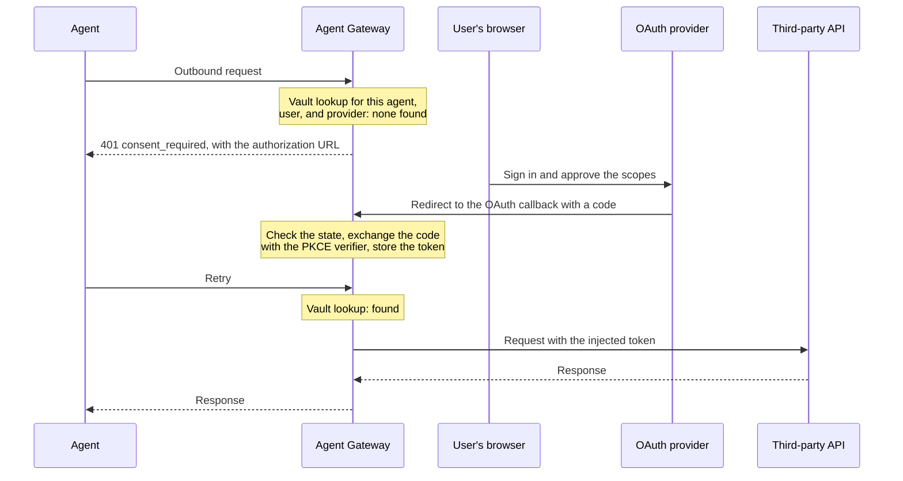

# Credential Delegation

How the gateway lets a managed agent call a third-party API with credentials the agent
never holds. For a user-facing flow, the credentials belong to the human the agent acts
for, and are obtained with that person's consent.

Use the hosted [per-caller credential delegation guide](https://docs.affinidi.com/products/affinidi-trust-fabric/agent-gateway/how-to-guides/setup/configure-per-caller-credential-delegation/)
for the operator procedure. This page documents the implementation in
[`src/credential_providers/`](../src/credential_providers/),
[`src/delegation_vault/`](../src/delegation_vault/), and
[`src/proxy/credential_delegation.rs`](../src/proxy/credential_delegation.rs).

## Moving parts

| Part | What it is |
| --- | --- |
| Credential provider | A configured OAuth 2.0 or API-key provider, such as Google or GitHub. Defined once and referenced by any number of surfaces. |
| Outbound credential binding | An entry in a surface's `outbound_credentials` naming a provider, the scopes, when it applies, and how the token is injected. |
| Delegation vault | Where obtained tokens are kept, one per agent, user, and provider. |
| Delegation audit log | A record of every lookup, consent prompt, refresh, and injection. |

## Credential providers

`CredentialProvider` ([`src/credential_providers/mod.rs`](../src/credential_providers/mod.rs))
has three types, set by `provider_type`.

| Type | Flow | Consent |
| --- | --- | --- |
| `oauth2_authorization_code` | Three-legged OAuth. The user signs in to the provider and approves the scopes. | Required, per user |
| `oauth2_client_credentials` | Two-legged, machine to machine. The gateway authenticates as the client. | None |
| `api_key` | A static key resolved from the secrets store. No OAuth. | None |

A provider carries its authorization and token endpoints and its default scopes. Its
client ID and client secret are **references** into the secrets store, such as
`GOOGLE_CLIENT_SECRET`, and are never stored in the provider record itself.

A provider's `provider_id` slug is unique per tenant, and among the untenanted providers. The
slug is compared as stored, trimmed and in lower case.

### External consent providers

A provider with an `issuer` is an external consent provider: one OAuth client of one
authorization server, whose grants another system obtains through the browser and hands
to the gateway, which keeps them in the vault by binding. Its fields:

| Field | Rule |
| --- | --- |
| `provider_type` | `oauth2_authorization_code` |
| `issuer` | An `https` issuer without credentials, query or fragment |
| `authorization_endpoint`, `token_endpoint` | Required |
| `revocation_endpoint` | The RFC 7009 endpoint, exactly when the issuer's metadata names one |
| `client_id` | Required, a plain value: a client id is not a secret. `client_id_secret_ref` is refused |
| `token_endpoint_auth_method` | `none`, `client_secret_basic` or `client_secret_post`. `client_secret_secret_ref` is required for the last two and refused for `none` |
| `callback_url` | Required, `https`: the redirect URI the other system registered |
| `resource` | Required, a canonical public `https` URI (RFC 8707): the protected resource the grants are for. Its origin is the only one a Transit Point sends the provider's grants to ([External consent on a Transit Point](#external-consent-on-a-transit-point)) |
| `allow_unadvertised_pkce` | Optional, `false` by default. `true` admits an issuer whose metadata does not list `code_challenge_methods_supported`; see below |
| `additional_params`, `consent_identity_strategy_id`, `api_key_secret_ref` | Refused |

Every endpoint, and `resource`, must be an `https` URL without credentials or fragment whose
host is no literal loopback, private, link-local or cloud-metadata address (the Strict egress
posture's static check). At create only the issuer's metadata fetch resolves a name; a vendor
name that resolves to a blocked address is refused when the gateway calls it, since every call
to a vendor endpoint goes through pinned Strict egress. A provider without an `issuer` cannot
set `revocation_endpoint`, `token_endpoint_auth_method`, `client_id` or
`allow_unadvertised_pkce`.

When the provider is created, the gateway reads the issuer's authorization server metadata
(RFC 8414, then OpenID Connect discovery) under the client profile of
[`authz_metadata`](SOURCE_AUTH.md#authorization-server-metadata-module-developer-reference),
through a pinned, bounded fetch under the Strict posture, and refuses the provider unless:

- the metadata's `issuer` equals the provider's byte for byte;
- the authorization, token and revocation endpoints are the ones the metadata names, byte for
  byte, a revocation endpoint included exactly when the metadata names one;
- `token_endpoint_auth_methods_supported` lists the provider's method, or, when the metadata
  lists none, the method is `client_secret_basic` (the RFC 8414 default);
- `code_challenge_methods_supported` includes `S256`. A document that does not list the methods
  is refused too: the MCP authorization specification (`2025-11-25` and later) tells clients to
  refuse to proceed with such a server, and a server that ignores `code_challenge` would void
  the PKCE verifier. The one exception is a provider that sets `allow_unadvertised_pkce: true`,
  for a server known to enforce S256 without listing it, such as Microsoft Entra ID. The
  exception never admits a list without `S256`.

| Refusal (`400`) | `code` | Also |
| --- | --- | --- |
| A rule in the table above | `invalid_provider` | |
| The metadata could not be read or is not acceptable | `provider_metadata_unavailable` | `reason`: `invalid_url`, `unreachable`, `http_status`, `too_large`, `invalid_document` or `issuer_mismatch`. A failure before the server answered is always `unreachable`, so the answer never says whether a name resolves to a blocked address; the log has the detail |
| The provider differs from the metadata | `provider_metadata_mismatch` | `field` names the field |
| An update changes a fixed field | `provider_field_immutable` | `field` names the field |

`issuer`, the endpoints, `client_id`, `token_endpoint_auth_method`, the secret references,
`callback_url`, `resource`, `allow_unadvertised_pkce`, `provider_type` and the refused fields
never change: an update that
sends another value is refused, and one that sends the stored value, such as a round trip of
the whole record, is accepted. The name, description, default scopes and
`token_refresh_enabled` stay editable. A change to the client or its server is a new
provider. An existing provider without an `issuer` cannot take one. So a token that can edit
providers cannot point a provider whose grants are stored at an endpoint of its choosing.

## Binding a provider to a surface

Each entry in `AgentSurface.outbound_credentials`
([`OutboundCredentialBinding`](../src/config/types.rs)) decides four things.

| Field | Options | Default |
| --- | --- | --- |
| `required_for` | `all` outbound requests, or `tools`: a list of MCP tool names, matched against `params.name` of a `tools/call` on Access Points and Fabric receive, never on Transit Points | `all` |
| `consent_mode` | `on_demand`, `pre_authorize`, or `elicit`; `external` only on a Transit Point's `transit_credentials` ([external consent](#external-consent-on-a-transit-point)) | `on_demand` |
| `inject_as` | `bearer_header`, `custom_header { name, format }`, or `meta { field }` | `bearer_header` |
| `scopes` | Scopes to request | The provider's defaults |

`custom_header` takes a format string, so a provider that expects `token {value}` rather
than `Bearer {value}` still works. `meta` writes the token into a JSON-RPC `_meta` field
instead of a header.

A binding carries no destination, so where it applies depends on the hop.

- **Access Points and Fabric receive** forward only to their own Target, so a `tools`
  binding applies to a `tools/call` whose `params.name` it lists.
- **Transit Points** never apply a `tools` binding. A partner upstream names its own tools,
  so matching its tool names would hand it a credential meant for the Target's tools. A
  `tools` binding that lists a JSON-RPC method, such as `tools/call` or `message/send`,
  does not apply there either.

An `all` binding in `outbound_credentials` applies on every Transit Point of the surface, so
every partner upstream behind them receives the delegated credential; use it only when every
Transit Point's upstream should hold the credential. A surface with no `outbound_credentials`
applies each Transit Point's own `transit_credentials` on that Transit Point only. A surface
with `outbound_credentials` ignores `transit_credentials`.

### Credential headers on a Transit Point

A Transit Point sends its target at most one value of each credential header, by the same
rule over HTTP and Fabric. It starts from the managed agent's headers, without the agent's
`Authorization` and `Cookie` and without a header named like the Transit Point's
`target_auth` header, whether or not the gateway adds that header to this request. It then
adds the `target_auth` header, and then the `bearer_header` and `custom_header` credentials of
its bindings, each replacing any earlier header of the same name. On a `2026-07-28` MCP
request, the credentials prepared for `outbound_credentials` are applied last in the same
way. So the managed agent can neither supply nor replace a credential, and a delegated
credential under the same name as `target_auth` replaces it; give them different names to
send both.

### The caller on a Transit Point

A Transit Point looks a grant up by the caller's identity hash and the managed agent's DID.
The caller is the transit token's when the request carries a valid transit token with a
`user_identity_hash`. Otherwise, when the Transit Point's own `source_auth` verified the
caller (see [`SOURCE_AUTH.md`](SOURCE_AUTH.md#transit-point-source-authentication)), it is
that caller's [identity hash](#the-callers-identity-hash), the value the Access Point computes
for a caller it authenticated the same way. So:

- an agent that calls the Transit Point with a JWT from the same issuer, for the same `sub`,
  as a user who consented through the Access Point is given that user's grant; a JWT from
  another issuer, or the same name verified another way, is another caller;
- an API-key caller is one identity: every request with a key from the same `api_key`
  secret, or with the same `api_key_provider` key, shares one set of grants;
- a JWT without a `sub` names no caller and is given no grant.

A caller verified by a resource access token (`mcp_http.authorization`) keys a grant only on
a `2026-07-28` MCP request. The agent half of the key is the Transit Point's
[managed identity](SOURCE_AUTH.md#managed-identity), else the caller DID the transit token
carries, so a `source_auth` caller without a transit token needs a managed identity for the
Transit Point.

A transit token the gateway issued for a request that arrived over Fabric (see
[`SOURCE_AUTH.md`](SOURCE_AUTH.md#transit-token)) keys a grant only on a Transit Point that
sets `delegated_credentials_for_fabric_callers: true` (off by default), and then only by its
`fabric.principal_hash`: the caller the receiving surface's own `source_auth` or resource token
verified on that request, the same identity hash its Access Point computes for the same
credential. The caller DID or pseudonym the peer gateway sent, and a top-level
`user_identity_hash`, never key a grant, and the caller DID is never the agent half of a key
either, so such a call needs the Transit Point's managed identity: its own `managed_identity`,
or the surface's when the Transit Point injects a VP, in any mode but `from_jwt_claim`. Without
one, a binding that applies refuses every Fabric caller with `403`, and a save of a Transit
Point that sets the switch, on the surface or in an enabled variant, answers with a `Warning`
header saying so.

Set the switch only when the receiving surface verifies a per-user credential on each Fabric
request: a JWT whose `sub` is the end user, with an audience naming this gateway. The receiving
surface normally verifies the credential the peer's `target_auth` presents, and when that is the
partner's own key, every request the partner sends has the same identity hash. One partner
credential is then one grant: the first of the partner's users to complete consent binds their
account, and every later request from that partner, for any of its users, is sent with it.

Without the switch, or when the receiving surface verified no caller, a binding that applies
refuses the call with `403` and the target is not called. The log says delegated credentials
are not released for requests that arrived over Fabric
(`reason=delegated_credentials_for_fabric_callers=false`), or that the receiving surface
verified no caller of the request (`reason=no_fabric_caller_verified`). The grant follows the
caller the Transit Point's policy input ranks first: a caller the Transit Point's own
`source_auth` verified on the same call keys its own grant only when the token names no caller
the receiving surface verified. When the token names one, that caller outranks it, so without
the switch the call is refused, never served with the grant of the Transit Point's caller.
Static `target_auth` credentials are added as for any caller. A release that predates the
switch, or `fabric.principal_hash`, keys no grant by a Fabric-issued token; a caller its own
`source_auth` verified still keys its own grant there, and its policy input and audit records
name that caller first. During a rolling upgrade, a `PUT` of the surface through a node that
predates the switch saves it without the switch, which turns it off.

On a `fabric://` Transit Point the two switches are independent:
`delegated_credentials_for_fabric_callers` decides whether a Fabric caller's grant is looked up
at all, and `fabric_delegated_credentials` whether a resolved credential crosses to the next
peer (see [Across Fabric](#across-fabric)).

### External consent on a Transit Point

A Transit Point's `transit_credentials` with `consent_mode: external` binds an
[external consent provider](#external-consent-providers) and releases the
[grant the vault keeps for that binding](#grants-by-binding). Another system obtains the grant
through the browser; the gateway never builds an authorization URL for such a binding.

| Field | Rule |
| --- | --- |
| `consent_mode` | `external` |
| `subject` | Required: `owner` for one grant every caller of the Transit Point uses, or `caller` for one grant per caller, selected by the caller's [identity hash](#the-callers-identity-hash). Refused with every other consent mode |
| `credential_provider_id` | A provider with an `issuer` and the surface's own tenant, exactly: an untenanted provider for an untenanted surface |
| `scopes`, `inject_as` | As for any binding |

The Transit Point itself must send the grant only where it belongs:

| Field | Rule |
| --- | --- |
| `target_endpoint` | A public `https` URL with the origin (scheme, host and port) of the provider's `resource`. A `fabric://` route is refused: a grant never crosses Fabric |
| `id` | Names one Transit Point. It appears once in the surface's points and once in each variant's `overrides.transit.points`, and every list that has it keeps the same `target_endpoint` and `transit_credentials`. A grant is kept under the Transit Point's id, so no second destination or binding may claim it |

A save of the surface, its base or a variant, is refused with `400` when the binding or its
Transit Point breaks a rule above, when the surface also has `outbound_credentials` (which apply
on every Transit Point), or while the vault cannot keep grants: [at-rest
encryption](#grants-by-binding) is not active, or `AG_IDENTITY_HASH_PEPPER` is not set. The same
checks run on every write: `POST /surfaces`, `PUT`, `PATCH`, the variant routes, and a surface's
tenant reassignment (refused there with `409`). Surface-level `outbound_credentials` cannot ask
for `external`, and a provider with an `issuer` is bound by no other consent mode, on a Transit
Point or in `outbound_credentials`.

A request through such a Transit Point needs a caller it identifies, as every delegated
credential does: a transit token naming one, or a caller its `source_auth` verified; without
one it is refused with `403`, so an anonymous caller never acts as the owner. No managed agent identity is needed: the grant is
keyed by the binding, not by an agent DID. The grant is injected as `inject_as` says, in place
of any `Authorization` the agent sent. The call is refused with `503` "Delegated credentials
unavailable", before it is forwarded, when the grant cannot be released: none is stored for the
key, its access token has expired, the provider is gone, has no issuer or is of another tenant,
the Transit Point's target is not a public `https` URL with the origin of the provider's
`resource`, the binding names no subject, the surface also has `outbound_credentials`, at-rest
encryption is not active, or the identity hash pepper is not configured. A `caller` binding is
refused for a caller named by anything but an identity hash. The log names the reason. A binding
that some other path reached with a provider that has an `issuer` is refused the same way, so
such a provider's grants are reached only by binding.

The destination is checked again when the request is sent. A request carrying a grant by
binding is forwarded only to the origin of its provider's `resource`, through pinned Strict
egress: `https` only, internal addresses refused, the connection pinned to the vetted
addresses, redirects returned rather than followed, and no proxy. It is never forwarded over
Fabric. A `fabric://` Transit Point withholds delegated credentials unless
`fabric_delegated_credentials` is set, and with it set the grant is refused, so a grant never
reaches a stored surface that predates these rules.

## When a token is missing

Delegation needs a user to key the token by, so a surface with delegation but no
authenticated source identity rejects the request with HTTP 403 `identity-required`. For an
authenticated caller, the consent mode decides what happens the first time.

| Mode | Behaviour |
| --- | --- |
| `on_demand` | The request fails with HTTP 401 and an `application/problem+json` `consent_required` body carrying the authorization URL. The caller has to interpret this payload itself; it is not the MCP elicitation mechanism. |
| `pre_authorize` | The session is refused at bind or `initialize` time until every binding's token already exists. After that, runtime traffic never sees a consent prompt. |
| `elicit` | Spec-compliant MCP elicitation. The gateway sends `elicitation/create` back over the open Streamable HTTP or SSE stream, with the authorization URL in the message, and waits up to `elicit_timeout_secs` (300 by default) for the user to finish or decline. Accepted risk: the stream and the pending prompt are keyed by surface and `Mcp-Session-Id`, not bound to the caller, so within one surface a caller holding another user's session id can receive that user's authorization URL, or answer or cancel their prompt. Isolation relies on the upstream issuing unguessable session ids; see "MCP session ownership" under Recorded Decisions in `docs/MCP_METADATA.md`. |

`elicit` needs an MCP client that advertised the `elicitation` capability during
`initialize`, and a capability record for its session. `elicit_fallback` decides
what happens when either is missing: `on_demand`, the default, degrades to the 401
response, and `fail` records `elicitation_unsupported` and forwards the tool call without
the credential. Elicit falls back when:

- the client did not advertise `elicitation`;
- the upstream returned a session id already in use on the surface (see "MCP session
  ownership" in `docs/MCP_METADATA.md`);
- the gateway has no capability record for the session, because the upstream answered
  `initialize` with SSE, sent an unusable `Mcp-Session-Id`, or the gateway restarted
  after the session opened.

A user who declines or cancels the elicitation, or does not answer before
`elicit_timeout_secs`, also has the call forwarded without it.

### When a credential cannot be resolved

A binding that applies but whose credential cannot be resolved refuses the request rather
than forwarding it without the credential. That covers a deleted or unreadable provider, an
API key whose secret cannot be read, a failed client-credentials token request, a vault read
error, and consent that is needed but cannot be asked for because no authorization URL can be
built, for example when the provider has no `authorization_endpoint`. An Access Point and
Fabric receive answer `503`: on an MCP surface a JSON-RPC error (`-32603`, `Delegated
credentials unavailable`) carrying the request's id, otherwise an `application/problem+json`
body. The delegation audit records the binding's outcome, and `provider_unavailable` names a
provider that cannot be used.

A Transit Point refuses such a request with `503`, and also refuses with `403` one that names
no caller, because neither a transit token with a caller identity nor the Transit Point's
`source_auth` identifies one, as on every request to a Transit Point that serves callers it
does not authenticate, or for which neither its managed identity nor the transit token's
caller DID gives the agent half of the vault key. It also refuses when its delegation
stores are not available. An MCP Transit Point answers with a JSON-RPC error (`-32603` for
`503`, `-32001` for `403`) carrying the request's id, and any other Transit Point with an
`application/problem+json` body. A missing token still gets the consent answer above. A
Transit Point forwards a `GET` of a public discovery path, such as an agent card, without
checking a transit token, so it carries no caller, and it is forwarded without a delegated
credential, as it is without the `target_auth` one.

Outside these checks a request is still forwarded without the credential: on an Access Point
or Fabric receive whose delegation stores
are not available, on Fabric receive for a request with no user identity, and on the `elicit`
outcomes above.

A grant is looked up by the managed agent's DID, the caller's identity hash and the provider,
not by surface or Transit Point. Surfaces that share an agent DID, such as surfaces whose
managed identity is derived from the same JWT claim, therefore release to each other the
grants a user consented to on either. A Transit Point never looks a grant up under a
placeholder agent.

## Across Fabric

When a surface's Target or Transit Point is `fabric://`, its delegated credential reaches the peer
only if that Target or Transit Point opts in with `fabric_delegated_credentials: true`. The setting
is off by default, including on existing surfaces. With it off, the caller's own token is still
stripped and the peer receives no delegated credential.

With it on, the access token, never the refresh token, crosses to the peer, which can use it until
it expires. On the Target only a modern (`2026-07-28`) request carries it, inside the encrypted
framed stream; a legacy MCP or A2A request never does. On a Transit Point, every protocol carries
it, including A2A through header injection. A Transit Point on a surface without `outbound_credentials` uses only its own
`transit_credentials`, never another Transit Point's, whatever its destination. The surface's
Target uses only `outbound_credentials`, never a Transit Point's `transit_credentials`. Consent, refresh
and revocation stay on the sending gateway. See
[Delegated credentials over Fabric](FABRIC.md#delegated-credentials-over-fabric).

## Consent flow

For an authorization-code provider in `on_demand` mode:



The authorization URL uses PKCE with the `S256` challenge method. The `state` parameter is
an `OAuthState` carrying the agent DID, the user identity hash, the surface, the provider,
a random nonce, an expiry, and the PKCE code verifier. The callback therefore needs no
server-side session to know which request it completes.

`state` is always sealed with AES-256-GCM before it is base64url-encoded, so neither the
provider nor anyone else who sees the authorization URL can read it (the PKCE code verifier
included) or forge one naming a different agent or user. When encryption at rest is
enabled, its key seals the state; otherwise a key derived from `AG_IDENTITY_HASH_PEPPER`
does, so gateways that share the pepper can open each other's states. The callback refuses
a `state` this gateway did not seal, an expired one, and one whose nonce was already used
([`encode_oauth_state`, `decode_oauth_state`, `claim_oauth_state`](../src/delegation_vault/oauth.rs)).
Used nonces are remembered in the gateway process for 15 minutes, longer than a state
lives, so a restart or a different gateway instance does not know about them. A state is
used up only when its credential is stored, so a callback that fails before then, for
example at the token exchange, can be retried with the same state.

The callback lands on `/v1/identity/oauth/callback` unless `gateway.json` sets
`oauth_callback_route`. On success the gateway stores the
token and issues a `DelegationCredential`, a verifiable credential recording the
delegation chain, kept with the token as `delegation_vc`.

## Delegation vault

A `DelegationToken` ([`src/delegation_vault/mod.rs`](../src/delegation_vault/mod.rs)) is
keyed by three values.

| Key | Source |
| --- | --- |
| `agent_did` | The managed agent the delegation is for |
| `user_identity_hash` | The caller's [identity hash](#the-callers-identity-hash), from the identity source authentication established |
| `credential_provider_id` | The provider |

With API-key or mTLS source authentication, every caller presenting the same key or
certificate identity therefore shares one set of delegated tokens.

### The caller's identity hash

`user_identity_hash` is the lowercase hex SHA-256 of the JSON array
`[method, issuer, tenant, subject]`, written as RFC 8785 canonical JSON (no spaces):

| Source authentication | `method` | `issuer` | `subject` |
| --- | --- | --- | --- |
| `jwt_bearer`, and a resource access token | `jwt_bearer` | The token's `iss` | The token's `sub` |
| `api_key` | `api_key` | `""` | The `secret_id` |
| `api_key_provider` | `api_key_provider` | The API Key Provider agent id | The key's id |
| `did_auth` | `did_auth` | `""` | The DID |
| `mtls` | `mtls` | The lowercase hex SHA-256 of the certificate the client certificate was verified against: the configured CA certificate its chain ends at, or with pinned trust the pinned certificate | The principal the `identity_binding` derives |

`tenant` is the surface's `tenant_id`, or `null` on a surface with none. The same subject named
by another method, issuer, API Key Provider agent or tenant is therefore another caller, with
grants of its own. An mTLS caller is keyed by the certificate the gateway trusted, not by the
issuer name its certificate states, so replacing a trusted CA certificate, or a pinned
certificate, gives its callers new identity hashes. A JWT without a non-empty `sub`, or without an `iss`, names no caller: it has
no identity hash, so it is given no delegated credential: an Access Point answers `403`
`identity-required`, and a Transit Point `403`.

The transit token carries the same value, a policy reads it as
`input.transit.caller.user_identity_hash`, and a Workload Binding with `caller_source: did`
puts it in `user_hash`. To compute it for a JWT subject `alice` from
`https://login.example.com` on a surface with no tenant:

```sh
printf '%s' '["jwt_bearer","https://login.example.com",null,"alice"]' | shasum -a 256
```

Delegated credentials stored by a release that keyed them by an earlier form of the identity
hash are never looked up again, but their access and refresh tokens stay in the vault until
they are removed. After upgrading, list the vault (`GET /api/v1/delegation-vault`, or the
Credential Tokens tab on the dashboard's Credentials page) and revoke each entry created before
the upgrade (`DELETE /api/v1/delegation-vault/{id}`, or its delete button), except those under
`__client_credentials__`, which are unchanged. Users connect their accounts again the next time
a credential is needed.

Client-credentials tokens have no user, so they are cached under the fixed user hash
`__client_credentials__`.

A lookup has four outcomes.

| Result | What the gateway does |
| --- | --- |
| Found and valid | Injects the token |
| Expired, with a refresh token | Refreshes it through the provider's token endpoint |
| Expired, no refresh token | Treats it as missing and applies the consent mode |
| Not found | Applies the consent mode |

For client-credentials providers an expired token is deleted and a fresh one fetched,
since no user is involved.

### Grants by binding

The grants of [external consent providers](#external-consent-providers) are kept apart from
the agent-keyed tokens above, in the vault's `delegated_grants` directory. A grant
([`src/delegation_vault/grants.rs`](../src/delegation_vault/grants.rs)) is keyed by the binding
it serves and whose account it is:

| Key | Source |
| --- | --- |
| `tenant_id` | The surface's tenant, `null` for an untenanted surface |
| `surface_id` | The surface |
| `hop` | The Transit Point's `id` |
| `credential_provider_id` | The provider's record id |
| `principal` | `owner` for the one grant every caller of the binding uses, or a caller's [identity hash](#the-callers-identity-hash) |

No agent DID is involved, so a grant is never released on another surface, another Transit
Point or another tenant, even when two Transit Points share a managed identity. A record's id is
`grant-` and the lowercase hex HMAC-SHA256, under a key derived from `AG_IDENTITY_HASH_PEPPER`,
of the RFC 8785 JSON array `[tenant, surface, hop, provider, principal]`. It reveals nothing of
the key, and a lookup is one read and one decrypt, never a scan. A record whose own key is not
the one its id was derived from is never used. Storing a grant for a key that has one replaces
it, and the replaced grant is handed back so its tokens can be revoked.

Grants are kept only while at-rest encryption is active: `[encryption] enabled = true` with a
key from the environment, a file or AWS KMS. The development `local` key source writes
plaintext, so it does not count. They are also kept only while `AG_IDENTITY_HASH_PEPPER` is set:
a grant's id derives from the pepper, and a pepper generated for one process changes on
restart, which would orphan every grant. Set the same value on every node. Without either, the
vault refuses to store or release a grant and logs a warning at startup, and the admin API
refuses a binding that needs one. A grant written under an earlier pepper is never released,
but it is still listed by the provider and binding its own record names, so it is revoked and
deleted with them.

Grants and agent-keyed tokens restored in plaintext, from a portable backup, are encrypted when
the vault starts. Storage exports leave the `delegated_grants` directory out. Grants stored
before this release do not exist: they are made only through external consent.

### Revoking grants at the vendor

A grant by binding is removed when [its provider is deleted](#deleting-a-provider) or [a surface
change removes its binding](#when-a-binding-is-removed). It is revoked at its authorization
server first (RFC 7009,
[`src/delegation_vault/revocation.rs`](../src/delegation_vault/revocation.rs)) at the provider's
`revocation_endpoint`: its refresh token with `token_type_hint=refresh_token`, then its access
token with `token_type_hint=access_token`, so a server that does not cascade the first
revocation still ends the access token. A grant without a refresh token has only its access
token revoked. A server that does not revoke access tokens answers that request with an error,
which changes nothing else. The client authenticates as its `token_endpoint_auth_method`
says: `client_id` in the form for `none`, the id and secret in the form for
`client_secret_post`, HTTP Basic for `client_secret_basic`. The secret is resolved from the
provider's own tenant, or an untenanted secret, and never another tenant's. The call goes
through the pinned Strict egress client, `https` only, without redirects, with a 10-second
timeout, and its response body is never read or logged. When many grants are removed at once,
at most eight are revoked at a time.

Revocation is best effort: whatever its outcome the grant is deleted. A `token_revoked`
delegation audit event records the grant's id, the caller that made the change (`caller`: the
console user and, on an access token, its id), and `detail` `vendor_revocation:<outcome>` for
the refresh token, or the access token of a grant without one, followed by
`,access_token:<outcome>` when the access token was revoked as well. An outcome is one of
`revoked`, `refused` (the server answered another status), `unreachable` (no connection, or the
egress policy refused the endpoint), `not_supported` (the provider names no revocation
endpoint) or `client_unavailable` (the client's secret could not be resolved). The log says the
outcome: `INFO` for `revoked` and `not_supported`, `WARN` otherwise. A vendor that does not
revoke keeps the token alive until it expires or the person removes the app at the vendor.

### When a binding is removed

A grant lives only as long as its binding
([`src/identity/handlers/surface_grants.rs`](../src/identity/handlers/surface_grants.rs)). A
surface change that removes a `consent_mode: external` binding revokes and deletes that
binding's grants before the change is saved: the surface deleted, the Transit Point removed,
its binding removed or given another consent mode, its `subject` or provider changed, or the
surface moved to another tenant. A binding is kept while the surface or any variant still has
it, with the same Transit Point id, provider and subject.

A change that adds a binding deletes any grant already stored under it, left by an earlier
binding of the same surface, Transit Point id and provider, so re-adding a binding, or creating
a surface again under the same id, needs a new consent; an old grant is never re-armed.

When the grants cannot be removed, the change is refused with `503` and nothing is saved: the
vault is unavailable, or grants are stored but cannot be read because at-rest encryption is now
off. Enable `[encryption]` with the key they were written under, then make the change.

### Deleting a provider

`DELETE /api/v1/credential-providers/{id}` is refused with `409` and `code`
`provider_in_use` while a surface binds the provider, in its base or a variant, through
`outbound_credentials` or a Transit Point's `transit_credentials`. Only the surfaces that may
reference the provider are read: those of its own tenant, or every surface for an untenanted
provider. Bindings are read from the surface's stored lists, its own and each variant's, so a
surface whose variants cannot be resolved still counts by the providers it names. The answer
names the binding `surface_id` when the caller may see that surface. Remove the bindings first.

A permitted delete of a provider with an `issuer` revokes and deletes every grant made with it
first, including one written under an earlier identity hash pepper. It answers `503` and keeps
the provider when the vault cannot list or delete the grants, and when grants are stored but
cannot be read because at-rest encryption is now off: they could not be revoked. Enable
`[encryption]` with the key they were written under, then delete the provider.

### Storage

The vault uses **uncached** storage: tokens are read from disk on each lookup and are not
held in the in-memory cache, so they do not linger in process memory.

The vault is encrypted at rest **only when at-rest encryption is enabled** in the
bootstrap configuration (`[encryption] enabled = true`), because it uses the global
storage configuration like every other store. The default is off. With the default,
access and refresh tokens are written to `_storage/` as plaintext JSON, and the vault logs a
warning at startup saying so. Enable encryption at rest on any appliance that holds real user
tokens; grants by binding need it. See
[`CONFIGURATION_REFERENCE.md`](CONFIGURATION_REFERENCE.md#configtoml).

## Management API

| Route | Purpose |
| --- | --- |
| `GET /api/v1/delegation-vault` | List vault entries, as metadata only, without tokens |
| `GET`, `DELETE /api/v1/delegation-vault/{id}` | Read or revoke one entry |
| `DELETE /api/v1/delegation-vault/by-user/{user_hash}` | Revoke every delegation one user has granted |
| `GET /api/v1/delegation-audit` | The delegation audit log |

Credential providers have their own management routes in
[`src/credential_providers/router.rs`](../src/credential_providers/router.rs), gated on
the `credential_providers.*` permissions. A provider a surface binds cannot be deleted
([Deleting a provider](#deleting-a-provider)).

In the dashboard these live on the Credentials page, under the **Credential Providers**,
**Credential Tokens**, and **Credential Delegation Audit** tabs.

## Related

- [`SOURCE_AUTH.md`](SOURCE_AUTH.md): the source authentication that supplies the user identity.
- [`STS.md`](STS.md): token exchange, a different way of acting on a caller's behalf.
- [`../ARCHITECTURE.md`](../ARCHITECTURE.md): where outbound credentials sit in the request path.
