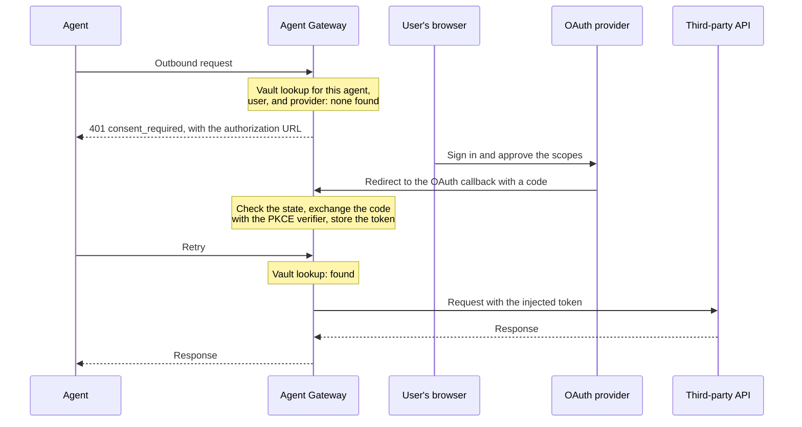

# Credential Delegation

How the gateway lets a managed agent call a third-party API with credentials the agent
never holds. For a user-facing flow, the credentials belong to the human the agent acts
for, and are obtained with that person's consent.

Use the hosted [per-caller credential delegation guide](https://docs.affinidi.com/products/affinidi-trust-fabric/agent-gateway/how-to-guides/setup/configure-per-caller-credential-delegation/)
for the operator procedure. This page documents the implementation in
[`src/credential_providers/`](../src/credential_providers/),
[`src/delegation_vault/`](../src/delegation_vault/), and
[`src/proxy/credential_delegation.rs`](../src/proxy/credential_delegation.rs).

## Moving parts

| Part | What it is |
| --- | --- |
| Credential provider | A configured OAuth 2.0 or API-key provider, such as Google or GitHub. Defined once and referenced by any number of surfaces. |
| Outbound credential binding | An entry in a surface's `outbound_credentials` naming a provider, the scopes, when it applies, and how the token is injected. |
| Delegation vault | Where obtained tokens are kept, one per agent, user, and provider. |
| Delegation audit log | A record of every lookup, consent prompt, refresh, and injection. |

## Credential providers

`CredentialProvider` ([`src/credential_providers/mod.rs`](../src/credential_providers/mod.rs))
has five types, set by `provider_type`.

| Type | Flow | Consent |
| --- | --- | --- |
| `oauth2_authorization_code` | Three-legged OAuth. The user signs in to the provider and approves the scopes. | Required, per user |
| `oauth2_client_credentials` | Two-legged, machine to machine. The gateway authenticates as the client with a client secret. | None |
| `oauth2_jwt_bearer` | JWT Bearer grant (RFC 7523 section 2.1). The gateway signs a JWT with the provider's private key and posts it as the `assertion`; no client ID or secret. A Google service account for Vertex AI Agent Engine works this way. | None |
| `oauth2_client_credentials_jwt_auth` | Client Credentials grant whose client authenticates with a signed JWT (`private_key_jwt`, RFC 7523 section 2.2) instead of a client secret. An Entra certificate credential (key named by certificate thumbprint) and an Ory `private_key_jwt` client (key named by `kid`) work this way. | None |
| `api_key` | A static key resolved from the secrets store. No OAuth. | None |

A provider carries its authorization and token endpoints and its default scopes. Its
client ID, client secret, signing key and certificate are **references** into the secrets
store, such as `GOOGLE_CLIENT_SECRET`, and are never stored in the provider record itself.

### https token endpoints

Every type except `api_key` sends its client secret, assertion or code to the token endpoint,
so the endpoint must be an https URL. An http endpoint meets the rule only when the bootstrap
`[credential_policy] insecure_token_endpoints` lists it exactly (compared as parsed URLs, so
another port or path does not match), or, under `AG_TEST_MODE=true`, when
`AG_BDD_OAUTH_ENDPOINT_ALLOWLIST` lists it exactly. `credential_policy.token_endpoint_https`
sets how the rule is applied (see [Credential policy](CONFIGURATION_RELOAD.md#credential-policy)):

| | `warn` (default) | `enforce` |
| --- | --- | --- |
| Create, or an update that sets a new token endpoint or turns an `api_key` provider into an OAuth type | 400 `token_endpoint must be an https URL` | The same |
| Update that keeps a stored http endpoint | Saved | 400 |
| `POST /api/v1/credential-providers/validate` | 400, before the endpoint is contacted | The same |
| Token request, refresh or code exchange of a stored http provider | Sent, with a warning log | Refused before any secret is read |

The check runs before the provider's secrets are read. In `warn` mode every use of a stored
http provider logs a warning, and a legacy binding's audit detail gains
` insecure_token_endpoint` (for example `client_credentials_cached insecure_token_endpoint`,
`after_refresh insecure_token_endpoint`). In `enforce` mode a service token reports
`TokenEndpointNotHttps` ("credential provider token endpoint is not https"), even for a token
already cached, the legacy code exchange and refresh fail with `token_endpoint must be an https
URL`, and the `2026-07-28` consent exchange answers an invalid record. Move such providers to
https, or list a deliberate http endpoint, before switching to `enforce`.

### Provider secrets belong to the provider's tenant

Every secret a provider references (client ID, client secret, API key, signing key,
certificate) must belong to the provider's own tenant: a tenant provider uses its tenant's
secrets, an appliance-wide provider uses appliance-wide secrets. `credential_policy.tenant_credential_isolation`
sets how the rule is applied (see [Credential policy](CONFIGURATION_RELOAD.md#credential-policy)):

| | `warn` (default) | `enforce` |
| --- | --- | --- |
| Create, or an update that sets a reference to another tenant's or an appliance-wide secret on a tenant provider | 400 `Secret reference is not accessible` | The same |
| Update that keeps a stored reference in the same field, with the type, token and authorization endpoints, `resource`, `additional_params` and JWT issuer, subject and audience unchanged | Saved | 400 |
| `POST /api/v1/credential-providers/validate` | 400 for a signing key or certificate in another tenant, before the key is read | The same |
| Authorization URL, code exchange, refresh, service token grant or API key read | The secret is read, with a warning log naming the provider and secret id | Refused before the secret is read |

A stored reference is kept only while it goes where it went before. An update that changes one
of those settings, or moves a stored reference to another field (a client secret becoming the
signing key, say), treats every such reference as new and answers 400, so a tenant cannot send
an appliance-wide secret, or an assertion signed with an appliance-wide key, to an endpoint or
audience of its choosing.

In `enforce` mode a service token or API key whose secret is outside the provider's tenant
reports `SecretUnavailable`, and no token request is sent. A cached service token is checked
against the same rule on every use, from the secrets' metadata, so it stops being served as soon
as the rule is enforced. Move such secrets into the provider's tenant before switching to
`enforce`.

### Providers that sign a JWT

The two JWT types share the settings in `JwtAssertionSettings`; create and update refuse a
record that misses a required one.

| Field | `oauth2_jwt_bearer` | `oauth2_client_credentials_jwt_auth` |
| --- | --- | --- |
| `jwt_signing_key_secret_ref` | Required: a PEM private key (PKCS#1 or PKCS#8 for RSA, PKCS#8 for EC), or a Google service account JSON key file, whose `private_key` is used | Required |
| `jwt_signing_algorithm` | `RS256` (default) or `ES256` | `PS256` (default) or `RS256` |
| `jwt_issuer` | Required: the `iss` claim, a service account's `client_email` | Not used: `iss` and `sub` are the client ID |
| `jwt_subject` | Optional `sub` (domain-wide delegation) | Not used |
| `jwt_certificate_secret_ref` | Not used | Optional: the PEM certificate, whose SHA-256 thumbprint goes in the `x5t#S256` header. Entra needs it; issuers that find the key by `kid`, such as Ory, do not |
| `client_id_secret_ref` | Not used | Required, sent as `client_id` |
| `client_secret_secret_ref` | Not used | Refused, so a misconfiguration cannot fall back to a client secret |
| `jwt_audience` | Optional `aud`; the token endpoint when unset | The same |
| `jwt_key_id` | Optional `kid` header. It overrides the `private_key_id` of a JSON key file, which is the default `kid` | Optional `kid` header, such as the `kid` of the key in an Ory client's JWKS. The dashboard warns when neither it nor a certificate is set, since the server may then not find the key |

Create and update resolve the referenced key and certificate after checking the caller may
use them, and refuse with 400 a key that cannot sign with the algorithm or a certificate that
is not PEM, so a wrong format fails the save rather than the first token request. A JSON key
file is checked the same way; the key secret may be at most 16 KiB.
`POST /api/v1/credential-providers/validate` runs the same check before a save: it needs the
credential provider edit permission, applies the caller's tenant to the secrets it names, and
answers `"key_material": "ok"` beside the token endpoint's reachability. JWK keys are not
accepted. The provider API never returns the key or certificate; the list leaves out
their references too.

Every token request signs a fresh assertion that lives 5 minutes (`iat`, `exp`, and for a
client assertion `nbf` and a random `jti`); only the issued access token is cached. A JWT
Bearer grant sends the scopes in the `scope` claim, a client assertion in the `scope` form
field (Entra: `<audience>/.default`). Entra needs the tenant-specific v2.0 token endpoint, not
`common`. An update that sends a reference or JWT field as an empty string clears it, which
is how a client-credentials provider switches to `oauth2_client_credentials_jwt_auth`; a create
reads an empty reference as none.

### Service tokens

`oauth2_client_credentials`, `oauth2_jwt_bearer`, `oauth2_client_credentials_jwt_auth` and
`api_key` give the gateway a credential of its own, with no user.
[`service_token::acquire`](../src/delegation_vault/service_token.rs) obtains it for every path
that needs one: legacy and `2026-07-28` delegation bindings, and target authentication.

- An API key is read from the secrets store on every use and never cached.
- Every token request (Client Credentials, JWT Bearer, `private_key_jwt` and refresh) is sent
  on a client pinned to the addresses the token endpoint resolved to when it was checked, with
  redirects off. A host resolving to loopback, an unspecified address or cloud metadata is
  refused before any request, reported as `TokenEndpointRefused` ("credential provider token
  endpoint refused by egress policy"); RFC 1918 addresses stay allowed. Under
  `AG_TEST_MODE=true`, `AG_BDD_OAUTH_ENDPOINT_ALLOWLIST` admits listed loopback test endpoints
  (never cloud metadata).
- An issued token is cached in the delegation vault and renewed half its lifetime before its
  `expires_at`, but at most 5 minutes and at least 60 seconds before (a one-hour token is
  renewed 5 minutes early, a 100-second one 60 seconds early). One request renews it while the
  others keep using the cached token. When the renewal fails at the token endpoint
  (`TokenRequestFailed`, `ScopeMismatch`) or is held back by the retry backoff, the cached token
  is still used, marked stale, until 60 seconds before it expires; after that the request fails.
  A legacy binding's audit detail then reads `<grant>_stale` (for example
  `client_credentials_stale`) in place of `<grant>_cached` or `<grant>_fresh`, and each use
  logs a warning.
  A changed provider, a missing secret, a provider setting or signing key the grant cannot use
  (`ProviderMisconfigured`, reported as a failed token request), a secrets store or vault error, or a token endpoint the
  egress or https rule refuses never serves the stale token. Its key is `<purpose>:<hash>`, where the hash is the hex SHA-256
  of the provider's digest, the sorted, deduplicated scopes, and the id, tenant and `updated_at`
  of every secret the provider references (client ID, client secret, signing key,
  certificate). Editing the provider, rotating one of its secrets or moving a secret to another
  tenant therefore requests a new token instead of reusing one issued under the old settings.
  Each use reads the secrets' metadata listing, never their values, so a cached token is served
  without decrypting a secret. A referenced secret that no longer exists reports
  `SecretUnavailable` and a secrets store error `StoreUnavailable`; neither serves the cached
  token nor sends a request.
- After a new token is stored, the expired tokens of the same agent, provider and purpose
  (those left by earlier settings, scopes or secret versions) are removed from the vault.
  Unexpired tokens, user grants, pending consents and refresh claims are kept. A failure to
  remove them is logged as a warning only. A token response without `expires_in`, with an empty token, or
  with a `token_type` other than `Bearer` is refused, as is a response over 64 KiB or slower
  than `credential_policy.token_request_timeout_secs` (30 by default); only the response's OAuth `error` code is logged (see _Logging token endpoint errors_ below).
- When scopes were requested, the issued `scope` must name the same set, or the token is
  refused; when none were requested, the issued scopes are kept.
- The provider is read again after the token request, and a provider changed meanwhile
  refuses the token.
- `resource` is sent only when the provider sets it, on every path including legacy bindings.
  The Microsoft identity platform v2.0 token endpoint rejects it (AADSTS901002): put the audience
  in the scopes as `<resource>/.default` instead. The dashboard warns on the provider form and
  list when an Entra v2.0 provider sets `resource`.

Each replica sends one token request per cache key at a time. Requests that miss the cache
meanwhile wait for it, then read the vault again, so they reuse the token it stored, or one
another replica stored, instead of requesting their own. Requests for other scopes, providers or
surfaces do not wait. Replicas do not coordinate, so each may request one token for the same key.

After a token request fails, or its issued scopes do not match (`TokenRequestFailed`,
`ScopeMismatch`), the next request for the same cache key (surface, provider, scopes and secret
versions) waits 1 second from the end of the failed request, doubling after each further failure
up to 60 seconds. A request arriving before then fails at once with `TokenRequestFailed`, without
contacting the provider. A successful request clears the wait, and editing the provider or
rotating a referenced secret starts a new key with no wait. Failures found before any request is sent never start a wait: a
missing or refused secret (`SecretUnavailable`), a secrets store or vault error
(`StoreUnavailable`), a token endpoint the egress or https rule refuses (`TokenEndpointRefused`,
`TokenEndpointNotHttps`), a provider changed during the request (`ProviderChanged`) or an
unsupported provider type. The wait is kept in memory on each replica and resets on restart.

### Logging token endpoint errors

A credential provider's token endpoint can answer an error response that echoes the request or
explains it in free text. The gateway keeps only its OAuth `error` code (RFC 6749 section 5.2):
1 to 64 bytes of `%x20-21 / %x23-5B / %x5D-7E`, or `unrecognized_error` when the code is missing or
breaks that rule. `error_description`, `error_uri` and the rest of the body are never logged,
returned in an error message or written to a delegation audit detail. This holds for code
exchange, refresh, service token grants, the Microsoft Graph API token used for SAML avatars and
the `error` an authorization callback carries.

Logs about a token request may name the provider id, the surface id, the HTTP status and the
OAuth error code. They never carry a secret, a client assertion, a token, the response body or
`error_description`.

A provider's `provider_id` slug is unique per tenant, and among the untenanted providers. The
slug is compared as stored, trimmed and in lower case.

### External consent providers

A provider with an `issuer` is an external consent provider: one OAuth client of one
authorization server, whose grants the gateway keeps in the vault by binding. This version has
no route that obtains or stores such a grant, so until one is stored a binding to the provider
refuses every call ([External consent on a Transit Point](#external-consent-on-a-transit-point)).
Its fields:

| Field | Rule |
| --- | --- |
| `provider_type` | `oauth2_authorization_code` |
| `issuer` | An `https` issuer without credentials, query or fragment |
| `authorization_endpoint`, `token_endpoint` | Required |
| `revocation_endpoint` | The RFC 7009 endpoint, exactly when the issuer's metadata names one |
| `client_id` | Required, a plain value: a client id is not a secret. `client_id_secret_ref` is refused |
| `token_endpoint_auth_method` | `none`, `client_secret_basic`, `client_secret_post` or `private_key_jwt`. `client_secret_secret_ref` is required for `client_secret_basic` and `client_secret_post` and refused for the others |
| `jwt_signing_key_secret_ref`, `jwt_certificate_secret_ref`, `jwt_key_id`, `jwt_signing_algorithm` | Only with `private_key_jwt`, the [signed-JWT settings](#providers-that-sign-a-jwt) of an `oauth2_client_credentials_jwt_auth` provider: the signing key is required and the algorithm is `PS256` (the default) or `RS256`. The key and certificate are checked when the provider is created. `jwt_audience` is refused, since the assertion is always addressed to the issuer, and so are `jwt_issuer` and `jwt_subject`, since the client is the issuer and subject of its assertion. Without `private_key_jwt` all are refused |
| `callback_url` | Required, `https`: the redirect URI the other system registered |
| `resource` | Required, a canonical public `https` URI (RFC 8707): the protected resource the grants are for. Its origin is the only one a Transit Point sends the provider's grants to ([External consent on a Transit Point](#external-consent-on-a-transit-point)), and it must be permitted for the issuer (below). The API returns it as `resource_origin`, so a client can show the person where the grant will go |
| `allow_unadvertised_pkce` | Optional, `false` by default. `true` admits an issuer whose metadata does not list `code_challenge_methods_supported`; see below |
| `additional_params`, `consent_identity_strategy_id`, `api_key_secret_ref` | Refused |

An external consent provider uses its own tenant's secrets only, for its client secret, its
signing key and its certificate: never an untenanted secret, nor another tenant's, since its
client authenticates at endpoints its tenant chose. An untenanted provider uses untenanted
secrets only. Both are checked when the provider is created and again on every use, so a
provider moved to another tenant stops using the secrets of the one it left. A provider without
an `issuer` may use its own tenant's secrets or untenanted ones.

Every endpoint, and `resource`, must be an `https` URL without credentials or fragment whose
host is no literal loopback, private, link-local or cloud-metadata address (the Strict egress
posture's static check). At create only the issuer's metadata fetch resolves a name; a vendor
name that resolves to a blocked address is refused when the gateway calls it, since every call
to a vendor endpoint goes through pinned Strict egress. A provider without an `issuer` cannot
set `revocation_endpoint`, `token_endpoint_auth_method`, `client_id` or
`allow_unadvertised_pkce`.

A provider's resource must be permitted for its issuer. By default its host must be the
issuer's host or one of its subdomains: for the issuer `https://mcp.notion.com`, a resource on
`mcp.notion.com` or `api.mcp.notion.com`, but not `api.notion.com`, `evil-notion.com`,
`mcp.notion.com.evil.example` or a look-alike name. Hosts are compared as the URL parser
normalises them, in lower case and with international names in punycode, label by label; an IP
address permits only itself. Any other resource origin must be listed for the issuer's origin
in `external_consent_resource_origins` in `gateway.json`, which only the operator's file sets:

```json
"external_consent_resource_origins": {
  "https://accounts.google.com": ["https://www.googleapis.com"]
}
```

Each key and value is an exact `https` origin: no wildcard, path, userinfo, query or fragment,
and a host that is an IP address or a plain DNS name (letters, digits and `-` in each label).
List each host on its own: `https://*.googleapis.com` is not a wildcard. An entry that is not
such an origin permits nothing, not even the literal origin it spells, and is named in an `ERROR`
at startup. The value is read once, when the gateway starts: provider create, surface save and
every request use it, and a configuration reload keeps it, with a `WARN` when the file says
otherwise, so a change takes a restart.
The rule is checked when the provider is created (`400`, `provider_resource_not_permitted`),
when a surface binds the provider (`400`), and again whenever a grant is released: a provider
whose resource is no longer permitted, because its entry was removed, releases nothing, and the
log names the reason `resource_not_permitted_for_issuer`. The default compares hosts rather
than registrable domains, so an issuer and a resource on sibling subdomains of one site need an
entry: telling a site's own subdomains from other customers' on a shared suffix needs the public
suffix list, which the gateway does not carry.

When the provider is created, the gateway reads the issuer's authorization server metadata
(RFC 8414, then OpenID Connect discovery) under the client profile of
[`authz_metadata`](SOURCE_AUTH.md#authorization-server-metadata-module-developer-reference),
through a pinned, bounded fetch under the Strict posture, and refuses the provider unless:

- the metadata's `issuer` equals the provider's byte for byte;
- the authorization, token and revocation endpoints are the ones the metadata names, byte for
  byte, a revocation endpoint included exactly when the metadata names one;
- `token_endpoint_auth_methods_supported` lists the provider's method, or, when the metadata
  lists none, the method is `client_secret_basic` (the RFC 8414 default), so `private_key_jwt`
  needs a server that lists it;
- `code_challenge_methods_supported` includes `S256`. A document that does not list the methods
  is refused too: the MCP authorization specification (`2025-11-25` and later) tells clients to
  refuse to proceed with such a server, and a server that ignores `code_challenge` would void
  the PKCE verifier. The one exception is a provider that sets `allow_unadvertised_pkce: true`,
  for a server known to enforce S256 without listing it, such as Microsoft Entra ID. The
  exception never admits a list without `S256`.

| Refusal (`400`) | `code` | Also |
| --- | --- | --- |
| A rule in the table above | `invalid_provider` | |
| The metadata could not be read or is not acceptable | `provider_metadata_unavailable` | `reason`: `invalid_url`, `unreachable`, `http_status`, `too_large`, `invalid_document` or `issuer_mismatch`. A failure before the server answered is always `unreachable`, so the answer never says whether a name resolves to a blocked address; the log has the detail |
| The provider differs from the metadata | `provider_metadata_mismatch` | `field` names the field |
| An update changes a fixed field | `provider_field_immutable` | `field` names the field |
| The resource is not permitted for the issuer | `provider_resource_not_permitted` | |

`issuer`, the endpoints, `client_id`, `token_endpoint_auth_method`, the secret references, the
signed-JWT settings, `callback_url`, `resource`, `allow_unadvertised_pkce`, `provider_type` and
the refused fields never change: an update that
sends another value is refused, and one that sends the stored value, such as a round trip of
the whole record, is accepted. The name, description, default scopes and
`token_refresh_enabled` stay editable. A change to the client or its server is a new
provider. An existing provider without an `issuer` cannot take one. So a token that can edit
providers cannot point a provider whose grants are stored at an endpoint of its choosing.

## Binding a provider to a surface

Each entry in `AgentSurface.outbound_credentials`
([`OutboundCredentialBinding`](../src/config/types.rs)) decides four things.

| Field | Options | Default |
| --- | --- | --- |
| `required_for` | `all` outbound requests, or `tools`: a list of MCP tool names, matched against `params.name` of a `tools/call` on Access Points and Fabric receive, never on Transit Points | `all` |
| `consent_mode` | `on_demand`, `pre_authorize`, or `elicit`; `external` only on a Transit Point's `transit_credentials` ([external consent](#external-consent-on-a-transit-point)) | `on_demand` |
| `inject_as` | `bearer_header`, `custom_header { name, format }`, or `meta { field }` | `bearer_header` |
| `scopes` | Scopes to request | The provider's defaults |

`custom_header` takes a format string, so a provider that expects `token {value}` rather
than `Bearer {value}` still works. `meta` writes the token into a JSON-RPC `_meta` field
instead of a header.

A binding carries no destination, so where it applies depends on the hop.

- **Access Points and Fabric receive** forward only to their own Target, so a `tools`
  binding applies to a `tools/call` whose `params.name` it lists.
- **Transit Points** never apply a `tools` binding. A partner upstream names its own tools,
  so matching its tool names would hand it a credential meant for the Target's tools. A
  `tools` binding that lists a JSON-RPC method, such as `tools/call` or `message/send`,
  does not apply there either.

An `all` binding in `outbound_credentials` applies on every Transit Point of the surface, so
every partner upstream behind them receives the delegated credential; use it only when every
Transit Point's upstream should hold the credential. A surface with no `outbound_credentials`
applies each Transit Point's own `transit_credentials` on that Transit Point only. A surface
with `outbound_credentials` ignores `transit_credentials`.

### Credential headers on a Transit Point

A Transit Point sends its target at most one value of each credential header, by the same
rule over HTTP and Fabric. It starts from the managed agent's headers, without the agent's
`Authorization` and `Cookie` and without a header named like the Transit Point's
`target_auth` header, whether or not the gateway adds that header to this request. It then
adds the `target_auth` header, and then the `bearer_header` and `custom_header` credentials of
its bindings, each replacing any earlier header of the same name. On a `2026-07-28` MCP
request, the credentials prepared for `outbound_credentials` are applied last in the same
way. So the managed agent can neither supply nor replace a credential, and a delegated
credential under the same name as `target_auth` replaces it; give them different names to
send both.

### The caller on a Transit Point

A Transit Point looks a grant up by the caller's identity hash and the managed agent's DID.
The caller is the transit token's when the request carries a valid transit token, and it has
no caller when that token carries no `user_identity_hash`: the request is refused with `403`,
and the client the Transit Point authenticated is not used instead. When the request carries
no valid transit token and the Transit Point's own `source_auth` verified the caller (see
[`SOURCE_AUTH.md`](SOURCE_AUTH.md#transit-point-source-authentication)), it is that caller's
[identity hash](#the-callers-identity-hash), the value the Access Point computes for a caller
it authenticated the same way. So:

- an agent that calls the Transit Point with a JWT from the same issuer, for the same `sub`,
  as a user who consented through the Access Point is given that user's grant; a JWT from
  another issuer, or the same name verified another way, is another caller;
- an API-key caller is one identity: every request with a key from the same `api_key`
  secret, or with the same `api_key_provider` key, shares one set of grants;
- a JWT without a `sub` names no caller and is given no grant.

A caller verified by a resource access token (`mcp_http.authorization`) keys a grant only on
a `2026-07-28` MCP request, and a `2026-07-28` MCP request keys a grant only that way. A
Transit Point cannot have both a resource access token and `source_auth`, so when the
surface has an outbound credential binding for every request (`required_for: all`), every
`2026-07-28` MCP request to a Transit Point whose caller `source_auth` verified, or that a
transit token alone names, is refused with `403` and JSON-RPC error `-32001`, whatever its
method, `tools/list` included, and never reaches the target; a save of such a Transit Point
answers with a `Warning` header. Bindings scoped to tools never apply on a Transit Point, so a
surface with only those sends the request on without delegated credentials. Such a caller
uses delegated credentials on legacy MCP, A2A and HTTP requests. The agent half of the key is the Transit Point's
[managed identity](SOURCE_AUTH.md#managed-identity), else the caller DID the transit token
carries, so a `source_auth` caller without a transit token needs a managed identity for the
Transit Point.

A transit token the gateway issued for a request that arrived over Fabric (see
[`SOURCE_AUTH.md`](SOURCE_AUTH.md#transit-token)) keys a grant only on a Transit Point that
sets `delegated_credentials_for_fabric_callers: true` (off by default), and then only by its
`fabric.principal_hash`: the caller the receiving surface's own `source_auth` or resource token
verified on that request, the same identity hash its Access Point computes for the same
credential. The receiving surface sets it only when its caller authentication tells a partner's
users apart, and the Transit Point checks its own surface again at call time, so a surface stored
with the switch and an API key, for example through a file, releases nothing to partners. The
caller DID or pseudonym the peer gateway sent, and a top-level
`user_identity_hash`, never key a grant, and the caller DID is never the agent half of a key
either, so such a call needs the Transit Point's managed identity: its own `managed_identity`,
or the surface's when the Transit Point injects a VP, in any mode but `from_jwt_claim`. Without
one, a binding that applies refuses every Fabric caller with `403`, and a save of a Transit
Point that sets the switch, on the surface or in an enabled variant, answers with a `Warning`
header saying so. The switch has an effect only on a Transit Point that also sets
`allow_fabric_callers`, since a token issued for a partner's request opens no other.

The switch releases anything only when the receiving surface verifies a per-user credential on
each Fabric request. Only two kinds of caller authentication can tell a partner's users apart: a
resource token (`mcp_http.authorization`), and a `jwt_bearer` method that names an audience (its
own `audiences`, or the resource `protected_resource` binds) through a JWT verification strategy
that names an issuer. Every other method the Access Point lists must be one of them, or mTLS,
which never verifies a request over Fabric and so leaves it with no verified caller. The
receiving surface normally verifies the credential the peer's `target_auth` presents. With
`api_key`, the identity hash is the secret's id, so every key in that secret, the partner's and
those of the surface's direct callers alike, would be one caller with one grant; an
`api_key_provider` key names the client that holds it; a `did_auth` session names the DID that
signed in, not the user a partner acts for; and a `jwt_bearer` method with no audience accepts a
token the identity provider issued for another service. A save of a Transit Point that sets the
switch where the surface's caller authentication, on the surface or in the variant the Transit
Point belongs to, cannot tell users apart is accepted with a `Warning` header saying so, and the
Transit Point releases nothing to Fabric callers there. A JWT whose `sub` is the end user, with
an audience naming this gateway, keys each user apart. A `PUT` that omits the switch keeps it
while the Transit Point requires the transit token, since the Surface Builder does not show it.

A Fabric caller gets only a grant that already exists. It is the grant that user's direct calls
through that Transit Point use: the Transit Point's managed identity and the same identity hash.
Consent is never started for a Fabric caller, since a person consents by connecting to this
gateway directly, never through a partner, and whoever completes an authorization URL binds
their provider account to the user. An opted-in caller with no grant yet is refused with `403`
and the fixed reason `consent_not_available_for_partners`, with no authorization URL and nothing
stored: a JSON-RPC error (`-32001`, the request's id, `data.reason`) on an MCP Transit Point and
an `application/problem+json` body with `reason` otherwise, recorded as a `request_rejected`
audit event at the `admission` stage. So the user first calls the surface's Access Point
directly, with the same credential the receiving surface verifies (the same JWT issuer and
`sub`), and completes the consent the agent's call through that Transit Point asks for; the
partner's calls for that user then use that grant.

Without the switch, or when the receiving surface verified no caller, a binding that applies
refuses the call with `403` and the target is not called. The log says delegated credentials
are not released for requests that arrived over Fabric
(`reason=delegated_credentials_for_fabric_callers=false`), or that the receiving surface
verified no caller of the request (`reason=no_fabric_caller_verified`). The token decides the
caller half of the key, as any transit token does, so a client the Transit Point's own
`source_auth` verified on the same call keys no grant either: without the switch the call is
refused, never served with the grant of the Transit Point's client. Static `target_auth`
credentials are added as for any caller. A release that predates the switch, or
`fabric.principal_hash`, keys no grant by a Fabric-issued token. During a rolling upgrade, a
`PUT` of the surface through a node that predates the switch saves it without the switch, which
turns it off.

On a `fabric://` Transit Point the two switches are independent:
`delegated_credentials_for_fabric_callers` decides whether a Fabric caller's grant is looked up
at all, and `fabric_delegated_credentials` whether a resolved credential crosses to the next
peer (see [Across Fabric](#across-fabric)).

A `2026-07-28` MCP call keys its grant by the Transit Point's resource-token caller, so a
Fabric-issued token there follows the same rule and one more: without the switch, or without
a caller the receiving surface verified, a binding that applies refuses the call with `403`
(`-32001`), and with them the call goes on only when the resource-token caller has the same
identity hash as `fabric.principal_hash`. The grant of a resource-token caller is never
released for a Fabric caller it is not. As on legacy calls, only a grant that already exists is
released: a Fabric caller with none, or one whose consent is still pending, gets `403` (`-32001`)
with `consent_not_available_for_partners`, never `input_required`, and no consent is issued; see
[`FABRIC.md`](FABRIC.md#delegated-credentials-over-fabric) for what the agent receives.

### The caller on Fabric receive

The receiving gateway never releases its Target's per-user grants (`oauth2_authorization_code`
providers) to a legacy Fabric request. The caller its surface verifies is normally the
credential the peer's `target_auth` presents, often the partner's own key, which names every one
of the partner's users alike, and a pseudonym, a DID or a presentation the peer's request names
never identifies a caller: any paired gateway can name any caller, and a connection issuer can
sign a presentation for any DID. A partner's calls use a person's grant only through a Transit
Point that opts in (see [The caller on a Transit Point](#the-caller-on-a-transit-point)).

A legacy Fabric request a binding applies to is refused with `403`, before the Target is called,
when:

| Reason | When |
| --- | --- |
| `delegation_not_enabled_for_partners` | A per-user binding applies. |
| `partner_caller_not_verified` | A service-level binding applies and the surface verified no caller of the request, as a direct call with no verified caller is refused. |

The reason is the only part of the refusal the peer sees: a JSON-RPC error with `-32001`, the
request's id and `data.reason` on an MCP surface, an `application/problem+json` body with
`reason` otherwise. Each is recorded as a `request_rejected` audit event at the `admission`
stage, with the reasons `delegation_not_enabled_for_partners` and `consent_identity_required`.
Service-level bindings (`api_key`, `oauth2_client_credentials`, `oauth2_jwt_bearer`,
`oauth2_client_credentials_jwt_auth`) key no caller's grant and reach a partner's request once
the surface verified a caller. Consent is never started for a legacy Fabric request: whoever
completes an authorization URL binds their account to the caller, and on Fabric it would travel
through the partner. An agent card or other discovery read releases no credential and is never
refused for one.

On a `2026-07-28` MCP request the user half of the key is the resource-token caller the surface
verified, and the agent half is a caller DID only when a presentation from one of the
connection's issuers proved it; otherwise the request is refused with `403` (`-32001`). Its
consent verifies the consenting user, so the switch does not apply to it. Grants stored under a
caller the peer named, before this rule, are never looked up again; remove them as in
[Removing grants keyed by the old identity hash](#removing-grants-keyed-by-the-old-identity-hash).

## Target authentication from a credential provider

A Target's `target.auth` or a Transit Point's `target_auth` can take its credential from a
credential provider instead of a static secret:

```json
{
  "method": {
    "credential_provider": {
      "provider_id": "<credential provider id>",
      "header_name": "Authorization",
      "header_format": "Bearer {value}",
      "scopes": ["https://www.googleapis.com/auth/cloud-platform"]
    }
  },
  "fallback": "reject"
}
```

`header_name` defaults to `Authorization`, `header_format` to `Bearer {value}`, and `scopes`
to the provider's default scopes. The provider can be any type but
`oauth2_authorization_code`, which needs a user's consent; a surface save refuses that type, a
provider the surface's tenant cannot reference, and the never-implemented `credential_lookup`
method, which still loads from storage. The provider is a reference of the surface, so it
cannot be deleted, or moved to another tenant, while a surface uses it ([Deleting a
provider](#deleting-a-provider)).

The token is a service token (see above), cached in the vault under the agent half
`surface:<surface_id>` and the user half `__target_auth__:<hash>` of the provider, its scopes
and its secret versions. Changing the provider or one of its secrets changes the hash, so a
token issued under the old settings is never reused; a Target and a Transit Point that use one
provider with different scopes each keep their own token. The token shows in the Credential Tokens tab like any other. The credential is sent only on a
request the gateway vetted (`CallerAssertion`), so a provider token is never spent on an
unauthenticated discovery request, except on the gateway's own agent card fetch. A token that
cannot be obtained follows `fallback`: `reject` answers 502 "Target authentication failed",
`passthrough` forwards without the credential, and the cause is logged only. A `401` from the
target does not evict the cached token.
The [agent card preview](PROTOCOLS.md#agent-card-preview) fetches the card with the same Target
Authentication and reports whether the credential was sent or why it could not be obtained, never
the token.

`POST /v1/mcp-proxies/discover`, the Surface Builder's design-time tool listing, still accepts
only `static_secret` target authentication, so listing the tools of an MCP server behind an
OAuth-protected endpoint needs a static secret for now.
### External consent on a Transit Point

A Transit Point's `transit_credentials` with `consent_mode: external` binds an
[external consent provider](#external-consent-providers) and releases the
[grant the vault keeps for that binding](#grants-by-binding). The gateway never builds an
authorization URL for such a binding, and this version has no route that stores a grant for it,
so until one is stored every call through it is refused with `503` (below).

| Field | Rule |
| --- | --- |
| `consent_mode` | `external` |
| `subject` | Required: `owner` for one grant every caller of the Transit Point uses, or `caller` for one grant per caller, selected by the caller's [identity hash](#the-callers-identity-hash). Refused with every other consent mode |
| `credential_provider_id` | A provider with an `issuer` and the surface's own tenant, exactly: an untenanted provider for an untenanted surface |
| `scopes`, `inject_as` | As for any binding |

The Transit Point itself must send the grant only where it belongs:

| Field | Rule |
| --- | --- |
| `target_endpoint` | A public `https` URL with the origin (scheme, host and port) of the provider's `resource`. A `fabric://` route is refused: a grant never crosses Fabric |
| `id` | Names one Transit Point in one place. It appears once, in the surface's points or in one variant's `overrides.transit.points`, and in no other list, whatever the target or binding there. A grant is kept under the Transit Point's id and used under that one Transit Point's settings, so no copy in another variant, with weaker gating or policy, may use it. To offer the binding in two variants, give each its own Transit Point id: each then has its own grants. A variant created from another gets new ids for these Transit Points |

A variant that does not list its own Transit Points (`overrides.transit.points`) keeps the
surface's, and so uses their grants under its own shared transit settings (`transit_policy`,
`rate_limit`, `opa_policy_definition_id`, `source_auth` and the extension rules in
`overrides.transit.shared`) and its own Access Point. Only a surface editor can set this up, and
they could weaken the surface's own settings just as well, so it is not refused. A save adds a
`Warning` header (`299`) for each Transit Point with `consent_mode: external` that an enabled
variant keeps while it overrides `transit.shared` or its Access Point, unless the variant turns
transit off. To keep a variant's callers apart, give the variant its own Transit Points, with
new ids and so their own grants.

A save of the surface, its base or a variant, is refused with `400` when the binding or its
Transit Point breaks a rule above, when the surface also has `outbound_credentials` (which apply
on every Transit Point), or while the vault cannot keep grants: [at-rest
encryption](#grants-by-binding) is not active, or `AG_IDENTITY_HASH_PEPPER` is not set. The same
checks run on every write: `POST /surfaces`, `PUT`, `PATCH`, the variant routes, and a surface's
tenant reassignment (refused there with `409`). Surface-level `outbound_credentials` cannot ask
for `external`, and a provider with an `issuer` is bound by no other consent mode, on a Transit
Point or in `outbound_credentials`. A save gives a Transit Point sent without an `id` a new one,
in a variant's list as in the surface's, and refuses a Transit Point with `consent_mode:
external` whose id is empty.

A surface with such a binding cannot move to another tenant: the binding's provider must be of
the surface's own tenant, and a bound provider cannot move ([Deleting a
provider](#deleting-a-provider)), so the reassignment answers `409`. Remove the binding, which
removes and revokes its grants, move the surface and the provider, then bind it again.

A request through such a Transit Point needs a caller it identifies, as every delegated
credential does: a transit token naming one, or a caller its `source_auth` verified; without
one it is refused with `403`, so an anonymous caller never acts as the owner. No managed agent identity is needed: the grant is
keyed by the binding, not by an agent DID. The grant is injected as `inject_as` says, in place
of any `Authorization` the agent sent. The call is refused with `503` "Delegated credentials
unavailable", before it is forwarded, when the grant cannot be released: none is stored for the
key, its access token has expired, the provider is gone, has no issuer or is of another tenant,
the Transit Point's target is not a public `https` URL with the origin of the provider's
`resource`, the binding names no subject, the surface also has `outbound_credentials`, at-rest
encryption is not active, the identity hash pepper is not configured, the grants stored were
written under another pepper ([Grants by binding](#grants-by-binding)), or the provider's
resource is no longer permitted for its issuer. A `caller` binding is
refused for a caller named by anything but an identity hash. The log names the reason. A binding
that some other path reached with a provider that has an `issuer`, the agent-keyed bindings of
the legacy and the `2026-07-28` paths included, is refused the same way, so such a provider's
grants are reached only by binding. A release records the grant's last use on a task of its
own, and only when the last use recorded is an hour old or more, so a busy Transit Point does
not rewrite its grant on every call.

The destination is checked again when the request is sent. A request carrying a grant by
binding is forwarded only to the origin of its provider's `resource`, through pinned Strict
egress: `https` only, internal addresses refused, the connection pinned to the vetted
addresses, redirects returned rather than followed, and no proxy. It is never forwarded over
Fabric. A `fabric://` Transit Point withholds delegated credentials unless
`fabric_delegated_credentials` is set, and with it set the grant is refused, so a grant never
reaches a stored surface that predates these rules.

## Tenant isolation on a surface's upstream legs

A surface owned by a tenant sends only credentials of its own tenant. The check covers
`static_secret` and `credential_provider` Target authentication on a Target, a Transit Point,
Fabric receive and the agent card fetch, `outbound_credentials` and `transit_credentials`
bindings on the legacy and modern delegation paths, and every whole-string `$SECRET:<id>` value
in custom metadata: the Target's `custom_metadata` and `response_custom_metadata`, the Access
Point's `response_custom_metadata` and the Transit Points' shared `custom_metadata`, at any depth
of the payload. Response custom metadata is returned to the caller, so it follows the same rule.
The gateway does not inject the Access Point's `response_custom_metadata`, but a save still checks
it as response metadata sent to the caller.
A custom metadata secret that cannot be sent fails its injection as a secret that does not exist
does, and the outcome depends on the path:

| Path | Outcome |
| --- | --- |
| Direct MCP request, and an MCP request a gateway receives over Fabric | `500` "MCP metadata injection failed" |
| Transit Point request, A2A or MCP | `500` (`MetadataInjectionFailed`) |
| MCP request a gateway forwards over Fabric | Forwarded without the metadata, and logged |
| MCP response, direct, Fabric or gateway-to-gateway | `502` "MCP response metadata injection failed" |
| A2A request, direct or over Fabric | Forwarded without the metadata, and logged |
| A2A response, direct or gateway-to-gateway, and A2A stream event | Forwarded without the metadata, and logged |
| A2A response received over Fabric | Payload added as configured, with `$SECRET:` helpers left unresolved: the caller receives the helper string, no secret value is sent, and nothing is logged |

- A secret or provider of another tenant is always refused.
- An appliance-wide secret or provider is refused according to the bootstrap
  `tenant_credential_isolation` rule (see
  [Credential policy](CONFIGURATION_RELOAD.md#credential-policy)). With `"warn"` (default) it
  keeps working and logs a warning, and a delegation audit detail gains the note
  `(appliance_wide_credential)`. With `"enforce"` it is refused.
- For delegation, only providers that send the gateway's own credential are held to the rule:
  `api_key`, `oauth2_client_credentials`, `oauth2_client_credentials_jwt_auth` and
  `oauth2_jwt_bearer`. An appliance-wide `oauth2_authorization_code` provider sends the end
  user's token and stays usable on a tenant surface.
- Appliance-wide surfaces are unaffected. Their custom metadata may name a secret of any
  tenant, at runtime and on save, until a reassignment gives the surface a tenant.

Saving a surface applies the same rule: a save that adds a reference breaking it is refused
with `400` "reference is not accessible", while a reference the stored surface already held
is kept in `warn` mode and refused in `enforce` mode. A stored reference is kept only on the
legs that already sent it and only while each keeps its endpoint: the Target of the base
surface or of a variant, or a Transit Point, identified by the variant's and the Transit Point's
`id`, so renaming or reordering them keeps it. Surface `outbound_credentials` are sent on the
Target and every Transit Point. A secret in the Target's custom metadata belongs to the Target's
leg, and one in the shared transit custom metadata to every Transit Point. A secret in either
response custom metadata goes to the caller, a destination of its own for the base surface and
for each variant, so a secret the Target leg already sent as Target authentication or request
metadata is not kept when it is moved or copied into response metadata, while one already stored
in response metadata is kept there when the Target's endpoint changes. Only enabled custom
metadata counts as already sent, so enabling stored metadata is checked as a new reference; a
save still checks every reference in disabled metadata, and keeps one named only there when the
stored surface held it at the same destination, in enabled or disabled metadata. On a tenant surface a `$SECRET:` that
names no existing secret is refused like another tenant's secret, whether it is new or already
stored, in `warn` mode too, so a save never keeps a reference to a secret that was deleted.
Deleting a secret does not check the surfaces that name it, so a surface stored before the
deletion keeps the reference until its next save. A surface with no tenant may still name a
missing secret. A save that changes such a leg's
endpoint, moves the reference to another leg, or adds a leg that would send it is refused with
`400` in `warn` mode too. A tenant reassignment that would create such a reference answers
`409`, and so does giving a surface whose custom metadata names a missing secret a different
tenant. See [Access tokens](ACCESS_TOKENS.md#what-a-tenant-pat-may-do-with-global-records).

A refused Target authentication follows the usual 502 "Target authentication failed" (or
`fallback`), and the cause is logged only. A refused legacy binding records
`provider_unavailable` with detail `provider_forbidden`, raised before any cached token is read
or grant is requested, and answers as in
[When a credential cannot be resolved](#when-a-credential-cannot-be-resolved). On a modern MCP
request the binding is refused as a binding mismatch.

## When a token is missing

Delegation needs a user to key the token by, so a surface with delegation but no
authenticated source identity rejects the request with HTTP 403 `identity-required`. For an
authenticated caller, the consent mode decides what happens the first time.

| Mode | Behaviour |
| --- | --- |
| `on_demand` | The request fails with HTTP 401 and an `application/problem+json` `consent_required` body carrying the authorization URL. The caller has to interpret this payload itself; it is not the MCP elicitation mechanism. |
| `pre_authorize` | The session is refused at bind or `initialize` time until every binding's token already exists. After that, runtime traffic never sees a consent prompt. |
| `elicit` | Spec-compliant MCP elicitation. The gateway sends `elicitation/create` back over the open Streamable HTTP or SSE stream, with the authorization URL in the message, and waits up to `elicit_timeout_secs` (300 by default) for the user to finish or decline. Accepted risk: the stream and the pending prompt are keyed by surface and `Mcp-Session-Id`, not bound to the caller, so within one surface a caller holding another user's session id can receive that user's authorization URL, or answer or cancel their prompt. Isolation relies on the upstream issuing unguessable session ids; see "MCP session ownership" under Recorded Decisions in `docs/MCP_METADATA.md`. |

`elicit` needs an MCP client that advertised the `elicitation` capability during
`initialize`, and a capability record for its session. `elicit_fallback` decides
what happens when either is missing: `on_demand`, the default, degrades to the 401
response, and `fail` records `elicitation_unsupported` and forwards the tool call without
the credential. Elicit falls back when:

- the client did not advertise `elicitation`;
- the upstream returned a session id already in use on the surface (see "MCP session
  ownership" in `docs/MCP_METADATA.md`);
- the gateway has no capability record for the session, because the upstream answered
  `initialize` with SSE, sent an unusable `Mcp-Session-Id`, or the gateway restarted
  after the session opened.

A user who declines or cancels the elicitation, or does not answer before
`elicit_timeout_secs`, also has the call forwarded without it.

### When a credential cannot be resolved

A binding that applies but whose credential cannot be resolved refuses the request rather
than forwarding it without the credential. That covers a deleted or unreadable provider, an
API key whose secret cannot be read, a failed client-credentials token request, a vault read
error, and consent that is needed but cannot be asked for because no authorization URL can be
built, for example when the provider has no `authorization_endpoint`. A failed token request
records `client_credentials_failed`, `jwt_bearer_failed` or `client_credentials_jwt_auth_failed`
by provider type. An Access Point and
Fabric receive answer `503`: on an MCP surface a JSON-RPC error (`-32603`, `Delegated
credentials unavailable`) carrying the request's id, otherwise an `application/problem+json`
body. The delegation audit records the binding's outcome, and `provider_unavailable` names a
provider that cannot be used.

A Transit Point refuses such a request with `503`, and also refuses with `403` one that names
no caller, because neither a transit token with a caller identity nor the Transit Point's
`source_auth` identifies one. That includes every request to a Transit Point that serves callers it
does not authenticate and every request to one that sets `require_transit_token: false` without
`source_auth` (a valid transit token sent there names the caller to policy only, not to
delegation), or for which neither its managed identity nor the transit token's caller DID gives
the agent half of the vault key. It also refuses when its delegation
stores are not available. An MCP Transit Point answers with a JSON-RPC error (`-32603` for
`503`, `-32001` for `403`) carrying the request's id, and any other Transit Point with an
`application/problem+json` body. A missing token still gets the consent answer above. A
Transit Point forwards a `GET` of a public discovery path, such as an agent card, without
checking a transit token, so it carries no caller, and it is forwarded without a delegated
credential, as it is without the `target_auth` one.

Outside these checks a request is still forwarded without the credential: on an Access Point
or Fabric receive whose delegation stores
are not available, and on the `elicit` outcomes above. Fabric receive refuses a request whose
caller its surface did not verify, any per-user binding, and consent (see [The caller on Fabric receive](#the-caller-on-fabric-receive)).

A grant is looked up by the managed agent's DID, the caller's identity hash and the provider,
not by surface or Transit Point. Surfaces that share an agent DID, such as surfaces whose
managed identity is derived from the same JWT claim, therefore release to each other the
grants a user consented to on either. A Transit Point never looks a grant up under a
placeholder agent.

## Across Fabric

When a surface's Target or Transit Point is `fabric://`, its delegated credential reaches the peer
only if that Target or Transit Point opts in with `fabric_delegated_credentials: true`. The setting
is off by default, including on existing surfaces. With it off, the caller's own token is still
stripped and the peer receives no delegated credential.

With it on, the access token, never the refresh token, crosses to the peer, which can use it until
it expires. On the Target only a modern (`2026-07-28`) request carries it, inside the encrypted
framed stream; a legacy MCP or A2A request never does. On a Transit Point, every protocol carries
it, including A2A through header injection. A Transit Point on a surface without `outbound_credentials` uses only its own
`transit_credentials`, never another Transit Point's, whatever its destination. The surface's
Target uses only `outbound_credentials`, never a Transit Point's `transit_credentials`. Consent, refresh
and revocation stay on the sending gateway. See
[Delegated credentials over Fabric](FABRIC.md#delegated-credentials-over-fabric).

## Consent flow

For an authorization-code provider in `on_demand` mode:



The authorization URL uses PKCE with the `S256` challenge method. The `state` parameter is
an `OAuthState` carrying the agent DID, the user identity hash, the surface, the provider,
a random nonce, an expiry, and the PKCE code verifier. The callback therefore needs no
server-side session to know which request it completes.

`state` is always sealed with AES-256-GCM before it is base64url-encoded, so neither the
provider nor anyone else who sees the authorization URL can read it (the PKCE code verifier
included) or forge one naming a different agent or user. When encryption at rest is
enabled, its key seals the state; otherwise a key derived from `AG_IDENTITY_HASH_PEPPER`
does, so gateways that share the pepper can open each other's states. The callback refuses
a `state` this gateway did not seal, an expired one, and one whose nonce was already used
([`encode_oauth_state`, `decode_oauth_state`, `claim_oauth_state`](../src/delegation_vault/oauth.rs)).
Used nonces are remembered in the gateway process for 15 minutes, longer than a state
lives, so a restart or a different gateway instance does not know about them. A state is
used up only when its credential is stored, so a callback that fails before then, for
example at the token exchange, can be retried with the same state.

The code exchange, the legacy and `2026-07-28` refresh, and the `2026-07-28` consent exchange
use the same pinned client as service tokens (see _Service tokens_): redirects are not
followed, and a token endpoint resolving to a blocked address is refused before any request.

The callback lands on `/v1/identity/oauth/callback` unless `gateway.json` sets
`oauth_callback_route`. On success the gateway stores the
token and issues a `DelegationCredential`, a verifiable credential recording the
delegation chain, kept with the token as `delegation_vc`.

## Delegation vault

A `DelegationToken` ([`src/delegation_vault/mod.rs`](../src/delegation_vault/mod.rs)) is
keyed by three values.

| Key | Source |
| --- | --- |
| `agent_did` | The managed agent the delegation is for |
| `user_identity_hash` | The caller's [identity hash](#the-callers-identity-hash), from the identity source authentication established |
| `credential_provider_id` | The provider |

With API-key or mTLS source authentication, every caller presenting the same key or
certificate identity therefore shares one set of delegated tokens.

### The caller's identity hash

`user_identity_hash` is the lowercase hex SHA-256 of the JSON array
`[method, issuer, tenant, subject]`, written as RFC 8785 canonical JSON (no spaces):

| Source authentication | `method` | `issuer` | `subject` |
| --- | --- | --- | --- |
| `jwt_bearer`, and a resource access token | `jwt_bearer` | The token's `iss` | The token's `sub` |
| `api_key` | `api_key` | `""` | The `secret_id` |
| `api_key_provider` | `api_key_provider` | The API Key Provider agent id | The key's id |
| `did_auth` | `did_auth` | `""` | The DID |
| `mtls` | `mtls` | The lowercase hex SHA-256 of the subject and public key of the CA certificate its chain ends at, or with pinned trust of the pinned certificate | The principal the `identity_binding` derives |

`tenant` is the surface's `tenant_id`, or `null` on a surface with none. The same subject named
by another method, issuer, API Key Provider agent or tenant is therefore another caller, with
grants of its own. An mTLS caller is keyed by the subject and key of the CA the gateway trusted, not by the
issuer name its certificate states, so renewing a CA with the same subject and key keeps its callers' identity
hashes, and a CA with another key gives them new ones. With pinned trust, replacing a pinned
certificate gives its caller a new hash. A JWT without a non-empty `sub`, or without an `iss`, names no caller: it has
no identity hash, so it is given no delegated credential: an Access Point answers `403`
`identity-required`, and a Transit Point `403`.

The transit token carries the same value, a policy reads it as
`input.transit.caller.user_identity_hash`, and a Workload Binding with `caller_source: did`
puts it in `user_hash`. To compute it for a JWT subject `alice` from
`https://login.example.com` on a surface with no tenant:

```sh
printf '%s' '["jwt_bearer","https://login.example.com",null,"alice"]' | shasum -a 256
```

Delegated credentials stored by a release that keyed them by an earlier form of the identity
hash are never looked up again, but their access and refresh tokens stay in the vault until
they are removed. After upgrading, list the vault (`GET /api/v1/delegation-vault`, or the
Credential Tokens tab on the dashboard's Credentials page) and revoke each entry created before
the upgrade (`DELETE /api/v1/delegation-vault/{id}`, or its delete button), except service tokens (those under
`__client_credentials__:`, `__mcp_client_credentials__:` or `__target_auth__:`), which are unchanged. Users connect their accounts again the next time
a credential is needed.

Service tokens have no user, so a legacy binding caches them under the user hash
`__client_credentials__:<hash>`, a `2026-07-28` binding under `__mcp_client_credentials__:<hash>`,
and target authentication under `__target_auth__:<hash>` with the agent half
`surface:<surface_id>`, where the hash covers the provider, the scopes and the secret versions
(see [Service tokens](#service-tokens)). Service tokens cached by an earlier release, under
`__client_credentials__` alone or an identity without secret versions, are not looked up again:
each binding requests one new token after the upgrade, and the old entries are removed once they
have expired and a new token for the same provider is stored.

A lookup has four outcomes.

| Result | What the gateway does |
| --- | --- |
| Found and valid | Injects the token |
| Expired, with a refresh token | Refreshes it through the provider's token endpoint |
| Expired, no refresh token | Treats it as missing and applies the consent mode |
| Not found | Applies the consent mode |

For a service token, one within 60 seconds of expiry counts as expired and is replaced by a
fresh one, since no user is involved. It is renewed up to 5 minutes before that and, while the
renewal fails, served stale until then (see [Service tokens](#service-tokens)).

### Grants by binding

The grants of [external consent providers](#external-consent-providers) are kept apart from
the agent-keyed tokens above, in the vault's `delegated_grants` directory. A grant
([`src/delegation_vault/grants.rs`](../src/delegation_vault/grants.rs)) is keyed by the binding
it serves and whose account it is:

| Key | Source |
| --- | --- |
| `tenant_id` | The surface's tenant, `null` for an untenanted surface |
| `surface_id` | The surface |
| `hop` | The Transit Point's `id` |
| `credential_provider_id` | The provider's record id |
| `principal` | `owner` for the one grant every caller of the binding uses, or a caller's [identity hash](#the-callers-identity-hash) |

No agent DID is involved, so a grant is never released on another surface, another Transit
Point or another tenant, even when two Transit Points share a managed identity. A record's id is
`grant-<provider>-<binding>-<key>`, three lowercase hex values under keys derived from
`AG_IDENTITY_HASH_PEPPER`:

| Part | Value |
| --- | --- |
| `<provider>` | The first 32 hex digits of an HMAC-SHA256 of the provider's record id |
| `<binding>` | The first 32 hex digits of an HMAC-SHA256 of the RFC 8785 JSON array `[tenant, surface, hop, provider]` |
| `<key>` | The HMAC-SHA256 of the RFC 8785 JSON array `[tenant, surface, hop, provider, principal]` |

The id reveals nothing of the key beyond which grants share a provider or a binding. A lookup
is one read and one decrypt, never a scan, and the grants of one binding, or of one provider,
are found by their file names: removing them reads and decrypts no other grant. A record whose
own key is not the one its id was derived from is never released. Storing a grant for a key that
has one replaces it, and the replaced grant is handed back so its tokens can be revoked.

Grants are kept only while at-rest encryption is active: `[encryption] enabled = true` with a
key from the environment, a file or AWS KMS. The development `local` key source writes
plaintext, so it does not count. They are also kept only while `AG_IDENTITY_HASH_PEPPER` is set:
a grant's id derives from the pepper, and a pepper generated for one process changes on
restart, which would orphan every grant. Set the same value on every node. Without either, the
vault refuses to store or release a grant and logs a warning at startup, and the admin API
refuses a binding that needs one.

The vault writes a fingerprint of the pepper, a keyed hash that reveals nothing of it, to
`delegated_grants/pepper-fingerprint` beside the first grant it stores. A gateway whose pepper
does not match the fingerprint while grants are stored logs an `ERROR` at startup naming the
cause, and then stores no grant, releases none (`identity_hash_pepper_mismatch`), and refuses
every change that removes an external consent binding or deletes an external consent provider
with `503`: it cannot find their grants under its own ids. Restore the pepper the grants were
written under, or [purge them](#purging-grants-that-cannot-be-read). A fingerprint with no grant
beside it is replaced by the next gateway that stores one.

A fingerprint, or a `delegated_grants` directory, that cannot be read at startup is named in an
`ERROR`, and the vault starts all the same: agent-keyed tokens are unaffected. Each grant
operation that needs the fingerprint reads it again, so while it cannot be read no grant is
stored, and a release, a removal or a provider delete that finds no grant fails rather than
answering none. A grant found under the current pepper's id is released and removed as usual. A
`delegated_grants` directory that cannot be opened at all, or whose plaintext records cannot be
encrypted, is named the same way, and then every grant read and write fails until it is fixed
and the gateway restarted. Without `AG_IDENTITY_HASH_PEPPER` the startup `ERROR` about grants
written under another pepper says the pepper was generated for the process: such grants can be
neither found nor listed after a restart, so set the variable and restore the pepper, or purge
them.

Grants and agent-keyed tokens restored in plaintext, from a portable backup, are encrypted when
the vault starts. Storage exports leave the `delegated_grants` directory out. Grants stored
before this release do not exist: they are made only through external consent.

### Revoking grants at the vendor

A grant by binding is removed when [its provider is deleted](#deleting-a-provider) or [a surface
change removes its binding](#when-a-binding-is-removed). It is revoked at its authorization
server first (RFC 7009,
[`src/delegation_vault/revocation.rs`](../src/delegation_vault/revocation.rs)) at the provider's
`revocation_endpoint`: its refresh token with `token_type_hint=refresh_token`, then its access
token with `token_type_hint=access_token`, so a server that does not cascade the first
revocation still ends the access token. A grant without a refresh token has only its access
token revoked. A server that does not revoke access tokens answers that request with an error,
which changes nothing else. The client authenticates as its `token_endpoint_auth_method`
says: `client_id` in the form for `none`, the id and secret in the form for
`client_secret_post`, HTTP Basic for `client_secret_basic`, and for `private_key_jwt` the id with
a client assertion (RFC 7523 section 2.2) signed for each request by the same code an
`oauth2_client_credentials_jwt_auth` provider uses: issuer and subject the client id, audience
the provider's `issuer` (the authorization server's issuer identifier, as RFC 7523bis requires,
never an endpoint), a `jti` of its own and a five-minute lifetime. The secret or key is resolved
from the provider's own tenant only. The call goes
through the pinned Strict egress client, `https` only, without redirects, ignoring any proxy,
with a 10-second timeout per request, and its response body is never read or logged. One
grant's revocation ends within 30 seconds wherever it waits, resolving its client's secret and
the endpoint's address included; one that takes longer is `unreachable`. When many grants are
removed at once, at most eight are revoked at a time.

A surface change deletes the grants it removes from the vault while it is saved, which ends
their release at once, and revokes at the vendor what the vault deleted only once the change is
saved. When the save fails, or the change is refused because a deletion failed, the deleted
grants are put back, unrevoked, before the surface's lock is released, so a change that fails
never costs a person their grant. A grant that cannot be put back, because the vault refuses
to store it, is revoked instead, and the log says so at `ERROR`: no copy of it is left, so it
must not stay valid at the vendor. The deletions, the wait for the save and the revocations run
on one task of their own. The request waits only for the deletions, never on a vendor, however
slow or unreachable. A request dropped part way, as when its client disconnects or a proxy
times it out, stops none of it: when a change is dropped before it reported its save, the task
reads the stored surface again, still under the surface's lock, and revokes the grants when the
surface stored serves the bindings of the change, since a save can finish after its client is
gone, and puts them back otherwise. A read that fails counts as saved, so the grants are
revoked. Each grant is read and deleted in one step, under the vault's lock, and the copy
deleted is the one revoked, so a grant whose tokens a refresh rotated after the change read it
has its current tokens revoked. A provider delete works the same way: it deletes its grants and
the provider, then revokes the grants once the provider is deleted, and never waits on a
vendor ([Deleting a provider](#deleting-a-provider)).

Revocations run in the gateway process and are not recorded before they start: a gateway that
stops while revocations are in flight, as in a deploy, abandons them, and those vendor tokens
stay valid until they expire or the person removes the app at the vendor. A grant whose
revocation was abandoned has a deletion in the logs but no `token_revoked` event.

Revocation is best effort: whatever its outcome the grant is deleted. A `token_revoked`
delegation audit event records the grant's id, the caller that made the change (`caller`: the
console user and, on an access token, its id), and `detail` `vendor_revocation:<outcome>` for
the refresh token, or the access token of a grant without one, followed by
`,access_token:<outcome>` when the access token was revoked as well, or `,reason:<reason>` when
it was skipped. An outcome is one of `revoked`, `refused` (the server answered another status),
`unreachable` (no connection, or the egress policy refused the endpoint), `not_supported` (the
provider names no revocation endpoint), `client_unavailable` (the client's secret could not be
resolved) or `skipped`, with the reason `no_secrets_store` (no secrets store is configured, so a
client that authenticates with a secret cannot), `provider_missing` (the grant's provider no
longer exists) or `purged` (an operator purged the grant without reading it). A grant purged
with its binding also has the binding: `surface_id` and `provider_id` in their own fields, and
`,tenant:<tenant>` (for a tenanted surface) and `,transit_point:<id>` after the reason, each
value a JSON string, for example
`vendor_revocation:skipped,reason:purged,tenant:"tenant-a",transit_point:"crm"`. A public client
is still revoked without a secrets store. The log says the outcome: `INFO` for `revoked` and
`not_supported`, `WARN` otherwise. A vendor that does not revoke keeps the token alive until it
expires or the person removes the app at the vendor.

### When a binding is removed

A grant lives only as long as its binding
([`src/identity/handlers/surface_grants.rs`](../src/identity/handlers/surface_grants.rs)). A
surface change that removes a `consent_mode: external` binding deletes that binding's grants
while the change is saved, then revokes them once it is, or puts them back when it is not
([Revoking grants at the vendor](#revoking-grants-at-the-vendor)): the surface deleted, the
Transit Point removed, its binding removed or given another consent mode, its `subject` or
provider changed, or the variant that holds it disabled, or its transit turned off
(`overrides.transit.disabled`). A binding is kept while the surface, or an enabled variant that
serves transit, still has it, with the same Transit Point id, provider and subject: a disabled
variant's Transit Points are not served, so they keep no grant, and enabling the variant again
needs a new consent. Disabling stays quick and always allowed.

A grant follows its Transit Point's `id`, not its alias. A `PUT` or merge `PATCH`, of the
surface or a variant, that leaves out the `id` of a Transit Point with `consent_mode:
external`, or sends it empty, keeps the id stored for the Transit Point with the same alias in
the same place (the surface's points, or the same variant's), so a client that does not send
ids back never revokes a person's grants by saving. A Transit Point whose id is sent keeps that
id, and any other Transit Point sent without its id is a new one, as before. Since it keeps its
id, such a Transit Point also keeps the stored settings a `PUT` keeps for a Transit Point sent
with its id when it leaves them out: `source_auth`, `allow_unauthenticated_callers` and
`delegated_credentials_for_fabric_callers`, each under its usual rule ([Transit Point
callers](SOURCE_AUTH.md#transit-point-callers)). Send them to change them, or
`"source_auth": null` to remove it.

A change that adds a binding deletes any grant already stored under it, left by an earlier
binding of the same surface, Transit Point id and provider, so re-adding a binding, or creating
a surface again under the same id, needs a new consent; an old grant is never re-armed.

Each surface write takes the surface's lock, reads the stored surface under it, and removes the
grants of every binding that differs between that stored surface and the one being saved, so a
write built from an earlier read still removes the grants of a binding a concurrent write added
and this one drops. Surface writes also hold a provider lock shared, which a provider delete or
tenant move holds exclusively for its whole check and change, and a write that binds a provider
deleted, or moved to a tenant the surface may not reference, since its references were checked
is refused with `400`. The locks serialise the writes
of the node that serves the admin API.

Only the grants of the bindings a change removes or adds are read. When one of them cannot be
read, the change is refused and nothing is saved, and only changes that need that grant are
refused: the surface's other edits, and every other surface and tenant, are unaffected. The
answer is `503` and names the grant's id and its Transit Point. A grant cannot be read when at-rest encryption is now off, when it
cannot be decrypted with the current key (a backup restored under another key, a key source
changed without re-encrypting) or when it cannot be parsed. Make it readable again (for
encryption, enable `[encryption]` with the key it was written under), or [purge
it](#purging-grants-that-cannot-be-read). A change is also refused when the vault is
unavailable, or the grants stored were written under another identity hash pepper. Without a
secrets store a change still removes its grants; a client that needs a secret is then not
revoked (`skipped`, `no_secrets_store`).

### Deleting a provider

`DELETE /api/v1/credential-providers/{id}` is refused with `409` and `code`
`provider_in_use` while a surface binds the provider, in its base or a variant, through
`outbound_credentials` or a Transit Point's `transit_credentials`, or uses it for the
`credential_provider` target authentication of its Target or a Transit Point. Only the surfaces that may
reference the provider are read: those of its own tenant, or every surface for an untenanted
provider. Bindings are read from the surface's stored lists, its own and each variant's, so a
surface whose variants cannot be resolved still counts by the providers it names. The answer
names the binding `surface_id` when the caller may see that surface. Remove the bindings first.

A permitted delete of a provider with an `issuer` deletes every grant made with it, then the
provider, and answers; the grants are revoked afterwards, on a task of their own, reading only
that provider's grants. The provider lock is held only while the bindings are checked and the
grants and the provider deleted, never while a vendor is called, so a vendor that is slow or
hangs keeps no surface write waiting, of any tenant. A delete dropped part way puts the grants
back when the provider is still stored, and revokes them when it is gone. It answers `503` and keeps the provider when the
vault cannot list or delete the grants, when the grants stored were written under another
identity hash pepper, and when one of its grants cannot be read, for example because at-rest
encryption is now off: it could not be revoked. The answer names that grant. Make it readable
again, or [purge it](#purging-grants-that-cannot-be-read), then delete the provider. Another
provider's unreadable grant never blocks the delete.

A provider that any surface binds or uses for target authentication, of any tenant, cannot move
to another tenant either: the tenant reassignment answers `409`. Its bindings would name another
tenant's provider, and moving it back would serve their grants again. Remove the bindings first.
Nor can a provider move into a tenant that already has a provider with its `provider_id`
(`409`), since slugs are unique per tenant. A provider delete or move holds the provider lock
for its whole check and change, so no surface write binds the provider in between; a delete
releases it before its grants are revoked.

### Purging grants that cannot be read

An operator can delete grants by binding without reading them, so a grant that cannot be
decrypted or parsed no longer blocks the removal of its binding or provider. A purged grant is
not revoked at the vendor, so the token stays valid there until it expires or the person removes
the app at the vendor. Each is audited as `token_revoked` with `detail`
`vendor_revocation:skipped,reason:purged` and the operator as `caller`; a purge by binding also
records the binding ([Revoking grants at the vendor](#revoking-grants-at-the-vendor)).

| Route | Purges |
| --- | --- |
| `DELETE /api/v1/delegation-vault/grants/{grant_id}` | One grant, by the id a refusal names: `204`, or `404` when there is none, `400` for an id that is not a grant's |
| `DELETE /api/v1/delegation-vault/grants?surface_id=&transit_point_id=&credential_provider_id=&tenant_id=` | Every grant of one binding, the owner's and each caller's, under the current pepper. Leave `tenant_id` out for an untenanted surface. Answers `{"purged": n, "grant_ids": [...]}`, or `409` with `code` `identity_hash_pepper_mismatch` and nothing purged while the grants stored were written under another pepper |

A grant's id is its file name in the vault's `delegated_grants` directory, without `.json.enc`
(`grant-` and three hex values; `pepper-fingerprint` is not a grant). After the identity hash
pepper changed, the purge by binding cannot derive the binding's ids, so it answers `409`
rather than purging nothing: restore the pepper, or purge each grant by its id, read from the
file names. No route lists grants.

Both need `delegation_vault.delete`, which only administrators hold by default, and refuse a
tenant's token with `403`: a purge reads no grant, so it cannot tell whose it is. When the key
or the pepper the grants were written under is lost for good, an operator can instead delete the
vault's `delegated_grants` directory while the gateway is stopped; those grants are then not
revoked at the vendor either.

### Storage

The vault uses **uncached** storage: tokens are read from disk on each lookup and are not
held in the in-memory cache, so they do not linger in process memory.

The vault is encrypted at rest **only when at-rest encryption is enabled** in the
bootstrap configuration (`[encryption] enabled = true`), because it uses the global
storage configuration like every other store. The default is off. With the default,
access and refresh tokens are written to `_storage/` as plaintext JSON, and the vault logs a
warning at startup saying so. Enable encryption at rest on any appliance that holds real user
tokens; grants by binding need it. See
[`CONFIGURATION_REFERENCE.md`](CONFIGURATION_REFERENCE.md#configtoml).

## Management API

| Route | Purpose |
| --- | --- |
| `GET /api/v1/delegation-vault` | List vault entries, as metadata only, without tokens |
| `GET`, `DELETE /api/v1/delegation-vault/{id}` | Read or revoke one entry |
| `DELETE /api/v1/delegation-vault/by-user/{user_hash}` | Revoke every delegation one user has granted |
| `DELETE /api/v1/delegation-vault/grants/{grant_id}`, `DELETE /api/v1/delegation-vault/grants?...` | Purge a grant by binding, or one binding's grants, without reading them ([Purging grants that cannot be read](#purging-grants-that-cannot-be-read)) |
| `GET /api/v1/delegation-audit` | The delegation audit log |

### Removing grants keyed by the old identity hash

Before the [identity hash](#the-callers-identity-hash) took the method, issuer and tenant, it
was the lowercase hex SHA-256 of the subject alone. A grant stored under that hash is never
found again: the user connects the account again, and the old entry stays in the vault, with
its refresh token, until it is revoked. Both hashes are 64 hex characters, so the vault list
does not show which entries are old. Service token entries (under `__client_credentials__`) are not affected.

For each user who connected an account before the upgrade, compute the old hash from the
subject (the JWT `sub`, the API key `secret_id` or key id, the DID, or the mTLS principal) and
revoke it:

```sh
OLD_HASH=$(printf '%s' 'alice' | shasum -a 256 | cut -d' ' -f1)
curl -X DELETE "$GATEWAY/api/v1/delegation-vault/by-user/$OLD_HASH" -H "Authorization: Bearer $TOKEN"
```

When the subjects are not known, list the vault and revoke by `id` every entry, other than
service tokens (under `__client_credentials__`), whose `created_at` is before the upgrade. Do this after every
instance runs the new release, as an instance still on the old one writes the old hash.

Credential providers have their own management routes in
[`src/credential_providers/router.rs`](../src/credential_providers/router.rs), gated on
the `credential_providers.*` permissions. A provider a surface binds cannot be deleted
([Deleting a provider](#deleting-a-provider)).

In the dashboard these live on the Credentials page, under the **Credential Providers**,
**Credential Tokens**, and **Credential Delegation Audit** tabs.

## Related

- [`SOURCE_AUTH.md`](SOURCE_AUTH.md): the source authentication that supplies the user identity.
- [`STS.md`](STS.md): token exchange, a different way of acting on a caller's behalf.
- [`../ARCHITECTURE.md`](../ARCHITECTURE.md): where outbound credentials sit in the request path.
