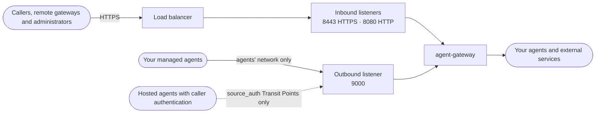

# Deployment Requirements

This page lists what your infrastructure needs to run Agent Gateway yourself, from this
source revision. If Affinidi hosts the appliance for you, use the hosted
[Agent Gateway documentation](https://docs.affinidi.com/products/affinidi-trust-fabric/agent-gateway/)
instead.

Agent Gateway is a single process, `agent-gateway`. It needs no database and no sidecar:
it keeps its state in memory and saves it as JSON files on disk. The web dashboard is a
folder of static files that the process serves.

## At a glance

| Area | What you need | Required |
| --- | --- | --- |
| [Build](#choose-how-to-run-it) | The container image, or the release binary plus a dashboard you build | Yes |
| [Host](#host) | Linux; 2 vCPUs and 1 GiB of RAM for evaluation | Yes |
| [Storage](#storage) | A persistent, writable volume, with backups | Yes |
| [Network](#network) | A public DNS name, a trusted TLS certificate, and a load balancer (recommended) | Yes |
| [Outbound access](#outbound-access) | Egress to your agents and to each service you enable | Yes |
| [Secrets](#secrets-and-keys) | A backup encryption key, an encryption-at-rest key for real credentials, and `AG_IDENTITY_HASH_PEPPER` for more than one instance or consent confirmation | Yes |
| [Time](#time) | NTP on the host | Yes |
| [Fabric](#fabric) | A DIDComm mediator | Only to connect gateways |

## Choose how to run it

**Container image (recommended).** Build it from the [`Dockerfile`](../Dockerfile). It is
the only complete build: it contains the binary and the dashboard, and runs as a non-root
user. No pre-built image is published, so build it yourself. The build needs much more
memory than the running gateway; see [Build memory](development/DEVELOPMENT.md#build-memory-oom).

The image starts with `--config /app/config/config.toml` and needs these mounts:

| Mount | Holds | Access |
| --- | --- | --- |
| `/app/config` | Configuration files | Read-only |
| `/app/certs` | TLS certificate and key | Read-only |
| `/app/_storage` | Gateway state | Persistent, writable |
| `/app/_backup_restore` | Restore staging and pre-restore backups; set `backup_restore = "/app/_backup_restore"` | Persistent, writable |

The image runs as `lowPrivUser`, which has no fixed uid, and only `/app/_storage` is
created and owned by it in the image. Make the `/app/_backup_restore` mount writable by
that user: check its uid with `docker run --rm --entrypoint id <image>` and give the
volume that owner.

[`docker-compose.yml`](../docker-compose.yml) shows the first three, and
[`config/examples/README.md`](../config/examples/README.md) lists every configuration file.

**Release binary.** Each GitHub release publishes `agent-gateway-linux-x86_64` with a
SHA256 checksum and a build-provenance attestation
([`RELEASING.md`](development/RELEASING.md)). The binary does **not** include the
dashboard: build it with Node 22 by running `www/default/build.sh`, and set the
`dashboard` static route `path` in `gateway.json` to the absolute path of
`www/default/build/`. The example `path`, `"www"`, is relative to the working directory.

## Host

- **Operating system.** Linux. The release binary is x86_64 only. The image builds for
  the architecture of the machine that builds it; CI also builds and runs the gateway on
  arm64.
- **CPU and memory.**
  - *Testing and evaluation:* a minimum host configuration of 2 vCPUs and 1 GiB of RAM.
    `make docker-run` limits the container to 512 MiB (override with `DOCKER_MEMORY`);
    the image and `docker-compose.yml` set no limit, so set one yourself.
  - *Production:* a highly available Kubernetes deployment with multiple replicas,
    monitoring, and autoscaling enabled. Customers using our larger managed deployment
    sizes also benefit from a Multi-AZ architecture and AWS Fargate-backed infrastructure
    for improved resilience and operational reliability.
- **Shared libraries** (binary only; the image already has them). OpenSSL 3 (`libssl`,
  `libcrypto`), `libdbus-1`, `libsasl2`, `libxml2`, `libxmlsec1`, `libxmlsec1-openssl`
  and `zlib`. The release is built on GitHub's `ubuntu-latest` runner, so check your
  distribution with `ldd agent-gateway-linux-x86_64`. Install `libxmlsec1-openssl` even
  if `ldd` does not list it, because it is loaded at runtime.
- **`xmlsec1` command.** Needed only for SAML login (`auth_mode = "saml"`).

## Storage

The gateway stores every surface, identity, policy, audit record and, by default, secret
under `_storage/`. Losing that folder loses the appliance, so mount it on a persistent,
writable volume. Keep the folder name `_storage`: backups and restores look for it. Set every `[storage_paths]` key in `config.toml` to an absolute path
inside that folder, except `backup_restore`. Put `backup_restore` on persistent, writable
storage next to `_storage`, never inside it: a restore empties `_storage`. A full backup
covers `_storage` except `logs/` and `system_metrics/`. Back up `config.toml`,
`gateway.json`, the other configuration files and the TLS certificates separately. See
[Locating the files](CONFIGURATION_REFERENCE.md#locating-the-files). Where
`[storage_paths] vc_keys` points, the gateway creates its transit token key and its login
decoy credential key on its first start (the decoy key on its first start in passkey sign-in
mode), each by linking a complete copy into place, so that
instances starting together create one key between them. Local disks, EFS and NFS support hard links. Where the link fails, as it
does on a volume without them such as an Azure Files SMB share, the gateway logs a warning
and creates the key file exclusively instead, filling it in place; instances still share one
key, and one reading the file while another fills it waits up to 5 seconds for it to be
complete. An instance that still cannot read a key file with content in it by then stops
with an error and reads the complete file when it is restarted, so a stalled share costs one
restart; a key file that holds no content, which a first start killed while filling it
leaves behind, is removed and created again instead, but only by an instance that found it
unchanged across those 5 seconds, so a file another instance is filling is left alone. See
[Transit token](SOURCE_AUTH.md#transit-token) for the whole
rule and the error. No configuration beyond the mount
is needed: the gateway reacts to what the volume does. Mount an SMB share with options that
keep the key file readable by its owner only (`file_mode=0600`, `dir_mode=0700`, and `uid`
and `gid` matching the user the gateway runs as, or your platform's equivalent for the
share). A mount that applies its own mode instead leaves the key readable by others on the
host; the gateway warns about it and starts.

Back up with full `.agbak` archives from the dashboard or the management API; see
[Storage export and backup](development/DEVELOPMENT.md#storage-export-and-backup). Treat
volume snapshots and archives as sensitive. A restore exits the gateway after staging the
archive, and again after applying it on the next start. Run the gateway under a
supervisor or restart policy (for example, `restart: on-failure`), or start it twice by
hand.

## Network

| Port | Serves | Who should reach it |
| --- | --- | --- |
| `8443` (HTTPS) | Agent traffic, the dashboard and the management API | The load balancer |
| `8080` (HTTP) | The same, without TLS | Only a load balancer that terminates TLS |
| `9000` (HTTP) | Calls your managed agents make to Transit Points | Only your managed agents' network. The internet only for a listener whose Transit Points all authenticate their callers with `source_auth`, and failed attempts are not throttled (see below) |

**Serve the dashboard over HTTPS, or open it on `http://localhost`.** Its session cookie,
`__Host-session_token`, is `Secure`, so a browser keeps it only there. Behind a load balancer
that terminates TLS, port `8080` serves the dashboard as before. Opened over plain HTTP on any
other host, the browser drops the cookie, and two things that authenticate only with it fail:

- The dashboard's live-update WebSocket is refused on every attempt, so a full-screen
  "Reconnecting to Gateway..." notice keeps returning while the tab is open.
- [CLI browser login](ACCESS_TOKENS.md#cli-browser-login) never completes: the browser moves
  between sign-in and the authorize page until the authorize throttle answers `429`.

Each listener in `gateway.json` sets its own port, so open only the ones you use. Before
you open any listener:

- **Restrict ports 8443 and 8080 with a firewall or security group.** Each listener sets
  its own `bind_address`, and the example `gateway.json` binds every listener, port 9000
  included, to `0.0.0.0`.
- **List your load balancer in `client_ip.trusted_proxies` in `gateway.json`.** Until it
  is listed, the gateway sees every caller as the balancer's address, so the STS token
  endpoint throttle, which is on by default, counts them all as one source: a burst of
  failed client logins through the balancer locks every STS client out for
  `lockout_secs`. The passkey, SAML and CLI login limits, when enabled, share one budget the
  same way. The
  balancer must append the caller's address to `X-Forwarded-For` or overwrite it, and set
  or strip `X-Forwarded-Host` and `X-Forwarded-Proto` rather than pass a caller's through.
- **Register the first administrator before anyone else can reach the gateway.** The
  first account to register, by passkey or SAML, becomes the primary administrator and
  cannot be deleted or demoted. Allow only your own address to reach 8443 and 8080,
  register at the public URL (passkeys require the browser origin to match
  `webauthn.external_origin`), then open the ports to everyone else.
- **Keep port 9000 private, unless every Transit Point on it authenticates its callers.** It
  adds your Transit Points' credentials to the calls it forwards, so only callers you trust
  should reach it. Set its `bind_address` to an internal address, and remove the `localhost`
  entries from `external_urls` in production. An inbound listener whose `external_urls`
  share a host name with the outbound listener's also forwards `/outbound/*` to it, so its
  Transit Points are then reachable wherever that inbound listener is; give the outbound
  listener a host name of its own to keep them private.
- **A Transit Point may face callers outside your network only when it authenticates them
  with `source_auth`.** A hosted agent, such as Copilot Studio, cannot send the transit
  token, so give its Transit Point `source_auth` with `mtls` or a strong key per caller, and
  never leave it open (`allow_unauthenticated_callers`) or protected only by a transit
  token. The listener is the unit of exposure: every Transit Point on an outbound listener
  is reachable wherever the listener is, so serve the ones that face the internet from a
  listener of their own (the Transit Point's `listen_address`) and keep the rest on a
  private one. Failed attempts are not throttled, so protect such a listener with your load
  balancer or firewall too. See
  [Reachable from other hosts](SOURCE_AUTH.md#reachable-from-other-hosts).
- **Send the OAuth consent routes to one gateway process.** A used consent start link is
  remembered only by the process that used it, so with several replicas behind one callback
  URL, a start link can be confirmed once on each. Route `{oauth_callback_route}/*` (by
  default `/v1/identity/oauth/callback/*`) to a single process. See
  [Consent flow](CREDENTIAL_DELEGATION.md#consent-flow).

You also need:

- **A public DNS name** that callers, browsers and
  [remote gateways](../CONTEXT.md) can reach. Use it in
  `listeners[].external_urls`, `webauthn.rp_id`, `webauthn.external_origin` and
  `did.domain`.
- **A trusted TLS certificate** for that name, on the load balancer if it terminates
  TLS, otherwise in `[tls]` in `config.toml`. A self-signed certificate works only for
  local testing; remote gateways and DID resolvers reject it.
- **Public DID documents.** The gateway publishes DIDs under `/.well-known/` and `/dids/`,
  which anyone verifying your agents must be able to fetch over HTTPS. See
  [Resolvable identities](CAPABILITIES.md#resolvable-identities).

## Outbound access

The gateway only calls out to what you configure. Allow egress to:

| Destination | Needed when |
| --- | --- |
| Your managed agents, MCP servers and each Transit Point's target endpoint | Always |
| `affinidi_terms_url` | `terms` is on in `gateway.json` |
| A DIDComm mediator | You connect gateways over [Fabric](#fabric), including to the agent-pay gateway a surface's payment policy names |
| Peer DID hosts, trust registries, OAuth providers | A surface uses identity verification, Trust Check or credential delegation |
| AWS Secrets Manager, Parameter Store, KMS | `secrets_backend = "aws"`, a secret uses an `aws_` reference, or encryption at rest uses KMS |
| An OpenTelemetry collector or CloudWatch | You configure them in `metrics.json` |
| `login.microsoftonline.com` and `graph.microsoft.com` | SAML login uses `graph_api` for Microsoft Entra ID provisioning and profile photos |
| SMTP, Slack, webhooks, Kafka, Kinesis, Pulsar or Redis Streams | An integration uses them ([details](INTEGRATIONS.md)) |

**Proxies and external consent.** The vendor calls of external consent connect directly and
ignore `HTTPS_PROXY`, `HTTP_PROXY`, `ALL_PROXY` and the system proxy settings: reading an
external consent provider's authorization server metadata, exchanging a connect's code and
refreshing its grants at the provider's token endpoint, revoking its grants (RFC 7009), and
forwarding a Transit Point request, or an Access Point's request to its Target, that carries a
grant by binding to the provider's
`resource`. A proxy would resolve each vendor's host again and connect to an address the
gateway never vetted, so the gateway pins these calls to the addresses it checked. On a network
where egress goes only through a proxy, allow direct egress to those vendors, including each
provider's token endpoint host, or external consent fails to connect. The JWKS fetches of JWT
verification strategies and the token requests of credential providers ignore the proxy for the
same reason, so allow direct egress to each strategy's JWKS host and each provider's token
endpoint host as well, or JWT Bearer callers and service tokens fail. The gateway logs a
warning at startup when a proxy variable is set. All other outbound calls use a configured
proxy as before.

## Secrets and keys

| Secret | Required | How to set it |
| --- | --- | --- |
| `backup_encryption_key` | Yes. The gateway does not start without it. | 64 hex characters, for example `openssl rand -hex 32`. Prefer `file://` with a mounted secret, so the key does not appear in the process environment or `docker inspect`. |
| Encryption-at-rest key | When the gateway holds real credentials | A 32-byte key. A configuration from `--generate-bootstrap` has encryption at rest off, so `_storage/` holds secrets in plain text until you turn it on. The development setup turns it on for the environments it creates. Choose the key source before the gateway stores data. See [Secrets and encryption at rest](CAPABILITIES.md#secrets-and-encryption-at-rest). |
| `AG_IDENTITY_HASH_PEPPER` | Required when you run more than one instance, keep grants by binding (`consent_mode: external`) or use consent confirmation on a credential provider; otherwise recommended | At least 64 hex characters (32 bytes), for example `openssl rand -hex 32`, with the same value on every instance. Without it, DIDs derived from mTLS, API key or JWT-claim credentials change on every restart, and with encryption at rest off, OAuth consent started before a restart or on another instance fails. A provider with consent confirmation cannot be saved without it, and if it is lost on a redeploy that provider gives JWT callers no consent link. |

Store the backup key and the encryption-at-rest key away from the backups. Losing either
key makes the backups or `_storage/` unreadable. See [Secret references](CONFIGURATION_REFERENCE.md#secret-references)
and [Environment variables](CONFIGURATION_REFERENCE.md#environment-variables).

## Time

Run NTP, or an equivalent clock sync, on the host. Signed requests and gateway-to-gateway
messages allow 60 to 120 seconds of clock difference, depending on the check; SAML
assertions allow 180 seconds.

## Fabric

You need Fabric only to connect your gateway to remote gateways. Gateway-to-gateway calls
travel over DIDComm v2.1 through a mediator, which needs:

- v0.33.1 or later, the version this source revision is built and tested against
  ([mediator reference](https://docs.affinidi.com/products/affinidi-trust-fabric/agent-gateway/reference/gateways/mediator/));
- a public URL that both gateways can reach;
- a Redis-compatible store, or its embedded Fjall store.

The published mediator image is built for linux/arm64 only. Check that it matches your
host's architecture with
`docker manifest inspect public.ecr.aws/affinidi/messaging-mediator:<tag>`. See
[`FABRIC.md`](FABRIC.md).
