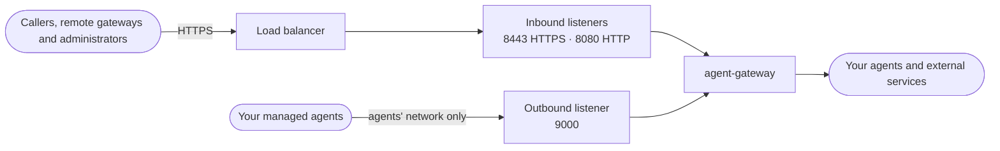

# Deployment Requirements

This page lists what your infrastructure needs to run Agent Gateway yourself, from this
source revision. If Affinidi hosts the appliance for you, use the hosted
[Agent Gateway documentation](https://docs.affinidi.com/products/affinidi-trust-fabric/agent-gateway/)
instead.

Agent Gateway is a single process, `agent-gateway`. It needs no database and no sidecar:
it keeps its state in memory and saves it as JSON files on disk. The web dashboard is a
folder of static files that the process serves.

## At a glance

| Area | What you need | Required |
| --- | --- | --- |
| [Build](#choose-how-to-run-it) | The container image, or the release binary plus a dashboard you build | Yes |
| [Host](#host) | Linux; 2 vCPUs and 1 GiB of RAM for evaluation | Yes |
| [Storage](#storage) | A persistent, writable volume, with backups | Yes |
| [Network](#network) | A public DNS name, a trusted TLS certificate, and a load balancer (recommended) | Yes |
| [Outbound access](#outbound-access) | Egress to your agents and to each service you enable | Yes |
| [Secrets](#secrets-and-keys) | A backup encryption key, an encryption-at-rest key for real credentials, and `AG_IDENTITY_HASH_PEPPER` for more than one instance | Yes |
| [Time](#time) | NTP on the host | Yes |
| [Fabric](#fabric) | A DIDComm mediator | Only to connect gateways |

## Choose how to run it

**Container image (recommended).** Build it from the [`Dockerfile`](../Dockerfile). It is
the only complete build: it contains the binary and the dashboard, and runs as a non-root
user. No pre-built image is published, so build it yourself. The build needs much more
memory than the running gateway; see [Build memory](development/DEVELOPMENT.md#build-memory-oom).

The image starts with `--config /app/config/config.toml` and needs these mounts:

| Mount | Holds | Access |
| --- | --- | --- |
| `/app/config` | Configuration files | Read-only |
| `/app/certs` | TLS certificate and key | Read-only |
| `/app/_storage` | Gateway state | Persistent, writable |
| `/app/_backup_restore` | Restore staging and pre-restore backups; set `backup_restore = "/app/_backup_restore"` | Persistent, writable |

[`docker-compose.yml`](../docker-compose.yml) shows the first three, and
[`config/examples/README.md`](../config/examples/README.md) lists every configuration file.

**Release binary.** Each GitHub release publishes `agent-gateway-linux-x86_64` with a
SHA256 checksum and a build-provenance attestation
([`RELEASING.md`](development/RELEASING.md)). The binary does **not** include the
dashboard: build it with Node 22 by running `www/default/build.sh`, and set the
`dashboard` static route `path` in `gateway.json` to the absolute path of
`www/default/build/`. The example `path`, `"www"`, is relative to the working directory.

## Host

- **Operating system.** Linux. The release binary is x86_64 only. The image builds for
  the architecture of the machine that builds it; architectures other than x86_64 are
  untested.
- **CPU and memory.**
  - *Testing and evaluation:* a minimum host configuration of 2 vCPUs and 1 GiB of RAM,
    with the Agent Gateway container limited to 512 MiB of RAM by default.
  - *Production:* a highly available Kubernetes deployment with multiple replicas,
    monitoring, and autoscaling enabled. Customers using our larger managed deployment
    sizes also benefit from a Multi-AZ architecture and AWS Fargate-backed infrastructure
    for improved resilience and operational reliability.
- **Shared libraries** (binary only; the image already has them). OpenSSL 3 (`libssl`,
  `libcrypto`), `libdbus-1`, `libsasl2`, `libxml2`, `libxmlsec1`, `libxmlsec1-openssl`
  and `zlib`. The release is built on GitHub's `ubuntu-latest` runner, so check your
  distribution with `ldd agent-gateway-linux-x86_64`. Install `libxmlsec1-openssl` even
  if `ldd` does not list it, because it is loaded at runtime.
- **`xmlsec1` command.** Needed only for SAML login (`auth_mode = "saml"`).

## Storage

The gateway stores every surface, identity, policy, audit record and, by default, secret
under `_storage/`. Losing that folder loses the appliance, so mount it on a persistent,
writable volume. Keep the folder name `_storage`: backups and restores look for it. Set every `[storage_paths]` key in `config.toml` to an absolute path
inside that folder, except `backup_restore`. Put `backup_restore` on persistent, writable
storage next to `_storage`, never inside it: a restore empties `_storage`. A full backup
covers `_storage` except `logs/` and `system_metrics/`. Back up `config.toml`,
`gateway.json`, the other configuration files and the TLS certificates separately. See
[Locating the files](CONFIGURATION_REFERENCE.md#locating-the-files).

Back up with full `.agbak` archives from the dashboard or the management API; see
[Storage export and backup](development/DEVELOPMENT.md#storage-export-and-backup). Treat
volume snapshots and archives as sensitive. A restore exits the gateway after staging the
archive, and again after applying it on the next start. Run the gateway under a
supervisor or restart policy (for example, `restart: on-failure`), or start it twice by
hand.

## Network

| Port | Serves | Who should reach it |
| --- | --- | --- |
| `8443` (HTTPS) | Agent traffic, the dashboard and the management API | The load balancer |
| `8080` (HTTP) | The same, without TLS | Only a load balancer that terminates TLS |
| `9000` (HTTP) | Calls your managed agents make to Transit Points | Only your managed agents' network; never the internet |

Each listener in `gateway.json` sets its own port, so open only the ones you use. Before
you open any listener:

- **Restrict ports 8443 and 8080 with a firewall or security group.** Each listener sets
  its own `bind_address`, and the example `gateway.json` binds every listener, port 9000
  included, to `0.0.0.0`.
- **Register the first administrator before anyone else can reach the gateway.** The
  first account to register, by passkey or SAML, becomes the primary administrator and
  cannot be deleted or demoted. Allow only your own address to reach 8443 and 8080,
  register at the public URL (passkeys require the browser origin to match
  `webauthn.external_origin`), then open the ports to everyone else.
- **Keep port 9000 private.** It adds your Transit Points' credentials to the calls it
  forwards, so only your managed agents should reach it. Set its `bind_address` to an
  internal address, and remove the `localhost` entries from `external_urls` in
  production.

You also need:

- **A public DNS name** that callers, browsers and
  [remote gateways](../CONTEXT.md) can reach. Use it in
  `listeners[].external_urls`, `webauthn.rp_id`, `webauthn.external_origin` and
  `did.domain`.
- **A trusted TLS certificate** for that name, on the load balancer if it terminates
  TLS, otherwise in `[tls]` in `config.toml`. A self-signed certificate works only for
  local testing; remote gateways and DID resolvers reject it.
- **Public DID documents.** The gateway publishes DIDs under `/.well-known/` and `/dids/`,
  which anyone verifying your agents must be able to fetch over HTTPS. See
  [Resolvable identities](CAPABILITIES.md#resolvable-identities).

## Outbound access

The gateway only calls out to what you configure. Allow egress to:

| Destination | Needed when |
| --- | --- |
| Your managed agents, MCP servers and each Transit Point's target endpoint | Always |
| `affinidi_terms_url` | `terms` is on in `gateway.json` |
| A DIDComm mediator | You connect gateways over [Fabric](#fabric) |
| Peer DID hosts, trust registries, OAuth providers, x402 facilitators | A surface uses identity verification, Trust Check, credential delegation or payments |
| AWS Secrets Manager, Parameter Store, KMS | `secrets_backend = "aws"`, a secret uses an `aws_` reference, or encryption at rest uses KMS |
| An OpenTelemetry collector or CloudWatch | You configure them in `metrics.json` |
| SMTP, Slack, webhooks, Kafka, Kinesis, Pulsar or Redis Streams | An integration uses them ([details](INTEGRATIONS.md)) |

## Secrets and keys

| Secret | Required | How to set it |
| --- | --- | --- |
| `backup_encryption_key` | Yes. The gateway does not start without it. | 64 hex characters, for example `openssl rand -hex 32`. Prefer `file://` with a mounted secret, so the key does not appear in the process environment or `docker inspect`. |
| Encryption-at-rest key | When the gateway holds real credentials | A 32-byte key. Encryption at rest is off by default, so `_storage/` holds secrets in plain text until you turn it on. Choose the key source before the gateway stores data. See [Secrets and encryption at rest](CAPABILITIES.md#secrets-and-encryption-at-rest). |
| `AG_IDENTITY_HASH_PEPPER` | Required when you run more than one instance; otherwise recommended | At least 64 hex characters (32 bytes), for example `openssl rand -hex 32`, with the same value on every instance. Without it, DIDs derived from mTLS, API key or JWT-claim credentials change on every restart, and with encryption at rest off, OAuth consent started before a restart or on another instance fails. |

Store the backup key and the encryption-at-rest key away from the backups. Losing either
key makes the backups or `_storage/` unreadable. See [Secret references](CONFIGURATION_REFERENCE.md#secret-references)
and [Environment variables](CONFIGURATION_REFERENCE.md#environment-variables).

## Time

Run NTP, or an equivalent clock sync, on the host. Signed requests and gateway-to-gateway
messages allow 60 to 120 seconds of clock difference, depending on the check; SAML
assertions allow 180 seconds.

## Fabric

You need Fabric only to connect your gateway to remote gateways. Gateway-to-gateway calls
travel over DIDComm v2.1 through a mediator, which needs:

- v0.17.0 or later
  ([mediator reference](https://docs.affinidi.com/products/affinidi-trust-fabric/agent-gateway/reference/gateways/mediator/));
- a public URL that both gateways can reach;
- a Redis-compatible store, or its embedded Fjall store.

Check that the mediator image matches your host's architecture with
`docker manifest inspect public.ecr.aws/affinidi/messaging-mediator:<tag>`. See
[`FABRIC.md`](FABRIC.md).
