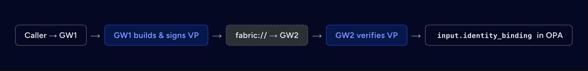

# Fabric and Gateway-to-Gateway Internals

Use the hosted [architecture](https://docs.affinidi.com/products/affinidi-trust-fabric/agent-gateway/concepts/architecture/)
and [federated connectivity guides](https://docs.affinidi.com/products/affinidi-trust-fabric/agent-gateway/how-to-guides/connections/)
for product concepts and connection procedures. This page records implementation details and
security invariants of the checked-out source revision.

## Fabric model

The Fabric is the set of DIDComm-based appliances connected through Connection Points. A
Gateway-to-Gateway (G2G) call targets an Agent Surface on a remote Agent Gateway while preserving
the authenticated sending gateway identity for policy evaluation.

An Agent Surface targets a remote surface with:

```text
fabric://{gateway_id}/{surface_id}
```

The DIDComm forward-request body still calls the second value `channel_id`. That identifier is a
legacy wire name; it carries the destination surface's `config_id`. Source methods and telemetry
fields that use `channel_id`, `channel_name`, or `channel_did` are likewise legacy code or wire
names, not current product terminology.

## Connection-point manager

[`ConnectionPointListenerManager`](../src/gateways/connection_points/ws_listener.rs) owns the
Connection Point listener lifecycle. Its runtime state includes:

- running listener information keyed by Connection Point ID;
- a gateway-to-Connection-Point index used by `fabric://` forwarding;
- stores for Connection Points, gateways, pending connections, mediators, notifications, and
  messages;
- a persistent, TTL-based [`DIDCache`](../src/gateways/did_cache.rs);
- a listener-start command channel for requests originating inside message handlers; and
- a `Weak<Self>` back-reference used by spawned tasks.

The manager is constructed with `Arc::new_cyclic`. A listener upgrades the weak reference only for
the duration of a callback, avoiding a manager-to-listener-to-manager strong-reference cycle.

## DIDComm listener

Each Connection Point maintains a persistent DIDComm connection through its mediator. The listener
authenticates, registers the receive ACL, receives encrypted envelopes, decrypts them, and dispatches
them by DIDComm message type. Applicable messages are persisted and connection metrics are updated.
A forwarded G2G request also emits a dashboard `PayloadCaptured` event through the payload-capture
helper.

Forward responses are correlated to pending requests by message ID. Resolving the pending
`oneshot` completes the HTTP request that initiated the G2G call.

The listener deletes a message from the mediator only after processing it, so every in-flight
fabric request stays queued at the mediator until it is answered. A mediator from v0.27 caps the
messages one sender may have queued for one recipient at `[limits] queued_send_messages_per_peer`
(default `50`, and not settable by environment variable in v0.33.1). A forward over the cap is
refused with `e.p.limits.queue.peer`, and the caller sees a fabric timeout (`504`). Size the cap
for the concurrent requests expected between two gateways, below the recipient's
`queued_receive_messages_soft` (default `200`). The E2E mediators (`scripts/g2g-mediator.sh`) and
the local mediator (`make mediator-up`) run with `150`. `scripts/mediator/user-data-v2.sh` sets the
cap from its optional thirteenth argument, and without it leaves the mediator default.

Framed stream messages (`forward-stream/1.0` frames and capability queries) also arrive through the
listener. It answers a capability query only from a registered, active peer gateway, and admits an
Open off its reader loop, holding the stream's early frames until the Open is admitted. It answers
an Open it refuses with an `Error` frame to that peer saying why: `stale_offer` (the sender negotiates
again), `legacy_only` (sent only by an older peer whose surface does not admit modern MCP; the
sender's caller gets `-32022`, as from a legacy-only endpoint), `capacity_reached` when a
framed-stream cap, the Open replay table or the peer's or its tenant's share of it is full, or the
peer is past its Open rate, or `unavailable`. A sender treats a `capacity_reached` it receives as a
full cap and answers its caller `429` with `Retry-After`, and treats any code it does not recognise
as `unavailable`; a 1.0.0 sender cannot parse `capacity_reached` and waits for its response deadline
instead.

While a pair runs mixed versions, this matters only when the upgraded receiver is out of room: a
1.0.0 sender's callers then wait for their response deadline, holding the sender's own stream slots
meanwhile, instead of getting a fast `502`. Normal traffic is unaffected. Upgrade both gateways of a
pair together. Where that is not possible, upgrade the gateway that sends the requests first: an
upgraded sender understands both `capacity_reached` and the `unavailable` a 1.0.0 receiver answers
with. An Open's
envelope must carry a valid `expires_time`, as a `forward-request`'s must. See the Framed Fabric Transport section of
[`MCP_METADATA.md`](MCP_METADATA.md#framed-fabric-transport).

The Agent Gateway exposes DID documents at `/.well-known/did.json` for `did:web` and
`/.well-known/did.jsonl` for `did:webvh`. Resolution checks the JSON Lines form first and then the
JSON document. DIDComm envelopes are accepted through the configured `/didcomm` HTTP or WebSocket
surface.

## Connection establishment invariants

Invitation fetching is SSRF-protected. A gateway invitation reaches a local address only through
the test-mode egress allow-list (`AG_BDD_EGRESS_ALLOWLIST`, honoured only when `AG_TEST_MODE=true`);
the development override `AG_ALLOW_LOCAL_OOB=1`, which must not be set in production, applies
only to the trust-registry OOB and `did:web` fetches in `src/trust_registries/communication.rs`.
Pairing also resolves the inviter's and the mediator's DIDs, so a peer or mediator whose
`did:web` / `did:webvh` lives on a local or private host needs `[did_cache] allow_private_hosts`;
see [DID resolution host policy](POLICY.md#did-resolution-host-policy).

The wire payloads use `channel_did` for the persistent peer DID. This is an exact legacy wire field
name. A connection-accepted message must be authcrypt; accepting anoncrypt here would let an
unauthenticated sender complete the handshake.

`connection-setup` and `connection-accepted` must also carry a valid issuer attestation, or the
handshake is rejected. Pairing therefore fails closed against a peer built before attestations
existed, until that peer is upgraded. Both messages are also refused, failing the handshake with no
reply, when their DIDComm `expires_time` has passed or their `(sender DID, message id)` pair was
already processed: `connection-setup` after it proves control of its `channel_did` on a live
invitation, `connection-accepted` once its sender and `channel_did` are present; both verify their
issuer attestation afterwards. A pairing message without `expires_time` is remembered for one hour.

An invitation pairs one gateway. The inviting gateway records the id of the invitation message
its mediator serves, and accepts a `connection-setup` only when all of these hold:

- it arrives on a User Connection Point that has a secret, is enabled and has not expired;
- the Connection Point has not already been redeemed;
- the setup's `pthid` names that invitation message.

The secret is compared in constant time. A successful setup increments the invitation's
`use_count`, so every later setup on it is refused, even if an administrator rejects the resulting
request; create a new invitation to pair again. A setup that fails after its secret is accepted
and before the request is stored, for example on an invalid issuer attestation or at the appliance
gateway limit, returns the invitation to unused so the peer can retry it. The redeemed Connection Point is kept, because
approval sends `connection-accepted` from its DID. System Connection Points (`oobresponder`,
`oobacceptor`, `system`) never accept a `connection-setup`. Invitations created before the gateway
recorded the message id are refused and must be created again.

The handshake always runs on the inviter's mediator. The acceptor's permanent connection point uses
the inviter's mediator too, unless `connect-via-oob` names one of the acceptor's own mediators in
`acceptor_mediator_id`. The field is refused with `400` unless the experimental `mediator_federation`
feature flag is on (it is off by default). That mediator must be within the caller's tenant and token
scope, referenceable by the new gateway's tenant (as for connection points), Active, and registered
(`our_did` / `our_secrets`), otherwise the request fails with `400`
before any outbound call. If the pending connection is lost before `connection-accepted` arrives, the
acceptor recovers its mediator from the temporary connection point. If that is the temporary
connection point's own (the inviter's) mediator, recovery proceeds; otherwise it refuses to finish
unless the acceptor mediator record recorded at accept time is still Active with that DID. The
acceptor's permanent connection point stores that record id as its `mediator_id`, so finalize,
recovery and its listener read that record by id, never a mediator found by DID. See [per-gateway mediators](PER_GATEWAY_MEDIATOR_FEDERATION.md).

`pack_and_send_message` chooses each send's route from the recipient's DID: when its
`DIDCommMessaging` service endpoint names a mediator other than the sender's own, the send is wrapped
in a `routing/2.0/forward` addressed to the sender's mediator, which relays it. Otherwise it is sent
directly. The route does not depend on the feature flag. Fabric stream frames and the x402
facilitator always send directly.

## Peer issuer DIDs

A gateway sends fabric envelopes from a per-pairing Connection Point DID but signs the identity
credentials it issues with its gateway DID. An issuer attestation
([`issuer_attestation.rs`](../src/gateways/issuer_attestation.rs)) is a typed JWT
(`gateway-issuer-attestation+jwt`) binding those two DIDs together: `sub` is the sender's Connection
Point DID, `aud` the receiver's temporary DID, and `nonce` the handshake thread id.

Each Remote gateway record therefore carries a set of **connection issuers**
([`gateways::types::PeerIssuers`](../src/gateways/types.rs)):

- `issuer_did` — established by the gateway itself, either from the attestation in the pairing
  handshake or from the `gateway-issuer-request` exchange
  ([`issuer_exchange.rs`](../src/gateways/issuer_exchange.rs), run on demand and at listener start).
  `issuer_did_source` records which. It cannot be set through the API.
- `trusted_issuer_dids` — issuer DIDs an operator adds to this one connection.

Trust is connection-scoped, never per surface or appliance-wide, so a peer cannot replay a
presentation another gateway issued. A sender with neither an established nor a trusted issuer is
rejected with 403; a sender with trusted issuers but a failed attestation exchange is admitted for
those issuers only.

Earlier builds had a per-surface allowlist, `AgentSurface.trusted_binding_issuers`, which accepted
a presentation from any peer that forwarded it. The field no longer exists. A stored surface that
still carries it has the field removed at load, with a WARN naming the surface
(`AgentSurface::migrate_raw_json`), and a write that includes it is rejected as an unknown field.
Add those issuer DIDs to the Remote gateway connection's `trusted_issuer_dids` instead.

The issuer string is trustworthy because [`LocalVerifier::verify_vp`](../src/identity/ssi/verifier.rs)
verifies every embedded VC's Data Integrity proof and requires the proof key's DID to equal the VC
`issuer` (and the VP proof key's DID to equal `holder`). ssi alone verifies only the outer VP proof
and never binds a proof key to the document it signs.


On the fabric path the credential's issuer must also be one of the connection's issuers,
which the diagram above does not show.



Attribution fails closed. A presentation that does not verify, or whose issuer is not one
of the connection's issuers, never falls back to the `did` claim beside it. The request
continues with no caller identity, only the audit record for the unverified DID is
written, and no weaker identity source is consulted for that request, neither the identity
binding VP nor a raw identity extension.

The `did` field is never a source of identity. A credential extension carrying only a
`did` claim yields nothing, and a `did` field in the raw `agent-identity/v1` extension is
ignored. The identity is instead computed from:

1. The extension's `x-identity` fields.
2. Failing that, when the surface has no identity schema or the gateway has no VC issuer,
   a hash of its `agentIdentity`, `agentId`, `id`, or `agent_id` value.
3. Failing that, a hash of the whole extension with its `did` removed.

A gateway with no VC issuer configured cannot verify presentations at all. It skips them
rather than rejecting them, so a raw identity extension beside one still yields a
payload-derived identity.

The direct A2A path applies the same no-fallback rule to payload identities: once a
presented VP is rejected, a raw `agent-identity/v1` extension beside it yields no identity
either. On that path no audit record is written, and a presentation it cannot verify
because no verifier is configured counts as rejected. A surface-configured
`inbound_identity`, meaning `static`, `from_mtls`, `from_api_key`, or `from_jwt_claim`,
still applies, except on public discovery paths where none is resolved.

Policies read how the caller DID was established from
`input.extension_identity.verification` and `input.agent.did_verification`.

| Value | Meaning |
| --- | --- |
| `vp` | Verified presentation from a connection issuer. Fabric path only. |
| `vp_unanchored` | Verified presentation on the direct A2A path, where no authenticated sender vouches for the issuer. |
| `source_auth` | DID bound to this request's authenticated source credential, meaning `from_jwt_claim`. |
| `unverified` | Payload-derived pseudonyms, and surface-configured identities such as `static`, `from_mtls`, and `from_api_key`. |

`input.extension_identity.verified` and `input.agent.did_verified` are the boolean
projections: everything but `unverified` is verified.

On the direct HTTP path there is no authenticated sender, so no issuer anchor exists; the verified
issuer is exposed to OPA as `input.identity_binding.issuer_gateway` for a binding presentation and
as `input.agent.identity_issuer_did` for an identity presentation, for policy to decide.

Management API: `GET /v1/gateways/{id}` (`gateways.view`) exposes `issuer_did`,
`issuer_did_source`, and `trusted_issuer_dids`. The rest are `gateways.edit`:
`POST /v1/gateways/{id}/issuer` runs the exchange; `DELETE /v1/gateways/{id}/issuer` forgets the
attested issuer; `POST /v1/gateways/{id}/trusted-issuers` and
`DELETE /v1/gateways/{id}/trusted-issuers/{issuer_did}` manage operator trust.

## Runtime health behavior

After a Gateway Ping timeout, the Gateway checks its mediator account. It reauthenticates and
reregisters if the account has disappeared, or restores the receive list when the account remains
but its ACL has been reset.

Every connected Connection Point also runs this check on its own account every 30 seconds. A
mediator can lose accounts while the connections stay open, for example when its store is flushed
or fails over. It recreates an account only when that account sends, and refuses delivery to a
missing account with `e.p.delivery.refused`. Without the periodic check, a gateway that only
receives would stay unreachable.

Four Connection Points are checked at a time, so one slow mediator does not hold up the others.
Each probe waits up to 5 seconds, a restart up to 20 seconds, and re-opening a receive list up to
10 seconds; a repair that fails is tried again at the next check and logged at `warn`. An account
that cannot be read changes nothing. When that happens on consecutive checks it is logged at
`warn` on the second, then at doubling intervals, so a check that cannot reach its mediator is
visible. A Connection Point stopped or removed while it is being checked is not started again.

When the appliance is Standby, fabric and trust listeners are inactive and the node reports not
ready. Periodic cache refresh keeps supported cached stores current on a Standby node.

## Peer exposure

Each Remote gateway record carries an exposure mode that decides which local surfaces that peer
reaches over Fabric ([`Gateway::exposes_surface`](../src/gateways/types.rs)):

| `exposure_mode` | The peer reaches |
| --- | --- |
| `none` | No surface. Every newly paired peer starts here, on every pairing path, including the inbound handshake. |
| `list` | Only the surface ids in `exposed_channels`. An empty list reaches nothing. |
| `all` | Every active surface. |

The same check applies to buffered `forward-request` traffic, framed-stream Opens, and the
`get-channels` capability query, which lists only the surfaces the sender may reach. The tenant rule
applies on top of every mode.

Records written before the mode existed have no `exposure_mode`. On boot,
[`migrate_exposure_modes`](../src/gateways/filesystem.rs) persists `all` for a record with an empty
list (its earlier meaning) and `list` for a record with a non-empty one, so existing peers keep their
access. On this version, until a record is migrated, it is read with that same earlier meaning,
never with more access.

Upgrade every node that shares gateway storage, such as both nodes of an active/standby pair,
before failing back to a node on an earlier version, and do not pair peers or change exposure
until every node runs a version with exposure modes. An earlier version ignores `exposure_mode`.
It reads a record with mode `none` and an empty list as every surface, and drops the mode when
it saves the record, including a background update, so the peer then reaches every surface on
the new version too. If a node on an earlier version ran after the upgrade, check each Remote
record's `exposure_mode` and set it again.

Set the mode with `PUT /v1/gateways/{id}/exposed-surfaces` (`gateways.edit`), body
`{"exposure_mode": "list", "exposed_channels": ["surface-id"]}`. The list is stored only in `list`
mode. A body without `exposure_mode` selects `list` for a non-empty list and `none` for an empty
one, so an empty list never means every surface. On a gateway that is not Remote, such as the
self gateway, the request is refused with 400. The dashboard sets it on the **Publishing** tab of
a remote gateway.

### Revoking access ends running streams

A change that narrows a peer's access also ends the framed streams it no longer allows on this
node ([`Revocation`](../src/proxy/fabric_stream/mod.rs)). They end the way a replaced listener ends
its streams: each side is told `unavailable`, and the caller's response ends with an error.

| Change | Streams that end |
| --- | --- |
| The peer's status leaves `active`, or its record is removed | Every stream with the peer, opened by either side |
| The peer's exposure no longer admits a surface (`none`, or a list without it) | The streams the peer opened here to that surface |
| A Connection Point is disabled or removed | Every stream it carries |
| A Connection Point's exposure list no longer admits a surface | The streams opened here through it to that surface |

When the streams end depends on where the change comes from:

- A write through this node's gateway or Connection Point store ends them at once. Only a change
  that narrows access does: a widened or reordered exposure list ends nothing.
- A change this node did not write ends them when its cache picks the change up: another node's
  write, read by the periodic cache refresh (`cache_refresh_interval_secs`) or by the refresh on
  promotion. The running streams are then checked against the stored records, and those the records
  no longer admit end.
- A write that cannot read the record it replaces checks the running streams against the stored
  records the same way.

Configuration reload does not re-read gateway or Connection Point records, and a backup restore
restarts the gateway, which ends every stream.

Streams of other peers, surfaces and Connection Points keep running. An Open admitted while a
revocation runs is refused, so it cannot outlive the change. Admission reads the Connection Point's
current record rather than the one its listener started with, so a disabled Connection Point admits
no new stream.

## Fabric receive pipeline

[`process_forward_request`](../src/gateways/connection_points/message_processor.rs) handles a G2G
request received by the destination gateway:

1. Decrypt and authenticate the DIDComm envelope.
2. Authorize the sender and admit the envelope once. The sender's Connection Point DID must belong
   to an active paired Remote gateway record that exposes the requested surface (403 otherwise).
   See [Peer exposure](#peer-exposure). Tenancy narrows that further: an appliance-wide peer, which
   includes every peer that arrived through the inbound handshake, may reach every surface its mode
   allows, while a tenant-owned peer reaches only surfaces of its own tenant and appliance-wide
   surfaces, whatever its exposure mode says
   ([`fabric_peer_may_reach_surface`](../src/gateways/connection_points/message_processor.rs)). A
   framed stream Open checks the same peer exposure and tenant rule, and also the receiving
   Connection Point's exposure list. A refused Open is answered with the `unavailable` stream error
   code, which 1.0.0 senders can parse, so a modern MCP caller sees `502` rather than `403`. The
   envelope is then checked by
   [`envelope_replay.rs`](../src/gateways/connection_points/envelope_replay.rs): its DIDComm
   `expires_time` must be present, in the future and at most one hour ahead, its `created_time`
   (when present) at most 120 s in the future, and its `(sender DID, message id)` pair not processed
   before. An undated envelope, or one dated too far ahead, is refused with 403 and an expired one
   with 504, before surface lookup, source authentication, policy, payment or dispatch. A
   re-delivered envelope is dropped without a reply: the mediator re-delivers a message that was not
   deleted after dispatch, and a reply threaded to the original id would displace the real response
   at the sender. The seen set holds a SHA-256 digest per pair in memory until the envelope's
   `expires_time`; expired entries are swept during admission, at most once a minute. It is exported
   as the `agent_gateway_fabric_envelope_seen_entries` gauge, which counts entries not yet swept. On
   the sending side the envelope lifetime is capped at 3480 s (`sent_envelope_lifetime_secs`)
   whatever the request timeout says (see [Fabric envelope
   lifetime](CONFIGURATION_RELOAD.md#fabric-envelope-lifetime)), leaving 120 s of clock skew below the
   receiver's cap; the caller deadline (`deadline_ms`) keeps the full timeout.
3. Resolve the destination surface from the legacy wire field `channel_id`.
4. Run the destination surface's configured source authentication and MCP request-boundary
   validation. DIDComm authentication proves the sending Gateway; source authentication separately
   evaluates caller evidence presented to the destination surface. On an MCP surface that
   publishes protected resource metadata, a missing or refused token is answered here with a
   `401` before policy, without `resource_metadata`: the sending Gateway strips the caller's
   own `Authorization` header, so only a credential it injects, issued for this surface's
   resource, can pass. There is no A2A counterpart:
   `A2A-Version` is negotiated and A2A requests are validated on the sending gateway, not here
   (see below).
5. Build policy input containing the authenticated sending Gateway and any source-auth result. An
   identity presentation is attributed to the caller only when its issuer is one of the sending
   connection's issuers (see [Peer issuer DIDs](#peer-issuer-dids)).
6. Run Gateway policy, payment verification, caller identity extraction, MCP per-tool policy, Trust
   Check, surface policy, and MCP tool gating in that order where configured.
7. Forward to the local surface Target.
8. Apply response processing, including MCP tool-list filtering when configured, before packaging
   the DIDComm response.

The sending and receiving gateways enforce their own policies independently. For MCP surfaces, tool
gating on each side composes: a tool hidden or denied by either surface remains unavailable.

### Modern MCP activation

Modern MCP (`2026-07-28`) is active on every MCP surface and crosses Fabric only
as framed streams, which any active MCP surface on the receiving gateway serves.
Pair single-tenant or trusted deployments first, and do not pair a
multi-tenant or internet-facing gateway: some gateway-wide tables and signals
are shared across tenants and peers (appliance-wide access changes still end
every subscription), and apart from the per-peer and per-tenant shares of the capability offer and
probe tables and of the Open replay table, the limits are per caller, per peer or per surface. The
shares apply once a table is half full, and a peer whose Remote gateway record has no tenant counts
against no tenant's share; see [how the shares apply](MCP_METADATA.md#framed-fabric-limits).
Framed streams are capped at 8 per peer and 16 per surface,
with listens counted apart from request streams under their own caps of the same size, so a partner's
long-lived listens do not use up its request slots. One peer can therefore hold 16 inbound streams and
one surface 32; only the total of 128 counts both. Past a cap on either gateway the caller gets `429`
with `Retry-After: 5`; the receiving gateway refuses with `capacity_reached`. The full list of limits is in
[Framed Fabric limits](MCP_METADATA.md#framed-fabric-limits). A buffered `ForwardRequest` receiver
does not recheck the caller's browser Origin against its own `mcp_http.allowed_origins`; it trusts
the paired sending gateway's check, as it trusts that peer for every other forwarded header. The
exception is the caller-info headers (`x-caller-did`, `x-caller-identity-source`,
`x-caller-dna-uai`, `x-gateway-did`): the receiving gateway drops every copy the peer sent, so the
agent behind it never takes a peer's value for one.

### Delegated credentials over Fabric

A sending surface's `outbound_credentials` reach a `fabric://` peer only when the route to that
peer opts in with `fabric_delegated_credentials: true`: on the Target for Access Point traffic, or
on the Transit Point for agent-initiated traffic. The setting is off by default, including on
surfaces saved before it existed, and no migration turns it on. With it off, the sending gateway
still strips the caller's own token and sends the peer no delegated credential, whatever the
request's protocol or MCP revision.

With it on, the access token crosses as it would to a local destination, injected as the
binding's `inject_as` says (a header or a `_meta` field); the refresh token never crosses. On the
Target, only modern (`2026-07-28`) MCP requests carry it: the sending gateway strips the caller's
own token, applies the delegated credential, and sends it inside the authcrypt framed stream.
Legacy MCP and A2A Access Point requests never carry it. On a Transit Point the setting applies to
every protocol: modern MCP requests, legacy MCP `_meta` injection, and header injection on any
request, including A2A. The receiving gateway, and its Target, can use that access token until it
expires. When the receiving gateway forwards the request to its Target it logs the name of each
forwarded header, never its value, so a delegated credential stays out of the logs whatever header
carries it.

The setting applies to one route only. Another `fabric://` Target or Transit Point on the same
gateway sends no delegated credential unless it opts in too. A Transit Point on a surface without
`outbound_credentials` uses only its own `transit_credentials`, never another Transit Point's. A
Target variant can override the setting, a variant's `transit.points` override sets it for that
variant's Transit Points, and a variant with `complete: true` that omits the Target override turns
it off. A legacy request whose Transit Point variant fails to resolve carries no delegated
credential.

When the setting keeps bindings from a peer, the sending gateway logs `Delegated credentials
withheld from Fabric peer` at debug level under the `credential_delegation` target, with
`surface_id`, `route` (the Target endpoint or Transit Point alias) and
`reason = "fabric_delegated_credentials=false"`. It never logs credential values. Turn it on only
for peers you would trust with those tokens. In the dashboard it is the **Send delegated
credentials over Fabric** switch on the Managed Agent or Transit Point panel, shown for a
`fabric://` route on a surface with credential bindings. See
[Credential delegation](CREDENTIAL_DELEGATION.md#across-fabric).

The receiving gateway applies its own surface's `outbound_credentials` toward its Target. Since it
forwards only to that Target, a binding with `required_for.tools` applies there to a `tools/call`
whose `params.name` it lists, read after admission has refused batches and ambiguous keys.

`make gw-e2e` verifies the Access Point Target case between two gateway binaries
(`tests/features/g2g/mcp_credential_delegation_over_fabric.feature`). The sending gateway has
`[mcp.continuations]`, `sts.mcp_issuer` and a credential provider whose consent identity strategy
trusts a local OpenID provider. The caller holds an MCP access token exchanged at that issuer. With
the setting on, a modern `tools/call` gets `input_required` with a consent URL, and the peer
gateway's received Fabric forward counter does not move. After consent, the retry carrying `requestState` reaches the peer's Target with
`Authorization: Bearer` set to the delegated access token, and neither the refresh token nor the
caller's own token appears in its URL, headers or body. A consent callback whose `state` was
altered is rejected before the gateway calls the provider's token endpoint; a retry with the
consent request state then still gets `input_required` and reaches nothing, and a new tool call
gets a new consent URL that completes normally. When the setting is
turned off after consent, the caller's stored credential does not reach the peer's Target: the
same call gets no consent request, and the Target receives neither an `Authorization` header, the
access token nor the caller's token. With the setting off and nothing stored, the call likewise
gets no consent request and the provider's token endpoint is never called. These checks observe
the peer's Target only; they do not inspect the Fabric message the receiving gateway gets. The
feature does not cover Transit Point routes or credential refresh across gateways.

A2A version negotiation, JSON-RPC and A2A request-shape validation, and the
`agent_gateway_a2a_protocol_version_total` metric run on the sending gateway, against the sending
surface's `access_point.a2a`, before a `fabric://` request is dispatched. The receive pipeline above
does not run them again, so the receiving surface's A2A settings do not apply to fabric requests;
see [Fabric coverage gap](PROTOCOLS.md#fabric-coverage-gap).
