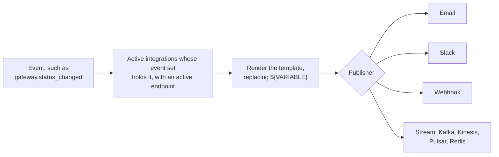

# Integrations

How the gateway tells other systems that something happened: an email when a user
registers, a Slack message when a gateway goes offline, an event on a Kafka topic for every
failed payment. Implemented in [`src/integrations/`](../src/integrations/).

In-dashboard notifications, the bell in the top bar, are a separate feature and are
covered at the end.

## Endpoints, event sets and integrations

An integration is one **endpoint**, one **event set** and a **template**. Each is its own
definition, kept as one JSON file
([`src/integrations/definitions/`](../src/integrations/definitions/)), so one endpoint or event
set can serve several integrations.

| Definition | Holds | Stored in |
| --- | --- | --- |
| Endpoint | `type` (`email`, `slack`, `webhook`, `stream`), `configuration`: the transport, destination and credentials, and `status` | `storage_paths.integration_endpoints` |
| Event set | `events`: event ids from the catalog, such as `gateway.created` or `audit.policy_decision`, audit and other events mixed freely | `storage_paths.integration_event_sets` |
| Integration | `endpoint_id`, `event_set_id`, `content` (the template), `status`, and for audit events `audit_drop_after_secs` and `audit_max_attempts` | `storage_paths.integration_definitions` |

Integrations belong to the whole appliance: none has a tenant owner, and a tenant or
resource-scoped PAT is refused with `403` on every route under `/v1/integrations`.

**Endpoints.** `smtp_password` (email), `webhook_url` (Slack), `signing_secret` and `headers`
(webhook), and `sasl_password`, `redis_url` and `auth_token` (stream) are written but never
read back:
responses leave them out of `configuration` and name the ones set in `secrets`. An update that
leaves a secret out keeps it, and one that sends it as `null` clears it. A secret field may
instead hold `$SECRET:<secret_id>`, a reference to an appliance-wide secret in the secrets
store, resolved at each delivery and shown in responses as written; a reference that does not
resolve fails the delivery. Only a value that is the reference as a whole counts. Deleting a
secret that an endpoint references is refused with `409` naming the endpoints; change or
delete those endpoints first. Changing the secret's value is allowed, and the next delivery
uses it. Only appliance-wide secrets resolve; a tenant-owned one never does. No `secrets.*`
permission is checked when a reference is saved or resolved, so `integrations.edit` can use, and
therefore read, every appliance-wide secret: pointing an endpoint that holds a reference at a
host of the caller's choosing and sending a test delivers the value there. Grant
`integrations.edit` only to roles that may read secrets; by default it and `secrets.*` are
administrator-only (see [`RBAC.md`](RBAC.md#secrets-in-endpoints)). The dashboard's stored
secret picker lists secrets only for callers with `secrets.view`, but a typed reference resolves
regardless. A save checks the configuration with its references resolved; when a referenced
value fails the checks, the `400` names the field and the secret id, for example "The value of
webhook_url from secret slack-hook fails the endpoint checks", and never the value. No error
of a save, a test, the startup check or the migration repeats a secret value or a URL (a
blocked host is named). Webhook `headers` must be an object of header names to strings, and
each header value may be such a reference; the field as a whole cannot be one. It cannot set
`Content-Type`, `X-Webhook-Timestamp` or `X-Webhook-Signature-256`, which the gateway sets on
every delivery; an endpoint stored with one of them still sends each exactly once, the
gateway's value. An endpoint's `type` cannot change. Its configuration is checked by
its publisher when saved, so a webhook or Slack URL that fails the checks under _Outbound
requests_ is refused with `400`.

**Event sets** need at least one event, every one from the catalog; repeats are dropped. A
request listing more events than the catalog holds is refused with `400`.

**Integrations** need an existing endpoint and event set. Their template must be a JSON object
whose variables some event of the event set fills, and the audit delivery limits are accepted
only when the event set holds audit events, and must be at least 1. Changing an event set is
refused with `409` while one of its integrations would no longer fit it, and an endpoint or
event set is not deleted (`409`) while an integration uses it.

## How an event becomes a message



An enabled event is delivered for every resource that raises it; there is no filter by
gateway, user or surface. Delivery reads a snapshot of the definitions
([`delivery/dispatch.rs`](../src/integrations/delivery/dispatch.rs)), taken again after any
change through the API and at most 5 seconds old otherwise, so definitions written by another
node are picked up too.

Delivery runs in spawned tasks and never blocks or fails the operation that raised the event.
Each integration of an event is delivered in a task of its own, so a slow or unreachable
endpoint does not hold up the others. At most 100 such tasks run at once; a delivery due while
all are busy is not made, and a warning is logged.

A transient failure (a connection error, timeout, or request error, or an HTTP 429 or 5xx
response) is retried up to five times, after 1, 2, 4, 8, and 16 seconds plus jitter
([`delivery/retry.rs`](../src/integrations/delivery/retry.rs)). Any other failure, such as an
HTTP 4xx, is logged and dropped. A retried delivery can arrive more than once, so a receiver
that is not idempotent should expect duplicates.

Audit events (`audit.*`) take another path: they are journaled and forwarded by the audit
pipeline, with its own retries and drop policy. See
[`OBSERVABILITY.md`](OBSERVABILITY.md#governance-audit-forwarding).

## Events

`GET /v1/integrations/catalog` lists every event the gateway delivers, with its name,
description, family, its audit group for audit events, and the template variables its delivery
fills; every template variable with its description; each endpoint type with its secret
fields; and `variable_pattern`, the placeholder syntax in use (see _Templates_)
([`events.rs`](../src/integrations/events.rs)).

| Family | Events |
| --- | --- |
| Gateway | `gateway.created`, `updated`, `deleted`, `status_changed`, `accessed` |
| User | `user.created`, `approved`, `updated`, `deleted`, `login`, `accessed` |
| Connection point | `connection_point.connected`: someone connected through a connection point with its secret |
| x402 | `x402.verification.failed`, `x402.settlement.failed`, `x402.transaction.completed`, `x402.cleanup.completed` |
| MPP | `mpp.verification.failed`, `mpp.payment.verified`, `mpp.challenge.issued` |
| Audit | `audit.<event>` for every event of the audit catalog ([`src/audit/catalog.rs`](../src/audit/catalog.rs)) |

A passkey registration raises `user.created`, and an administrator's approval `user.approved`. A
SAML sign-in that creates the user raises `user.created`; SAML users are approved on creation,
so no `user.approved` follows. A later SAML sign-in that changes the user's role, status, or
primary flag raises `user.updated`. Every SAML sign-in then raises `user.login`, in that order
([`saml/user_provisioning.rs`](../src/auth/saml/user_provisioning.rs)).

## Templates

An integration's `content` is a JSON object whose string values may hold `${VARIABLE}`
placeholders. Fields the template leaves out take the endpoint type's default, so an empty
template sends a complete message:

| Type | Default |
| --- | --- |
| `email` | `subject` `${EVENT_NAME}`, `body` `${EVENT_SUMMARY}`, `format` `plain` (or `html` when the body is HTML) |
| `slack` | `text` `*${EVENT_NAME}*` and `${EVENT_SUMMARY}` on the next line |
| `webhook`, `stream` | `event_type`, `event_name`, `timestamp`, `appliance_id`, `summary` and `data` (`${EVENT_DATA}`) |

Every event fills these variables, plus its own:

| Variable | Value |
| --- | --- |
| `EVENT_TYPE` | The event id, such as `gateway.created` |
| `EVENT_NAME` | Its name, such as `Gateway Created` |
| `EVENT_SUMMARY` | One line on what happened, such as `Gateway edge was created` |
| `EVENT_DATA` | The event's own variables as a JSON object with lower-case keys; for an audit event, the audit record |
| `TIMESTAMP` | RFC 3339 |
| `APPLIANCE_ID` | The **Appliance ID** set in Settings › System Settings (`appliance_id` in `settings.json`), such as the appliance's id in Agent Watch. It never comes from event values, is never the appliance DID, and is unrelated to any Kafka topic name. Empty while unset. |

The computed variables (`EVENT_TYPE`, `EVENT_NAME`, `EVENT_SUMMARY`, `EVENT_DATA`,
`APPLIANCE_ID`) are always set by the gateway, never by the code that raised the event. Each
event's own variables, such as `GATEWAY_ID`, `GATEWAY_NAME`, `GATEWAY_DID`, and
`GATEWAY_STATUS` for a gateway event, are listed in the catalog. Gateway and user events also
carry `OLD_STATE` and `NEW_STATE`: the resource before and after the change as JSON, empty for a
create or a delete respectively.

A user's `OLD_STATE` and `NEW_STATE` carry only `user_id`, `role`, `status`, `is_primary`,
`created_at`, and `updated_at`
([`user_integration_triggers.rs`](../src/integrations/user_integration_triggers.rs)). Passkeys,
the SAML subject, and profile details (names, department, job title, avatar) never leave the
appliance through an integration. `USERNAME` and `USER_EMAIL` remain available as separate
variables for a template that needs them.

Placeholders are filled in one pass
([`delivery/render.rs`](../src/integrations/delivery/render.rs)): a placeholder with no value
becomes empty, and a substituted value is never scanned for placeholders again, so a username
of `${SECRET}` stays literal. For `webhook` and `stream`, a string that is exactly
`${EVENT_DATA}` or `${AUDIT_RECORD}` is embedded as a JSON value. Everywhere else, including
`slack` and `email`, and inside other text, these JSON-valued variables are inserted as JSON
text and escaped like any other value.

Values, never the template, are escaped for the transport. Slack messages are sent as mrkdwn,
with `&`, `<`, and `>` escaped, so caller-supplied text such as a JWT `name` claim cannot
produce mentions (`<!channel>`) or links. HTML email bodies have `&`, `<`, `>`, `"`, and `'`
escaped.

The placeholder syntax is `integration.variable_pattern` in `gateway.json`, fixed at startup
([`runtime_variables.rs`](../src/integrations/runtime_variables.rs)); a pattern that is not a
valid regular expression stops the gateway from starting.

## Publishers

| Type | Sends to | Configuration |
| --- | --- | --- |
| `email` | An SMTP server | `smtp_host`, `smtp_port`, `smtp_username`, `smtp_password`, `from`, `to`, optional `cc` and `bcc`, `use_tls`, `use_starttls` |
| `slack` | A Slack incoming webhook | `webhook_url` |
| `webhook` | Any HTTPS endpoint | `url`, optional `method` (`POST`, `PUT`, `PATCH`), `signing_secret`, `headers` |
| `stream` | Kafka, Amazon Kinesis, Apache Pulsar, or Redis Streams | `platform`, `topic`, and the platform's connection settings |

All four stream platforms are compiled into the binary; which one is used is a matter of
configuration.

A webhook request carries `X-Webhook-Timestamp`, the Unix time in seconds. With a
`signing_secret` it also carries `X-Webhook-Signature-256`: `sha256=` and the hex
HMAC-SHA256 of `<timestamp>.<body>` keyed with the secret, so a receiver can check the sender
and reject replays.

## Outbound requests

Webhook and Slack URLs are checked with `validate_resolved_webhook_url`
([`src/url_validation.rs`](../src/url_validation.rs)), which resolves the host and rejects
cloud metadata addresses, loopback and unspecified addresses, the RFC 1918 private ranges,
IPv4 and IPv6 link-local, IPv6 unique-local, and IPv4-mapped forms of all of these. This is
stricter than the forward legs, which allow loopback and RFC 1918 for same-host and
same-network targets. A DNS failure is an error. The request is then sent through the shared
external client ([`src/http_client.rs`](../src/http_client.rs)), which has a 30-second
timeout and redirects disabled, so a redirect cannot lead to an internal address.

These sinks do not use the pin-once primitive in [`src/egress.rs`](../src/egress.rs) that
the forward legs use. The client resolves the host again when it connects, so the checked
address and the connected address are not bound together. The [event hook](#event-hook) does
use it. See [`POLICY.md`](POLICY.md#egress-and-ssrf-controls) for the sinks that are pinned.

## Event hook

The event hook is a notification the gateway sends to one external receiver whenever a
Connection Point is created, connects or is deleted. The receiver is chosen by whoever deploys the
gateway (the Deployment operator) and is typically a service running next to it. For example, it can
register a Connection Point's DID on a mediator that only admits known DIDs, before the gateway
first connects to that mediator. The hook is not a webhook integration: nothing is stored or
editable through the dashboard or the management API. It is configured only through environment
variables, calls are signed with the operator's key whenever `AG_EVENT_HOOK_SECRET` is set (the secret is optional only for a loopback receiver), every event carries a process-wide
`sequence`, and it only ever sends the events below. With `AG_EVENT_HOOK_URL` unset the gateway
behaves as if the feature did not exist: no calls and no background tasks.

[`src/event_hook/`](../src/event_hook/mod.rs) is the implementation. The request goes through
`egress::pinned_forward_client`: loopback and private addresses are allowed, cloud-metadata
addresses are blocked, the resolved address is pinned and redirects are not followed.

| Variable | Default | Meaning |
| --- | --- | --- |
| `AG_EVENT_HOOK_URL` | unset | Receiver endpoint, for example `http://127.0.0.1:8085/events`. Setting it turns the hook on. It must be an `https` URL with a host and needs `AG_EVENT_HOOK_SECRET`. `http` is accepted only for a loopback host (`localhost`, any `127.0.0.0/8` address, `::1`), and only there is the secret optional. The host name is checked as written, with no DNS lookup, so any name other than `localhost` counts as non-loopback. Anything else (an unparsable URL, `http` to another host, `https` to another host without a secret) disables the hook with one error log that names the failed rule and never the URL. |
| `AG_EVENT_HOOK_SECRET` | unset | HMAC key that signs every call when set, at least 32 characters after trimming whitespace. Read once at startup through the configuration loaders, like `AG_IDENTITY_HASH_PEPPER`: a plain value or an `env://`, `file://`, `aws_secrets://` or `aws_parameter_store://` reference ([`CONFIGURATION_REFERENCE.md`](CONFIGURATION_REFERENCE.md#secret-references)). A value that is too short, or a reference that cannot be resolved, disables the hook with one error log that says which of the two it was. Never logged. With no secret the hook stays on and sends unsigned requests, with one startup `warn`, but only for a loopback receiver; any other host without a secret disables the hook. A receiver that verifies signatures answers `401` to every unsigned attempt, so set the same secret on both sides. |
| `AG_EVENT_HOOK_TIMEOUT_MS` | `5000` | HTTP timeout of one delivery attempt. No request waits on it. |

**Events.** Every call is a `POST` with `Content-Type: application/json`. Only Connection Points created through the management API after the gateway recorded `mediator_did` are announced. Not announced are the permanent Connection Points the gateway pairing flows create (the inviter side after approval and the acceptor side after pairing), Connection Points stored before `mediator_did` was recorded (there is no backfill, so deleting one sends nothing), and the temporary pairing Connection Points; none of them produce `connected` or `deleted`. A receiver that registers DIDs on a mediator that only admits known DIDs therefore supports only API-created Connection Points created after this change; pairing flows and older Connection Points are not covered.

| `event` | Fires |
| --- | --- |
| `connection_point.creation_started` | When a Connection Point's DID has been minted, before the gateway first contacts the mediator. |
| `connection_point.created` | Right after the Connection Point record is saved, before its listener starts. |
| `connection_point.creation_failed` | When creation ends without a saved record after `creation_started`: an error, a panic, or the request being cancelled (for example the client disconnecting). Every `creation_started` is followed by exactly one of `created` or `creation_failed`. Both exist only once the DID is minted: a request that fails validation earlier emits nothing, and `creation_failed` carries no reason. |
| `connection_point.connected` | After the Connection Point's listener makes its first successful mediator connection, each time the listener starts (boot, promotion to Active). The payload is read from the stored record at that moment, so a rename made while the listener connected is reflected, and nothing is sent when the record was deleted meanwhile. Reconnects after a dropped socket do not repeat it, and every restart re-announces all live Connection Points. |
| `connection_point.deleted` | After a Connection Point record has actually been deleted through the Connection Point store: the API delete and expiry cleanup. Deleting a gateway does not delete its User Connection Points, so it emits nothing for them. A record removed by hand from storage is not reported, and neither is a deletion whose record could not be read just before it: the event cannot be built without the record, so the gateway logs a `warn` naming the Connection Point id and the delete still succeeds. |

```json
{
  "event": "connection_point.created",
  "event_id": "b4a782b8-f640-41cf-81ef-951898ca0a6f",
  "sequence": 1781000000000001,
  "timestamp": "2026-10-20T09:54:18.904121+00:00",
  "connection_point": {
    "id": "c0ffee00-1111-4222-8333-444455556666",
    "name": "Support line",
    "description": "Inbound support",
    "gateway_id": "5b0e8f2a-1c3d-4e5f-8a9b-0c1d2e3f4a5b",
    "mediator_id": "7d1c2b3a-4f5e-6a7b-8c9d-0e1f2a3b4c5d",
    "mediator_did": "did:web:mediator.example.com",
    "did": "did:peer:2.Vz6MkExample.Ez6LSExample.SeyJ0IjoiZG0ifQ",
    "did_method": "peer",
    "created_at": "2026-10-20T09:54:18.901857+00:00"
  }
}
```

`description` is omitted when empty. `created_at` is present on events built from a stored record
(`created`, `connected`, `deleted`) and absent on `creation_started` and `creation_failed`, which
happen before the record exists. `mediator_did` is stored on the Connection Point when it is
created, so `deleted` still carries it after the mediator record is removed; a record created
before that field existed has no `mediator_did` on `deleted`. `sequence` is a process-local
counter seeded from the clock in microseconds, so it normally increases across restarts, but a clock stepped backwards across a restart can give the new process lower values than the previous one, so treat ordering across restarts as best-effort. `sequence` is for ordering only: an event dropped because its pool is full or because no runtime is available takes no number, but the clock reseed after a restart can skip numbers, so receivers must not treat gaps as errors or as lost events; `event_id` is
unique per event and the same for its retries.

**Signing.** With the secret set, every attempt carries a timestamp taken at send time:

```
X-Webhook-Timestamp: <unix seconds, decimal>
X-Webhook-Signature-256: sha256=<lowercase hex HMAC-SHA256(secret, "{timestamp}.{raw request body}")>
```

These are the headers and scheme of the webhook publisher, built by the same function
([`webhook_signing.rs`](../src/integrations/webhook_signing.rs)), so a receiver can share one
verifier. Without a secret (allowed only for a loopback receiver) neither header is sent.

Because the hook and the webhook integrations sign requests the same way, a message signed
for one would verify at the other if they shared a key. They must use separate keys.

A receiver should:

- reject a request with a missing or malformed signature header whenever a key is configured;
- compare signatures in constant time;
- reject a timestamp older or newer than a window it chooses (60 seconds is a reasonable
  default), because the timestamp is signed;
- treat events as at-least-once and handle them idempotently;
- use a separate key per receiver.

**Delivery.** The hook is a notification. The gateway hands each event to its own background
task and never waits for the receiver: a slow, down or rejecting receiver has no effect on
Connection Point creation or deletion, their latency or their result. Delivery uses the schedule
of integration publishes: the first attempt, then five retries after about 1, 2, 4, 8 and 16
seconds with jitter. `2xx` accepts. A connection error, timeout, `408`, `425`, `429`, `5xx`, and
also `401` and `403`, is retried, so a signing-key mismatch stays visible; the `warn` says which
variable to check. Any other `4xx` is a permanent refusal: it is logged and dropped. A `3xx` is also a permanent refusal, because redirects are never followed; the `warn` tells the operator to set `AG_EVENT_HOOK_URL` to the final URL. An event
that is still failing after the last retry is dropped with a `warn`. Deliveries are bounded by two
pools so an unresponsive receiver cannot starve other background work: at most 64 `creation_started`,
`created`, `creation_failed` and `deleted` deliveries in flight, and a separate 16 for `connected`.
Beyond its pool an event is dropped with a `warn`. Because a restart announces one `connected` per
Connection Point, a burst of them during a receiver outage cannot take permits from lifecycle events.

Guarantees, stated plainly:

- Nothing is persisted. An event not yet delivered when the gateway stops or restarts is lost
  (at-most-once across restarts). The gateway announces `connection_point.connected` for every
  Connection Point at listener start, which re-reports live Connection Points after a restart,
  but a deletion lost that way is never reported, so a receiver needs its own reconcile for
  orphans. The same holds for a `deleted` whose record could not be read, and for a `connected`
  dropped because its pool was full.
- Within a process an event is delivered at least once while retries last; a retried delivery may
  arrive more than once.
- Events are retried independently, so their delivery order across events is not guaranteed.
  Receivers must order by `sequence` (or `timestamp`), be idempotent, and tolerate `created` or `connected`
  arriving before `creation_started`.
- `creation_started` is emitted before the first mediator contact but delivered in the
  background, so it can still reach the receiver after the gateway's first call. A mediator listed
  by the [mediator directory](#mediator-directory) that only admits known DIDs answers that call
  with `403` until the receiver has processed the event, so the gateway repeats the first call with
  the same DID, as described below; for any other mediator a refusal is final. If the mediator
  still refuses after the last repeat, creation fails with a `500`, `creation_failed` is sent, and
  creating it again mints a new DID.

**First mediator call retry.** This applies only to a mediator the gateway's directory lists, that
is a stored record with `provided: true` that the last successful directory answer the gateway holds
still lists (a stale answer counts, and the gateway never fetches the list for this). While the
directory has not answered successfully yet (after a restart, or because every fetch failed) nothing
says a provided record is gone, so it is retried too. The gateway never repeats the first call for
any other mediator, an operator-added one included: for those a refusal is real and fails at once,
as does a provided record that a successful directory answer no longer lists (the error then says
the mediator is no longer offered by the directory). For these mediators each attempt is also
bounded by the time left of the 60 second cap below; the first call to any other mediator has no
added time bound.

A mediator the directory lists may admit a DID only on demand, after the directory's operator has
registered it in response to the gateway's `creation_started` notification, so it can refuse the
very first call until that registration lands. That is why the gateway repeats the first call, and
only for directory mediators.

When a new Connection Point's first call to such a mediator (opening the live connection that
precedes the OOB invitation) is refused because the mediator does not know the DID yet, the gateway
repeats that call, with the same DID, after a fixed delay. Only that refusal is repeated. Exactly these failures count as one: an HTTP `403` status, an ACL denial, and a
transport error whose text contains `WebSocket is not active` or `WebSocket isActive? command timed
out` (the live connection failing to become active, which is how the SDK reports a refused
authentication on that path). The last two also match a mediator that is simply unreachable, so it
is retried too, until the attempts or the 60 second cap below run out. Nothing else is matched, so
every other failure, including a `401`, ends creation at once. The wait respects request cancellation, which sends
`connection_point.creation_failed` like any other failure. The retry applies with or without an
event hook, because it is about the mediator, not the receiver, and its settings apply to
directory-listed mediators only.

| Variable | Default | Meaning |
| --- | --- | --- |
| `AG_MEDIATOR_DIRECTORY_FIRST_CALL_RETRY_ATTEMPTS` | `5` | For directory-listed mediators only: how many times the first call is repeated after the first refusal, from `0` (never repeat) to `20`. Any other value is ignored with a `warn` and the default is used. |
| `AG_MEDIATOR_DIRECTORY_FIRST_CALL_RETRY_DELAY_MS` | `2000` | For directory-listed mediators only: wait before each repeat, from `1` to `60000` milliseconds. Any other value is ignored with a `warn` and the default is used. |

Each repeat logs one `warn` (`Directory mediator has not admitted the connection point DID yet;
retrying the first call retry=1 of=5 delay_ms=2000`). The live connection's own readiness wait can add up to
10 seconds to an attempt, so the whole sequence is capped at 60 seconds: once another wait would
pass that point the last refusal is returned and creation fails with `creation_failed`, whatever the
attempts and delay are set to. The settings are read once at startup.

## Mediator directory

The same operator can also offer extra mediators next to the ones stored on the gateway: when
`AG_MEDIATOR_DIRECTORY_URL` is set, the gateway asks that endpoint for a list of mediators and adds
them to `GET /v1/mediators` and `GET /v1/mediators/compatible`, so they appear in the Create
Connection Point wizard and on the Mediators page. With the variable unset the responses are
unchanged.

The URL follows the event hook's target rules (`https`, or `http` only for a loopback host; any
non-loopback host needs `AG_EVENT_HOOK_SECRET`) and goes through the same pinned egress client, so
redirects are not followed. The secret is shared with the event hook: a request is signed exactly
like an event, with `X-Webhook-Timestamp` and `X-Webhook-Signature-256: sha256=<hex>` over
`"{timestamp}.{body}"` where the body of the `GET` is empty. An invalid URL or secret disables the
directory with one error log, and an invalid event hook URL does not disable a valid directory.

The endpoint answers `200` with at most 1 MiB of JSON:

```json
{"items": [{"did": "did:web:mediator.example", "name": "Shared mediator"}]}
```

Only `did` and `name` are read; any other field is ignored.

Anything else (another status, a redirect, a body that does not parse, a slow answer beyond 3 seconds)
counts as unavailable, and the gateway lists only its stored mediators. Entries are cleaned before
use: at most 50, a well-formed `did:` DID of at most 1024 bytes, a non-empty `name` of at most 200
characters with control characters replaced by spaces and whitespace collapsed, duplicates by DID
dropped. The list is cached for 5
minutes after a non-empty answer and 30 seconds after an empty or failed one. Once the directory has answered, an
expired list is returned at once while one background task refreshes it, so no caller waits, and a
failed refresh keeps serving the last good list.

**Startup.** A directory may need time to answer its first request, or answer `503` until it can.
Right after start the gateway therefore asks every 2 seconds, in the background, for up to 30
seconds, until the directory answers `200`, and allows each of those requests up to 10 seconds
(later requests allow 3). No request
waits for that: until the first answer, the lists contain the stored mediators only and the wizard
pre-selects nothing. After that a stale list is refreshed on demand, as described above, and a
caller that arrives while a first fetch is running waits for its result instead of seeing an empty
list.

Creating a Connection Point with a `directory:` id before the directory has answered successfully
(right after start, while the startup requests still run, or because every fetch failed) answers
`503` with `The mediator directory is not available yet; try again shortly` and a `Retry-After: 5`
header, because the gateway cannot tell yet whether the id was ever offered. Once the directory has
answered, an id it does not list is `404 Mediator not found`.

A directory entry is always listed with the id `directory:<16 hex characters>` (stable per DID), its
`name`, `provided: true`, no description and no identity on the mediator. The wizard pre-selects the
first `provided` mediator when no other choice was made; nothing else marks it. The entry is
read-only: it cannot be fetched, edited, deleted or pinged by that id. Creating a Connection Point
with that `mediator_id` turns it into a stored record the first time: the gateway resolves the
mediator's DID document, mints its own identity on it like `POST /v1/mediators` does, and stores it
with `provided: true`. That path needs no `mediators.edit` permission and the record does not count
toward the `connections.mediators` limit. The caller's resource scope is checked against the
`directory:` id, and that grant also covers reusing the record created for it, so a token scoped to
`directory:` ids can create on the same entry again and again. The record's id is fixed by the DID
(and the token's tenant), and the record is stored, under a lock per DID, before the Connection
Point's first event, so every event of the Connection Point, `creation_started` included, carries
the id it is saved with. The record stays if the creation then fails (a mediator that refuses the
DID, say): it is read-only and reused by the next attempt. The mediator created notification fires
when it is stored; an unresolvable DID document answers `502` and stores nothing. A record is
reused only when the gateway of the new Connection Point may reference it and the caller may use
it, so each tenant gets its own, and a mediator an operator added for the same DID is never used for
a `directory:` id: it is listed as its own row next to the entry.

The list returns every directory entry first, then every stored record the caller may use,
operator-added and provided alike, one row per record id: a Connection Point keeps the id of the
record it was created on, so that record stays listed while the directory still offers its DID. The
dashboard shows each mediator once: the Create Connection Point dropdown offers a directory mediator
only as its `directory:` entry, and the Mediators page shows the stored record when one exists for the
DID and the entry otherwise. A stored provided record cannot be changed through the API: `PUT
/v1/mediators/<id>` answers `409`. `DELETE` answers `409` too, with a message saying it is still
offered by the directory or used by a connection point, until the directory has answered
successfully without its DID and no stored Connection Point uses it. Then `DELETE` removes it, and
the next Connection Point created on the entry, if the directory offers it again, stores it fresh.
That is how a stale provided mediator is cleaned up or refreshed. The check and the removal hold
the same per-DID lock as the creation, and the record is read again under it, so a creation cannot
start using the record meanwhile. A creation on a provided record takes the same lock for its final
check that the record still exists and for the save, and the lock is released only when the save
ends, even if the request is cancelled meanwhile, so a delete cannot slip in between: it then finds
the record used. Calling `GET`, `PUT` or `DELETE` on a stored provided record follows the caller's
mediator resource scope by its own id, like any mediator. A record already stored under the id a
`directory:` entry would get, which the caller may not use, fails the creation with `404` before
anything is sent or created.

**Log lines.** All logs are plain text at the target `agent_gateway::event_hook`; the
`did` field is logged like any DID and masked by the global log redactor. The URL, the secret and
the signature are never logged.

| Level | Line |
| --- | --- |
| `info` | `Event hook configured signed=false timeout_ms=5000` |
| `warn` | `Event hook is enabled without a signing secret; requests are sent unsigned. Set AG_EVENT_HOOK_SECRET to sign them` |
| `info` | `Event hook event delivered event="connection_point.creation_failed" sequence=1792490172201530 connection_point_id=4c747a16-5378-46f4-a73d-c3bf55d7fdd2 did=did:peer:2.<...> attempt=1` (`debug` for `connection_point.connected`) |
| `warn` | `Event hook delivery failed event="connection_point.creation_started" sequence=1792490173523043 connection_point_id=9dd6556a-3b12-408d-82cf-87dba9cf34c4 did=did:peer:2.<...> attempt=1 error=hook answered 503 Service Unavailable` |
| `warn` | `Event hook event dropped after the last retry event=... attempts=6 error=...` |
| `warn` | `Event hook rejected an event; dropping it event="connection_point.creation_started" ... status=422 reason="not_eligible"` |
| `warn` | `Event hook delivery pool is full; dropping the event` |
| `warn` | `Connection point deleted, but its record could not be read first, so no connection_point.deleted event is sent connection_point_id=...` |

## Dashboard

Settings live on the **Integrations** page, in three tabs: Integrations, Endpoints and Event Sets
([`www/default/src/pages/IntegrationsPage/`](../www/default/src/pages/IntegrationsPage/)). The
sidebar item and the pages need `integrations.view`, the editors and test sends
`integrations.edit`, and deleting `integrations.delete`.

- **Endpoints** show the fields of their type. Secret fields are never shown once stored: they
  can be kept, replaced or cleared, or point to an appliance-wide secret with
  `$SECRET:<secret_id>`. A saved endpoint can send a test message.
- **Event sets** pick events from the catalog, grouped by family and audit events by their
  audit group, with search. Audit events are picked and saved like any other.
- **Integrations** join an endpoint and an event set and hold the template for the endpoint's
  type. The editor lists the variables the event set fills, refuses a template that uses
  others, sets the audit delivery limits when the event set holds audit events, and tests the
  integration as it stands on screen.
- An endpoint or event set in use cannot be deleted; the list names the integrations using it.
- On the Audit page, **Forward records** opens a new event set of every audit event when no
  integration receives audit records yet.

## Management API

| Route | Purpose |
| --- | --- |
| `GET`, `POST /v1/integrations` | List and create integrations |
| `GET`, `PUT`, `DELETE /v1/integrations/{id}` | Read, change, and remove one |
| `POST /v1/integrations/{id}/test` | Send a saved integration's message once |
| `POST /v1/integrations/test` | Send an unsaved integration's message once |
| `GET`, `POST /v1/integrations/endpoints` | List and create endpoints |
| `GET`, `PUT`, `DELETE /v1/integrations/endpoints/{id}` | Read, change, and remove one |
| `POST /v1/integrations/endpoints/{id}/test` | Send the endpoint's default message once |
| `GET`, `POST /v1/integrations/event-sets` | List and create event sets |
| `GET`, `PUT`, `DELETE /v1/integrations/event-sets/{id}` | Read, change, and remove one |
| `GET /v1/integrations/catalog` | Events, template variables and endpoint types |

A test sends one message without retries
([`api/send_test.rs`](../src/integrations/api/send_test.rs)). An integration test renders its
template for one event of its event set (the smallest event id, so repeated tests match),
filled with sample values; an unsaved one is
checked as a save would be first. An endpoint test sends the endpoint type's default message
for the event `integration.test`. A test that reaches the destination returns
`{"delivered": true, "event_type": ...}`; one that fails returns `502` with the reason.

Each route needs `integrations.view`, `integrations.edit` (including the tests), or
`integrations.delete`, checked by the RBAC guard ([`api/mod.rs`](../src/integrations/api/mod.rs)).
Mounted without a guard, every route above refuses the request with `403`. No route checks any
other permission: an event set holding audit events, an integration delivering them and its
endpoint are managed and tested like any other, and every `integrations.view` holder sees every
endpoint's destination, including where Governance Audit records go. `audit.view` guards reading
the audit records, not where they are forwarded; the previous release hid audit integrations
from callers without it and needed it to change them (see
[`RBAC.md`](RBAC.md#governance-audit-integrations)). Each create, change
and delete is logged as `integrations.<endpoint|event_set|integration>.<created|updated|deleted>`
with its id and the caller, and each test as `integrations.test_sent`; secret values are never
logged.

## In-dashboard notifications

Separate from integrations, the gateway keeps notifications for dashboard users, shown in
the top bar.

| Route | Purpose |
| --- | --- |
| `GET`, `POST /v1/notifications` | List and create |
| `GET`, `PUT`, `DELETE /v1/notifications/{id}` | Read, update, or delete one |
| `GET /v1/notifications/unread/count` | The badge count |
| `POST /v1/notifications/send-welcome` | Send the welcome message |
| `GET`, `PUT /v1/notifications/user-welcome-template` | Read or change the welcome template |

Welcome messages for administrators and users start from the templates
[`admin_welcome.json`](../src/integrations/admin_welcome.json) and
[`user_welcome.json`](../src/integrations/user_welcome.json).

## Upgrading from the previous version

The version before endpoints and event sets kept each integration as one record (transport,
credentials, category and template) and attached it to gateways, users and connection points.
On the first start of the Active node, a one-time migration
([`src/integrations/migration/`](../src/integrations/migration/)) turns each one into an
endpoint, an event set and an integration, all three with the old integration's id.

**What it becomes.**
- **Endpoint:** its type and configuration, with credentials kept as written (they become
  write-only).
- **Event set:** the events it actually received. That means:
  - the event types of its gateway and user attachments (an empty list meant all of them);
  - every x402 or MPP event for those categories;
  - `connection_point.connected` when a connection point named it;
  - for an appliance-wide `audit` integration, the audit records the previous version
    forwarded, including the three the VP Audit Log settings gated.
- **Integration:** its name, template and status. An audit integration gets the delivery
  limits of 7 days and 20 attempts, since unset means retried forever.
- **Endpoint only:** an integration that received nothing keeps only its endpoint, so its
  destination is not lost. This covers `surface`, `identity` and unattached
  `general`/`connection_point` integrations, and tenant-owned `audit` ones.

**What changes, for each integration the report names:**
- **Scope:** an integration attached to some gateways or connection points now receives the
  event from all of them, every tenant's included. A tenant-owned integration becomes
  appliance-wide, and its tenant's tokens can no longer reach it.
- **Templates:**
  - `${CHANNEL_*}` becomes `${SURFACE_*}`.
  - Custom `_` variables and variables that no event of its set fills are removed. Attachment
    values for custom variables are not migrated.
  - Placeholders in webhook header values are removed, since header values are sent as
    written.
  - An empty webhook or stream template sends the event envelope.
- **Slack:** `bot_name` and `icon_emoji` move from the template to the endpoint, and
  `channel` is dropped.
- **Dropped:**
  - Kinesis `access_key` and `secret_key`, which nothing read;
  - webhook headers the gateway sets itself, or whose value is not text;
  - `pre_authorize_blocked`, which no longer exists.
- **Disabled:**
  - an endpoint that fails the current checks, such as a URL now refused, is written disabled
    with the reason;
  - a tenant-owned integration is written disabled whatever its status, since enabled it would
    receive every tenant's events instead of only those of the gateways and connection points
    linked to it. The report gives the reason and the node logs
    `integrations.migration.integration_disabled`. Review its destination before enabling it.
    Its endpoint keeps its status, since no integration delivers to it while it is disabled.
- **Audit:** audit records are now journaled and retried. Audit events added since the
  previous version are not selected.

**Where it reads and what it leaves.**
- It reads `_storage/integrations/definitions` and `_storage/integrations/triggers`, or the
  deprecated `storage_paths.integrations` and `storage_paths.integration_triggers` when set.
  Like every other storage path, a relative path, the defaults included, is relative to the
  config file's directory, not the working directory. Those keys are read for this only and
  log a deprecation warning.
- When `storage_paths.integrations` is set, each of `integration_endpoints`,
  `integration_event_sets` and `integration_definitions` that the config leaves unset goes
  beside it: with the old example config, `../_storage/integrations/endpoints`,
  `…/event_sets` and `…/integrations`. So a config written for the previous version keeps the
  definitions with the rest of its storage, which matters in Docker, where the config
  directory is mounted read-only. A key whose folder there would be one of the old directories
  takes the key's name as its folder instead: with `integrations = "/data/integrations"`, the
  definitions go to `/data/integration_definitions`. Before removing the deprecated keys, set
  those three keys to the directories they use now; otherwise they fall back to
  `_storage/integrations/…` under the config directory.
- The node refuses to start when `integration_endpoints`, `integration_event_sets` or
  `integration_definitions` is one of the old directories, or sits inside one. The new store
  would read the old records, which it cannot parse, and the migration renames the old
  directories with whatever they hold. The error names both keys.
- When the old definitions directory is not there, the node logs
  `integrations.migration.not_found` with the path it looked in: INFO, as on a fresh install
  or once migrated, or WARN when `storage_paths.integrations` names it.
- Each integration logs `integrations.migration.integration`. A disabled endpoint logs
  `integrations.migration.endpoint_disabled`, a tenant's integration written disabled logs
  `integrations.migration.integration_disabled`, an integration that cannot be migrated logs
  `integrations.migration.skipped`, and the end logs `integrations.migration.done`.
- The report is `migration-report-<unix seconds>.json` in the directory holding
  `storage_paths.integration_definitions` (by default `_storage/integrations/` beside the
  config file, or the directory holding the old definitions when only
  `storage_paths.integrations` is set), with no secret, header or attachment value in it.
- The two old directories are renamed to `<dir>.migrated-<unix seconds>`, which also keeps
  the migration from running again. They may hold credentials in plain text, so the Active
  node deletes them 30 days later, without a restart.
- Connection point records keep their old integration fields until they are next saved.

**When something goes wrong.**
- If any old record cannot be read or decrypted, nothing is written or renamed. The node logs
  `integrations.migration.failed` and starts normally, and the next start tries again.
- Restoring a backup that holds the old directories runs the migration again. Definitions
  whose id already exists, migrated or edited since, are left as they are.

**High availability.** Upgrade both nodes before the Active node first starts on the new
version: the rename removes the directories an old-version node still reads. A node started
as Standby migrates when it is promoted, then refreshes delivery and the audit sinks.

After the upgrade, check the startup summary `integrations.definitions.checked` (below) for
migrated definitions that do not pass their checks.

## Troubleshooting

**Definitions checked at startup.** Each node checks the stored definitions when it starts
([`definitions/check.rs`](../src/integrations/definitions/check.rs)), the way saving them
would:

- each endpoint's configuration, with its `$SECRET:` references resolved;
- each event set's events, against the catalog;
- each integration's endpoint and event set, which must exist, and its template, which must
  fit the event set.

Each definition that fails logs a warning, `integrations.definition.invalid`, with its kind,
id, name and the reason, never a secret value. One summary line,
`integrations.definitions.checked`, gives the counts: a warning when anything failed,
otherwise info. Nothing is changed or disabled. A failing definition's deliveries fail and log
`Integration delivery failed` until it is fixed through the API or the dashboard. The usual
cause after a restore or an upgrade is a referenced secret that is missing from the secrets
store, or an endpoint URL that the current _Outbound requests_ checks refuse.

## Related

- [`CAPABILITIES.md`](CAPABILITIES.md#managing-the-gateway): integrations from a user's point of view.
- [`POLICY.md`](POLICY.md#egress-and-ssrf-controls): how outbound requests are controlled.
- [`OBSERVABILITY.md`](OBSERVABILITY.md): metrics and traces, and Governance Audit forwarding.
