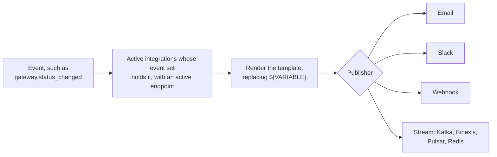

# Integrations

How the gateway tells other systems that something happened: an email when a user
registers, a Slack message when a gateway goes offline, an event on a Kafka topic for every
failed payment. Implemented in [`src/integrations/`](../src/integrations/).

In-dashboard notifications, the bell in the top bar, are a separate feature and are
covered at the end.

## Endpoints, event sets and integrations

An integration is one **endpoint**, one **event set** and a **template**. Each is its own
definition, kept as one JSON file
([`src/integrations/definitions/`](../src/integrations/definitions/)), so one endpoint or event
set can serve several integrations.

| Definition | Holds | Stored in |
| --- | --- | --- |
| Endpoint | `type` (`email`, `slack`, `webhook`, `stream`), `configuration`: the transport, destination and credentials, and `status` | `storage_paths.integration_endpoints` |
| Event set | `events`: event ids from the catalog, such as `gateway.created` or `audit.policy_decision`, audit and other events mixed freely | `storage_paths.integration_event_sets` |
| Integration | `endpoint_id`, `event_set_id`, `content` (the template), `status`, and for audit events `audit_drop_after_secs` and `audit_max_attempts` | `storage_paths.integration_definitions` |

Integrations belong to the whole appliance: none has a tenant owner, and a tenant or
resource-scoped PAT is refused with `403` on every route under `/v1/integrations`.

**Endpoints.** `smtp_password` (email), `webhook_url` (Slack), `signing_secret` and `headers`
(webhook), and `sasl_password` and `redis_url` (stream) are written but never read back:
responses leave them out of `configuration` and name the ones set in `secrets`. An update that
leaves a secret out keeps it, and one that sends it as `null` clears it. A secret field may
instead hold `$SECRET:<secret_id>`, a reference to an appliance-wide secret in the secrets
store, resolved at each delivery and shown in responses as written; a reference that does not
resolve fails the delivery. An endpoint's `type` cannot change. Its configuration is checked by
its publisher when saved, so a webhook or Slack URL that fails the checks under _Outbound
requests_ is refused with `400`.

**Event sets** need at least one event, every one from the catalog; repeats are dropped.

**Integrations** need an existing endpoint and event set. Their template must be a JSON object
whose variables some event of the event set fills, and the audit delivery limits are accepted
only when the event set holds audit events, and must be at least 1. Changing an event set is
refused with `409` while one of its integrations would no longer fit it, and an endpoint or
event set is not deleted (`409`) while an integration uses it.

## How an event becomes a message

An enabled event is delivered for every resource that raises it; there is no filter by
gateway, user or surface. Delivery reads a snapshot of the definitions
([`delivery/dispatch.rs`](../src/integrations/delivery/dispatch.rs)), taken again after any
change through the API and at most 5 seconds old otherwise, so definitions written by another
node are picked up too.

Delivery runs in a spawned task and never blocks or fails the operation that raised the event.
At most 100 such tasks run at once; an event raised while all are busy is not delivered, and a
warning is logged.

A transient failure (a connection error, timeout, or request error, or an HTTP 429 or 5xx
response) is retried up to five times, after 1, 2, 4, 8, and 16 seconds plus jitter
([`delivery/retry.rs`](../src/integrations/delivery/retry.rs)). Any other failure, such as an
HTTP 4xx, is logged and dropped. A retried delivery can arrive more than once, so a receiver
that is not idempotent should expect duplicates.

Audit events (`audit.*`) take another path: they are journaled and forwarded by the audit
pipeline, with its own retries and drop policy. See
[`OBSERVABILITY.md`](OBSERVABILITY.md#governance-audit-forwarding).

## Events

`GET /v1/integrations/catalog` lists every event the gateway delivers, with its name,
description, family, its audit group for audit events, and the template variables its delivery
fills; every template variable with its description; and each endpoint type with its secret
fields ([`events.rs`](../src/integrations/events.rs)).

| Family | Events |
| --- | --- |
| Gateway | `gateway.created`, `updated`, `deleted`, `status_changed`, `accessed` |
| User | `user.created`, `approved`, `updated`, `deleted`, `login`, `accessed` |
| Connection point | `connection_point.connected`: someone connected through a connection point with its secret |
| x402 | `x402.verification.failed`, `x402.settlement.failed`, `x402.transaction.completed`, `x402.cleanup.completed` |
| MPP | `mpp.verification.failed`, `mpp.payment.verified`, `mpp.challenge.issued` |
| Audit | `audit.<event>` for every event of the audit catalog ([`src/audit/catalog.rs`](../src/audit/catalog.rs)) |

A passkey registration raises `user.created`, and an administrator's approval `user.approved`. A
SAML sign-in that creates the user raises `user.created`; SAML users are approved on creation,
so no `user.approved` follows. A later SAML sign-in that changes the user's role, status, or
primary flag raises `user.updated`. Every SAML sign-in then raises `user.login`, in that order
([`saml/user_provisioning.rs`](../src/auth/saml/user_provisioning.rs)).

## Templates

An integration's `content` is a JSON object whose string values may hold `${VARIABLE}`
placeholders. Fields the template leaves out take the endpoint type's default, so an empty
template sends a complete message:

| Type | Default |
| --- | --- |
| `email` | `subject` `${EVENT_NAME}`, `body` `${EVENT_SUMMARY}`, `format` `plain` (or `html` when the body is HTML) |
| `slack` | `text` `*${EVENT_NAME}*` and `${EVENT_SUMMARY}` on the next line |
| `webhook`, `stream` | `event_type`, `event_name`, `timestamp`, `appliance_id`, `summary` and `data` (`${EVENT_DATA}`) |

Every event fills these variables, plus its own:

| Variable | Value |
| --- | --- |
| `EVENT_TYPE` | The event id, such as `gateway.created` |
| `EVENT_NAME` | Its name, such as `Gateway Created` |
| `EVENT_SUMMARY` | One line on what happened, such as `Gateway edge was created` |
| `EVENT_DATA` | The event's own variables as a JSON object with lower-case keys; for an audit event, the audit record |
| `TIMESTAMP` | RFC 3339 |
| `APPLIANCE_ID` | The **Appliance ID** set in Settings › System Settings (`appliance_id` in `settings.json`), such as the appliance's id in Agent Watch. It never comes from event values, is never the appliance DID, and is unrelated to any Kafka topic name. Empty while unset. |

The computed variables (`EVENT_TYPE`, `EVENT_NAME`, `EVENT_SUMMARY`, `EVENT_DATA`,
`APPLIANCE_ID`) are always set by the gateway, never by the code that raised the event. Each
event's own variables, such as `GATEWAY_ID`, `GATEWAY_NAME`, `GATEWAY_DID`, and
`GATEWAY_STATUS` for a gateway event, are listed in the catalog. Gateway and user events also
carry `OLD_STATE` and `NEW_STATE`: the resource before and after the change as JSON, empty for a
create or a delete respectively.

A user's `OLD_STATE` and `NEW_STATE` carry only `user_id`, `role`, `status`, `is_primary`,
`created_at`, and `updated_at`
([`user_integration_triggers.rs`](../src/integrations/user_integration_triggers.rs)). Passkeys,
the SAML subject, and profile details (names, department, job title, avatar) never leave the
appliance through an integration. `USERNAME` and `USER_EMAIL` remain available as separate
variables for a template that needs them.

Placeholders are filled in one pass
([`delivery/render.rs`](../src/integrations/delivery/render.rs)): a placeholder with no value
becomes empty, and a substituted value is never scanned for placeholders again, so a username
of `${SECRET}` stays literal. A string that is exactly `${EVENT_DATA}` or `${AUDIT_RECORD}` is
embedded as a JSON value; inside other text it is inserted as JSON text.

Values, never the template, are escaped for the transport. Slack messages are sent as mrkdwn,
with `&`, `<`, and `>` escaped, so caller-supplied text such as a JWT `name` claim cannot
produce mentions (`<!channel>`) or links. HTML email bodies have `&`, `<`, `>`, `"`, and `'`
escaped.

The placeholder syntax is `integration.variable_pattern` in `gateway.json`, fixed at startup
([`runtime_variables.rs`](../src/integrations/runtime_variables.rs)); a pattern that is not a
valid regular expression stops the gateway from starting.

## Publishers

| Type | Sends to | Configuration |
| --- | --- | --- |
| `email` | An SMTP server | `smtp_host`, `smtp_port`, `smtp_username`, `smtp_password`, `from`, `to`, optional `cc` and `bcc`, `use_tls`, `use_starttls` |
| `slack` | A Slack incoming webhook | `webhook_url` |
| `webhook` | Any HTTPS endpoint | `url`, optional `method` (`POST`, `PUT`, `PATCH`), `signing_secret`, `headers` |
| `stream` | Kafka, Amazon Kinesis, Apache Pulsar, or Redis Streams | `platform`, `topic`, and the platform's connection settings |

All four stream platforms are compiled into the binary; which one is used is a matter of
configuration.

A webhook request carries `X-Webhook-Timestamp`, the Unix time in seconds. With a
`signing_secret` it also carries `X-Webhook-Signature-256`: `sha256=` and the hex
HMAC-SHA256 of `<timestamp>.<body>` keyed with the secret, so a receiver can check the sender
and reject replays.

## Outbound requests

Webhook and Slack URLs are checked with `validate_resolved_webhook_url`
([`src/url_validation.rs`](../src/url_validation.rs)), which resolves the host and rejects
cloud metadata addresses, loopback and unspecified addresses, the RFC 1918 private ranges,
IPv4 and IPv6 link-local, IPv6 unique-local, and IPv4-mapped forms of all of these. This is
stricter than the forward legs, which allow loopback and RFC 1918 for same-host and
same-network targets. A DNS failure is an error. The request is then sent through the shared
external client ([`src/http_client.rs`](../src/http_client.rs)), which has a 30-second
timeout and redirects disabled, so a redirect cannot lead to an internal address.

These sinks do not use the pin-once primitive in [`src/egress.rs`](../src/egress.rs) that
the forward legs use. The client resolves the host again when it connects, so the checked
address and the connected address are not bound together. See
[`POLICY.md`](POLICY.md#egress-and-ssrf-controls) for the sinks that are pinned.

## Management API

| Route | Purpose |
| --- | --- |
| `GET`, `POST /v1/integrations` | List and create integrations |
| `GET`, `PUT`, `DELETE /v1/integrations/{id}` | Read, change, and remove one |
| `POST /v1/integrations/{id}/test` | Send a saved integration's message once |
| `POST /v1/integrations/test` | Send an unsaved integration's message once |
| `GET`, `POST /v1/integrations/endpoints` | List and create endpoints |
| `GET`, `PUT`, `DELETE /v1/integrations/endpoints/{id}` | Read, change, and remove one |
| `POST /v1/integrations/endpoints/{id}/test` | Send the endpoint's default message once |
| `GET`, `POST /v1/integrations/event-sets` | List and create event sets |
| `GET`, `PUT`, `DELETE /v1/integrations/event-sets/{id}` | Read, change, and remove one |
| `GET /v1/integrations/catalog` | Events, template variables and endpoint types |

A test sends one message without retries
([`api/send_test.rs`](../src/integrations/api/send_test.rs)). An integration test renders its
template for the first event of its event set, filled with sample values; an unsaved one is
checked as a save would be first. An endpoint test sends the endpoint type's default message
for the event `integration.test`. A test that reaches the destination returns
`{"delivered": true, "event_type": ...}`; one that fails returns `502` with the reason.

Each route needs `integrations.view`, `integrations.edit` (including the tests), or
`integrations.delete`, checked by the RBAC guard ([`api/mod.rs`](../src/integrations/api/mod.rs)).
Mounted without a guard, every route above refuses the request with `403`. Each create, change
and delete is logged as `integrations.<endpoint|event_set|integration>.<created|updated|deleted>`
with its id and the caller, and each test as `integrations.test_sent`; secret values are never
logged.

## In-dashboard notifications

Separate from integrations, the gateway keeps notifications for dashboard users, shown in
the top bar.

| Route | Purpose |
| --- | --- |
| `GET`, `POST /v1/notifications` | List and create |
| `GET`, `PUT`, `DELETE /v1/notifications/{id}` | Read, update, or delete one |
| `GET /v1/notifications/unread/count` | The badge count |
| `POST /v1/notifications/send-welcome` | Send the welcome message |
| `GET`, `PUT /v1/notifications/user-welcome-template` | Read or change the welcome template |

Welcome messages for administrators and users start from the templates
[`admin_welcome.json`](../src/integrations/admin_welcome.json) and
[`user_welcome.json`](../src/integrations/user_welcome.json).

## Related

- [`CAPABILITIES.md`](CAPABILITIES.md#managing-the-gateway): integrations from a user's point of view.
- [`POLICY.md`](POLICY.md#egress-and-ssrf-controls): how outbound requests are controlled.
- [`OBSERVABILITY.md`](OBSERVABILITY.md): metrics and traces, and Governance Audit forwarding.
