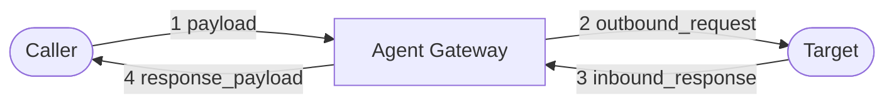

# Observability Internals

Use the hosted [observability documentation](https://docs.affinidi.com/products/affinidi-trust-fabric/agent-gateway/concepts/observability/)
and [reference](https://docs.affinidi.com/products/affinidi-trust-fabric/agent-gateway/reference/observability/)
for monitoring and operator guidance. This page documents internal event and correlation contracts
for the checked-out source revision.

## Dashboard WebSocket

[`WsState`](../src/server/websocket.rs) wraps a Tokio broadcast sender. Each connected dashboard
WebSocket subscribes independently after any configured authentication check; a slow receiver that
lags is disconnected rather than blocking producers. `websocket_broadcast_buffer` controls the
channel capacity and defaults to `500`.

`WsUpdate` currently defines these event shapes:

| Variant | Current behavior |
| --- | --- |
| `IdentityCreated` | Emitted after an identity is created. |
| `IdentityUpdated` | Emitted after persisted identity usage data changes. |
| `MetricsUpdated` | Emitted by metrics update paths. |
| `LogEntry` | Emitted by the tracing WebSocket layer for a new log event. |
| `PayloadCaptured` | Emitted by direct-path payload capture when `extension_inspection.enabled` is set, by every MCP Proxy (`proxy://`) request whether it succeeds or fails, by every forwarded fabric-received request, and by onboarding capture. |
| `ChannelExpired` | Emitted when an in-memory onboarding session expires. `channel_name` is a legacy event field. |
| `OnboardingAttempt` | Defined for wire compatibility but not emitted; onboarding uses `PayloadCaptured`. |
| `RefreshDashboard` | Requests a complete dashboard refetch after settings updates, policy-definition create/update/delete, or Trust Registry connection-state changes. |
| `DashboardDelta` | Carries a pre-serialized periodic dashboard delta in `Arc<String>`. |

Configuration reload does **not** emit `RefreshDashboard`. A dashboard observes reloaded state
through periodic `DashboardDelta` broadcasts or an explicit refetch.

## Payload capture

Normal surface capture can represent four pipeline observations in one `PayloadCaptured` event:

1. `payload`: inbound request;
2. `outbound_request`: request after gateway transformations;
3. `inbound_response`: response received from the Target; and
4. `response_payload`: response after gateway transformations.



The event also carries validation status, an optional validation error, derived schema, and an
optional surface-variant alias. Some producers do not have all four observations. Onboarding, for
example, sets both intermediate fields to `None` because it does not forward the request.

## WebSocket flow

For each dashboard connection, the handler subscribes to the broadcast channel and multiplexes
outbound updates with periodic ping frames. An incoming JSON `subscribe` command replaces the set
of dashboard sections included in subsequent `DashboardDelta` events. Any broadcast receive error,
including lag, ends the connection; socket closure does likewise.

`DashboardDelta` is already serialized before broadcast and held in `Arc<String>`, reducing clone
cost across subscribers. Other variants are serialized per connection.

## A2A protocol version metric

`agent_gateway_a2a_protocol_version_total{channel_id,negotiated_version,method_era}` is a Prometheus
counter incremented once for each A2A or AP2 request that reaches
[version negotiation](PROTOCOLS.md#version-negotiation), whether its `A2A-Version` negotiates or is
refused. A request answered before that step is not counted: for example agent-card discovery, and
refusals by source authentication, rate limiting, gateway or appliance-wide policy, or the AP2 gate.
A request later refused by delegated payment, the egress guard or the request-body size limit
(HTTP `413`) is counted. A request to a `fabric://` target is negotiated and counted on the sending
gateway; the receiving gateway does not count it again.

| Label | Value |
| --- | --- |
| `channel_id` | The surface **name** (a legacy label name; it is not the surface ID) |
| `negotiated_version` | `0.3` or `1.0`, as resolved from `A2A-Version` (an absent or empty header counts as `0.3`), or `rejected` when the request is refused with `-32009` |
| `method_era` | The era of the JSON-RPC method name: `0.3` (slash-form), `1.0` (PascalCase), `unknown` (not an A2A method), or `none` (no method) |

The two version labels can differ, because either method era is accepted whatever version was
negotiated; a `negotiated_version="0.3"` series shows callers that would be refused if the surface
stopped accepting `0.3`. Callers a surface refuses appear as `negotiated_version="rejected"`,
with `method_era` showing which method names they send. Requests later refused by JSON-RPC or
request-shape validation are counted under their negotiated version. Fabric traffic is counted on
the sending gateway only (see [Fabric coverage gap](PROTOCOLS.md#fabric-coverage-gap)).

## Trust plane metrics

Prometheus counters for the OAuth and OIDC trust plane. Every label value is a fixed code, so
cardinality is bounded. A failure label is one of the same codes the API and audit records use;
none carries a URL, host, issuer, token or provider name.

| Metric | Labels | Counted |
| --- | --- | --- |
| `agent_gateway_token_fetch_total` | `grant`: `client_credentials`, `jwt_bearer`, `unsupported` (a provider type the gateway never grants for). `result`: `ok`, `unsupported`, `secret_unavailable`, `forbidden`, `unavailable`, `invalid_response`, `assertion_failed` | Each gateway token request that was not answered from cache or held back by the retry backoff. `unavailable` covers an unreachable endpoint, a refused grant and a timeout; `assertion_failed` is a JWT bearer assertion that could not be signed |
| `agent_gateway_jwks_fetch_total` | `result`: `ok`, `invalid_url`, `blocked`, `unreachable`, `http_error`, `too_large`, `invalid_document` | Each network fetch of a remote strategy's key set, successful or failed. A host that does not resolve counts as `blocked`. A cache hit, a static key set and the validate-jwks-uri probe are not counted |
| `agent_gateway_discovery_total` | `result`: `ok`, `invalid_url`, `blocked`, `unreachable`, `http_status`, `too_large`, `invalid_document`, `issuer_mismatch` | Each authorization server metadata discovery, whether from a probe, a save or a re-discovery after an issuer change |
| `agent_gateway_scope_denied_total` | `scheme`: the `auth_failed` scheme, `jwt` for a `jwt_bearer` method's [`required_scopes`](SOURCE_AUTH.md#required-scopes) (an MCP Access Point with `protected_resource` included) and `mcp_resource_token` for `mcp_http.authorization` | Each request whose caller token lacked a required scope, whether the gateway refused it or left the decision to policy. Counted whether or not a sink selects `auth_failed`. An operator's card preview is not a caller request and is not counted |
| `agent_gateway_card_security_total` | `outcome`: `declare`, `strip`, `pass_through`, `unservable`. `reason`: the [strip reason code](SOURCE_AUTH.md#declaring-an-access-point) for `strip` (`transit_point` for a Transit Point card), otherwise `none` | Each agent card an Access Point serves after rewriting it, and each Transit Point card whose security the gateway removes because its Access Point's cards are secured ([Agent card security](PROTOCOLS.md#agent-card-security)). An operator's [Agent card preview](SOURCE_AUTH.md#agent-card-preview) is not counted |

Alert on `agent_gateway_token_fetch_total{result!="ok"}` and
`agent_gateway_jwks_fetch_total{result!="ok"}` as a rate against their `ok` series: a gateway
that cannot reach an authorization server refuses callers (JWKS) or, after a failed token fetch,
either answers 502 (Target Authentication with the default `reject` fallback) or sends the request
without the credential (an `outbound_credentials` binding, or `fallback: passthrough`), while the
rest of the appliance looks healthy.

A record the gateway cannot read at load is skipped and counted in
`agent_gateway_storage_load_errors_total{entity, reason}`. `reason` is `invalid_json`,
`migration_failed`, `decrypt_failed` (an encrypted record that could not be decrypted),
`encrypted_but_encryption_disabled` (an encrypted record while encryption at rest is off) or
`unreadable_record` (a well-formed record this release cannot interpret, which is what a record
written by a newer release looks like). The `entity` `dynamodb_channel` counts a DynamoDB channel
item that could not be parsed; the other channels still load.

The counter increments for each unreadable record on every load or refresh scan, and a lookup
that misses the cache runs a scan too, so after a downgrade each request that names a dropped
record adds to it. Its value and rate are not a count of bad records: alert on it being non-zero
or rising for a sustained period, for example after an upgrade or a rollback; see
[Rollback](adrs/0002-hop-two-target-authentication.md#migration-and-change-management).

## Logging initialization

Logging is initialized after the encryption service so secret-backed OTLP headers can be resolved.
The tracing subscriber combines:

- the logging level from `config.logging.level`;
- a stderr formatting layer;
- an optional file layer;
- the WebSocket log layer that emits `LogEntry` events; and
- optional OpenTelemetry export according to the observability configuration.

Structured call sites attach searchable fields such as surface identifiers, request method, path,
latency, and trace context. Some older field names still contain `channel`; treat those as legacy
telemetry schema names rather than current domain terminology.

Log redaction is on by default for every configuration source. Its rules live in `gateway.json`
under `logging.redaction`, and `"enabled": false` turns it off. It masks stderr and file output,
exported OTLP spans and exported OTLP log records. In OTLP exports, a span or log attribute whose
name marks a credential, such as `authorization`, `cookie`, `token`, `session_id`, `password`,
`secret` or `api_key`, becomes `<redacted>` whatever its value. `opentelemetry.logs.targets` in
`metrics.json` limits which log targets are exported over OTLP and defaults to `["*"]`, every
target. [Log redaction](CONFIGURATION_REFERENCE.md#log-redaction) lists the built-in rules and the
exact credential names.

## Request correlation

HTTP tracing and policy auditing attach correlation data to request spans and structured events.
When configured, the root HTTP span can also record `caller.auth_method`, `caller.principal`, and
`caller.did`. Policy decisions are emitted through the policy-audit target with policy scope,
decision, policy identity, deny reason, surface identity, and caller context; denials are WARN and
allows are DEBUG.

The gateway propagates `X-Gateway-Trace-Id` to a Target where the request path creates that trace
identifier, allowing gateway and managed-agent logs to be correlated.

## Access log

[`access_log`](../src/observability/http_trace.rs) logs every inbound HTTP request to the
`agent_gateway::access` target as two plain-text lines:

| Line | Fields |
| --- | --- |
| `➡️  HTTP <method> <path>[?<query>]` | `host`, `accept`, `ua` (`User-Agent`), `origin`, `mcp_sid` (`mcp-session-id`), `xff` (`x-forwarded-for`), `xfp` (`x-forwarded-proto`) |
| `⬅️  HTTP <method> <path> → <status> (<ms>ms)` | `content-type` of the response |

Both lines are `INFO`, or `DEBUG` for static dashboard assets, `/api/` paths, `did.json` documents
and dashboard page loads (a `GET` that accepts `text/html`). A field is empty when the request did
not carry that header.

Query strings keep their parameter names only: each value is logged as `<redacted>`, and a
parameter sent without `=` is replaced by `<redacted>` whole, so an OAuth `code` or a token passed
as a query parameter never reaches the log. The same redaction applies to `http.uri` on the
`http.request` trace span and to `http.url` on the `http.client.send` span, which also drops any
user name and password in the Target URL. Target and mirror endpoint URLs in other log lines are
redacted the same way, and a failure to reach a Target or mirror is logged without its URL.

MCP session ids appear only as a prefix: their first 8 characters followed by `...`, or
`<redacted>` when the id is shorter than 16 characters. This covers `mcp_sid` here and the Legacy
SSE and Streamable HTTP session ids in the proxy and MCP transport logs. Onboarding session ids in
a path, the UUID after `/onboard/` or `/delete-temp-channel/`, are shortened the same way in both
lines and in `http.uri` and `http.path`. With the default
redaction rules, `mcp_sid` is masked entirely in console and file output, because a built-in
session rule matches `sid=`.

The `xff` field keeps the client address that the reverse proxy reported. It is personal data in
many jurisdictions, so ship and retain the access log accordingly. [Log
redaction](CONFIGURATION_REFERENCE.md#log-redaction) applies to these lines as well.

## Access token rotation events

`POST /api/v1/access-tokens/{id}/rotate` emits structured tracing events on the `audit` target.
They are log events only: they are not written to `delegation-audit.jsonl` and are not forwarded
to Governance Audit integrations, so ship the `audit` target off the appliance to keep them. See
[`ACCESS_TOKENS.md`](ACCESS_TOKENS.md#token-contract) for the rotation contract.

| Event | Level | Fields |
| --- | --- | --- |
| `access_token.rotated` | INFO, or WARN when `rotated_for_other_user` is true | `token_id`, `owner_user_id`, `caller_user_id`, `caller_auth_method`, `caller_token_id`, `rotated_for_other_user`, `rotation_generation` |
| `access_token.rotate_denied` | WARN | `token_id`, `caller_user_id`, `caller_auth_method`, `caller_token_id`, `status`, `reason` |

`caller_auth_method` is `access_token` for a PAT caller and `session` otherwise; `caller_token_id`
is the calling PAT's id and empty for a session caller. `access_token.rotate_denied` carries no
owner and covers only refusals made by the handler: `401` for a request with no authenticated
caller, `403` for a non-administrator rotating another user's token, a PAT caller naming a token
id outside its lineage (including an unknown id) or a PAT scoped by `required_headers` alone,
`404` for a session caller naming an unknown token id, and `409` for a revoked, expired,
inactive-lineage or concurrently rotated token. It is also emitted with status `500` when
loading the caller or saving the rotated token fails; the error detail is logged only on the
default target. Requests refused before the handler runs emit neither event: the
`access_tokens.edit` route check and any refusal by the authentication middleware, for example a
missing or invalid credential, the `403` it returns to a PAT with a `resource_pattern` because the
access-token routes are not a resource-scoped path family, a required header that does not
match, or Terms the token owner has not accepted.

## Governance audit forwarding

Governance audit records go to **sinks**: the VP Audit Log (`delegation-audit.jsonl`, read by
`/v1/audit`) and each Governance Audit integration: an integration whose event set holds audit
events (see [`INTEGRATIONS.md`](INTEGRATIONS.md)). Every sink selects the audit events it wants,
and the selections are independent: an integration can receive an event the VP Audit Log does
not keep, and the reverse. Nothing is selected on a fresh install, and a record nobody selects
is never built.

**Selection.** The VP Audit Log keeps the events in the settings field `audit_events` while
`audit_enabled` is on (Settings › VP Audit); turning it off pauses the log without losing the
selection. An integration receives the audit events its event set holds, as `audit.<event>`
next to any other events. Both take event names from the audit event catalog
(`src/audit/catalog.rs`), for example `policy_decision`, `auth_failed`, `token_injected`; an
unknown name is rejected (400). `GET /v1/settings/audit-events` lists the catalog in order, each
entry with its `event` name, `label`, `description`, `group` and `group_label`, and
`GET /v1/integrations/catalog` lists the same events as `audit.<event>` with their group.

**Request events.** Raised at the Access Point on the direct, MCP-proxy and fabric paths.
Reasons are fixed codes; no record carries a credential, token or validator message.

An operator's [Agent card preview](SOURCE_AUTH.md#agent-card-preview) records no
`request_rejected` or `auth_failed` event and counts in no request metric, because it is not a
caller's request. It still records the Target Authentication delegation events the gateway's own
credential use produces, other than a rejected request. The last caller card fetch is kept per
replica, in memory, until the gateway restarts (up to 512 surfaces). The last served card the
preview falls back to is kept per replica, in memory, for 10 minutes, and only by its size when
it is over the preview's 256 KiB display limit.

- `auth_failed`: the caller failed authentication. `scheme` is `jwt`, `api_key`, `did_auth`,
  `mtls` or `mcp_resource_token`. `reason` is `missing_credential`, `invalid_credential`,
  `insufficient_scope`, `config_not_found`, `internal`, `setup_failed` or `unavailable` (no MCP
  resource authorization context). `blocking` is false when the failure was handed to policy
  (`input.source_auth.method == "failed"`) instead of refusing the request. `client_ip` is the
  resolved client address (forwarded headers only from `client_ip.trusted_proxies`); absent on
  the fabric path, where the caller connected to the sending gateway.
- `rate_limited`: the request was refused with 429. `scope` is `surface` (the Access Point's
  rate limit), `sse_sessions` (the legacy SSE session cap) or `fabric_capacity` (a full Fabric
  stream cap on the way to a fabric target). `retry_after_ms` is the wait the caller is given,
  when there is one; the surface limit also sends it as `Retry-After` in whole seconds.
- `request_rejected`: the Access Point refused the request before or while forwarding it.
  `http_status` is what the caller received and `rpc_error_code` the JSON-RPC error code, when
  the refusal was one; legacy MCP refuses a malformed request with HTTP 200 and a JSON-RPC error,
  so read the two together. `stage` and `reason`:
  - `routing`: `no_route` (no surface matches; recorded against surface `unknown`, with no trace
    id on the direct path), `unknown_variant`, `variant_disabled`.
  - `admission`: `body_too_large`, `protocol_mismatch` (an MCP body on an A2A Access Point or the
    reverse), `invalid_envelope` (not JSON, or not a JSON-RPC request, on every protocol and MCP
    revision), `invalid_request_shape` (A2A fields), `version_unsupported` (A2A or MCP),
    `mcp_admission` (MCP transport rules: Origin, header size, mirrored method or protocol
    headers, HTTP method, per-request capabilities, `_meta`), `extension_rejected` (request
    extension rules, and an inbound identity that is missing or invalid),
    `consent_identity_required` (credential delegation for an anonymous caller).
  - `forward`: `ssrf_blocked` (egress policy refuses the target address),
    `target_auth_unavailable` (Target Authentication failed to produce a credential: a missing
    secret or provider, or a failed token request, when the surface's fallback is `reject`; or a
    failure the fallback never covers: a header conflict, an invalid header, a credential outside
    the Target base path, an unsupported provider type, leg or injection, a provider or secret
    the surface's tenant may not use, or a Target endpoint a credential provider may not be sent
    to; `http_status` is 502, the status the gateway answers with, including on the agent card
    route's fetch). The receiving gateway's card read for its policy context answers no caller
    and is not recorded. A credential deliberately withheld, and a failure under
    `fallback: passthrough` that the fallback covers, is not recorded.

  Requests answered before any gateway handler runs (a path under no configured route) and
  gateway faults (a misconfigured default variant, a failed egress check task) are not recorded.
- `identity_binding_verified` and `identity_binding_failed`: the outcome of checking the identity
  presentation (identity binding VP) a request carries, recorded wherever the gateway checks one:
  A2A requests on the direct path, MCP requests at admission, Transit Point MCP requests, and, on
  the fabric receive path, when a surface policy relies on the presentation. These record that a
  received presentation was checked; `vp_injected` records the gateway creating one.
  - `identity_binding_verified`: the presentation verified and a trust anchor vouches for its
    issuer. Carries `agent_did`, `issuer_gateway` and the caller-context `assurance`.
  - `identity_binding_failed`: `outcome` is `absent` (no presentation was sent), `invalid` (it
    failed verification, including an issuer the receiving connection does not trust) or
    `untrusted` (it verified, but no trust anchor was available to vouch for its issuer).
    `error_detail` is a short diagnostic and never carries the presentation itself.

**Policy change events.** Raised by management API requests that change a policy definition or
where a policy applies (group Policies). Each record carries its body in the `event` variant, e.g.
`"event": {"policy_attached": {...}}`, and every record one request writes shares that request's
`request_id`. See [`POLICY.md`](POLICY.md#policy-change-audit) for what each covers.

- `policy_created`, `policy_updated`, `policy_deleted`: a policy definition was created, changed
  or deleted. `policy_updated` names the parts that changed in `changed` (`rego`, `name`,
  `description`, `enabled`, `sample_input`, `owner`) with `previous_policy_version` and
  `previous_policy_content_hash`; an update that changes nothing is not recorded.
- `policy_attached`, `policy_detached`: a policy now applies, or no longer applies, at a slot of a
  surface, a gateway or an appliance-wide plane. `target` is `{kind, id, name}` (`surface`,
  `gateway` or `appliance`); `scope` is the decision scope the slot produces; `slot` is `target`,
  `inbound`, `response`, `transit`, `transit_point`, `mcp_tool`, `mcp_tool_gate` or `plane`, with
  `variant`, `transit_point`, `mcp_tool_name`, `gate` or `plane` naming the place. A replaced
  policy is detached, then its successor attached. A surface target also sets the top-level
  `surface_id` and `channel_name`.
  A gateway's legacy inline Rego has no definition: its records carry `policy_name`
  `Gateway policy` and the Rego's `policy_content_hash`, and a change to its text is a
  `policy_updated` with `changed: ["rego"]` against the gateway.
- `policy_attachment_changed`: an appliance-wide assignment switched between `enforced` and
  `monitor_only` (`mode`, `previous_mode`), or a gateway's policy was enabled or disabled
  (`enabled`, `previous_enabled`).
- `policy_change_refused`: one of the changes above was refused with 400, 403, 404, 409 or 422,
  on a route that only changes policies: the definition, assignment, gateway policy and
  definition ownership routes. A refused surface or variant write, or a refused gateway delete,
  is not recorded (see [`POLICY.md`](POLICY.md#policy-change-audit)).
  `action` is the change attempted, `status` the HTTP status and `reason` one of `invalid`,
  `forbidden`, `not_found` or `conflict`. The attempt is read from the route only: ids come from
  the path, bounded to 128 id characters, and replacing the appliance-wide assignments or a
  gateway's policy is recorded as an attempted `policy_attached` with no policy id.

Every record names its `actor`: `{kind: "user", id}` for a signed-in user, `{kind: "pat", id,
user_id}` for an access token (its id, never its value, and its owner's user id) or
`{kind: "system", id: "gateway"}`. `source` is `api`, `ownership` (a definition's tenant was
reassigned) or `definition_deleted` (deleting a definition pruned its appliance-wide
assignments). Policy ids, versions and content hashes are those `policy_decision` records carry,
so a change joins to the decisions it causes. No record carries the Rego text, the sample input
or a request body. Writes made outside a management request (startup migrations, replication)
record nothing, and neither do writes a configuration reload makes, though the reload is asked
for through the management API: it is the gateway's own work, not the user's change.

**Delegation failures.** `delegation_failed` is recorded when the gateway cannot obtain a
credential for an `outbound_credentials` binding of a client-credentials or JWT bearer
provider, and the request is left without it. `reason` is `assertion_failed` (the JWT bearer
assertion could not be signed: an unreadable or mismatched signing key), `token_endpoint_failed`
(the token endpoint was unreachable, refused the grant, timed out, or returned an invalid
response) or `credentials_unavailable` (a secret is missing, belongs to another tenant, the
token endpoint is blocked by the egress policy, or the provider cannot grant for this use).
`detail` is the grant and a fixed failure category, for example `jwt_bearer_unavailable`; the
token endpoint's text never reaches the record. The same failure also records `token_not_found`
with the same detail. The
actor (`caller.auth_method`) is `gateway`, because the gateway acts for itself, not for the
caller. A stale cached token that is still valid is injected instead, and nothing is recorded.

**Configuration events.** Group `configuration`. Each is recorded after the management API saves
the change, with the actor in `caller`: `auth_method` is `session` for a signed-in user or
`access_token` for a personal access token, `sub` is the user and `token_id` the token. A change
the API refuses (permission, tenant, validation) records nothing. Records carry identifiers and
fixed values only, never a secret, key or token.
- `verification_strategy_changed`: a JWT verification strategy was created, updated or deleted.
  `change` is `created`, `updated` or `deleted`; the record carries `strategy_id`, `name`,
  `expected_issuer`, `jwks_source` (`remote` or `static`), `pinned` (the strategy holds pinned
  authorization server metadata after the change, so always `false` for a delete) and
  `pin_changed` (the pinned metadata differs from before, which covers a first pin, a re-pin after
  discovery and clearing the pin; a delete of a pinned strategy reports `true`).
- `credential_provider_changed`: a credential provider was created, updated or deleted. The
  provider's `provider_id` and `provider_name` are on the record, with `provider_type`.
- `target_auth_changed`: the Target Authentication of a surface, or of a variant that sets its
  own, was set, changed or removed through a surface or variant write. `change` is `created`
  (set), `updated` or `deleted` (removed). The surface is on the record; `method` is `credential_lookup`, `static_secret` or `credential_provider`, and
  `credential_provider_id` names the provider when there is one. A variant's change carries its
  `variant_id` and the `variant_alias` it had then, and both are absent for the surface's own.
  Variants are matched by id, so deleting, adding, reordering or promoting a variant never
  attributes a change to another one: deleting a variant that had its own Target Authentication
  records one `deleted` event for it. A variant that takes the surface's Target Authentication
  before and after records nothing, because the surface's own event covers it. A write that
  leaves every Target Authentication as it was records nothing.

Changes made by editing `_storage/` on disk, by a backup restore, or through the legacy MCP proxy
routes are not recorded.

**Volume.** Request events are unbounded by design: each is recorded once per request, with no
aggregation or sampling. `auth_failed` and the routing `request_rejected` are recorded before
the surface rate limit is checked, and `rate_limited` once for every request the limit refuses,
so an unauthenticated or unroutable client produces one record per request it sends
(unroutable ones against surface `unknown`). Selecting these events for an Email or Slack
integration sends one message per record. They also count towards the journal size and its
1 GiB backlog cap (see _Backlog_ below), so a flood can make a slow sink skip records.

**Recipients.** Every active integration with an active endpoint whose event set holds the
record's event, whatever the endpoint's type. Every record is one delivery, so Email and Slack send one message per record;
Stream (Kafka, Kinesis, Pulsar or Redis Streams) and Webhook suit busy appliances. The records
hold administrator-only evidence: the caller's email and name, request details and the signed VP
leave the appliance with each record, so point audit integrations only at destinations cleared
for that data.

**Access.** Integrations are managed through `/v1/integrations` with the `integrations.*`
permissions alone, audit ones included; `audit.view` is not checked there. It guards reading the
audit records, not where they are forwarded. So every holder of `integrations.view` (the `user`
role by default) sees where Governance Audit records go, and every holder of `integrations.edit`
can change it. The previous release hid audit integrations without `audit.view` and needed it to
change them (see [`RBAC.md`](RBAC.md#governance-audit-integrations)). Changing integrations is
administrator-only by default (see [`INTEGRATIONS.md`](INTEGRATIONS.md#management-api)).

- Integrations belong to the whole appliance. `PUT /v1/tenant-ownership/integrations/{id}`
  returns 400, and a tenant or resource-scoped PAT is refused on every integration route.
- Audit events reach integrations only through the journal. The event dispatcher refuses
  `audit.*` events, so no other code path can deliver an audit event, and an integration whose
  event set mixes audit and other events gets each event as its own message, never values of
  one inside the other.

**Delivery.** No record is lost by the gateway except in the counted cases below.

- *Producing.* The producer (`src/audit/producer.rs`) is the only place a record is finalised.
  It checks the selections first (one atomic read), gives the record an `event_id` (UUID v4),
  addresses it to the sinks that select its event at that moment, and hands it to the journal
  without waiting. A record produced while the gateway serves a request also gets that
  request's `request_id`: 16 lowercase hex characters (the W3C span-id format), minted afresh
  when an Access Point request, a Transit Point request or a fabric-received request starts,
  never read from a header or token. Every record of one request shares it, and an Access
  Point request and the Transit Point requests its agent makes each have their own, linked by
  `trace_id`; a sink counts requests by distinct `request_id`. That includes the records a
  streamed response writes per event while it is read (SSE on every path) and the payment
  records an x402 or MPP request writes from background tasks. Records a proxied request produces while credential delegation runs are held
  until the request's identity VP is minted, then stamped with it; any still held when the
  request ends, on any path, are submitted without a VP. A selected record produced while the
  pipeline is not running is dropped and counted in
  `agent_gateway_audit_records_lost_total{reason="pipeline_not_running"}`, and one handed to a
  journal writer that has stopped in `reason="journal_closed"`.
- *Journal.* Every record is appended to the journal (`{log_directory}/journal/`, segment
  files named by their first sequence number) by a dedicated thread that writes in batches of up
  to 256 records or 5 ms and syncs each batch to disk before any sink may read it. A crash can
  lose at most the last unsynced batch. If the journal cannot be written the writer retries with
  backoff while holding up to 10,000 records in memory; beyond that the oldest are discarded and
  counted in `agent_gateway_audit_records_lost_total{reason="journal_write"}`. A failed batch
  is cut off again; if that fails too, the segment is re-read before the next batch, as on start.
  When the pipeline stops before the writer has written records it was handed, the writer stops
  between batches or during its backoff and discards them, counted in
  `agent_gateway_audit_records_lost_total{reason="aborted"}`.
  The journal directory is owner-only (`0700`) and its files `0600`.
- *One writer.* Only an Active node runs the pipeline (see
  [Server mode](CONFIGURATION_RELOAD.md#server-mode)); a Standby node keeps no audit records.
  On stepping down a node stops taking records, gives the writer up to 5 s to journal what it
  was handed, then cancels the writer, the dispatcher and every reader: a delivery in flight is
  dropped, no cursor is saved after that, and records still unwritten are counted with
  `reason="aborted"`. The journal lock is released last, once all of them have stopped. On
  becoming Active it re-opens the journal and cursors from disk and continues after
  the last record the previous Active node wrote. Before the pipeline starts, on start-up or on
  becoming Active, the sinks are built from the current settings and integrations, so delivery
  never starts from sinks that were never built or are stale; while the integrations cannot be
  listed the pipeline does not start and is tried again every 5 s. A node becoming Active
  first re-reads the dashboard settings (`settings.json`, which hold the VP Audit Log
  selection) from disk and empties its integration cache, so the sinks it builds and every
  delivery follow the settings and integrations the previous Active node left, not those this
  node loaded before (see [Server mode](CONFIGURATION_RELOAD.md#server-mode)). The node admits
  traffic after one start attempt; a refused start keeps being retried in the background. The
  writer holds an exclusive lock on `journal/journal.lock`, so a second process sharing the
  directory cannot write to it; a node that becomes Active while another still holds the lock
  tries again every 5 s. Stepping down ends these retries, and the sink rebuild retries below,
  along with the pipeline.
- *Dispatch.* Each sink has its own reader and cursor (`journal/cursors.json`). A reader
  delivers the records addressed to its sink in journal order and saves its cursor after each
  batch, so it resumes there after a restart; a slow or unreachable destination only delays
  itself. A failed delivery is retried with backoff (1 s up to 5 min) and holds back the records
  after it, until the integration's drop policy or attempt limit (below) skips it; the
  integration retry policy still applies inside each attempt. Delivery is
  at-least-once: a record may be delivered again after a restart, so receivers should
  deduplicate on `event_id`. The VP Audit Log does this itself for the records at the end of
  its file.
- *Sinks coming and going.* A new sink reads from the start of the journal; no record is
  addressed to a sink before it exists, so it misses nothing. An integration that is disabled,
  whose endpoint is disabled, or whose event set no longer holds audit events is paused: it
  keeps its configuration but receives no records, and records addressed to it while it is paused are not
  kept. Pausing moves its cursor to the end of the journal, letting go of the records it had not
  received; each one addressed to it is counted in
  `agent_gateway_audit_sink_skipped_total{sink, reason="paused"}` (unreadable lines with
  `reason="corrupt"`) and one warning per integration gives the count. An integration paused
  while the gateway was stopped is paused the same way when the pipeline starts. Resuming
  continues from where the pause left it, so it receives only records produced after the pause;
  that position never holds back journal pruning, and once pruning has deleted everything up to
  it the integration resumes from the oldest remaining record, all of them produced after the
  pause. Deleting an integration lets go of its records in the same way and drops its cursor.
  The VP Audit Log is never paused. Until its reader is stopped a paused integration refuses
  records, counted with `result="not_receiving"`, so none is reported as delivered; those
  records are counted as paused. Records produced at the moment of pausing, before the change
  takes effect, may still be delivered after the integration resumes, or be counted as paused.
  The sinks are rebuilt from the settings and integrations one rebuild at a time, so an older
  rebuild never replaces newer sinks. When the integrations cannot be listed, including before
  integration storage is set up, the previous sinks are kept, the failure is counted in
  `agent_gateway_audit_sink_rebuild_failed_total`, and the rebuild is retried every 5 s until it
  succeeds or the node steps down.
- *Backlog.* Journal segments every active cursor has passed are deleted. The journal size is
  reported in `agent_gateway_audit_journal_bytes` and logged as a warning above 256 MiB. Above
  1 GiB, every sink still in the oldest segment is moved past it so the segment can be deleted;
  the records each one skips are counted in
  `agent_gateway_audit_sink_skipped_total{sink, reason="backlog_cap"}`.
- *Drop policy.* A Governance Audit integration may set `audit_drop_after_secs`: records older
  than that are skipped for it, including one still being retried, and counted with
  `reason="expired"`. Without it nothing is skipped.
- *Attempt limit.* A Governance Audit integration may set `audit_max_attempts`: a record that
  fails that many delivery attempts is skipped for it, so a record the destination never
  accepts does not hold back the records after it. Every failed attempt counts, whatever the
  error; one attempt is one hand-over to the integration, including the integration retry
  policy inside it. The skipped record is counted with `reason="rejected"` and one warning gives
  its seq, the attempt count and the last error. Attempts are counted while the reader stays on
  the record, so a restart starts the count again. A changed limit applies to the record being
  retried. Without it a record is retried until it is delivered. The limit does not tell a
  rejected record from an outage: while the destination is down, each record is skipped once it
  reaches the limit. With the retry backoff (1 s, doubling, up to 5 min), 10 attempts span
  about 8.5 minutes and 20 about an hour, plus the time the attempts themselves take.
- *Damage.* A damaged journal or cursors file never stops the pipeline. On start, everything
  after the last readable line of the newest segment is cut off and logged with the number of
  bytes discarded; a segment with no readable line is emptied. Files in `journal/` that are not
  segments are logged and ignored. An unreadable `cursors.json` is renamed to
  `cursors.json.corrupt-<unix seconds>` and every sink starts without a cursor. A reader moves
  past a journal line that does not parse as it would past a delivered record, counts it with
  `reason="corrupt"` and logs one warning per batch naming the segment.

Records produced are counted in `agent_gateway_audit_records_produced_total{event}`;
integration deliveries in
`agent_gateway_audit_forward_total{result="delivered"|"failed"|"not_receiving", integration_id}`;
records a sink skipped in
`agent_gateway_audit_sink_skipped_total{sink, reason="backlog_cap"|"expired"|"corrupt"|"paused"|"rejected"}`.

`agent_gateway_audit_pipeline_started` is 1 while the pipeline runs and 0 when it could not start
(the journal directory cannot be created or written, for example) or the node is in Standby.
While it is 0 on an Active node the gateway keeps serving requests but keeps and forwards no
audit records; alert on that.

*A writer stuck in I/O.* A journal writer blocked inside a write or sync (a failing disk, for
example) cannot see that the pipeline was stopped. It keeps the journal lock, deliberately, so no
other writer interleaves with it; ten seconds after the stop the node logs an error saying the
writer is stuck in I/O and keeps the journal lock. The node taking over then cannot open the
journal and keeps retrying every 5 s. Alert when `agent_gateway_audit_pipeline_started` is 0 on
the Active node, or `agent_gateway_audit_records_lost_total{reason="pipeline_not_running"}`
increases; if the stuck-writer error was logged on the node that stepped down, reboot that node to
release the lock.

**Payload.** Audit templates may use `EVENT_TYPE` (`audit.<event>`), `EVENT_NAME`,
`EVENT_SUMMARY` (the event's name, then whichever of the surface, decision, policy, reason and
caller the record holds), `EVENT_DATA` (the same as `AUDIT_RECORD`), `APPLIANCE_ID`,
`TIMESTAMP` (the record's own timestamp), `AUDIT_RECORD`, `AUDIT_CATEGORY`, `AUDIT_TRACE_ID`, `AUDIT_SURFACE_ID`, `AUDIT_SURFACE_NAME`,
`AUDIT_PROTOCOL`, `AUDIT_AGENT_DID`, `AUDIT_VIA_FABRIC`, `AUDIT_PRINCIPAL`,
`AUDIT_PRINCIPAL_EMAIL`, `AUDIT_PRINCIPAL_NAME`, `AUDIT_AUTH_METHOD`, `AUDIT_DECISION`,
`AUDIT_DENY_REASON`, `AUDIT_POLICY_NAME`, `AUDIT_POLICY_VERSION`, `AUDIT_POLICY_CONTENT_HASH`,
`AUDIT_VP_JWT` and `AUDIT_VP_FINGERPRINT`. `AUDIT_RECORD` is the full record in the
`/v1/audit` row shape. The principal variables come from the record's `caller` context:
`AUDIT_PRINCIPAL` is the caller's email, else display name, else authenticated subject (JWT
`sub`, API key name, DID, mTLS principal, or on a Transit Point the caller the transit token
carries), and all four are empty when the request had no caller context (no source auth, or a
Transit Point whose token carries no caller). The policy variables describe the policy that made
a `policy_decision` (`AUDIT_POLICY_NAME` is the definition's name, else its id, else a label
for the layer when the policy has no stored definition, such as "Gateway policy" or "Surface
policy") and are empty for other records; see
[`POLICY.md`](POLICY.md#versioned-policy-definitions) for which decisions carry a revision. A
string value that is exactly `${AUDIT_RECORD}` or `${EVENT_DATA}` is embedded as a JSON object
for Webhook and Stream integrations; for Slack and Email, and inside other text, it is inserted
as JSON text. A Stream or Webhook integration with an empty
template sends the default event envelope, whose `data` is the record:

```json
{
  "event_type": "${EVENT_TYPE}",
  "event_name": "${EVENT_NAME}",
  "timestamp": "${TIMESTAMP}",
  "appliance_id": "${APPLIANCE_ID}",
  "summary": "${EVENT_SUMMARY}",
  "data": "${EVENT_DATA}"
}
```

Kafka producers belong to the endpoint: every integration and test send on one endpoint shares
it. It is rebuilt when the brokers or SASL settings change and dropped when the endpoint is
changed or deleted; the Kinesis, Pulsar and Redis Streams publishers still open a client per
record.

**Configuration.** Settings saved with the older `audit_categories` booleans are read as the
events `policy_decision`, `trust_check` and `vp_injected`; nothing else is selected on upgrade.
See `src/audit/` and `src/integrations/audit_integration_triggers.rs`.
