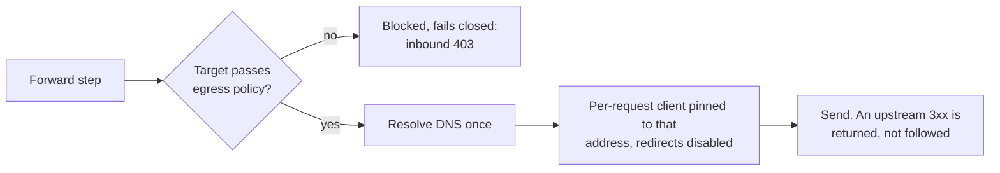
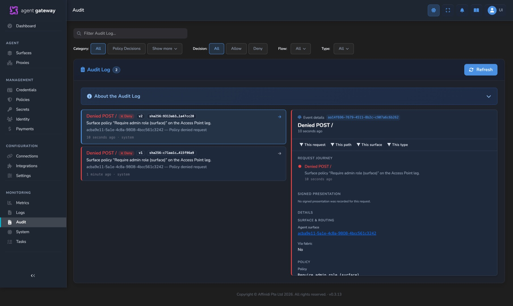

# Policy Planes, Enforcement, and Egress Controls

Revision-specific internals of the OPA policy planes, versioned policy
definitions, appliance-wide enforcement, and the egress/SSRF controls on the
forward legs. This documents the behavior of the checked-out source; for the
request-pipeline ordering see [`ARCHITECTURE.md`](../ARCHITECTURE.md#full-order).

## OPA packages


OPA is [Regorus](https://github.com/microsoft/regorus) (Rust-native Rego, no
external process). Gateway-level policy is evaluated before surface-level, and a
gateway deny is final. Using the wrong package name fails closed.

| Scope   | Package                  | Query                       |
| ------- | ------------------------ | --------------------------- |
| Gateway | `package gateway.policy` | `data.gateway.policy.allow` |
| Surface | `package surface.policy` | `data.surface.policy.allow` |

There are exactly two policy planes — **Gateway** (appliance-to-appliance) and
**Agent Surface**. Legacy `package channel.policy` is auto-migrated to
`surface.policy` at boot. Deny reason: `data.surface.policy.deny_reason` /
`data.gateway.policy.deny_reason`.

### MCP request context (`input.mcp`)

On an MCP surface, gateway and surface policies get `input.mcp` on the direct
Access Point and on Fabric receive alike. A legacy MCP request carries its
`method`, `tool_name` (for `tools/call`) and raw `params`; a modern
(`2026-07-28`) request carries its validated context, including the protocol
version and client declarations (see
[`MCP_METADATA.md`](MCP_METADATA.md#policy-context)). Fabric receive used to set
`input.mcp` only for modern requests, so a rule keyed on `input.mcp` never
matched legacy Fabric traffic; it now does, and a decision can change on upgrade.

## Versioned policy definitions

Policy definitions are immutable and versioned
([`src/policies/policy_definitions.rs`](../src/policies/policy_definitions.rs)). A
`PolicyDocument` holds an append-only list of `PolicyVersion`s, each carrying a monotonic
version, a content hash of `sha256(policy_type ∥ 0x1e ∥ rego)`, and an author. Editing the
Rego appends a version rather than replacing one. The flat `PolicyDefinition` API projects
the current version, and a policy's type is fixed after creation.

### How a gateway resolves its Rego

A gateway resolves **reference-only**, from one or more policy definitions named by
`opa_policy_config.policy_definition_id` and `policy_definition_ids`, at compile time. An
inline `policy` is a legacy fallback.

A definition set is evaluated as **deny-overrides**: every member must allow, and any deny
blocks.

### What an edit recompiles

Editing a definition recompiles live:

- Gateways whose `policy_definition_id` names it.
- Surfaces whose target, inbound, response, outbound, or Transit Point policy references
  it, including variant overrides.
- The appliance-wide set, when that references it.

It does **not** recompile a gateway that references it only through
`policy_definition_ids`, or a surface that uses it only as an MCP tool-gating condition.
The impact endpoint does not count those surfaces either.

### Audit and failure

Every OPA decision made by a stored policy definition records the definition's name and
the enforced `policy_version` and `content_hash` in the audit event, and, when the
`policy_decision` audit event is selected, in the JSONL `PolicyDecision`. Policy decisions
are never embedded in a minted VP: audit configuration does not change what the gateway
sends on the wire. That covers gateway, appliance-wide, surface, access-point
inbound, Transit Point, and response policies, and a denying MCP tool policy, on the
direct, MCP-proxy, outbound, and fabric paths.

These carry no revision: MCP tool gating, an allowed MCP tool-policy call (no single
policy decides it), and the built-in allow-all default.

The JSONL `PolicyDecision` also records the leg's caller context as `caller`: its
authenticated source identity, or on a Transit Point the caller the transit token carries
(its allowlisted `sub`, `email`, and `name` claims, else the caller DID). It is absent when
the request had neither.

Enforcement is **fail-closed** on both planes. An enabled but broken policy denies, and a
gateway set is evicted wholesale if any member fails to resolve or compile. A surface with
OPA enabled but no compiled policy (or no policy engine) denies its requests on the direct
and fabric paths alike, recorded as decision `error`.

Change-control endpoints: `GET /v1/policy-definitions[/{id}[/versions|/impact]]`,
`POST /v1/policy-definitions/{id}/simulate` (dry-run), `GET`/`PUT
/v1/policy-assignments` (appliance-wide set).

Tenant-scoped PATs may read global (untenanted) policy definitions and reference
them from their own surfaces, but may update or delete only definitions owned by
their tenant and within their resource pattern. `PUT /v1/policy-assignments`
rejects any tenant-scoped PAT with 403. See
[`ACCESS_TOKENS.md`](ACCESS_TOKENS.md#tenant-ownership).

## Appliance-wide (global) enforcement

In `src/policies/global_policy.rs`: a policy can be assigned to a whole plane via
`PUT /v1/policy-assignments` (`policies.edit`) — enforced on **every** gateway
(`gateway.policy`) or **every** agent surface (`surface.policy`), independent of
each object's own OPA config. `GlobalPolicyManager` compiles one engine per
assignment per plane and evaluates the set **deny-overrides ahead of the
per-object policy** at the inbound PEPs (fabric gateway + fabric surface in
`message_processor`; direct-inbound gateway + surface in `proxy/handler` — on both
paths the surface global runs on every request, even when the surface's own OPA is
disabled or the path is a public discovery endpoint). Each
`GlobalAssignment` supports `monitor_only` (evaluated + audited with version/hash,
never blocking) for safe rollout; the set is **fail-closed** (a broken-to-compile
or missing enforced member denies that plane, monitor-only exempt) and recompiles
live when a referenced definition is edited. Deleting a definition removes it from
every plane's global assignments (`global_policies/global.json`). `GET
/v1/policy-definitions/{id}/impact` reports `globally_enforced` + `planes`.

## Trust Check

`src/trust_registry_verification/` runs TRQP queries per-leg, with results at
`input.trust_check_results.{caller|target}`. The stage never denies — OPA decides.
Discovery paths bypass the caller-leg check. See the source for error codes and
template syntax.


Each leg carries a `trust_check_list`:

| List | Runs on |
| --- | --- |
| `access_point.trust_check_list` | The caller leg, for requests arriving at the Access Point. |
| `transit.points[].trust_check_list` | Requests the managed agent sends through that Transit Point, and no other. The Surface Builder adds Trust Checks to A2A and AP2 Transit Points only; on an MCP or HTTP Transit Point it shows a migrated copy read-only, to keep or remove. |
| `target.trust_check_list` | The managed agent's own target leg: `a2a-proxy://` Targets and Fabric send. |

A Transit Point with an empty list runs no Trust Check on its traffic: no agent-card fetch
for trust, no identity verification, no TRQP query. A request through a Transit Point sees
only that Transit Point's results, at `input.trust_check_results.target`, in all three
outbound OPA scopes (gateway, surface, Transit Point).

A list holds at most `TRUST_CHECK_LIST_MAX` (10) elements
([`src/config/agent_surface.rs`](../src/config/agent_surface.rs)). A surface variant
override replaces the whole list verbatim, never element by element; a variant gives its
Transit Points their own lists through its `transit.points` override.

A write to the management API declares the per-Transit-Point shape with
`trust_check_split: true`; the Surface Builder always sends it. A declared write is rejected
with `400` when its `target.trust_check_list` is non-empty and its Managed Agent target is not
`a2a-proxy://` or `fabric://` (an `http(s)` URL, `proxy://`, or no endpoint), because no stage
runs that list for such a target. For a variant, only a target list the variant sets in its own
override counts; an inherited list that cannot run on the variant's endpoint is ignored.

A write that does not declare the shape is converted only while the stored surface has no
Trust Check lists at all (no `trust_check_split` and no Transit Point lists): an undeclared
create or `PUT` that carries a `target.trust_check_list` and no Transit Point lists is then
treated as the old shape, converted exactly as a stored surface is (below), logged as a
warning, and saved. Once the surface has Trust Check lists, an undeclared write cannot change
them. An undeclared `PUT` keeps every stored Transit Point list for each Transit Point it sends
without one, keeps the stored target list when it sends none, and is rejected with `400` if it
sets a target list or a Transit Point list that differs from the stored one, including an
explicit empty list, or leaves out a variant's own Transit Points that hold lists. A new
Transit Point it adds without a list has no Trust Checks. An undeclared `PATCH` or variant write is
rejected with `400` when it sets or clears a target list or Transit Points, including through a
parent object such as `transit` or a variant's `overrides`, or by replacing `variants`; a
variant `PUT` that sends `overrides` for a variant whose Transit Points hold lists counts as
doing so. Such a write must be resent with `trust_check_split: true`. A `PATCH` that only moves
an `a2a-proxy://` or `fabric://` target to another endpoint while its target list remains is
rejected by the first rule until the list is removed.

### Lists stored before per-Transit-Point checks

Surfaces stored before Transit Points had their own lists kept one `target.trust_check_list`
that ran on every Transit Point. The first time such a surface loads, the gateway copies that
list onto each of its Transit Points (and those of each variant), marks each copy
with `trust_check_migrated: true`, removes `target.trust_check_list` unless the Managed Agent
target is `a2a-proxy://` or `fabric://`, sets `trust_check_split: true`, and saves the file. It logs the surface and the Transit Points that received copies,
and warns when a list is removed without any Transit Point receiving it. Every Transit Point
keeps its behaviour until an operator edits the surface. The Surface Builder flags
each copy for review; through the API, remove a copy by saving the Transit Point without
`trust_check_list` in a write that declares the shape.

User-saved Surface Templates are converted the same way when they load, and when they are
created, updated or imported without the marker; an imported export from an earlier release is
converted. A template's endpoint is usually the `$TARGET_ENDPOINT` placeholder, so a template
with a placeholder or empty endpoint keeps its `target.trust_check_list`, and its Transit Points
still receive copies. When the Surface Builder loads a surface, including one created from such
a template, whose target cannot run its target list and whose Transit Points all carry the same
checks, it drops the Managed Agent's copy; otherwise the `400` above applies when the surface is
saved.

MCP and HTTP Transit Points receive a copy too, because the old list ran on them. There it
usually reports `AGENT_CARD_UNAVAILABLE`, but an HTTP Transit Point whose destination serves an
A2A agent card runs real identity and TRQP checks. The Surface Builder does not add Trust Checks
to MCP or HTTP Transit Points and shows such a copy read-only, to keep or remove; the
management API accepts a list on any Transit Point. Removing a copy during review means that
Transit Point's traffic is no longer checked, so a policy that denied on its results allows
it.

A variant that inherited the base Transit Points but resolves to a different list receives
its own copy of them in `overrides.transit.points`, so later edits to the base Transit Points,
such as a new Transit Point, a changed destination or rotated credentials, no longer reach it.
Variants saved by the Surface Builder already carry their own Transit Points and are not
affected.

`trust_check_split` is stored whenever the surface keeps a `target.trust_check_list` or any of
its Transit Points has a `trust_check_list`. A surface file written outside the API in the
per-Transit-Point shape must set it, or a target list in it is converted on load. When the
marker is set and a target list sits on a target that cannot run it, the gateway logs a warning
on load and the list never runs.

The conversion is forward-only. A gateway release from before per-Transit-Point lists refuses a
surface carrying `trust_check_split`, which every surface with Trust Checks on its target or
Transit Points carries after the upgrade. It still loads a converted template, because it
stores the template's surface unparsed, so applying it there can fail or create a surface
without its Transit Point checks. Back up `_storage/agent_surfaces/` and
`_storage/agent_surface_templates/` before upgrading if a rollback may be needed, and restore
both on rollback.

### Requiring checks in policy

A Transit Point without checks leaves `input.trust_check_results` absent. Rules that only look
for failures, such as `every r in input.trust_check_results.target { r.ok }` or a count of
results with `ok == false` equal to zero, therefore allow every request through a Transit
Point that has no checks, or whose checks were removed. Such a Transit Point also has no
verified target identity: `input.agent` is absent in the gateway and surface scopes, and with
`require_agent_context` the Transit Point scope reads it from the agent card's unsigned DID.
When a policy requires Trust Checks, also require that they ran, or check specific element
ids:

```rego
allow if {
    count(input.trust_check_results.target) > 0
    every r in input.trust_check_results.target { r.ok }
}
```

Element validation is in
[`src/trust_registry_verification/trust_check_element.rs`](../src/trust_registry_verification/trust_check_element.rs).

| Field | Rule |
| --- | --- |
| `id` | Required, unique within the leg, at most `TRUST_CHECK_ID_MAX_CODE_POINTS` (64) code points. Rego-addressable and audit-visible. |
| `name` | Optional display label, at most `TRUST_CHECK_NAME_MAX_CODE_POINTS` (64) code points. |
| `id` and `name` | Control, DEL, C1, and bidi-override codepoints are rejected. |

The two caps are separate constants that happen to share a value today, because `id` is
addressable from policy while `name` is only a label. Counts are code points, not bytes.

When an audit sink selects `trust_check`, each element's outcome is recorded with the
surface id, the request's trace id and the authenticated caller (on the Access Point, Fabric
and MCP-proxy paths), so a trust check can be tied to the request and principal that
triggered it. On the outbound path the record also names the Transit Point.

## Failed caller authentication

Source auth does not refuse a request whose credential is missing or invalid. The
request continues with no caller identity, `input.source_auth` is
`{"method": "failed", "attempted_method": ..., "reason": ...}`. On every forwarding
path (direct inbound, `proxy://` MCP Targets, `a2a-proxy://` Targets, Fabric send and
Fabric receive, the last for surfaces without protected resource metadata) the stored
target credential, or the A2A proxy's Direct Line secret, is not attached, because it
vouches that the gateway vetted the caller. A surface that
must reject such callers needs a policy that denies `input.source_auth.method == "failed"`.
Server-side source-auth errors (missing configuration, internal failures) still block
with `500`. A request to an MCP Access Point that publishes protected resource
metadata never reaches policy with a failed credential, direct or over Fabric: a direct
request is refused with a `401` challenge pointing at that metadata, and a Fabric request
with a `401` without it, see
[`MCP_METADATA.md`](MCP_METADATA.md#authorization-server-discovery-for-caller-authentication).

A Transit Point's own `source_auth` is different: it refuses a missing or invalid credential
itself, with `401`, before any policy runs, so an outbound policy never sees
`"method": "failed"` (see [`SOURCE_AUTH.md`](SOURCE_AUTH.md#transit-point-callers)).

Over Fabric, the sending Gateway strips the credential header its own surface consumed
before forwarding. A receiving surface without protected resource metadata that requires
source authentication on that same header therefore sees every Fabric caller as failed and
forwards without its target credential; one with the metadata refuses them with `401`. Require caller authentication on one side of the Fabric hop, or use a
different credential header on each side.

## Caller identity verification in policy input

`input.extension_identity` is the caller identity the gateway resolved on the
inbound leg (`did`, `identity_hash`), and `normalize_caller_did` promotes its
`did` into `input.agent.did` when the body asserted none (unless the Trust
Check flagged an identity mismatch). Both carry how the DID was established:

| Field | Values | Meaning |
| --- | --- | --- |
| `input.extension_identity.verification`, `input.agent.did_verification` | `vp` | The caller proved control of the DID with an identity presentation that verified and whose issuer is one of the sending connection's issuers. Only the fabric receive path produces it. |
| | `vp_unanchored` | The caller proved control of the DID with an identity presentation that verified, but no trust anchor vouches for its issuer: the direct A2A path has no authenticated sender, so a self-issued credential ends here too. Trust its identity fields only after checking `input.agent.identity_issuer_did` or a Trust Check. |
| | `source_auth` | The DID is bound to the source credential this gateway authenticated on this request (`from_jwt_claim`). |
| | `unverified` | Nothing in the request proves the DID: `x-identity` payload pseudonyms and surface-configured identities (`static`, `from_mtls`, `from_api_key`). |
| `input.extension_identity.verified`, `input.agent.did_verified` | `true` / `false` | Boolean projection: everything but `unverified` is verified. |

A DID copied from the request body or an agent card into `input.agent.did` that
differs from `extension_identity.did`, or when there is none, carries
`did_verified: false` and no `did_verification`; one equal to it takes the
extension's verification. A presentation that fails verification, or a bare
`did` claim, never becomes `extension_identity`. The request carries at most a
payload-derived identity from a raw `agent-identity/v1` extension, and only when
no presentation was rejected (a bare `did` claim, or on the fabric path a
gateway with no VC issuer), or, on the direct path, a surface-configured
identity (`unverified` or `source_auth`). A rule such as
`input.extension_identity.verification == "vp"` therefore denies those requests.
The same rule denies every request on the direct A2A path, which never produces
`vp`; a rule for that path accepts `vp_unanchored` together with a check on
`input.agent.identity_issuer_did`.

## Caller in Transit Point policy input

Every outbound evaluation (gateway, surface, per-Transit-Point and response policies, and
MCP tool gating conditions on a Transit Point) gets `input.transit`. It is never on an
inbound evaluation, where `input.source_auth` and `input.extension_identity` carry the
caller. It names two principals, each in its own field, because one call can carry both:

- `input.transit.caller` is the end user the transit token names, as the Access Point
  authenticated them. Without a transit token it is `anonymous`.
- `input.transit.client` is the principal the Transit Point authenticated itself on this
  request, such as the managed agent's resource-server token. It is absent when the Transit
  Point authenticated none.

A rule about the end user reads `caller`, and a rule about the client reads `client`;
neither stands in for the other. A policy that reads `caller` must test `verified` first: a
caller named only by an unverified DID is reported, and never as verified.

A Transit Point's response policy gets `input.transit`, and `input.source_auth` when the
Transit Point authenticated a client, beside its `input.response`, `input.caller` and
`input.surface`. Its `input.caller.did` is the managed agent's DID, not the Transit Point's
caller, so a rule about who receives a response reads `input.transit.caller`.

Only a Transit Point's response policy has `input.transit`. A gateway or surface response
policy also runs on the inbound legs, where `input.transit` is undefined, and there
`not input.transit.caller.verified` is true. A rule shared by both legs that denies on
`not input.transit.caller.verified` therefore also denies every inbound response, and one that
allows on it allows every inbound response. Do not negate `input.transit` in a response policy
that can run inbound. Test that it is present instead (`input.transit.caller.verification`), or
keep the rule in the Transit Point's own `response_policy`.

| Field | Values | Meaning |
| --- | --- | --- |
| `input.transit.caller.verified` | `true` / `false` | `true` when `verification` is `transit_token`. |
| `input.transit.caller.verification` | `transit_token` | The call carries a valid transit token whose `user_identity_hash` came from source authentication on the Access Point. |
| | `unverified` | A valid transit token names a caller DID but carries no verified principal: the DID was asserted or derived from request fields on the Access Point. |
| | `anonymous` | The call carries no valid transit token: none on a Transit Point that does not require one, one there that does not verify, or a public discovery `GET`. A Transit Point that does not require a token still verifies one the agent sends, so a valid token is reported as above. There it names the caller to policy only: delegated credentials, Workload Binding and stream expiry still treat the call as carrying no token. A client the Transit Point authenticated does not change this. |
| `input.transit.caller.identity_source` | `gateway-computed`, `self-presented`, `verified-presentation` | How the Access Point established the caller DID. Absent when the token has none. |
| `input.transit.caller.user_identity_hash` | lowercase hex SHA-256 | The caller's [identity hash](CREDENTIAL_DELEGATION.md#the-callers-identity-hash) the Access Point computed: the source-auth method, its issuer, the surface's tenant and the principal (the JWT `sub`, API key name, DID or mTLS principal). The same subject verified by another method, issuer or tenant has another hash. Present only when `verified`, and absent for a JWT that names no `sub`. |
| `input.transit.caller.did` | DID | The caller DID the transit token carries. Always asserted, even when `verified` is `true`: `verified` is about the principal behind `user_identity_hash`, not this DID. Absent when the token has none. |
| `input.transit.caller.fields` | object | The caller claims this Transit Point allowlists, verbatim: its enabled `workload_binding.caller_context_fields` with `caller_source: transit_token`, taken from the caller's verified JWT claims on the Access Point. The token carries the claims every Transit Point of the surface allowlists, but each Transit Point's policy sees only its own. Absent unless the caller is `verified` and the Transit Point allowlists a claim the token carries. |
| `input.transit.client.verification` | `resource_token` | The Transit Point verified the client's resource-server token (`mcp_http.authorization`) on this request. `input.source_auth` carries the same identity with its claims. |
| | `source_auth` | The Transit Point's own `source_auth` verified the client's API key, JWT or client certificate on this request (see [`SOURCE_AUTH.md`](SOURCE_AUTH.md#transit-point-source-authentication)). `input.source_auth` carries the same identity, with a JWT's claims. |
| `input.transit.client.method` | `jwt_bearer`, `api_key`, `did_auth`, `mtls` | The source-auth method that verified the client (`api_key` also for `api_key_provider`). |
| `input.transit.client.user_identity_hash` | lowercase hex SHA-256 | The client's identity hash, computed as for the caller. It equals a caller's hash only when both were verified the same way. Absent for a JWT that names no `sub`. |
| `input.transit.client.subject` | string | The verified principal itself. Absent with the hash. |

On an MCP Transit Point that requires a resource token and also receives a transit token,
`caller` is the end user, and `client` is the client the resource token names. A rule that
admits one end user checks `caller`; one that admits only some clients checks `client` as well. `client` is set when the Transit Point
verified a resource token or its own `source_auth`, whichever it requires.

An anonymous call looks like this, and a policy that must refuse it denies on
`not input.transit.caller.verified`:

```json
{ "verified": false, "verification": "anonymous" }
```

`input.transit.caller` has no `did_verified` and no Agent DNA UAI. Nothing on the Access Point
verifies a DID presentation yet, so either would be a value the caller asserted. Match a caller
by `user_identity_hash`, never by `did`.

To allow only one caller, compare the hash. For the JWT subject `alice` from
`https://login.example.com` on a surface with no tenant, it is
`printf '%s' '["jwt_bearer","https://login.example.com",null,"alice"]' | shasum -a 256`. An API
key named `alice`, or `alice` at another issuer, has another hash and is not admitted:

```rego
package surface.policy

default allow := false

allow if {
    input.transit.caller.verified
    input.transit.caller.user_identity_hash == "42628a381c35947c51d560b24315c5590c6f3c217701fcabd95f9fd9697bcd3f"
}
```

## Egress and SSRF controls

### Forward-leg SSRF guard

`src/egress.rs::pinned_forward_client`: the **forward** step on the inbound
(`src/proxy/handler.rs`), outbound
(`src/proxy/outbound_handler.rs::step_forward_request_http`) and Fabric receive
(`src/gateways/connection_points/message_processor.rs::forward_client_for`)
sinks vets the target
with the DNS-aware cloud-metadata-only policy (cloud metadata blocked; loopback +
RFC 1918 allowed for localhost-sidecar/same-VPC forwards), resolves DNS **once**,
and forwards through a per-request `reqwest::Client` **pinned** to that exact
resolved address via `resolve_to_addrs` (TLS SNI preserved) with **redirects
disabled** — so a host cannot rebind to an internal/metadata IP between vetting
and connect, and an upstream 3xx is returned to the caller rather than followed.
A2A-proxy and legacy MCP `proxy://` targets are **not** DNS-resolved/pinned here
(vetted at dial time / MCP-proxy create time). A modern (`2026-07-28`) owned MCP
Proxy `tools/call` dials its REST backend through a pinned, redirect-free client
too, under the stricter save-time policy (see _Other pinned egress sinks_). A
blocked target fails closed (inbound
and Fabric receive `403` "Request blocked by egress policy"; outbound
`TargetAuthUnavailable`) with the resolved IP log-only.



### Other pinned egress sinks

The same pin-once-then-`resolve_to_addrs` primitive closes the DNS-rebinding
TOCTOU on the remaining validate-then-connect fetch sinks.

- `egress::pinned_strict_client` (Strict policy — blocks cloud metadata,
  loopback, RFC 1918, link-local and unique-local) pins the caller-supplied
  **MCP tool discovery** dial (`src/mcp_proxies/handlers.rs`, incl. the
  Legacy-SSE fallbacks — whose session POST URL is additionally
  **origin-locked** to the SSE host via
  `mcp::sse_transport::resolve_session_post_url`, so a cross-origin `endpoint`
  event can't redirect the POST to an internal address).
- `egress::pinned_configured_client` (Configured policy — blocks cloud
  metadata, loopback and unspecified addresses, allows RFC 1918) pins the
  modern owned **MCP Proxy `tools/call`** to its REST backend
  (`src/mcp_proxies/modern_rest.rs`). It applies at call time the same policy
  `validate_resolved_url` applies to `base_url` when the proxy is saved, so a
  backend host that rebinds to loopback afterwards is refused. Under
  `AG_TEST_MODE=true`, `AG_BDD_EGRESS_ALLOWLIST` can admit an exact loopback
  fixture (never cloud metadata); the MCP conformance runner uses this for its
  REST fixture.
- `egress::pinned_forward_client` (cloud-metadata-only) pins the **JWKS** fetch
  (`src/jwt_bearer/jwks.rs`, fresh client per fetch) and the **x402
  remote-facilitator** client (`src/x402/remote_facilitator.rs`, re-pinned per
  construction, resolve/pin on `spawn_blocking` off the async runtime).
- `egress::pinned_forward_client` pins the **event hook** call (`src/event_hook/transport.rs`),
  the operator-configured `AG_EVENT_HOOK_URL` ([`INTEGRATIONS.md`](INTEGRATIONS.md#event-hook)):
  loopback and private receivers are allowed, cloud metadata is blocked, redirects are not followed.
  The mediator directory request (`AG_MEDIATOR_DIRECTORY_URL`, [`INTEGRATIONS.md`](INTEGRATIONS.md#mediator-directory))
  uses the same client and the same rules.
- `egress::pinned_forward_client` also pins the **agent-card fetch** from an
  `http(s)` surface target whenever it carries `target.auth`
  (`src/proxy/handler.rs::fetch_agent_card_from_surface_target`), so the
  credential cannot follow a 3xx to another host. A 3xx answers `502`
  "Upstream redirected"; a blocked target answers `403` "Request blocked by
  egress policy". It shares the `pinned_target_client` helper with the
  inbound forward step. Without `target.auth` the fetch
  uses the shared proxy client, which returns a 3xx rather than following it
  but is not pinned.
- Fabric receive's **agent-card hop** to the local Target, made for the GW2
  policy context, uses the forward's `forward_client_for`
  (`egress::pinned_forward_client` for an `http(s)` Target), so it is pinned
  and does not follow redirects. A blocked target or a redirect yields no card.
- The Transit Point's **agent-card fetch** for target-leg Trust Check and
  agent context (`src/proxy/outbound_handler.rs::fetch_agent_card`) pins each
  well-known URL with `egress::pinned_forward_client`, the forward step's
  policy, and reads the card within the Transit Point's response bounds. A
  blocked URL, a redirect or an oversized card yields no card.
- The **managed agent Agent Card fetch** for display names
  (`src/identity/target_card_names.rs`) reads the card of an A2A or AP2
  surface's operator-configured HTTP(S) target through the same
  `outbound_handler.rs::fetch_agent_card`, so it shares the forward step's
  policy: loopback and private targets are allowed, cloud metadata is blocked,
  and redirects are not followed. The fetch has a 5-second timeout and a 64 KiB
  limit and always runs in the background for the dashboard, never on the
  request path. See [`SOURCE_AUTH.md`](SOURCE_AUTH.md#agent-card-names).
- The dashboard's **caller Agent Card fetch**
  (`src/observability/caller_names.rs`) reads a URL taken from the caller's own
  DID document, so the caller chooses it. It goes through
  `egress::guarded_send_inner` with the Strict policy, which validates and pins
  the URL and re-validates and re-pins each of at most five manually followed
  redirects. The fetch has a 5-second timeout and a 64 KiB limit and runs in the
  background, off the request path. A blocked URL or a failed fetch yields no
  name; see [`SOURCE_AUTH.md`](SOURCE_AUTH.md#external-callers).

Both helpers share one `pin_and_build` body.

### DID resolution host policy

`did:web` and `did:webvh` resolution names its own host, so an attacker-supplied
DID is an egress target. Every resolver the gateway builds refuses non-public hosts
by default:

- the shared resolver (`src/gateways/did_cache.rs::init_shared_resolver`), which VP
  and VC verification (`src/identity/ssi/verifier.rs::CompositeResolver`) also uses
  for `did:web` and `did:webvh`;
- the per-client DIDComm resolvers (`did_cache::headless_tdk_config`), which keep
  their own caches.

The common guard is the address check: a host that is, or resolves to, a loopback,
private-network, carrier-grade NAT or link-local address (cloud metadata included)
is refused, and DID document fetches do not follow redirects. Each method also refuses some names
before resolving them. `did:web` refuses `localhost`, `*.localhost` and `*.local`.
`did:webvh` also refuses `*.internal`, `home.arpa` and single-label names, so
`did:webvh:…:mediator` is refused by name, while `did:web:mediator` is refused only
when `mediator` resolves to a non-public address.

`[did_cache] allow_private_hosts = true` (startup-only, default `false`) lifts both
checks for every resolver, cloud metadata included, and startup logs a warning when
it is on. Use it only for a local stack whose mediator and DIDs live on `localhost`.
On a network where an instance metadata service is reachable it reopens that
endpoint (see [Known limitations](#known-limitations)).

A DID document the gateway caches itself, such as a stored mediator document, is
served from the resolver cache only until the cache TTL expires (300 s for the
DIDComm clients). After that it is resolved like any other DID, so a mediator whose
DID lives on a private host needs `allow_private_hosts`. The same holds for the
gateway's own Connection Point DID: the messaging SDK signs each Trust Task with a
key it finds by resolving that DID, and sends the task unsigned when resolution
fails, which a mediator enforcing `trust_task_verification` refuses.

The guard is the resolver's own host policy (`HostPolicy` in
`affinidi-did-resolver-cache-sdk`), not `src/egress.rs`. The SDK fetches DID
documents with its own HTTP client, which the gateway cannot pin to a vetted
address. The trade-off is that the policy has only two settings, and the one that
allows private hosts also allows link-local addresses, whereas
`egress::pinned_forward_client` keeps cloud metadata blocked. Routing DID fetches
through the egress guard would need a resolver hook the SDK does not offer, and a
setting that allows private hosts but keeps link-local refused would have to come
from the SDK.

#### Agent name resolution

The dashboard's caller naming (`src/observability/caller_names.rs`) also verifies
agent names: up to four `alsoKnownAs` entries of the form `host/@name` in the caller's
own DID document, so the caller chooses the hosts. Each entry is resolved through the
SDK's `agent-names` feature (`HttpRedirectResolver` from the `agent-names` crate), which
fetches `https://<host>/@<name>` and follows the redirect it serves to a DID. The
resolved DID must be the caller's own and list the name in its `alsoKnownAs`.

This path does not use the DID resolution host policy above or `src/egress.rs`:

- The resolver has its own HTTP client. `[did_cache] allow_private_hosts` does not
  apply, and non-public addresses are always refused.
- Before each request it resolves the host and refuses it if any address is
  loopback, private-network, carrier-grade NAT, link-local (cloud metadata
  included), or another special-purpose range. IP literals are checked the same way.
- It follows at most five redirects by hand and re-checks the address on every hop.
  Only `https` is accepted, on the first request and on every redirect, on any port.
- The gateway caps each entry at 10 seconds, below the resolver's own 20-second
  timeout.
- Lookups run in the background with at most four concurrent resolutions. Results
  are cached per DID for 300 seconds, so a dashboard refresh, including every
  WebSocket tick and `/v1/dashboard/stats`, serves the cache and starts at most one
  refresh per stale DID.
- The connection is not pinned to the checked address, so it is open to DNS
  rebinding (see [Known limitations](#known-limitations)).

### Known limitations

These are current, unmitigated coverage gaps in the egress controls. They are
documented here so operators can assess exposure.

- **`allow_private_hosts` reopens cloud metadata for DID resolution.** The
  resolver's host policy has no setting that allows private hosts while keeping
  link-local addresses refused, so with `[did_cache] allow_private_hosts` on, a DID
  naming `169.254.169.254` is fetched. Keep the flag off wherever an instance
  metadata service is reachable. See
  [DID resolution host policy](#did-resolution-host-policy).
- **Agent name resolution is open to DNS rebinding.** The `agent-names` resolver
  checks the host's addresses and then connects through its own client without
  pinning one, so a caller-controlled host whose DNS answer changes between the
  check and the connection can reach an internal HTTPS endpoint. The gateway sees
  only whether a DID came back, so this is a blind request. Closing it needs a
  resolver that honours `HostPolicy` or pins the checked address, injected through
  the SDK. See [Agent name resolution](#agent-name-resolution).

- **The legacy stored-MCP-proxy runtime path is not pinned.** A stored MCP Proxy
  serving `2024-11-05` is an `rmcp_openapi` `Server` (`src/mcp_proxies/handlers.rs::McpServerManager`);
  discovery through it reads tool names from the loaded OpenAPI spec and does not
  dial, but a `tools/call` dials `base_url` through rmcp-openapi's own internally
  built HTTP client (re-resolves at connect; `base_url` is management-gated and
  checked on create/update with `validate_resolved_url`, which blocks cloud
  metadata, loopback and unspecified addresses but not RFC 1918). The gateway
  cannot pin that client, so this path retains a DNS-rebinding window between
  validation and connect. Modern `tools/call` uses the gateway's own pinned
  client instead (`egress::pinned_configured_client`, see _Other pinned egress
  sinks_), which applies the save-time policy at call time: a host that rebinds
  to loopback, an unspecified address or cloud metadata after validation is
  refused. It does not refuse a rebind to an RFC 1918 address, because that
  policy allows RFC 1918.
- **The process-wide Legacy-SSE session cache** (keyed by `base_url`) can reuse a
  non-discovery session's client for a discovery GET. The POST origin-lock closes
  the metadata vector regardless, but the reused GET leg is not pinned.
- **Global (appliance-wide) enforcement covers inbound PEPs only.** The outbound
  and secondary surface-variant PEPs do not evaluate the appliance-wide policy
  set, and neither does the `fabric://` send leg for the surface plane: a direct
  inbound request to a surface whose target is `fabric://` is dispatched to
  `handle_fabric_request` after the gateway-plane global gate but before the
  surface-plane global gate in `src/proxy/handler.rs`.

## Policy change audit

Every management change to a policy, or to where a policy applies, can be recorded as a
governance audit event (group Policies; record fields in
[`OBSERVABILITY.md`](OBSERVABILITY.md#governance-audit-forwarding)):

| Change | Where | Events |
| --- | --- | --- |
| Create, edit, delete a definition | `/v1/policy-definitions` | `policy_created`, `policy_updated`, `policy_deleted` |
| Reassign a definition's tenant | `PUT /v1/tenant-ownership/policy-definitions/{id}` | `policy_updated` with `changed: ["owner"]` |
| Add, remove or replace a policy on a surface or variant: target, inbound, response, shared transit, per transit point, MCP tool policy, MCP tool gate condition | any surface or variant write | `policy_attached`, `policy_detached` |
| Change a gateway's policy or its deny-overrides members, or enable or disable it | any gateway write, e.g. `PUT /v1/gateways/{id}/policy` | `policy_attached`, `policy_detached`, `policy_attachment_changed` |
| Change the appliance-wide assignments, or switch one between enforced and monitor-only | `PUT /v1/policy-assignments`; deleting a definition prunes it | `policy_attached`, `policy_detached`, `policy_attachment_changed` |
| A change above refused, by the route (role, validation, not found, conflict) or before it (an access token's resource scope, Terms and Conditions not yet accepted) | the definition, assignment, gateway policy and ownership routes | `policy_change_refused` |

Surface and gateway changes are found by comparing the stored record before and after each
write in a management request (`src/policies/slots.rs` lists a surface's policy slots), so
every API path that writes one is covered. Each store holds a write lock from that read until the
write's changes are recorded, so concurrent writes record a chain of changes, each relative to
the record it replaced, in write order. The appliance-wide assignments (set through the API, or
pruned when a definition is deleted) and definition updates and owner reassignments are locked
the same way. A slot is told apart by its variant, its transit
point and its tool name or gate id; every entry of a tool or gate list is enforced, so a name or
id repeated in one list is a slot of its own. `transit.transit_policy` is not enforced, so it is
not listed. A refused surface or variant write is not recorded, nor a refused
`DELETE /v1/gateways/{id}`: a refusal is recorded from the route alone, and whether either one
would have changed a policy depends on the body or the stored record. A successful one records
each policy it attaches or detaches.

Change records follow what a user wrote, not what the runtime works out from it. A surface's
records name the policies set on the base surface and those set in each variant's overrides, as
stored. They do not record which policy a request ends up under:
- Promoting a variant to default, or enabling or disabling one, changes which policies serve a
  route but writes no policy slot, so it records no policy change.
- A variant saved with `complete: true` (the surface builder saves every variant this way)
  replaces the base wholesale, so a policy it does not set is cleared for its traffic. Its
  records show only the policies it sets.
- A variant's transit overrides (shared or per transit point) are recorded as written, but the
  runtime compiles transit policies from the base surface only, so they are not enforced.

A surface change record names the slot it wrote in `surface_variant`: the variant's alias for a
slot in a variant's overrides, or `_base_` for a slot on the base surface. A base change also
applies to every variant that inherits that slot, so it can change what several variants enforce.
Gateway and appliance targets have no variants and no `surface_variant`.

What actually decided a request is in its `policy_decision` records, each naming the
`surface_variant` that served the request.

The policy write routes are listed once, in `PolicyWrite` (`src/audit/policy_refusals.rs`); the
router registers each through it, so a route's own refusals and those made before it by
authentication name the same attempted change.

A gateway's legacy inline Rego (`opa_policy_config.policy`, enforced only when the gateway
references no definition) is recorded too. It has no definition id, so its records carry
`policy_name` `Gateway policy` and the `policy_content_hash` of the Rego, the same name and
hash its decisions carry: `policy_attached` when it starts applying, `policy_detached` when it
stops (including when a definition replaces it), `policy_updated` with `changed: ["rego"]` and
`previous_policy_content_hash` when its text changes, and `policy_attachment_changed` when it is
enabled or disabled. Inline Rego beside a definition reference is not enforced and not recorded.
An enabled gateway policy with blank inline Rego and no definition denies every request (it
fails closed), so it is recorded as attached too; a disabled blank one enforces nothing and is
not, so enabling or disabling it records `policy_attached` or `policy_detached`.

## Policy decision audit logging




Every OPA evaluation emits a structured `tracing` event via
`observability::record_policy_decision`. Denials are logged at `WARN`, allows at
`DEBUG`. Fields: `policy_scope`, `policy_flow`, `policy_decision`, `policy_id`,
`policy_definition_id`, `deny_reason`, `surface_id`, `gateway_did`, `actor_did`,
`caller_*`, `http_method`, `http_path`, `trace_id`, `policy_version`,
`policy_content_hash`. See `src/observability/policy_audit.rs`.

`policy_decision` is `allow`, `deny`, or `error`. `error` means the policy could not decide
and the request was denied (fail closed); `deny_reason` is then `evaluation_error` (the Rego
raised an error), `no_policy_manager` (no policy engine is available) or
`policy_not_compiled` (OPA is enabled for the surface but no compiled policy is loaded). These
are recorded on the gateway, access-point inbound, surface and MCP tool policies on the direct,
Fabric and MCP-proxy paths, on the transit-point gateway, surface and per-transit-point policies,
and on response policies, and logged at `WARN`. The engine's error text stays in that log line;
it is not put in the audit record or the response to the caller.

Response policies record every outcome: `allow` when the response is passed on, `deny` when it is
blocked, and `error` when the policy could not decide. On an A2A event stream the policy is
evaluated on every event, and the stream records one `allow` (on its first event) plus the `deny`
or `error` that ends it; see [Event streams](PROTOCOLS.md#event-streams).

MCP tool gating that takes tools out of a `tools/list` response is recorded as one decision with
scope `mcp_tool_list` and decision `allow` (the list itself was served). `removed_tools` lists the
tool names the caller did not see. Nothing is recorded when the gate keeps every tool. This
applies on the direct, Fabric and MCP-proxy paths.

When the `policy_decision` audit event is selected, the decision is also written to the VP Audit
Log, and from there forwarded to any Governance Audit integrations (any type). See
[`OBSERVABILITY.md`](OBSERVABILITY.md#governance-audit-forwarding).

Every decision record names its surface and its policy:

- `surface_id` is the surface UUID and `channel_name` the surface name, on every scope and flow.
- `policy_name` is never empty: the policy definition's name, else the definition id, else a
  label for the layer that decided: `Gateway policy`, `Surface policy`, `MCP tool gating`,
  `MCP tool policy`, `Response policy` or `MCP tool list filter`. A tool policy that matched no
  definition keeps the tool name.
- `request_id` identifies the gateway request the decision belongs to; one request yields a
  decision per policy layer, all with the same `request_id` (see
  [`OBSERVABILITY.md`](OBSERVABILITY.md)).
