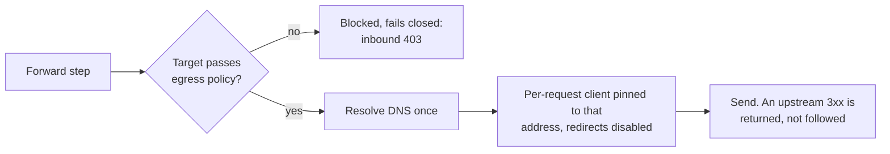
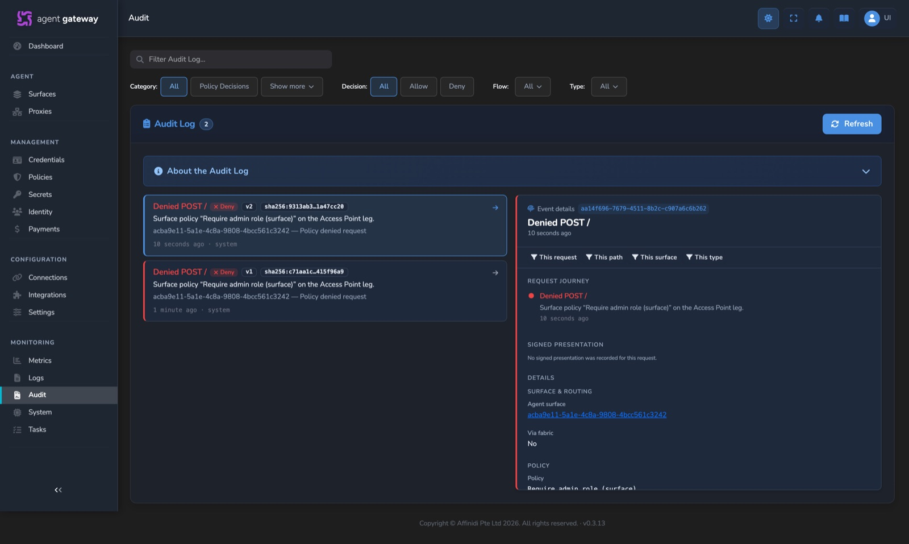

# Policy Planes, Enforcement, and Egress Controls

Revision-specific internals of the OPA policy planes, versioned policy
definitions, appliance-wide enforcement, and the egress/SSRF controls on the
forward legs. This documents the behavior of the checked-out source; for the
request-pipeline ordering see [`ARCHITECTURE.md`](../ARCHITECTURE.md#full-order).

## OPA packages


OPA is [Regorus](https://github.com/microsoft/regorus) (Rust-native Rego, no
external process). Gateway-level policy is evaluated before surface-level, and a
gateway deny is final. Using the wrong package name fails closed.

| Scope   | Package                  | Query                       |
| ------- | ------------------------ | --------------------------- |
| Gateway | `package gateway.policy` | `data.gateway.policy.allow` |
| Surface | `package surface.policy` | `data.surface.policy.allow` |

There are exactly two policy planes — **Gateway** (appliance-to-appliance) and
**Agent Surface**. Legacy `package channel.policy` is auto-migrated to
`surface.policy` at boot. Deny reason: `data.surface.policy.deny_reason` /
`data.gateway.policy.deny_reason`. A Transit Point's own policy and a Fabric receive refusal
send their deny reason to the caller, so it must not include data from `input`.

A surface's own policy is skipped only for a public discovery read: a `GET` or `HEAD` of a path
ending in `/agent-card.json`, `/agent.json`, `/.well-known/agent-card`, `/.well-known/ucp` or
`/discovery` (`paths::is_public_request`). This holds on the direct path, Fabric receive, and the
sending gateway of a `fabric://` Target, so a `POST` to a path that merely ends in
`/agent-card.json` or `/agent.json` is evaluated like any other call, and the sending gateway
skips its policy for a `GET` of `/discovery` or `/.well-known/ucp` as the direct path does.

On the direct path and the sending gateway, a request of any method whose path ends in
`/.well-known/agent-card.json` or `/.well-known/agent.json` is answered by the gateway's own agent
card fetch, a `GET` to the Target, before policy runs (`handle_agent_card`), so that request never
reaches the Target as sent.

### MCP request context (`input.mcp`)

On an MCP surface, gateway and surface policies get `input.mcp` on the direct
Access Point and on Fabric receive alike. A legacy MCP request carries its
`method`, `tool_name` (for `tools/call`) and raw `params`; a modern
(`2026-07-28`) request carries its validated context, including the protocol
version and client declarations (see
[`MCP_METADATA.md`](MCP_METADATA.md#policy-context)). Fabric receive used to set
`input.mcp` only for modern requests, so a rule keyed on `input.mcp` never
matched legacy Fabric traffic; it now does, and a decision can change on upgrade.

A legacy JSON-RPC message without an `id`, whatever its `method`, carries no `input.mcp`; a rule that allows requests without `input.mcp` allows them whatever they call.

### Request, surface and direction (`input.http`, `input.channel`, `input.gateway`)

Every gateway and surface policy input carries these fields (`PolicyInput` in
[`src/surface_context/mod.rs`](../src/surface_context/mod.rs)):

| Field | Value |
| --- | --- |
| `input.http.method`, `input.http.path` | The request's HTTP method and its whole path, which starts with the Access Point route (`/my-surface/public/docs` for a route `/my-surface`). On a Transit Point, the request the managed agent sends: its path starts with `/outbound`, the route and the Transit Point's alias (`/outbound/my-surface/partner-a/...`), or with the Transit Point's own `listen_path`. |
| `input.http.headers` | The request's headers, without credential headers such as `Authorization`, cookies and API keys. |
| `input.channel.config_id` | The surface id: unique, and unchanged when the surface is renamed. |
| `input.channel.name` | The surface's display name, which other surfaces may share. |
| `input.channel.variant_alias` | The surface variant the request selects: set on Fabric receive and on a Transit Point; absent on a direct request and for the default variant. |
| `input.gateway.direction` | `inbound` for a request arriving at the Access Point, directly or over Fabric receive: the gateway policy, the Access Point policy and the Target's request policy see it. `outbound` for a request the managed agent sends through a Transit Point: the gateway policy, the shared Transit Point policy and the Transit Point's own policy see it. Also `outbound` for the request a surface with a `fabric://` Target sends to the peer gateway: the Target's request policy sees it there, and so do the MCP tool gating conditions on that leg, without `input.transit`. Test `input.transit` to tell a Transit Point evaluation from that one. |
| `input.gateway.target_id` | On a Transit Point, its configured `target_endpoint`, such as `https://api.example.com/mcp`, or `fabric://{gateway_id}/{surface_id}` on a Fabric route; never the URL of one request. On the send of a `fabric://` Target, the peer gateway's DID. Absent on `inbound`. |
| `input.gateway.source_id` | On a Transit Point, the managed agent's DID when it has one. On a Transit Point whose `managed_identity` is `from_api_key` without `api_key_id`, `from_jwt_claim`, or `from_mtls` without `certificate_id`, the DID of the API key, the JWT claim, or the client certificate its caller presented, never an identity the request body asserts (see [`SOURCE_AUTH.md`](SOURCE_AUTH.md#transit-point-identity-from-its-caller)). On Fabric receive, the DID that sent the forward request. Absent on the send of a `fabric://` Target. |

### MCP tool policy input

A policy bound to MCP tools (`target.mcp_tool_policies`) decides each `tools/call` to an MCP
Target: a direct HTTP Target, a `proxy://` MCP Proxy, the sending gateway of a `fabric://`
Target, and Fabric receive. Other MCP methods pass this gate. Its input is
the tool call (`McpPolicyContext` in [`src/mcp/policy.rs`](../src/mcp/policy.rs)), not the
caller context the gateway and surface policies get:

```json
{
  "mcp": {
    "method": "tools/call",
    "params": {"name": "search", "arguments": {"query": "open invoices"}},
    "protocol": "json-rpc-2.0"
  },
  "jwt": {"sub": "user@example.com", "role": "admin"},
  "channel": {"name": "tools", "id": "3f2b8c1e-6d4a-4b7e-9c2f-1a5e8d7b6c40", "protocol": "mcp"},
  "request": {"source_ip": "203.0.113.10", "method": "POST", "path": "/mcp"}
}
```

| Field | Value |
| --- | --- |
| `input.mcp.method` | Always `tools/call`. |
| `input.mcp.params` | The call's `params`; the tool name is `input.mcp.params.name`. |
| `input.mcp.protocol_version`, `client_capabilities`, `client_info` | Set for a modern (`2026-07-28`) request only. |
| `input.jwt` | The claims of the bearer token in the request's `Authorization` header, absent without one; on Fabric receive, of the header the sending gateway forwarded. The gateway decodes these claims without verifying the token. A tool policy that reads `input.jwt` belongs only on a closed Access Point whose Caller Context methods are all JWT Bearer reading the `Authorization` header with the `Bearer` scheme. |
| `input.channel` | The surface's `name`, `id` (the surface id) and `protocol` (`mcp`). |
| `input.request` | `source_ip` (`fabric` on Fabric receive), `method` and `path`. |

The input has no `source_auth`, `agent`, `extension_identity` or `trust_check_results`.

### Payment context (`input.payment`)

On a surface with an `agent_pay` payment policy, every policy that runs for it gets
`input.payment`: the appliance-wide and per-gateway gateway policies as well as the surface
policies, on the direct Access Point and on Fabric receive alike. A surface without an
`agent_pay` policy has no `input.payment`.

```json
{"required": true, "rail": "x402", "amount": "0.25", "currency": "USD"}
```

`required` says whether the request is chargeable under the policy's triggers. `rail` is the
rail of the credential the caller presented, or the only rail the payment surface's manifest
offers; `amount` and `currency` come from the manifest snapshot. Each is omitted when unknown.
Payment is taken only after policy allows the request, so a denied request is never charged,
and policy never sees whether a payment succeeded: the older `input.payment.verified` field is
gone, and a rule that reads it no longer matches.

## Versioned policy definitions

Policy definitions are immutable and versioned
([`src/policies/policy_definitions.rs`](../src/policies/policy_definitions.rs)). A
`PolicyDocument` holds an append-only list of `PolicyVersion`s, each carrying a monotonic
version, a content hash of `sha256(policy_type ∥ 0x1e ∥ rego)`, and an author. Editing the
Rego appends a version rather than replacing one. The flat `PolicyDefinition` API projects
the current version, and a policy's type is fixed after creation.

### How a gateway resolves its Rego

A gateway resolves **reference-only**, from one or more policy definitions named by
`opa_policy_config.policy_definition_id` and `policy_definition_ids`, at compile time. An
inline `policy` is a legacy fallback.

A definition set is evaluated as **deny-overrides**: every member must allow, and any deny
blocks.

### What an edit recompiles

Editing a definition recompiles live:

- Gateways whose `policy_definition_id` names it.
- Surfaces whose target, inbound, response, outbound, or Transit Point policy references
  it, including variant overrides.
- The appliance-wide set, when that references it.

It does **not** recompile a gateway that references it only through
`policy_definition_ids`, or a surface that uses it only as an MCP tool-gating condition.
The impact endpoint does not count those surfaces either.

### Audit and failure

Every OPA decision made by a stored policy definition records the definition's name and
the enforced `policy_version` and `content_hash` in the audit event, and, when the
`policy_decision` audit event is selected, in the JSONL `PolicyDecision`. Policy decisions
are never embedded in a minted VP: audit configuration does not change what the gateway
sends on the wire. That covers gateway, appliance-wide, surface, access-point
inbound, Transit Point, and response policies, and a denying MCP tool policy, on the
direct, MCP-proxy, outbound, and fabric paths.

These carry no revision: MCP tool gating, an allowed MCP tool-policy call (no single
policy decides it), and the built-in allow-all default.

The JSONL `PolicyDecision` also records the leg's caller context as `caller`: its
authenticated source identity, or on a Transit Point the caller the transit token carries
(its allowlisted `sub`, `email`, and `name` claims, else the caller DID). It is absent when
the request had neither.

Enforcement is **fail-closed** on both planes. An enabled but broken policy denies, and a
gateway set is evicted wholesale if any member fails to resolve or compile. A surface with
OPA enabled but no compiled policy (or no policy engine) denies its requests on the direct
and fabric paths alike, recorded as decision `error`.

Change-control endpoints: `GET /v1/policy-definitions[/{id}[/versions|/impact]]`,
`POST /v1/policy-definitions/{id}/simulate` (dry-run), `GET`/`PUT
/v1/policy-assignments` (appliance-wide set).

Tenant-scoped PATs may read global (untenanted) policy definitions and reference
them from their own surfaces, but may update or delete only definitions owned by
their tenant and within their resource pattern. `PUT /v1/policy-assignments`
rejects any tenant-scoped PAT with 403. See
[`ACCESS_TOKENS.md`](ACCESS_TOKENS.md#tenant-ownership).

## Policy input capture

The gateway does not log the policy input. To write a policy against real requests, an operator
listens to the policy input of one surface from its Capture view in the dashboard. It is meant for
developing and testing policies, not for monitoring, so it is off until an administrator turns on
the `policy_input_capture` system feature flag (Settings › Admin › Feature Flags, or
`feature_flags.policy_input_capture` in `POST /api/v1/settings`). It is a system-only flag: a
user's own settings never turn it on. Listening is a
request on the dashboard WebSocket, with no admin API route and nothing stored on the surface:

- `{"type": "capture_policy_input", "surface_id": "<id>"}` starts listening, and
  `{"type": "stop_capturing_policy_input", "surface_id": "<id>"}` stops it.
- The gateway answers each with `{"type": "policy_input_capture", "surface_id", "listening"}`, and
  an `error` when it refuses or ends a listen: `policy input capture needs dashboard sign-in` (the
  connection carries no signed-in dashboard user, as when the gateway serves the dashboard without
  authentication or without role checks), `your dashboard session has ended; sign
  in again` (the connection's session is no longer live), `policy input capture is turned off` (the
  flag is off), `needs surfaces.edit and policies.edit`, `invalid surface
  id` (empty, over 256 bytes, or holding a control character or a bidirectional or zero-width
  format character) or `listening to too many surfaces on this connection` (more than
  10). The answer to a stop has no `error`, even when its surface id is not valid.
- Starting needs the flag on and a dashboard session whose user holds `surfaces.edit` and
  `policies.edit` ([`RBAC.md`](RBAC.md#policy-input-capture)). The session, the flag and the
  permissions are checked again on each keep-alive ping; once the session ends, the flag is turned
  off or either permission is gone, the connection stops listening to every surface and is told
  why. The flag is also read on every policy evaluation, so turning it off stops new captures at
  once. A due check runs before any queued capture is
  sent, and the captures still queued when access is lost are discarded. A client that has not
  read a message within 10 seconds is disconnected, so it cannot delay the check.
- Each listen that starts records `policy_input_capture_started`, and each that ends records
  `policy_input_capture_stopped` with its reason, in the VP Audit Log when auditing selects either
  event and in any Governance Audit integration that selects either one
  ([`OBSERVABILITY.md`](OBSERVABILITY.md#governance-audit-forwarding)). Each start and stop is also
  written to the log at info, whatever auditing selects. A refused listen records nothing.
- Listening ends when the connection closes, so reloading or leaving the page ends it. Captures
  still queued when the connection closes are not sent. The dashboard sends its listens again
  after a reconnect.
- Captures and `policy_input_skipped` notices queued before a stop, or by an earlier listen to
  the same surface, are not sent; those of the connection's other surfaces still are.

A surface's policy input is captured while at least one connection listens to it, and only the
listening connections receive the captures, each through its own queue of at most 64; a capture
that finds a connection's queue full is dropped for that connection, and the connection is told how
many it missed with `{"type": "policy_input_skipped", "config_id", "skipped"}` before its next
capture. While every listening connection's queue is full, an evaluation is counted as missed for
each of them and its input is not masked or serialized. The Capture view shows that count.
Capture runs on the node the dashboard is connected to: requests another node of the appliance
serves are not captured there.

While a connection listens, each evaluation of a request or response policy on the surface sends
it one `policy_input_captured` update, once the policy has decided:

| Field | Value |
| --- | --- |
| `config_id` | The surface id |
| `timestamp` | When the policy decided, RFC 3339 |
| `slot` | The policy, in words: `inbound` (the Access Point policy), `target` (the Target's request policy), `inbound variant <alias>`, `target variant <alias>`, `outbound`, `transit <alias>`, `response` (the Target's response policy), `transit <alias> response`, `gateway` (the gateway-level policy on an inbound request), `gateway outbound` (the gateway-level policy on an outbound request, `input.gateway.direction` `outbound`) or `appliance <plane>` (an appliance-wide plane) |
| `transit_point` | The Transit Point alias, for a Transit Point request or response policy |
| `policies` | The policy definitions the slot evaluated, each `{"id", "name", "version"}`: one for a surface slot, every member of the set for the gateway and appliance-wide planes; a legacy inline gateway policy has neither `id` nor `name`. A monitor-only appliance-wide member is listed without its outcome: a deny it would have made does not change `decision` or `decided_by` |
| `decided_by` | The `id` of the member that denied, when a gateway or appliance-wide set denies, or that failed to evaluate, on an appliance-wide plane |
| `plane` | `surface`, `gateway` or `appliance` |
| `engine` | The compiled policy key: the surface id, `inbound:`, `outbound:`, `variant:` or `transit:<surface>:<alias>` for a surface request policy, `response:<policy definition id>` or `response:transit:<surface>:<alias>` for a response policy, the gateway id, or the appliance-wide plane |
| `input` | The policy input, credentials masked: the request input of a request policy, `response`, `caller` and `surface` (with `transit` and `source_auth` on a Transit Point leg) for a response policy |
| `decision` | `allow`, `deny` or `error` (an evaluation error, which denies) |
| `reason` | The deny reason, or the evaluation error; an appliance-wide error carries its generic reason (`Appliance-wide policy evaluation error`, `Appliance-wide policy input error` or `Failed to serialize policy input`), not the engine's error text |
| `surface_variant` | The surface variant of the request, when there is one |

Policies run appliance-wide, gateway, Access Point, Target, and a deny ends the chain, so a slot
after it sends nothing. Captures are sent on the direct, Fabric and MCP proxy paths alike. MCP tool
policies, the `tools/list` filtering of a surface policy, and a fail-closed deny of a slot whose
policy did not compile (the request is denied before any policy runs) are not captured. A
surface with no
policy of its own has no surface evaluation to capture, so only a gateway or appliance-wide policy
that applies to it is shown; to see the input of each request, add a request policy first (one that
allows everything is enough). The Capture view says so while the surface has none.

Only a dashboard WebSocket opened with a session (`websocket_require_auth`, on by default) can
listen; a socket that carries no signed-in dashboard user is refused with `policy input capture
needs dashboard sign-in` and never receives captures. Nothing is written to the log or
stored, so a capture is gone once it has been sent. A listen is checked against the user's
permissions, not against the surface: dashboard sessions are appliance-wide, so a user with both
permissions can listen to any surface, and a listen naming a surface that does not exist receives
nothing. Scoping dashboard sessions to tenants or surfaces would need the listen check to apply the
same scope.

Before a capture is sent, every credential in the input becomes `<redacted>`: the value of a key
named like a credential (the [credential names](CONFIGURATION_REFERENCE.md#log-redaction) of log
redaction, such as `token` or `api_key`), any JWT (three dot-separated base64url segments whose
first decodes to a JSON object), and the token of any `Bearer` or `Basic`
authorization value, also inside longer text (`Authorization: Bearer <redacted> please`). A
JWT joined to the word before it, as in `CSRF=<redacted>` or `session_<redacted>`, is masked
too, and a JWT followed by `.` and more text, as in `<JWT>.example.com` or `<JWT>.<JWT>`, is
masked together with the dotted text after it. A `Bearer` token is one of letters, digits or `-._~+/=` that is at least 12 characters long, or at
least 6 with a digit or one of those symbols; a `Basic` token is one that decodes as base64 to
`user:password`. Message text such as `Basic authentication` or `Bearer arms` is kept. In every
absolute URL in the input, query parameter names are kept and every query value becomes
`<redacted>`, and the userinfo (user name and password) becomes `<redacted>`
(`https://<redacted>@host/path`), up to the last `@` before the path, query or fragment. A
fragment that holds `name=value` parameters, as an OAuth redirect's does
(`#access_token=<redacted>&state=<redacted>`), is masked like a query; a plain anchor such as
`#top` is kept. A deny
reason and an evaluation error get the same masking, since a policy can build its reason from
input text and an engine error can quote it. `http.path`
is shown as the request log line shows it: query parameter names are kept and every query value
becomes `<redacted>`, since a request received over Fabric carries the caller's full path and query,
and capability ids in the path are shortened. Masking matches these shapes only, so a credential in
another shape, such as an opaque key under a field name that is not a credential name, is sent as
it is. Object keys are never masked: only values are, so a credential used as a key is sent as it
is. Policies still see the full path. Headers that
carry credentials never reach the policy input. After this masking, the operator's
[log redaction rules](CONFIGURATION_REFERENCE.md#log-redaction) (`logging.redaction.rules`) are
applied to every string value in the input, to each string field as a log line writes it
(`"name":"value"`, so a rule that matches a field name with its value, such as the built-in quoted
credential fields rule for `"clientsecret":"..."`, masks the whole value as `<redacted>`), and to
the deny reason and error, so a capture masks at least what the log masks. The built-in rules also catch credential assignments in free text
(`password=[REDACTED]`, `api_key: [REDACTED]`), `agpat_` tokens, PEM private keys and email
addresses, each shown with the rule's replacement. With `logging.redaction.enabled` set to `false`
only the masking above applies. The rules are read at startup. Message bodies, tool arguments and
claims are sent with only this masking applied. Policy input capture is meant for writing and
testing policies: the captures hold caller data.

## Appliance-wide (global) enforcement

In `src/policies/global_policy.rs`: a policy can be assigned to a whole plane via
`PUT /v1/policy-assignments` (`policies.edit`) — enforced on **every** gateway
(`gateway.policy`) or **every** agent surface (`surface.policy`), independent of
each object's own OPA config. `GlobalPolicyManager` compiles one engine per
assignment per plane and evaluates the set **deny-overrides ahead of the
per-object policy** at the inbound PEPs (fabric gateway + fabric surface in
`message_processor`; direct-inbound gateway + surface in `proxy/handler` — on both
paths the surface global runs on every request, even when the surface's own OPA is
disabled or the path is a public discovery endpoint). Each
`GlobalAssignment` supports `monitor_only` (evaluated + audited with version/hash,
never blocking) for safe rollout; the set is **fail-closed** (a broken-to-compile
or missing enforced member denies that plane, monitor-only exempt) and recompiles
live when a referenced definition is edited. Deleting a definition removes it from
every plane's global assignments (`global_policies/global.json`). `GET
/v1/policy-definitions/{id}/impact` reports `globally_enforced` + `planes`.

## Trust Check

`src/trust_registry_verification/` runs TRQP queries per-leg, with results at
`input.trust_check_results.{caller|target|managed_agent}`. The stage never denies — OPA decides.
Discovery paths bypass the caller-leg check. See the source for error codes and
template syntax.


Each leg carries a `trust_check_list`:

| List | Runs on |
| --- | --- |
| `access_point.trust_check_list` | The caller leg, for requests arriving at the Access Point. |
| `transit.points[].trust_check_list` | Requests the managed agent sends through that Transit Point, and no other. In the Surface Builder each query checks the destination or the [managed agent](#self-recognition-check); on an MCP Transit Point only the managed agent, and a migrated copy holding a destination query is shown read-only, to keep or remove. |
| `target.trust_check_list` | The managed agent's own target leg: `a2a-proxy://` Targets and Fabric send. |

A Transit Point with an empty list runs no Trust Check on its traffic: no agent-card fetch
for trust, no identity verification, no TRQP query. A request through a Transit Point sees
only that Transit Point's results, at `input.trust_check_results.target`, and those of its
[managed-agent elements](#self-recognition-check) at `input.trust_check_results.managed_agent`,
in all three outbound OPA scopes (gateway, surface, Transit Point).

A list has no limit on its elements or on the authorities they query
([`src/config/agent_surface.rs`](../src/config/agent_surface.rs)). The gateway queries every
listed authority of a leg at once, so each authority adds one TRQP message per request (see
the accepted risk under [_Several authorities in one query_](#several-authorities-in-one-query)). A surface variant
override replaces the whole list verbatim, never element by element; a variant gives its
Transit Points their own lists through its `transit.points` override.

A write to the management API declares the per-Transit-Point shape with
`trust_check_split: true`; the Surface Builder always sends it. A declared write is rejected
with `400` when its `target.trust_check_list` is non-empty and its Managed Agent target is not
`a2a-proxy://` or `fabric://` (an `http(s)` URL, `proxy://`, or no endpoint), because no stage
runs that list for such a target. For a variant, only a target list the variant sets in its own
override counts; an inherited list that cannot run on the variant's endpoint is ignored.

A write that does not declare the shape is converted only while the stored surface has no
Trust Check lists at all (no `trust_check_split` and no Transit Point lists): an undeclared
create or `PUT` that carries a `target.trust_check_list` and no Transit Point lists is then
treated as the old shape, converted exactly as a stored surface is (below), logged as a
warning, and saved. Once the surface has Trust Check lists, an undeclared write cannot change
them. An undeclared `PUT` keeps every stored Transit Point list for each Transit Point it sends
without one, keeps the stored target list when it sends none, and is rejected with `400` if it
sets a target list or a Transit Point list that differs from the stored one, including an
explicit empty list, or leaves out a variant's own Transit Points that hold lists. A new
Transit Point it adds without a list has no Trust Checks. An undeclared `PATCH` or variant write is
rejected with `400` when it sets or clears a target list or Transit Points, including through a
parent object such as `transit` or a variant's `overrides`, or by replacing `variants`; a
variant `PUT` that sends `overrides` for a variant whose Transit Points hold lists counts as
doing so. Such a write must be resent with `trust_check_split: true`. A `PATCH` that only moves
an `a2a-proxy://` or `fabric://` target to another endpoint while its target list remains is
rejected by the first rule until the list is removed.

### Lists stored before per-Transit-Point checks

Surfaces stored before Transit Points had their own lists kept one `target.trust_check_list`
that ran on every Transit Point. The first time such a surface loads, the gateway copies that
list onto each of its Transit Points (and those of each variant), marks each copy
with `trust_check_migrated: true`, removes `target.trust_check_list` unless the Managed Agent
target is `a2a-proxy://` or `fabric://`, sets `trust_check_split: true`, and saves the file. It logs the surface and the Transit Points that received copies,
and warns when a list is removed without any Transit Point receiving it. Every Transit Point
keeps its behaviour until an operator edits the surface. The Surface Builder flags
each copy for review; through the API, remove a copy by saving the Transit Point without
`trust_check_list` in a write that declares the shape.

User-saved Surface Templates are converted the same way when they load, and when they are
created, updated or imported without the marker; an imported export from an earlier release is
converted. A template's endpoint is usually the `$TARGET_ENDPOINT` placeholder, so a template
with a placeholder or empty endpoint keeps its `target.trust_check_list`, and its Transit Points
still receive copies. When the Surface Builder loads a surface, including one created from such
a template, whose target cannot run its target list and whose Transit Points all carry the same
checks, it drops the Managed Agent's copy; otherwise the `400` above applies when the surface is
saved.

MCP and HTTP Transit Points receive a copy too, because the old list ran on them. There it
usually reports `AGENT_CARD_UNAVAILABLE`, but an HTTP Transit Point whose destination serves an
A2A agent card runs real identity and TRQP checks. On an MCP Transit Point the Surface Builder
adds only managed-agent queries and shows such a copy read-only, to keep or remove; the
management API accepts a list on any Transit Point. Removing a copy during review means that
Transit Point's traffic is no longer checked, so a policy that denied on its results allows
it.

A variant that inherited the base Transit Points but resolves to a different list receives
its own copy of them in `overrides.transit.points`, so later edits to the base Transit Points,
such as a new Transit Point, a changed destination or rotated credentials, no longer reach it.
Variants saved by the Surface Builder already carry their own Transit Points and are not
affected.

`trust_check_split` is stored whenever the surface keeps a `target.trust_check_list` or any of
its Transit Points has a `trust_check_list`. A surface file written outside the API in the
per-Transit-Point shape must set it, or a target list in it is converted on load. When the
marker is set and a target list sits on a target that cannot run it, the gateway logs a warning
on load and the list never runs.

The conversion is forward-only. A gateway release from before per-Transit-Point lists refuses a
surface carrying `trust_check_split`, which every surface with Trust Checks on its target or
Transit Points carries after the upgrade. It still loads a converted template, because it
stores the template's surface unparsed, so applying it there can fail or create a surface
without its Transit Point checks. Back up `_storage/agent_surfaces/` and
`_storage/agent_surface_templates/` before upgrading if a rollback may be needed, and restore
both on rollback.

### Requiring checks in policy

A Transit Point without checks leaves `input.trust_check_results` absent. Rules that only look
for failures, such as `every r in input.trust_check_results.target { r.ok }` or a count of
results with `ok == false` equal to zero, therefore allow every request through a Transit
Point that has no checks, or whose checks were removed. Such a Transit Point also has no
verified target identity: `input.agent` is absent in the gateway and surface scopes, and with
`require_agent_context` the Transit Point scope reads it from the agent card's unsigned DID.
When a policy requires Trust Checks, also require that they ran, or check specific element
ids:

```rego
allow if {
    count(input.trust_check_results.target) > 0
    every r in input.trust_check_results.target { r.ok }
}
```

Element validation is in
[`src/trust_registry_verification/trust_check_element.rs`](../src/trust_registry_verification/trust_check_element.rs).

| Field | Rule |
| --- | --- |
| `id` | Required, unique within the leg, at most `TRUST_CHECK_ID_MAX_CODE_POINTS` (64) code points. Rego-addressable and audit-visible. |
| `name` | Optional display label, at most `TRUST_CHECK_NAME_MAX_CODE_POINTS` (64) code points. |
| `id` and `name` | Control, DEL, C1, and bidi-override codepoints are rejected. |
| `query.authority_id` / `query.authority_ids` | Exactly one is set. `authority_ids` holds one or more distinct, non-blank DIDs or templates. `authority_sources` is refused without `authority_ids` or with a key `authority_ids` does not list, and `authority_source` is refused with `authority_ids`. |
| `timeout_secs` | Optional on a single-authority element; without it the element waits for the trust registry transport's own timeout. Refused on a multi-authority element, where each authority always waits `TRUST_CHECK_MULTI_AUTHORITY_TIMEOUT_SECS` (5). |

The two caps are separate constants that happen to share a value today, because `id` is
addressable from policy while `name` is only a label. Counts are code points, not bytes.

When an audit sink selects `trust_check`, each element's outcome is recorded with the
surface id, the request's trace id and the authenticated caller (on the Access Point, Fabric
and MCP-proxy paths), so a trust check can be tied to the request and principal that
triggered it. On the outbound path the record also names the Transit Point.

### Self recognition check

An element of a Transit Point's `trust_check_list` with `"subject": "managed_agent"` asks
about the managed agent calling out through the Transit Point instead of its destination.
Elements without `subject` ask about the destination, as before. Only a Transit Point's list
may hold managed-agent elements; any other list refuses them with `400`.

A managed-agent element whose `query.entity_id` is blank asks about the DID the Transit Point
calls out under: its own managed identity's when it has one, otherwise the surface Managed
Agent's identity it injects. On a Transit Point whose identity is taken from its caller's
credential (see
[Transit Point identity from its caller](SOURCE_AUTH.md#transit-point-identity-from-its-caller)),
that is the DID of the API key, JWT claim or client certificate the Transit Point verified on
the request, never one the body asserts. Templates, authority lists, `authority_source`, query types and
timeouts work as on any element. When no managed agent DID is resolved for the request, each
managed-agent element reports `MANAGED_AGENT_IDENTITY_UNAVAILABLE` without asking its trust
registry; such a Transit Point can still be saved. Managed-agent elements need no destination
agent card, so a list holding only them fetches none for trust.

Their results are at `input.trust_check_results.managed_agent`, in the gateway, surface and
Transit Point outbound scopes, beside `target`. The key is absent when the Transit Point has
no managed-agent elements or the request is a discovery read. Without a trust registry
connection each element fails with `TRUST_REGISTRY_UNREACHABLE`, except that a request with no
managed agent DID still reports `MANAGED_AGENT_IDENTITY_UNAVAILABLE`. Like every Trust Check
the stage never denies: policy decides. Nothing is cached, so turning recognition off in the
trust registry takes effect on the next call, unless a Transit Point Trust Recorder writes the
record again (see below). The Transit Point's policy still runs on a
discovery read, such as an agent card read, where the key is absent. To refuse a managed agent
the trust registry no longer recognises and still serve discovery reads, allow a request whose
results are absent and otherwise require that every result is `ok`:

```rego
package surface.policy

default allow := false

allow if not input.trust_check_results.managed_agent

allow if {
    count(input.trust_check_results.managed_agent) > 0
    every r in input.trust_check_results.managed_agent { r.ok }
}

deny_reason := "Calling agent has no managed identity" if {
    not allow
    some r in input.trust_check_results.managed_agent
    r.error.code == "MANAGED_AGENT_IDENTITY_UNAVAILABLE"
} else := "Calling agent is not recognised" if not allow
```

The first rule allows every call while the Transit Point has no managed-agent elements, so pair
this policy with them. A failed result carries its reason in `error.code`, so the second
`deny_reason` tells a Transit Point that resolves no managed agent DID apart from an agent the
trust registry does not recognise.

The check answers whether the trust registry recognises a DID, not who presents it: any
request the Transit Point sends under that DID passes. It assumes the managed agent is the
operator's own, and lets the trust registry withdraw its recognition; it does not stop an agent
that controls its own identity from claiming another one, and the registry decides what this
gateway may write to it. To bind a Transit Point to the agent calling it, authenticate that
agent with the Transit Point's own `source_auth` (mTLS, JWT or API key, see
[Transit Point source authentication](SOURCE_AUTH.md#transit-point-source-authentication)),
and its responses with `target.response_auth` (see
[Response authentication](SOURCE_AUTH.md#response-authentication)).

A Transit Point's own policy that denies answers `403` with the `detail` "Request blocked by
surface policy", followed by `: <deny_reason>` when the policy sets one, so the managed agent
learns why it was refused. That reason reaches the caller: never build it from `input`.

A Transit Point with its own `trust_recorder` writes its managed agent's records in the
background on every request except a discovery read, without waiting, so the agent is
recognised once those records exist, which may be after its first call. It writes before the
Trust Check and policy, so a call policy refuses is recorded too. A record the operator removes
is written again by the next call through any Transit Point that records the same agent in that
registry; one made inactive is written again only if the registry accepts the create, and a
registry that answers with a conflict leaves it inactive. To turn recognition off, remove that
recorder entry as well. See [Transit Point Trust Recorder](SOURCE_AUTH.md#transit-point-trust-recorder).

Managed-agent elements run on A2A, AP2, MCP and HTTP Transit Points, including `fabric://`
ones, and not on discovery reads. Each query is a `trust_check` record with `leg`
`managed_agent` that names the Transit Point.

### Several authorities in one query

A query that must accept an entity any of several organisations recognises lists them in
`query.authority_ids` instead of `query.authority_id`:

```json
{
  "id": "authority-recognised",
  "trust_registry_id": "tr-main",
  "query_type": "recognition",
  "query": {
    "authority_ids": ["did:web:authority-a", "did:web:authority-b", "did:web:authority-c"],
    "entity_id": "{{ input.agent.did }}"
  }
}
```

The gateway sends one TRQP query per listed authority, all at once, and waits until each one
answers or reaches its built-in 5-second timeout (`TRUST_CHECK_MULTI_AUTHORITY_TIMEOUT_SECS`),
which fails that authority's result with `QUERY_TIMEOUT`; it never stops early and never
combines the answers. Such an element cannot set `timeout_secs`. Each
authority gets its own result, in list order, all carrying the element's `id` and each its own
`authority_id`, and its own audit record and `agent_gateway_trust_check_total` sample. A result
failed with `AGENT_CARD_UNAVAILABLE`, `TRUST_REGISTRY_METADATA_UNAVAILABLE`,
`IDENTITY_VP_VERIFICATION_FAILED`, `TARGET_AGENT_IDENTITY_UNAVAILABLE` or
`MANAGED_AGENT_IDENTITY_UNAVAILABLE` omits `authority_id`
and `entity_id`, so the authorities of one element tell such results apart only by order. A
template that fails to resolve, a missing metadata field or an unreachable registry fails only
that authority's result. An authority that resolves to a blank value, in a list or in
`query.authority_id`, fails with `TEMPLATE_RESOLUTION_FAILED` without querying its registry.
When the target cannot be checked at all (for example its agent card
is unavailable), every listed authority gets a result with that error code.

Because several results share an `id`, an any-of rule iterates them:

```rego
allow if {
    some r in input.trust_check_results.caller
    r.id == "authority-recognised"
    r.ok
}
```

A rule that addresses one result by `id` alone matches every authority of the element.
`authority_sources` maps each listed literal DID to the register it was picked from, as
`authority_source` does for `authority_id` (see
[_The authority of a Trust Check_](#the-authority-of-a-trust-check)); a template or a DID in
neither register has no entry. A listed Authority that no longer exists fails only its own
result with `AUTHORITY_NOT_FOUND`, and the other authorities are queried as usual. The Surface
Builder's fullscreen editor picks that list in one multi-select of the Issuers and Authorities
registers; see _Authority lists_ in
[`www/default/AGENTS.md`](../www/default/AGENTS.md).

A rule over every result, such as `every r in input.trust_check_results.target { r.ok }`,
requires every authority of every element. To require every element, each passing when any
of its authorities recognises the entity, group the results by `id`, as the dashboard's
_All trust checks pass_ and _At least N trust checks pass_ templates do:

```rego
check_ids contains r.id if {
    some r in input.trust_check_results.target
}

passed_ids contains r.id if {
    some r in input.trust_check_results.target
    r.ok == true
}

allow if {
    count(check_ids) > 0
    count(check_ids - passed_ids) == 0
}
```

Accepted risk: nothing bounds how many authorities a leg queries. Every request sends one TRQP
message per listed authority, all at once, through the trust registry's connection and its
mediator, and writes one audit record and one `agent_gateway_trust_check_total` sample per
authority, so the lists an operator configures set the load each request puts on the registry,
the mediator and the audit sinks. Keep lists to the authorities a policy needs. A query that
times out never marks the registry connection `Failed`: every request the gateway sends to a
registry has a thread id starting with `ag-req-` (`REQUEST_THREAD_PREFIX` in
[`src/trust_registries/communication.rs`](../src/trust_registries/communication.rs)), and a
refusal on such a thread that no query still awaits is logged and ignored, however late
it arrives, whether it arrives as a problem report or as the `trust-task-error` document a
mediator at v0.52 or later sends. That newer form can also name the query in its own
`threadId` or `inResponseTo`, and is then delivered to that query, or ignored in the same way
once the query is no longer awaited. A correlator naming anything other than such a query says
nothing about the gateway's queries and changes nothing. Every other refusal is taken as the
registry rejecting the gateway.

Gateway 1.0.9 and earlier cannot read `query.authority_ids`, even a list of one. It skips any
stored surface or managed connection with a Trust Check that sets `query.authority_ids`, and
logs a parse error. Requests to that surface fail as unknown, and that client cannot
authenticate. Before rolling back to 1.0.9 or earlier, or before a standby on such a version
takes over, change each such query to a single `authority_id`. Surfaces and managed
connections whose queries set only `authority_id` load as before. Such a gateway also caps a leg's list at 10 Trust Checks, but only when saving: it loads
and runs a longer list, and refuses to save that surface or managed connection (`400`) until
the list is trimmed to 10.

### The authority of a Trust Check

`query.authority_id` is stored as text: a literal DID, or a template resolved per request.
`authority_source` beside it records the register a literal DID was found in
([`authority_source.rs`](../src/trust_registry_verification/authority_source.rs)):

| `authority_source` | Meaning |
| --- | --- |
| `authority` | Linked to the Authority with that DID. The Authority must still exist. |
| `issuer` | An Issuer has that DID. |
| absent | A template, or a DID in neither register. |

For a query that lists authorities, `authority_sources` holds the same value per listed DID, and
everything below applies to each listed DID on its own.

Every save of a surface or STS client sets it for each literal DID: `authority` when the write
sends `authority`, when the stored record already had the DID as `authority`, or when an
Authority the record's tenant may use has the DID; else `issuer` when such an Issuer has it;
else none. A link to an Authority is never dropped, so a client that leaves the field out or
sends another value cannot turn a deleted Authority into a plain DID. A save is refused with
`400` when a source is set on a template, or when a link names an Authority that does not exist
or belongs to another tenant; both answer alike. Without an Authority store nothing is set or
refused. Stored surfaces are classified the same way on each load (an active node saves the
ones that changed; a standby node keeps them in memory), and stored STS clients at startup on
an active node.

A link from a surface or STS client to an Authority is an ownership reference: moving the
Authority, the surface or the STS client to a tenant that would make it cross-tenant is refused
with `409`, like any other cross-tenant reference.

`DELETE /v1/authorities/{id}` is refused with `409` while a Trust Check or a Trust Recorder
entry on any surface (base or variant) or STS client names the Authority's DID, counting only
records whose tenant may use the Authority: a record of another tenant that names the same DID
neither holds the Authority nor learns of it. The answer lists
the surfaces and STS clients the caller may view, each with `uses`: the Trust Checks
(`element: trust_check`, `id`, `name`, `placement` (`access_point`, `target` or
`transit_point`), `transit_point`, `variant`) and Trust Recorder entries
(`element: trust_recorder`, `trust_registry_id`, `variant`) that name it, and
`hidden_references` counts the rest. `?force=true` deletes it anyway, but only when the caller
may view every record that names it, and records an `authority_force_deleted` event (see
[`OBSERVABILITY.md`](OBSERVABILITY.md)). The records keep their configuration. A delete and a
surface save never interleave: the save re-checks its new links under the lock the delete
holds.

A Trust Check linked to an Authority that no longer exists fails with `AUTHORITY_NOT_FOUND`
without querying its trust registry, whether the Authority was deleted with force, removed from
`_storage/`, or never existed; so does one whose Authority store is missing or unreadable. The
result keeps the configured `authority_id`, so policy and the audit trail can see which DID was
refused. The check looks the DID up among all Authorities, whose DIDs are unique; whether the
record's tenant may use it is checked on save and on tenant moves. A DID with no source is not
checked, so a forced delete leaves a record that a node has not classified yet, such as an STS
client stored while the node was in standby, querying the DID until its next save or startup.
Likewise a record naming an Authority that was deleted before this check existed has no source
on its first load, because no register has the DID any more, and its Trust Check keeps running.
Each load logs, per surface and STS client, the literal DIDs it names that are in neither
register, so such a record can be found and pointed at an Authority or removed.

## Failed caller authentication

Every Access Point that is not public refuses a missing or invalid credential with `401`
before policy: a closed one (`access_point.public: false`, which the admin API sets on every
surface it creates unless it is public), a legacy one stored without `public`, and any whose
`caller_authentication.on_failure` is `reject`, see
[`SOURCE_AUTH.md`](SOURCE_AUTH.md#closed-and-public-access-points). An Access Point whose
inbound identity is `from_jwt_claim`, public or not, direct or over fabric, refuses one the
same way, whatever method it failed; a caller verified by a method other than JWT Bearer is
served there with no identity (see
[`SOURCE_AUTH.md`](SOURCE_AUTH.md#several-methods-on-one-access-point)). These refusals run
before gateway policy, so a gateway deny does not apply to them, and surface policy never sees
the request. Their body is the generic `Caller credential missing or invalid`; the reason is
logged. Only on any other public Access Point (`public: true`) does source auth hand a request
whose credential is missing or invalid to policy. The request continues with no caller identity, `input.source_auth` is
`{"method": "failed", "attempted_method": ..., "reason": ...}`, where `attempted_method` is
the method selected for the request (see
[`SOURCE_AUTH.md`](SOURCE_AUTH.md#several-methods-on-one-access-point)). On every forwarding
path (direct inbound, `proxy://` MCP Targets, `a2a-proxy://` Targets, Fabric send and
Fabric receive, the last for surfaces without protected resource metadata) the stored
target credential, or the A2A proxy's Direct Line secret, is not attached, because it
vouches that the gateway vetted the caller. A public surface that
must reject such callers needs a policy that denies `input.source_auth.method == "failed"`.
Server-side source-auth errors (missing configuration, internal failures) still block
with `500`. A request to an MCP Access Point that publishes protected resource
metadata never reaches policy with a failed credential, direct or over Fabric: a failed JWT
bearer credential is refused with a `401` challenge pointing at that metadata on a direct
request, and with a `401` without it over Fabric, and a failed credential of another method
on that Access Point with a plain `401`, see
[`MCP_METADATA.md`](MCP_METADATA.md#authorization-server-discovery-for-caller-authentication).

A Transit Point's own `source_auth` is different: it refuses a missing or invalid credential
itself, with `401`, before any policy runs, so an outbound policy never sees
`"method": "failed"` (see [`SOURCE_AUTH.md`](SOURCE_AUTH.md#transit-point-callers)).

Over Fabric, the sending Gateway strips the credential headers of every method its own
surface configures before forwarding. A receiving surface without protected resource metadata that requires
source authentication on that same header therefore sees every Fabric caller as failed: a
public one forwards them without its target credential, and every other one refuses them
with `401`. Require caller authentication on one side of the Fabric hop, or use a
different credential header on each side.

## Caller identity verification in policy input

`input.extension_identity` is the caller identity the gateway resolved on the
inbound leg (`did`, `identity_hash`), and `normalize_caller_did` promotes its
`did` into `input.agent.did` when the body asserted none (unless the Trust
Check flagged an identity mismatch). On a Transit Point it is the managed agent instead, with
the same values and no promotion (see
[Caller in Transit Point policy input](#caller-in-transit-point-policy-input)). A DID used as
given, a `static` DID or a certificate with a pinned DID, has no hash, so `identity_hash` is
absent on both legs; match such a DID by `did`. Both carry how the DID was established:

| Field | Values | Meaning |
| --- | --- | --- |
| `input.extension_identity.verification`, `input.agent.did_verification` | `vp` | The caller proved control of the DID with an identity presentation that verified and whose issuer is one of the sending connection's issuers. Only the fabric receive path produces it. |
| | `vp_unanchored` | The caller proved control of the DID with an identity presentation that verified, but no trust anchor vouches for its issuer: the direct A2A path has no authenticated sender, so a self-issued credential ends here too. Trust its identity fields only after checking `input.agent.identity_issuer_did` or a Trust Check. |
| | `source_auth` | The DID is bound to the source credential this gateway authenticated on this request: `from_jwt_claim`, or an API Key Provider key on an inbound `from_api_key` slot; on a Transit Point whose identity is taken from its caller, the API Key Provider key, the JWT claim or the client certificate the Transit Point verified. |
| | `unverified` | Nothing in the request proves the DID: `x-identity` payload pseudonyms, surface-configured identities (`static`, a stored-certificate `from_mtls`, a stored-key `from_api_key`), and a plain API Key on an inbound `from_api_key` slot, whose DID every holder of the secret shares. |
| `input.extension_identity.verified`, `input.agent.did_verified` | `true` / `false` | Boolean projection: everything but `unverified` is verified. |

`input.agent.trust_verification` is `true` when every Trust Registry recognition query for
`input.agent.did` passed, `false` when one did not, and absent without Trust Registry data. On
the caller leg, `input.agent.did` and the Trust Registry fields beside it come from the request
body's trust-registry extension, so a policy that requires the caller to be recognised also
requires `input.agent.did_verified == true`: the recognised DID is then the caller identity the
gateway established.

On a direct request to a surface whose inbound identity is `from_api_key`, the
caller is the API key it presents (see
[`SOURCE_AUTH.md`](SOURCE_AUTH.md#from_api_key-on-the-inbound-slot)). Fabric
receive does not read this mode; the request body sets the caller there (see
[`FABRIC.md`](FABRIC.md)). On a direct request:

- `input.extension_identity` and `input.agent.did`, `did_verified` and
  `did_verification` are the key's DID, replacing any DID or identity
  presentation in the request body.
- When the body does not assert the key's own DID, including when it names no DID,
  the trust-registry claims it made are dropped: `provider_did`, `trust_registry_did`,
  `authority_did`, `identity_issuer_did`, `agent_dna` and the trust verifications. A Trust Check
  preset that reads `input.agent.provider_did` therefore denies unless the body
  asserts the key's own DID.
- With no caller identity, such as after a failed key, `input.agent.did` is absent and
  those trust-registry claims are always dropped.
- Gateway-plane policy, including its global policy, runs before the key resolves, so it
  sees no `input.agent.did` and none of those claims on these surfaces.
- On a `fabric://` target only `access_point.inbound_policy` sees the key's DID, in
  `input.extension_identity` (and `input.agent` when the Access Point has a Trust Check).
  `target.policy` keeps its existing input, the target agent's card and the request body, so
  a per-caller rule there matches `input.source_auth.key_name`.
- A key that also identifies a Managed Agent gives its callers the Managed Agent's DID; see
  [One key in both roles](SOURCE_AUTH.md#one-key-in-both-roles) for the surface policy that
  refuses it.

On a surface whose inbound identity is `from_api_key` or `from_jwt_claim`, a caller verified by
a method that identity does not read (any method but an API key for `from_api_key`, any but
JWT Bearer for `from_jwt_claim`), or whose credential failed on a public Access Point, gets no
caller identity, on direct requests and Fabric send: `input.extension_identity` and
`input.agent.did` are absent, and so are the trust-registry claims its body makes. Tell it apart
by `input.source_auth.method`; see
[`SOURCE_AUTH.md`](SOURCE_AUTH.md#several-methods-on-one-access-point).

A DID copied from the request body or an agent card into `input.agent.did` that
differs from `extension_identity.did`, or when there is none, carries
`did_verified: false` and no `did_verification`; one equal to it takes the
extension's verification. A presentation that fails verification, or a bare
`did` claim, never becomes `extension_identity`. The request carries at most a
payload-derived identity from a raw `agent-identity/v1` extension, and only when
no presentation was rejected (a bare `did` claim, or on the fabric path a
gateway with no VC issuer), or, on the direct path, a surface-configured
identity (`unverified` or `source_auth`). A rule such as
`input.extension_identity.verification == "vp"` therefore denies those requests.
The same rule denies every request on the direct A2A path, which never produces
`vp`; a rule for that path accepts `vp_unanchored` together with a check on
`input.agent.identity_issuer_did`.

## Caller in Transit Point policy input

Every Transit Point evaluation (gateway, surface, per-Transit-Point and response policies,
and MCP tool gating conditions on a Transit Point) gets `input.transit`. It is never on an
inbound evaluation, where `input.source_auth` and `input.extension_identity` carry the
caller, nor on the `outbound` evaluation of the request a `fabric://` Target sends, where
only `input.source_auth` does. The same Transit Point evaluations also get the Transit
Point's own caller, the managed agent, in `input.extension_identity` (see below). `input.transit`
names two principals, each in its own field, because one call can carry both:

- `input.transit.caller` is the end user the transit token names, as the Access Point
  authenticated them. Without a transit token it is `anonymous`.
- `input.transit.client` is the principal the Transit Point authenticated itself on this
  request, such as the managed agent's resource-server token. It is absent when the Transit
  Point authenticated none.

A rule about the end user reads `caller`, and a rule about the client reads `client`;
neither stands in for the other. A policy that reads `caller` must test `verified` first: a
caller named only by an unverified DID is reported, and never as verified.

The policy editor's built-in templates that read the caller (`input.source_auth`,
`input.agent` or `input.extension_identity`) decide on the Access Point and Target request
policies. On a Transit Point `input.source_auth` is the client the Transit Point
authenticated, `input.agent` describes the destination and `input.extension_identity` is the
managed agent, so a template that reads `input.extension_identity` decides on the managed
agent there, and denies while the managed agent has no identity; an inbound response policy
gets none of the three. On the send of
a `fabric://` Target, the Target's request policy gets `input.source_auth` but no
`input.extension_identity`, and its `input.agent` describes this Access Point's own card, not
the caller, so the templates that read `input.extension_identity` or `input.agent` deny every
request there.

On a Transit Point the managed agent's DID is `input.extension_identity.did`,
`input.gateway.source_id`, and its response policy's `input.caller.did`. A Transit Point whose `managed_identity` is `from_api_key` without
`api_key_id` takes it from the API key the Transit Point's `source_auth` verified on this
request, one whose `managed_identity` is `from_jwt_claim` from the claim of the JWT it
verified, and one whose `managed_identity` is `from_mtls` without `certificate_id` from the CA and
principal of the client certificate it verified, replacing any identity the body asserts. How far
that DID can be trusted follows the credential, as on the Access Point, and
`input.extension_identity` carries it in the Access Point's shape (`did`, `identity_hash`,
`verification`, `verified`): a JWT claim, an API Key Provider key and a client certificate give
each claim value, key or CA and principal its own DID (`source_auth`), while a plain API Key
gives every holder of the secret the same DID (`unverified`). A managed agent identity read from
the request payload, a static DID, a stored key or a stored certificate is `unverified`; a
Transit Point never verifies an identity presentation from its caller, so it never reports
`vp` or `vp_unanchored`. `input.extension_identity` is absent when the managed agent has no
identity, such as an API key or client certificate caller without a VC issuer; a JWT caller is
refused there instead (see
[`SOURCE_AUTH.md`](SOURCE_AUTH.md#transit-point-identity-from-its-caller)). A rule that trusts the DID as one caller tests
`input.extension_identity.verification == "source_auth"`. The DID is never copied into
`input.agent`, which describes the destination. A Transit Point Trust Check element that asks
about the destination never reads `input.extension_identity`, so a template that falls back to
it never resolves to the managed agent. A managed-agent element (see
[Self recognition check](#self-recognition-check)) asks about the managed agent's resolved DID,
which for an identity taken from the caller's credential is the DID of that credential.

Gateway and surface policies run on Transit Point calls too, so they also see
`input.extension_identity` there. A rule such as `input.extension_identity.verified == false`,
which never matched on a Transit Point before, now matches a managed agent identity read from
the payload, a static DID or a stored key or certificate (all `unverified`), and can deny
Transit Point traffic it used to allow. Scope such a rule to the inbound legs by testing that
`input.transit` is absent.

The surface's response policy (`target.response_policy`, or the served variant's) runs on every
answer from an HTTP, MCP Proxy or `a2a-proxy://` Target, including one an MCP Target gives
through a Legacy SSE session, whether the request came in directly or over Fabric. On an
`a2a-proxy://` Target it checks a successful answer only; the proxy's own JSON-RPC errors pass
unchecked. On a modern MCP response it checks the complete result only; notifications sent
before it are not checked. On a `tools/list` answer the policy sees the list after MCP tool
gating has removed the tools the caller may not see, directly and over Fabric, on every Target
kind. Responses the gateway makes itself are not checked, nor is an agent card, nor an empty
answer from a Legacy SSE session (the answer to a notification). A denied answer is refused
with `403 response_policy_denied`, or, on an MCP Proxy Target, with a JSON-RPC `-32000` error
that carries the deny reason. A denied modern MCP result ends its stream when the Target
answered with an event stream, and is refused with `502` when it answered with a single JSON
response. A request received over Fabric is refused when the gateway has no policy
manager to evaluate the policy with. On such a request `input.caller.did` is set only when a
presentation from one of the peer's connection issuers carried it, and
`input.caller.identity_source` is `fabric-presentation` or `fabric-asserted`. The decision is
recorded with flow `fabric` and `via_fabric: true`, as every policy decision made on a request
received over Fabric is.

A Transit Point's response policy gets `input.transit`, `input.extension_identity` while the
managed agent has an identity, and `input.source_auth` when the Transit Point authenticated a
client, beside its `input.response`, `input.caller` and
`input.surface`. Its `input.caller.did` is the managed agent's DID, not the Transit Point's
caller, so a rule about who receives a response reads `input.transit.caller`.

Only a Transit Point's response policy has `input.transit`. A gateway or surface response
policy also runs on the inbound legs, where `input.transit` is undefined, and there
`not input.transit.caller.verified` is true. A rule shared by both legs that denies on
`not input.transit.caller.verified` therefore also denies every inbound response, and one that
allows on it allows every inbound response. Do not negate `input.transit` in a response policy
that can run inbound. Test that it is present instead (`input.transit.caller.verification`), or
keep the rule in the Transit Point's own `response_policy`.

| Field | Values | Meaning |
| --- | --- | --- |
| `input.transit.caller.verified` | `true` / `false` | `true` when `verification` is `transit_token`, or `fabric_peer` when the receiving surface verified the caller of the Fabric request itself. It covers the caller's `user_identity_hash` and `fields` only, never a DID. A `fabric_peer` caller's DID is the peer's word, so it is never `did` beside `verified`, only `fabric.caller_did`. Match a caller by `user_identity_hash`, never by a DID. |
| `input.transit.caller.verification` | `transit_token` | The call carries a valid transit token whose `user_identity_hash` came from source authentication on the Access Point. |
| | `unverified` | A valid transit token names a caller DID but carries no verified principal: the DID was asserted or derived from request fields on the Access Point. |
| | `fabric_peer` | The call carries a valid transit token this gateway issued for a request a paired gateway sent over Fabric (see [`SOURCE_AUTH.md`](SOURCE_AUTH.md#transit-token)). The peer gateway is verified, and named in `fabric`. The caller it sent the request for is verified only when the receiving surface's own `source_auth` or resource token verified a credential on that request with caller authentication that tells a partner's users apart (see [`CREDENTIAL_DELEGATION.md`](CREDENTIAL_DELEGATION.md#the-caller-on-a-transit-point)): then `verified` is `true` and `user_identity_hash` names that caller. An API key or other shared credential leaves it unverified. Whatever the peer says about its caller never verifies it. A rule on `verification == "transit_token"` never matches it. |
| | `anonymous` | The call carries no valid transit token: none on a Transit Point that does not require one, or one there that does not verify (see [`SOURCE_AUTH.md`](SOURCE_AUTH.md#transit-token)). A Transit Point that does not require a token still verifies one the agent sends, so a valid token is reported as above. There it names the caller to policy and to the Transit Point's [per-caller rate limit](SOURCE_AUTH.md#per-caller-rate-limit-on-a-transit-point) only: delegated credentials, Workload Binding and stream expiry still treat the call as carrying no token. A discovery read with a valid transit token is not anonymous; policy sees the named caller and can enforce rules on it. A client the Transit Point authenticated does not change this. |
| `input.transit.caller.identity_source` | `gateway-computed`, `self-presented`, `verified-presentation` | How the Access Point established the caller DID. Absent when the token has none. |
| | `fabric-presentation`, `fabric-asserted` | For a `fabric_peer` caller: the DID came from a presentation one of the connection's issuers signed, or from anything else the peer sent (or the request names no DID). |
| `input.transit.caller.user_identity_hash` | lowercase hex SHA-256 | The caller's [identity hash](CREDENTIAL_DELEGATION.md#the-callers-identity-hash) the Access Point computed: the source-auth method, its issuer, the surface's tenant and the principal (for a JWT the value of its strategy's [`principal_claim`](SOURCE_AUTH.md#which-claim-names-a-jwt-caller), `sub` by default, with the claim's name when it is not `sub`; the API key name, DID or mTLS principal). The same subject verified by another method, issuer or tenant has another hash. For a `fabric_peer` caller it is the caller the receiving surface verified on the Fabric request, the same value for the same credential as on its Access Point. Present only when `verified`, and absent for a JWT without a non-empty string in its strategy's principal claim. |
| `input.transit.caller.did` | DID | The caller DID an Access Point's transit token carries. Always asserted, even when `verified` is `true`: `verified` is about the principal behind `user_identity_hash`, not this DID. Never present for a `fabric_peer` caller, whose DID is in `fabric.caller_did`. Absent when the token has none. |
| `input.transit.caller.fields` | object | The caller claims this Transit Point allowlists, verbatim: its enabled `workload_binding.caller_context_fields` with `caller_source: transit_token`, taken from the caller's verified JWT claims on the Access Point, or, for a `fabric_peer` caller, on the receiving surface. The token carries the claims every Transit Point of the surface allowlists, but each Transit Point's policy sees only its own. Absent unless the caller is `verified` and the Transit Point allowlists a claim the token carries. |
| `input.transit.caller.fabric` | object | Present for a `fabric_peer` caller, whose transit token was issued for a request that arrived over Fabric: `peer_gateway_id` (the sending gateway's Remote gateway record), `peer_issuer_did` (its issuer DID, once pairing established it), `hops` (the Fabric crossings the request made) and `caller_did`. The Fabric handshake verified the peer. `caller_did` is present only when a presentation from one of the connection's issuers carried it (`fabric-presentation`), and is still the peer's word, never verified, even beside `verified: true`: any paired gateway can vouch for any DID. To admit a DID one partner vouches for, match it together with `identity_source == "fabric-presentation"` and `fabric.peer_issuer_did`. |
| `input.transit.client.verification` | `resource_token` | The Transit Point verified the client's resource-server token (`mcp_http.authorization`) on this request. `input.source_auth` carries the same identity with its claims. |
| | `source_auth` | The Transit Point's own `source_auth` verified the client's API key, JWT or client certificate on this request (see [`SOURCE_AUTH.md`](SOURCE_AUTH.md#transit-point-source-authentication)). `input.source_auth` carries the same identity, with a JWT's claims. |
| `input.transit.client.method` | `jwt_bearer`, `api_key`, `did_auth`, `mtls` | The source-auth method that verified the client (`api_key` also for `api_key_provider`). |
| `input.transit.client.user_identity_hash` | lowercase hex SHA-256 | The client's identity hash, computed as for the caller. It equals a caller's hash only when both were verified the same way. Absent for a JWT without a non-empty string in its strategy's principal claim. |
| `input.transit.client.subject` | string | The verified principal itself. Absent with the hash. |

On an MCP Transit Point that requires a resource token and also receives a transit token,
`caller` is the end user, and `client` is the client the resource token names. A rule that
admits one end user checks `caller`; one that admits only some clients checks `client` as well. `client` is set when the Transit Point
verified a resource token or its own `source_auth`, whichever it requires.

An anonymous call looks like this, and a policy that must refuse it denies on
`not input.transit.caller.verified`:

```json
{ "verified": false, "verification": "anonymous" }
```

`input.transit.caller` has no `did_verified` and no Agent DNA UAI. Nothing on the Access Point
verifies a DID presentation yet, so either would be a value the caller asserted. Match a caller
by `user_identity_hash`, never by `did` or `fabric.caller_did`.

Audit records of a Transit Point call carrying a Fabric-issued token name the Fabric caller
(`auth_method: fabric_verified` or `fabric_asserted`, with `peer_gateway`), as they name the
caller of any transit token. A client the Transit Point verified itself on the same call, with
its `source_auth` or a resource token, is in `input.transit.client` for policy but not in those
audit records, which have no field for a second principal; the same holds for an Access Point's
token that names a caller. Without such a token, the audit records name that client.

To allow only one caller, compare the hash. For the JWT subject `alice` from
`https://login.example.com` on a surface with no tenant, it is
`printf '%s' '["jwt_bearer","https://login.example.com",null,"alice"]' | shasum -a 256`. An API
key named `alice`, or `alice` at another issuer, has another hash and is not admitted. The rule
also admits a request a paired gateway sent over Fabric whose caller the receiving surface
verified with the same credential; add `not input.transit.caller.fabric` to keep Fabric
requests out:

```rego
package surface.policy

default allow := false

allow if {
    input.transit.caller.verified
    input.transit.caller.user_identity_hash == "42628a381c35947c51d560b24315c5590c6f3c217701fcabd95f9fd9697bcd3f"
}
```

### Fabric callers on a Transit Point

A request a partner gateway sent over Fabric reaches the managed agent with a transit token
that opens every Transit Point of the surface, so its agent can call them; which partners reach
a surface is set by peer exposure ([`FABRIC.md`](FABRIC.md#which-transit-points-a-partner-can-drive)).
Such a call is a `fabric_peer` caller. A rule on `verification == "transit_token"` never matches
it, whichever DID it names, but a rule that refuses only anonymous callers admits it, and one
that admits any `verified` caller admits it whenever the receiving surface verified the
partner's caller. Review such rules on the Transit Points of surfaces a partner reaches, and match
`verification` explicitly. To admit one partner's requests on a Transit Point:

```rego
package surface.policy

default allow := false

allow if {
    input.transit.caller.verification == "fabric_peer"
    input.transit.caller.fabric.peer_issuer_did == "did:web:partner.example"
}
```

To keep every partner's requests off a Transit Point while the rest of the policy decides
other calls:

```rego
package surface.policy

default allow := true

allow := false if input.transit.caller.fabric
```

`fabric` is present only when the call carries the transit token the gateway issued for the
partner's request, so this rule, and `not input.transit.caller.fabric` in the hash rule above,
hold only on a Transit Point that requires the transit token, for an agent that passes the
token it was given with the request. A Transit Point that does not require the token reads one
only when the agent sends it, so an agent can leave the rule unmatched by sending none, and an agent that still holds a live Access Point token from a direct request can
present that instead (see [`FABRIC.md`](FABRIC.md#chains-across-gateways)). The rule keeps out
partner requests an agent handles as intended, not those of an agent that sends another token.

## Egress and SSRF controls

### Forward-leg SSRF guard

`src/egress.rs::pinned_forward_client`: the **forward** step on the inbound
(`src/proxy/handler.rs`), outbound
(`src/proxy/outbound_handler.rs::step_forward_request_http`) and Fabric receive
(`src/gateways/connection_points/message_processor.rs::forward_client_for`)
sinks vets the target
with the DNS-aware cloud-metadata-only policy (cloud metadata blocked; loopback +
RFC 1918 allowed for localhost-sidecar/same-VPC forwards), resolves DNS **once**,
and forwards through a per-request `reqwest::Client` **pinned** to that exact
resolved address via `resolve_to_addrs` (TLS SNI preserved) with **redirects
disabled** — so a host cannot rebind to an internal/metadata IP between vetting
and connect, and an upstream 3xx is returned to the caller rather than followed.
A2A-proxy and legacy MCP `proxy://` Access Point Targets are **not** DNS-resolved/pinned here
(vetted at dial time / MCP-proxy create time); a `proxy://` Transit Point's tool calls are (see
_Other pinned egress sinks_). A modern (`2026-07-28`) owned MCP
Proxy `tools/call`, and a legacy one that carries the Target credential, dials its
REST backend through a pinned, redirect-free client too, under the stricter
save-time policy (see _Other pinned egress sinks_). A
blocked target fails closed (inbound
and Fabric receive `403` "Request blocked by egress policy"; outbound
`TargetAuthUnavailable`) with the resolved IP log-only.

Every address check in [`src/url_validation.rs`](../src/url_validation.rs), on a URL literal or
a resolved address, treats an IPv6 address that carries an IPv4 address like that IPv4
address: the IPv4-mapped (`::ffff:0:0/96`), 6to4 (`2002::/16`) and NAT64 forms, on the
well-known prefix (`64:ff9b::/96`) or a `/96` of the local-use prefix (`64:ff9b:1::/96`). So
`[64:ff9b::a9fe:a9fe]` and `[2002:a9fe:a9fe::1]` are blocked as `169.254.169.254`, and the
webhook checks block `[2002:a00:1::1]` as `10.0.0.1`. The webhook checks also block the whole
local-use prefix `64:ff9b:1::/48`, which translates only non-global IPv4 addresses.

A Transit Point request that carries a grant by binding (`consent_mode: external`) is held to
more: the outbound forward sends it only to the origin of its provider's `resource`, through
`egress::pinned_vendor_client` (the Strict policy, `https` only), and never over Fabric. See
[`CREDENTIAL_DELEGATION.md`](CREDENTIAL_DELEGATION.md#external-consent-on-a-transit-point). So
is an Access Point request to a Target bound by external consent: the inbound forward uses that
client in place of the operator-policy one, for every request but a public discovery read
([`CREDENTIAL_DELEGATION.md`](CREDENTIAL_DELEGATION.md#external-consent-on-the-access-point-target)).

The vendor clients of external consent, which carry a client's credentials or a person's token,
ignore proxy settings (`HTTPS_PROXY`, `HTTP_PROXY`, `ALL_PROXY` and the system proxy) and always
connect directly: the fetch of an external consent provider's authorization server metadata,
the code exchange and refresh, RFC 7009 revocation, and the forward of a request that carries a
grant by binding. The JWKS fetches of JWT verification strategies and the token requests of
credential providers ignore proxy settings the same way. A proxy would resolve the host again and connect to an address nobody vetted,
voiding the pin. The gateway warns at startup when a proxy variable is set. Every other pinned client, the authorization
server discovery of inbound JWT and MCP authorization included, uses a configured proxy as
before; the proxy then resolves the host itself, so the pin does not hold through it.



### Trust agent addresses

A trust agent is a control-plane dependency and never a data-plane destination. The gateway
reserves the origin (`host:port`, scheme and path ignored) of every trust agent it signs through:
the `[vta]` block's `base_url` at startup, and each stored connection's endpoint at startup and
when it is created or its client is built ([`src/vta/isolation.rs`](../src/vta/isolation.rs)).
Both pinned egress clients, `pinned_forward_client` (the forward step of every surface, MCP proxy
and A2A proxy Target and Transit Point) and `pinned_strict_client`, refuse a reserved origin
before resolving it, even where the forward-leg policy allows loopback and RFC 1918, so a caller
cannot drive the trust agent through the proxy pipeline. Only addresses the gateway was
configured with are reserved, never request input, so other local services stay reachable.
Every name of the gateway's own host (`localhost`, a `.localhost` name, a loopback or unspecified
address) counts as one host, listed as `loopback`, so a trust agent at `127.0.0.1:3000` is also
refused as `localhost:3000` or `[::1]:3000`. Another host name that resolves to the same address
is not compared. `GET /v1/vta/status` lists the reserved origins under `reserved_origins`.

### Other pinned egress sinks

The same pin-once-then-`resolve_to_addrs` primitive closes the DNS-rebinding
TOCTOU on the remaining validate-then-connect fetch sinks.

- `egress::pinned_strict_client` (Strict policy — blocks cloud metadata,
  loopback, RFC 1918, link-local and unique-local) pins the caller-supplied
  **MCP tool discovery** dial (`src/mcp_proxies/handlers.rs`, incl. the
  Legacy-SSE fallbacks — whose session POST URL is additionally
  **origin-locked** to the SSE host via
  `mcp::sse_transport::resolve_session_post_url`, so a cross-origin `endpoint`
  event can't redirect the POST to an internal address).
- `egress::pinned_forward_client` (the forward step's policy) pins **MCP tool
  discovery of a saved surface** (`surface_id`): the gateway reads the surface's
  stored Target and `target.auth` itself, so it reaches exactly what the
  surface already forwards to (loopback and RFC 1918 allowed, cloud metadata
  blocked) and the caller cannot choose the host. The caller must be able to
  read the surface (tenant and resource scope, else `404`), and a
  `target_endpoint` sent with it that differs from the saved one is refused
  with `409` before any dial.
- `egress::pinned_configured_client` (Configured policy — blocks cloud
  metadata, loopback and unspecified addresses, allows RFC 1918) pins the
  modern owned **MCP Proxy `tools/call`** to its REST backend
  (`src/mcp_proxies/modern_rest.rs`), and a legacy MCP Proxy `tools/call` that
  carries the Target credential, direct or over Fabric, the same way. It applies
  at call time the same policy `validate_resolved_url` applies to `base_url`
  when the proxy is saved, so a backend host that rebinds to loopback afterwards
  is refused before any request, and the credential is never sent to it. A
  legacy call without the credential still runs on `rmcp-openapi`'s client and
  is not pinned. Under
  `AG_TEST_MODE=true`, `AG_BDD_EGRESS_ALLOWLIST` can admit an exact loopback
  fixture (never cloud metadata); the MCP conformance runner uses this for its
  REST fixture.
- `egress::pinned_vendor_client` (the Strict policy, `https` only) pins every
  **`tools/call` of a `proxy://` Transit Point** to its MCP Proxy's REST
  backend, with a grant or without: internal addresses refused after DNS
  resolution, the connection pinned, redirects refused, and no HTTP proxy.
  `rmcp-openapi`'s client is never used on this path. See
  [`CREDENTIAL_DELEGATION.md`](CREDENTIAL_DELEGATION.md#through-an-mcp-proxy).
- `egress::pinned_configured_direct_client` (Configured policy — blocks cloud
  metadata, loopback and unspecified addresses, and their IPv4-mapped forms;
  allows private networks, so an identity provider inside the operator's
  network keeps working) pins the **credential provider token requests** of
  `src/delegation_vault/oauth.rs`: service-token grants, refreshes, and the
  legacy and `2026-07-28` authorization-code exchanges (a grant's connect code
  exchange and refresh go through `pinned_vendor_client`, below). The token
  endpoint is resolved once, off the async runtime, and the request goes to
  that address with redirects off, so a host cannot rebind to a blocked
  address after the check; a blocked address is refused before any request.
  Saving a provider whose token endpoint resolves to a blocked address is
  refused with `400`. The client ignores any HTTP proxy, since a proxy would
  resolve the host again and void the pin; see
  [`CREDENTIAL_DELEGATION.md`](CREDENTIAL_DELEGATION.md). Under
  `AG_TEST_MODE=true`, `AG_BDD_OAUTH_ENDPOINT_ALLOWLIST` admits listed loopback
  test endpoints.
- `egress::pinned_configured_direct_client` also pins the **JWKS** fetch of a
  JWT verification strategy (`src/jwt_bearer/jwks.rs`, fresh client per fetch,
  answer read up to 256 KiB). Creating or updating a strategy whose `jwks_uri`
  resolves to a blocked address is refused with `400`, and a stored strategy
  whose `jwks_uri` resolves to one is refused on every fetch; a host that does
  not resolve at save time is saved and vetted on every fetch. `POST
  /api/v1/jwt-verification-strategies/validate-jwks-uri` needs
  `jwt_verification_strategies.edit` and answers one of two fixed errors (the
  URI is refused, or it could not be fetched or is not a JWKS); the detail is
  only logged. Since private networks are allowed, this probe and the
  credential provider probe still tell a user with the edit permission whether
  a private host answers. The fetch ignores any HTTP proxy. Under
  `AG_TEST_MODE=true`, `AG_BDD_EGRESS_ALLOWLIST` admits listed loopback
  fixtures, never cloud metadata.
- `egress::pinned_forward_client` pins the **event hook** call (`src/event_hook/transport.rs`),
  the operator-configured `AG_EVENT_HOOK_URL` ([`INTEGRATIONS.md`](INTEGRATIONS.md#event-hook)):
  loopback and private receivers are allowed, cloud metadata is blocked, redirects are not followed.
  The mediator directory request (`AG_MEDIATOR_DIRECTORY_URL`, [`INTEGRATIONS.md`](INTEGRATIONS.md#mediator-directory))
  uses the same client and the same rules.
- `egress::pinned_forward_client` pins every **traffic mirror** request
  (`target.networking.mirror.endpoint`, `src/proxy/mirror.rs`) on the direct, `fabric://` and owned MCP
  Proxy paths, so the mirror gets the same send-time check as the Target: a cloud metadata address is
  never contacted, the connection is pinned to the address resolved for that request, and a 3xx is
  returned rather than followed. The lookup and the send share one `timeout_secs` budget: a resolver
  that does not answer in time refuses the mirror, though the lookup keeps its blocking thread until
  the OS resolver returns. The mirror is sent the caller headers the Target is sent, never one the
  Target is refused: a header named like a Target credential header is dropped, and a Target bound by
  external consent gets only the protocol headers, so its mirror does too. A refused mirror is never
  contacted: a direct or MCP Proxy request logs a warning and continues, and a `fabric://` request
  that waits for its mirror answers `503` with the failure class and the text "the mirror request did
  not complete" (see [Known limitations](#known-limitations)). A fire-and-forget mirror is vetted
  inside its own task, so slow DNS never delays the live request. Saving a surface or variant also
  refuses a mirror endpoint that is not `http` or `https`, that carries credentials (`user:pass@`, as
  for the Target) or that names cloud metadata, with `400`
  `target.networking.mirror.endpoint: <reason>`, and a `timeout_secs` of zero or above 30 with `400`
  `target.networking.mirror.timeout_secs: <reason>`; that check resolves no DNS, so the send-time
  check is the control for a surface written without the admin API (a hand edit under `_storage/`, a
  restore, DynamoDB), and a stored `timeout_secs` above 30 runs as 30. Loopback and private addresses
  stay allowed, as for the Target, so an editor can still point a mirror at an internal service. Each
  mirrored request resolves DNS on a blocking-pool thread and builds a fresh client; none is pooled,
  because a cached client would reopen the rebinding window. A stored surface whose mirror would be
  refused still loads: each mirrored request logs one refusal, and the surface gets `400` on its next
  save, for any edit, until the mirror is fixed. With `HTTP_PROXY` or `HTTPS_PROXY` set, the pinned
  client sends through the proxy, which resolves the host again, as for the Target above; the gateway
  must still resolve the host itself first, so a mirror host that only the proxy can resolve is
  refused, as such a Target is.
- `egress::pinned_forward_client` also pins the **agent-card fetch** from an
  `http(s)` surface target whenever it carries `target.auth`
  (`src/proxy/handler/agent_card.rs`), so the
  credential cannot follow a 3xx to another host. A 3xx answers `502`
  "Upstream redirected"; a blocked target answers `403` "Request blocked by
  egress policy". It shares the `pinned_target_client` helper with the
  inbound forward step. Without `target.auth` the fetch
  uses the shared proxy client, which returns a 3xx rather than following it
  but is not pinned.
- An Access Point with a `fabric://` Target gives its surface policy the card
  it serves, built in process the way the preview builds it, never requested
  through its own listener. Payment gating, rate limits, metrics and the Trust
  Recorder do not see that read. The card is read from the remote gateway over
  Fabric within `a2a.timeout_seconds`, or the surface's shorter request
  timeout, and a card larger than `a2a.max_body_size` is refused, like a card
  fetched over HTTP. The card the Access Point serves over Fabric is read the
  same way.
- The [agent card preview](PROTOCOLS.md#agent-card-preview) builds the same card
  but always fetches an `http(s)` Target over `egress::pinned_forward_client`, with
  or without `target.auth`, and records nothing; a blocked target reports
  `blocked_by_egress` (`403`), and a host that does not resolve reports `unreachable`
  (`502`). The served card route reports such a host as unreachable only when it fetches
  without `target.auth`; a served fetch with `target.auth` (`pinned_target_client`) and the
  proxy forward still answer `403` "Request blocked by egress policy" for it.
- Fabric receive's **agent-card hop** to the local Target, made for the GW2
  policy context, uses the forward's `forward_client_for`
  (`egress::pinned_forward_client` for an `http(s)` Target), so it is pinned
  and does not follow redirects, and reads the card within `a2a.max_body_size`.
  It presents the surface's `target.auth` as the gateway's own request, so the
  policy input sees the card of a protected Target, and drops a provider token
  the Target refuses as `invalid_token`, as the forward does. A blocked target, a
  redirect, a non-success answer or a `target.auth` credential that cannot be
  resolved yields no card in the policy input; the failure is logged as a
  warning without the credential. Under `target.auth.fallback: passthrough` a
  credential that cannot be resolved reads the card without it. A Target that is
  not an `http(s)` URL, such as a `proxy://` MCP proxy, has no card to read, so
  no credential is resolved for it. The outcome is
  cached per surface and `target.auth` for 60 seconds (10 seconds for no card),
  is not cleared when a secret or credential provider changes, and is cleared on
  configuration reload or a surface save, so the policy input may see a card up
  to a minute old.
- The Transit Point's **agent-card fetch** for target-leg Trust Check and
  agent context (`src/proxy/outbound_handler.rs::fetch_agent_card`) pins each
  well-known URL with `egress::pinned_forward_client`, the forward step's
  policy, and reads the card within the Transit Point's response bounds. A
  blocked URL, a redirect or an oversized card yields no card. For a
  `fabric://` target the card is read over Fabric instead, never through the
  Transit Point's own listener, at `/.well-known/agent-card.json` and then,
  as a fallback, `/.well-known/agent.json`. Both are discovery paths, which the
  remote gateway answers as public card reads with its surface's card and
  identity credential. The remote reads `/.well-known/agent-card.json` from its
  configured card location, with its Target credential when it has one. It
  reads the `/.well-known/agent.json` fallback as a public discovery read,
  without that credential, so a remote Target that serves its card only at the
  legacy path and requires its credential there is reported as
  `AGENT_CARD_UNAVAILABLE`. Any other path is an ordinary request through the
  remote Access Point, so `agent_card_path` is not used, and the Surface Builder
  does not offer it on a `fabric://` Transit Point. A `404` or `503` the
  remote gateway answers itself (an unknown or inactive surface) and a Fabric
  transport failure end the read with no card; any other answer without a
  usable card moves on to the next path, which the remote reads with different
  credentials. Trust Checks and a
  Transit Point policy with `require_agent_context` share the agent card cache,
  so a card is read once a minute and a missing one, for any target, is
  remembered for 10 seconds. A read that failed on this gateway's side (no
  Fabric connection yet, the mediator refusing the message, or the reply not
  picked up) and a `503` from the briefly unavailable remote are not cached, so
  the next request reads again. The policy does not read a card the request's Trust Checks already
  found unavailable.
- The **managed agent Agent Card fetch** for display names
  (`src/identity/target_card_names.rs`) reads the card of an A2A or AP2
  surface's operator-configured HTTP(S) target through the same
  `outbound_handler.rs::fetch_agent_card`, so it shares the forward step's
  policy: loopback and private targets are allowed, cloud metadata is blocked,
  and redirects are not followed. The fetch has a 5-second timeout and a 64 KiB
  limit and always runs in the background for the dashboard, never on the
  request path. `GET /v1/agents` starts it on a cache miss for every agent it
  lists, so a tenant's list can start it for an appliance-wide surface's agent
  and see that card's `name`, though the tenant's own card read answers
  `operator_only`. See [`SOURCE_AUTH.md`](SOURCE_AUTH.md#agent-card-names).
- The **Agents API served card name lookup** (`src/identity/handlers/agents.rs`,
  `card_preview.rs::served_card`) names agents behind an `a2a-proxy://` or
  `fabric://` target. It builds the card the surface serves, as the
  [Agent card preview](RBAC.md#agent-card-preview) does, so it follows the
  same rules: the A2A proxy generates the card, and a `fabric://` card is read
  from the remote gateway. It runs in the background on a cache miss, once per
  surface per 5 minutes and at most 4 at once, is not rate limited or audited,
  and issues no DID, writes no Trust Registry record and records no request.
  As with the target card name, a tenant's list can start it for an
  appliance-wide surface's agent and see that card's `name`.
- The **Agents API Agent Card fetch** (`GET /v1/agents/{id}/agent-card`,
  `src/identity/handlers/agents.rs`) is the surface's
  [Agent card preview](RBAC.md#agent-card-preview) of the agent's first A2A or
  AP2 surface that runs on this gateway, so it follows the same rules as the
  preview and the surface's own card route: a URL Target's card is fetched
  with the surface's Target Authentication and rewritten, an `a2a-proxy://`
  Target's card is generated, and a `fabric://` Target's card is read from the
  remote gateway. Serving it issues no DID, writes no Trust Registry record and
  records no request. A tenant's token reads it only through a surface of its
  own tenant, and gets `available: false` with `operator_only` and no fetch
  when only an appliance-wide surface could, as the preview does. Each fetch
  counts against the preview's per-user and per-surface limits and is audited;
  past them the last preview of the surface answers, or `429` without one. The
  response carries only the top-level A2A 0.3 and 1.0 Agent Card fields of the
  card the gateway serves, and `502` when there is no card or it is not a JSON
  object with a string `name`. See [`RBAC.md`](RBAC.md#agents-api).
- The dashboard's **caller Agent Card fetch**
  (`src/observability/caller_names.rs`) reads a URL taken from the caller's own
  DID document, so the caller chooses it. It goes through
  `egress::guarded_send_inner` with the Strict policy, which validates and pins
  the URL and re-validates and re-pins each of at most five manually followed
  redirects. The fetch has a 5-second timeout and a 64 KiB limit and runs in the
  background, off the request path. A blocked URL or a failed fetch yields no
  name; see [`SOURCE_AUTH.md`](SOURCE_AUTH.md#external-callers).
- An **external consent provider's issuer metadata** is read when the provider
  is created (`src/credential_providers/external.rs`), through
  `authz_metadata::discover_client` under the Strict posture
  (`egress::pinned_metadata_client`): `https` only, internal addresses blocked,
  redirects refused, no proxy, a 64 KiB body and a 10-second timeout per step. See
  [`CREDENTIAL_DELEGATION.md`](CREDENTIAL_DELEGATION.md#external-consent-providers).
- A grant's **RFC 7009 revocation** (`src/delegation_vault/revocation.rs`) goes
  through `egress::pinned_vendor_client`: the Strict policy, `https`
  only, pinned, redirects refused, no proxy, a 10-second timeout, and the response body is
  never read. Under `AG_TEST_MODE=true`, `AG_BDD_EGRESS_ALLOWLIST` can admit an
  exact `http` or loopback fixture, never cloud metadata. See
  [`CREDENTIAL_DELEGATION.md`](CREDENTIAL_DELEGATION.md#revoking-grants-at-the-vendor).
- A grant's **code exchange and refresh** (`src/delegation_vault/token_endpoint.rs`)
  go to its provider's token endpoint through `egress::pinned_vendor_client` as
  revocation does, with a 30-second timeout and a 64 KiB cap on the answer, whose
  body is never logged or echoed. See
  [`CREDENTIAL_DELEGATION.md`](CREDENTIAL_DELEGATION.md#the-connect-api).

`pinned_forward_client` and `pinned_strict_client` share one `pin_and_build` body; the
metadata and vendor clients above build their client with `pinned_direct_client`, which ignores
proxies.

### DID resolution host policy

`did:web` and `did:webvh` resolution names its own host, so an attacker-supplied
DID is an egress target. Every resolver the gateway builds refuses non-public hosts
by default:

- the shared resolver (`src/gateways/did_cache.rs::init_shared_resolver`), which VP
  and VC verification (`src/identity/ssi/verifier.rs::CompositeResolver`) also uses
  for `did:web` and `did:webvh`;
- the per-client DIDComm resolvers (`did_cache::headless_tdk_config`), which keep
  their own caches.

The common guard is the address check: a host that is, or resolves to, a loopback,
private-network, carrier-grade NAT or link-local address (cloud metadata included)
is refused, and DID document fetches do not follow redirects. Each method also refuses some names
before resolving them. `did:web` refuses `localhost`, `*.localhost` and `*.local`.
`did:webvh` also refuses `*.internal`, `home.arpa` and single-label names, so
`did:webvh:…:mediator` is refused by name, while `did:web:mediator` is refused only
when `mediator` resolves to a non-public address.

`[did_cache] allow_private_hosts = true` (startup-only, default `false`) lifts both
checks for every resolver, cloud metadata included, and startup logs a warning when
it is on. Use it only for a local stack whose mediator and DIDs live on `localhost`.
On a network where an instance metadata service is reachable it reopens that
endpoint (see [Known limitations](#known-limitations)).

A DID document the gateway caches itself, such as a stored mediator document, is
served from the resolver cache only until the cache TTL expires (300 s for the
DIDComm clients). After that it is resolved like any other DID, so a mediator whose
DID lives on a private host needs `allow_private_hosts`. The same holds for the
gateway's own Connection Point DID: the messaging SDK signs each Trust Task with a
key it finds by resolving that DID, and sends the task unsigned when resolution
fails, which a mediator enforcing `trust_task_verification` refuses.

The guard is the resolver's own host policy (`HostPolicy` in
`affinidi-did-resolver-cache-sdk`), not `src/egress.rs`. The SDK fetches DID
documents with its own HTTP client, which the gateway cannot pin to a vetted
address. The trade-off is that the policy has only two settings, and the one that
allows private hosts also allows link-local addresses, whereas
`egress::pinned_forward_client` keeps cloud metadata blocked. Routing DID fetches
through the egress guard would need a resolver hook the SDK does not offer, and a
setting that allows private hosts but keeps link-local refused would have to come
from the SDK.

#### Agent name resolution

The dashboard's caller naming (`src/observability/caller_names.rs`) also verifies
agent names: up to four `alsoKnownAs` entries of the form `host/@name` in the caller's
own DID document, so the caller chooses the hosts. Each entry is resolved through the
SDK's `agent-names` feature (`HttpRedirectResolver` from the `agent-names` crate), which
fetches `https://<host>/@<name>` and follows the redirect it serves to a DID. The
resolved DID must be the caller's own and list the name in its `alsoKnownAs`.

This path does not use the DID resolution host policy above or `src/egress.rs`:

- The resolver has its own HTTP client. `[did_cache] allow_private_hosts` does not
  apply, and non-public addresses are always refused.
- Before each request it resolves the host and refuses it if any address is
  loopback, private-network, carrier-grade NAT, link-local (cloud metadata
  included), or another special-purpose range. IP literals are checked the same way.
- It follows at most five redirects by hand and re-checks the address on every hop.
  Only `https` is accepted, on the first request and on every redirect, on any port.
- The gateway caps each entry at 10 seconds, below the resolver's own 20-second
  timeout.
- Lookups run in the background with at most four concurrent resolutions. Results
  are cached per DID for 300 seconds, so a dashboard refresh, including every
  WebSocket tick and `/v1/dashboard/stats`, serves the cache and starts at most one
  refresh per stale DID.
- The connection is not pinned to the checked address, so it is open to DNS
  rebinding (see [Known limitations](#known-limitations)).

### Known limitations

These are current, unmitigated coverage gaps in the egress controls. They are
documented here so operators can assess exposure.

- **`allow_private_hosts` reopens cloud metadata for DID resolution.** The
  resolver's host policy has no setting that allows private hosts while keeping
  link-local addresses refused, so with `[did_cache] allow_private_hosts` on, a DID
  naming `169.254.169.254` is fetched. Keep the flag off wherever an instance
  metadata service is reachable. See
  [DID resolution host policy](#did-resolution-host-policy).
- **A waited `fabric://` mirror names its failure class to the caller.** The `503` says which of
  `blocked by egress policy`, `DNS resolution failed`, `internal error`, `timeout`, `connection
  refused`, `invalid request` or `network error` stopped the mirror. The last four existed before the
  mirror had an egress guard; the first three came with it. The caller who receives the class is the
  remote caller of the surface, who need not be the party that edits it, and on a loopback or private
  mirror it tells a closed port from a timeout or an unresolvable name. Neither a URL nor a path is
  sent. Returning one generic `503` and logging the class is a possible tightening. See
  [Other pinned egress sinks](#other-pinned-egress-sinks).

- **Agent name resolution is open to DNS rebinding.** The `agent-names` resolver
  checks the host's addresses and then connects through its own client without
  pinning one, so a caller-controlled host whose DNS answer changes between the
  check and the connection can reach an internal HTTPS endpoint. The gateway sees
  only whether a DID came back, so this is a blind request. Closing it needs a
  resolver that honours `HostPolicy` or pins the checked address, injected through
  the SDK. See [Agent name resolution](#agent-name-resolution).

- **The uncredentialed legacy stored-MCP-proxy runtime path is not pinned.** A stored MCP Proxy
  serving `2024-11-05` is an `rmcp_openapi` `Server` (`src/mcp_proxies/handlers.rs::McpServerManager`);
  discovery through it reads tool names from the loaded OpenAPI spec and does not
  dial, but a `tools/call` without the Target credential dials `base_url` through
  rmcp-openapi's own internally built HTTP client, which re-resolves at connect
  (`base_url` is management-gated and checked on create/update with
  `validate_resolved_url`, which blocks cloud metadata, loopback and unspecified
  addresses but not RFC 1918), so that call retains a DNS-rebinding window between
  validation and connect. A legacy `tools/call` that carries the Target credential,
  and every modern `tools/call`, uses the gateway's own REST client
  (`modern_rest::call`) pinned with `egress::pinned_configured_client` (see _Other
  pinned egress sinks_), which applies the save-time policy at call time: a host
  that rebinds to loopback, an unspecified address or cloud metadata after
  validation is refused before the request, so the credential never reaches it.
  It does not refuse a rebind to an RFC 1918 address, because that policy allows
  RFC 1918.
- **The process-wide Legacy-SSE session cache** (keyed by `base_url`) can reuse a
  non-discovery session's client for a discovery GET. The POST origin-lock closes
  the metadata vector regardless, but the reused GET leg is not pinned.
- **Global (appliance-wide) enforcement covers inbound PEPs only.** The outbound
  and secondary surface-variant PEPs do not evaluate the appliance-wide policy
  set, and neither does the `fabric://` send leg for the surface plane: a direct
  inbound request to a surface whose target is `fabric://` is dispatched to
  `handle_fabric_request` after the gateway-plane global gate but before the
  surface-plane global gate in `src/proxy/handler.rs`.

## Policy change audit

Every management change to a policy, or to where a policy applies, can be recorded as a
governance audit event (group Policies; record fields in
[`OBSERVABILITY.md`](OBSERVABILITY.md#governance-audit-forwarding)):

| Change | Where | Events |
| --- | --- | --- |
| Create, edit, delete a definition | `/v1/policy-definitions` | `policy_created`, `policy_updated`, `policy_deleted` |
| Reassign a definition's tenant | `PUT /v1/tenant-ownership/policy-definitions/{id}` | `policy_updated` with `changed: ["owner"]` |
| Add, remove or replace a policy on a surface or variant: target, inbound, response, shared transit, per transit point, MCP tool policy, MCP tool gate condition | any surface or variant write | `policy_attached`, `policy_detached` |
| Change a gateway's policy or its deny-overrides members, or enable or disable it | any gateway write, e.g. `PUT /v1/gateways/{id}/policy` | `policy_attached`, `policy_detached`, `policy_attachment_changed` |
| Change the appliance-wide assignments, or switch one between enforced and monitor-only | `PUT /v1/policy-assignments`; deleting a definition prunes it | `policy_attached`, `policy_detached`, `policy_attachment_changed` |
| A change above refused, by the route (role, validation, not found, conflict) or before it (an access token's resource scope, Terms and Conditions not yet accepted) | the definition, assignment, gateway policy and ownership routes | `policy_change_refused` |

Surface and gateway changes are found by comparing the stored record before and after each
write in a management request (`src/policies/slots.rs` lists a surface's policy slots), so
every API path that writes one is covered. Each store holds a write lock from that read until the
write's changes are recorded, so concurrent writes record a chain of changes, each relative to
the record it replaced, in write order. The appliance-wide assignments (set through the API, or
pruned when a definition is deleted) and definition updates and owner reassignments are locked
the same way. A slot is told apart by its variant, its transit
point and its tool name or gate id; every entry of a tool or gate list is enforced, so a name or
id repeated in one list is a slot of its own. `transit.transit_policy` is not enforced, so it is
not listed. A refused surface or variant write is not recorded, nor a refused
`DELETE /v1/gateways/{id}`: a refusal is recorded from the route alone, and whether either one
would have changed a policy depends on the body or the stored record. A successful one records
each policy it attaches or detaches.

Change records follow what a user wrote, not what the runtime works out from it. A surface's
records name the policies set on the base surface and those set in each variant's overrides, as
stored. They do not record which policy a request ends up under:
- Promoting a variant to default, or enabling or disabling one, changes which policies serve a
  route but writes no policy slot, so it records no policy change.
- A variant saved with `complete: true` (the surface builder saves every variant this way)
  replaces the base wholesale, so a policy it does not set is cleared for its traffic. Its
  records show only the policies it sets.
- A variant's shared transit overrides are recorded as written, but the runtime compiles
  transit policies from the base surface only, so they are not enforced. A variant's Transit
  Point cannot change the `policy` or `response_policy` of the surface's Transit Point of the
  same alias: the admin API refuses such a write with `400`, also when the surface has no
  Transit Point of that alias, and a stored variant whose Transit Point sets a different
  one has the requests through that Transit Point refused with `403`. A variant Transit
  Point that leaves them out is enforced with the surface Transit Point's policies. See
  [`MCP_TOOL_GATING.md`](MCP_TOOL_GATING.md), which applies the same rule to
  `mcp_tool_gating`.

A surface change record names the slot it wrote in `surface_variant`: the variant's alias for a
slot in a variant's overrides, or `_base_` for a slot on the base surface. A base change also
applies to every variant that inherits that slot, so it can change what several variants enforce.
Gateway and appliance targets have no variants and no `surface_variant`.

What actually decided a request is in its `policy_decision` records, each naming the
`surface_variant` that served the request.

The policy write routes are listed once, in `PolicyWrite` (`src/audit/policy_refusals.rs`); the
router registers each through it, so a route's own refusals and those made before it by
authentication name the same attempted change.

A gateway's legacy inline Rego (`opa_policy_config.policy`, enforced only when the gateway
references no definition) is recorded too. It has no definition id, so its records carry
`policy_name` `Gateway policy` and the `policy_content_hash` of the Rego, the same name and
hash its decisions carry: `policy_attached` when it starts applying, `policy_detached` when it
stops (including when a definition replaces it), `policy_updated` with `changed: ["rego"]` and
`previous_policy_content_hash` when its text changes, and `policy_attachment_changed` when it is
enabled or disabled. Inline Rego beside a definition reference is not enforced and not recorded.
An enabled gateway policy with blank inline Rego and no definition denies every request (it
fails closed), so it is recorded as attached too; a disabled blank one enforces nothing and is
not, so enabling or disabling it records `policy_attached` or `policy_detached`.

## Policy decision audit logging




Every OPA evaluation emits a structured `tracing` event via
`observability::record_policy_decision`. Denials are logged at `WARN`, allows at
`DEBUG`. Fields: `policy_scope`, `policy_flow`, `policy_decision`, `policy_id`,
`policy_definition_id`, `deny_reason`, `surface_id`, `gateway_did`, `actor_did`,
`caller_*`, `http_method`, `http_path`, `trace_id`, `policy_version`,
`policy_content_hash`. See `src/observability/policy_audit.rs`.

`policy_decision` is `allow`, `deny`, or `error`. `error` means the policy could not decide
and the request was denied (fail closed); `deny_reason` is then `evaluation_error` (the Rego
raised an error), `no_policy_manager` (no policy engine is available) or
`policy_not_compiled` (OPA is enabled for the surface but no compiled policy is loaded). These
are recorded on the gateway, access-point inbound, surface and MCP tool policies on the direct,
Fabric and MCP-proxy paths, on the transit-point gateway, surface and per-transit-point policies,
and on response policies, and logged at `WARN`. The engine's error text stays in that log line;
it is not put in the audit record or the response to the caller.

Response policies record every outcome: `allow` when the response is passed on, `deny` when it is
blocked, and `error` when the policy could not decide. On an A2A event stream the policy is
evaluated on every event, and the stream records one `allow` (on its first event) plus the `deny`
or `error` that ends it; see [Event streams](PROTOCOLS.md#event-streams).

MCP tool gating that takes tools out of a `tools/list` response is recorded as one decision with
scope `mcp_tool_list` and decision `allow` (the list itself was served). `removed_tools` lists the
tool names the caller did not see. Nothing is recorded when the gate keeps every tool. This
applies on the direct, Fabric and MCP-proxy paths.

When the `policy_decision` audit event is selected, the decision is also written to the VP Audit
Log, and from there forwarded to any Governance Audit integrations (any type). See
[`OBSERVABILITY.md`](OBSERVABILITY.md#governance-audit-forwarding).

Every decision record names its surface and its policy:

- `surface_id` is the surface UUID and `channel_name` the surface name, on every scope and flow.
- `policy_name` is never empty: the policy definition's name, else the definition id, else a
  label for the layer that decided: `Gateway policy`, `Surface policy`, `MCP tool gating`,
  `MCP tool policy`, `Response policy` or `MCP tool list filter`. A tool policy that matched no
  definition keeps the tool name.
- `request_id` identifies the gateway request the decision belongs to; one request yields a
  decision per policy layer, all with the same `request_id` (see
  [`OBSERVABILITY.md`](OBSERVABILITY.md)).
