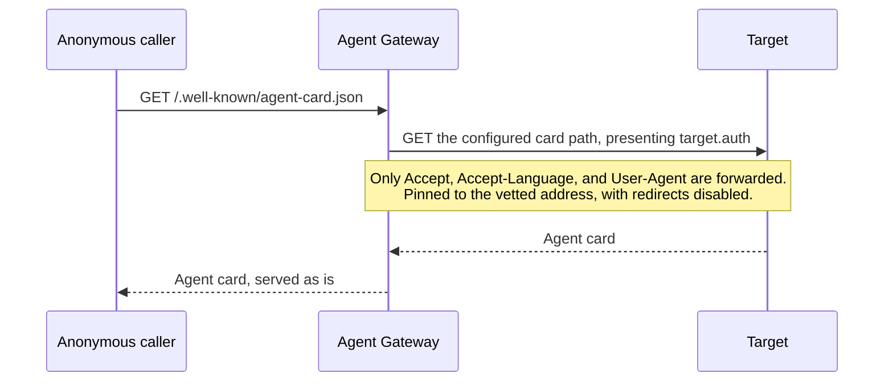

# Protocol Implementation Notes

Use the hosted [protocol documentation](https://docs.affinidi.com/products/affinidi-trust-fabric/agent-gateway/concepts/protocols/)
for A2A, MCP, AP2, DIDComm, x402, and MPP concepts and integration guidance. This page records
revision-specific behavior and limitations of the checked-out source.

## Support Matrix

| Protocol | Status in this revision | Implementation note |
| --- | --- | --- |
| A2A `1.0` | Active, advertised | JSON-RPC messaging, discovery, identity extensions, policy, and proxy targets; implemented against spec revision [`1.0.1`](https://a2a-protocol.org/v1.0.1/specification/) |
| A2A `0.3` | Accepted | Accepted on each A2A surface that selects it, which is the default except on a new A2A proxy surface. See [A2A Protocol Versions](#a2a-protocol-versions) |
| MCP `2024-11-05` | Active | Admitted and advertised on every MCP endpoint |
| MCP `2025-03-26`, `2025-06-18`, `2025-11-25` | Active | Admitted on every MCP endpoint and forwarded as session revisions, like `2024-11-05`. Advertised in discovery on every MCP endpoint except gateway-owned MCP Proxies, which answer `initialize` with `2024-11-05`. Tasks (`tasks/*`) and JSON-RPC batches are not supported (HTTP `422`). See [MCP Validation Boundary](#mcp-validation-boundary) |
| MCP `2026-07-28` | Active | Admitted and advertised on every MCP endpoint, alongside the session revisions that endpoint advertises |
| AP2 | Experimental | Disabled by default; production proof signing is not implemented |

The hosted documentation is rolling product documentation. Use this matrix and the repository
changelog when behavior must match this source revision exactly.

## A2A-Specific Behavior

Agent-card discovery is unauthenticated by design. Caller-leg Trust Check is bypassed for the public
agent-card and UCP well-known paths recognized by `src/proxy/paths.rs`, and for paths ending in
`/discovery`; unrelated `.well-known/*` paths do not receive that bypass. A surface-configured
caller identity (`inbound_identity`: `static`, `from_mtls`, `from_api_key`, `from_jwt_claim`) is not
resolved on those paths either, on the direct or fabric send leg, so a credential that cannot be
resolved does not fail discovery.

Forwarded requests on those public paths never carry the surface's `target.auth`: that
credential vouches that the gateway vetted the caller, and discovery vetted nobody.

### Agent card fetch

The card the gateway serves at `/.well-known/agent-card.json` and
`/.well-known/agent.json` is different, because the gateway fetches it itself from its
`http(s)` target, on a path the operator configures and the caller cannot change
(`agent_card_location_path` or `override_agent_card_location`, defaulting to
`/.well-known/agent-card.json`).

That fetch presents `target.auth` as `CallerAssertion::GatewayOriginated`, so a target
that requires a credential still publishes its card. A Simple Proxy tunnel's ingress key
and an agent behind a bearer token both work.



| Aspect | Behaviour |
| --- | --- |
| `target.auth.fallback: reject` | 502 with the generic detail "Target authentication failed". The cause is logged only. |
| `target.auth.fallback: passthrough` | Fetches without the credential. |
| Caller headers | Only `Accept`, `Accept-Language`, and `User-Agent` are forwarded while the credential is attached, so an anonymous caller can neither override the credential nor add identity or forwarding headers. |
| Redirects | The client is pinned to the vetted target address with redirects disabled, so the credential cannot follow a 3xx to another host. A 3xx answers 502 "Upstream redirected". |
| Blocked by egress policy | 403 |
| Without `target.auth` | The fetch forwards caller headers and follows redirects as before. |
| `fabric://` targets | Unchanged. The remote gateway applies its own target auth. |

The card fetched with `target.auth` is served to unauthenticated callers as is, so a
target must not return credential-only content on its card path. A2A's authenticated
extended card lives on a separate endpoint that the gateway does not fetch. This may later
become a per-surface opt-in.

For payload-derived managed identity, the Gateway reads configured fields from the identity
extension metadata, sorts them by field path, joins them as `key=value` pairs with `|`, and hashes
the canonical string with SHA-256. This hash is deterministic and unkeyed. Credential-derived modes
(`from_mtls`, `from_api_key`, and `from_jwt_claim`) instead use HMAC-SHA256 keyed by the process
identity pepper. `AG_IDENTITY_HASH_PEPPER` supplies the stable pepper when valid; otherwise startup
generates an ephemeral pepper and derived DIDs change after restart. The `static` mode returns its
configured DID directly without hashing or issuance; see
[`src/identity/credential_identity.rs`](../src/identity/credential_identity.rs). Only
`from_jwt_claim` is reported to policy as verified (`source_auth`); payload-derived, `from_mtls`,
`from_api_key`, and `static` identities are `unverified`, while an identity presentation reports
`vp` / `vp_unanchored` regardless of mode (see
[`docs/POLICY.md`](POLICY.md#caller-identity-verification-in-policy-input)).

Target `custom_metadata` is merged into outbound extension metadata. A secret reference must occupy
the whole string and use `$SECRET:<secret_id>`.

Relevant implementation:

- [`src/a2a/`](../src/a2a/) handles A2A protocol behavior.
- [`src/identity/vc_issuer.rs`](../src/identity/vc_issuer.rs) issues or resolves managed identity.
- [`src/proxy/handler.rs`](../src/proxy/handler.rs) applies the direct inbound pipeline.

## A2A Protocol Versions

The Gateway serves A2A `1.0` and `0.3`. Each A2A surface chooses the versions it accepts, and
whether it validates messages, on its Access Point (see [A2A surface settings](#a2a-surface-settings)).
The Gateway does not translate between versions: the request is forwarded as sent, so a caller and
the Managed Agent it reaches must share a version.

### Version negotiation

On an A2A or AP2 surface the Gateway resolves the `A2A-Version` request header right after gateway
OPA and the AP2 gate, and then runs [JSON-RPC and request-shape validation](#error-mapping). All
three come before any payment (a delegated `agent_pay` payment or local x402/MPP verification), the
forward-target egress check, the `max_body_size` limit and forwarding. So a request refused with
any of the [errors below](#error-mapping) is never charged, and those errors take precedence over an egress
block or HTTP `413`; the [protocol-version metric](OBSERVABILITY.md#a2a-protocol-version-metric)
also counts requests that are refused later. A delegated `agent_pay` payment is still settled before
the rest of this Gateway's pipeline (egress check, body-size limit, Trust Check, surface policy,
upstream), so a request it paid for can still be refused there.

Negotiation runs on every request that reaches that point, whatever the HTTP method, and applies
to Managed Agent, `a2a-proxy://` and `fabric://` targets alike, each against its surface's
accepted versions; for a `fabric://` target it runs on the sending gateway, before the request is
dispatched (see [Fabric coverage gap](#fabric-coverage-gap)). Requests that return earlier are not
negotiated: agent-card discovery (`/.well-known/agent-card.json` and `/.well-known/agent.json`), the
DID Auth `/authenticate` endpoints on a `did_auth` surface, and onboarding surfaces.

| `A2A-Version` header | Resolved as |
| --- | --- |
| Absent, empty, or not readable as visible ASCII | `0.3`, as the specification requires |
| `0.3` or `1.0` | As sent |
| A patch revision such as `1.0.1` | Its `Major.Minor` (`1.0`) |
| Anything else | Rejected with `-32009` |

The accepted set is the surface's `access_point.a2a.accepted_versions`: `0.3` and `1.0` by default,
and `1.0` only on a new surface whose Target is an A2A proxy. It changes only what is accepted,
never how the header is read: an absent header still resolves to `0.3`, and a surface that does not
accept `0.3` then refuses it.

### A2A surface settings

An A2A Access Point carries its A2A settings in `access_point.a2a`, set in the dashboard on the
Access Point of an A2A surface (**A2A Protocol**):

| Field | Default | Effect |
| --- | --- | --- |
| `accepted_versions` | `["0.3", "1.0"]` | The versions [negotiation](#version-negotiation) accepts. At least one; each must be `0.3` or `1.0`. |
| `validation` | `"envelope"` | How much of a request is checked before forwarding (see [Error mapping](#error-mapping)): `"off"` checks nothing; `"envelope"` checks the JSON-RPC envelope; `"full"` checks the envelope and the [request shape](#request-shape-validation). |

```json
"access_point": { "protocol": "a2a", "a2a": { "accepted_versions": ["1.0"], "validation": "full" } }
```

The dashboard shows `validation` as **Message validation**: **Off**, **JSON-RPC envelope** (the
default) or **Envelope + A2A fields**.

- `"off"` lets a JSON-RPC batch, a non-string `method` and a body that is not JSON reach surface
  policy and the agent with no method that rules keyed on `input.a2a.method` could match. Only an
  appliance-wide caller can set it: an access token with a tenant or a resource scope (a resource
  pattern or required headers) that sets
  `"off"` on a surface that was not already `"off"` is refused with `403`, on create, `PUT`, merge
  `PATCH` and the variant routes alike. On such a request, an x402 or MPP payment with A2A method
  filters is required rather than skipped, since the filters cannot be matched. A batch that
  contains an extended agent card request is still refused (see
  [Generated agent cards](#generated-agent-cards)).
- The surface API stores the block explicitly on every save of an A2A or AP2 surface, the defaults
  when none is sent. A `PUT` that omits it keeps the stored one, and a JSON merge `PATCH` with
  `null` resets it. A save that changes the protocol to anything other than A2A or AP2 drops the
  block.
- The accepted versions of a surface whose Target is an A2A proxy are fixed: `["1.0"]` on create
  and when a save moves the Target to an A2A proxy, and the stored ones on every later save. A
  save that carries the stored versions along unchanged (a Target moved to a proxy, a `PUT` echoing
  `GET`) takes the fixed ones; one that asks for other versions is refused with `400`.
- An `a2a-proxy://` Target accepts the block's versions and always checks the JSON-RPC envelope
  only, whatever `validation` says, and so does a variant that points the Target at an A2A proxy.
  The dashboard follows the base Target for the versions: with an A2A proxy base Target it shows
  the fixed versions, locked, in every view, and sends only `validation` (`"envelope"` when no
  variant points the Target at a URL). It locks **Message validation** at **JSON-RPC envelope**
  only while the Target in view is an A2A proxy.
- On a surface whose Target is an A2A proxy, `validation` configures only the variants that point
  the Target at a URL, enabled or not, so disabling one and enabling it again keeps the level. With
  no such variant it applies to no request and must be `"envelope"`. A
  save that only carries the stored level along (a Target moved to a proxy, a `PUT` echoing `GET`,
  the last URL variant changed or removed) resets it to `"envelope"` and keeps the versions; a save
  that changes it to another level is refused with `400`.
- The block is surface-level: variants cannot override it. It is valid on A2A and AP2 Access Points
  only: a create, a `PUT` or a merge `PATCH` that sends it on another protocol is refused with `400`
  ("access_point.a2a requires an A2A or AP2 Access Point"). A block left over from the stored
  surface, as when a merge `PATCH` changes only the protocol, is dropped instead.
- A surface stored before per-surface settings existed has no block. When surfaces are loaded, at
  startup or on a configuration reload, each such A2A or AP2 surface, A2A proxy Targets included, is
  given one, and the block is written to storage. A stored record that reaches the gateway as a
  storage event (another node's write, the cache refresh scan, or the disk refresh a reload starts
  with) is given one the same way before it is applied, in memory only, so the event cannot undo
  what a reload gave and applying it writes nothing back: `accepted_versions` is `["1.0"]` if the
  retired
  `a2a_legacy_compatibility` flag was off, and both versions otherwise, so an existing A2A proxy
  surface keeps serving callers that send no `A2A-Version` header; `validation` is `"envelope"` on a
  surface whose Targets are all A2A proxies, `"off"` elsewhere if the retired
  `[a2a] validate_messages` is `false`, and `"envelope"` otherwise. It is never carried
  over as `"full"`, although `validate_messages = true` (the old default) also checked the request
  shape: the shape check is the one that can refuse lenient callers, so it is now opt-in per surface,
  and a surface that relied on it must select `"full"`. A log line reports how many surfaces were
  given settings, counting separately the A2A-proxy surfaces given `"envelope"` while the others get
  `"off"`, with a warning when the retired flag was off. Further warnings name the surfaces whose
  behaviour the carried settings change, up to 20 each: those that had the request-shape check (a
  Target that is neither an A2A proxy nor `fabric://`, with `validate_messages` unset or `true`) and
  now check only the envelope, with how to restore the check; A2A-proxy surfaces given `"envelope"`
  while `validate_messages` is `false`, whose callers must now send a well-formed JSON-RPC request;
  and `fabric://` surfaces, which now apply their settings before sending over the fabric. Because
  those surfaces are then stored with settings, each warning is logged once, on the first load after
  the upgrade.
- The settings file is read for the retired flag only while some surface still needs a block, and
  never written. If it exists but cannot be read or parsed, no block is stored, a warning is logged,
  and the next load retries; those surfaces are served with the defaults meanwhile. A block that
  cannot be saved is stored on a later load or save; until then, a startup serves that surface with
  the defaults, while a configuration reload serves the carried settings straight away. Each surface
  is read again just before its block is stored, and the block is set on what is read: a block saved
  through the API before that read is kept, with the rest of that edit, and a surface deleted or
  moved to another protocol meanwhile is not stored again. There is no lock, so an API save that
  lands between that read and the store is overwritten.
- Only an Active node stores carried settings. A Standby node gives them in memory, so it cannot
  overwrite an edit the Active node saves meanwhile, and the configuration reload that promotes it to
  Active stores the blocks that are still missing.
- With `channel_config_source = "dynamodb"` the carry-over does not run: an A2A surface without a
  block is served with the defaults. A startup warning says when a retired switch is therefore not
  applied (`validate_messages` set, or the flag off); set `access_point.a2a` on each surface instead.
- Rolling back to a version from before per-surface settings needs `access_point.a2a` removed from
  every stored surface first. Those versions reject unknown Access Point fields, so they skip any
  surface that has the block, and almost every A2A or AP2 surface has it after the first start.
  With the gateway stopped, remove it from each surface file in the `agent_surfaces` storage
  directory, for example
  `for f in _storage/agent_surfaces/*.json; do jq 'del(.access_point.a2a)' "$f" > "$f.tmp" && mv "$f.tmp" "$f"; done`. For
  the same reason, nodes that share surface storage (Active and Standby) must run the same version:
  upgrade them together, and set `cache_refresh_interval_secs` to `0` on the older node until it is
  upgraded, or its refresh drops the surfaces the newer node has written.
- A stored version list that is invalid, which only editing storage by hand can produce, is not
  refused: a startup warning names the surface, and an empty or unrecognised `accepted_versions`
  serves both versions until the surface is saved with valid settings. On an A2A-proxy surface, the
  versions it is served with become its fixed versions, so it can still be saved. A stored block with an
  unknown field or an unknown `validation` level does not parse, like any other unknown Access
  Point field, so the surface is not loaded and the load logs why.
- Changes take effect when the surface is saved, without a restart.

### Error mapping

The checks run in this order, and each rejection returns before any payment and before the upstream
is contacted:

| Condition | HTTP / JSON-RPC result |
| --- | --- |
| Resolved version not accepted | HTTP `400`, `-32009` (`VersionNotSupportedError`); `data.supported` lists the accepted set |
| Body is not JSON | HTTP `400`, `-32700` |
| `jsonrpc` is not `"2.0"`, or `method` is not a string | HTTP `400`, `-32600` |
| Request shape invalid (see below) | HTTP `400`, `-32602` (`Invalid params`); `data.errors[]` holds `{field, message}` per problem, at most 20; `data.truncated: true` when more were found |

`data.requested` on `-32009` is the trimmed header when it names no known version (`2.0`), and the
resolved `Major.Minor` otherwise, so an absent header, `0.3` or `0.3.x` refused under v1.0-only
answers `"requested": "0.3"`, and `data.supported` lists the surface's accepted versions. The
envelope rows (`-32700`, `-32600`) apply to every non-empty body on an A2A or AP2 surface whose
`validation` is `"envelope"` (the default) or `"full"`, A2A proxy Targets included. The
request-shape row needs `"full"` and never applies to an A2A proxy Target.

### Method names

[`src/a2a/methods.rs`](../src/a2a/methods.rs) pairs every v0.3 slash-form method with its v1.0
PascalCase name (`message/send` and `SendMessage`, `tasks/get` and `GetTask`, and so on, including
`tasks/list` and `ListTasks`, which are v1.0 additions). Either spelling is accepted whatever
version was negotiated. The method is forwarded, and exposed to policy as `input.a2a.method`,
exactly as the caller sent it, so a policy that matches one spelling matches only that era. Policy
also receives `input.a2a.method_canonical`, the v0.3 slash form of a method in this table whichever
spelling was sent (`SendMessage` gives `message/send`); it is absent when the method is not in the
table or there is none. The Gateway's internal checks (payment gating, A2A-proxy dispatch and the
onboarding agent) resolve both spellings to one in the same way; request-shape validation also
uses the spelling to pick the version whose fields it checks (see
[Request-shape validation](#request-shape-validation)). The
pre-0.2 alias `tasks/send` is not in the table: validation, payment filters and A2A-proxy dispatch
do not recognise it, it has no `method_canonical`, and on a Managed Agent surface it is forwarded as
sent.

### Writing policy for both versions

Because `input.a2a.method` and `input.a2a.message` reach policy exactly as the caller sent
them, a rule written for one version matches only that version.

**Deny-lists must match `input.a2a.method_canonical`.** This matters from the day a gateway
accepts both spellings: a rule that denies `tasks/cancel` by `input.a2a.method` is bypassed by a
caller that sends `CancelTask`. Match the canonical method, and add a rule that fails closed on a
method outside the [method table](#method-names):

```rego
default allow := false

allow if not deny

# Blocks both `tasks/cancel` and `CancelTask`.
deny if input.a2a.method_canonical == "tasks/cancel"

# Blocks any method outside the method table, such as `tasks/send`.
deny if {
	input.a2a.method
	not input.a2a.method_canonical
}
```

The fail-closed rule also blocks custom or extension methods; add an exception for any a surface
serves.

**An allow-list** keeps matching existing traffic until callers start sending v1.0 names. To
accept both spellings, match either one:

```rego
# Option A: a set membership check.
allow if input.a2a.method in {"message/send", "SendMessage"}

# Option B: two rules, which OPA evaluates as a logical OR.
allow if input.a2a.method == "message/send"
allow if input.a2a.method == "SendMessage"
```

Matching `input.a2a.method_canonical == "message/send"` does the same in one rule.

**The message shape differs too**, and it is not canonicalised:

| Field | v0.3 | v1.0 |
| --- | --- | --- |
| `role` | `"user"`, `"agent"` | `"ROLE_USER"`, `"ROLE_AGENT"` |
| A text part | `{"kind": "text", "text": "..."}` | `{"text": "..."}`, with no `kind` |

So `input.a2a.message.role == "user"` and `input.a2a.message.parts[_].kind == "text"` match v0.3
callers only. To cover both, match either role spelling, and identify a text part by the presence
of `text`:

```rego
allow if input.a2a.message.role in {"user", "ROLE_USER"}

allow if input.a2a.message.parts[_].text
```

`metadata`, `extensions`, and `messageId` are the same in both versions, so rules that read them,
including the agent identity extension, need no change.

A JSON-RPC batch or a non-string `method` reaches policy with neither `input.a2a.method` nor
`input.a2a.method_canonical`, so no rule keyed on the method sees it. Global and gateway policy run
before the envelope check, so they see such a request at every validation level; the envelope check
then refuses it with `-32600` before payment, surface policy and forwarding. Only on a surface whose
`validation` is `"off"` does it reach surface policy and the agent. A request a sending gateway
forwards over the fabric is checked there, and is not checked again by the receiving gateway.

The allow-list and message-shape patterns are pinned against the policy engine by the tests in
[`src/surface_context/mod.rs`](../src/surface_context/mod.rs).

### Request-shape validation

On a surface whose `access_point.a2a.validation` is `"full"`, requests are checked against what A2A itself requires, and the problems found are reported together in one `-32602` response, up to 20
of them: validation stops walking `parts` at the cap and sets `data.truncated: true` (the key is
absent otherwise), and a caller-supplied `kind` echoed in a message is quoted and cut to 64
characters, so a large body cannot inflate the error:

The spelling of the method picks the rules: a v0.3 slash-form method (`message/send`) is checked
against what A2A 0.3 defines, and a v1.0 PascalCase method (`SendMessage`) against what A2A 1.0
defines. The negotiated `A2A-Version` plays no part: version negotiation and shape validation are
independent checks, so a valid 0.3 request sent with `A2A-Version: 1.0` passes, and a
`SendMessage` with `role: "user"` is refused whatever the header says.

| Method | A2A 0.3 (slash form) | A2A 1.0 (PascalCase) |
| --- | --- | --- |
| Any in the method table | `params`, when present, is an object or an array | The same |
| `message/send`, `message/stream` / `SendMessage`, `SendStreamingMessage` | `params.message` is an object; `messageId` a non-empty string; `role` is `user` or `agent`; `kind`, when present, is `"message"`; `parts` is a non-empty array | `params.message` is an object; `messageId` (or `message_id`) a non-empty string; `role` is `ROLE_USER` or `ROLE_AGENT`; `parts` is a non-empty array |
| Each part | Exactly one of `text` (a string), `file` (an object with a string `bytes` or `uri`, not both) or `data` (an object); `kind`, when present, names the member | Exactly one of `text`, `raw`, `url` (strings) or `data` (any JSON) |
| `tasks/get`, `tasks/cancel`, `tasks/resubscribe` / `GetTask`, `CancelTask`, `SubscribeToTask` | `params.id` is a non-empty string, in any format | The same |
| `tasks/list` / `ListTasks` | The optional `status` is a lowercase state (`working`, `completed`) | The optional `status` is a `TASK_STATE_*` name |

Fields a version does not define are ignored, as A2A 1.0 (§5.7) says implementations SHOULD: a
`kind` on a 1.0 request, or the other version's part members (`raw` and `url` in 0.3, `file` in
1.0), are not errors in themselves. A part whose only content is such a member still fails, since
it carries none of its own version's, and the error points at the right member. The official SDKs
are stricter and refuse unknown fields, so an SDK-based agent may still refuse such a request.
`kind` may be left out of a 0.3 message and its parts, although the 0.3 JSON schema lists it,
because the official 0.3 SDK accepts them without it. An empty `parts` list is refused in both
versions. Each error names the version and method, for example `params.message.role: must be
ROLE_USER or ROLE_AGENT in A2A 1.0 (SendMessage)`. A method outside the table, such as the pre-0.2
`tasks/send`, is checked only for a structured `params`. Unknown fields are ignored and responses
are never inspected. A surface whose target is `a2a-proxy://` never validates: the proxy is the
implementation rather than a pass-through, needs only `params.message` and text parts, and has no
downstream agent that would refuse a looser message.

### Generated agent cards

The cards the Gateway generates (the synthesized A2A-proxy card and the onboarding card) are valid
`1.0` documents. Each lists the versions its endpoint accepts: the A2A proxy card the surface's
`accepted_versions`, and the onboarding card, which belongs to no surface, both.

- `supportedInterfaces[]` lists one entry per accepted version, the preferred version first, all
  with the same URL and `protocolBinding: "JSONRPC"`. The preferred version is `[a2a]
  default_version` (default `1.0`; see [A2A settings](CONFIGURATION_RELOAD.md#a2a-settings)) when it
  is accepted, and otherwise the first version that is.
- `provider.organization` and `capabilities.extendedAgentCard` carry the provider and
  extended-card flag; `capabilities.stateTransitionHistory` is not emitted.
- When `0.3` is accepted (the onboarding card, and an A2A proxy card whose surface accepts it), the
  v0.3 fields `protocolVersion`, `url`, `preferredTransport`, `agentProvider` and
  `supportsAuthenticatedExtendedCard` are emitted as well, each derived from its `1.0` counterpart,
  so a v0.3 client can act on the card. An A2A proxy card whose surface accepts `1.0` only, as a
  new one does, has none of them.

Field mapping from v0.3 to v1.0 in generated cards:

| v0.3 field | v1.0 field | In the generated card |
| --- | --- | --- |
| `protocolVersion` (top level) | `supportedInterfaces[].protocolVersion` | v1.0 field always; the v0.3 field too while `0.3` is accepted |
| `url` and `preferredTransport` | `supportedInterfaces[]`, ordered | v1.0 field always; the v0.3 pair too while `0.3` is accepted |
| `additionalInterfaces[]` | Folded into `supportedInterfaces[]` | Not emitted |
| `transport` | `protocolBinding` | `protocolBinding`, value `"JSONRPC"` (previously the incorrect `"HTTP+JSON"`) |
| `agentProvider` | `provider.organization` | v1.0 field always; the v0.3 field too while `0.3` is accepted |
| `supportsAuthenticatedExtendedCard` | `capabilities.extendedAgentCard` | v1.0 field always; the v0.3 field too while `0.3` is accepted |
| `capabilities.stateTransitionHistory` | Removed in v1.0 | Not emitted |

The dual-emitted v0.3 fields are deprecated. Card consumers should read the v1.0 fields.

An explicit `[a2a] default_version = "0.3"`, as in a configuration copied from an older example,
takes effect on the onboarding card, and on an A2A proxy card whose surface accepts `0.3`, which
then list the `0.3` interface first. Remove the line or set `"1.0"` to prefer `1.0`.

A Managed Agent's own card is served at the agent's `protocolVersion` and never translated to
another version. On agent-card discovery requests the Gateway changes it in two ways: its endpoint
URLs are rewritten to the gateway, and, when agent identity is configured, its
`agent-identity/v1` extension is replaced by a signed `agent-identity-credential/v1` presentation
(with the `didwebvh` feature, `agentDid` and `agentDNA` are added too). The URL rewrite covers
`supportedInterfaces`, `supported_interfaces`, `additionalInterfaces` and `additional_interfaces`,
in their original order, since in `1.0` order
encodes preference.

An extended card gets the same treatment on A2A and AP2 surfaces (on the outbound path, A2A and
AP2 transit points), whether it is returned as a JSON-RPC result (`GetExtendedAgentCard` /
`agent/getAuthenticatedExtendedCard`) or fetched over the HTTP+JSON binding
(`{route}/extendedAgentCard` in `1.0`, `{route}/v1/card` in `0.3`). JSON-RPC method names match
exactly as the A2A specification spells them. The HTTP+JSON path is checked as the Target sees it:
appended to the base path of the target endpoint (or the transit point's destination), resolved
the way the forwarded URL is resolved (dot segments, including `%2e`, and percent-escapes), and
also the way lenient Target routers resolve it (dropping `;` path parameters and empty segments,
and treating `\` as a separator), ignoring ASCII case. `extendedAgentCard` matches as the last
segment at any depth, so a tenant-scoped `{route}/{tenant}/extendedAgentCard` is a card; `v1/card`
matches only directly under the base path, so a deeper path such as `{route}/payments/v1/card` is
not a card. A root-level `{route}/v1/card` is a card on every A2A and AP2 surface, including one
whose Target serves its own `/v1/card` resource. A path that climbs out of the base path, or that
the gateway cannot parse, is treated as a card. So is a path whose `..` segments climb above the
root, which covers a `fabric://` target, where the peer gateway's Target base path is not known. Every method except `HEAD` and `OPTIONS` is
checked, because a Target may honour a method override header. A Target whose HTTP+JSON base sits
below its target endpoint is not covered. Its endpoint URLs are rewritten on inbound,
fabric and outbound paths, and on inbound paths it gets the same identity treatment when agent
identity is configured, with one difference: an `agent-identity-credential/v1` extension already on
an extended card never stands in for the agent's identity, even over Fabric, because a peer gateway
does not issue one on an extended card, so it can only come from a Target. The Target must present
`agent-identity/v1`. When agent identity is configured, every credential extension on an extended
card is removed and only the one the gateway issues is added, so none survives for an anonymous
identity. When managed identity is on, an extended card with no
`capabilities.extensions` array is answered with `502`. No identity VP is signed for an agent card
response, public or extended. On inbound and fabric paths it skips response extension inspection, like
the public card, so response validation rules do not apply to it; outbound transit points still
validate response extensions on both kinds of card.

For the JSON-RPC binding, error responses and empty bodies are forwarded unchanged; a JSON-RPC error
is an object `error` with no `result`, and a `null` member counts as absent, so `"error": null` next
to a card still has the card rewritten. A card `result` is rewritten whatever the HTTP status. The
URL rewrite fails closed for an extended card: a successful response that is neither a JSON-RPC
error (on the JSON-RPC binding) nor a card the gateway can rewrite is answered with `502` rather
than forwarded. That covers an SSE stream, an empty HTTP+JSON body, a card or `result` that is not
a JSON object, both `result` and `error`, and a card with no endpoint field (`url`, `endpoint`,
`endpoints`, `supportedInterfaces` or `additionalInterfaces`) to rewrite, such as a wrapped card.
On the JSON-RPC binding the refusal is a JSON-RPC `-32603` error that echoes the request `id`; on
the HTTP+JSON binding it is a problem response. A non-success response that carries no card
`result` is forwarded unchanged.
A public card that cannot be rewritten is answered with `502` on the direct inbound path and
forwarded as received on fabric and outbound paths.

A JSON-RPC batch that contains an extended-card call is rejected with `-32600` before it is
forwarded, whatever the surface's A2A validation level, `"off"` included, because a card inside a
batch response cannot be rewritten. A compressed card cannot be rewritten either, so an extended-card fetch is forwarded with
`Accept-Encoding: identity` in place of the caller's value.

Extended cards are detected the same way as the public card: from the request's JSON-RPC method or
path. Some requests are not recognised, and are forwarded like any other request with their
response not rewritten. These are accepted limits:

- a body the gateway cannot parse but the Target can, such as JSON with a UTF-8 byte order mark,
  when the surface's A2A validation is `"off"` (checked on the sending gateway for a `fabric://`
  target) and on outbound transit points;
- a JSON-RPC body with duplicate `method` keys, sent to a Target that keeps the first key where the
  gateway keeps the last;
- a JSON-RPC method name in another letter case, sent to a Target that matches method names
  case-insensitively;
- an HTTP+JSON base path below the target endpoint.

A Fabric caller's extended card is rewritten by the caller-side gateway only once that gateway
runs a version that recognises extended cards.

An extended card is always fetched by a caller, so with `from_jwt_claim` managed identity it needs
the caller's validated JWT claims like any other response; without them the request fails with
`JwtClaimsUnavailable`. Only the public card, which has no caller, resolves as anonymous.

A surface's agent card (the synthesized A2A-proxy card or a Managed Agent's rewritten card) is
served as `application/a2a+json` only when the caller's `A2A-Version` resolves to `1.0` and the
surface accepts `1.0`, or the caller lists that type in `Accept`; every other caller receives `application/json`. The response carries
`Vary: A2A-Version, Accept`, so a shared cache stores each variant separately. The onboarding
card served by the identity API (`/onboard/{uuid}/.well-known/agent-card.json`) is always served as
`application/json`.

### Accepting A2A 0.3

Whether a surface accepts `0.3` is its `access_point.a2a.accepted_versions` (see
[A2A surface settings](#a2a-surface-settings)); both versions are accepted by default. A surface that
does not accept `0.3` answers a `0.3` request, including one with no `A2A-Version` header, with
`-32009` and `"supported": ["1.0"]`. That reaches every negotiated request (see
[Version negotiation](#version-negotiation)): a GET that carries no `A2A-Version` header gets HTTP
`400` `-32009` as well. Agent-card discovery is not negotiated, so a headerless client can still
fetch the card; a Managed Agent's card lists whatever the agent published.

An A2A proxy surface's versions are fixed. A new one accepts `1.0` only, so its callers must send
`A2A-Version: 1.0`; one stored before per-surface settings keeps accepting `0.3` and `1.0` (see
[A2A surface settings](#a2a-surface-settings)).

Before removing `0.3` from a surface, check `agent_gateway_a2a_protocol_version_total` (see
[Observability Internals](OBSERVABILITY.md#a2a-protocol-version-metric)) for remaining `0.3`
traffic. Fabric traffic is counted on the sending gateway only (see
[Fabric coverage gap](#fabric-coverage-gap)). Refused callers
are counted with `negotiated_version="rejected"`.

The retired `a2a_legacy_compatibility` dashboard flag is read only when surfaces are loaded, to give
a surface stored before per-surface settings existed its accepted versions: `1.0` only if the flag
was off (see [A2A surface settings](#a2a-surface-settings)).

### Guidance for callers

- Send `A2A-Version: 1.0` on every call. A request without the header counts as `0.3`, and is
  refused by a surface that does not accept `0.3`, which includes a new A2A proxy surface.
- Read the endpoint from `supportedInterfaces[0].url`, the preferred interface, and fall back to
  the top-level `url` only for v0.3 cards.
- Confirm the Managed Agent behind a surface speaks v1.0 before switching, because the Gateway
  does not translate between versions.

What stays the same:

1. Conformant v0.3 callers keep working on surfaces that accept `0.3`, the default.
2. Both method spellings are accepted whatever version was negotiated, so a partly migrated client
   is not refused.
3. A Managed Agent's card is served at its own version; only its endpoint URLs and identity
   extension change.
4. The legacy discovery path `/.well-known/agent.json` still resolves.
5. `application/json` remains the default card media type.
6. Existing policies keep matching existing traffic, since the method reaches policy as sent. A
   deny-list still has to match `method_canonical`; see
   [Writing policy for both versions](#writing-policy-for-both-versions).

### Backend identity in task artifacts

On the response leg, the protected agent's identity extension is read from the status message
first and then from `artifacts[]` in document order; the first match wins, and a location that
declares the extension without its payload is reported as malformed rather than skipped. `history[]`
is never read, because it holds the caller's own messages. This applies to a bare Task (a `GetTask`
or v0.3 `message/send` result) and to the Task a v1.0 `SendMessage` result wraps in
`{"task": …}`.

When the identity is on the status message, the signed `agent-identity-credential/v1`
presentation replaces the raw extension there. An identity resolved from an artifact is used for
issuance and the Trust Recorder, but the artifact keeps its raw extension and no credential is
added to the reply.

The same locations apply over Fabric. The gateway in front of the Managed Agent resolves the
identity from them and places the presentation on the status message. The calling gateway reads
the presentation, or a raw identity extension, only from the status message, and never from
artifacts: the peer gateway never places a presentation in an artifact, so one found there, or a
raw identity there, did not come from it and is ignored
([`src/proxy/fabric_identity.rs`](../src/proxy/fabric_identity.rs)).

Neither remaining location proves authorship: A2A artifacts carry no author, and the Gateway does not
validate responses. A Managed Agent that reflects caller content into its status message or an
artifact (by echoing it, tracing it, or under prompt injection) can therefore let a caller plant an
identity extension that resolves as the agent's own, with the managed-identity issuance and Trust
Recorder writes that follow. This rests on the trust placed in the Managed Agent; see
[`response_identity_candidates`](../src/proxy/backend_identity.rs).

### Event streams

An A2A or AP2 surface with a direct Target forwards an event stream as it arrives. When the Target
answers with a successful `text/event-stream` response, normally to `SendStreamingMessage` /
`message/stream` or `SubscribeToTask` / `tasks/resubscribe`, the Gateway reads one event, checks
it, forwards it, and only then reads the next
([`src/a2a/streaming.rs`](../src/a2a/streaming.rs),
[`src/proxy/handler/a2a_stream.rs`](../src/proxy/handler/a2a_stream.rs)). A slow caller therefore
slows the Target rather than filling a buffer. An agent-card response, an error status, or a
response that is not an event stream takes the buffered path.

The caller receives `text/event-stream` with the Target's status and end-to-end headers (plus the
x402 and delegated settlement receipt headers a buffered reply gets), `Cache-Control: no-store`,
`X-Accel-Buffering: no`, and a keepalive comment every 15 seconds. Each event is forwarded once, in
the Target's order, under its `event:` name; `id:` and `retry:` fields are dropped. The caller's
stream ends when the Target's does, so a terminal state (`TASK_STATE_COMPLETED`,
`TASK_STATE_FAILED`, `TASK_STATE_CANCELED`, `TASK_STATE_REJECTED`) or an interrupted one
(`TASK_STATE_INPUT_REQUIRED`, `TASK_STATE_AUTH_REQUIRED`) reaches the caller as the Target sent it,
and a clean end adds nothing. For a streaming method the Gateway asks the Target for an uncompressed
body (`Accept-Encoding: identity`) and sends the call once, whatever the surface's `retry` policy.
The Target must send its response headers within the request timeout, or the caller gets HTTP `504`,
and the call is bounded by `[a2a] stream_max_lifetime_secs` on top of the request timeout; the
stream's own limits are in [Upstream Response Bounds](#upstream-response-bounds).

Each event's data must be a JSON object, the JSON-RPC response that carries the event. Before the
checks run, a v1.0 `StreamResponse` member (`task`, `message`, `statusUpdate` or `artifactUpdate`)
is moved into `result`, so the event reads like a non-streaming reply, and it is put back
afterwards. The checks are those a non-streaming reply gets on the Access Point, in the same order:

| Check | On each event |
| --- | --- |
| Protected and external identity | Resolved when the event claims an identity: a message that declares `agent-identity/v1` or `agent-identity-credential/v1`, or an identity payload where [backend identity](#backend-identity-in-task-artifacts) is read (a status message, a message, or an artifact, including the single `artifact` of an artifact update). An event without a claim is not resolved and nothing is signed for it. A slot that derives identity from a credential (`from_mtls`, `from_api_key`, `static`, `from_jwt_claim`) is resolved once, on the first event. A claim that cannot be resolved falls back to the request-path identity when there is one, and ends the stream otherwise. The first managed DID resolved for the protected agent holds for the whole stream: a later event that resolves a different one ends it. A slot that reads identity from the response (`from_payload`) also needs the stream to claim it: see the end-of-stream check below. |
| Response custom metadata | Injected into the event's `result`, which for a v1.0 event is the member's payload |
| Agent identity credential | Replaces the raw extension where the event's message declares it, as on a non-streaming reply |
| Response extension rules | Run on the event |
| Response policy | Evaluated on the event as it will be sent: `input.response.body` is the event, `content_type` is `text/event-stream`, and `is_error` is true for a JSON-RPC error event. One allow decision is recorded per stream, plus the deny that ends it. |
| Trust Recorder | Once per resolved DID, for the first event that resolved it and passed every check above |

The serverIdentity presentation a non-streaming reply gets when the caller declares the credential
extension is not added to events, and payload capture and UCP operation inference do not run on
them. Metrics, bytes and the connection count are recorded once, when the stream ends or the caller
disconnects; a stream the Gateway ended early, or one the caller left before it ended, counts as an
error.

Once the first event is sent the status can no longer change, so a failure ends the stream with a
JSON-RPC error event that echoes the request `id`, the event that failed is not sent, and the Target
connection is dropped:

```text
data: {"jsonrpc":"2.0","id":1,"error":{"code":-32603,"message":"Response blocked","data":{"code":"response_policy_denied"}}}
```

| `data.code` | Cause |
| --- | --- |
| `response_policy_denied` | The response policy denied the event |
| `response_extension_rejected` | The event failed the response extension rules |
| `identity_extension_missing`, `identity_invalid_response`, `identity_validation_failed`, `identity_did_failed` | The event's identity claim could not be resolved, and the request path resolved no identity; `identity_extension_missing` also follows the last event of a stream that never claimed one (see below) |
| `identity_changed` | The event resolved a different protected agent DID than an earlier event of the stream |
| `upstream_event_invalid` | The event's data is not a JSON object |
| `upstream_event_too_large` | The event is larger than `[a2a] max_body_size` |
| `upstream_stream_idle` | The Target sent nothing for the idle timeout |
| `upstream_stream_lifetime` | The stream reached `[a2a] stream_max_lifetime_secs` |
| `upstream_stream_failed` | Reading from the Target failed |
| `stream_event_rewrite_failed` | A check produced an event that is not JSON |

When the Target ends its stream cleanly, one check runs on the stream as a whole. A reply without
an identity claim is refused on a slot that reads identity from the response, so a stream that
delivered at least one result is refused too when none of its events resolved an identity for
that slot. The refusal is an `identity_extension_missing` error event sent after the last event;
the caller has already received the events, unsigned, but sees the stream fail rather than end
cleanly. The protected slot is exempt when the request path resolved an identity, as on a
non-streaming reply, and the external slot is checked only when it is configured. A stream that
carried only JSON-RPC error events delivered no result and is not refused.

A `fabric://` surface and a Transit Point do not stream; see [Current limitations](#current-limitations).

### Fabric coverage gap

Version negotiation, both validation layers and the protocol-version metric run on the inbound path
of every A2A surface, including one whose target is `fabric://`: the sending gateway applies the
surface's accepted versions and validation level before the request is paid for or dispatched over
the fabric. The [fabric receive pipeline](FABRIC.md#fabric-receive-pipeline) on the receiving
gateway does not run them again. So on a G2G hop:

- the sending surface's `access_point.a2a` decides what crosses the fabric; the receiving surface's
  `access_point.a2a` is not applied to fabric requests;
- a request from a sending gateway that does not run these checks (a version from before they
  applied to `fabric://` targets) reaches the receiving gateway's Target unchecked, and the agent
  decides;
- `agent_gateway_a2a_protocol_version_total` counts the request on the sending gateway, not on the
  receiving one;
- an x402 or MPP payment with A2A method filters is checked on the receiving gateway without the
  envelope check, so a body the filters cannot match is charged there whatever the validation level.

A malformed envelope, a batch, or an `A2A-Version` a `fabric://` surface does not accept is refused
on the sending gateway, as on any other A2A surface, rather than forwarded for a conformant agent to
refuse. On upgrade, a fabric surface without its own settings is given them like any other surface
(see [A2A surface settings](#a2a-surface-settings)), and a warning names it.

Source authentication, gateway and surface policy, and Trust Check run on each leg.

Relevant implementation:

- [`src/a2a/version.rs`](../src/a2a/version.rs) owns negotiation, the accepted set, and generated-card interfaces.
- [`src/a2a/validation.rs`](../src/a2a/validation.rs) owns request-shape validation.
- [`src/a2a/errors.rs`](../src/a2a/errors.rs) builds the JSON-RPC error responses.
- [`src/a2a/url_rewriter.rs`](../src/a2a/url_rewriter.rs) rewrites Managed Agent card URLs.


### Current limitations

- **Streaming over Fabric and on Transit Points:** only a direct Target's event stream is
  forwarded event by event (see [Event streams](#event-streams)). Across a `fabric://` hop the
  receiving gateway reads the Target's `text/event-stream` body in full and returns it as one
  response, and a Transit Point buffers an A2A event stream the same way, so the caller sees nothing
  until the Target closes. Event order and terminal task states are preserved, but the whole stream
  must finish within the request timeout (`[a2a] timeout_seconds`, default 30 s, or the target's
  `request_secs`) and the bounds in [Upstream Response Bounds](#upstream-response-bounds). The
  per-event checks do not run on it, and the response checks that read the body find no JSON in
  it. A Managed Agent card that declares `capabilities.streaming`
  is forwarded unchanged on these surfaces too. The cards the Gateway generates (A2A proxy and
  onboarding) declare `streaming: false`, and those endpoints do not stream.
- **Signed cards:** there is no signature handling. URL rewriting and identity-extension
  replacement invalidate any `signatures[]` on a Managed Agent's card, and the signatures are passed
  through unchanged, so downstream verification fails.
- **Bindings:** only the JSON-RPC binding is served. A2A mandates no particular binding, so this is
  conformant; gRPC and REST are not planned.
- **Per-interface routing:** the rewrite points every interface URL (`supportedInterfaces[]`,
  `additionalInterfaces[]`) at the surface's one gateway endpoint and keeps each entry's
  `protocolBinding` and `protocolVersion`. An upstream that routes by interface loses that routing:
  a client that picks a `GRPC` or `HTTP+JSON` entry reaches the Gateway's JSON-RPC endpoint and
  fails, and one that picks a per-version path is forwarded to the surface's target endpoint rather
  than that path.
- **Reply shape:** the onboarding agent answers in the v0.3 shape (`kind`, `role: "agent"`)
  whatever version the caller negotiated. The A2A proxy picks the shape from the send method's
  spelling, not the negotiated version: `SendMessage` gets the `1.0` shape (`result.message`,
  `ROLE_AGENT`, parts without `kind`), and `message/send` gets the v0.3 shape (the message itself as
  `result`, `kind: "message"`, `role: "agent"`, `kind: "text"` parts), whatever `A2A-Version` the
  caller sent.

## Upstream Response Bounds

Every upstream response the Gateway buffers is bounded by size and by idle time, whatever the
protocol (`proxy::upstream_body::read_bounded`). This covers every response on the direct path
(for MCP, any that is not `text/event-stream`, plus a `tools/list` answered as SSE, which is
buffered for tool gating; for A2A and AP2, any that is not a successful event stream), every HTTP
response on a Transit Point, and the legacy Fabric receive
forward to the local Target, JSON or SSE. A Fabric receive failure is returned to the sending
gateway as a `ForwardResponse` with the same status. The Fabric receive agent-card hop and MCP
tool discovery (JSON or SSE, capped at the default `max_body_size`) are bounded the same way; a
card that fails the bounds is treated as missing.

An SSE stream the Gateway parses event by event rather than buffering whole (an MCP
`text/event-stream` passthrough, and Legacy SSE sessions) holds at most `[a2a] max_body_size` of
one incomplete event (the default 10 MB for Legacy SSE sessions). An event that grows past that
ends the stream, and a Legacy SSE session ends with it. An MCP `text/event-stream` passthrough also
ends when the upstream sends nothing for the surface's `mcp_http.stream_idle_timeout_secs` (default
60 s) or is still streaming at `mcp_http.stream_max_lifetime_secs` (default 3600 s).

An A2A event stream from a direct Target (see [Event streams](#event-streams)) is read one event at
a time. One event, as received and after the checks, may hold up to `[a2a] max_body_size`, and the
stream ends with an error event when the Target sends nothing for the surface's
`networking.timeout.idle_secs` (default 60 s; `0` leaves only the lifetime) or is still streaming at
`[a2a] stream_max_lifetime_secs` (default 3600 s, at most 86400 s). Anything the Target sends counts
as activity, a comment or keep-alive line included, and the idle time is counted only while the
Gateway waits for the Target, so a caller that is slow to read an event does not end the stream.
The same holds for the MCP passthrough's idle timeout. The Target must send its
headers within the request timeout, and the call to it is bounded by that lifetime plus the request
timeout.

The gateway holds at most 10,000 Legacy SSE sessions (`GET /sse` on `proxy://` and `fabric://`
surfaces, and on standalone MCP proxies). A `GET /sse` beyond that, after sessions whose client has
disconnected are dropped, is answered with HTTP `429` "Too many active SSE sessions".

- A body larger than `[a2a] max_body_size` (default 10 MB, which also caps requests) is answered
  with HTTP `502` "Upstream response too large".
- A pause between chunks longer than the target's `networking.timeout.idle_secs` (Transit Point
  first, then surface; default 60 s; `0` disables it) is answered with HTTP `504`.
- A body still arriving when the target's `request_secs` expires (default `[a2a] timeout_seconds`
  direct and on Fabric receive, 30 s on a Transit Point) is answered with HTTP `504`. On Fabric
  receive the forward client's `[a2a] timeout_seconds`, or the caller's deadline, also caps the
  whole exchange.

For an SSE-shaped direct MCP request (`GET`, or `POST` accepting `text/event-stream`) the upstream
may take up to 24 hours to send headers; `request_secs` for a non-SSE body then counts from the
headers. A `text/event-stream` passthrough keeps the 24-hour limit; a buffered SSE `tools/list`
does not, and must end within `request_secs`.

Not bounded here: `fabric://` legs.

## MCP Validation Boundary

The session revisions `2024-11-05`, `2025-03-26`, `2025-06-18` and `2025-11-25` are active on
every MCP endpoint. They all open a session with `initialize` and carry it in `Mcp-Session-Id`, so
the gateway forwards them to the upstream, except that gateway-owned MCP Proxies answer
`initialize` themselves with `2024-11-05`. The Gateway recognizes `2026-07-28` per-request
metadata and mirrored HTTP headers on direct Access Points, Transit Points, standalone MCP Proxies
and Fabric receive, and admits and advertises that revision on every MCP endpoint. A gateway-owned
MCP Proxy advertises it alongside `2024-11-05` only, or alone when it has no legacy catalog. Fabric carries it only as framed streams; the buffered Fabric forward carries
the session revisions only. Revisions the gateway does not model are rejected as unsupported.

`2026-07-28` support is measured against the published MCP conformance suite with
`make mcp-conformance`, which runs the ordinary gateway binary; see
[`scripts/mcp-conformance/README.md`](../scripts/mcp-conformance/README.md) and the Conformance
Harness section of [`MCP_METADATA.md`](MCP_METADATA.md).

| Condition | HTTP / JSON-RPC result |
| --- | --- |
| Valid modern request whose upstream answers with a legacy (non-modern) result | HTTP `502` |
| Modern request whose upstream answers HTTP `400` with `-32000` or `-32600` and an id that is `null` or another request's, as a session-only upstream does | HTTP `400`, `-32022`, listing only the session revisions |
| Modern request whose upstream answers with any other error whose id is `null` or another request's | HTTP `502` |
| Request using an unmodelled revision such as `2099-01-01` | HTTP `400`, `-32022`, listing the revisions the endpoint supports |
| Malformed modern metadata | HTTP `400`, `-32602` |
| Missing, malformed, or mismatched mirrored headers | HTTP `400`, `-32020` |
| Modern-signaled POST with an empty body | HTTP `400`, `-32700` |
| Modern metadata declaring a session revision such as `2024-11-05` | HTTP `400`, `-32602`, mixed-era diagnostic |
| Modern POST body with duplicate keys, keys differing only in case, or a case-variant field the gateway reads | HTTP `400`, `-32600` (legacy: HTTP `200`, `-32600`) |
| PUT, PATCH or an extension method on an Access Point, Transit Point or Fabric receive | HTTP `405`, `Allow: POST, GET, DELETE, HEAD, OPTIONS` |
| A body on any method but POST, on an Access Point, Transit Point or Fabric receive | HTTP `400`, `-32600` |
| Legacy `initialize` asking for a session revision | Forwarded unchanged, so the upstream negotiates the revision |
| Legacy `initialize` asking for a revision the endpoint does not serve | Forwarded asking for `2024-11-05`, so the session settles on a revision the endpoint serves |

The `initialize` cap is `cap_legacy_initialize` in `src/mcp/request_validation.rs`, applied
after `normalize_bytes` on the direct, Transit Point and Fabric receive paths, so an upstream
cannot settle a session on a revision the gateway then rejects.

An `MCP-Protocol-Version` header naming a session revision remains legacy traffic when modern
metadata is absent, even with mirrored `Mcp-Method` or `Mcp-Name` headers, and the header reaches
the upstream unchanged. An `initialize` with no `MCP-Protocol-Version` header is a legacy session
opening on the same terms. Mirrored headers are still validated, and `Mcp-Method` must name the
request's method, and `Mcp-Name` must match `params.name` on `tools/call` and `prompts/get` or
`params.uri` on `resources/read`. Every supplied `Mcp-Name` is validated, including for
methods without a mirrored name source. Complete Base64 sentinel markers trigger decoding; partial
markers remain plain ASCII, and overlapping markers fail without panicking.

Wire validation runs before generic method-prefix protocol classification. Modern `tasks/*`
requests therefore receive MCP validation errors instead of being classified as A2A. Requests
without modern signals retain legacy protocol-family handling.

The full single-object rules (batches, non-JSON and non-object bodies, and which fields are
case-checked) are in the HTTP Endpoint Admission section of [`MCP_METADATA.md`](MCP_METADATA.md#http-endpoint-admission).

## MCP Metadata Compatibility

Canonical metadata is carried in `params._meta` for requests and notifications and in
`result._meta` for successful responses. Affinidi-owned keys use the `io.affinidi.fabric/*`
namespace.

The Gateway also recognizes an explicit top-level `_meta` compatibility envelope for legacy
traffic. Canonical aliases are normalized, conflicting Gateway-owned values are rejected, and
modern-signaled requests cannot use the top-level compatibility envelope.

`AgentSurface.mcp_legacy_metadata_output` controls output placement for legacy traffic:

- `compatibility` is the default and preserves historical top-level output and aliases;
- `canonical` writes metadata to `params._meta` or `result._meta` with canonical keys.

The setting is inherited by Surface Variants. It changes legacy output shape but does not activate
the recognized modern revision.

Relevant implementation:

- [`src/mcp/meta.rs`](../src/mcp/meta.rs) owns metadata placement, aliases, and normalization.
- [`src/mcp/request_validation.rs`](../src/mcp/request_validation.rs) owns request classification and wire validation.
- [`src/mcp/identity.rs`](../src/mcp/identity.rs) owns identity extraction and injection.
- [`src/mcp_proxies/`](../src/mcp_proxies/) contains the REST-to-MCP adapter.

### MCP proxy exposure

An MCP proxy turns a REST API described by an OpenAPI spec into an MCP server. It
can be reached two ways:

- **Through a surface** whose target is `proxy://<proxy-id>`. Caller
  authentication, surface OPA policies, MCP tool policies, MCP tool gating and
  target auth all apply.
- **Directly**, on the `{prefix}/{endpoint_path}` route registered for each
  `mcp_proxies` prefix in `network.json`. This route carries no caller
  authentication or policy of its own.

`McpProxy.direct_access` (default `true`) controls the second. A proxy created
with `"direct_access": false` answers only through a surface; on the direct route
it is treated exactly like a path with no proxy (POST and `GET …/sse` answer 404,
and the `GET` route-info response reports `configured: false`), so its existence is
not disclosed. Records and create requests without the field keep today's behaviour.

Direct-route matching is on a path-segment boundary, and the longest matching
`endpoint_path` wins, so a proxy at `/foo` does not answer `/foobar`.

`McpProxy.managed_by` (optional, at most 64 printable characters) names the
product that maintains the proxy through the API. It is a label only and grants
or restricts nothing; on update, absent keeps it and an empty string clears it.

In the dashboard, the Add MCP Proxy wizard and the proxy's Routing tab carry an
"Also serve on its own route (no sign-in)" switch (on by default, matching the
API). With it off, the route fields are disabled, the Overview and Routing tabs
show the surfaces that front the proxy instead of a copyable route, and the
Sandbox tab points to a fronting surface's sandbox, since the direct route
would answer 404. The Proxies list shows each proxy's reachability and any
`managed_by` label; a managed proxy's edit page and delete confirmation warn
that changes may be overwritten by, or break, the managing product. The surface
builder's "via MCP Proxy" target notes whether the chosen proxy can also be
reached around the surface.

## x402 Payment Verification

A local x402 paywall verifies a caller's payment against the surface's own `payment_requirements`,
never against the requirement the credential carries. The credential's `accepted` object must name
one of the requirements the `402` challenge issued, exactly, in everything verification and
settlement act on: `scheme`, `network`, `asset`, `payTo`, `amount`, the asset transfer method in
`extra`, and the EIP-712 `name` and `version` in `extra`. The amount must equal the configured one
for `upto` as well as `exact`, because an `upto` payer authorises the configured amount as the
maximum. EVM addresses compare case-insensitively, because the challenge issues them lowercased;
Solana addresses compare exactly. A credential that names no issued requirement is rejected with
`400 invalid_payment` before any signature check, chain lookup, facilitator call, or settlement,
in every `verification_mode` including `mock`, and its transaction record is marked failed. A
surface with x402 enabled and no `payment_requirements` accepts no payment. Beyond that match,
`mock` skips every signature, chain, and facilitator check, so it grants access for an unpaid
credential; it is for tests only and must not be used in production.

Every check takes its expected values from the resolved requirement: the recipient, amount, token,
asset transfer method, and EIP-712 domain. A requirement checked by signature therefore needs
`extra.assetTransferMethod` (`eip3009` or `permit2`), and an EIP-3009 one also needs `extra.name`
and `extra.version`; clients no longer supply them. Signature checks require the authorised value
to equal the configured amount. Solana transaction-hash verification checks native SOL lamports
only and refuses a requirement for an SPL token, which must use `spl_transfer`. An embedded or
external facilitator receives the resolved requirement as `paymentRequirements` next to the
caller's `paymentPayload.accepted`, so the facilitator's own requirement match also applies.

The transaction record and every settlement path (immediate, deferred, startup recovery, and
fabric) use the payload with `accepted` replaced by the resolved requirement. A record written by
an earlier build carries the caller's own `accepted`: the deferred worker and startup recovery
settle it only if that still resolves to one of the surface's current requirements, and otherwise
mark its settlement failed.

In `fabric_gateway` verification mode, the requesting gateway resolves the requirement and sends it
as `payment_requirement` in the `x402/verify-request` body. The facilitator gateway verifies against
that requirement and rejects a verify-request that does not carry one. A facilitator gateway trusts
its fabric peers: it verifies against the requirement a peer sends, and settles the payload a peer
sends in `x402/settle-request` as it is. Upgrade requesting gateways first. An upgraded requester
binds the payment, including its EIP-712 domain, before a facilitator on an earlier build sees it;
an upgraded facilitator rejects every verify-request from a requester on an earlier build.

## AP2 Limitation

AP2 is controlled by `feature_flags.ap2_experimental`, which defaults to off. When disabled, an AP2
POST with a body is rejected with HTTP `501` after Gateway OPA and before payment handling or
forwarding.

When enabled, transformation still returns `501` if the Gateway cannot produce the required
cryptographic proof. The current implementation does not fabricate a proof to make the request
appear successful.
