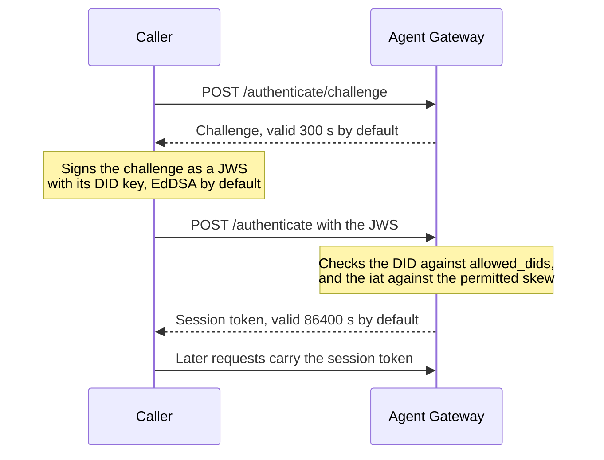

# Source Authentication and Managed Identity

Revision-specific internals of how the gateway authenticates an inbound caller and how
it derives the managed agent's DID. These are separate concerns and the source keeps
them separate: source authentication proves who is calling, managed identity names the
agent the request is on behalf of.

Use the hosted [identity documentation](https://docs.affinidi.com/products/affinidi-trust-fabric/agent-gateway/concepts/identity/)
for product concepts. See [`POLICY.md`](POLICY.md#caller-identity-verification-in-policy-input)
for how a derived DID is graded in policy input, and [`FABRIC.md`](FABRIC.md#peer-issuer-dids)
for attribution on the fabric path.

Implemented in [`src/source_auth/`](../src/source_auth/) and
[`src/didauth/`](../src/didauth/).

## Source authentication

Configured on the Access Point as `caller_authentication.methods`, and on a Transit Point as
`source_auth` (see [Transit Point callers](#transit-point-callers)). Each method is a
`SourceAuthConfig`
([`models.rs`](../src/source_auth/models.rs)), which has five variants.

| Method | Serialized tag | Validates |
| --- | --- | --- |
| JWT bearer | `jwt_bearer` | An inbound bearer token against a JWT verification strategy |
| API key | `api_key` | A key extracted from the request against the secrets store |
| API key provider | `api_key_provider` | A key extracted from the request against the API Key Provider |
| DID Auth | `did_auth` | A DID Auth session token |
| mTLS | `mtls` | A TLS client certificate |

`methods` is a list, but the inbound pipeline enforces only its first entry
([`AgentSurface::source_auth`](../src/config/agent_surface_accessors.rs)); later entries
are accepted and ignored.

A JWT bearer token is accepted only when it is signed with an RS256, RS384, RS512, ES256,
ES384 or EdDSA key from the strategy's key set, its `iss` equals the strategy's expected
issuer, it has an `exp` that has not passed and, when it has an `nbf`, that time has come,
each with 60 seconds of leeway. `aud` must name one of the method's `audiences`; an empty
list skips that check, except on an MCP Access Point that publishes protected resource
metadata, where `aud` must name the resource of the route called.

An MCP Access Point whose first method is JWT bearer can also publish RFC 9728 protected
resource metadata naming the authorization server that issues its tokens, with
`caller_authentication.protected_resource`. See
[`MCP_METADATA.md`](MCP_METADATA.md#authorization-server-discovery-for-caller-authentication),
and [Choosing How an MCP Access Point Checks Tokens](MCP_METADATA.md#choosing-how-an-mcp-access-point-checks-tokens)
for when to use it instead of the gateway STS Resource Server path.

The gateway builds one source authentication middleware at startup. If its JWT
verification strategy store (`jwt_verification_strategies/`, next to the secrets storage
directory) cannot be opened, the gateway refuses to start and names that path, rather
than serving surfaces whose caller authentication would be skipped. A request, direct or
over Fabric, that reaches a surface with caller authentication configured while no middleware
is installed is refused with `500` rather than forwarded unauthenticated.

A missing or invalid credential does not refuse the request. That includes an mTLS
certificate that lacks the configured binding field. The request continues with no caller
identity, and policy sees `input.source_auth` as
`{"method": "failed", "attempted_method": ..., "reason": ...}`. Only server-side errors,
such as missing configuration or an internal failure, block the request with `500`
([`errors.rs`](../src/source_auth/errors.rs)). Such a request is forwarded without the
surface's stored target credential, or the A2A proxy's Direct Line secret, on each inbound
and Fabric forwarding path: direct inbound, `proxy://` MCP Targets, `a2a-proxy://` Targets,
Fabric send and Fabric receive. A Transit Point refuses such a caller itself (see
[Transit Point callers](#transit-point-callers)). A surface that must reject unauthenticated
callers at its Access Point therefore needs a policy that denies them:

```rego
package surface.policy

default allow := false

allow if not deny

deny if input.source_auth.method == "failed"
```

See [`POLICY.md`](POLICY.md#failed-caller-authentication).

A request to an MCP Access Point that publishes protected resource metadata, direct or over
Fabric, is the exception: a missing or invalid JWT is refused with a `401` (the discovery
challenge on a direct request), see
[`MCP_METADATA.md`](MCP_METADATA.md#authorization-server-discovery-for-caller-authentication).

### mTLS

Two trust modes, in [`MtlsTrust`](../src/source_auth/models.rs):

| Mode | Behaviour |
| --- | --- |
| `Pinned { certificate_ids }` | Accepts only those exact certificates, matched by SHA-256 fingerprint of the stored leaf DER. No chain verification. References certificates whose `kind == ClientLeaf`. |
| `Ca { ca_certificate_ids, … }` | Verifies that the presented leaf chains to one of the configured CAs. References certificates whose `kind == Ca`, and can require the TLS Client extended key usage. |

The identity taken from the certificate is chosen by `MtlsIdentityBinding`. Every mode
except `Fingerprint` fails at runtime when the certificate does not carry the field.

| Binding | Takes |
| --- | --- |
| `fingerprint` | Lowercase hex SHA-256 of the leaf DER. Always available. |
| `subject_cn` | Subject Common Name |
| `dns_san` | First DNS SubjectAltName |
| `uri_san` | First URI SubjectAltName. SPIFFE IDs arrive through this mode. |
| `ip_san` | First IP SubjectAltName, rendered canonically |
| `subject_rdn { oid }` | An arbitrary RDN by OID from the Subject DN, for example UID as `0.9.2342.19200300.100.1.1` |

The certificate reaches the gateway either from a directly terminated TLS handshake or
forwarded as an XFCC header from a proxy listed in `tls.client_auth.trusted_proxies`.
An XFCC header from any other source is not trusted.

### DID Auth

A two-step ceremony: `POST /authenticate/challenge` issues a challenge, and
`POST /authenticate` accepts a JWS over it.



| Setting | Default | Notes |
| --- | --- | --- |
| `allowed_dids` | empty | Empty means any DID is accepted |
| `challenge_ttl_seconds` | 300 | Capped at 3600. A longer challenge widens the replay window. |
| `session_ttl_seconds` | 86400 | |
| `allowed_algorithms` | `["EdDSA"]` | The verifier recognises `EdDSA` and `ES256`; a value outside that set is rejected at validation time |

`IAT_SKEW_SECONDS` is 120 ([`verify.rs`](../src/didauth/verify.rs)). A JWS is rejected
when its `iat` is more than 120 seconds in the future. The backdating allowance is
wider, at 30 times that value.

Workload Binding supports `caller_source: did`, which tags the Workload Binding
presentation with the caller's identity hash as `user_hash` (see
[`CREDENTIAL_DELEGATION.md`](CREDENTIAL_DELEGATION.md#the-callers-identity-hash)).

### Authorization server metadata module (developer reference)

[`src/authz_metadata/`](../src/authz_metadata/) fetches and validates an authorization
server's metadata document and returns the issuer, the URL the document came from, the
`token_endpoint` and the `jwks_uri`. An issuer is acceptable only when it has no whitespace,
Unicode spaces such as a no-break space or a line separator included, and no control
character anywhere, leading, trailing or inside; the raw string is checked before it is
parsed, and a failure is `invalid_url` before any DNS lookup or request.
Let P be the issuer path with its trailing slashes removed. An origin issuer (empty P, with or
without a trailing slash) has two attempts, in this order: `{origin}/.well-known/oauth-authorization-server`
(RFC 8414), then `{origin}/.well-known/openid-configuration`. A path issuer has three: the
RFC 8414 URL with P inserted after the well-known name
(`{origin}/.well-known/oauth-authorization-server{P}`), the OpenID Connect URL with P inserted
(`{origin}/.well-known/openid-configuration{P}`), then the OpenID Connect URL with P appended
(`{origin}{P}/.well-known/openid-configuration`). The first acceptable document wins. The
`issuer` in the document must equal the requested issuer byte for byte. `token_endpoint` and
`jwks_uri` are both required, `jwks_uri` too although RFC 8414 makes it optional, because the
gateway validates JWT access tokens and needs the issuer's keys; a document without either is
`invalid_document`. Both must be absolute `http` or
`https` URLs of at most 2048 characters, with no whitespace, control characters,
credentials or fragment, not a cloud-metadata address, and not a weaker scheme than the
issuer: an `https` issuer with an `http` endpoint is an invalid document under every posture.
The schemes are compared as parsed, so their case does not matter.

| Limit | Value |
| --- | --- |
| Body size | 64 KiB (`MAX_METADATA_BYTES`), set per call by `DiscoveryOptions::max_bytes` |
| Timeout | 10 s, set per call by `DiscoveryOptions::timeout`, applied once to resolving the host and again to the HTTP request from connecting to reading the last byte. One fetch can take up to twice the timeout, and `discover` can make three fetches for a path issuer and two for an origin issuer, so up to six or four times the timeout in all |
| Redirects | Refused |
| DNS | The egress guard can resolve the host more than once; the connection is pinned to the addresses of the last, vetted resolution. An IPv6 literal host cannot be pinned and fails as `blocked`. Pinning does not hold when a proxy is configured: the HTTP client reads `HTTPS_PROXY`, `HTTP_PROXY` and `ALL_PROXY` (also in lower case) and, on macOS and Windows, the system proxy settings. The request then goes to the proxy, which resolves the host again and connects to an address nobody vetted, so address vetting and pinning no longer apply. This is true of the shared pinned egress clients until they call `.no_proxy()` |
| Status | Only a 2xx response is read |

The caller chooses an `EgressPosture`. `Strict` accepts `https` only: `get_bounded` and
`discover` refuse an `http` URL or an `http` issuer as `invalid_url` before any DNS lookup or
request, and an `http` `token_endpoint` or `jwks_uri` makes the document invalid. `Strict` also
blocks loopback, unspecified, RFC 1918, link-local and unique-local addresses.
`CloudMetadataOnly` accepts `http` and `https`, for operator-trusted callers such as a local
authorization server, and blocks only cloud-metadata addresses, allowing loopback and private
ranges. An `http` issuer, possible only under `CloudMetadataOnly`, may have `http` or `https`
endpoints. The posture
applies to the metadata URL at fetch time. It also applies to the discovered
`token_endpoint` and `jwks_uri` at parse time, where under `Strict` a literal IP host or a
`localhost` name in a blocked range makes the document invalid. A name that only resolves to
a private address cannot be known without DNS, so it passes parsing. The caller must therefore
fetch these URLs with `get_bounded`, or another pinned client, under the same posture, which
blocks such a name at fetch time. The JWT Bearer `JwksFetcher` always uses the
cloud-metadata-only pinned client, so a `jwks_uri` discovered under `Strict` must not be
handed to it; fetch it with `get_bounded` under `Strict`.

A failure is a `DiscoveryError`. `failure()` returns the `DiscoveryFailure`, `code()` a
stable string, `message()` fixed text that is safe in an API response (it never carries a
resolved address or a transport error) and `detail()` text for logs only. The error's
`Display` output includes the detail, so it is for logs only too. Both `code()` and
`message()` reveal the kind of failure, for example that a host is blocked or unreachable, so
a caller that serves untrusted parties should log them and return one generic message
instead.

| `code()` | Meaning |
| --- | --- |
| `invalid_url` | The URL or issuer is not an absolute `http` or `https` URL without credentials (`https` only under `Strict`), the issuer has a query or fragment, or the issuer contains whitespace or control characters |
| `blocked` | The egress posture refused the URL or its resolved address, the host name did not resolve, or the host is an IPv6 literal |
| `unreachable` | Resolving the host timed out, the connection failed or timed out, or the body could not be read in time |
| `http_status` | The server answered with a status outside 2xx, including a redirect |
| `too_large` | The body exceeded the size limit |
| `invalid_document` | The body is not a JSON object, or a required field is missing or unacceptable, including an endpoint with a weaker scheme than the issuer or, under `Strict`, a non-`https` endpoint |
| `issuer_mismatch` | The document's `issuer` differs from the requested issuer |

`discover` tries the URLs in order and stops at once on `invalid_url`, `blocked` or
`unreachable`. Otherwise, when every attempt fails, it returns the most specific failure among
all of them, from least to most specific: `http_status`,
`too_large`, `invalid_document`, `issuer_mismatch`.

| Function | Use |
| --- | --- |
| `discover(issuer, posture, options)` | Fetches and validates, trying the URLs in order |
| `metadata_urls(issuer)` | Pure: the candidate URLs for an issuer, in order: two for an origin issuer, three for a path issuer |
| `validate_issuer(issuer, posture)` | Pure: the issuer checks `discover` makes before any request; protected resource metadata uses it for the authorization servers it advertises |
| `parse_metadata(body, issuer, metadata_url, posture)` | Pure: validates a document already in hand |
| `get_bounded(url, posture, options)` | The pinned, bounded GET, reusable for a JWKS fetch |

```rust
use crate::authz_metadata::{discover, DiscoveryOptions, EgressPosture};

match discover(issuer, EgressPosture::Strict, DiscoveryOptions::default()).await {
    Ok(metadata) => use_endpoints(&metadata.token_endpoint, &metadata.jwks_uri),
    Err(error) => {
        tracing::warn!(code = error.code(), detail = error.detail(), "discovery failed");
        respond_with("The authorization server could not be reached");
    }
}
```

The module has no metrics, audit or storage coupling and no tenancy or strategy types in its
signatures, so callers record outcomes themselves from `code()`.

## Transit Point callers

Every Transit Point authenticates its callers in at least one of these ways, all set on the
Transit Point:

| Way | Set with | Use it when |
| --- | --- | --- |
| [Transit token](#transit-token) | `require_transit_token: true`, the default | The caller is the surface's managed agent, serving a request that came through the Access Point. The token names that request's caller |
| Resource access token | `mcp_http.authorization`, MCP Transit Points only | The caller can obtain an access token for the Transit Point from the gateway's STS (see [`MCP_METADATA.md`](MCP_METADATA.md)) |
| [Source authentication](#transit-point-source-authentication) | `source_auth` | The caller holds a credential of its own: an API key, a JWT from an identity provider, or a client certificate. Agents that cannot carry a transit token, such as cloud-hosted ones like Copilot Studio, use this |

A Transit Point that sets none of them must say so with `allow_unauthenticated_callers: true`.
It then serves anyone who reaches it, through this gateway and with its target credentials,
such as a `target_auth` key. Set it only on a Transit Point that sends no credential, or one
only trusted callers can reach: its outbound listener bound to a private address, with no
public external URL, and no inbound listener sharing a host name with it (see
[Reachable on a public address](#reachable-on-a-public-address)).

The admin API refuses with `400`, on the surface or in a variant's overrides, a Transit Point
that:

- authenticates no caller and does not set `allow_unauthenticated_callers`;
- sets `allow_unauthenticated_callers` but authenticates its callers;
- sets both `source_auth` and `mcp_http.authorization`;
- sets a `source_auth` a Transit Point does not support, or one the Access Point's rules
  refuse, such as mTLS trust that names no certificate.

A surface stored with such a Transit Point still loads, with a warning in the log, but the
Transit Point refuses every request with `503`, discovery reads included; a Transit Point
that sets `allow_unauthenticated_callers` but authenticates its callers keeps authenticating
them. The caller is told only that the Transit Point is unavailable, as a JSON-RPC error on an
MCP Transit Point and a problem JSON otherwise; the reason is logged.

`transit.source_auth`, on the surface's `transit` block rather than a Transit Point, is not
enforced. The admin API refuses a surface that sets it, on the surface or in a variant's
overrides, with `400`. A surface stored with it still loads, with a warning in the log, but
its Transit Points refuse every request with `503` in the same way.

The Surface Builder shows neither a Transit Point's `source_auth` nor its
`allow_unauthenticated_callers`. A `PUT` that omits `source_auth`, as a dashboard save does,
keeps the stored one; a merge `PATCH` whose `transit.points` leave it out removes it, since a
merge patch replaces the whole list. A `PUT` that omits `allow_unauthenticated_callers` keeps
it while the Transit Point still authenticates no caller, and drops it once the Transit Point
authenticates its callers.

### Upgrading and rolling back

A release that predates Transit Point `source_auth` ignores a Transit Point's `source_auth`
and `allow_unauthenticated_callers`. It would serve a Transit Point that relies on
`source_auth` to anyone who reaches it, with its `target_auth` credential, when the transit
token is off, and without the `source_auth` check when it is on. So a surface with a Transit
Point that uses `source_auth`, on the base or in a variant, is stored with
`transit_point_source_auth: true`. The gateway sets it on every save and when it loads a
stored surface, including one written outside the API, and drops it once no Transit Point
uses `source_auth`; a value a write sends is ignored. A release that predates it refuses that
whole surface at load (it skips and logs it) instead of serving its Transit Points without
`source_auth`: on such a release the surface is down, not open.

- Upgrade every node that serves the same storage, Active and Standby, before giving any
  Transit Point `source_auth`.
- Do not roll back to such a release while any Transit Point uses `source_auth`. To roll
  back, first remove `source_auth` from each one, base and variant, and turn its transit token
  back on, or delete the surface. Then check the stored records under
  `_storage/agent_surfaces/`, not a `GET`: a surface that still carries
  `transit_point_source_auth` is skipped by the older release.
- A Surface Template stores its surface unparsed, so an older release still loads it and can
  create from it a Transit Point without `source_auth`. Back up
  `_storage/agent_surface_templates/` before upgrading if a rollback may be needed, and
  restore it on rollback.

### Transit Point source authentication

A Transit Point's `source_auth` takes the same configuration as an Access Point's
`caller_authentication` method, and the same source authentication middleware checks it,
before the gateway reads anything else from the request, checks a transit token, applies a
limit or resolves a credential:

```json
{
  "alias": "crm",
  "protocol": "mcp",
  "target_endpoint": "https://crm.example/mcp",
  "require_transit_token": false,
  "source_auth": {
    "type": "api_key",
    "extraction": { "source": "http_header", "field": "X-API-Key" },
    "secret_id": "copilot-crm-callers"
  }
}
```

| Method | On a Transit Point |
| --- | --- |
| `api_key`, `api_key_provider` | Read from an HTTP header only |
| `jwt_bearer` | `forward_header` must be `false`. An audience of `{{ surface.agent_did }}` means the surface's agent DID, as on an Access Point |
| `mtls` | The certificate from the outbound listener's own TLS handshake (`[tls.client_auth] direct`, on an `https` outbound listener), or from the forwarded-client-cert header of a proxy in `trusted_proxies` |
| `did_auth` | Not supported: a Transit Point serves no DID Auth challenge |

The secret, JWT verification strategy, API-key parent or certificates a Transit Point's
`source_auth` names are checked on save as an Access Point's are: a tenant access token can
name only its own tenant's or appliance-wide ones (see
[`ACCESS_TOKENS.md`](ACCESS_TOKENS.md)).

Unlike an Access Point, a Transit Point refuses a caller whose credential is missing or
refused, with `401` and a problem JSON saying only `Caller credential missing or invalid`;
which check failed is logged. A check the gateway cannot run, such as a secret, strategy,
JWKS or certificate it cannot load, is refused with `503` as unavailable. Nothing of a
refused request reaches the target. The credential's header is removed from an admitted
request, so the target never receives the caller's key or token. A Transit Point that also
requires a transit token needs both: `source_auth` first, then the token.

A request that reaches a Transit Point through an inbound listener's `/outbound` route (see
[Reachable on a public address](#reachable-on-a-public-address)) carries no client
certificate: that route never passes on the forwarded-client-cert header, because the
outbound listener sees the gateway itself as the peer. A Transit Point with `mtls`
`source_auth` is called on its outbound listener directly, or through a trusted proxy.

The verified caller is in the Transit Point's policy input as `input.transit.caller`, with
`verification: "source_auth"` (see
[`POLICY.md`](POLICY.md#caller-in-transit-point-policy-input)), and `input.source_auth`
carries the identity with a JWT's claims. The caller's principal, and so its identity hash,
is:

| Method | Principal | So |
| --- | --- | --- |
| `jwt_bearer` | The token's `sub` | One caller per issuer and subject. A token without a `sub` names no caller: it has no identity hash, so no delegated credentials |
| `api_key` | The `secret_id` | Every key in the secret is the same caller; give each caller a secret of its own to tell them apart |
| `api_key_provider` | The key's id | One caller per issued key |
| `mtls` | The principal the `identity_binding` derives | One caller per certificate issuer and bound principal |

The identity hash covers the method, the issuer (the JWT `iss`, the API Key Provider agent,
the certificate's issuer DN), the surface's tenant and the principal (see
[`CREDENTIAL_DELEGATION.md`](CREDENTIAL_DELEGATION.md#the-callers-identity-hash)). It is the
value an Access Point puts in the transit token for a caller it authenticated the same way, so
a Transit Point that trusts the Access Point's issuer for the same subjects reaches the grants
those users consented to, while a JWT from another issuer, or an API key secret named like a
JWT subject, is another caller with grants of its own.

### Reachable on a public address

A Transit Point is reachable on a public address when its outbound listener has an external
URL whose host is not `localhost` or a loopback, private, link-local or unspecified address
(any other host name counts as public), or when an inbound listener with such a URL shares a
host name with the outbound listener, which makes that inbound listener pass `/outbound/...`
requests on to it. The example configuration's `http://localhost` URLs on both listeners are
enough for that.

For each Transit Point that sets `allow_unauthenticated_callers` and is reachable that way, on
the surface or in a variant, a create or update of its surface or of one of its variants is
answered with a `Warning` header:

```
Warning: 299 - "Transit Point 'crm' serves callers it does not authenticate and is reachable on a public address: https://gateway.example.com"
```

When the outbound listener mounts the surface it logs the same text at `WARN`, and logs
every other Transit Point that serves callers it does not authenticate at `WARN` too.

### Transit token

When a surface has Transit Points, its Access Point adds an `X-Transit-Token` header to each
request it forwards to the managed agent, and the agent sends it back on its Transit Point
calls ([`transit_token.rs`](../src/proxy/transit_token.rs)). The token is an HS256 JWT:
signed, not encrypted, so the agent can read every claim. It names the surface, the
caller, a hash of the caller's authenticated identity, the Transit Points it opens and the
trace, and expires its surface's [transit token lifetime](#transit-token-lifetime) after
it is issued, 300 seconds unless the surface sets another. The agent may send the same
token on any number of calls to that surface's Transit Points until then. The header is
never forwarded to a Transit Point's target.

A Transit Point refuses the call with `401` unless the token:

- is signed with this gateway's key and names it in `kid`, with the gateway's domain as
  `iss`;
- was issued for this Transit Point's surface, and lists this Transit Point or lists none;
- has not expired, is not issued in the future, lives no longer than its surface's transit
  token lifetime when it is presented, and has a token ID. Expiry and issue time allow 5
  seconds of clock difference.

A `2026-07-28` MCP request must also carry exactly one token, and allows no clock difference.
The refusal says only that the transit token is missing or invalid; which check it failed is
logged. A `GET` of a public discovery path, such as an agent card, is forwarded without a
transit token check, and so without any credential (see
[`CREDENTIAL_DELEGATION.md`](CREDENTIAL_DELEGATION.md#when-a-credential-cannot-be-resolved)).

Transit Point policies see the caller the token carries, and a caller verified another way,
in `input.transit.caller`; see
[`POLICY.md`](POLICY.md#caller-in-transit-point-policy-input).

The signing key is 32 random bytes the gateway creates on its first start, in
`transit_token_key.json` under `[storage_paths] vc_keys`, readable by the owner only and
encrypted like the gateway's other keys when encryption at rest is on. A key file that is
not owner-only, such as one a restore wrote, is restricted to its owner when the gateway
loads it, and the file written when encryption at rest is turned on later is owner-only
too. The file is created by linking a complete copy into place, so the directory must be on
a filesystem that supports hard links; one that does not stops the first start with an error
saying so. A key file that cannot be read stops the gateway from starting. Every token names
the key in its `kid` header, and a token that names another key, or none, is refused.
Instances that share the storage directory share the key, so a Standby that takes over
accepts the tokens the Active instance issued. A portable backup carries the key, so a
gateway restored from it accepts the tokens the original issued. To replace the key, stop
every instance, delete the file, and start them again; every token issued before is refused.

#### Transit token lifetime

A surface sets how long its transit tokens live in `transit.transit_token_lifetime_secs`,
from the appliance's shortest lifetime (30 seconds unless `gateway.json` sets
`transit_token_min_lifetime_secs`) to 900 seconds. Unset means 300 seconds, or the shortest
lifetime when that is above 300. Set a longer one when a managed agent's turn, such
as a long tool call, needs its Transit Points for longer than 300 seconds. For that whole
time the managed agent, or anyone who obtains the token, can call the surface's Transit
Points as that caller, with the credentials they inject, so keep it no longer than a turn
needs.

```json
{ "transit": { "transit_token_lifetime_secs": 600, "points": [ … ] } }
```

The lifetime belongs to the surface: a variant takes its surface's, and cannot set its own.
A surface whose Transit Points exist only in a variant needs a base `transit` block, with
empty `points`, to carry the lifetime; without one its tokens live as an unset lifetime does.
The admin API refuses a new lifetime outside the shortest lifetime to 900 seconds with `400`,
naming `transit_token_min_lifetime_secs`, and one in a variant's overrides with `422`. A save
that keeps the value already stored is accepted even when that value is outside the bounds,
so a dashboard save, or a `GET` followed by a `PUT`, of such a surface still works.

A stored lifetime outside the bounds never stops the gateway. At startup, for every stored
surface, disabled ones included, and on every reload, one below the shortest is raised to the
shortest and one above 900 seconds is lowered to 900, with one `WARN` per surface naming the
surface, the stored value and the lifetime its tokens get; the surface keeps its stored value.
A value below the shortest arrives when the shortest is raised, when surfaces are restored
from a backup taken on an appliance with a lower shortest lifetime, or when they are saved
through another instance with a lower one; set the same value on every instance that shares
surfaces. A value above 900 arrives from a hand edit, or after a rollback from a release that
allows longer lifetimes (see [`CONFIGURATION_RELOAD.md`](CONFIGURATION_RELOAD.md)). The token
issuer itself also refuses a lifetime outside the bounds.

The shortest lifetime is a setting of the appliance, `transit_token_min_lifetime_secs` in
`gateway.json` (see [`CONFIGURATION_REFERENCE.md`](CONFIGURATION_REFERENCE.md)): 30 seconds
unless set, from 1 to 900. The gateway reads it once, when it starts: a value outside 1 to 900
stops it from starting, and a change takes a restart. A reload, including the one a surface
save triggers, keeps the value the gateway started with, whatever `gateway.json` says by then,
so the admin API, the Access Point and the Transit Point always agree. Raise it to make every
surface's tokens live at least that long; surfaces stored with a shorter lifetime are raised
with it, as above. Lower it, for example to 10, when a deployment needs tokens that expire
sooner. Near the floor, a Transit Point accepts a token on a legacy request until 5 seconds
past its `exp`, the clock leeway between gateways, so a lifetime of 1 to 5 seconds lasts its
lifetime plus 5 seconds there, while a `2026-07-28` MCP request checks `exp` with no leeway
and leaves almost no usable time at that size. The longest, 900 seconds, is fixed.

A Transit Point checks a token against the lifetime its surface sets when the token is
presented, so a change applies to tokens already issued:

- shortening the lifetime refuses every token issued to live longer, only while the shorter
  lifetime is in force, until the caller's next request through the Access Point brings the
  managed agent a new one;
- lengthening it keeps the tokens already issued, each until its own expiry, and accepts
  again a longer token a shorter lifetime refused if it has not expired; only tokens issued
  after the change live longer.

Shortening the lifetime is therefore not revocation. To revoke the tokens already issued,
rotate the transit token key as described above.

The Surface Builder does not show the lifetime. A `PUT` that omits
`transit.transit_token_lifetime_secs`, as a dashboard save does, keeps the stored value;
a merge `PATCH` with `"transit_token_lifetime_secs": null` removes it, which sets it back
to 300 seconds.

### Headers through a Transit Point

A Transit Point forwards the managed agent's request headers to its target, over HTTP or
Fabric, except hop-by-hop headers, `Host`, `Content-Length`, `X-Transit-Token`, the agent's
`Authorization` and its `Cookie`, a header named like the Transit Point's `target_auth`
header, and any header a Header Metadata Mapping is set to strip. Other headers, such as an
API key header the agent sends for the target itself, pass. The credentials the gateway adds
are described in
[`CREDENTIAL_DELEGATION.md`](CREDENTIAL_DELEGATION.md#credential-headers-on-a-transit-point).

The target's response headers go back to the agent except hop-by-hop headers, `Set-Cookie`
and `WWW-Authenticate`, so a target cannot set cookies in the agent or send it to
authenticate with the target directly. The response status is unchanged.

## Managed identity

A rule that derives the managed agent's DID. `ManagedIdentityConfig`
([`models.rs`](../src/source_auth/models.rs)) has five modes. It is set per identity
slot on the surface, and a Transit Point may override it for its own outbound leg.

| Mode | Derives the DID from | Counts in policy as |
| --- | --- | --- |
| `payload_extraction` | A field in the request payload metadata. Also accepted on the wire as `from_payload`. | `unverified` |
| `from_api_key` | A stored API key named by `api_key_id` | `unverified` |
| `from_mtls` | A stored certificate named by `certificate_id` | `unverified` |
| `static` | A fixed `did`, for test fixtures and stub agents | `unverified` |
| `from_jwt_claim` | A claim on a JWT already verified by source auth | `source_auth` |

Only `from_jwt_claim` is request-bound. The other four read a stored credential or the
request body and are independent of the credential authenticated on this request, which
is why they do not count as verified. An identity presentation reports `vp` or
`vp_unanchored` regardless of the configured mode; see
[`POLICY.md`](POLICY.md#caller-identity-verification-in-policy-input).

### `from_jwt_claim`

Requires `jwt_bearer` source auth on the same surface, so the token is cryptographically
verified before the DID is derived.

| Field | Default | Effect |
| --- | --- | --- |
| `claim` | `oid` | The claim whose value identifies the agent. The default is the stable Microsoft Entra Agent ID object identifier. |
| `namespace_claims` | empty | Additional claims folded into the identity hash to namespace the agent across tenants or issuers, for example `["iss", "tid"]`. Every listed claim must be present on the token, or resolution fails. |

One stable `did:webvh` is minted per distinct claim value. Token rotation keeps the DID
stable, and a shared identity-hash pepper keeps it identical across every gateway in the
fabric.

### Identity hash pepper

The two derivation paths hash differently.

| Mode | Hash |
| --- | --- |
| `payload_extraction` | Plain SHA-256 over the selected fields, sorted by path and joined as `field=value\|field=value` ([`identity_hash.rs`](../src/identity/identity_hash.rs)). No pepper. |
| `from_mtls`, `from_api_key`, `from_jwt_claim` | `HMAC-SHA256(pepper, canonical(fields))` ([`credential_identity.rs`](../src/identity/credential_identity.rs)) |
| `static` | None. The configured DID is used as given. |


The pepper keeps a credential-derived hash non-invertible, so emitting it through policy
input or the audit log does not expose the certificate, key, or claim it came from. It is
read from `AG_IDENTITY_HASH_PEPPER`, as hex or as a loader reference such as `env://`,
`file://`, `aws_secrets://`, or `aws_parameter_store://`, and must decode to at least 32
bytes. A2A proxy identities other than Entra agents are hashed with it too.

Without it, or with a value that is too short or cannot be resolved, the gateway falls back
to an ephemeral pepper, and every **credential-derived** DID changes on restart. Payload-derived DIDs are unaffected. Two gateways that should mint
the same credential-derived DID for the same agent must share the pepper. See
[`CONFIGURATION_REFERENCE.md`](CONFIGURATION_REFERENCE.md#environment-variables).

Credential-derived modes skip body parsing entirely.

## Trust Recorder

The only writer of agent-in-trust-registry records
([`trust_recorder.rs`](../src/trust_registry_verification/trust_recorder.rs)). It fires
on the response leg and on discovery, and is idempotent.

After writing its records, the Trust Recorder publishes a name for each authority it
wrote. The name comes from the Authority register entry with that DID, or, failing that,
from the Issuer with that DID, which covers the `{{ surface.issuer_did }}` template. An
Issuer DID used as a record's entity is named after the Issuer too. A DID with no
matching Authority or Issuer stays unnamed.

When the managed agent has a display name (see [Display names](#display-names)), the
Trust Recorder also publishes the agent DID's entity reference field and attaches
`{"displayName": "<name>", "origin": "managed"}` as `context` on the records it creates
for the agent DID. Context is a snapshot taken at creation and is never rewritten; the
reference field carries the current name. A naming failure never skips record creation.

`authority_did` accepts the template `{{ surface.issuer_did }}`, resolved at write time
to the surface's configured Issuer DID. When the surface has no issuer configured, or its
issuer was deleted (deleting an Issuer does not check whether a surface still uses it), the
template does not resolve and the entry is skipped with a warning rather than written
with a placeholder.

An entry's `issuer_did` is not a signer and does not set the authority. It is written as
the `entity_id` of custom records whose `entity_target` is `issuer`, and nothing else. The
dashboard warns on the Trust Recorder panel and on the entry while the surface has no Issuer
selected, or its Issuer no longer exists, and an entry's authority is the template, because
that entry writes nothing. The
warning does not block saving, and it does not appear for entries with an explicit authority.

### Recorder status

The gateway keeps the Trust Recorder's last known outcome for each managed agent DID on each
surface ([`recorder_status.rs`](../src/trust_registry_verification/recorder_status.rs)). It is the
recorder's last outcome, not a live check of the trust registry.

Each entry has one state:

| State | Meaning |
| --- | --- |
| Recorded (`recorded`) | At least one record was written or already existed, and none failed. |
| Partly recorded (`partial`) | Some records were written or already existed and some failed. |
| Failed (`failed`) | No record was written. The reason is `no_response` (no reply within 10 seconds), `rejected` (the registry sent a problem report) or `error`. |
| Skipped (`skipped`) | The entry was not written. The reason is `registry_not_found`, `registry_not_connected`, `no_surface_issuer` (the `{{ surface.issuer_did }}` template did not resolve) or `error` (the trust registry lookup failed). |
| Not attempted yet (`not_attempted`) | The surface has a Trust Recorder and no outcome is stored yet, for example right after it was added. |

An entry that declares no records is not reported. The identity's overall state combines its
entries: when all entries share a state it is that state, when a written entry is mixed with an
unwritten one it is Partly recorded, and otherwise Failed ranks above Skipped. Only these
codes, counts and timestamps are kept; registry error text never reaches the status.

Statuses are stored in `_storage/trust_recorder_status/`, beside the identities directory and
without a `[storage_paths]` key, so a backup of `_storage` includes them. The recorder runs on
every response, so a status is written only when the outcome changes. The attempt time is
held in memory and, after a restart, shows the time of the last change until the next
attempt. Deleting a surface, or adding, removing or changing the entries of its Trust Recorder,
clears its statuses, so they show Not attempted yet until the next response. The outcome of a
run that began before the clear is dropped, so a run still waiting on a trust registry cannot
bring a cleared status back. A storage failure is logged as a warning and the status reads as
missing.

Managed identities whose surface has a Trust Recorder carry `trust_recorder` in the identity
list (`/v1/dashboard/stats` and its live updates), which also pushes an identity whose outcome
changed. Adding or removing a Trust Recorder, or a change another node wrote to shared storage,
shows on the next update or reload. `GET /v1/surfaces/{id}/trust-recorder-status` returns
`{"status": ...}` for a surface: the most recently attempted of its managed agents, or `null`
before the first attempt and while the surface has no Trust Recorder. It needs the same surface
access as `GET /v1/surfaces/{id}`.

## Display names

A display name is an unverified, human-readable label for a DID
([`display_name.rs`](../src/identity/display_name.rs)). Valid names are trimmed, keep
their case, contain no control characters or invisible Unicode format (`Cf`) characters
such as zero-width spaces and bidirectional overrides, and fit in 128 characters and
256 UTF-8 bytes. Descriptions are dropped when they contain either kind of character. An invalid or empty name is skipped with a warning, and the DID is shown
instead. Falling back to the DID is display-only: no reference field, context or VC
name is ever published with the DID as the name.

### Managed agents

The managed agent's display name is its surface name. On A2A and AP2 surfaces with an
`http` or `https` target, the dashboard shows the `name` in the target's Agent Card
instead (see [Agent Card names](#agent-card-names)). Each identity record carries an
origin (`managed` or `external_caller`), stamped when the gateway issues the DID. The
origin follows the identity slot the DID came from, not the request leg: on a surface
with no inbound slot, an inbound request that derives the DID from the protected slot
(or legacy `target.identity_injection`) issues it as `managed`, the same as the
outbound leg and the response path. A
record written before origins existed has none until the gateway next issues its
credential. Until then it is never published, and the dashboard shows it unnamed, in its
own row, with the LOCAL or REMOTE badge instead of an origin badge. A record is not
classified from the surface it links to: before origins existed, caller DIDs were also
stored as local records linked to the surface, so a link does not prove a managed agent.
Credential principals (the name of the backing certificate or secret) appear only in
the dashboard and are never published.

If one DID is managed on more than one surface, no name is published and the dashboard
shows a name conflict.

#### Agent Card names

The Agent Card name ([`target_card_names.rs`](../src/identity/target_card_names.rs))
is dashboard-only. It applies to every managed-identity mode, and the Identities page
shows it in place of the surface name. The card is read from
`<target endpoint>/.well-known/agent-card.json`, then `/.well-known/agent.json`, or from
the target origin plus the access point's `agent_card_path` when that is set. Surfaces of
other protocols, such as MCP, and targets with another scheme, such as `fabric://`, are
never looked up.

Lookups are cached per surface for 300 seconds and are re-read when the target endpoint
or card path changes, with a 5-second timeout for each card URL tried. The dashboard
never waits: until its first lookup finishes, and whenever the card has no valid `name`,
a row shows the surface name. When the card cannot be read (unreachable, blocked by
egress policy, a non-success status, an oversized body, or a non-JSON body), the row keeps
the last name read from the same target and card path, and the next lookup is retried
after the cache period; with no earlier name, it shows the surface name.

The card name is self-asserted by the target and never verified. The target is trusted
to serve traffic, not to choose what the gateway's Issuer signs, so the card name never
reaches the VC, Trust Recorder context, or trust-registry reference fields, and card
lookups never sit on the request path. A name conflict shows no name, whatever the card
says.

The agent identity VC carries the surface name as `credentialSubject.name` on both the
legacy and SSI paths. VCs are signed on each issuance, so the next VC after a surface
rename carries the new name under the same DID.

### Trust registry reference fields

The gateway publishes names as trust-registry reference fields
([`reference_fields.rs`](../src/trust_registries/reference_fields.rs)), never by
rewriting trust records:

| Trigger | Fields published |
| --- | --- |
| Issuer create, retry, or edit | Entity field for the Issuer DID, authority field for its Authority |
| Authority edit | Authority field, to every registry an Issuer of that Authority uses |
| Surface rename | Entity field for each managed DID of the surface, to each Trust Recorder registry |
| Trust Recorder | Entity field for the agent DID; authority field for each record's authority (an Authority, else an Issuer with that DID); entity field for an Issuer DID used as a record's entity |

An Authority or Issuer is either global or owned by one tenant, and an owned one is named
only within its tenant.
An Issuer publishes its Authority's name only when that Authority is global or in the
Issuer's tenant. The Trust Recorder names an Authority or Issuer only when it is global
or in the surface's tenant; a surface without a tenant names only global ones. A DID
that fails this check gets no reference field, but its records are still written, so
external DIDs keep working.

Each publish sends `create-reference-field`. On the problem-report code
`e.p.msg.conflict` it sends `update-reference-field`, and on a second conflict it
resends the update once. Any other error is logged and retried on the next trigger.
A reference field is shared by every writer for its type and id, so gateways that
publish different names for the same Authority overwrite each other, and the last write
wins. Fields are not create-only, so renaming an Authority or Issuer updates the name
in every registry that already holds it.
Successful publishes are cached per registry, field type, and id, so an unchanged name
is not re-sent. Publishing runs in the background and never delays or fails an HTTP
response, record creation, forwarding, or a TRQP query.

### External callers

Caller names appear only in the dashboard
([`caller_names.rs`](../src/observability/caller_names.rs)) and never override a
managed agent's name. They are resolved in the background, cached for 300 seconds, in
this order:

1. A verified agent name: a `host/@local` entry in the caller's `alsoKnownAs` that the
   DID resolver verifies back to the same DID. At most four entries are tried. Their
   egress controls are in [`POLICY.md`](POLICY.md#agent-name-resolution).
2. The `name` of the caller's Agent Card, which is not verified. The card is found through a
   DID-document service of type `AgentCard` or `A2AAgentCard`, or whose id ends in
   `#agent-card`. It is fetched under the strict egress policy with a 5-second timeout
   and a 64 KiB limit.
3. The DID.

Until the first lookup for a DID finishes, the dashboard row carries
`display_name_pending` and shows "resolving…". A finished lookup that found no name, or
that failed, shows the DID alone and is retried after the cache period.

## Related

- [`POLICY.md`](POLICY.md): how a derived DID is graded and exposed to OPA.
- [`FABRIC.md`](FABRIC.md): attribution rules on the fabric receive path.
- [`ACCESS_TOKENS.md`](ACCESS_TOKENS.md): management-plane tokens, which are a separate concern.
- [`../ARCHITECTURE.md`](../ARCHITECTURE.md): where these stages sit in the request path.
