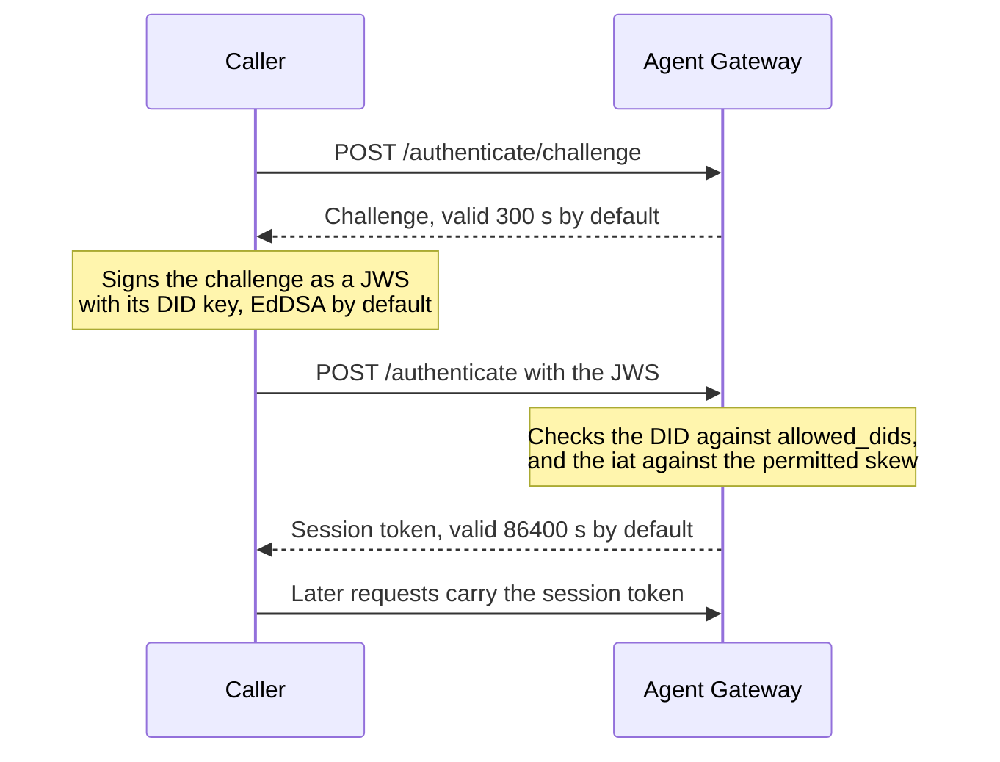

# Source Authentication and Managed Identity

Revision-specific internals of how the gateway authenticates an inbound caller and how
it derives the managed agent's DID. These are separate concerns and the source keeps
them separate: source authentication proves who is calling, managed identity names the
agent the request is on behalf of.

Use the hosted [identity documentation](https://docs.affinidi.com/products/affinidi-trust-fabric/agent-gateway/concepts/identity/)
for product concepts. See [`POLICY.md`](POLICY.md#caller-identity-verification-in-policy-input)
for how a derived DID is graded in policy input, and [`FABRIC.md`](FABRIC.md#peer-issuer-dids)
for attribution on the fabric path.

Implemented in [`src/source_auth/`](../src/source_auth/) and
[`src/didauth/`](../src/didauth/).

## Source authentication

Configured on the Access Point as `caller_authentication.methods`. Each method is a
`SourceAuthConfig`
([`models.rs`](../src/source_auth/models.rs)), which has five variants.

| Method | Serialized tag | Validates |
| --- | --- | --- |
| JWT bearer | `jwt_bearer` | An inbound bearer token against a JWT verification strategy |
| API key | `api_key` | A key extracted from the request against the secrets store |
| API key provider | `api_key_provider` | A key extracted from the request against the API Key Provider |
| DID Auth | `did_auth` | A DID Auth session token |
| mTLS | `mtls` | A TLS client certificate |

`methods` is a list, but the inbound pipeline enforces only its first entry
([`AgentSurface::source_auth`](../src/config/agent_surface_accessors.rs)); later entries
are accepted and ignored.

A JWT bearer token is accepted only when it is signed with an RS256, RS384, RS512, ES256,
ES384 or EdDSA key from the strategy's key set, its `iss` equals the strategy's expected
issuer, it has an `exp` that has not passed and, when it has an `nbf`, that time has come,
each with 60 seconds of leeway. `aud` must name one of the method's `audiences`; an empty
list skips that check, except on a declaring Access Point, where the declared resource of the
route called must be one of the token's `aud` values and the method's `audiences` are not used.
A method that lists `required_scopes` also needs a token that grants each of them; see [Required scopes](#required-scopes).

An Access Point whose first method is JWT bearer can also publish RFC 9728 protected
resource metadata naming the authorization server that issues its tokens, and then refuses
callers with a challenge that points at it. An MCP, A2A or AP2 Access Point declares by setting
`caller_authentication.protected_resource`; see [Declaring an Access Point](#declaring-an-access-point).
See also
[`MCP_METADATA.md`](MCP_METADATA.md#authorization-server-discovery-for-caller-authentication),
and [Choosing How an MCP Access Point Checks Tokens](MCP_METADATA.md#choosing-how-an-mcp-access-point-checks-tokens)
for when to use the explicit setting instead of the gateway STS Resource Server path.

The gateway builds one source authentication middleware at startup. If its JWT
verification strategy store (`jwt_verification_strategies/`, next to the secrets storage
directory) cannot be opened, the gateway refuses to start and names that path, rather
than serving surfaces whose caller authentication would be skipped. A request, direct or
over Fabric, that reaches a surface with caller authentication configured while no middleware
is installed is refused with `500` rather than forwarded unauthenticated.

On an Access Point that does not declare, a missing or invalid credential, or a JWT short of
a required scope, does not refuse the request. That includes an mTLS certificate that lacks
the configured binding field. The request continues with no caller identity, and policy sees
`input.source_auth` as
`{"method": "failed", "attempted_method": ..., "kind": ..., "reason": ...}`, where `kind` is
`missing`, `invalid` or `insufficient_scope`. Only server-side errors,
such as missing configuration or an internal failure, block the request with `500`
([`errors.rs`](../src/source_auth/errors.rs)). Such a request is forwarded without the
surface's Target Authentication credential, or the A2A proxy's Direct Line secret, on each inbound
and Fabric forwarding path: direct inbound, `proxy://` MCP Targets, `a2a-proxy://` Targets,
Fabric send and Fabric receive. Transit Point listeners do not authenticate callers, so this
does not cover them. A surface that does not declare and must reject unauthenticated callers
therefore needs a policy that denies them:

```rego
package surface.policy

default allow := false

allow if not deny

deny if input.source_auth.method == "failed"
```

See [`POLICY.md`](POLICY.md#failed-caller-authentication).

A declaring Access Point (MCP, A2A or AP2) is the exception: it refuses a failed caller itself, at
source authentication, before rate limiting, the request body and any policy, with `401` for a
missing or invalid JWT and `403` for one short of a required scope, and the caller never reaches
the surface's policy or its Target. The refusal carries the discovery challenge on
a direct request and the realm-only refusal on the receiving gateway of a Fabric route, which the
sending gateway answers to its own caller with `502`. The
invariant is written once in [`AGENTS.md`](../AGENTS.md#architecture); see
[Caller challenge](#caller-challenge) and
[`MCP_METADATA.md`](MCP_METADATA.md#authorization-server-discovery-for-caller-authentication).

A surface whose JWT verification strategy no longer exists, for example because it was deleted
while the surface still references it, cannot authenticate any caller. The strategy is looked
up only after a token is found, so a request with no token is still a missing credential,
handled as above, while a request that presents one is refused with `500`. The problem `detail`
of that `500` is the fixed text `Caller authentication is unavailable` and names no strategy or
certificate id, so a caller learns nothing about the surface's configuration; only the
gateway's own log names the id, and the audit event records the reason `config_not_found`.
Deleting a strategy is not refused while a surface uses it; the dashboard asks for confirmation first and lists the
surfaces whose Access Point or Surface Variants reference it.

### JWT bearer signing keys

A strategy with a remote `jwks_uri` has its JSON Web Key Set fetched and cached by
[`JwksClient`](../src/jwt_bearer/jwks.rs). Each node keeps its own cache.

| Behaviour | Rule |
| --- | --- |
| Cache key | One key set per strategy, used only while the strategy's `jwks_uri` and `updated_at` match the ones it was fetched for. A strategy edited on any node, through the API or on disk, is a cache miss once the node reads the edited record. |
| Eviction | Updating or deleting a strategy through the API evicts its key set. A standby that becomes Active drops every cached key set (see [Server mode](CONFIGURATION_RELOAD.md#server-mode)). |
| Lifetime | `Cache-Control: max-age`, clamped to between 60 seconds and 24 hours; 24 hours when the header is absent. |
| Unknown `kid` | A token whose `kid` is not in a fresh key set triggers at most one refetch per strategy every 60 seconds. Inside that window it fails as `Key not found for kid`, an invalid credential like any other. |
| Concurrency | Concurrent requests for one strategy share one fetch. |
| Fetch failure | The next fetch waits 10 seconds. When a refresh of an expired key set fails, the last good set keeps serving for up to one hour past its expiry; after that, or with no good set, the request is refused with `500`. |
| Limits | A response body over 64 KiB, more than 64 keys, a repeated `kid`, or a key without a `kid` in a set of several keys is a failed fetch. `POST /v1/jwt-verification-strategies/validate-jwks-uri` applies the same limits. |

The fetch is pinned to the vetted address under the cloud-metadata-only posture, with no
redirects ([`fetch.rs`](../src/jwt_bearer/fetch.rs); see
[`POLICY.md`](POLICY.md#other-pinned-egress-sinks)). A strategy with a static key set is never
fetched or cached. Each network fetch of a strategy's key set, successful or failed, is counted
by result in `agent_gateway_jwks_fetch_total`
([`OBSERVABILITY.md`](OBSERVABILITY.md#trust-plane-metrics)); a cache hit and the
`validate-jwks-uri` probe are not counted. A host that does not resolve fails as `blocked`, and
resolving it times out after 10 seconds as `unreachable`.

### Authorization server discovery

A strategy can pin its authorization server's metadata. Discovery runs through the shared
[authorization server metadata module](#authorization-server-metadata-module-developer-reference)
with `expected_issuer` as the issuer, so the document's `issuer` must equal it byte for byte,
trailing slash included, and name a `token_endpoint` and a `jwks_uri` that do not use a weaker
scheme than the issuer. The pin, `authorization_server`, holds `issuer`, `metadata_url` (the
document that answered), `token_endpoint` and `jwks_uri`. It does not change `jwks_source`,
and token verification does not read it.

| Request | Behaviour |
| --- | --- |
| `POST /v1/jwt-verification-strategies/discover` with `{"issuer": ...}` | Returns the metadata a save would pin, and stores nothing |
| Save with `discover_metadata: true` | Discovers and pins. If discovery fails, the save is refused with `422` and nothing is stored |
| Save with `discover_metadata: false` | Clears the pin |
| Save without `discover_metadata` | Keeps the pin, if any. When a pinned strategy's issuer or remote `jwks_uri` changed, discovers again. If that fails, or the caller is past the probe limit, the save still answers `200` and logs a warning; the old pin is kept only when its issuer still equals the expected issuer (only the remote `jwks_uri` changed) and is cleared otherwise. A tenant-scoped caller that moves the issuer to an `http` URL always has its pin cleared: the strict posture refuses the issuer as `invalid_url` before any request |

`POST /v1/jwt-verification-strategies/validate-jwks-uri` stays for strategies whose
`jwks_uri` is entered by hand; `discover` returns the discovered `jwks_uri` as well.

Both endpoints, and a save that discovers, make an outbound request on the caller's behalf, so
they share one set of rules ([`handlers.rs`](../src/jwt_bearer/handlers.rs)):

| Rule | Detail |
| --- | --- |
| Permission | `jwt_verification_strategies.edit` |
| Egress posture | The cloud-metadata-only posture (cloud metadata blocked; http, loopback and RFC 1918 allowed), and the strict posture for a tenant-scoped PAT, which also blocks loopback, RFC 1918, link-local and unique-local addresses. Under the strict posture discovery and `validate-jwks-uri` accept `https` only: an `http` issuer or JWKS URI fails with `invalid_url` before any lookup, and an `http` endpoint in the document makes it invalid. Each request is pinned to the vetted address unless a proxy is configured (see the module's [DNS limit](#authorization-server-metadata-module-developer-reference)), does not follow redirects, and reads at most 64 KiB. A discovery fetch has 10 seconds to resolve the host and 10 more for the request, and discovery makes up to three fetches for an issuer with a path and two for one without, so it takes at most 60 or 40 seconds. |
| Limit | Up to 10 probes per user at once, replenished at one every 6 seconds; past that, `429` with code `rate_limited`. A save that cannot re-discover because of the limit keeps its pin only when the issuer is unchanged, and clears it otherwise. |
| Errors | A fixed `code` and message, never the resolved address or the transport error. Discovery uses the [module's codes](#authorization-server-metadata-module-developer-reference): `invalid_url`, `blocked` (also a host name that does not resolve), `unreachable`, `http_status`, `too_large`, `invalid_document`, `issuer_mismatch`. `validate-jwks-uri` uses `invalid_url`, `blocked` (also a host name that does not resolve), `unreachable`, `http_status`, `too_large`, `invalid_document`. `discover` and saves answer `422`; `validate-jwks-uri` answers `400` with `valid: false`. |
| Audit | Each probe logs an `audit` event `jwt_verification_strategy.probe` with the probe kind (`discover`, `jwks_uri` or `save`), the caller, the tenant, the posture, the host and the result: `ok` or the failure code, which a failed probe also logs in a warning. Every probe records a server that answers outside 2xx as `http_status`. |

Every discovery is also counted in `agent_gateway_discovery_total`
([trust plane metrics](OBSERVABILITY.md#trust-plane-metrics)), and each strategy create, update
or delete records a `verification_strategy_changed` configuration event that says whether the
pin changed ([governance audit forwarding](OBSERVABILITY.md#governance-audit-forwarding)).

**Microsoft Entra.** Only tenant-specific authorities work, such as
`https://login.microsoftonline.com/<tenant id>/v2.0`. The multi-tenant authorities (`common`,
`organizations`) advertise `{tenantid}` in their issuer, which fails the exact match, and a
strategy whose `expected_issuer` contains `{` or `}` is refused with `400`: the gateway never
matches issuer templates.

**Other consumers of a strategy.** STS subject and ID-JAG verification ([`STS.md`](STS.md))
selects a strategy by `expected_issuer` and checks no audience; modern consent verifies the
provider's ID token against `consent_identity_strategy_id` with the client id as audience
([`MCP_METADATA.md`](MCP_METADATA.md)); credential providers reference a strategy only through
that field. None of them reads `authorization_server`, so a pin never changes which tokens
they accept. The field is left out of the stored record when unset, so a strategy saved before
the field existed keeps the digest that a consent record bound to it.

### Required scopes

A `jwt_bearer` method can list `required_scopes`. After the token verifies (signature, issuer,
expiry and audience), the Access Point reads the scopes it grants
([`access_token.rs`](../src/jwt_bearer/access_token.rs)) and checks them in
[`middleware.rs`](../src/source_auth/middleware.rs). The check is not part of token
validation, so STS, modern consent and credential providers are unaffected.

| Rule | Detail |
| --- | --- |
| Granted scopes | The first claim in the strategy's `scope_claims` (default `scope`, then `scp`) that the token carries decides. A string is split on spaces, an array of strings is used as is, and any other shape grants nothing. |
| Shortfall | A token that lacks any required scope is a failed caller of kind `insufficient_scope`, handed to policy like a missing or invalid token, except on a declaring Access Point, which refuses it with `403` (see [Caller challenge](#caller-challenge)). The `auth_failed` audit reason is `insufficient_scope`, and each shortfall is counted in `agent_gateway_scope_denied_total` ([`OBSERVABILITY.md`](OBSERVABILITY.md#trust-plane-metrics)). |
| Access tokens only | With `required_scopes` set, a token carrying `nonce` or `at_hash`, or whose JOSE `typ` header is present and is not `at+jwt`, `application/at+jwt` or `JWT` (case-insensitive), fails as `invalid`. A method without `required_scopes` keeps accepting such tokens. |
| Saving | Each entry must be an RFC 6749 scope token (`%x21 / %x23-5B / %x5D-7E`) of 1 to 128 characters, with at most 32 entries and no duplicates, on the base Access Point and on every Surface Variant. Otherwise the save is refused with `400`, and a configuration file is refused at startup. |

A strategy's `scope_claims` lists the claims read for granted scopes, in order: 1 to 8 names,
each 1 to 256 printable ASCII characters without spaces, none repeated, or the save is refused
with `400`. Microsoft Entra app-only tokens, for example, carry their permissions in `roles`.
A save that omits the field keeps the stored list, and one that sends `["scope", "scp"]`
stores the default as absent, so a strategy that never customises it keeps its stored record,
and the digest a consent record binds to it, unchanged. Only Access Points read it.

An ID token is signed by the same issuer as an access token, and its audience can be the
Access Point URL: any Google service account can mint a Google ID token for an audience it
chooses. Such a token carries no scope, so requiring a scope refuses it. An Access Point that
trusts a Google issuer, or any issuer that mints ID tokens for arbitrary audiences, needs
`required_scopes` or a policy on `client_id` or `subject`.

A verified caller's policy input carries `scopes` and `client_id` normalised across
providers, and the id and tenant of the strategy that verified the token; see
[`POLICY.md`](POLICY.md#jwt-bearer-caller-input).

Releases before this one ignore a method's `required_scopes` and a strategy's
`scope_claims` on every `jwt_bearer` Access Point, and drop them when they save the record.
After a rollback those Access Points accept tokens without the scope, ID tokens included,
with no warning, and the metadata keeps listing the scopes as supported. Before rolling back,
disable each Access Point that relies on `required_scopes`, or protect it with a surface
policy those releases can evaluate: one that checks the raw `scope` or `scp` claim in
`input.source_auth.claims`, since they publish neither `input.source_auth.scopes` nor the
`insufficient_scope` kind. Set `required_scopes` again after upgrading.

Those releases also drop a strategy's pinned `authorization_server` when they save it. A
strategy an older node saved during a rollback comes back unpinned, so a declaring A2A or AP2
agent card names no security scheme (the `card_scheme_unavailable` warning), and a
strategy that read scopes from `roles` falls back to `scope` and `scp`. After re-upgrading,
run discovery on each such strategy (`discover_metadata: true`) and set its `scope_claims`
again, as well as `required_scopes`.

### Declaring an Access Point

An Access Point declares when it tells callers which authorization server to use: it publishes
protected resource metadata for the route called, binds the token audience to that route and
refuses a failed caller with a challenge that names the metadata. The request path resolves
the declaration once per request ([`declaration.rs`](../src/source_auth/declaration.rs)), and
the metadata, the audience binding, the caller challenge and a declaring A2A or AP2 agent card
([`PROTOCOLS.md`](PROTOCOLS.md#agent-card-security)) are all projections of it.

There is one source: `caller_authentication.protected_resource` on an MCP, A2A or AP2 Access
Point (the dashboard's **Authorization server discovery** switch). An Access Point without it
never declares, never reads the strategy store and handles a failed caller as an Access Point
that does not declare, whatever its methods say. `required_scopes` alone enforces scopes and
hands a failure to policy. Removing the setting (`PATCH` it to `null`) switches declaring off.

| Field | Meaning |
| --- | --- |
| `resource` | Required. The resource a token is issued for: a canonical `https` URL on one of the `external_urls` of the Access Point's listener, with the Access Point's route as its path. It is checked on save, and one endpoint owns it ([`MCP_METADATA.md`](MCP_METADATA.md#authorization-server-discovery-for-caller-authentication)) |
| `authorization_servers` | Optional. The gateway advertises the strategy's `expected_issuer` whether or not this is sent. When sent it must be exactly `["<expected_issuer>"]`, or the save is refused with `400` |
| `scopes` | Optional. Scopes advertised in addition to `required_scopes` |

The authorization server and the scopes are not stored with the declaration. The gateway reads
the JWT verification strategy of the first method on every request, so an issuer change shows
in the metadata and the challenge at once, and takes `required_scopes` from that method.
With `protected_resource`, `forward_header`, non-empty `audiences`, a token header other than
`Authorization` and a scheme other than `Bearer` are refused with `400` on save and answer `503`
at request time.

A declaring Access Point whose Target is `fabric://` declares too: it challenges its own callers,
and the receiving gateway refuses with the realm-only answer described under
[Caller challenge](#caller-challenge).

A declaration has one of four outcomes. An Access Point without `protected_resource` strips:
it publishes no metadata, sends no challenge and adds no scheme to its card, and the reason code
([`StripReason`](../src/source_auth/declaration.rs)) is one of:

| Reason code | Strips when |
| --- | --- |
| `fabric_target` | The Access Point has no caller authentication and its Target is `fabric://` |
| `not_declared` | The Access Point has caller authentication and no `protected_resource` |

`agent_gateway_card_security_total` also counts a `strip` with the reason `transit_point`: a
Transit Point card whose partner security and signatures the gateway removed because its
Access Point's cards are secured ([`PROTOCOLS.md`](PROTOCOLS.md#agent-card-security)). It is
never the outcome of a request.

An Access Point with neither caller authentication nor a `fabric://` Target passes through.
An Access Point is `unservable` when its settings ask for a declaration it cannot serve. Its
callers get `503` before policy, and the reason code
([`UnservableReason`](../src/source_auth/declaration.rs)) says why. The code does not change
the refusal: callers get `503` with `Invalid MCP protected resource` on an MCP Access Point and
`Caller authentication unavailable` on any other, on the direct path and over Fabric, and the
gateway warning names the cause's detail.

| Reason code | Unservable when |
| --- | --- |
| `unsupported_protocol` | `protected_resource` is set on an Access Point that is not MCP, A2A or AP2 |
| `invalid_protected_resource` | The `protected_resource` fields fail their checks: the resource, the scopes, or 1 to 8 distinct `authorization_servers` |
| `incompatible_caller_authentication` | With `protected_resource`, the first method is not `jwt_bearer` reading the `Authorization` header with the `Bearer` scheme, lists `audiences`, or has `forward_header` on |
| `root_variant_resource` | With `protected_resource`, the route called is a Surface Variant of an Access Point at `/`, which has no resource of its own |
| `resource_mismatch` | The `protected_resource` resource is not on a public origin of the Access Point's listener with the Access Point's own path |
| `strategy_unavailable` | The strategy the method names is missing, or the surface's tenant may not reference it |
| `issuer_not_advertisable` | The strategy's `expected_issuer` is not an `https` issuer URL (or an `http` one too for a strategy no tenant owns) that protected resource metadata can name |
| `strategy_store_unavailable` | The strategy could not be read because the strategy store failed |
| `network_unavailable` | Over Fabric, the receiving gateway has no network configuration to name the resource of an Access Point that declares |

The resource of a Surface Variant is the declared resource with `$alias` appended (`%24` is read
as `$`); the base route and the default variant use the declared resource itself. A surface at `/`
has no variants that declare. Each variant is resolved on its own, against its own resource. An
alias that selects no enabled variant, including any alias on a surface without
variants, is refused at routing (`404` `unknown_variant` or `variant_disabled`; see
[`request_rejected`](OBSERVABILITY.md#governance-audit-forwarding)). On an Access Point whose bare
route declares (the route without an alias, served by the default variant, else the base
surface), a caller that fails source authentication on such a URL first gets the bare route's
challenge, whichever alias it named, and never reaches policy, payment or the Target; an
authenticated caller gets the refusal, and so does every caller when the bare route does not
declare or cannot serve its declaration. Variant aliases are not secret: each variant publishes
its own metadata at `<route>$alias`, and its challenge names that resource. Over Fabric the alias is the one the
sending route's `fabric://` Target pins, so the receiving gateway refuses an unresolvable one
before source authentication.

On a declaring route a token is accepted when the resource of the route called is one of its
`aud` values, whether `aud` is a string or an array: a token issued for the base route does not
open a variant, and the method's `audiences` must be empty. The resource is the stored one, so it
does not depend on the order of the listener's `external_urls`; if the listener stops serving it,
requests fail closed with `503`, audited. Direct requests and Fabric receive resolve it through the
same code. A route that holds `$` or `%24` is refused with `400` on save, because it would claim
another surface's variant URL.

`GET /v1/surfaces/{id}/declarations` reports the outcome of the base route and of each enabled
Surface Variant as `{"declarations", "warnings"}`, and every surface save returns the same two
fields next to the surface; see [Surface save warnings](POLICY.md#surface-save-warnings). Each
declaration's `reason` is the strip reason code for `strip`, the unservable reason code above
for `unservable`, and `null` otherwise. `resource` is the declared resource; for any other outcome
it is the resource the route's `protected_resource` names, else the Access Point URL the dashboard
suggests, else `null`. `authorization_servers`, `required_scopes`, `scopes_supported` and
`metadata_url` hold what the metadata and challenge publish and are empty (`metadata_url`
`null`) unless the outcome is `declare`.

A declaring Access Point never sends the caller's token on, to the Target or over Fabric: it is
the resource the token was issued for, so a Target would receive a token not meant for it. A strategy store failure while
resolving a declaration that would otherwise declare answers `503` and never lets the caller
through.

### Protected resource metadata

A declaring Access Point publishes its declaration as RFC 9728 protected resource metadata, so
a client can find the authorization server from the Access Point URL alone. Every inbound
listener serves it at `/.well-known/oauth-protected-resource<path>`, where `<path>` is the
route, or `<route>$alias` for a Surface Variant, whether or not `sts.mcp_issuer` is set:

```json
{
  "resource": "https://gw.example/smoke",
  "authorization_servers": ["https://as.example/"],
  "bearer_methods_supported": ["header"],
  "scopes_supported": ["agent.invoke"]
}
```

| Field | Value |
| --- | --- |
| `resource` | The resource of the route called, which `aud` must name |
| `authorization_servers` | The strategy's `expected_issuer`, read on every request; a stored list is never advertised |
| `scopes_supported` | `required_scopes`, then each extra `protected_resource.scopes` once; omitted when both are empty |

| Request | Answer |
| --- | --- |
| The path of a declaring Access Point or enabled Surface Variant | `200` with `Cache-Control: no-store` |
| Any other path, including one that strips | `404` |
| A path that two endpoints claim, a setting the Access Point cannot serve, or a strategy store failure | `503` |

The surface and its strategy are read on every request, so an edit to either, an issuer change
included, changes the document on the next request. The route, its CORS rule, the collision checks and the reserved
prefix are in
[`MCP_METADATA.md`](MCP_METADATA.md#authorization-server-discovery-for-caller-authentication).

### Caller challenge

On a declaring Access Point the gateway is the resource server, so a caller whose source
authentication failed is refused by the gateway, whatever policy would say. The refusal names
the protected resource metadata, so a client finds the authorization server from the refusal
alone (RFC 6750 and RFC 9728):

| Failure kind | Answer |
| --- | --- |
| `missing` | `401`, `WWW-Authenticate: Bearer resource_metadata="<metadata URL>"`, plus `scope="<required_scopes>"` when the method lists any |
| `invalid` | `401`, the same challenge with `error="invalid_token"` after `resource_metadata` |
| `insufficient_scope` | `403`, the same challenge with `error="insufficient_scope"` after `resource_metadata` |

`scope` lists `required_scopes` only, never the other scopes the metadata advertises. A
server-side error is never challenged: it answers `500`, or `503` when the Access Point can no
longer serve its declaration.

The refusal comes from one place, `challenge_failed_caller`
([`caller_denial.rs`](../src/proxy/caller_denial.rs)). The invariant, that no stage after
source authentication sees a failed caller of a declaring Access Point, is written once in
[`AGENTS.md`](../AGENTS.md#architecture). In request order:

| Stage | A failed caller on a declaring Access Point |
| --- | --- |
| Routing, when the request's Surface Variant cannot be resolved | The bare route's challenge, before any policy, on every protocol |
| Source authentication | The challenge, on every protocol, before rate limit, the body and every policy plane, AP2 and payment; one blocking `auth_failed` record and no `policy_decision` record |
| Receiving gateway of a Fabric route | `401` or `403` with `realm="agent-gateway"` and no `resource_metadata`, before policy |

Public paths, the agent card and the protected resource metadata, are never challenged. A policy
stage refuses with its own `403` and never a challenge. On every protocol the body is a problem
(`application/problem+json`, `Cache-Control: no-store`) whose detail is fixed and never says why
a token failed. Every challenge the gateway builds carries the `GatewayChallenge` marker
([`protected_resource.rs`](../src/protocols/protected_resource.rs)), so the filter below keeps
it.

Only the sending gateway of a Fabric route declares and sends the challenge that names the
metadata. The receiving gateway has no use for `resource_metadata`: the sending gateway strips the caller's own token, so sending
the remote client to fetch one would only loop. It refuses a failed caller with the realm-only
answer, which the sending gateway answers to its own caller with `502` and the detail `The Fabric
peer refused the gateway's authorization`, recorded as `request_rejected` (stage `forward`, reason
`peer_token_refused` or `peer_scope_refused`). See [Relayed challenges](#relayed-challenges) and
[`FABRIC.md`](FABRIC.md#resource-server-across-the-fabric).

| Not a caller challenge | Answer |
| --- | --- |
| Rate limit | `429`; a failed caller of a declaring Access Point is challenged before the limit and uses none of it |
| Payment | `402` with its `Payment` challenges; a `Bearer` challenge is never added to it |
| A `tools/call` that a policy refuses, and MCP tool gating | The JSON-RPC denial (HTTP `200`, code `-32001`) |
| Response policy, egress policy, server-side source authentication errors | Their own answers |

### Relayed challenges

When the Access Point declares, or the Target is a `fabric://` route, every
`WWW-Authenticate` challenge in the Target's response except `Payment` is removed before the
caller sees it ([`strip_relayed_challenges`](../src/source_auth/challenge.rs)). The gateway is
then the resource server, or the Target is another gateway answering the sending gateway's
credential, so `Bearer`, `DPoP`, `Basic` and the rest name an authorization the caller cannot
use through the gateway.

From a Target:

| Target response | Caller gets |
| --- | --- |
| A challenge the gateway built itself | Unchanged |
| A header value listing several challenges | Only its `Payment` challenges |
| A `401` left with no challenge | `502` with the detail `The target refused the gateway's authorization`: the Target refused the gateway's own credential, which the caller cannot fix, and a `401` without a challenge would send an OAuth or MCP client back to its own authorization server |
| Any other status | The same status, without the dropped challenges |
| A `401` that carried no challenge at all | Unchanged |

Each response that loses a challenge logs a warning naming the surface, the status, the
dropped schemes and whether it became `502`. Every other Access Point passes the Target's
challenges and status through unchanged, including one whose `jwt_bearer` method forwards the
caller's own token.

From a Fabric peer: the peer is another gateway, and the caller's own token never crosses Fabric, so a
peer's refusal of the gateway's authorization is not the caller's to fix. The sending gateway
answers `502` with the detail `The Fabric peer refused the gateway's authorization` and no
`WWW-Authenticate`, on every `fabric://` Access Point whether or not it declares, and records
`request_rejected` with stage `forward` and `http_status` `502`
([`peer_refusal`](../src/source_auth/challenge.rs),
[`fabric_peer_refusal.rs`](../src/proxy/fabric_peer_refusal.rs)). The receiving gateway's own
`auth_failed` record holds the reason.

| Fabric peer response | Caller gets | Audit reason |
| --- | --- | --- |
| `401` without a `Payment` challenge, a `401` with no challenge at all included | `502` | `peer_token_refused` |
| `403` with a `Bearer` challenge whose `error` is `insufficient_scope` | `502` | `peer_scope_refused` |
| `401` or `402` with a `Payment` challenge | The status, with its `Payment` challenges only | None |
| Any other answer, a policy `403` included | The same status, without the dropped challenges | None |

### Agent card preview

When the card fetch fails, a caller gets no card and only a `502` or the agent's status. The
Agent card preview shows an operator why, and what the gateway changes in a card it serves. It
is the Agent Cards tab of the Surface Builder. It runs the base route's card assembly
([`src/proxy/handler/agent_card.rs`](../src/proxy/handler/agent_card.rs)) as the card route does
for an anonymous caller, so its `after` is the served card, but as an operator read: it reads
the Target card with policy-context semantics only. It records no `RequestRejected` or
`auth_failed` audit event, does not count as a caller request in any metric (including
`agent_gateway_card_security_total`), writes no Trust Recorder entry and skips the x402 and MPP
payment gate. An egress refusal is not recorded as a rejected request either. Target
Authentication delegation events other than a rejected request are still written, because the
gateway really used its credential.

| Method | Path | Permission |
| --- | --- | --- |
| `GET` | `/api/v1/surfaces/{surface_id}/agent-card` | `surfaces.view` |
| `POST` | `/api/v1/surfaces/{surface_id}/agent-card/refresh` | `surfaces.edit` |

Both routes load the stored surface for the caller's tenant first: `404` when it is unknown or
belongs to another tenant, so another tenant's card is never returned. A PAT with a resource
pattern reaches only its own surface ids ([RBAC](RBAC.md#surface-declarations-and-agent-card-preview),
[Access tokens](ACCESS_TOKENS.md#what-tenancy-does-not-partition)). They then preview the surface
running on this replica. A failed fetch is data and answers `200`. `POST` takes no body and always
fetches. `GET` answers from a snapshot under a minute old while the running surface is unchanged
(a SHA-256 digest of the running surface, so a save or reload is never shown stale), otherwise it
fetches. Concurrent requests for one surface share one fetch.

Response fields:

| Field | Value |
| --- | --- |
| `surface_id` | The surface id |
| `supported`, `unsupported_reason` | `false` with `not_a2a` for a surface that is not A2A or AP2, or `not_running` when no listener on this replica runs it, or its base route serves no card because the default Surface Variant is missing or disabled; nothing is fetched and the fields below are `null`, `false` or `0`. Otherwise `true` |
| `generated` | `true` for an `a2a-proxy://` Target; `before` and `source_url` are then `null` |
| `served_url` | The public card URL of the base route (the Access Point origin and path with `/.well-known/agent-card.json`), `null` when no listener matches |
| `source_url`, `source_url_query_hidden` | The card URL the gateway fetches, with user info, query and fragment removed; the flag is `true` when a query or user info was removed |
| `fetched_at`, `cached` | When the snapshot was taken (RFC 3339); `cached` is `true` when no fetch ran for this request |
| `fetch` | `{status, cause, http_status, duration_ms}`: `status` is `ok`, `failed` (no card obtained) or `not_served` (obtained, but the gateway will not serve it); `cause` is `null` exactly when `ok`; `http_status` is the agent's status for a status-derived cause |
| `auth` | `{kind, result, provider_name, token_expires_at, failure}`: `kind` is `none`, `static_secret`, `credential_provider`, `credential_lookup` or `remote_gateway` (`fabric://`); `result` is `not_configured`, `sent`, `not_sent` or `failed`; `provider_name` and, for a gateway token, `token_expires_at` only when a provider credential was sent; `failure` is the Target Authentication category when `failed` |
| `payment_required` | `true` when callers must pay before the card route answers |
| `outcome` | The [declaration](PROTOCOLS.md#agent-card-security) the rewrite applied, in the shape `GET /declarations` reports; the base route's resolved declaration when the card was not processed |
| `before`, `after` | The agent's card as parsed, and the card the route serves. A card over `display_limit_bytes` (256 KiB) is `null` |
| `before_bytes`, `after_bytes` | Serialized sizes, set whenever the card exists |
| `last_caller_fetch` | `{status, cause, http_status, at}` of the last card request a caller made on this replica since it started, on the URL without `$alias`; `null` when there is none |

| `cause` | `status` | Raised when |
| --- | --- | --- |
| `needs_token` | `failed` | The agent answered `401` and no credential was sent |
| `auth_failed` | `failed` | The `reject` fallback refused the fetch, or the agent answered `401` to the credential |
| `forbidden` | `failed` | The agent answered `403` |
| `not_found` | `failed` | The agent answered `404` or `410` |
| `redirected` | `failed` | The agent answered `3xx` (the fetch never follows redirects) |
| `upstream_error` | `failed` | Any other non-success status |
| `unreachable` | `failed` | Connect, TLS or body read error, or a fabric forward error |
| `timeout` | `failed` | The fetch or body read timed out, or the preview deadline passed |
| `too_large` | `failed` | The body is over `[a2a] max_body_size` |
| `invalid_card` | `failed` | The body is not a JSON object |
| `blocked_by_egress` | `failed` | Egress policy refused the agent's address: its host does not resolve, or resolves to a cloud metadata address |
| `proxy_unavailable` | `failed` | The A2A proxy is missing or disabled, or its store is unavailable |
| `identity_failed` | `not_served` | Protected or external identity resolution, or identity credential injection, failed |
| `rewrite_failed` | `not_served` | The endpoint or security rewrite failed |

When the fetch fails, `after` still holds the last card the gateway served for the same
running surface: the last card the base route served a caller, or the last successful preview,
as the card route processed it. A card served before the surface last changed is never shown.
`after` is `null` when no such card is kept, and `fetch` still reports the failure. The agent's
own card (`before`) is `null` after a failed fetch.

The preview never returns the upstream body of a failed fetch, any header sent or received, a
token, an API key, a static secret, a secret id, a client id, a provider id, a resolved address
or an error string: only the fixed values above and, when it parsed as a JSON object, the
agent's card. The fetch carries only `Accept: application/json` and, when Target Authentication
sends one, the Target credential; the management request's cookie and `Authorization` never
reach the agent. The preview's own log line holds only the surface id, the cause and the
duration; the fetch itself logs as the card route does, including the target URL at debug level
and the transport error on a failed send or read.

The fetch is the card route's own: pinned to the address the egress policy vetted, with or
without a Target credential, never following redirects and bounded by `[a2a] max_body_size`,
inside an overall deadline of `a2a.timeout_seconds + 5` seconds, at most
60. It uses the shared gateway token cache like a caller, so a refresh never forces a new
token ([Target Authentication](CREDENTIAL_DELEGATION.md#target-authentication-through-a-provider)).
A user may start 10 fetches a minute across all surfaces on a replica (a `GET` counts only when
it fetches). Past that, `GET` answers from a snapshot of the running surface with `cached: true`
and otherwise, like `POST`, answers `429` `{"error": "Too many card refreshes; try again in a
minute", "code": "rate_limited"}` with `Retry-After: 60`. Everything the preview keeps is per
replica and in memory: snapshots and the last served card for 10 minutes, `last_caller_fetch`
until the gateway restarts, each for up to 512 surfaces, and the limit. A served card over
`display_limit_bytes` is kept by its size only.

### mTLS

Two trust modes, in [`MtlsTrust`](../src/source_auth/models.rs):

| Mode | Behaviour |
| --- | --- |
| `Pinned { certificate_ids }` | Accepts only those exact certificates, matched by SHA-256 fingerprint of the stored leaf DER. No chain verification. References certificates whose `kind == ClientLeaf`. |
| `Ca { ca_certificate_ids, … }` | Verifies that the presented leaf chains to one of the configured CAs. References certificates whose `kind == Ca`, and can require the TLS Client extended key usage. |

The identity taken from the certificate is chosen by `MtlsIdentityBinding`. Every mode
except `Fingerprint` fails at runtime when the certificate does not carry the field.

| Binding | Takes |
| --- | --- |
| `fingerprint` | Lowercase hex SHA-256 of the leaf DER. Always available. |
| `subject_cn` | Subject Common Name |
| `dns_san` | First DNS SubjectAltName |
| `uri_san` | First URI SubjectAltName. SPIFFE IDs arrive through this mode. |
| `ip_san` | First IP SubjectAltName, rendered canonically |
| `subject_rdn { oid }` | An arbitrary RDN by OID from the Subject DN, for example UID as `0.9.2342.19200300.100.1.1` |

The certificate reaches the gateway either from a directly terminated TLS handshake or
forwarded as an XFCC header from a proxy listed in `tls.client_auth.trusted_proxies`.
An XFCC header from any other source is not trusted.

### DID Auth

A two-step ceremony: `POST /authenticate/challenge` issues a challenge, and
`POST /authenticate` accepts a JWS over it.



| Setting | Default | Notes |
| --- | --- | --- |
| `allowed_dids` | empty | Empty means any DID is accepted |
| `challenge_ttl_seconds` | 300 | Capped at 3600. A longer challenge widens the replay window. |
| `session_ttl_seconds` | 86400 | |
| `allowed_algorithms` | `["EdDSA"]` | The verifier recognises `EdDSA` and `ES256`; a value outside that set is rejected at validation time |

`IAT_SKEW_SECONDS` is 120 ([`verify.rs`](../src/didauth/verify.rs)). A JWS is rejected
when its `iat` is more than 120 seconds in the future. The backdating allowance is
wider, at 30 times that value.

Sessions are kept in the `didauth` subdirectory of `[storage_paths] sessions`, apart
from dashboard sessions. At startup the gateway moves any DID Auth session files it
finds in `sessions` itself into that subdirectory.

Workload Binding supports `caller_source: did`, which tags the Workload Binding
presentation with `user_hash = SHA256(did)`.

### Authorization server metadata module (developer reference)

[`src/authz_metadata/`](../src/authz_metadata/) fetches and validates an authorization
server's metadata document and returns the issuer, the URL the document came from, the
`token_endpoint` and the `jwks_uri`. An issuer is acceptable only when it has no whitespace,
Unicode spaces such as a no-break space or a line separator included, and no control
character anywhere, leading, trailing or inside; the raw string is checked before it is
parsed, and a failure is `invalid_url` before any DNS lookup or request.
Let P be the issuer path with its trailing slashes removed. An origin issuer (empty P, with or
without a trailing slash) has two attempts, in this order: `{origin}/.well-known/oauth-authorization-server`
(RFC 8414), then `{origin}/.well-known/openid-configuration`. A path issuer has three: the
RFC 8414 URL with P inserted after the well-known name
(`{origin}/.well-known/oauth-authorization-server{P}`), the OpenID Connect URL with P inserted
(`{origin}/.well-known/openid-configuration{P}`), then the OpenID Connect URL with P appended
(`{origin}{P}/.well-known/openid-configuration`). The first acceptable document wins. The
`issuer` in the document must equal the requested issuer byte for byte. `token_endpoint` and
`jwks_uri` are both required, `jwks_uri` too although RFC 8414 makes it optional, because the
gateway validates JWT access tokens and needs the issuer's keys; a document without either is
`invalid_document`. Both must be absolute `http` or
`https` URLs of at most 2048 characters, with no whitespace, control characters,
credentials or fragment, not a cloud-metadata address, and not a weaker scheme than the
issuer: an `https` issuer with an `http` endpoint is an invalid document under every posture.
The schemes are compared as parsed, so their case does not matter.

| Limit | Value |
| --- | --- |
| Body size | 64 KiB (`MAX_METADATA_BYTES`), set per call by `DiscoveryOptions::max_bytes` |
| Timeout | 10 s, set per call by `DiscoveryOptions::timeout`, applied once to resolving the host and again to the HTTP request from connecting to reading the last byte. One fetch can take up to twice the timeout, and `discover` can make three fetches for a path issuer and two for an origin issuer, so up to six or four times the timeout in all |
| Redirects | Refused |
| DNS | The egress guard can resolve the host more than once; the connection is pinned to the addresses of the last, vetted resolution. An IPv6 literal host cannot be pinned and fails as `blocked`. Pinning does not hold when a proxy is configured: the HTTP client reads `HTTPS_PROXY`, `HTTP_PROXY` and `ALL_PROXY` (also in lower case) and, on macOS and Windows, the system proxy settings. The request then goes to the proxy, which resolves the host again and connects to an address nobody vetted, so address vetting and pinning no longer apply. This is true of the shared pinned egress clients until they call `.no_proxy()` |
| Status | Only a 2xx response is read |

The caller chooses an `EgressPosture`. `Strict` accepts `https` only: `get_bounded` and
`discover` refuse an `http` URL or an `http` issuer as `invalid_url` before any DNS lookup or
request, and an `http` `token_endpoint` or `jwks_uri` makes the document invalid. `Strict` also
blocks loopback, unspecified, RFC 1918, link-local and unique-local addresses.
`CloudMetadataOnly` accepts `http` and `https`, for operator-trusted callers such as a local
authorization server, and blocks only cloud-metadata addresses, allowing loopback and private
ranges. An `http` issuer, possible only under `CloudMetadataOnly`, may have `http` or `https`
endpoints. The posture
applies to the metadata URL at fetch time. It also applies to the discovered
`token_endpoint` and `jwks_uri` at parse time, where under `Strict` a literal IP host or a
`localhost` name in a blocked range makes the document invalid. A name that only resolves to
a private address cannot be known without DNS, so it passes parsing. The caller must therefore
fetch these URLs with `get_bounded`, or another pinned client, under the same posture, which
blocks such a name at fetch time. The JWT Bearer `JwksClient` fetches a strategy's key set
for verification (`get_key`) only under the cloud-metadata-only posture; only `fetch_jwks`,
used by `validate-jwks-uri`, takes the caller's posture. So a `jwks_uri` discovered under
`Strict` must not be handed to the verification cache; fetch it with `get_bounded` under
`Strict`.

A failure is a `DiscoveryError`. `failure()` returns the `DiscoveryFailure`, `code()` a
stable string, `message()` fixed text that is safe in an API response (it never carries a
resolved address or a transport error) and `detail()` text for logs only. The error's
`Display` output includes the detail, so it is for logs only too. Both `code()` and
`message()` reveal the kind of failure, for example that a host is blocked or unreachable, so
a caller that serves untrusted parties should log them and return one generic message
instead.

| `code()` | Meaning |
| --- | --- |
| `invalid_url` | The URL or issuer is not an absolute `http` or `https` URL without credentials (`https` only under `Strict`), the issuer has a query or fragment, or the issuer contains whitespace or control characters |
| `blocked` | The egress posture refused the URL or its resolved address, the host name did not resolve, or the host is an IPv6 literal |
| `unreachable` | Resolving the host timed out, the connection failed or timed out, or the body could not be read in time |
| `http_status` | The server answered with a status outside 2xx, including a redirect |
| `too_large` | The body exceeded the size limit |
| `invalid_document` | The body is not a JSON object, or a required field is missing or unacceptable, including an endpoint with a weaker scheme than the issuer or, under `Strict`, a non-`https` endpoint |
| `issuer_mismatch` | The document's `issuer` differs from the requested issuer |

`discover` tries the URLs in order and stops at once on `invalid_url`, `blocked` or
`unreachable`. Otherwise, when every attempt fails, it returns the most specific failure among
all of them, from least to most specific: `http_status`,
`too_large`, `invalid_document`, `issuer_mismatch`.

| Function | Use |
| --- | --- |
| `discover(issuer, posture, options)` | Fetches and validates, trying the URLs in order |
| `metadata_urls(issuer)` | Pure: the candidate URLs for an issuer, in order: two for an origin issuer, three for a path issuer |
| `validate_issuer(issuer, posture)` | Pure: the issuer checks `discover` makes before any request; protected resource metadata uses it for the authorization servers it advertises |
| `parse_metadata(body, issuer, metadata_url, posture)` | Pure: validates a document already in hand |
| `get_bounded(url, posture, options)` | The pinned, bounded GET, reusable for a JWKS fetch |

```rust
use crate::authz_metadata::{discover, DiscoveryOptions, EgressPosture};

match discover(issuer, EgressPosture::Strict, DiscoveryOptions::default()).await {
    Ok(metadata) => use_endpoints(&metadata.token_endpoint, &metadata.jwks_uri),
    Err(error) => {
        tracing::warn!(code = error.code(), detail = error.detail(), "discovery failed");
        respond_with("The authorization server could not be reached");
    }
}
```

The module has no metrics, audit or storage coupling and no tenancy or strategy types in its
signatures, so callers record outcomes themselves from `code()`.

## Transit Point callers

A Transit Point listener does not run an Access Point's source authentication. A call to a
Transit Point is admitted by its transit token, required unless the Transit Point sets
`require_transit_token: false`, and on an MCP Transit Point also by a resource access token
when it sets `mcp_http.authorization` (see
[`MCP_METADATA.md`](MCP_METADATA.md)). These are the only ways to authenticate a Transit
Point caller.

`transit.source_auth` is not enforced. The admin API refuses a surface that sets it, on the
surface or in a variant's overrides, with `400`. A surface stored with it still loads, with a
warning in the log, but its Transit Points refuse every request with `503`, discovery reads
included. The caller is told only that the Transit Point is unavailable, as a JSON-RPC error
on an MCP Transit Point and a problem JSON otherwise; the reason is logged.

### Transit token

When a surface has Transit Points, its Access Point adds an `X-Transit-Token` header to each
request it forwards to the managed agent, and the agent sends it back on its Transit Point
calls ([`transit_token.rs`](../src/proxy/transit_token.rs)). The token is an HS256 JWT:
signed, not encrypted, so the agent can read every claim. It names the surface, the
caller, a hash of the caller's authenticated identity, the Transit Points it opens and the
trace, and expires 300 seconds after it is issued. The agent may send the same token on
any number of calls to that surface's Transit Points until then. The header is never
forwarded to a Transit Point's target.

A Transit Point refuses the call with `401` unless the token:

- is signed with this gateway's key and names it in `kid`, with the gateway's domain as
  `iss`;
- was issued for this Transit Point's surface, and lists this Transit Point or lists none;
- has not expired, is not issued in the future, lives no longer than the 300 seconds the
  gateway issues, and has a token ID. Expiry and issue time allow 5 seconds of clock
  difference.

A `2026-07-28` MCP request must also carry exactly one token, and allows no clock difference.
The refusal says only that the transit token is missing or invalid; which check it failed is
logged. A `GET` of a public discovery path, such as an agent card, is forwarded without a
transit token check, and so without any credential (see
[`CREDENTIAL_DELEGATION.md`](CREDENTIAL_DELEGATION.md#when-a-credential-cannot-be-resolved)).

The signing key is 32 random bytes the gateway creates on its first start, in
`transit_token_key.json` under `[storage_paths] vc_keys`, readable by the owner only and
encrypted like the gateway's other keys when encryption at rest is on. A key file that is
not owner-only, such as one a restore wrote, is restricted to its owner when the gateway
loads it, and the file written when encryption at rest is turned on later is owner-only
too. The file is created by linking a complete copy into place, so the directory must be on
a filesystem that supports hard links; one that does not stops the first start with an error
saying so. A key file that cannot be read stops the gateway from starting. Every token names
the key in its `kid` header, and a token that names another key, or none, is refused.
Instances that share the storage directory share the key, so a Standby that takes over
accepts the tokens the Active instance issued. A portable backup carries the key, so a
gateway restored from it accepts the tokens the original issued. To replace the key, stop
every instance, delete the file, and start them again; every token issued before is refused.

### Headers through a Transit Point

A Transit Point forwards the managed agent's request headers to its target, over HTTP or
Fabric, except hop-by-hop headers, `Host`, `Content-Length`, `X-Transit-Token`, the agent's
`Authorization` and its `Cookie`, a header named like the Transit Point's `target_auth`
header, and any header a Header Metadata Mapping is set to strip. Other headers, such as an
API key header the agent sends for the target itself, pass. The credentials the gateway adds
are described in
[`CREDENTIAL_DELEGATION.md`](CREDENTIAL_DELEGATION.md#credential-headers-on-a-transit-point).

The target's response headers go back to the agent except hop-by-hop headers, `Set-Cookie`
and `WWW-Authenticate`, so a target cannot set cookies in the agent or send it to
authenticate with the target directly. The response status is unchanged.

## Managed identity

A rule that derives the managed agent's DID. `ManagedIdentityConfig`
([`models.rs`](../src/source_auth/models.rs)) has five modes. It is set per identity
slot on the surface, and a Transit Point may override it for its own outbound leg.

| Mode | Derives the DID from | Counts in policy as |
| --- | --- | --- |
| `payload_extraction` | A field in the request payload metadata. Also accepted on the wire as `from_payload`. | `unverified` |
| `from_api_key` | A stored API key named by `api_key_id` | `unverified` |
| `from_mtls` | A stored certificate named by `certificate_id` | `unverified` |
| `static` | A fixed `did`, for test fixtures and stub agents | `unverified` |
| `from_jwt_claim` | A claim on a JWT already verified by source auth | `source_auth` |

Only `from_jwt_claim` is request-bound. The other four read a stored credential or the
request body and are independent of the credential authenticated on this request, which
is why they do not count as verified. An identity presentation reports `vp` or
`vp_unanchored` regardless of the configured mode; see
[`POLICY.md`](POLICY.md#caller-identity-verification-in-policy-input).

### `from_jwt_claim`

Requires `jwt_bearer` source auth on the same surface, so the token is cryptographically
verified before the DID is derived.

| Field | Default | Effect |
| --- | --- | --- |
| `claim` | `oid` | The claim whose value identifies the agent. The default is the stable Microsoft Entra Agent ID object identifier. |
| `namespace_claims` | empty | Additional claims folded into the identity hash to namespace the agent across tenants or issuers, for example `["iss", "tid"]`. Every listed claim must be present on the token, or resolution fails. |

One stable `did:webvh` is minted per distinct claim value. Token rotation keeps the DID
stable, and a shared identity-hash pepper keeps it identical across every gateway in the
fabric.

### Identity hash pepper

The two derivation paths hash differently.

| Mode | Hash |
| --- | --- |
| `payload_extraction` | Plain SHA-256 over the selected fields, sorted by path and joined as `field=value\|field=value` ([`identity_hash.rs`](../src/identity/identity_hash.rs)). No pepper. |
| `from_mtls`, `from_api_key`, `from_jwt_claim` | `HMAC-SHA256(pepper, canonical(fields))` ([`credential_identity.rs`](../src/identity/credential_identity.rs)) |
| `static` | None. The configured DID is used as given. |


The pepper keeps a credential-derived hash non-invertible, so emitting it through policy
input or the audit log does not expose the certificate, key, or claim it came from. It is
read from `AG_IDENTITY_HASH_PEPPER`, as hex or as a loader reference such as `env://`,
`file://`, `aws_secrets://`, or `aws_parameter_store://`, and must decode to at least 32
bytes. A2A proxy identities other than Entra agents are hashed with it too.

Without it, or with a value that is too short or cannot be resolved, the gateway falls back
to an ephemeral pepper, and every **credential-derived** DID changes on restart. Payload-derived DIDs are unaffected. Two gateways that should mint
the same credential-derived DID for the same agent must share the pepper. See
[`CONFIGURATION_REFERENCE.md`](CONFIGURATION_REFERENCE.md#environment-variables).

Credential-derived modes skip body parsing entirely.

## Trust Recorder

The only writer of agent-in-trust-registry records
([`trust_recorder.rs`](../src/trust_registry_verification/trust_recorder.rs)). It fires
on the response leg and on discovery, and is idempotent.

After writing its records, the Trust Recorder publishes a name for each authority it
wrote. The name comes from the Authority register entry with that DID, or, failing that,
from the Issuer with that DID, which covers the `{{ surface.issuer_did }}` template. An
Issuer DID used as a record's entity is named after the Issuer too. A DID with no
matching Authority or Issuer stays unnamed.

When the managed agent has a display name (see [Display names](#display-names)), the
Trust Recorder also publishes the agent DID's entity reference field and attaches
`{"displayName": "<name>", "origin": "managed"}` as `context` on the records it creates
for the agent DID. Context is a snapshot taken at creation and is never rewritten; the
reference field carries the current name. A naming failure never skips record creation.

`authority_did` accepts the template `{{ surface.issuer_did }}`, resolved at write time
to the surface's configured Issuer DID. When the surface has no issuer configured, or its
issuer was deleted (deleting an Issuer does not check whether a surface still uses it), the
template does not resolve and the entry is skipped with a warning rather than written
with a placeholder.

An entry's `issuer_did` is not a signer and does not set the authority. It is written as
the `entity_id` of custom records whose `entity_target` is `issuer`, and nothing else. The
dashboard warns on the Trust Recorder panel and on the entry while the surface has no Issuer
selected, or its Issuer no longer exists, and an entry's authority is the template, because
that entry writes nothing. The
warning does not block saving, and it does not appear for entries with an explicit authority.

### Recorder status

The gateway keeps the Trust Recorder's last known outcome for each managed agent DID on each
surface ([`recorder_status.rs`](../src/trust_registry_verification/recorder_status.rs)). It is the
recorder's last outcome, not a live check of the trust registry.

Each entry has one state:

| State | Meaning |
| --- | --- |
| Recorded (`recorded`) | At least one record was written or already existed, and none failed. |
| Partly recorded (`partial`) | Some records were written or already existed and some failed. |
| Failed (`failed`) | No record was written. The reason is `no_response` (no reply within 10 seconds), `rejected` (the registry sent a problem report) or `error`. |
| Skipped (`skipped`) | The entry was not written. The reason is `registry_not_found`, `registry_not_connected`, `no_surface_issuer` (the `{{ surface.issuer_did }}` template did not resolve) or `error` (the trust registry lookup failed). |
| Not attempted yet (`not_attempted`) | The surface has a Trust Recorder and no outcome is stored yet, for example right after it was added. |

An entry that declares no records is not reported. The identity's overall state combines its
entries: when all entries share a state it is that state, when a written entry is mixed with an
unwritten one it is Partly recorded, and otherwise Failed ranks above Skipped. Only these
codes, counts and timestamps are kept; registry error text never reaches the status.

Statuses are stored in `_storage/trust_recorder_status/`, beside the identities directory and
without a `[storage_paths]` key, so a backup of `_storage` includes them. The recorder runs on
every response, so a status is written only when the outcome changes. The attempt time is
held in memory and, after a restart, shows the time of the last change until the next
attempt. Deleting a surface, or adding, removing or changing the entries of its Trust Recorder,
clears its statuses, so they show Not attempted yet until the next response. The outcome of a
run that began before the clear is dropped, so a run still waiting on a trust registry cannot
bring a cleared status back. A storage failure is logged as a warning and the status reads as
missing.

Managed identities whose surface has a Trust Recorder carry `trust_recorder` in the identity
list (`/v1/dashboard/stats` and its live updates), which also pushes an identity whose outcome
changed. Adding or removing a Trust Recorder, or a change another node wrote to shared storage,
shows on the next update or reload. `GET /v1/surfaces/{id}/trust-recorder-status` returns
`{"status": ...}` for a surface: the most recently attempted of its managed agents, or `null`
before the first attempt and while the surface has no Trust Recorder. It needs the same surface
access as `GET /v1/surfaces/{id}`.

## Display names

A display name is an unverified, human-readable label for a DID
([`display_name.rs`](../src/identity/display_name.rs)). Valid names are trimmed, keep
their case, contain no control characters or invisible Unicode format (`Cf`) characters
such as zero-width spaces and bidirectional overrides, and fit in 128 characters and
256 UTF-8 bytes. Descriptions are dropped when they contain either kind of character. An invalid or empty name is skipped with a warning, and the DID is shown
instead. Falling back to the DID is display-only: no reference field, context or VC
name is ever published with the DID as the name.

### Managed agents

The managed agent's display name is its surface name. On A2A and AP2 surfaces with an
`http` or `https` target, the dashboard shows the `name` in the target's Agent Card
instead (see [Agent Card names](#agent-card-names)). Each identity record carries an
origin (`managed` or `external_caller`), stamped when the gateway issues the DID. The
origin follows the identity slot the DID came from, not the request leg: on a surface
with no inbound slot, an inbound request that derives the DID from the protected slot
(or legacy `target.identity_injection`) issues it as `managed`, the same as the
outbound leg and the response path. A
record written before origins existed has none until the gateway next issues its
credential. Until then it is never published, and the dashboard shows it unnamed, in its
own row, with the LOCAL or REMOTE badge instead of an origin badge. A record is not
classified from the surface it links to: before origins existed, caller DIDs were also
stored as local records linked to the surface, so a link does not prove a managed agent.
Credential principals (the name of the backing certificate or secret) appear only in
the dashboard and are never published.

If one DID is managed on more than one surface, no name is published and the dashboard
shows a name conflict.

#### Agent Card names

The Agent Card name ([`target_card_names.rs`](../src/identity/target_card_names.rs))
is dashboard-only. It applies to every managed-identity mode, and the Identities page
shows it in place of the surface name. The card is read from
`<target endpoint>/.well-known/agent-card.json`, then `/.well-known/agent.json`, or from
the target origin plus the access point's `agent_card_path` when that is set. Surfaces of
other protocols, such as MCP, and targets with another scheme, such as `fabric://`, are
never looked up.

Lookups are cached per surface for 300 seconds and are re-read when the target endpoint
or card path changes, with a 5-second timeout for each card URL tried. The dashboard
never waits: until its first lookup finishes, and whenever the card has no valid `name`,
a row shows the surface name. When the card cannot be read (unreachable, blocked by
egress policy, a non-success status, an oversized body, or a non-JSON body), the row keeps
the last name read from the same target and card path, and the next lookup is retried
after the cache period; with no earlier name, it shows the surface name.

The card name is self-asserted by the target and never verified. The target is trusted
to serve traffic, not to choose what the gateway's Issuer signs, so the card name never
reaches the VC, Trust Recorder context, or trust-registry reference fields, and card
lookups never sit on the request path. A name conflict shows no name, whatever the card
says.

The agent identity VC carries the surface name as `credentialSubject.name` on both the
legacy and SSI paths. VCs are signed on each issuance, so the next VC after a surface
rename carries the new name under the same DID.

### Trust registry reference fields

The gateway publishes names as trust-registry reference fields
([`reference_fields.rs`](../src/trust_registries/reference_fields.rs)), never by
rewriting trust records:

| Trigger | Fields published |
| --- | --- |
| Issuer create, retry, or edit | Entity field for the Issuer DID, authority field for its Authority |
| Authority edit | Authority field, to every registry an Issuer of that Authority uses |
| Surface rename | Entity field for each managed DID of the surface, to each Trust Recorder registry |
| Trust Recorder | Entity field for the agent DID; authority field for each record's authority (an Authority, else an Issuer with that DID); entity field for an Issuer DID used as a record's entity |

An Authority or Issuer is either global or owned by one tenant, and an owned one is named
only within its tenant.
An Issuer publishes its Authority's name only when that Authority is global or in the
Issuer's tenant. The Trust Recorder names an Authority or Issuer only when it is global
or in the surface's tenant; a surface without a tenant names only global ones. A DID
that fails this check gets no reference field, but its records are still written, so
external DIDs keep working.

Each publish sends `create-reference-field`. On the problem-report code
`e.p.msg.conflict` it sends `update-reference-field`, and on a second conflict it
resends the update once. Any other error is logged and retried on the next trigger.
A reference field is shared by every writer for its type and id, so gateways that
publish different names for the same Authority overwrite each other, and the last write
wins. Fields are not create-only, so renaming an Authority or Issuer updates the name
in every registry that already holds it.
Successful publishes are cached per registry, field type, and id, so an unchanged name
is not re-sent. Publishing runs in the background and never delays or fails an HTTP
response, record creation, forwarding, or a TRQP query.

### External callers

Caller names appear only in the dashboard
([`caller_names.rs`](../src/observability/caller_names.rs)) and never override a
managed agent's name. They are resolved in the background, cached for 300 seconds, in
this order:

1. A verified agent name: a `host/@local` entry in the caller's `alsoKnownAs` that the
   DID resolver verifies back to the same DID. At most four entries are tried. Their
   egress controls are in [`POLICY.md`](POLICY.md#agent-name-resolution).
2. The `name` of the caller's Agent Card, which is not verified. The card is found through a
   DID-document service of type `AgentCard` or `A2AAgentCard`, or whose id ends in
   `#agent-card`. It is fetched under the strict egress policy with a 5-second timeout
   and a 64 KiB limit.
3. The DID.

Until the first lookup for a DID finishes, the dashboard row carries
`display_name_pending` and shows "resolving…". A finished lookup that found no name, or
that failed, shows the DID alone and is retried after the cache period.

## Related

- [`POLICY.md`](POLICY.md): how a derived DID is graded and exposed to OPA.
- [`FABRIC.md`](FABRIC.md): attribution rules on the fabric receive path.
- [`ACCESS_TOKENS.md`](ACCESS_TOKENS.md): management-plane tokens, which are a separate concern.
- [`../ARCHITECTURE.md`](../ARCHITECTURE.md): where these stages sit in the request path.
