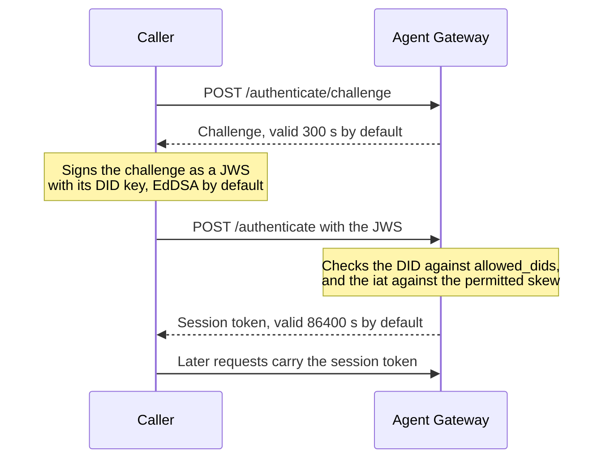

# Source Authentication and Managed Identity

Revision-specific internals of how the gateway authenticates an inbound caller and how
it derives the managed agent's DID. These are separate concerns and the source keeps
them separate: source authentication proves who is calling, managed identity names the
agent the request is on behalf of.

Use the hosted [identity documentation](https://docs.affinidi.com/products/affinidi-trust-fabric/agent-gateway/concepts/identity/)
for product concepts. See [`POLICY.md`](POLICY.md#caller-identity-verification-in-policy-input)
for how a derived DID is graded in policy input, and [`FABRIC.md`](FABRIC.md#peer-issuer-dids)
for attribution on the fabric path.

Implemented in [`src/source_auth/`](../src/source_auth/) and
[`src/didauth/`](../src/didauth/).

## Source authentication

Configured on the Access Point as `caller_authentication.methods`, and on a Transit Point as
`source_auth` (see [Transit Point callers](#transit-point-callers)). Each method is a
`SourceAuthConfig`
([`models.rs`](../src/source_auth/models.rs)), which has five variants.

| Method | Serialized tag | Validates |
| --- | --- | --- |
| JWT bearer | `jwt_bearer` | An inbound bearer token against a JWT verification strategy |
| API key | `api_key` | A key extracted from the request against the secrets store |
| API key provider | `api_key_provider` | A key extracted from the request against the API Key Provider |
| DID Auth | `did_auth` | A DID Auth session token |
| mTLS | `mtls` | A TLS client certificate |

### Which claim names a JWT caller

A JWT verification strategy names the claim that identifies a caller with `principal_claim`
(default `sub`; the API field may be left out). The claim's value is the caller's subject in the
[identity hash](CREDENTIAL_DELEGATION.md#the-callers-identity-hash), and a claim other than `sub`
adds its name to the hash, so it decides which
delegated credentials a caller uses, `input.source_auth.subject`, and the caller key of
per-caller limits. Every method that points at the strategy, on an Access Point or a Transit
Point, identifies callers by the same claim.

- Choose a claim that is unique to one person and that the identity provider never lets them
  change. Microsoft Entra's `sub` is different for each application, so a caller's `sub` in one
  application differs from their `sub` in another; use `oid`, which is the same across a
  tenant's applications. The issuer is part of the hash too, so set `expected_issuer` to the v2
  issuer, `https://login.microsoftonline.com/{tenant-id}/v2.0`, and have the agent's API issue
  v2 access tokens (`requestedAccessTokenVersion: 2` in its app registration manifest). A v1
  access token carries `https://sts.windows.net/{tenant-id}/` instead, so the same `oid` would
  be another caller, and the strategy refuses the token. The issuer names one Entra tenant, and
  a user's `oid` differs in each tenant too, so an agent API that serves several tenants needs
  one strategy per tenant, each its own method. A claim a person can edit, such as an email
  address they control, lets them take another person's name.
- The value must be a non-empty string. A token without the claim, or with a value that is
  empty or not a string, is valid but names no caller: an Access Point answers `403`
  `identity-required` to a request that needs one, and no delegated credential is given. A
  policy still sees the request as authenticated, with `input.source_auth.subject` set to the
  placeholder `<none>`, and every such caller shares the per-caller limit key `jwt:<none>`, as a
  token without `sub` does under the default.
- The claim name is printable ASCII with no spaces, up to 128 characters. It names a top-level
  claim, matched case-sensitively: `Sub` is not `sub`, and `a.b` is a claim named `a.b`, not a
  path into `a`. Claims that name the token, its issuer, audience, client, tenant, session or
  lifetime are refused, since none names a person: `iss`, `aud`, `exp`, `iat`, `nbf`, `jti`,
  `azp`, `client_id`, `tid`, `idp`, `scope`, `scp`, `nonce`, `sid`, `act`, `cnf`, `typ`, `ver`,
  `auth_time`, `amr` and `acr`. Naming `sub` is the default, and is not stored.
- A strategy whose stored `principal_claim` is one the API refuses, such as one written to
  `_storage/` by hand, names no caller: the gateway logs a warning for it at startup, a surface
  save that uses it answers with a `Warning` header, and JWT source authentication through it
  answers `500`.
- `principal_claim` is fixed when the strategy is created. Changing it would change every
  caller's identity hash and orphan the credentials stored under the old ones, so an update that
  names a different claim is refused with `400`, and an update that leaves it out keeps it. To
  use another claim:
  1. Create a new strategy for the issuer that names the claim.
  2. Point every surface method, and every credential provider whose
     `consent_identity_strategy_id` names the old strategy, at the new one.
  3. Delete the old strategy. Nothing checks that it is unused, so a provider still naming it
     would answer its consents with not found.
  4. Have callers connect again, since their identity hashes have changed.

  From step 1 to step 3, token exchange and `jwt-bearer` redemption refuse the issuer's tokens
  with `invalid_grant`, and with them the MCP OAuth path and its consents, so run those steps
  back to back.
- A release older than `principal_claim` ignores the field from the moment it loads the
  strategy: while it runs, the strategy names callers by `sub`, so every caller has another
  identity hash and the grants stored under the claim's hashes are not found. It also removes
  the field from storage the next time it saves the strategy. The API cannot restore it, since
  an update naming the claim is refused as a change: after upgrading again, edit
  `principal_claim` back into the strategy's record under `_storage/jwt_verification_strategies/`
  and restart the gateway (or see [`CONFIGURATION_RELOAD.md`](CONFIGURATION_RELOAD.md) for when
  a reload picks the edit up). Downgrade only with strategies that leave the claim unset.
- Two strategies for the same issuer that name different claims never share a caller: the
  claim's name is part of the hash, so the same person through each is a different caller, with
  credentials of their own, and one person's value in one claim never stands for another
  person's value in the other. A surface save warns when its Access Point, on the surface or in
  a variant, or a Transit Point accepts the issuer through both.
- For token exchange an issuer names callers by one claim in a tenant scope: a tenant's own
  strategies, or the appliance-global ones for a tenant with none. While two strategies of the
  scope name the issuer's callers by different claims, STS refuses that issuer's tokens, for
  every surface in the scope, even one that uses only one of them. Creating or updating such a
  strategy answers with a `Warning` header.
- Token exchange and `jwt-bearer` redemption ([STS](STS.md)) name a subject or actor token's
  subject by the principal claim of the strategy that verified it too, so an exchanged token's
  `sub` and `act.sub` carry that claim's value; on the MCP issuer, a subject from another issuer
  is bound to the issuer and, when the claim is not `sub`, to the claim's name. A credential
  provider's `consent_identity_strategy_id` matches the person who signs in to consent by its
  strategy's claim in the same way. The gateway's own tokens, such as the MCP resource tokens and
  ID-JAGs it issues, name their subject by `sub`.

### Several methods on one Access Point

`methods` is a list, so one surface can accept callers with different credentials, for
example a JWT for internal users and an API key for partner agents, and the managed agent
keeps one identity. The first entry is the primary method. The gateway selects one method
per request ([`select_source_auth_method`](../src/source_auth/models.rs)) and verifies only
that method:

1. The method is the one whose credential the request carries: its header is present and not
   empty (for JWT bearer, `token_header` holding a token in `token_scheme`, so an MPP
   `Authorization: Payment` credential is not a JWT; otherwise `extraction.field`), or, for
   mTLS, a client certificate reached the gateway. No credential is read from the body, so a
   method that extracts from `mcp_meta` or `a2a_extension` is allowed only as the sole method.
2. A request that carries no method's credential is checked against the primary method, so
   it fails as a missing credential of that method.
3. A request that carries credentials for more than one method fails source authentication
   as the primary method, audited as `ambiguous_credentials`, and neither credential is
   verified, so a caller can't choose the identity the gateway asserts. Like any failed
   credential, it is refused on a closed Access Point, with `on_failure: reject` or beside
   protected resource metadata, and otherwise passed to policy as
   `input.source_auth.method == "failed"`. This includes a JWT or API key sent over a
   connection that presents a client certificate, on a surface that also accepts mTLS, and an
   MCP client's own `Bearer` token sent beside an API key when a JWT bearer method reads
   `Authorization`: the gateway cannot tell whose token it is.
4. A rejected credential is never retried with another method.

The order of the other methods has no effect.

Policy sees the method that verified the caller as `input.source_auth.method`, so a rule can
treat callers differently by method:

```rego
package surface.policy

default allow := false

allow if input.source_auth.method == "jwt_bearer"

allow if {
    input.source_auth.method == "api_key"
    input.source_auth.key_name == "partner-keys"
}
```

For `api_key`, `key_name` is the method's `secret_id`. An `api_key_provider` caller also
reports `method: "api_key"`, with the provider's key id as `key_name`, so a policy tells the
two API key methods apart by `key_name`.

Creating or saving a surface, and each of its enabled variants as resolved, refuses:

- two methods that read the same credential location: the same header, compared without
  regard to case, both `mcp_meta`, both `a2a_extension`, or two mTLS methods;
- a method that reads `mcp_meta` or `a2a_extension` when there is more than one method, since
  it could never be selected;
- more than one `did_auth` method, because the `/authenticate` endpoints serve one;
- a `from_jwt_claim` identity, in any identity slot or Transit Point override, unless every
  method is `jwt_bearer`;
- an inbound `from_api_key` identity unless every method is `api_key` or `api_key_provider`;
- on an Access Point that publishes protected resource metadata, a JWT bearer method other
  than the primary: the discovery audience and challenge belong to the primary method.

Both identity rules follow from the caller: `from_jwt_claim` needs a verified JWT and
`from_api_key` a verified key. So a surface mixing JWT and API key callers takes a stored or
static inbound identity, and policy tells its callers apart by `input.source_auth.method` and
`key_name`.

On an Access Point that publishes protected resource metadata, every caller-attributable
failure is refused before policy: a failed JWT with the discovery challenge, and a failed
credential of any other method with a plain `401`, so a bad credential never gets further
than none. This holds directly and over Fabric.

**Upgrading and rolling back.** Upgrading turns on every method of a stored surface: earlier
releases enforced only the first and ignored the rest, so a caller presenting a later method's
credential, which failed before, is now authenticated. Audit `caller_authentication.methods`,
on each surface and each variant override, before upgrading. At startup the gateway logs, at
`WARN`, one line per surface and per variant with more than one method, naming the methods
after the first ([`additional_source_auth_method_notices`](../src/config/proxy.rs)); the line
repeats on every start.

Surfaces stored before these rules may break them, because the gateway then enforced only the
first method and ignored the rest. Wherever surfaces load, at startup (from local storage,
DynamoDB or its cache), on a configuration or single-surface reload, and when a storage event
applies a surface another process wrote, a stored surface whose methods break them keeps only
its first method, when that method is valid alone, and so does each enabled variant overriding
its caller authentication ([`fall_back_to_first_source_auth_method`](../src/config/proxy.rs)).
The gateway logs an error naming the surface, the rule and each dropped method by tag,
credential location and non-secret references (strategy, secret, provider agent,
certificates), so it can be rebuilt. An active node's load persists the correction to local
storage ([`fall_back_to_first_source_auth_methods`](../src/surfaces/store.rs)); a standby
node, a storage event and a DynamoDB-sourced surface are corrected in memory only. A stored
`from_jwt_claim` identity beside a method other than `jwt_bearer`, or an inbound
`from_api_key` identity beside a method other than an API key, is logged as a warning at
startup and refused on the next save.

Before rolling back to a release that enforces only the first method, remove every method but
the first. That release strips only the first method's header, so it would forward a later
method's credential, such as a partner's `X-API-Key`, to the Target.

The credential headers of every method are stripped before a request is forwarded, on each
inbound, mirror, Fabric and agent-card path. A JWT bearer method with `forward_header`
forwards its header only when it was the method selected for that request, so a request
carrying several credentials forwards none. A `forward_header` method whose `token_header` is
`Cookie` forwards nothing, since an Access Point never forwards `Cookie`.

An Access Point never forwards its caller's `Cookie` to the managed agent, directly or over
Fabric, a gateway receiving a Fabric request drops a `Cookie` its peer sent, and an MCP Proxy
never forwards its caller's `Cookie` to its REST API; a REST API that takes a cookie gets it
from a tool argument its OpenAPI specification declares. The cookies
belong to the host the caller called, which serves the dashboard too, so its session cookie
would otherwise reach the agent. For the same reason an Access Point's answer carries no
`Set-Cookie` the agent sent, so the agent cannot set a cookie on the dashboard's host. An
agent that needs session affinity or its own session must take it from a header, such as one
the agent returns in its answer and the caller sends back, not from a cookie.

A JWT bearer token is accepted only when it is signed with an RS256, RS384, RS512, ES256,
ES384 or EdDSA key from the strategy's key set, its `iss` equals the strategy's expected
issuer, it has an `exp` that has not passed and, when it has an `nbf`, that time has come,
each with 60 seconds of leeway. `aud` must name one of the method's `audiences`; an empty
list skips that check, except on an MCP Access Point that publishes protected resource
metadata, where `aud` must name the resource of the route called.

An MCP Access Point whose first method is JWT bearer can also publish RFC 9728 protected
resource metadata naming the authorization server that issues its tokens, with
`caller_authentication.protected_resource`. See
[`MCP_METADATA.md`](MCP_METADATA.md#authorization-server-discovery-for-caller-authentication),
and [Choosing How an MCP Access Point Checks Tokens](MCP_METADATA.md#choosing-how-an-mcp-access-point-checks-tokens)
for when to use it instead of the gateway STS Resource Server path.

The gateway builds one source authentication middleware at startup. If its JWT
verification strategy store (`jwt_verification_strategies/`, next to the secrets storage
directory) cannot be opened, the gateway refuses to start and names that path, rather
than serving surfaces whose caller authentication would be skipped. A request, direct or
over Fabric, that reaches a surface with caller authentication configured while no middleware
is installed is refused with `500` rather than forwarded unauthenticated.

### Closed and public Access Points

`access_point.public` and `caller_authentication.on_failure` decide whether an Access Point
admits callers without a valid credential
([`agent_surface.rs`](../src/config/agent_surface.rs)).

| `access_point.public` | Meaning |
| --- | --- |
| absent | A legacy surface: one the admin API did not create, such as a surface built from DynamoDB or restored or edited by hand without the field. It keeps the behaviour its stored fields describe: no `caller_authentication` admits every caller, and `on_failure` defaults to `continue`. |
| `false` | Closed. The admin API writes it on every surface it creates when the request does not set `public: true`. A failed caller is refused whatever `on_failure` stores, including on a surface edited by hand. |
| `true` | Public: callers without credentials are admitted. On every save the admin API sets `caller_authentication.on_failure` to `continue`, on the base and on every variant override that sets `caller_authentication`, so a caller whose credential fails goes on to policy. Every save answers with a `Warning` header. |

On a closed surface the admin API, on create and on every update:

- saves a surface, or an enabled variant, whose Access Point has no `caller_authentication`
  method, and answers with a `Warning` header saying it is not ready for external access. An MCP
  Access Point protected by `mcp_http.authorization` counts as authenticating its callers;
- sets `caller_authentication.on_failure` to `reject`, on the base and on every variant
  override that sets `caller_authentication`;
- keeps the stored `public` value when an update leaves it out, so a client that drops the
  field cannot reopen the surface.

#### Not ready Access Points

A closed Access Point (`public: false`) without source authentication (no
`caller_authentication` method and, on MCP, no `mcp_http.authorization`) is not ready for
external access. Only `public: false` closes an Access Point: a legacy surface with
`on_failure: reject` and no method stays ready and admits every caller. The state is derived
from the surface as served, base or variant, and never stored, so the Access Point serves as
soon as a save adds source authentication or sets `public: true`. Until then it refuses every
request, discovery reads included, with `503` before source authentication, policy and the
target, on direct inbound, `proxy://` MCP Targets, `a2a-proxy://` Targets and Fabric receive.
MCP callers get a JSON-RPC error carrying the request id; other callers get
`application/problem+json`. The body says only that the Access Point is not available; the
reason is logged, and each refusal is recorded in the Audit Log as `request_rejected` with the
reason `access_point_not_ready`. Legacy and public Access Points are always ready for this
reason, and so are onboarding surfaces, which capture a request and never forward it. A surface
that derives a DID from an API key it may not use is not ready too, whatever its Access Point;
see [Provider keys when a surface goes live](#provider-keys-when-a-surface-goes-live).

Surface responses carry a read-only top-level `access_point_status`, `ready` or
`not_ready`, for the surface the Access Point URL serves: the default variant when the surface
has one, otherwise the base. Variant responses carry it for that variant. `ready` does not mean
the surface serves: a surface refused for its API Key Provider keys stays `ready` and answers
`503`. Look for `rule="provider_key_tenant"` in the gateway log; see
[Provider keys when a surface goes live](#provider-keys-when-a-surface-goes-live).

On a closed surface, or with `on_failure: reject`, a missing or invalid credential is refused
with `401` before policy and the target, on direct inbound, `proxy://` MCP Targets,
`a2a-proxy://` Targets and Fabric receive. These refusals return before the surface rate limit,
so they don't use up its budget: an anonymous caller can't exhaust the budget of the callers it
protects, and repeated wrong credentials aren't throttled by it either. Use high-entropy API keys
and limit requests per client upstream of the gateway if credential guessing is a concern. MCP callers get a JSON-RPC error carrying the request id; other callers get
`application/problem+json`. A JWT bearer method adds a `WWW-Authenticate: Bearer` header. The refusal says only that the credential
is missing or invalid; the reason is logged. Public discovery reads, the DID Auth ceremony and
onboarding surfaces are unaffected.

Create and update responses are the saved surface plus `access_point_status`. A save warns
in `Warning` headers (code 299), before the Transit Point warnings described below, when the
Access Point is public, when it or an enabled variant is not ready (a variant's warning is
prefixed `variant '<alias>': `), and when a legacy surface authenticates no caller and so
admits every caller. A write request that sends a response back unchanged has its top-level
`access_point_status` dropped before parsing.

A gateway rolled back to a release without these fields cannot load the surfaces that store
them, which is every surface created after the upgrade; see
[Upgrading and rolling back](#upgrading-and-rolling-back).

### Failed credentials with `on_failure: continue`

With `on_failure: continue`, a missing or invalid credential does not refuse the request.
That includes an mTLS certificate that lacks the configured binding field. The request
continues with no caller identity, and policy sees `input.source_auth` as
`{"method": "failed", "attempted_method": ..., "reason": ...}`. Only server-side errors,
such as missing configuration or an internal failure, block the request with `500`
([`errors.rs`](../src/source_auth/errors.rs)). Such a request, including one that carries
credentials for more than one method (`ambiguous_credentials`), is forwarded without the
surface's stored target credential, or the A2A proxy's Direct Line secret, on each inbound
and Fabric forwarding path: direct inbound, `proxy://` MCP Targets, `a2a-proxy://` Targets,
Fabric send and Fabric receive. A Transit Point refuses such a caller itself (see
[Transit Point callers](#transit-point-callers)). A surface with no caller authentication at
all sends that credential for every caller, and is held to
[`target_source_auth`](CREDENTIAL_DELEGATION.md#target-credential-rules-on-the-request-path):
in `warn` a warning is logged once, in `enforce` the credential is withheld and a new or
changed Target authentication, or a new `a2a-proxy://` Target, on such a surface is refused on
save. To reject
unauthenticated callers at such an Access Point, close it (`public: false` with caller
authentication), or attach a policy that denies them:

```rego
package surface.policy

default allow := false

allow if not deny

deny if input.source_auth.method == "failed"
```

See [`POLICY.md`](POLICY.md#failed-caller-authentication).

A request to an MCP Access Point that publishes protected resource metadata, direct or over
Fabric, is the exception: a missing or invalid JWT is refused with a `401` (the discovery
challenge on a direct request), see
[`MCP_METADATA.md`](MCP_METADATA.md#authorization-server-discovery-for-caller-authentication).

### mTLS

Two trust modes, in [`MtlsTrust`](../src/source_auth/models.rs):

| Mode | Behaviour |
| --- | --- |
| `Pinned { certificate_ids }` | Accepts only those exact certificates, matched by SHA-256 fingerprint of the stored leaf DER. No chain verification. References certificates whose `kind == ClientLeaf`. |
| `Ca { ca_certificate_ids, … }` | Verifies that the presented leaf chains to one of the configured CAs. References certificates whose `kind == Ca`, and can require the TLS Client extended key usage. |

The identity taken from the certificate is chosen by `MtlsIdentityBinding`. Every mode
except `Fingerprint` fails at runtime when the certificate does not carry the field.

| Binding | Takes |
| --- | --- |
| `fingerprint` | Lowercase hex SHA-256 of the leaf DER. Always available. |
| `subject_cn` | Subject Common Name |
| `dns_san` | First DNS SubjectAltName |
| `uri_san` | First URI SubjectAltName. SPIFFE IDs arrive through this mode. |
| `ip_san` | First IP SubjectAltName, rendered canonically |
| `subject_rdn { oid }` | An arbitrary RDN by OID from the Subject DN, for example UID as `0.9.2342.19200300.100.1.1` |

The certificate reaches the gateway either from a directly terminated TLS handshake or
forwarded as an XFCC header from a proxy listed in `tls.client_auth.trusted_proxies`.
An XFCC header from any other source is not trusted.

### DID Auth

A two-step ceremony: `POST /authenticate/challenge` issues a challenge, and
`POST /authenticate` accepts a JWS over it. Either request body may hold at most 64 KiB; a
larger one is refused with HTTP `413` before it is parsed.



| Setting | Default | Notes |
| --- | --- | --- |
| `allowed_dids` | empty | Empty means any DID is accepted, so a surface with it takes no binding with external consent ([`CREDENTIAL_DELEGATION.md`](CREDENTIAL_DELEGATION.md#external-consent-on-a-transit-point)) |
| `challenge_ttl_seconds` | 300 | Capped at 3600. A longer challenge widens the replay window. |
| `session_ttl_seconds` | 86400 | Capped at 86400. A session is a bearer token. Only the first caller-authentication method mints sessions, so the cap applies to the surface's first method and to each variant's own. A save that sets a value above the cap is refused; a stored value above it still loads, is named in a `WARN` at startup, and its sessions last 86400 seconds, and a save that keeps it is accepted. |
| `allowed_algorithms` | `["EdDSA"]` | The verifier recognises `EdDSA` and `ES256`; a value outside that set is rejected at validation time |

`IAT_SKEW_SECONDS` is 120 ([`verify.rs`](../src/didauth/verify.rs)). A JWS is rejected
when its `iat` is more than 120 seconds in the future. The backdating allowance is
wider, at 30 times that value.

A session authenticates only at the view it was minted on: the surface, and the variant
whose `/authenticate` minted it, or the base surface. Every request it carries is checked
again against that view's `allowed_dids` as they are then, so a DID removed from the list,
or left out of a list added since, is refused at once, not when its session expires. No
session authenticates more than 86400 seconds after it was minted.

Sessions are kept in the `didauth` subdirectory of `[storage_paths] sessions`, apart
from dashboard sessions. At startup the gateway moves any DID Auth session files it
finds in `sessions` itself into that subdirectory.

Workload Binding supports `caller_source: did`, which tags the Workload Binding
presentation with the caller's identity hash as `user_hash` (see
[`CREDENTIAL_DELEGATION.md`](CREDENTIAL_DELEGATION.md#the-callers-identity-hash)).

### Authorization server metadata module (developer reference)

[`src/authz_metadata/`](../src/authz_metadata/) fetches and validates an authorization
server's metadata document and returns the issuer, the URL the document came from, the
`token_endpoint` and the `jwks_uri`. An issuer is acceptable only when it has no whitespace,
Unicode spaces such as a no-break space or a line separator included, and no control
character anywhere, leading, trailing or inside; the raw string is checked before it is
parsed, and a failure is `invalid_url` before any DNS lookup or request.
Let P be the issuer path with its trailing slashes removed. An origin issuer (empty P, with or
without a trailing slash) has two attempts, in this order: `{origin}/.well-known/oauth-authorization-server`
(RFC 8414), then `{origin}/.well-known/openid-configuration`. A path issuer has three: the
RFC 8414 URL with P inserted after the well-known name
(`{origin}/.well-known/oauth-authorization-server{P}`), the OpenID Connect URL with P inserted
(`{origin}/.well-known/openid-configuration{P}`), then the OpenID Connect URL with P appended
(`{origin}{P}/.well-known/openid-configuration`). The first acceptable document wins. The
`issuer` in the document must equal the requested issuer byte for byte. `token_endpoint` and
`jwks_uri` are both required, `jwks_uri` too although RFC 8414 makes it optional, because the
gateway validates JWT access tokens and needs the issuer's keys; a document without either is
`invalid_document`. Both must be absolute `http` or
`https` URLs of at most 2048 characters, with no whitespace, control characters,
credentials or fragment, not a cloud-metadata address, and not a weaker scheme than the
issuer: an `https` issuer with an `http` endpoint is an invalid document under every posture.
The schemes are compared as parsed, so their case does not matter.

The client profile (`discover_client`, `parse_client_metadata`) reads the same documents
for an OAuth client of the server, such as a credential provider checked against its
issuer (see [`CREDENTIAL_DELEGATION.md`](CREDENTIAL_DELEGATION.md#external-consent-providers)).
It requires `authorization_endpoint` and `token_endpoint`, and makes `jwks_uri` optional:
many authorization servers publish none, and a client that never validates the server's JWTs
does not need its keys. It also returns `revocation_endpoint`, `registration_endpoint`,
`code_challenge_methods_supported`, `token_endpoint_auth_methods_supported` and
`authorization_response_iss_parameter_supported` when the document has them. Every endpoint
it reads passes the endpoint rules above, the method lists must be arrays of strings and the
flag a boolean, and a member that is `null` counts as absent. The inbound profile
(`discover`, `parse_metadata`) is unchanged and still requires `jwks_uri`.

| Limit | Value |
| --- | --- |
| Body size | 64 KiB (`MAX_METADATA_BYTES`), set per call by `DiscoveryOptions::max_bytes` |
| Timeout | 10 s, set per call by `DiscoveryOptions::timeout`, applied once to resolving the host and again to the HTTP request from connecting to reading the last byte. One fetch can take up to twice the timeout, and `discover` can make three fetches for a path issuer and two for an origin issuer, so up to six or four times the timeout in all |
| Redirects | Refused |
| DNS | The egress guard can resolve the host more than once; the connection is pinned to the addresses of the last, vetted resolution. An IPv6 literal host cannot be pinned and fails as `blocked`. Pinning does not hold when a proxy is configured: inbound JWT and MCP discovery read `HTTPS_PROXY`, `HTTP_PROXY` and `ALL_PROXY` (also in lower case) and, on macOS and Windows, the system proxy settings, and the proxy resolves the host again and connects to an address nobody vetted. Only a fetch with `DiscoveryOptions::direct`, which an external consent provider's issuer metadata uses, ignores every proxy and always connects directly |
| Status | Only a 2xx response is read |

The caller chooses an `EgressPosture`. `Strict` accepts `https` only: `get_bounded` and
`discover` refuse an `http` URL or an `http` issuer as `invalid_url` before any DNS lookup or
request, and an `http` `token_endpoint` or `jwks_uri` makes the document invalid. `Strict` also
blocks loopback, unspecified, RFC 1918, link-local and unique-local addresses.
`CloudMetadataOnly` accepts `http` and `https`, for operator-trusted callers such as a local
authorization server, and blocks only cloud-metadata addresses, allowing loopback and private
ranges. An `http` issuer, possible only under `CloudMetadataOnly`, may have `http` or `https`
endpoints. The posture
applies to the metadata URL at fetch time. It also applies to the discovered
`token_endpoint` and `jwks_uri` at parse time, where under `Strict` a literal IP host or a
`localhost` name in a blocked range makes the document invalid. A name that only resolves to
a private address cannot be known without DNS, so it passes parsing. The caller must therefore
fetch these URLs with `get_bounded`, or another pinned client, under the same posture, which
blocks such a name at fetch time. The JWT Bearer `JwksFetcher` always uses the
cloud-metadata-only pinned client, so a `jwks_uri` discovered under `Strict` must not be
handed to it; fetch it with `get_bounded` under `Strict`.

A failure is a `DiscoveryError`. `failure()` returns the `DiscoveryFailure`, `code()` a
stable string, `message()` fixed text that is safe in an API response (it never carries a
resolved address or a transport error) and `detail()` text for logs only. The error's
`Display` output includes the detail, so it is for logs only too. Both `code()` and
`message()` reveal the kind of failure, for example that a host is blocked or unreachable, so
a caller that serves untrusted parties should log them and return one generic message
instead.

| `code()` | Meaning |
| --- | --- |
| `invalid_url` | The URL or issuer is not an absolute `http` or `https` URL without credentials (`https` only under `Strict`), the issuer has a query or fragment, or the issuer contains whitespace or control characters |
| `blocked` | The egress posture refused the URL or its resolved address, the host name did not resolve, or the host is an IPv6 literal |
| `unreachable` | Resolving the host timed out, the connection failed or timed out, or the body could not be read in time |
| `http_status` | The server answered with a status outside 2xx, including a redirect |
| `too_large` | The body exceeded the size limit |
| `invalid_document` | The body is not a JSON object, or a required field is missing or unacceptable, including an endpoint with a weaker scheme than the issuer or, under `Strict`, a non-`https` endpoint |
| `issuer_mismatch` | The document's `issuer` differs from the requested issuer |

`discover` tries the URLs in order and stops at once on `invalid_url`, `blocked` or
`unreachable`. Otherwise, when every attempt fails, it returns the most specific failure among
all of them, from least to most specific: `http_status`,
`too_large`, `invalid_document`, `issuer_mismatch`.

| Function | Use |
| --- | --- |
| `discover(issuer, posture, options)` | Fetches and validates, trying the URLs in order |
| `discover_client(issuer, posture, options)` | As `discover`, under the client profile |
| `parse_client_metadata(body, issuer, metadata_url, posture)` | Pure: validates a document already in hand under the client profile |
| `metadata_urls(issuer)` | Pure: the candidate URLs for an issuer, in order: two for an origin issuer, three for a path issuer |
| `validate_issuer(issuer, posture)` | Pure: the issuer checks `discover` makes before any request; protected resource metadata uses it for the authorization servers it advertises |
| `parse_metadata(body, issuer, metadata_url, posture)` | Pure: validates a document already in hand |
| `get_bounded(url, posture, options)` | The pinned, bounded GET, reusable for a JWKS fetch |

```rust
use crate::authz_metadata::{discover, DiscoveryOptions, EgressPosture};

match discover(issuer, EgressPosture::Strict, DiscoveryOptions::default()).await {
    Ok(metadata) => use_endpoints(&metadata.token_endpoint, &metadata.jwks_uri),
    Err(error) => {
        tracing::warn!(code = error.code(), detail = error.detail(), "discovery failed");
        respond_with("The authorization server could not be reached");
    }
}
```

The module has no metrics, audit or storage coupling and no tenancy or strategy types in its
signatures, so callers record outcomes themselves from `code()`.

## Transit Point callers

Every Transit Point authenticates its callers in at least one of these ways, all set on the
Transit Point:

| Way | Set with | Use it when |
| --- | --- | --- |
| [Transit token](#transit-token) | `require_transit_token: true`, the default | The caller is the surface's managed agent, serving a request that came through the Access Point or, over Fabric, from a paired gateway. The token names that request's caller |
| Resource access token | `mcp_http.authorization`, MCP Transit Points only | The caller can obtain an access token for the Transit Point from the gateway's STS (see [`MCP_METADATA.md`](MCP_METADATA.md)) |
| [Source authentication](#transit-point-source-authentication) | `source_auth` | The caller holds a credential of its own: an API key, a JWT from an identity provider, or a client certificate. Agents that cannot carry a transit token, such as cloud-hosted ones like Copilot Studio, use this |

A Transit Point that sets none of them must say so with `allow_unauthenticated_callers: true`.
It then serves anyone who reaches it, through this gateway and with its target credentials,
such as a `target_auth` key. Set it only on a Transit Point that sends no credential, or one
only trusted callers can reach: its outbound listener bound to loopback, with no external URL
other hosts reach, and no inbound listener sharing a host name with it (see
[Reachable from other hosts](#reachable-from-other-hosts)).

The admin API refuses with `400`, on the surface or in a variant's overrides, a Transit Point
that:

- authenticates no caller and does not set `allow_unauthenticated_callers`;
- sets `allow_unauthenticated_callers` but authenticates its callers;
- sets both `source_auth` and `mcp_http.authorization`;
- sets a `source_auth` a Transit Point does not support, such as a `jwt_bearer` that names no
  audience, or one the Access Point's rules refuse, such as mTLS trust that names no
  certificate;
- sets `delegated_credentials_for_fabric_callers` but does not require a transit token, the
  only way a Fabric caller reaches it (see [Transit token](#transit-token)).

A Transit Point that sets `delegated_credentials_for_fabric_callers` on a surface, or in a
variant, whose Access Point caller authentication cannot tell a partner's users apart (anything
but a resource token, or a `jwt_bearer` method that names an audience through a JWT
verification strategy that names an issuer) is saved with a `Warning` header saying so, and
releases nothing to Fabric callers. With `api_key`, for example, every key in the secret, the
partner's and direct callers' alike, would be one caller with one grant (see
[`CREDENTIAL_DELEGATION.md`](CREDENTIAL_DELEGATION.md#the-caller-on-a-transit-point)).

A surface stored with such a Transit Point still loads, with a warning in the log naming the
Transit Point and, for one a variant defines, the variant, but the Transit Point refuses every
request with `503`, discovery reads included. Two kinds serve their callers instead: a Transit
Point that sets `allow_unauthenticated_callers` but authenticates its callers keeps
authenticating them, and one that sets `delegated_credentials_for_fabric_callers` without
requiring a transit token serves its callers as before and releases nothing to Fabric callers,
since it never reads the token that names them. The caller of a refused request is told only
that the Transit Point is unavailable, as a JSON-RPC error on an MCP Transit Point and a problem
JSON otherwise; the reason is logged.

`transit.source_auth`, on the surface's `transit` block rather than a Transit Point, is not
enforced. The admin API refuses a surface that sets it, on the surface or in a variant's
overrides, with `400`. A surface stored with it, on the surface or in a variant's overrides,
still loads, with a warning in the log, but its Transit Points refuse every request with `503`
in the same way; one set only in a variant refuses that variant's requests. A variant never
lifts the surface's refusal, a complete variant whose shared transit settings leave
`source_auth` out included.

The Surface Builder's Transit Point panel has a **Who can call this Transit Point** section
with the transit token switch, a **Caller authentication** choice (an API key from the secret
store or from the provider, or a JWT bearer with its strategy, audiences, token header and
scheme), and an **Open to any caller** switch that asks for confirmation. The switch shows
while the Transit Point has no transit token, `source_auth` or `mcp_http.authorization`, and
while it is already marked open; choosing the token or a method turns the marking off. An
empty token scheme is allowed: the gateway then reads the token as the raw header value. The
API key provider validates the surface's own keys, the same keys an Access Point using the
provider accepts, so the panel warns that the Access Point's callers can call the Transit Point
too; an API key from the secret store keeps a separate set of callers. A dashboard save writes
the provider's `agent_id` from the surface being saved, so a Transit Point copied from a
template accepts the new surface's keys, not the original's. A `source_auth` set through the API with
mTLS shows as such and is kept; the panel does not edit it, nor DID Auth, which a Transit
Point does not support. The panel applies the rules above before the save: a Transit Point that
authenticates no caller and is not open, one that is open beside the token or a method, and a
method that is missing its secret, header, strategy or audience cannot be saved, and the panel
says why. A refusal from the admin API shows in the same section in plain words. Turning
caller authentication off sends `"source_auth": null`. The panel does not show
`delegated_credentials_for_fabric_callers`; a dashboard save keeps it while the Transit Point
still requires the transit token and the surface's caller authentication still tells a
partner's users apart.

These rules hold for a `PUT` of the surface and for a `PUT`
of one variant (`PUT /v1/surfaces/{id}/variants/{variant_id}`), for the Transit Points its
overrides list. An omitted `source_auth` in a `PUT` keeps the stored
one; `"source_auth": null` removes it, and so does a merge `PATCH` of the surface or the
variant whose `transit.points` leave it out, since a merge patch replaces the whole list. The
save rules above then apply, so a Transit Point left with no caller authentication is refused
with `400` unless it requires a transit token or is marked `allow_unauthenticated_callers`. A
`PUT` that omits `allow_unauthenticated_callers` keeps it while the Transit Point still
authenticates no caller, and drops it once the Transit Point authenticates its callers. A
`PUT` that omits `delegated_credentials_for_fabric_callers` keeps it while the Transit Point
still requires a transit token, and drops it once it does not; a value the `PUT` sends is
saved. A `PUT` matches each Transit Point to the stored one by `id`, and a Transit Point sent without
an `id` gets a new one, so a `PUT` that omits both the `id` and `source_auth` drops the stored
`source_auth`: a Transit Point that still requires a transit token is saved, authenticated by
the token alone, and one that does not is refused with `400`. Send each Transit Point's `id`
back. A Transit Point with a `consent_mode: external` binding is the exception: sent without
its `id`, it keeps the stored id of the Transit Point with its alias in the same list, so it
keeps these stored settings too
([`CREDENTIAL_DELEGATION.md`](CREDENTIAL_DELEGATION.md#when-a-binding-is-removed)). A write's
`transit_point_source_auth` is ignored (see below), so the dashboard never sends it.

### Upgrading and rolling back

A release that predates Transit Point `source_auth` ignores a Transit Point's `source_auth`
and `allow_unauthenticated_callers`. It would serve a Transit Point that relies on
`source_auth` to anyone who reaches it, with its `target_auth` credential, when the transit
token is off, and without the `source_auth` check when it is on. So a surface with a Transit
Point that uses `source_auth`, on the base or in a variant, is stored with
`transit_point_source_auth: true`. The gateway sets it on every save and when it loads a
stored surface, including one written outside the API, and drops it once no Transit Point
uses `source_auth`; a value a write sends is ignored. A release that predates it refuses that
whole surface at load (it skips and logs it) instead of serving its Transit Points without
`source_auth`: on such a release the surface is down, not open.

- Upgrade every node that serves the same storage, Active and Standby, before giving any
  Transit Point `source_auth`.
- Do not roll back to such a release while any Transit Point uses `source_auth`. To roll
  back, first remove `source_auth` from each one, base and variant, and turn its transit token
  back on, or delete the surface. Then check that no surface still carries
  `transit_point_source_auth`, which the older release skips: a `GET` of the surface shows it,
  and so do the stored records under `_storage/agent_surfaces/` unless storage encryption at
  rest is on, which stores them encrypted.
- A Surface Template's surface is marked the same way: the gateway sets
  `transit_point_source_auth: true` inside it while a Transit Point there, base or variant,
  uses `source_auth`, on every save and when it loads a stored template, and drops it
  otherwise. An older release still loads the template, but its admin API refuses a surface
  created from that surface as it is. The dashboard builds a new surface from a template's
  elements instead and does not carry the mark, nor a Transit Point's `source_auth`, so before
  rolling back, also remove `source_auth` from such templates, or back up
  `_storage/agent_surface_templates/` before upgrading and restore it on rollback. Templates
  are always stored as plain JSON.
- A release that predates closed Access Points rejects `access_point.public` and
  `caller_authentication.on_failure` (both reject unknown fields), so it skips, with a logged
  error, every surface that stores either one. That is every surface the admin API or the
  dashboard created after the upgrade, and every surface an operator closed or opened since.
  Their routes answer `404` and they leave the dashboard and Fabric discovery: they are down,
  not open. The records stay on disk and load again once the upgrade is reapplied. Removing
  the fields to load such a surface on the older release opens it: one without source
  authentication then admits every caller, and one with it hands a failed caller to policy.
  Back up `_storage/agent_surfaces/` before upgrading.

### Transit Point source authentication

A Transit Point's `source_auth` takes the same configuration as an Access Point's
`caller_authentication` method, and the same source authentication middleware checks it,
before the gateway reads anything else from the request, checks a transit token, applies a
limit or resolves a credential:

```json
{
  "alias": "crm",
  "protocol": "mcp",
  "target_endpoint": "https://crm.example/mcp",
  "require_transit_token": false,
  "source_auth": {
    "type": "api_key",
    "extraction": { "source": "http_header", "field": "X-API-Key" },
    "secret_id": "copilot-crm-callers"
  }
}
```

| Method | On a Transit Point |
| --- | --- |
| `api_key`, `api_key_provider` | Read from an HTTP header only |
| `jwt_bearer` | `forward_header` must be `false`, and `audiences` must name at least one audience. Give the Transit Point an audience of its own: with the Access Point's strategy and an audience the Access Point also accepts, on the surface or an enabled variant, a token issued for the Access Point is accepted here too, so any caller of the Access Point can call the Transit Point directly, and a save answers with a `Warning` header saying so. An MCP Access Point that publishes protected resource metadata accepts the resource of each of its routes, so a Transit Point audience that names one of them counts too. Use one JWT verification strategy per issuer on a surface: the identity hash keys a JWT caller by its issuer, subject and principal claim, so a caller verified through another strategy that names the same `expected_issuer` and the same `principal_claim`, on the Access Point or another Transit Point, is the same caller, with the same delegated credentials, and through one that names another claim is another caller. Either way a save answers with a `Warning` header naming both strategies. An audience of `{{ surface.agent_did }}` means the surface's agent DID, as on an Access Point |
| `mtls` | The certificate from the outbound listener's own TLS handshake (`[tls.client_auth] direct`, on an `https` outbound listener), or from the forwarded-client-cert header of a proxy in `trusted_proxies` |
| `did_auth` | Not supported: a Transit Point serves no DID Auth challenge |

The secret, JWT verification strategy, API-key parent or certificates a Transit Point's
`source_auth` names are checked on save as an Access Point's are: a tenant access token can
name only its own tenant's or appliance-wide ones (see
[`ACCESS_TOKENS.md`](ACCESS_TOKENS.md)).

Unlike an Access Point, a Transit Point refuses a caller whose credential is missing or
refused, with `401` saying only `Caller credential missing or invalid`, as a JSON-RPC error
(`-32001`, id `null`) on an MCP Transit Point and a problem JSON on any other;
which check failed is logged, and the refusal is recorded as an `auth_failed` audit event (see
[`OBSERVABILITY.md`](OBSERVABILITY.md)). Failed attempts are not throttled: protect a Transit
Point reachable from untrusted networks with a strong key or certificate, and watch those
events. The admitted caller is named on the Transit Point's policy decision and delegation
audit records. A check the gateway cannot run, such as a secret, strategy,
JWKS or certificate it cannot load, is refused with `503` as unavailable. Nothing of a
refused request reaches the target. The credential's header is removed from an admitted
request, so the target never receives the caller's key or token. A Transit Point that also
requires a transit token needs both: `source_auth` first, then the token.

A request that reaches a Transit Point through an inbound listener's `/outbound` route (see
[Reachable from other hosts](#reachable-from-other-hosts)) carries no client
certificate: that route never passes on the forwarded-client-cert header, because the
outbound listener sees the gateway itself as the peer. A Transit Point with `mtls`
`source_auth` is called on its outbound listener directly, or through a trusted proxy.

The verified caller is in the Transit Point's policy input as `input.transit.client`, with
`verification: "source_auth"`, apart from `input.transit.caller`, the end user a transit token
names (see
[`POLICY.md`](POLICY.md#caller-in-transit-point-policy-input)), and `input.source_auth`
carries the identity with a JWT's claims. The caller's principal, and so its identity hash,
is:

| Method | Principal | So |
| --- | --- | --- |
| `jwt_bearer` | The value of the strategy's [`principal_claim`](#which-claim-names-a-jwt-caller) (`sub` by default) | One caller per issuer, subject and principal claim. A token without a non-empty string in that claim names no caller: it has no identity hash, so no delegated credentials |
| `api_key` | The `secret_id` | Every key in the secret is the same caller; give each caller a secret of its own to tell them apart |
| `api_key_provider` | The key's id | One caller per issued key |
| `mtls` | The principal the `identity_binding` derives | One caller per trusted CA (its subject and key, or the pinned certificate) and bound principal |

A Workload Binding on the Transit Point with `caller_source: authorization_bearer_jwt` binds the
claims of the JWT the Transit Point verified (its `source_auth` or `mcp_http.authorization`),
whichever header carried it. A caller verified another way (API key, mTLS) binds no claims. A
Transit Point that authenticated no caller reads the `Authorization` header as sent, which the
gateway has not verified, so give such a Transit Point `source_auth` before binding its claims.

The identity hash covers the method, the issuer (the JWT `iss`, the API Key Provider agent,
a hash of the subject and public key of the CA an mTLS client certificate was verified against), the
surface's tenant and the principal (see
[`CREDENTIAL_DELEGATION.md`](CREDENTIAL_DELEGATION.md#the-callers-identity-hash)). It is the
value an Access Point puts in the transit token for a caller it authenticated the same way, so
a Transit Point that trusts the Access Point's issuer for the same subjects reaches the grants
those users consented to, while a JWT from another issuer, or an API key secret named like a
JWT subject, is another caller with grants of its own.

### Reachable from other hosts

A Transit Point is reachable from other hosts when its outbound listener binds an address
other than loopback (`0.0.0.0` included), or has an external URL whose host is not
`localhost` or a loopback or unspecified address, or when an inbound listener that does either
shares a host name with the outbound listener, which makes that inbound listener pass
`/outbound/...` requests on to it. A private or link-local address counts: every workload on
that network reaches it. Any other host name counts too. The example configuration's
`http://localhost` URLs on both listeners are enough for an inbound listener to pass
`/outbound/...` on, and its `0.0.0.0` bind addresses make both reachable from other hosts.

For each Transit Point that sets `allow_unauthenticated_callers` and is reachable that way, on
the surface or in a variant, a create or update of its surface or of one of its variants is
answered with a `Warning` header naming those URLs and bind addresses:

```
Warning: 299 - "Transit Point 'crm' serves callers it does not authenticate and is reachable from other hosts: 0.0.0.0:8080, https://gateway.example.com"
```

This warning, and the shared-audience and shared-issuer warnings above, name a Transit Point
that a variant's overrides define as `Transit Point 'crm' in variant 'beta'`. A Transit Point a
variant inherits from the surface is named as the surface's own, once.

The dashboard shows each such header on the Transit Point it names, in its **Who can call
this Transit Point** section and in a toast, and keeps it there until that Transit Point's
token, caller authentication, open marking or listener changes. Before the save it shows the
same text when an open Transit Point's listener URL is one other hosts reach; that check sees
only external URLs, so the header, which also counts bind addresses and shared-domain inbound
listeners, is the complete answer. The same headers carry the shared audience and shared
issuer warnings, shown the same way.

When the outbound listener mounts the surface it logs the same text at `WARN`, and logs
every other Transit Point that serves callers it does not authenticate at `WARN` too.

### Transit token

When a surface has Transit Points, its Access Point adds an `X-Transit-Token` header to each
request it forwards to the managed agent, and the agent sends it back on its Transit Point
calls ([`transit_token.rs`](../src/proxy/transit_token.rs)). The token is an HS256 JWT:
signed, not encrypted, so the agent can read every claim. It names the surface, the
caller, how the caller's identity was established (`identity_source`), the caller's DNA UAI
when resolved (`caller_dna_uai`), a hash of the caller's authenticated identity, the
operator-configured caller context fields captured on the Access Point
(`caller_context_fields`), the Transit Points it opens and the trace, and expires its surface's [transit token lifetime](#transit-token-lifetime) after
it is issued, 300 seconds unless the surface sets another. The agent may send the same
token on any number of calls to that surface's Transit Points until then. The header is
never forwarded to a Transit Point's target.

Every token is embedded: `transit.transit_token_mode` has one working value, `embedded`, and the
admin API refuses `reference` (see
[`CONFIGURATION_REFERENCE.md`](CONFIGURATION_REFERENCE.md#surface-transit-settings-that-do-nothing)).
Do not put in the caller context claims you would not show the agent.

Which requests carry one:

| Pipeline | Issues a transit token |
| --- | --- |
| Access Point (direct HTTP: MCP, A2A, HTTP) | For every request it forwards to the managed agent of a surface with Transit Points, an anonymous caller's included, but not for an agent card fetch |
| Fabric receive, buffered and framed stream | For every request a paired gateway sends that it forwards to an HTTP or HTTPS Target of a surface with Transit Points, but not for a public discovery `GET` such as an agent card fetch. The token lists every Transit Point of the surface, as the Access Point's does; which partners reach a surface is set by peer exposure (see [`FABRIC.md`](FABRIC.md#which-transit-points-a-partner-can-drive)). When one should be issued and cannot be, the request is refused with `503` |
| `proxy://` and `a2a-proxy://` Targets, on either path | Never: the gateway runs the MCP Proxy and there is no agent, and an A2A Proxy's backend, such as Direct Line, must never see one |
| Fabric send, the STS, the management API | Never |

On either path, an MCP Target that answers a plain `POST` with `400`, `404` or `405` is reached
over the legacy HTTP+SSE transport instead, and a request sent that way carries no transit
token: the transport posts only the request body, on one session per Target URL that later
requests reuse (over Fabric, without trying the plain `POST` first). An agent that only speaks
that transport cannot call its Transit Points with a token.

Over Fabric, the receiving gateway issues the token itself, with the same key and the same
lifetime setting as its Access Point, and removes every `X-Transit-Token` the peer sent first,
so its agent gets exactly one. It differs from an Access Point token:

| Claim | Fabric receive |
| --- | --- |
| `sub` | Never present, so a release that predates the `fabric` claim never reads the peer's caller as one this gateway verified |
| `identity_source` | `fabric-presentation` when a presentation signed by one of the connection's issuers carried the caller DID, `fabric-asserted` otherwise |
| `allowed_transit_points` | Every Transit Point of the surface, as in the Access Point's token |
| `user_identity_hash`, `caller_dna_uai` | Never present. `user_identity_hash` names a caller an Access Point verified; a Fabric token's principal is `fabric.principal_hash` |
| `caller_context_fields` | The claims the surface's Transit Points allowlist (their enabled `workload_binding.caller_context_fields` with `caller_source: transit_token`), taken from the JWT the receiving surface's own `source_auth` or resource token verified on the request. Never anything the peer's presentation or payload says |
| `trace_id` | The trace this gateway sends on to its agent, so the agent's Transit Point calls continue it |
| `fabric` | `peer_gateway_id` (the sender's Remote gateway record), `peer_issuer_did` (its issuer DID, once pairing established it), `hops`, the Fabric crossings the request made (see [`FABRIC.md`](FABRIC.md#chains-across-gateways)), `caller_did`, only when a presentation from one of the connection's issuers carried it: never a DID the peer only named, one this gateway computed from fields the peer sent, or a payload pseudonym, and `principal_hash` (below) |
| `fabric.principal_hash` | The [identity hash](CREDENTIAL_DELEGATION.md#the-callers-identity-hash) of the caller the receiving surface's own `source_auth` or resource token verified on this request, the value an Access Point would put in `user_identity_hash` for the same credential. Absent when the surface verified no caller (it has no caller authentication, or a caller-attributable failure was left to policy), or when its caller authentication cannot tell a partner's users apart (see [`CREDENTIAL_DELEGATION.md`](CREDENTIAL_DELEGATION.md#the-caller-on-a-transit-point)), such as an API key that names every key in its secret as one caller. Never derived from the caller DID, presentation or payload the peer sent |

The peer gateway is always verified, by the Fabric handshake. Its caller is verified only when
the receiving surface checked a credential itself on the request, normally the one the peer's
`target_auth` presents, since the sending gateway never forwards its own caller's credential.

A Transit Point accepts such a token as it accepts an Access Point's, and its policy sees the
caller as `verification: fabric_peer`, verified only with a `fabric.principal_hash` (see
[`POLICY.md`](POLICY.md#caller-in-transit-point-policy-input)), and its DID never verified,
even when a presentation carried it, so policy sees it as the peer's (`fabric.caller_did`),
never as the caller's `did`. Static `target_auth`
credentials are added as for any caller. Delegated per-user credentials are released for it
only on a Transit Point that sets `delegated_credentials_for_fabric_callers: true`, which the
admin API accepts only on a surface whose caller authentication tells a partner's users apart,
and only for the caller in `fabric.principal_hash` (see
[`CREDENTIAL_DELEGATION.md`](CREDENTIAL_DELEGATION.md#the-caller-on-a-transit-point)).
A Transit Point's audit records name a caller in `fabric.principal_hash` with
`auth_method: fabric_verified`, that hash as `user_identity_hash`, which is all that names a
caller verified by an API key, and the allowlisted `sub`, `email` and `name` the receiving
surface verified, with no `iss`: the peer issued none of them. Without one they name
`fabric.caller_did` as `sub` with `auth_method: fabric_asserted` and the peer as `iss`. Either
is named even when the Transit Point verified a client itself, and both name the peer (its
issuer DID, else its Remote gateway record id) as `peer_gateway`. Policy sees both as
`verification: fabric_peer`; in audit records, `fabric_verified` is a Fabric caller the
receiving surface verified as `fabric.principal_hash` and `fabric_asserted` one with no
principal, so a search for every request
from paired gateways matches both labels, or `peer_gateway`. The identity presentation a
Transit Point with a `workload_binding` signs for its agent never names that DID as the user it
acts for (`userIdentity`), as it does the DID of an Access Point token.
A release that predates the `fabric` claim reads such a token as one with no principal and no
caller DID, so during a rolling upgrade a Transit Point served by such a node treats its caller
as anonymous: it never names a DID as the user its agent acts for or keys a grant by one. One
that predates `fabric.principal_hash` reads it as a `fabric_peer` caller with no principal, so
it releases no delegated credential for it either. A release that predates the hop count
neither reads nor sends `X-Gateway-Fabric-Hops`, so a chain through such a gateway starts
counting again at 1 after it (see [`FABRIC.md`](FABRIC.md#chains-across-gateways)).

A Transit Point refuses the call with `401` unless the token:

- is signed with this gateway's key and names it in `kid`, with the gateway's domain as
  `iss`;
- was issued for this Transit Point's surface, and lists this Transit Point or lists none;
- has not expired, is not issued in the future, lives no longer than its surface's transit
  token lifetime when it is presented, and has a token ID. Expiry and issue time allow 5
  seconds of clock difference.

A `2026-07-28` MCP request must also carry exactly one token, and allows no clock difference.
The refusal says only that the transit token is missing or invalid; which check it failed is
logged.

A discovery read is forwarded without a transit token check, and so without any credential
(see [`CREDENTIAL_DELEGATION.md`](CREDENTIAL_DELEGATION.md#when-a-credential-cannot-be-resolved)).
It is a `GET` or `HEAD` whose path below the Transit Point, which is the path the target
receives below its endpoint, is exactly one of `.well-known/agent-card.json`,
`.well-known/agent.json`, `.well-known/agent-card`, `.well-known/ucp`, `agent-card.json`,
`agent.json` or `discovery`, with at most one trailing slash. A document below another
segment, such as `admin/discovery`, and a spelling with percent-escapes, `;` parameters, `\`
or `.` and `..` segments are not discovery reads, whatever the target resolves them to, so
they need a transit token.

Transit Point policies see the caller the token carries in `input.transit.caller`, and a
client the Transit Point verified itself apart from it, in `input.transit.client`; see
[`POLICY.md`](POLICY.md#caller-in-transit-point-policy-input).

The signing key is 32 random bytes the gateway creates on its first start, in
`transit_token_key.json` under `[storage_paths] vc_keys`, readable by the owner only and
encrypted like the gateway's other keys when encryption at rest is on. A key file that is
not owner-only, such as one a restore wrote, is restricted to its owner when the gateway
loads it, and the file written when encryption at rest is turned on later is owner-only
too. The file is created by linking a complete copy into place, so the directory must be on
a filesystem that supports hard links; one that does not stops the first start with an error
saying so. A key file that cannot be read stops the gateway from starting. Every token names
the key in its `kid` header, and a token that names another key, or none, is refused.
Instances that share the storage directory share the key, so a Standby that takes over
accepts the tokens the Active instance issued; instances that do not share it refuse each
other's tokens, so every instance that serves a managed agent's Transit Point calls must share
`vc_keys` with the one that served its inbound request. Instances sharing the directory must
also agree on encryption at rest: when one creates the plaintext key and another the
encrypted one at the same time, the one that finds the other's file beside its own removes its
own and fails to start with an error saying so. The directory is synced after the key file is
created. A portable backup carries the key only when `vc_keys` is under `_storage`, so a
gateway restored from it accepts the tokens the original issued. To replace the key, stop
every instance, delete both `transit_token_key.json` and `transit_token_key.json.enc`, and
start them again; every token issued before is refused.

#### Transit token lifetime

A surface sets how long its transit tokens live in `transit.transit_token_lifetime_secs`,
from 30 seconds to the appliance's longest lifetime (300 seconds unless `gateway.json` sets
`transit_token_max_lifetime_secs`, up to 900). Unset means 300 seconds, or the longest
lifetime when that is below 300. Set a longer one when a managed agent's turn, such as a long
tool call, needs its Transit Points for longer than 300 seconds. For that whole time the
managed agent, or anyone who obtains the token, can call the surface's Transit Points as that
caller, with the credentials they inject, so keep it no longer than a turn needs.

```json
{ "transit": { "transit_token_lifetime_secs": 600, "points": [ … ] } }
```

The lifetime belongs to the surface: a variant takes its surface's, and cannot set its own.
A surface whose Transit Points exist only in a variant needs a base `transit` block, with
empty `points`, to carry the lifetime; without one its tokens live as an unset lifetime does.
The admin API refuses a new lifetime below 30 seconds or above the longest lifetime with
`400`, naming `transit_token_max_lifetime_secs`, and one in a variant's overrides with `422`.
A save that keeps the value already stored is accepted even when that value is outside the
bounds, so a dashboard save, or a `GET` followed by a `PUT`, of such a surface still works.

A stored lifetime outside the bounds never stops the gateway. At startup, for every stored
surface, disabled ones included, and on every reload, the Access Point issues tokens living 30
seconds for one below 30, and tokens living the longest lifetime for one above it, with one
`WARN` per surface naming the surface, the stored value and the lifetime its tokens get; the
surface keeps its stored value. A value above the longest arrives when the longest is
lowered, when surfaces are restored from a backup taken on an appliance with a higher one, or
when they are saved through another instance with a higher one. A value below 30 arrives from
a hand edit. The token issuer itself also refuses a lifetime outside 30 to 900 seconds.

The longest lifetime is a setting of the appliance, `transit_token_max_lifetime_secs` in
`gateway.json` (see [`CONFIGURATION_REFERENCE.md`](CONFIGURATION_REFERENCE.md)): 300 seconds
unless set, from 30 to 900. It caps how long the tokens this gateway issues live, whatever a
surface stores, so it is how an operator bounds the window in which a leaked token can be
used; surface writers cannot exceed it. The gateway reads it once, when it starts: anything
but a whole number from 30 to 900 stops it from starting, and a change takes a restart. A
reload, including the one a surface save triggers, keeps the value the gateway started with,
whatever `gateway.json` says by then, and logs a `WARN` while the file says otherwise. The
shortest, 30 seconds, and the highest the setting may take, 900 seconds, are fixed.

A Transit Point never reads the longest lifetime: it checks a token against its surface's
own lifetime, held to 30 to 900 seconds. Instances that share surfaces therefore accept each
other's tokens even when their longest lifetimes differ, and lowering the longest lifetime
does not refuse the longer tokens already issued; they stay valid until their own expiry.
Upgrade every instance that shares surface storage, a Standby included, to this release or
later before setting any surface's lifetime or raising the longest lifetime above 300. An
earlier release refuses any token living longer than 300 seconds, so a request it serves
gets an intermittent `401`, and it does not know the lifetime, so the next time it saves the
surface it drops the stored value, which sets the lifetime back to 300 seconds.

A Transit Point checks a token against the lifetime its surface sets when the token is
presented, so a change applies to tokens already issued:

- shortening the lifetime refuses every token issued to live longer, only while the shorter
  lifetime is in force, until the caller's next request through the Access Point brings the
  managed agent a new one;
- lengthening it keeps the tokens already issued, each until its own expiry, and accepts
  again a longer token a shorter lifetime refused if it has not expired; only tokens issued
  after the change live longer.

Shortening the lifetime is therefore not revocation. To revoke the tokens already issued,
rotate the transit token key as described above.

The Surface Builder does not show the lifetime. A `PUT` that omits
`transit.transit_token_lifetime_secs`, as a dashboard save does, keeps the stored value. A
`PUT` with no `transit` at all, as a dashboard save of a surface whose base has no Transit
Points sends, keeps a stored base block with empty `points` holding only its lifetime;
a merge `PATCH` with `"transit_token_lifetime_secs": null` removes it, which sets it back
to 300 seconds.

### Per-caller rate limit on a Transit Point

A Transit Point's `rate_limit` is one bucket for the point, shared by every caller. Give the point
a `per_caller_rate_limit` (`requests`, `window_secs` and an optional `burst`, as for `rate_limit`)
to give each caller a bucket of their own, so one caller cannot spend the allowance of the others:

```json
{
  "alias": "linear",
  "rate_limit": { "requests": 600, "window_secs": 60 },
  "per_caller_rate_limit": { "requests": 60, "window_secs": 60 }
}
```

- **Who a caller is.** A request is counted against the transit caller, or else the transit
  client: the identity hash of the caller its transit token names, or else of the client the
  point's own `source_auth` verified. A token that names a caller wins when both are present;
  one that names none counts the client. On a point with
  `require_transit_token: false`, a token the request carries and that verifies names the caller
  for this limit too, though it keys no delegated credentials. A request over Fabric counts as an
  identified caller only where it does for delegated credentials.
- **No identified caller.** Requests with no identified caller share one bucket of their own, so
  a request cannot avoid the limit by naming no caller, and an identified caller is not held up
  by them. Reads that carry no transit token, such as an agent card fetch, count against it too.
- **Both limits apply.** A request is checked against its caller's bucket first, then the
  surface's and the point's, so a caller who is over their limit does not use up the allowance of
  the others. The stricter limit decides. A request the surface's or the point's limit refuses has
  already spent one request of its caller's bucket.
- **Refusals.** A refused request answers `429` with `Retry-After` in whole seconds, rounded up:
  a JSON-RPC error with code `-32000` on an MCP Transit Point, and a plain `429` otherwise. The
  answer names no caller. It is recorded as a `rate_limited` audit event with scope
  `transit_point_caller`, the Transit Point's alias, the caller's identity hash and `retry_after_ms`.
  A refusal by the bucket callers share at the bound below is recorded with scope
  `transit_point_overflow` and no identity hash, since that caller spent no allowance of their own.
- **Bounded memory.** At most 10,000 callers have a bucket at once, and a bucket that has fully
  recovered is forgotten. While that many callers are all still limited, a caller who has a bucket
  keeps it, and callers without one share one bucket until some recover. While the bound is
  reached the gateway logs a warning naming the Transit Point, at most once a second.
- **Surface variants.** A variant's Transit Point is limited by the per-caller limit of the
  surface's Transit Point of the same alias, and shares its buckets. A variant point that sets
  another per-caller limit, or one where the surface's point has none, is refused when the surface
  is saved; a variant point may restate the surface's limit (an unset `burst` is the same as one
  equal to `requests`) or leave it out. A request through a stored variant that is refused for
  changing the limit spends nothing of its caller's allowance first.
- **Counting.** Counting is per gateway node. With several replicas and no load-balancer affinity,
  a caller can make about the replica count times `requests` per window, so divide the limit by
  the replica count. Every bucket of a surface's Transit Points starts again when the surface is
  saved, when a policy definition it references is saved, and when the node becomes Active.
- **Limits that cannot be enforced.** A `requests` or `window_secs` of `0`, a `burst` of `0`,
  more `requests` than the window can count (at most one per nanosecond), or a bucket that would
  take longer than about 290 years to refill, is refused when the surface is saved, on the surface
  and in a variant's own points. A stored limit like that, written to storage by hand for example,
  makes the Transit Point refuse every request with `503` until a valid limit is saved, and is
  logged as an error naming the Transit Point.

### Headers through a Transit Point

A Transit Point forwards its caller's request headers to its target, over HTTP or Fabric,
except hop-by-hop headers, `Host`, `Content-Length`, `X-Transit-Token`,
`X-Gateway-Fabric-Hops` (a Fabric send sets its own), the caller's
`Authorization` and its `Cookie`, its `Forwarded`, `X-Real-IP` and every `X-Forwarded-*`
header, the caller-info and `did:webvh` identity headers
(`x-caller-did`, `x-caller-identity-source`, `x-caller-dna-uai`, `x-gateway-did`,
`x-did-identity`, `x-did-signed-identity`), the header its `source_auth` reads, a header named
like the Transit Point's `target_auth` header or like the `custom_header` of a credential
binding that can apply on it, and any header a Header Metadata Mapping is set to strip. Other
headers, such as an API key header the agent sends for the target itself under another name,
pass. The gateway sets none of the forwarding headers either, so a target that trusts it as its
proxy never takes a caller's claim about its address, host or scheme. The credentials the gateway
adds are described in
[`CREDENTIAL_DELEGATION.md`](CREDENTIAL_DELEGATION.md#credential-headers-on-a-transit-point).

The target's response headers go back to the agent except hop-by-hop headers, `Set-Cookie`,
`Set-Cookie2`, `WWW-Authenticate` and `Authentication-Info`, so a target cannot set cookies in the agent or send it to
authenticate with the target directly. The response status is unchanged.

## Managed identity

A rule that derives the managed agent's DID. `ManagedIdentityConfig`
([`models.rs`](../src/source_auth/models.rs)) has five modes. It is set per identity
slot on the surface, and a Transit Point may override it for its own outbound leg.

| Mode | Derives the DID from | Counts in policy as |
| --- | --- | --- |
| `payload_extraction` | A field in the request payload metadata. Also accepted on the wire as `from_payload`. | `unverified` |
| `from_api_key` | On the other slots, a stored API key named by `api_key_id`. On the inbound slot, the API key the caller presents; see [below](#from_api_key-on-the-inbound-slot). | `unverified`, except an API Key Provider key on the inbound slot: `source_auth` |
| `from_mtls` | A stored certificate named by `certificate_id` | `unverified` |
| `static` | A fixed `did`, for test fixtures and stub agents | `unverified` |
| `from_jwt_claim` | A claim on a JWT already verified by source auth | `source_auth` |

`from_jwt_claim` and inbound `from_api_key` are request-bound. The other modes read a stored
credential or the request body and are independent of the credential authenticated on this
request, which is why they do not count as verified. A plain API Key on the inbound slot is
request-bound but still `unverified`, because every holder of the secret shares its DID. An
identity presentation reports `vp` or `vp_unanchored` regardless of the configured mode, except
on a direct request to an inbound `from_api_key` surface, where the key's DID replaces it; see
[`POLICY.md`](POLICY.md#caller-identity-verification-in-policy-input).

### `from_api_key` on the inbound slot

The inbound slot stores no key. Each request's caller DID comes from the API key that request
presents to the surface's caller authentication:

| Caller authentication | Caller DID | Counts in policy as |
| --- | --- | --- |
| API Key Provider | One DID per key, derived from its key id | `source_auth` |
| API Key | One DID per secret, shared by every caller holding a value of that secret | `unverified` |

Per-key caller identity therefore needs an API Key Provider.

- A missing, invalid or revoked key resolves no caller identity. On a closed Access Point, or
  with `on_failure: reject`, the request is refused with `401` before policy; otherwise policy
  sees `input.source_auth.method == "failed"` and decides; see
  [`POLICY.md`](POLICY.md#failed-caller-authentication).
- On a direct request, the key's DID replaces any identity the request body asserts, such as
  an identity presentation or a credential extension. [`POLICY.md`](POLICY.md#caller-identity-verification-in-policy-input)
  describes what that does to `input.agent`. On a `fabric://` target only
  `access_point.inbound_policy` sees the key's DID; `target.policy` keeps the target agent's
  card and the request body, so a per-caller rule there matches `input.source_auth.key_name`.
- The Transit token `sub`, the Workload Binding `userIdentity.id`, and the Transit Point OAuth
  grants looked up by that `sub` are therefore per presented key.
- A write drops a stored inbound `api_key_id` from the surface and every variant, and the
  request path ignores one still on disk. A gateway binary that requires `api_key_id` on every
  slot skips a surface saved without it, so a re-saved surface does not load on an older binary.
- Fabric receive does not use this mode; the request body sets the caller there (see
  [`FABRIC.md`](FABRIC.md)).

A save (`POST`, `PUT`, `PATCH`, and each enabled variant) refuses an inbound `from_api_key`
with `400` when:

- a Caller Context method is not API Key or API Key Provider: a caller verified another way
  presents no key to identify it, and the request path refuses it with `500`. At startup a
  stored surface breaking this rule loads with a warning;
- `mcp_http.authorization` is set, because resource tokens identify those callers;
- the target is an MCP `proxy://` MCP Proxy.

An API Key Provider key and a plain API Key secret hash the same fields, `credential_type` and
the key id or `secret_id`. A secret named after a provider key id would get that key's identity
record and DID, so the `atgk_` prefix is reserved for API key ids: `POST /v1/secrets/new`
refuses a `secret_id` that starts with it with `400`. An update cannot change a secret's id, and
a secret stored with such an id before the prefix was reserved keeps loading and serving.

#### Tenant check of provider keys

The request path derives a DID from an `atgk_` key id without looking the key up. Each key id a
surface derives a DID from is therefore a reference to the surface that owns the key, held to
the [reference rules](ACCESS_TOKENS.md#references-between-records). These ids are collected, on
the base and in every variant:

- an `atgk_` `api_key_id` of a `from_api_key` identity on the protected or external slot, or on
  a Transit Point's `managed_identity`;
- an `atgk_` `target.identity_injection.api_key_id` when its `type` is `from_api_key`.

A Transit Point's own `identity_injection.api_key_id` is not collected: the request path reads
only its `inject_vp`.

A save (`POST`, `PUT`, `PATCH`) refuses with `400`:

- another tenant's key, or a tenant's key named by a surface with no tenant: "API-key parent
  Surface reference is not accessible", whatever `tenant_credential_isolation` says;
- a tenant surface naming the key of a surface with no tenant, as an appliance-wide secret sent
  upstream is: a new reference is refused, and one the stored surface already named is kept under
  `warn` and refused under `enforce`;
- a key id that names no key: "API key reference is not accessible", and a key whose owning
  surface was deleted: "API-key parent Surface reference is not accessible". Either is kept when
  the stored surface already named it, so a GET→PUT of that surface saves;
- a key id outside a resource-scoped token's pattern (`api-keys:<key id>`), also when the stored
  surface already named it;
- a new Caller Context API Key `secret_id` that starts with `atgk_`, on a view whose inbound
  Identity is From API Key, when a key of that id belongs to a surface this one may not
  reference or to a surface with no tenant. One the stored surface already named is kept under
  `warn` and refused under `enforce`. An id no key has is a plain secret.

Without an API key store, a save naming an `atgk_` id answers `500` "API key store is not
configured"; a Caller Context API Key `secret_id` that starts with `atgk_` on a view whose
inbound Identity is From API Key counts. A tenant reassignment is a conflict (`409`), whichever of the two surfaces moves,
when it would leave a surface naming a key whose owning surface it may not reference, or would
make a tenant surface name the key of a surface with no tenant. Under `warn`, a tenant surface
that already names such a key may still move. A reassignment whose surface then fails any
reference check is a `409` too, never a `500`. While a surface names an `atgk_` id, such a
secret included, and no API key store is configured, every reassignment and every ownership
impact read (`GET /v1/tenant-ownership/{kind}/{id}/impact`) answers `409` "API key store is
not configured". A key a surface names as such a secret counts as named, so moving its owning
surface is checked like moving the owner of any named key.

#### Provider keys when a surface goes live

A surface goes live without a save at boot, on a configuration reload, when the cache refresh
scan or another node's write changes it, and on the first request to a version no check has seen.
Each time, the gateway checks its key ids against their owning surfaces and logs one `WARN` line
per surface that names a key it may not use, or whose key or owning surface is gone. The line
names the `surface`, its `tenant`, `rule="provider_key_tenant"`, each key id with its issue
(`other_tenant`, `appliance_key`, `missing_key` or `missing_owner`) and `not_ready`. It carries
no secret. When a surface that owns keys changes the same ways, or by a save, or is deleted, every
surface naming one of its keys is checked again on its next request, so an owner moved to
another tenant on disk or by another node takes those surfaces out of service under `enforce`.

- Under `tenant_credential_isolation: warn` the surface keeps serving.
- Under `enforce`, a surface naming another tenant's key, a tenant's key on a surface with no
  tenant, or the key of a surface with no tenant is not ready.
- A key or owning surface that cannot be found is only reported. The key may exist on another
  node that shares the storage and not be visible here yet, so the request after
  `cache_refresh_interval_secs` (30 seconds when it is `0`) checks it again; a key that has
  appeared by then is held to the rules above. Until then the verdict is kept, so a surface
  naming a key that does not exist does not read the API key store on every request. Each read
  of the API key store picks up the keys of a surface whose first key another node created; a
  key another node adds for a surface whose keys this node already holds shows up only with
  `cache_refresh_interval_secs` greater than `0`, or when this node becomes Active (see
  [Server mode](CONFIGURATION_RELOAD.md#server-mode)).
- While the API key store cannot be read, a surface naming an `atgk_` id is not ready in either
  mode unless it was checked before the outage and has not gone live again since; a surface that
  goes live during the outage loses its earlier verdict. The outage is logged once. Each request
  to an unchecked surface checks again, so it serves once a read succeeds.
- If the API key store fails to start, the gateway runs without it until it restarts: every
  surface naming an `atgk_` id stays not ready in either mode. Fix the store and restart.

The check also covers a Caller Context API Key `secret_id` that starts with `atgk_` on a view
whose inbound Identity is From API Key: a secret stored before the prefix was reserved. It is
reported like a key id when a key of that id belongs to a surface the surface may not
reference, or to a surface with no tenant; otherwise it is a plain secret and is not reported.

A not-ready surface refuses every request with `503` before source authentication, policy and
the target, on direct inbound, Fabric receive and its Transit Points, as a [not ready Access
Point](#not-ready-access-points) does. The refusal is logged with `reason=provider_key_tenant`,
or `reason=api_key_store_unavailable` during a store outage, and recorded in the Audit Log as
`request_rejected` with the reason `access_point_not_ready` (a Transit Point refusal is logged
only). The agent card preview of such a surface reports `unsupported_reason: not_running` and
fetches nothing. The surface response's `access_point_status` stays `ready`, and the Audit Log
reason is the one a closed surface without source authentication gets, so neither says why. The
`WARN` line with `rule="provider_key_tenant"` always does; the credential policy report lists the
surface too, but only at boot and on reload.

`from_api_key` on the protected, external and Transit Point slots needs a non-empty
`api_key_id`; a stored one without it is refused at request time (see the table below). A surface with no inbound identity whose protected slot is `from_api_key`,
`from_mtls` or `static` identifies its callers with the Managed Agent's DID, but only when the
request body carries no identity, and never on public discovery paths.

One API key has one identity record and one DID, whatever role uses it. The first request that
uses an API key creates the record, in the role it is used in, only if no record exists for the
key yet, so concurrent first requests with one key share one DID. The record keeps the role it
was created in. A key used as both a Managed Agent (protected slot or Transit Point
`managed_identity`) and a caller (presented key or external slot), on one surface or across
surfaces, resolves to that same DID in both roles, and a save that uses one key in both roles
is accepted. A record with no role takes the role of the next request that uses it. When only
the role cannot be recorded, the request still resolves the record's DID. A store that cannot
write the record fails a Managed Agent's request; a caller then resolves no identity and policy
decides (see the request-time refusals below).

#### One key in both roles

A caller presenting a key that also identifies a Managed Agent is identified as that Managed
Agent. It gets the same DID, `source_auth` verification for an API Key Provider key, and the
trust tied to that DID: policy rules, Trust Check entries, Transit Point grants, the transit
token `sub` and the Workload Binding `userIdentity.id`. A plain API Key secret that is also the
Managed Agent's key gives every caller the Managed Agent's DID.

To refuse such callers, deny the key in the surface policy and keep the condition in every
`allow` rule:

```rego
package surface.policy

default allow := false

managed_agent_key if {
    input.source_auth.key_name == "<Managed Agent api_key_id>"
}

allow if {
    not managed_agent_key
}

deny_reason := "The Managed Agent's API key cannot be used by a caller" if managed_agent_key
```

`input.source_auth.key_name` is the key id for an API Key Provider key and the `secret_id` for
a plain API Key. Denying a plain API Key refuses every holder of that secret, so give the
Managed Agent a separate secret. The rule refuses only the caller's request: policy input has
nothing for the Managed Agent's own leg.

A Managed Agent whose key a caller used first keeps the External Caller role. Its VC carries
no name, and Agent Identities lists it as an External Caller with no surface and no Trust
Recorder chip. Trust Recorder writes are unaffected. Issue the Managed Agent a new API key to
give it a Managed Agent record.

A caller using a Managed Agent's key on another surface that accepts it counts as a use of that
surface. The Managed Agent is then treated as shared by several surfaces, and its name is not
published (see [Managed agents](#managed-agents)).

Request-time refusals return a fixed body and log the cause server-side. Each counts in
`agent_gateway_managed_identity_resolve_total` with `mode="from_api_key"`, whose `channel_id`
label is the surface name on the caller path, the Managed Agent's response and a Transit
Point's outbound request:

| Condition | Status | `result` |
| --- | --- | --- |
| Caller authentication is not API Key or API Key Provider | `500` | `api_key_unavailable` |
| A plain API Key's secret is not in the secrets store | `500` | `secret_not_found` |
| The secrets store cannot be read | `503` | `secrets_store_unavailable` or `store_lookup_failed` |
| A stored `from_api_key` Managed Agent or Transit Point identity has no `api_key_id` | `500` | `api_key_id_missing` |

When no VC issuer is configured (`vc_issuer_missing`) or DID issuance fails
(`vc_issuer_error`), the request is not refused: it resolves no caller identity and policy
decides, as for a failed key.

### `from_jwt_claim`

Requires `jwt_bearer` source auth on the same surface, so the token is cryptographically
verified before the DID is derived.

| Field | Default | Effect |
| --- | --- | --- |
| `claim` | `oid` | The claim whose value identifies the agent. The default is the stable Microsoft Entra Agent ID object identifier. |
| `namespace_claims` | empty | Additional claims folded into the identity hash to namespace the agent across tenants or issuers, for example `["iss", "tid"]`. Every listed claim must be present on the token, or resolution fails. |

One stable `did:webvh` is minted per distinct claim value. Token rotation keeps the DID
stable, and a shared identity-hash pepper keeps it identical across every gateway in the
fabric.

### Identity hash pepper

The two derivation paths hash differently.

| Mode | Hash |
| --- | --- |
| `payload_extraction` | Plain SHA-256 over the selected fields, sorted by path and joined as `field=value\|field=value` ([`identity_hash.rs`](../src/identity/identity_hash.rs)). No pepper. |
| `from_mtls`, `from_api_key`, `from_jwt_claim` | `HMAC-SHA256(pepper, canonical(fields))` ([`credential_identity.rs`](../src/identity/credential_identity.rs)) |
| `static` | None. The configured DID is used as given. |


The pepper keeps a credential-derived hash non-invertible, so emitting it through policy
input or the audit log does not expose the certificate, key, or claim it came from. It is
read from `AG_IDENTITY_HASH_PEPPER`, as hex or as a loader reference such as `env://`,
`file://`, `aws_secrets://`, or `aws_parameter_store://`, and must decode to at least 32
bytes. A2A proxy identities other than Entra agents are hashed with it too.

Without it, or with a value that is too short or cannot be resolved, the gateway falls back
to an ephemeral pepper, and every **credential-derived** DID changes on restart. Payload-derived DIDs are unaffected. Two gateways that should mint
the same credential-derived DID for the same agent must share the pepper. See
[`CONFIGURATION_REFERENCE.md`](CONFIGURATION_REFERENCE.md#environment-variables).

Credential-derived modes skip body parsing entirely.

## Trust Recorder

The only writer of agent-in-trust-registry records
([`trust_recorder.rs`](../src/trust_registry_verification/trust_recorder.rs)). It fires
on the response leg and on discovery, and is idempotent.

After writing its records, the Trust Recorder publishes a name for each authority it
wrote. The name comes from the Authority register entry with that DID, or, failing that,
from the Issuer with that DID, which covers the `{{ surface.issuer_did }}` template. An
Issuer DID used as a record's entity is named after the Issuer too. A DID with no
matching Authority or Issuer stays unnamed.

When the managed agent has a display name (see [Display names](#display-names)), the
Trust Recorder also publishes the agent DID's entity reference field and attaches
`{"displayName": "<name>", "origin": "managed"}` as `context` on the records it creates
for the agent DID. Context is a snapshot taken at creation and is never rewritten; the
reference field carries the current name. A naming failure never skips record creation.

`authority_did` accepts the template `{{ surface.issuer_did }}`, resolved at write time
to the surface's configured Issuer DID. When the surface has no issuer configured, or its
issuer was deleted (deleting an Issuer does not check whether a surface still uses it), the
template does not resolve and the entry is skipped with a warning rather than written
with a placeholder.

An entry's `issuer_did` is not a signer and does not set the authority. It is written as
the `entity_id` of custom records whose `entity_target` is `issuer`, and nothing else. The
dashboard warns on the Trust Recorder panel and on the entry while the surface has no Issuer
selected, or its Issuer no longer exists, and an entry's authority is the template, because
that entry writes nothing. The
warning does not block saving, and it does not appear for entries with an explicit authority.

### Recorder status

The gateway keeps the Trust Recorder's last known outcome for each managed agent DID on each
surface ([`recorder_status.rs`](../src/trust_registry_verification/recorder_status.rs)). It is the
recorder's last outcome, not a live check of the trust registry.

Each entry has one state:

| State | Meaning |
| --- | --- |
| Recorded (`recorded`) | At least one record was written or already existed, and none failed. |
| Partly recorded (`partial`) | Some records were written or already existed and some failed. |
| Failed (`failed`) | No record was written. The reason is `no_response` (no reply within 10 seconds), `rejected` (the registry sent a problem report) or `error`. |
| Skipped (`skipped`) | The entry was not written. The reason is `registry_not_found`, `registry_not_connected`, `no_surface_issuer` (the `{{ surface.issuer_did }}` template did not resolve) or `error` (the trust registry lookup failed). |
| Not attempted yet (`not_attempted`) | The surface has a Trust Recorder and no outcome is stored yet, for example right after it was added. |

An entry that declares no records is not reported. The identity's overall state combines its
entries: when all entries share a state it is that state, when a written entry is mixed with an
unwritten one it is Partly recorded, and otherwise Failed ranks above Skipped. Only these
codes, counts and timestamps are kept; registry error text never reaches the status.

Statuses are stored in `_storage/trust_recorder_status/`, beside the identities directory and
without a `[storage_paths]` key, so a backup of `_storage` includes them. The recorder runs on
every response, so a status is written only when the outcome changes. The attempt time is
held in memory and, after a restart, shows the time of the last change until the next
attempt. Deleting a surface, or adding, removing or changing the entries of its Trust Recorder,
clears its statuses, so they show Not attempted yet until the next response. The outcome of a
run that began before the clear is dropped, so a run still waiting on a trust registry cannot
bring a cleared status back. A storage failure is logged as a warning and the status reads as
missing.

Managed identities whose surface has a Trust Recorder carry `trust_recorder` in the identity
list (`/v1/dashboard/stats` and its live updates), which also pushes an identity whose outcome
changed. Adding or removing a Trust Recorder, or a change another node wrote to shared storage,
shows on the next update or reload. `GET /v1/surfaces/{id}/trust-recorder-status` returns
`{"status": ...}` for a surface: the most recently attempted of its managed agents, or `null`
before the first attempt and while the surface has no Trust Recorder. It needs the same surface
access as `GET /v1/surfaces/{id}`.

## Display names

A display name is an unverified, human-readable label for a DID
([`display_name.rs`](../src/identity/display_name.rs)). Valid names are trimmed, keep
their case, contain no control characters or invisible Unicode format (`Cf`) characters
such as zero-width spaces and bidirectional overrides, and fit in 128 characters and
256 UTF-8 bytes. Descriptions are dropped when they contain either kind of character. An invalid or empty name is skipped with a warning, and the DID is shown
instead. Falling back to the DID is display-only: no reference field, context or VC
name is ever published with the DID as the name.

### Managed agents

The managed agent's display name is its surface name. On A2A and AP2 surfaces with an
`http` or `https` target, the dashboard shows the `name` in the target's Agent Card
instead (see [Agent Card names](#agent-card-names)). Each identity record carries an
origin (`managed` or `external_caller`), stamped when the gateway issues the DID. The
origin follows the identity slot the DID came from, not the request leg: on a surface
with no inbound slot, an inbound request that derives the DID from the protected slot
(or legacy `target.identity_injection`) issues it as `managed`, the same as the
outbound leg and the response path. A
record written before origins existed has none until the gateway next issues its
credential. Until then it is never published, and the dashboard shows it unnamed, in its
own row, with the LOCAL or REMOTE badge instead of an origin badge. A record is not
classified from the surface it links to: before origins existed, caller DIDs were also
stored as local records linked to the surface, so a link does not prove a managed agent.
Credential principals (the name of the backing certificate or secret) appear only in
the dashboard and are never published.

If one DID is managed on more than one surface, no name is published and the dashboard
shows a name conflict.

#### Agent Card names

The Agent Card name ([`target_card_names.rs`](../src/identity/target_card_names.rs))
is dashboard-only. It applies to every managed-identity mode, and the Identities page
shows it in place of the surface name. The card is read from
`<target endpoint>/.well-known/agent-card.json`, then `/.well-known/agent.json`, or from
the target origin plus the access point's `agent_card_path` when that is set. Surfaces of
other protocols, such as MCP, and targets with another scheme, such as `fabric://`, are
never looked up.

Lookups are cached per surface for 300 seconds and are re-read when the target endpoint
or card path changes, with a 5-second timeout for each card URL tried. The dashboard
never waits: until its first lookup finishes, and whenever the card has no valid `name`,
a row shows the surface name. When the card cannot be read (unreachable, blocked by
egress policy, a non-success status, an oversized body, or a non-JSON body), the row keeps
the last name read from the same target and card path, and the next lookup is retried
after the cache period; with no earlier name, it shows the surface name.

The card name is self-asserted by the target and never verified. The target is trusted
to serve traffic, not to choose what the gateway's Issuer signs, so the card name never
reaches the VC, Trust Recorder context, or trust-registry reference fields, and card
lookups never sit on the request path. A name conflict shows no name, whatever the card
says.

The agent identity VC carries the surface name as `credentialSubject.name` on both the
legacy and SSI paths. VCs are signed on each issuance, so the next VC after a surface
rename carries the new name under the same DID.

### Trust registry reference fields

The gateway publishes names as trust-registry reference fields
([`reference_fields.rs`](../src/trust_registries/reference_fields.rs)), never by
rewriting trust records:

| Trigger | Fields published |
| --- | --- |
| Issuer create, retry, or edit | Entity field for the Issuer DID, authority field for its Authority |
| Authority edit | Authority field, to every registry an Issuer of that Authority uses |
| Surface rename | Entity field for each managed DID of the surface, to each Trust Recorder registry |
| Trust Recorder | Entity field for the agent DID; authority field for each record's authority (an Authority, else an Issuer with that DID); entity field for an Issuer DID used as a record's entity |

An Authority or Issuer is either global or owned by one tenant, and an owned one is named
only within its tenant.
An Issuer publishes its Authority's name only when that Authority is global or in the
Issuer's tenant. The Trust Recorder names an Authority or Issuer only when it is global
or in the surface's tenant; a surface without a tenant names only global ones. A DID
that fails this check gets no reference field, but its records are still written, so
external DIDs keep working.

Each publish sends `create-reference-field`. On the problem-report code
`e.p.msg.conflict` it sends `update-reference-field`, and on a second conflict it
resends the update once. Any other error is logged and retried on the next trigger.
A reference field is shared by every writer for its type and id, so gateways that
publish different names for the same Authority overwrite each other, and the last write
wins. Fields are not create-only, so renaming an Authority or Issuer updates the name
in every registry that already holds it.
Successful publishes are cached per registry, field type, and id, so an unchanged name
is not re-sent. Publishing runs in the background and never delays or fails an HTTP
response, record creation, forwarding, or a TRQP query.

### External callers

Caller names appear only in the dashboard
([`caller_names.rs`](../src/observability/caller_names.rs)) and never override a
managed agent's name. They are resolved in the background, cached for 300 seconds, in
this order:

1. A verified agent name: a `host/@local` entry in the caller's `alsoKnownAs` that the
   DID resolver verifies back to the same DID. At most four entries are tried. Their
   egress controls are in [`POLICY.md`](POLICY.md#agent-name-resolution).
2. The `name` of the caller's Agent Card, which is not verified. The card is found through a
   DID-document service of type `AgentCard` or `A2AAgentCard`, or whose id ends in
   `#agent-card`. It is fetched under the strict egress policy with a 5-second timeout
   and a 64 KiB limit.
3. The DID.

Until the first lookup for a DID finishes, the dashboard row carries
`display_name_pending` and shows "resolving…". A finished lookup that found no name, or
that failed, shows the DID alone and is retried after the cache period.

## Related

- [`POLICY.md`](POLICY.md): how a derived DID is graded and exposed to OPA.
- [`FABRIC.md`](FABRIC.md): attribution rules on the fabric receive path.
- [`ACCESS_TOKENS.md`](ACCESS_TOKENS.md): management-plane tokens, which are a separate concern.
- [`../ARCHITECTURE.md`](../ARCHITECTURE.md): where these stages sit in the request path.
