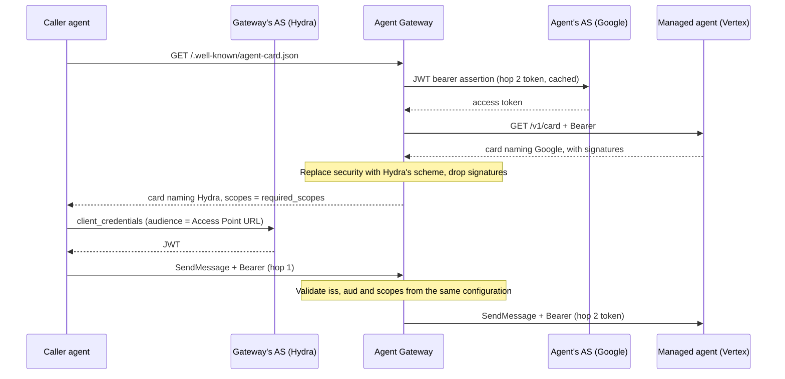
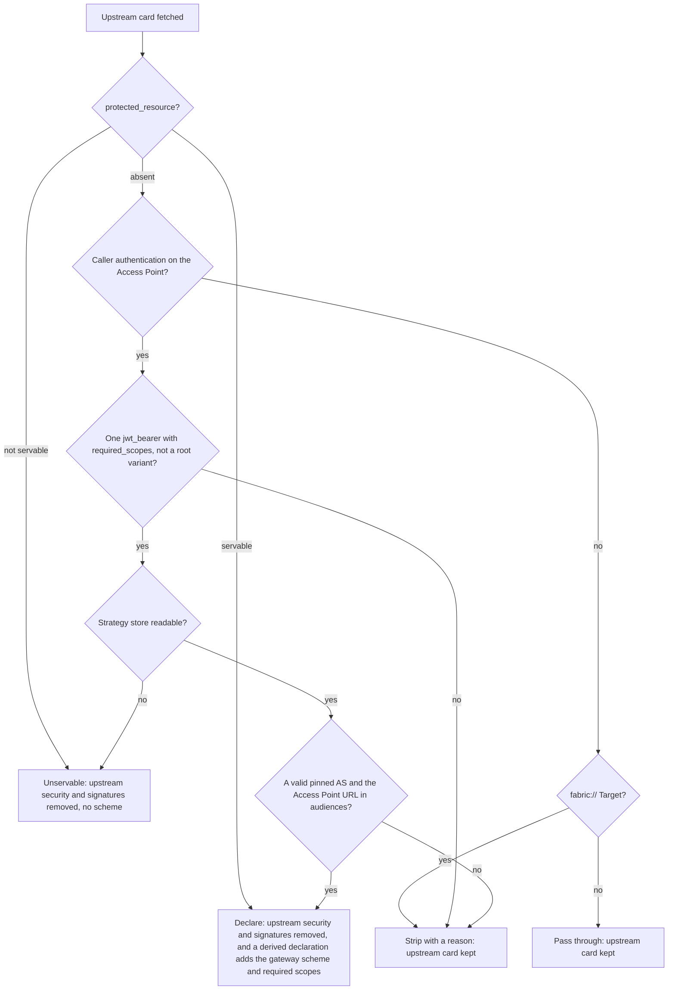
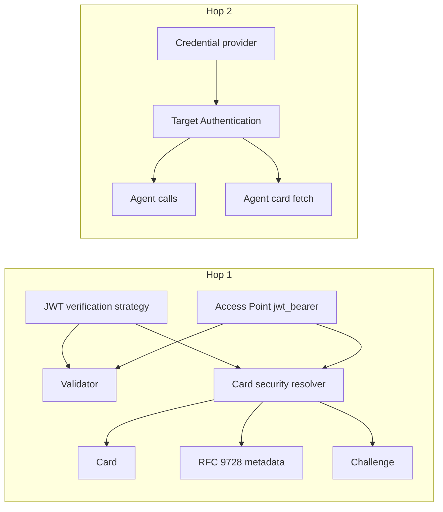

# 1. Adopt OpenID Connect and OAuth 2.0 as a provider-neutral trust plane in Agent Gateway

| Field        | Value                                                                  |
| ------------ | ---------------------------------------------------------------------- |
| Owner        | [Kajal Sinha](mailto:kajal.sinha@affinidi.com)                         |
| Team         | TBD (see [Open questions](#open-questions))                            |
| Is Global    | false                                                                  |
| Categories   | authentication, authorization, oauth, oidc, a2a, credential-delegation |
| Date         | 2026-10-20                                                             |
| Last Updated | 2026-10-29                                                             |

## Status

Proposed. This is the first ADR in this repository. It amends, extends and supersedes nothing.

- Extended by [2. Resolve hop 2 Target Authentication through one gateway-scoped credential resolver](0002-hop-two-target-authentication.md)
- Extended by [3. Specify the hop 1 resource server contract for scopes, challenges, metadata and card declarations](0003-hop-one-resource-server-contract.md)

It records three coupled decisions (A, B and C under Alternatives). Hop 2's card fetch feeds the same card rewrite that hop 1's declaration changes, and the card can only tell the truth when all three hold. ADR 0003 gives the full hop 1 contract, including when a failed caller is refused. The standards table under Decision is directional; each later increment gets its own ADR when it changes a contract.

## Context

### State before this decision

Before this decision Agent Gateway had two trust planes, and they were not equally complete.
The Where column names the code as it stood then; some functions, such as
`agent_card_target_credential`, no longer exist.

The **DIDComm plane** (the Fabric) is complete. See [`FABRIC.md`](../FABRIC.md) and
[`SOURCE_AUTH.md`](../SOURCE_AUTH.md). It covers:

- **Peer authentication:** authcrypt envelopes and issuer attestation.
- **Replay protection:** an envelope replay cache.
- **Attribution:** verified presentations, graded in policy input.
- **Trust anchoring:** trust registries over TRQP.
- **Delegation:** delegation credentials.

The **OAuth/OIDC plane** had only parts:

| Part | Where | Limitation |
| --- | --- | --- |
| Inbound JWT validation | `src/jwt_bearer/`. A JWT verification strategy holds `expected_issuer` and a JWKS source. The Access Point holds `audiences`. | No discovery: the `jwks_uri` was entered by hand. No scope checks existed. An empty `audiences` list disabled the `aud` check (`src/jwt_bearer/validator.rs`). |
| A2A card rewriting | `src/a2a/url_rewriter.rs` | Rewrote URLs only. The upstream agent's `securitySchemes`, `security` and `signatures` reached callers unchanged, so the card named the agent's own authorization server, not the one the gateway enforces. The signatures no longer verified after the rewrite. |
| RFC 9728 protected resource metadata | `src/mcp/resource_server.rs` for `mcp_http.authorization`; `src/protocols/protected_resource.rs` for an MCP Access Point's `caller_authentication.protected_resource` | MCP only. `mcp_http.authorization` named the gateway's own STS issuer. `protected_resource` named operator-configured authorization servers and answered a missing or invalid token with a 401 challenge before policy, but a scope shortfall answered 503, and saving it on an A2A Access Point was refused. An A2A Access Point published no metadata and sent no challenge. |
| STS | `src/sts/`, [`STS.md`](../STS.md) | Supported RFC 8693 token exchange and ID-JAG. The external STS client (`src/sts/client.rs`) was not connected to any provider. |
| Outbound credentials | Credential delegation ([`CREDENTIAL_DELEGATION.md`](../CREDENTIAL_DELEGATION.md)) | Supported Authorization Code, Client Credentials and API key, but not the JWT bearer grant Google requires. |
| Target Authentication | `TargetAuthMethod`, `src/config/types.rs` | Supported a static secret only. The agent card fetch (`agent_card_target_credential`, `src/proxy/handler.rs`) used only Target Authentication, so a card protected by an expiring OAuth token could not be fetched. |
| Access Point header forwarding | `should_forward_ap_request_header_with_mapping`, `src/proxy/handler.rs` | Never forwarded the caller's `Authorization` header upstream unless it was the source-auth header with `forward_header` on. An MCP `protected_resource` refused `forward_header` at save (400) and failed closed with 503 on a stored record that combined them (`AgentSurface::validate_protected_resource`, `src/config/agent_surface.rs`). |

### Triggering events

1. **Product direction.**
   - Extend the OAuth/OIDC plane to mirror DIDComm's trust properties.
   - Build it with production intent, provider-neutral, and demonstrable.
   - Start with linking the A2A agent card to the authorization server source authentication uses, through one configuration.
2. **Managed agents on hosted platforms.** Agents hosted on Vertex AI Agent Engine and Microsoft Foundry need a gateway-held OAuth token on hop 2 and on the card fetch.
   - Microsoft Foundry agent cards require an Entra token, and the card fetch could not use one.
   - Google Vertex AI Agent Engine accepts only tokens obtained with the RFC 7523 JWT bearer grant. No provider type could produce one.
   - Source Authentication handles the caller. Target Authentication must produce the token the agent expects.

### Glossary

| Term | Meaning |
| --- | --- |
| Hop 1 | Caller to gateway. The gateway is the resource server, and the Access Point authenticates the caller. |
| Hop 2 | Gateway to managed agent. The gateway is the OAuth client, and Target Authentication or credential delegation authenticates it. |
| AS | Authorization server, for example Ory Hydra, Auth0, Entra or Google. |
| PRM | OAuth 2.0 Protected Resource Metadata (RFC 9728). |
| JWKS | JSON Web Key Set |
| STS | The gateway's Security Token Service ([`STS.md`](../STS.md)) |
| ID-JAG | Identity Assertion JWT Authorization Grant (IETF draft) |
| DPoP | Demonstrating Proof of Possession (RFC 9449) |

Access Point, Target, Transit Point, and Fabric are defined in [`CONTEXT.md`](../../CONTEXT.md).

## Requirements

### Functional

1. **One configuration per hop.**
   - **Hop 1:**
     - The JWT verification strategy and the Access Point's `jwt_bearer` settings are the only inputs. An MCP Access Point may instead name its metadata explicitly with `protected_resource`, as it could before this decision.
     - They drive token validation, the agent card's security declaration, RFC 9728 metadata, and the `WWW-Authenticate` challenge.
     - Changing them changes all four on the next request, with no restart.
   - **Hop 2:**
     - One credential provider drives both the calls to the agent and the agent card fetch.
2. **Truthful cards.**
   - When the Access Point declares, so the gateway is the resource server, the card declares the gateway's scheme, never the upstream's.
   - Signatures that no longer verify are removed from every card whose security the gateway changes.
3. **Discovery.**
   - The authorization server's metadata comes from RFC 8414, with OIDC Discovery as a fallback.
   - The issuer must match exactly.
4. **Scopes.** The Access Point can require scopes. Granted scopes are normalised (`scope` and `scp`) and published to OPA.
5. **RFC 9728 for A2A.** A declaring A2A Access Point publishes protected-resource metadata. A caller whose token is missing, invalid or short of a required scope receives an RFC 6750 challenge pointing at that metadata, before the gateway takes a payment or reaches the Target ([ADR 0003 decision 2](0003-hop-one-resource-server-contract.md#2-failure-kind-one-deny-mapping-and-the-built-in-refusal)).
6. **JWT bearer provider type (RFC 7523 §2.1).**
   - Fields: token endpoint, issuer (the JWT `iss`), subject (the JWT `sub`, defaulting to the issuer), signing key as a secret reference, signing algorithm (RS256 or ES256), key id (the `kid` header), and scopes. The assertion `aud` is always the token endpoint.
   - Fetch, caching, refresh and Bearer injection behave exactly as for Client Credentials.
7. **Target Authentication through a credential provider.**
   - The agent card fetch uses it.
   - It works on the receiving gateway's Fabric path.
8. **Provider neutrality.** Ory Hydra, Auth0, Entra and Google work by changing configuration only.
9. **Demonstrable.**
   - A docker-compose demo uses Ory Hydra for hop 1 and Hydra's JWT bearer grant for hop 2.
   - An Auth0 leg runs the same walkthrough on an Auth0 test tenant.
   - A Vertex AI Agent Engine lab and a Foundry agent, run on our own Google and Azure test accounts, are the real-platform check.

### Non-functional

| Area | Requirement |
| --- | --- |
| Security | Discovery and token endpoints must be https and are fetched through pinned egress with redirects off. Response bodies are capped (64 KiB for metadata). Error text is generic. Signing keys and tokens never appear in API responses or logs. JWT bearer assertions have `exp` no more than 3600 s after `iat` and carry a random `jti`. |
| Performance | No new network call on the request path, except a JWKS refetch on an unknown `kid`, limited to one per strategy per 60-second cooldown. Card security is resolved from in-memory stores. Hop 2 tokens are reused until 300 seconds before they expire. |
| Availability | If a hop 2 token cannot be obtained, the existing `TargetAuthFallback` applies (reject by default). A card whose declaration cannot be resolved has the upstream security removed, rather than a wrong or stale declaration served. If a JWKS refresh fails, the last good key set keeps serving for up to one hour past its expiry. |
| Compatibility | Stored strategy, surface and provider JSON written before this change still loads. A surface that sets none of the new settings answers as before, except for the changes ADR 0003 lists under Consequences (a `fabric://` Target's relayed 401 becomes 502, `variant_alias` reaches policy on direct requests, and a route holding `$` or `%24` can no longer be saved), and `tests/features/surface/source_authentication_http.feature` passes unchanged. An MCP Access Point with `protected_resource` keeps its metadata, its 401 before policy and its save checks; ADR 0003 lists the few MCP responses that change. The only new surface field, `required_scopes`, sits in the `jwt_bearer` method, which older releases parse without `deny_unknown_fields`; nothing is added to `caller_authentication` itself or to `protected_resource`, which they parse with it, so an older release still loads the surface. |
| Interoperability | The rewritten card parses with a2a-python 1.x and 0.3.x and with a2a-js 1.x and 0.3.x. |
| Maintainability | Extend existing records and functions rather than adding parallel entities (AGENTS.md rules 6 and 13). |

### Impacted teams

| Team | Impact | Contact |
| --- | --- | --- |
| Agent Gateway backend | All of the above | See Open question 1 |
| Dashboard | Strategy page, caller authentication panel, credential provider type, Target Authentication panel | See Open question 1 |
| Product | Card behaviour change and roadmap | Cosmin Mogos |
| Hosted documentation | Credential types page, source authentication page | See Open question 1 |

### Out of scope

- End-to-end encryption through intermediaries, and DIDComm-style mediators. No OAuth standard exists for either, and the gateway will not claim parity.
- RFC 7662 introspection of opaque tokens. Hydra will issue JWT access tokens until introspection lands as a later increment.
- Human sign-in schemes on the card (authorization code with PKCE, device code).
- Card declarations for Transit Points and DID Auth Access Points.
- Entra multi-tenant authorities (`common`, `organizations`). Their discovery documents advertise a `{tenantid}` issuer template, which fails the exact issuer match; the gateway never matches issuer templates and refuses an `expected_issuer` that contains one.
- OpenID Federation.

## Alternatives

### A. Hop 1: where the authorization server configuration lives

Effort is relative: small, medium or large.

| Option | Description | Pros | Cons | Effort | Infra cost |
| --- | --- | --- | --- | --- | --- |
| **A1 (Chosen)** | Evolve the JWT verification strategy into the authorization server record. Add optional metadata pinned by discovery. A resolver derives the card, PRM and challenge from it. | One source of truth. Reuses storage, RBAC, tenancy and UI. Old records keep loading. | The strategy name no longer describes the whole role. | Medium, including demo and docs | None |
| A2 | Add a new `AuthorizationServer` entity, referenced by strategies and Access Points | Clean name and separation | A third overlapping concept, next to the strategy and the unused OIDC Providers dashboard pages. New storage, RBAC and tenancy work. A migration for existing strategies. | Large | None |
| A3 | A per-Access-Point card override where the operator types `securitySchemes` | Smallest change | The card and the validator can disagree silently. No discovery. No PRM. Every provider is hand-copied. | Small | None |
| A4 | Always advertise the gateway's own STS, and federate external issuers through token exchange | One issuer everywhere. MCP already works this way. | Callers cannot use Hydra or Auth0 tokens directly. Every caller needs an STS client. External tokens are not first-class. | Medium | None |

**Decision matrix.** Scores are 1 to 5, where 5 is best; for effort, 5 means least effort.

| Aspect | Weight | A1 | A2 | A3 | A4 | Info |
| --- | --- | --- | --- | --- | --- | --- |
| One source of truth (no drift) | 3 | 5 | 5 | 1 | 4 | A3 allows the card and the validator to disagree |
| Provider neutrality | 2 | 5 | 5 | 4 | 2 | A4 forces every caller through the STS |
| Development effort | 1.5 | 4 | 2 | 5 | 3 | |
| Backward compatibility | 1.5 | 4 | 3 | 5 | 2 | |
| Standards fit (RFC 8414, RFC 9728, A2A) | 2 | 5 | 5 | 3 | 4 | |
| **Summary** | | **47.0** | **42.5** | **32.0** | **31.5** | |

### B. Hop 2: how the gateway obtains the agent's token for calls and for the card fetch

| Option | Description | Pros | Cons | Effort | Infra cost |
| --- | --- | --- | --- | --- | --- |
| **B1 (Chosen)** | Add an `oauth2_jwt_bearer` credential provider type. Add a Target Authentication method `credential_provider` that resolves a provider's cached token. The card fetch already uses Target Authentication. | One configuration for every gateway-originated call. Fixes Foundry (client credentials) and Vertex (JWT bearer) together. Keeps caller authentication in Source Authentication and agent tokens in Target Authentication. | Target Authentication and credential delegation both reach providers, so the docs must say when to use each | Small | None |
| B2 | The same provider type, with the surface's credential delegation binding also applied to the card fetch | No new Target Authentication method | Delegation bindings are scoped to users and agents, but a card fetch has no caller. It mixes gateway identity with delegated identity, and per-user Authorization Code bindings cannot apply. | Small | None |
| B3 | Status quo: the client mints the Google token itself, or the operator deploys an extra proxy such as Cloud Run | No gateway change | The gateway gives no protection on hop 2, the card stays unreachable, and every operator must build glue. Leaves Foundry and Vertex targets unreachable through the gateway. | None in the gateway | An extra proxy service per customer |

**Decision matrix.** Scores are 1 to 5, where 5 is best; for effort, 5 means least effort.

| Aspect | Weight | B1 | B2 | B3 | Info |
| --- | --- | --- | --- | --- | --- |
| Covers agent calls and the card fetch | 3 | 5 | 3 | 1 | B2 cannot use per-user bindings for the card |
| One configuration for hop 2 | 2 | 5 | 3 | 1 | |
| Development effort | 1.5 | 4 | 4 | 5 | |
| Separation of gateway identity from delegated identity | 2 | 5 | 2 | 1 | |
| **Summary** | | **41.0** | **25.0** | **14.5** | |

### C. The upstream card's security

| Option | Description | Pros | Cons | Effort |
| --- | --- | --- | --- | --- |
| **C1 (Chosen)** | On a declaring Access Point, replace the upstream's `securitySchemes`, `security` and `securityRequirements` (including skill-level ones) with the gateway's scheme and drop `signatures`, on its own cards and its Transit Point cards. Every other card keeps the upstream security and signatures. | Where the gateway is the resource server the card never names the wrong authorization server. A surface that sets none of the new settings serves the card it serves today. The change arrives with the same opt-in that turns on the metadata and the challenge. | A non-declaring Access Point's card can still name an authorization server whose tokens the gateway does not forward, and still shows a signature the URL rewrite has invalidated | Small |
| C2 | Replace or strip the upstream security, and drop `signatures`, on every rewritten card | No card names the wrong authorization server or leaks internal identity provider hosts. A verifying client is never shown a stale signature. | Changes card output for every existing A2A surface, with no per-surface switch | Small |
| C3 | A per-Access-Point "advertise" switch, off by default | Fully backward compatible | A new setting beside the declaration that can disagree with it; the leak and the stale signatures remain until an operator opts in | Small to medium |

**Decision matrix.** Scores are 1 to 5, where 5 is best; for effort, 5 means least effort.

| Aspect | Weight | C1 | C2 | C3 | Info |
| --- | --- | --- | --- | --- | --- |
| Truthful card where the gateway is the resource server | 3 | 5 | 5 | 2 | C3 keeps the wrong declaration until an operator opts in |
| No leaked internal identity provider hosts | 2 | 3 | 5 | 1 | C1 keeps the upstream security on non-declaring cards |
| Surfaces without new settings unchanged | 2.5 | 5 | 2 | 5 | C2 changes every card |
| Development effort | 1.5 | 4 | 4 | 3 | C3 adds a setting and a dashboard control |
| **Summary** | | **39.5** | **36.0** | **25.0** | |

## Argument

- **A1 meets requirement 1 at the lowest cost.**
  - The resolver re-checks the record on every request: the pinned issuer must equal `expected_issuer`, and the pinned JWKS URI must equal the strategy's. So the card cannot advertise one authorization server while the validator checks another.
  - A2 has the same correctness but adds a concept and a migration, against the repository rule of the smallest correct change.
  - A3 fails requirement 1 outright.
  - A4 fails requirement 8, because external tokens would stop being first-class.
- **B1 meets requirement 7 and keeps caller and agent authentication apart.**
  - Hop 2 is gateway identity, so it belongs to Target Authentication, which the card fetch already uses.
  - B2 would couple the card fetch to per-caller delegation, which has no caller on a card fetch.
  - B3 leaves Foundry and Vertex targets unreachable through the gateway.
- **C1 meets requirement 2 and keeps surfaces without new settings unchanged.**
  - Hop 1 and hop 2 have different authorization servers. On a declaring Access Point the gateway is the resource server and never forwards the caller's token, so the upstream's OAuth declaration is never usable through it, and the card must name the gateway's scheme instead.
  - On any other Access Point the gateway makes no claim about the authorization server, and an Access Point with `forward_header` may pass the caller's token on, so the upstream declaration can still be the right one. C2 would change every existing A2A card to fix a leak that the operator can already end by declaring; C3 adds a second setting that can disagree with the declaration.
  - Whether non-declaring cards should also lose the upstream security is left to [open question 2](#open-questions).
- **Assumptions.**
  - Hydra v25.4 and later, and Auth0, serve RFC 8414 metadata.
  - Hydra supports the RFC 7523 JWT bearer grant with a trusted issuer.
  - The a2a SDKs' compatibility code keeps parsing the dual-era card shape. That code was read in the SDK sources and is gated by a conformance run.

## Decision

Agent Gateway treats OAuth 2.0 and OpenID Connect as a first-class, provider-neutral trust plane next to DIDComm. It has one configuration per hop.

### Hop 1: the gateway as resource server

- `JwtVerificationStrategy` gains an optional `authorization_server`:
  - fields `issuer`, `metadata_url`, `token_endpoint` and `jwks_uri`, all https;
  - filled by RFC 8414 discovery with OIDC fallback, at save time;
  - the discovered issuer must match `expected_issuer` exactly.
- **Management API:**
  - New `POST /v1/jwt-verification-strategies/discover`.
  - The strategy request gains `discover_metadata: Option<bool>`:

    | Value | Behaviour |
    | --- | --- |
    | `true` | Discover and pin. If discovery fails, the save is refused with a generic 422 and nothing is stored. |
    | `false` | Clear |
    | Omitted | Keep the pinned metadata, and re-discover if the issuer or JWKS URI changed. If that re-discovery fails, the existing pin is kept. |
- `JwtBearerAuthConfig` gains `required_scopes`, and the strategy gains `scope_claims`. Policy input gains `input.source_auth.scopes`, `client_id`, `strategy_id` and `strategy_tenant_id`, and a failed caller's `kind`.
- **Declaration resolver.** One resolver, `resolve_surface_declaration` (`src/source_auth/declaration.rs`), returns one outcome per Access Point and Surface Variant. The card, the metadata, the audience check and the challenge all read it:

  | Outcome | When | Card effect |
  | --- | --- | --- |
  | Declare | An MCP Access Point's explicit `protected_resource`, or one pinned `jwt_bearer` method with `required_scopes` whose `audiences` contain the Access Point URL ([ADR 0003 decision 3](0003-hop-one-resource-server-contract.md#3-declaration-sources-and-outcomes)) | Drops the upstream security and signatures. A derived declaration also emits the gateway's `oauth2` scheme with `oauth2MetadataUrl`, a `clientCredentials` flow offering the advertised scopes, and a requirement listing `required_scopes`; an explicit one has no pinned server to name and emits no scheme |
  | Strip | Caller authentication that does not declare, with a reason code such as `no_required_scopes`, `not_pinned` or `method_not_declarable` | Upstream card kept |
  | Pass through | No caller authentication | Upstream card kept |
  | Unservable | The declaration cannot be served, such as a strategy store failure | Upstream security and signatures removed, no scheme |

  - Emission follows the card's era: the v1.0 oneof wrapper with `securityRequirements`, or the v0.3 `type` shape with `security`. A card carrying both eras gets the flat shape and both arrays.
- A declaring Access Point, A2A or MCP, serves `/.well-known/oauth-protected-resource<route>`.
  - `resource` is the Access Point URL. On a declaring route a token's `aud` must name it.
  - `authorization_servers` holds the pinned strategy issuer, or the configured servers of an explicit `protected_resource`.
- A declaring Access Point refuses a caller whose source authentication failed with 401 (403 for insufficient scope) and `WWW-Authenticate: Bearer resource_metadata=...`, whatever its surface policy says: an MCP Access Point at the source authentication stage, any other after gateway policy and before AP2 and payment. It never forwards the caller's token.
- **Fail-open invariant.**
  - Unchanged on an Access Point that does not declare: source authentication publishes, OPA decides.
  - A declaring Access Point fails closed for failed callers with no policy attached, whether it was saved from the dashboard or through the API ([ADR 0003 decision 2](0003-hop-one-resource-server-contract.md#2-failure-kind-one-deny-mapping-and-the-built-in-refusal)).

### Hop 2: the gateway as OAuth client

- `CredentialProviderType` gains `oauth2_jwt_bearer`, with these fields:
  - token endpoint;
  - issuer (`assertion_issuer`);
  - subject (`assertion_subject`, defaulting to the issuer);
  - signing key secret reference;
  - algorithm (RS256 or ES256);
  - key id (`key_id`);
  - scopes.
- **Token acquisition (RFC 7523 §2.1).**
  - Build and sign an assertion: `iss`, `sub`, `aud` (the token endpoint), `scope`, `iat`, `exp` no more than `iat` + 3600, a random `jti`, and the `kid` header when a key id is known.
  - POST it with `grant_type=urn:ietf:params:oauth:grant-type:jwt-bearer`.
  - Store and reuse the token in the delegation vault, exactly as Client Credentials does (`src/proxy/credential_delegation.rs`).
  - Replace a token `min(300 s, lifetime / 2)` before expiry, with the lifetime measured from that token's grant, for both provider types (`DelegationToken::needs_refresh`, `src/delegation_vault/mod.rs`). A token granted before the provider's last edit is not reused.
- `TargetAuthMethod` gains `CredentialProvider { provider_id }`.
  - The gateway injects that provider's current token on calls to the agent and on the agent card fetch, including on the Fabric receive path.

### Standards adopted, and the order of the increments that follow

| DIDComm property in the gateway | OAuth/OIDC standard | Status (2026-10-20) | Order |
| --- | --- | --- | --- |
| Gateway identity toward a target | RFC 7523 §2.1 JWT bearer grant | RFC | 1 |
| DID document and agent card discovery | RFC 8414, OIDC Discovery 1.0, RFC 9728, A2A `securitySchemes` | RFC, Final, A2A 1.0.1 | 2 |
| Exposure modes and authorization | `aud` and scope (RFC 6749, RFC 8707) | RFC | 2 |
| Revocation and status lists | RFC 7662, RFC 7009, then the OAuth Token Status List draft | RFC, then draft submitted to the IESG | 3 |
| Envelope strictness | RFC 8725, RFC 9068 | RFC | 4 |
| Delegation across Fabric hops | RFC 8693 with `act`; identity chaining draft; ID-JAG draft | RFC, then drafts | 5 |
| No stored long-lived secret | RFC 8693 against an external STS (Google Workload Identity Federation) | RFC | 5 |
| Signed identity and cards | A2A card signatures (RFC 7515 JWS, RFC 8785 JCS); RFC 9728 signed metadata | A2A 1.0, RFC | 6 |
| Authcrypt sender binding and replay | RFC 9449 DPoP, RFC 8705 | RFC | 7 |
| DID Auth proof of key control | RFC 7523 §2.2 `private_key_jwt` | RFC | 8 |
| Out-of-band pairing | Client ID Metadata Documents draft; RFC 7591 | Draft, RFC | 9 |
| Workload binding | OAuth Transaction Tokens draft | Draft | 10 |
| Message integrity | RFC 9421 HTTP Message Signatures | RFC | 11 |
| Trust registries | OpenID Federation 1.0 | Final | 12 |
| Mediators, anoncrypt end-to-end encryption | None | n/a | Not claimed |

Each increment ships with its own demo and documentation. Draft statuses must be re-checked
before each increment starts.

## Consequences

### Positive

- A client can find the gateway's authorization server, scopes and audience from the card URL alone, then recover through the standard 401 challenge. A2A and MCP clients use the same discovery pattern.
- Operators configure an authorization server once. The card, the metadata and the validator cannot drift apart, and the Auth0 trailing-slash issuer mistake is caught at save time.
- Policy authors get provider-neutral `scopes` and `client_id` instead of parsing Hydra's `scp` and Auth0's `scope` separately.
- Google Cloud, Vertex AI Agent Engine and Microsoft Foundry agents work through the gateway with only a stored credential provider, so customers need no extra proxy.
- The roadmap is anchored to published standards, which makes the case for the gateway to Product.

### Negative, with mitigations

| Consequence | Mitigation |
| --- | --- |
| The cards of a declaring Access Point change: the upstream schemes and signatures disappear | They change only when the operator makes the Access Point declare; the changelog, release notes and hosted documentation describe it. A future increment re-signs cards with the gateway key. |
| A non-declaring Access Point's card still names the upstream's authorization server and carries a signature the URL rewrite invalidated | Unchanged from before this decision; declaring removes both. Whether to strip them everywhere is [open question 2](#open-questions). |
| The dual-era card shape relies on SDK compatibility code | A conformance run against a2a-python and a2a-js gates the card change. Java and Go are tracked as open questions. |
| A strategy edit can break the declaration of surfaces that reference it | The resolver strips and logs a warning. A later increment refuses to delete strategies that are still referenced. |
| Older releases cannot load the new enum variants (`oauth2_jwt_bearer`, `TargetAuthMethod::CredentialProvider`) and drop the whole surface or provider; they also stop enforcing `required_scopes` | Rollback procedure in Migration, no mixed releases on shared storage, a release version in the backup manifest, and a load-error counter. A downgrade test covers the whole-record drop. |
| A declaring Access Point refuses failed callers whatever its surface policy says, so a policy that admitted some failed callers stops doing so once the Access Point declares | Only an Access Point the operator made declare is affected; removing `required_scopes`, or the strategy's pin, returns it to "OPA decides". The trade-off and its isolation point are recorded in [ADR 0003 decision 2](0003-hop-one-resource-server-contract.md#2-failure-kind-one-deny-mapping-and-the-built-in-refusal). |
| Discovery fetches operator-supplied URLs, including private hosts | Discovery uses the JWKS fetch posture: pinned resolution, cloud-metadata addresses blocked, embedded credentials and non-http(s) schemes refused, a body size cap and fixed error codes. Like JWKS fetches it admits http, loopback and RFC 1918 hosts, because operators legitimately run authorization servers on the same machine or VPC. Documented as a residual risk. The probes that fetch on a caller's behalf (`discover`, `validate-jwks-uri` and a save that discovers) need the edit permission, are limited to 10 per user per minute and are audited, and a tenant-scoped caller probes under the strict posture, which also blocks loopback and private ranges. |

## Security considerations

- **Triggers:** authentication, authorization, secrets, cryptographic operations, and APIs.
- **Trust boundaries:**
  - caller to Access Point (hop 1);
  - gateway to managed agent (hop 2);
  - gateway to authorization server metadata, JWKS and token endpoints.

| Threat | Control |
| --- | --- |
| Audience confusion; ID tokens accepted as access tokens | On a declaring route the token's `aud` must name the Access Point URL, and the method's other audiences are not accepted there. With `required_scopes` set, a token carrying `nonce` or `at_hash`, or with a `typ` other than an access token type, fails. |
| Algorithm confusion | Fixed allow-list (RS*, ES256/384, EdDSA) today. A per-strategy allow-list, `kty`/`crv`/`use` checks and RFC 8725 follow in the envelope-strictness increment. |
| Issuer mix-up | Exact issuer match at discovery and on every token. Strategies are tenant-owned, and surfaces may reference only strategies they are allowed to (`src/identity/handlers/surface_tenancy.rs`). |
| JWKS refetch amplification by unauthenticated callers sending unknown `kid`s | Per-strategy cooldown and a single in-flight fetch. JWKS bodies and key counts are capped. The JWKS cache is evicted on strategy update and delete, and a cached key set is used only for the `jwks_uri` and `updated_at` it was fetched for. |
| SSRF through discovery or token endpoints | Cloud-metadata block, pinned DNS, redirects off, size cap, fixed error codes that never carry a resolved address; probes need the edit permission, are rate-limited per user and audited, and run under the strict posture for tenant-scoped callers |
| Card spoofing or leakage | On a declaring Access Point the upstream security and signatures are replaced on its own and its Transit Point cards, and card bodies are never logged. Re-signing with the gateway key is a later increment. |
| Fail-open surfaces | A declaring Access Point refuses failed callers before AP2, payment and the Target with no policy attached; a non-declaring one keeps "OPA decides" |
| Signing key exposure (hop 2) | The key is a secrets-store entry referenced by `secret_id`: a PKCS#8 PEM key or a service account JSON key of at most 16 KiB. It is never returned by the API or logged, and is held in zeroizing memory only while one assertion is signed. Encryption at rest is off by default ([`DEPLOYMENT_REQUIREMENTS.md`](../DEPLOYMENT_REQUIREMENTS.md)), so the docs tell operators to enable it on any appliance that holds a signing key. The AWS Secrets Manager backend is not implemented and cannot hold the key. |
| Assertion replay (hop 2) | `exp` no more than 3600 s, a random `jti`, and `aud` bound to the token endpoint. Assertions are never cached or logged. |
| Token leakage (hop 2) | Tokens are stored in the delegation vault, exactly like Client Credentials tokens, so the encryption-at-rest guidance above applies to them too. They are never logged, and only the target receives them. |

- **Least privilege:** strategy and provider management keep their existing RBAC features and PAT resource scoping.
- **Audit:**
  - Token acquisition failures and card strip events are logged without secret material.
  - Hop 2 token use emits the same `DelegationAuditAction` events as credential delegation (`src/proxy/credential_delegation.rs`), including on the Fabric path.

## Performance, scalability and cost

- **Hop 1 latency.**
  - Card security is resolved from the in-memory strategy store (a DashMap cache), with no network call.
  - The target is under 1 ms of added p95 latency per card request. It has not been measured yet, and the component tests record it.
  - Token validation adds only a scope set check.
- **Hop 2 latency.** One token request per provider per token lifetime (about one hour for Google), replaced a margin before expiry. Request-path latency is unchanged once a token is stored.
- **Throughput.** No new per-request network dependency, so throughput matches today's. Card resolution and token validation read in-memory stores. The only new traffic is one token request per hop 2 provider per token lifetime, plus JWKS refetches limited by the cooldown.
- **Scaling.** Caches are per replica, which the documentation states. A cached JWKS is tied to the strategy's `jwks_uri` and `updated_at`, so a strategy edit misses the cache on every replica once that replica reads the edited record. A standby reconciles the strategy and credential provider stores and drops its JWKS cache when it becomes Active.
- **Cost.** No new paid infrastructure. The demo runs Ory Hydra containers. The Auth0 leg uses an existing Auth0 test tenant.

## Data storage

The change modifies existing records only. It adds no new store.

| Record | Change | Type | Default | Purpose |
| --- | --- | --- | --- | --- |
| `JwtVerificationStrategy` | `authorization_server` | Optional object: `issuer`, `metadata_url`, `token_endpoint`, `jwks_uri` | Absent | Pinned discovery result, used by the card, PRM and challenge |
| `JwtBearerAuthConfig` (Access Point) | `required_scopes` | String list | Empty | Scope enforcement, the declared scopes and the derived declaration |
| `JwtVerificationStrategy` | `scope_claims` | String list | Absent, read as `scope` then `scp` | Claims read for granted scopes |
| `CredentialProvider` | Type `oauth2_jwt_bearer`. New object `jwt_bearer`: `assertion_issuer`, `assertion_subject`, `signing_key_secret_ref`, `signing_algorithm`, `key_id`. Reused fields: `token_endpoint` (also the assertion `aud`), `default_scopes`. | Strings | Subject defaults to the issuer; algorithm to RS256 | Hop 2 token acquisition |
| `TargetAuthConfig` | `method: credential_provider { provider_id }` | Enum variant | n/a | Hop 2 authentication for calls and the card fetch |

- **Access patterns:** unchanged. Records are read by id from the DashMap caches on each request and written through to filesystem JSON.
- **Consumers:** a strategy is also read by STS subject and ID-JAG verification (selected by `expected_issuer`, no audience), modern consent ID-token verification (audience is the client id) and credential providers (`consent_identity_strategy_id`). Only the Access Point path reads `authorization_server` and `scope_claims`; the other flows ignore them, and the mandatory audience and ID-token rules apply only when an Access Point declares. Unset fields are not serialized, so a consent record's strategy digest is unchanged for strategies saved before them.
- **TTL:**
  - Discovered metadata has no TTL. It is pinned and re-discovered on save.
  - Hop 2 tokens live in the delegation vault until they are within the refresh margin of `expires_in`, then they are replaced.
- **Delete:** hard delete, as today.
- **Data minimisation:** only the four metadata fields the projections need are stored. The signing key stays in the secrets store, not in the provider record.
- **Encryption:**
  - In transit: production authorization servers are reached over https. The gateway does not enforce that for discovery and JWKS fetches, which share the JWKS posture, so https is an operator responsibility there.
  - At rest: follows the gateway's encryption-at-rest setting (see Security considerations).
- **Timestamps:** existing records already carry `created_at` and `updated_at`.
- **Data locality:** records stay in the gateway's own storage. Discovery and token requests go only to operator-configured endpoints, and hop 2 requests carry only the signed assertion.

## Migration and change management

| Stage | Content | Exit criterion |
| --- | --- | --- |
| Foundation | JWKS body cap, key bound, `kid`-miss cooldown, cache eviction on update and delete | Unit tests pass. No change in behaviour. |
| Hop 2 tokens | `oauth2_jwt_bearer` provider type; Target Authentication through a credential provider | The Vertex lab and the Foundry card fetch succeed. The Hydra JWT bearer leg passes in CI. |
| Discovery and scopes | Strategy discovery and pinning; `required_scopes`; normalised policy input | Auth0 and Hydra discovery tests, including the trailing-slash case |
| Metadata and challenge | One declaration resolver on the shared RFC 9728 builders; metadata for every declaring Access Point; scope enforcement with 403 `insufficient_scope`; relayed-challenge stripping | `make mcp-conformance` differs from the previous release only in the responses ADR 0003 lists. MCP and A2A metadata tests pass. |
| Card declaration and A2A challenge | The derived declaration; the A2A refusal before payment; card replacement and signature removal on declaring Access Points | Component tests for both card eras and every declaration outcome; the SDK conformance run passes |
| Demo | Compose demo with two Hydra instances, a mock agent and a client | The scripted walkthrough passes end to end |

**Test plan:**
- **In-process mock authorization server** (component tests and BDD): serves RFC 8414 and OpenID discovery documents for a configurable issuer, including a trailing slash and a path issuer; a JWKS endpoint with RS256 and ES256 keys and rotation; the `client_credentials` grant; and the RFC 7523 `jwt-bearer` grant, which verifies the assertion signature and checks `iss`, `sub`, `aud`, `exp`, `jti` and `kid`. It counts and logs token requests and can serve a 404, an oversized body, or a mismatched issuer.
- **Hydra compose fixture:** a tagged `oryd/hydra` image pinned in the compose files, used by CI and the demo. It lands with the Hydra stages, not with the mock.
- **Fixtures for the new fields:** strategy, provider and surface fixtures for `required_scopes`, pinned metadata and the `oauth2_jwt_bearer` provider type land with the stage that adds each field.
- **Resolver component tests per card era:** the card resolver is tested against the `0.3` and `1.0` card shapes with and without a declaration, and on the strip path.
- **Validators:** discovery uses the JWKS posture (`egress::pinned_forward_client`). The token endpoint uses `url_validation::validate_oauth_endpoint_url`, which blocks loopback and cloud metadata in production.
- **Test seam:** with `AG_TEST_MODE=true`, the exact-URL allow-lists let CI and the demo reach a loopback token endpoint; discovery and JWKS need no allow-list. Cloud metadata stays blocked, and a negative test proves the seam is inert without `AG_TEST_MODE`. A run that uses it proves the protocol flow, not production egress; see [Reaching loopback in a test](../development/TESTING.md#reaching-loopback-in-a-test).

**Rollback:**
- **Optional fields:** older releases ignore the new optional fields. One of them is a security control: `required_scopes` on a `jwt_bearer` Access Point is read by no older release, so after a downgrade the Access Point accepts tokens without the scope, and only a surface policy on the raw `scope` or `scp` claim in `input.source_auth.claims` still enforces it, since older releases do not publish `input.source_auth.scopes`. Treat a downgrade as removing scope enforcement.
- **New enum values:** an older release cannot read `oauth2_jwt_bearer` providers or `credential_provider` Target Authentication. Its loader skips the whole record it cannot parse, not the field. A surface with such Target Authentication disappears from the older node and its route stops answering; a provider disappears and every binding to it stops resolving. Before downgrading, remove those providers and settings, or restore a pre-upgrade backup.
- **Detection:** from this release on, a record the loader cannot read is counted in `agent_gateway_storage_load_errors_total{reason="unreadable_record"}` or `invalid_json`. A release that predates this change counts nothing, so check the surface and provider counts in the dashboard after a downgrade. Tests cover the whole-record drop for surfaces and providers.
- **Shared storage:** do not run mixed releases against one storage directory or one DynamoDB table, including an Active and a Standby node. An older node that loads or re-saves a record can drop it, and a Standby promoted on an older release serves less than the Active node did. Upgrade and downgrade every node together, Standby last on upgrade and first on downgrade.
- **DynamoDB:** an older release read an unreadable `target_auth` attribute as no Target Authentication, so a channel forwarded without its credential. This release skips the item and counts it in `agent_gateway_storage_load_errors_total{entity="dynamodb_channel"}` while the other channels still load, so it is never served with a credential silently missing. A downgrade of a DynamoDB-backed appliance carries the older behaviour.
- **Backups:** the manifest of a `.agbak` backup and of a portable archive records the release that took it. A restore refuses a backup from a newer release than the running one, before it changes anything; an older release's backup, and one without a version, restores. The guard compares released versions only: an unreleased build carries the version of the release before it, so its backups restore onto that earlier release without refusal. An older node reading a newer manifest ignores the field, so the guard only protects a node that has this change. A redacted `.atgx` export is not a backup and cannot restore an appliance.
- **`credential_lookup` as a two-way door:** not adopted. An older release resolves `credential_lookup` to no credential and forwards, so a downgrade would send requests to the Target unauthenticated. Dropping the surface is the safer failure.
- **Declaring Access Points:** an older release does not declare from `required_scopes`, so it publishes no metadata for such an Access Point, serves its upstream card and leaves its failed callers to policy. Before downgrading, attach a policy denying `input.source_auth.method == "failed"` to each declaring Access Point that has none.
- **Per-surface rollback of a declaration:** remove `required_scopes`, or clear the strategy's pinned metadata. The Access Point then strips: its card, metadata and failed-caller responses return to what they were before it declared.

**Backward compatibility:**
- Serde defaults keep old JSON loading.
- `source_authentication_http.feature` runs unchanged.
- An MCP Access Point with `protected_resource` keeps its metadata, its challenge before policy and its save checks, except for the responses ADR 0003 lists. An MCP Access Point without it can declare from `required_scopes` like an A2A one.

**Communication:**
- Changelog fragments per change, with upgrade notes on breaking entries and rollback notes where an older release drops a control.
- Release notes.
- The hosted credential types and source authentication pages.
- A note to teams that integrate hosted agents when hop 2 ships.

## Diagrams

The repository's documentation uses Mermaid, so the diagrams are inline.

### Two hops, two authorization servers

### Card security outcome

### One configuration per hop

## References

**Repository:**
- [`ARCHITECTURE.md`](../../ARCHITECTURE.md)
- [`SOURCE_AUTH.md`](../SOURCE_AUTH.md)
- [`PROTOCOLS.md`](../PROTOCOLS.md)
- [`MCP_METADATA.md`](../MCP_METADATA.md)
- [`POLICY.md`](../POLICY.md)
- [`FABRIC.md`](../FABRIC.md)
- [`STS.md`](../STS.md)
- [`CREDENTIAL_DELEGATION.md`](../CREDENTIAL_DELEGATION.md)

**Standards and specifications:**
- [RFC 6749](https://www.rfc-editor.org/rfc/rfc6749)
- [RFC 6750](https://www.rfc-editor.org/rfc/rfc6750)
- [RFC 7523](https://www.rfc-editor.org/rfc/rfc7523)
- [RFC 7662](https://www.rfc-editor.org/rfc/rfc7662)
- [RFC 8414](https://www.rfc-editor.org/rfc/rfc8414)
- [RFC 8693](https://www.rfc-editor.org/rfc/rfc8693)
- [RFC 8707](https://www.rfc-editor.org/rfc/rfc8707)
- [RFC 8725](https://www.rfc-editor.org/rfc/rfc8725)
- [RFC 9068](https://www.rfc-editor.org/rfc/rfc9068)
- [RFC 9449](https://www.rfc-editor.org/rfc/rfc9449)
- [RFC 9728](https://www.rfc-editor.org/rfc/rfc9728)
- [OpenID Connect Discovery 1.0](https://openid.net/specs/openid-connect-discovery-1_0.html)
- [OpenID Federation 1.0](https://openid.net/specs/openid-federation-1_0.html)
- [A2A specification](https://a2a-protocol.org/latest/specification/)
- [Google service account OAuth](https://developers.google.com/identity/protocols/oauth2/service-account)
- [Ory Hydra JWT bearer grant](https://www.ory.com/docs/hydra/guides/jwt)

## Open questions

| # | Question | Owner | Resolves by |
| --- | --- | --- | --- |
| 1 | Which team owns this ADR (the Team field)? Who are the contacts for the backend, dashboard and hosted documentation teams? | Kajal Sinha | Before the ADR is accepted |
| 2 | Should the cards of Access Points that do not declare also lose the upstream security and signatures (alternative C2), or keep only upstream `apiKey` schemes sent in a forwarded header? Default: they keep the upstream card, as before this decision. The choice lives in `secures_cards` (`src/a2a/card_security.rs`) and the Transit Point check in `src/proxy/outbound_handler.rs`. | Kajal Sinha | Before the ADR is accepted |
| 3 | Interop bar: are a2a-python and a2a-js enough, or must a2a-java and a2a-go pass too? | Cosmin Mogos | Before card declaration merges |
| 4 | Should the Auth0 leg run on a schedule, or only on demand? | Kajal Sinha | Before the Auth0 demo leg |
| 5 | Should a Transit Point card declare its outbound listener authentication? Should a DID Auth Access Point declare anything? | Cosmin Mogos | A follow-up ADR |
| 6 | Should the gateway's own STS be selectable as an A2A authorization server, as it is for MCP? | Cosmin Mogos | A follow-up ADR |
| 7 | Vertex serves only an authenticated card at `/v1/card`. Is re-serving it publicly through `agent_card_path` acceptable? When the Access Point declares, the gateway replaces Google's scheme, but it never filters extended-card content. | Cosmin Mogos | Before the hop 2 lab sign-off |
| 8 | What is the exact Hydra admin call to trust a JWT bearer issuer for the CI leg? | Kajal Sinha | During the hop 2 stage |

## Future work

- RFC 7662 introspection and several authorization servers per Access Point.
- RFC 9068 profile and validator strictness.
- `apiKey`, `mutualTLS` and `http` declarations.
- Authorization code with PKCE and device code schemes.
- Token exchange across the Fabric, and an external STS client.
- Gateway-signed cards.
- A save-time report of each Surface Variant's declaration outcome, and of policies that admit failed callers on Access Points that do not declare.
- DPoP.
- `private_key_jwt`.
- Client ID Metadata Documents.
- Transaction Tokens.
- HTTP Message Signatures.
- OpenID Federation.

Each item gets its own ADR when it changes a contract or crosses a team boundary.
