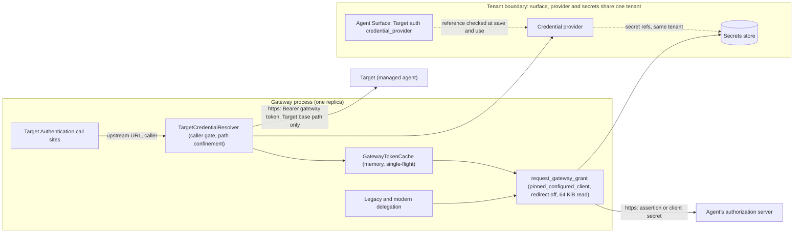

# 2. Resolve hop 2 Target Authentication through one gateway-scoped credential resolver

| Field        | Value                                                                           |
| ------------ | ------------------------------------------------------------------------------- |
| Owner        | [Kajal Sinha](mailto:kajal.sinha@affinidi.com)                                  |
| Team         | TBD (see [Open questions](#open-questions))                                     |
| Is Global    | false                                                                           |
| Categories   | authentication, oauth, credential-delegation, target-authentication, tenancy, fabric |
| Date         | 2026-10-21                                                                      |
| Last Updated | 2026-10-30                                                                      |

## Status

Proposed.

Extends [1. Adopt OpenID Connect and OAuth 2.0 as a provider-neutral trust plane in Agent Gateway](0001-openid-oauth-agent-gateway.md),
whose Status carries the matching `Extended by` link.

Amended on 2026-10-30: a JWT bearer assertion carries `sub` only when `assertion_subject` is
set, and the optional `jwt_bearer.audience` sets `aud`, which defaults to the token endpoint.
Statements below that the subject defaults to the issuer, that there is no audience field or
that `aud` is always the token endpoint are superseded by
[JWT bearer providers](../CREDENTIAL_DELEGATION.md#jwt-bearer-providers).

This ADR records the contract for hop 2: how Target Authentication obtains a credential from a
credential provider, where a gateway token is cached, which provider types may be used where, how
Target Authentication relates to credential delegation, which gateway owns the token on a Fabric
route, and which tenancy checks guard every new reference. The behaviour it describes is
documented for operators in
[Target Authentication through a provider](../CREDENTIAL_DELEGATION.md#target-authentication-through-a-provider).

## Context

### Problem

A managed agent hosted on a cloud platform (for example Google Vertex AI or Microsoft Foundry)
accepts only a short-lived OAuth access token, on every call and on its agent card. A static
secret cannot provide that. The gateway therefore needs a Target
Authentication method that obtains a token as itself from a credential provider, with the Client
Credentials grant or the RFC 7523 JWT bearer grant (a signed assertion, such as a Google service
account key), and sends it on calls to the Target and on its own agent card fetch.

### State of the code before this decision

The evidence column names the code as it stood before this decision; some of those functions no
longer exist.

| Area | What the code did | Evidence |
| --- | --- | --- |
| Resolution entry point | `inject_target_auth_header` took only a secrets store, so it could not reach providers or tokens. `CredentialLookup` returned `Ok(None)`, which callers treated as "inject nothing". | `src/proxy/handler.rs` (`inject_target_auth_header`) |
| Call sites | Eight call sites, each with its own fallback handling. Two of them echoed the error text in the 502 body. The receiving gateway built a new filesystem secrets store per message. | `src/proxy/handler.rs`, `src/proxy/outbound_handler.rs`, `src/gateways/connection_points/message_processor.rs` |
| Forward URL | `join_endpoint_path` appends the caller's raw path and query to the Target endpoint. Nothing on the forward path rejected `..` or `%2e%2e`, and the URL parser resolves them, so a forwarded path could climb out of the Target base path while carrying the Target credential. Dot segments were handled only for the card-rewrite check. | `src/proxy/protocol_router.rs` (`join_endpoint_path`); `src/proxy/paths.rs` (`lenient_router_segments`) |
| Caller assertion | `CallerAssertion::for_forwarded_request` returns `Authenticated` for any non-public path unless source authentication failed, which includes a surface that has no caller authentication at all. | `src/proxy/handler.rs` (`CallerAssertion`) |
| Grant client | Gateway grants validated the token endpoint and then posted through `http_client::external()`, which has redirects off but resolves DNS again at connect time, so a host that rebinds after validation reaches loopback. Modern delegation did the same. The legacy Client Credentials fetch and the consent-flow token calls read the whole response with `response.text()`, with no size limit; only the modern grant capped it, at 64 KiB in a zeroizing buffer. The tree already had a pinned, redirect-off client for a backend vetted at save, `egress::pinned_configured_client`. | `src/delegation_vault/oauth.rs` (`fetch_client_credentials_token`, `exchange_code_for_tokens`, `refresh_access_token`, `scoped_token_grant`); `src/proxy/credential_delegation/modern.rs`; `src/http_client.rs` (`external`); `src/egress.rs` (`pinned_configured_client`) |
| Injection shape | Two `CredentialInjection` enums exist. Bindings and `build_injection_headers` use the one in `src/config/types.rs`; `TransitCredentials` uses the one in `src/config/agent_surface.rs`. | `src/config/types.rs`; `src/config/agent_surface.rs`; `src/proxy/credential_delegation.rs` (`build_injection_headers`) |
| Token cache key | Client Credentials tokens are stored in the delegation vault under `(agent_did, "__client_credentials__", provider id)`. Scopes and purpose are not in the key. The card fetch has no agent DID. | `src/proxy/credential_delegation.rs` |
| Token fetch | Inline in the delegation resolver, coupled to bindings and audit, with no single-flight. A vault lookup is an uncached directory scan plus a `mark_used` write. | `src/proxy/credential_delegation.rs`; `src/delegation_vault/storage.rs` (`mark_used`) |
| Provider type routing | Five `==`/`!=` comparisons on `provider_type`. A new type such as `oauth2_jwt_bearer` would have been routed silently down the Client Credentials branch of modern delegation. | `src/proxy/credential_delegation/modern.rs`, `src/delegation_vault/modern_consent.rs`, `src/credential_providers/handlers.rs` |
| Precedence | Target Authentication and an `outbound_credentials` binding both appended headers with `RequestBuilder::header`, so a surface with both sent two `Authorization` headers. | `src/proxy/handler.rs` (`proxy_handler_with_mcp_runtime`) |
| Fabric | On a `fabric://` Target the sending gateway puts its Target Authentication header into the Fabric `ForwardRequest`, outside the per-route `fabric_delegated_credentials` switch. The receiving gateway forwarded that header and appended its own. | `src/proxy/handler.rs` (`handle_fabric_request`); `src/gateways/connection_points/message_processor.rs` |
| Receiving gateway card rule | Any public-suffix GET (for example a path ending `/discovery`) was treated as the gateway's own card fetch and received the Target credential, together with the caller's query string, body and every inbound header except the source-auth credential and mapped headers, so a method-override header rode along. The sending gateway's local card fetch instead builds its own `GET` and passes only `Accept`, `Accept-Language` and `User-Agent`. | `src/gateways/connection_points/message_processor.rs`; `src/proxy/paths.rs` (`is_public_request`); `src/proxy/handler.rs` (`is_forwarded_on_credentialed_card_fetch`) |
| Tenancy | `can_reference` lets a tenant resource reference appliance-wide resources. Provider secret references were checked with it, and resolved by `secret_id` alone. The Target Authentication reference collector matched only `StaticSecret`, so a new variant would compile with no reference check. | `src/tenancy/mod.rs` (`can_reference`); `src/credential_providers/handlers.rs` (`validate_secret_references`); `src/delegation_vault/oauth.rs` (`resolve_secret`); `src/identity/handlers/surface_tenancy.rs` (`collect_target_auth_reference`) |
| Reload and secret hooks | `perform_config_reload` runs on `POST /v1/config/reload`, on a surface change that needs a full reload, and on Standby to Active activation. A tenant PAT may update and delete its own tenant's secrets. The secret handlers already drop one secret from the A2A secrets cache by `secret_id`. Secrets live in uncached filesystem storage by design. | `src/identity/handlers/config.rs` (`perform_config_reload`); `src/secrets/handlers.rs`; `src/secrets/filesystem.rs` |

### Triggering events

1. Managed agents on hosted platforms require a gateway-held OAuth token on hop 2, including on
   the agent card fetch, and the gateway had no way to obtain one.
2. A tenant can point a provider that uses appliance-wide secret material at a token endpoint or
   Target the tenant controls (the Tenancy row above), a cross-tenant confused-deputy path. That
   has to be closed before a new way to send gateway-held credentials ships.
3. A Target credential could leave the Target base path, reach a caller that nobody
   authenticated, or ride on a Fabric request the caller shaped, and grants were sent on clients
   that do not pin DNS and read unbounded responses (the Forward URL, Caller assertion, Fabric,
   Receiving gateway card rule and Grant client rows above).

### Glossary

| Term | Meaning |
| --- | --- |
| Hop 2 | The leg from the gateway to its Target, the managed agent. The caller-to-gateway leg is hop 1. |
| Gateway token | An access token the gateway obtains for its own identity from a credential provider (Client Credentials or JWT bearer grant), with no user. |
| Gateway grant | The token request that produces a gateway token. |
| Single-flight | At most one gateway grant in flight per cache key per replica; concurrent requests share its result. |
| Sending gateway | The gateway whose surface Target is `fabric://`. |
| Receiving gateway | The gateway that receives a Fabric `ForwardRequest` and forwards it to its own surface's Target. |
| Legacy delegation | `outbound_credentials` and `transit_credentials` bindings resolved by `resolve_delegation_credentials`. |
| Modern delegation | Credential delegation for MCP `2026-07-28` requests (`src/proxy/credential_delegation/modern.rs`). |

Target, Transit Point, Fabric, Target authentication, Gateway token, Tenant and Global resource
are defined in [`CONTEXT.md`](../../CONTEXT.md). Credential providers and the delegation vault are
described in [`CREDENTIAL_DELEGATION.md`](../CREDENTIAL_DELEGATION.md).

## Requirements

### Functional

1. **One resolver.** Every Target Authentication call site resolves through
   `TargetCredentialResolver` and applies the fallback through `apply_target_auth_fallback`.
   Every resolver on a replica shares one gateway token cache.
2. **Gateway-scoped cache.** A Target Authentication token is keyed by purpose, provider id,
   provider digest, sorted scopes and audience, never by caller or agent DID. Invalidation is
   targeted: a change to one secret or provider drops only the entries minted from it, so no
   tenant action evicts another tenant's tokens.
3. **Provider-type allow-list.** Target Authentication accepts `api_key`,
   `oauth2_client_credentials` and `oauth2_jwt_bearer` providers only. Branches on provider type
   match on `CredentialProviderType` or on its `ProviderGrant`, so a new type fails to compile
   until every branch handles it.
4. **Precedence.** A surface cannot be saved with a `credential_provider` Target Authentication
   header that collides with an `outbound_credentials` header. At runtime one header is sent, never
   two.
5. **Header shape.** The variant carries optional scopes and an `inject_as` (default
   `Authorization: Bearer`).
6. **Fabric ownership.** Only the gateway whose Target is https resolves a `credential_provider`.
   The receiving gateway treats a request as its own card fetch only when it is a `GET` whose
   upstream URL, query included, is a card URL it builds for its surface, and then sends it with
   no body and only content-negotiation headers from the caller.
7. **Tenancy.** Every new reference is collected, checked at save, re-checked at use, and part of
   the ownership graph and reassignment conflicts.
8. **Errors.** One error type with fixed categories; error text from token endpoints, secret
   values and token values never reach a response body or a log line.
9. **Audit.** Target Authentication through a provider emits the existing
   `DelegationAuditAction` events, without a user hash.
10. **Path confinement.** On an `HttpTarget` leg a Target credential, whatever its method, is
    attached only when the final upstream URL has the Target endpoint's origin and its path stays
    under the Target base path, or the URL is one of the surface's agent card URLs.
11. **Caller requirement.** `credential_provider` is saved only on a surface that authenticates
    its callers. A forwarded call that no configured mechanism authenticated never carries the
    gateway token.
12. **Pinned, bounded grants.** Every gateway grant, for Target Authentication and for both
    delegation paths, and every consent-flow token call, is sent on a client pinned to the token
    endpoint's vetted addresses, with redirects off and a 10 s timeout. Its response is read to at
    most 64 KiB. A gateway grant whose `access_token` is empty, longer than 8 KiB or not printable
    ASCII, whose `token_type` is not `Bearer`, or whose `expires_in` is not positive is rejected
    and never cached.

### Non-functional

| Area | Requirement |
| --- | --- |
| Security | No cross-tenant use of providers or secret material. Target Authentication through a provider requires an https Target. The assertion `aud` is the token endpoint. Tokens are held in zeroizing memory and never logged or returned. Token endpoint connections are DNS-pinned and their responses bounded. A Target credential never leaves the Target base path. |
| Performance | A cache hit adds under 1 ms p95 to the request (target, recorded by the ignored benchmark test `bench_cache_hit_adds_under_a_millisecond_at_p95`). A miss blocks only the request that triggers it, for at most the 10 s grant timeout. During a refresh, other requests keep using the still-valid token. |
| Availability | A failed refresh keeps injecting the still-valid token. After a token endpoint failure, retries back off from 1 s, doubling to at most 60 s, per key; a local failure starts no backoff. |
| Scalability | Token requests per hour per key per replica: about 1.1 for a 3600 s token (one every 3300 s). Cache entries are bounded (4,096 keys) and idle entries expire after 24 h. Keys come only from saved configuration, never from request input. |
| Compatibility | Surface and provider JSON written before this change still loads. `static_secret` Target Authentication behaves as before, except that a failure no longer echoes error text in the 502 body, a header that collides with a delegated credential is sent once, a request whose path climbs out of the Target base path is answered 502 instead of carrying the secret, a tenant surface's secret must belong to the surface's tenant, and a receiving gateway's card fetch carries no caller body and only `Accept`, `Accept-Language` and `User-Agent` from the caller. |
| Maintainability | No new crate and no new egress function. Reuse `CredentialInjection`, `provider_digest`, `egress::pinned_configured_client`, `is_forwarded_on_credentialed_card_fetch` and the `moka` cache already in the tree. |

### Impacted teams

| Team | Impact | Contact |
| --- | --- | --- |
| Agent Gateway backend | Resolver, cache, call sites, tenancy, save checks | TBD (Open question 1) |
| Dashboard | Target Authentication panel (provider picker, scopes, header shape); provider type capability map | TBD (Open question 1) |
| Product | Tenancy tightening for provider secret references | Cosmin Mogos |

### Out of scope

- `credential_provider` Target Authentication on Transit Points, MCP proxy targets (`proxy://`),
  A2A proxy targets (`a2a-proxy://`) and on the sending gateway of a Fabric route. Each is rejected
  at save. Transit Points keep `transit_credentials` for provider tokens.
- Changing the shape of the legacy delegation vault key for Client Credentials bindings. It is
  `(agent_did, "__client_credentials__:<scope-set hash>", provider id)`, so scope sets no longer
  share a token; the original bare key is in the option table below.
- `static_secret` Target Authentication across Fabric. Its behaviour is kept, except for the
  receiving gateway's header rule under [Precedence](#precedence).
- Path confinement on Transit Point and MCP proxy legs. They keep their `static_secret`
  behaviour.
- Sharing gateway tokens between replicas.
- An allowed-target-origins list that would let tenant surfaces use appliance-wide providers.

## Alternatives

### D. Where a Target Authentication token is cached

| Option | Description | Pros | Cons | Effort | Infra cost |
| --- | --- | --- | --- | --- | --- |
| **D1 (Chosen)** | A per-replica in-memory gateway token cache keyed by purpose, provider id, provider digest, scopes and audience, with single-flight and a failure backoff. Never persisted. | No disk scan or write per request. Nothing at rest. Does not count towards the `credentials` licence umbrella. Not listed in vault listings. Provider edits change the digest, so stale tokens are unreachable. | Each replica and each restart fetches its own token | About 1 engineer-week | None |
| D2 | The delegation vault with a gateway-scoped key, fronted by an in-memory cache | Survives restarts; one store for every token | Licence counting, vault listing filters, at-rest exposure and invalidation all need work. Two caches to keep coherent. | About 2 engineer-weeks | None |
| D3 | Reuse the delegation key `(agent_did, "__client_credentials__", provider id)` | Least code | The card fetch has no agent DID. Scopes are not in the key, so two scope sets share one token. Vault scan and write on every request. | About 0.5 engineer-weeks | None |

**Decision matrix.** Scores are 1 to 5, where 5 is best; for effort, 5 means least effort.

| Aspect | Weight | D1 | D2 | D3 | Info |
| --- | --- | --- | --- | --- | --- |
| Correct reuse (no sharing across scopes, purposes or provider versions) | 3 | 5 | 5 | 1 | D3 has no scopes or purpose in the key |
| Request-path cost | 2 | 5 | 4 | 2 | D3 scans the vault directory per request |
| Token exposure at rest | 2 | 5 | 2 | 2 | |
| Development effort | 1.5 | 4 | 2 | 5 | |
| Token requests after restart or scale-out | 1 | 3 | 4 | 4 | D1 refetches per replica |
| **Summary** | | **44.0** | **34.0** | **22.5** | |

### E. Which gateway owns the provider on a Fabric route

| Option | Description | Pros | Cons | Effort | Infra cost |
| --- | --- | --- | --- | --- | --- |
| **E1 (Chosen)** | Only the gateway whose Target is https resolves a `credential_provider`. The sending gateway rejects the variant on a `fabric://` Target; the receiving gateway resolves it for its own Target. | The token never leaves the gateway that owns the provider. One place to configure. The receiving gateway's card fetch uses it. | An operator who wants the sending gateway to hold the provider cannot | Included in D1 | None |
| E2 | The sending gateway resolves the token and ships it in the `ForwardRequest`, gated by `fabric_delegated_credentials` | Reuses an existing switch | The token crosses a trust boundary to a peer that can replay it until expiry. The switch was designed for delegated user tokens on modern MCP only. | About 0.5 engineer-weeks | None |
| E3 | Both may resolve; the receiving gateway replaces the sender's header | Flexible | Two places to configure; which token reached the agent depends on both peers | About 1 engineer-week | None |

**Decision matrix.**

| Aspect | Weight | E1 | E2 | E3 | Info |
| --- | --- | --- | --- | --- | --- |
| Token stays with the gateway that owns the provider | 3 | 5 | 2 | 3 | |
| Card fetch works across Fabric | 2.5 | 5 | 4 | 5 | |
| One place to configure | 2 | 4 | 3 | 2 | |
| Development effort | 1.5 | 4 | 4 | 3 | |
| **Summary** | | **41.5** | **28.0** | **30.0** | |

### P. Precedence between Target Authentication and credential delegation

| Option | Description | Pros | Cons | Effort | Infra cost |
| --- | --- | --- | --- | --- | --- |
| **P1 (Chosen)** | Reject a save where a `credential_provider` Target Authentication header collides with an `outbound_credentials` header; log a `static_secret` collision. At runtime a header is set, not appended, and the delegated credential wins over a `static_secret` header on forwarded calls; a `credential_provider` collision that still reaches runtime (a record from disk, or across Fabric) fails closed. The card fetch carries only Target Authentication. | Deterministic upstream request. Per-caller authority is never silently replaced by gateway identity. Existing `static_secret` surfaces still save. | A `static_secret` surface that relied on two `Authorization` headers now sends one | About 0.5 engineer-weeks | None |
| P2 | Target Authentication wins at runtime | Gateway identity always reaches the agent | Silently drops a credential the operator bound per caller | About 0.5 engineer-weeks | None |
| P3 | Status quo: both headers are appended | No change | Two `Authorization` headers; the agent picks one unpredictably | None | None |

**Decision matrix.**

| Aspect | Weight | P1 | P2 | P3 | Info |
| --- | --- | --- | --- | --- | --- |
| Deterministic upstream request | 3 | 5 | 5 | 1 | |
| Respects per-caller authority | 2 | 5 | 2 | 3 | |
| Backward compatibility | 1.5 | 4 | 3 | 5 | |
| Development effort | 1 | 4 | 4 | 5 | |
| **Summary** | | **35.0** | **27.5** | **21.5** | |

### N. Tenant boundary for providers used on hop 2

| Option | Description | Pros | Cons | Effort | Infra cost |
| --- | --- | --- | --- | --- | --- |
| **N1 (Chosen)** | Strict same-tenant: a tenant surface's Target Authentication provider and `static_secret` secret, a tenant surface's delegation binding to a provider that sends the gateway's own credential (`api_key`, Client Credentials, JWT bearer), and a tenant provider's secret references must belong to the same tenant (appliance-wide to appliance-wide). The assertion `aud` is always the token endpoint. Target Authentication through a provider needs an https Target. | Closes the confused-deputy path with no new field. Easy to test. | Operators must copy shared secrets and gateway-credential providers into each tenant. Existing tenant providers that reference appliance-wide secrets, and tenant surfaces that send an appliance-wide Target secret or bind an appliance-wide gateway-credential provider, stop resolving. | About 1 engineer-week | None |
| N2 | As N1 for secrets, but tenant surfaces may use appliance-wide providers listed with an allowed-target-origins list | Shared providers without copying | A new field, a new UI control, and origin matching to get right | About 2 engineer-weeks | None |
| N3 | Keep `can_reference` (tenant may reference appliance-wide) | No change | A tenant can send appliance-wide secret material, or tokens minted from it, to an endpoint it controls | None | None |

**Decision matrix.**

| Aspect | Weight | N1 | N2 | N3 | Info |
| --- | --- | --- | --- | --- | --- |
| Confused-deputy resistance | 3 | 5 | 4 | 1 | |
| Operator convenience | 1.5 | 2 | 4 | 5 | |
| Development effort | 1.5 | 4 | 2 | 5 | |
| Compatibility with existing tenant records | 1 | 3 | 4 | 5 | |
| **Summary** | | **27.0** | **25.0** | **23.0** | |

## Argument

- **D1** meets requirement 2 and the performance row. Target Authentication is gateway identity
  with no caller, so a key that leaves out the caller is correct by construction, and the provider
  digest makes every provider edit a new key. D2 is equally correct but adds licence, listing and
  at-rest work for a token that costs one request per hour to replace. D3 fails requirement 2.
- **E1** meets requirement 6. The token is minted for the agent behind the receiving gateway, so
  that gateway owns it. E2 sends a bearer token to a peer, although a gateway credential is meant
  to reach only the Target it was minted for. E3 makes the effective credential depend on two
  configurations.
- **P1** meets requirement 4. The save check removes the ambiguity for the new variant, and the
  runtime rule makes old records deterministic. Delegation wins because a binding is the more
  specific, per-caller choice; P2 would discard it silently.
- **N1** meets requirement 7 with the smallest change. N2 scores close but adds a field and a UI
  control that no customer has asked for; N1 is a two-way door, so N2 stays open.
- **Path confinement, the caller requirement and pinned grants** (requirements 10 to 12) are not
  weighed against alternatives: the only alternative to each is the gap it closes. They reuse what
  the tree already has (`lenient_router_segments` and the base-path matching used for the card
  rewrite, the surface's caller authentication settings, `egress::pinned_configured_client`, and
  the 64 KiB zeroizing read the modern grant already did), so they add no new mechanism.
- **Targeted invalidation** (requirement 2) is chosen over a key that carries each referenced
  secret's `updated_at`. Secrets live in uncached filesystem storage by design, so building that
  key would read every referenced secret from disk on every cache hit, against the performance
  row. Event-based invalidation sits next to the hook the secret handlers already call for the A2A
  secrets cache, and `invalidate_all` stays with the appliance-wide events that no tenant can
  trigger.
- **Assumptions.**
  - Google and Entra issue 3600 s gateway tokens (assumed from their service account and
    workload identity documentation).
  - One replica serves at most a few hundred distinct keys (assumed).
  - Google and Hydra accept `aud` equal to the token endpoint for the RFC 7523 grant (assumed
    from the Google service account and Ory Hydra JWT profile documentation; the Hydra demo in
    [`OIDC_DEMO.md`](../development/OIDC_DEMO.md) shows it for Hydra).

## Decision

### Decisions in brief

| Topic | Decision |
| --- | --- |
| Target Authentication method | `TargetAuthMethod` gains `CredentialProvider { credential_provider_id, scopes, inject_as }`. The field name matches `OutboundCredentialBinding` and `TransitCredentials`, and avoids confusion with the provider's slug `provider_id`. |
| JWT bearer provider type | `CredentialProviderType` gains `oauth2_jwt_bearer`, with `jwt_bearer` settings `assertion_issuer`, optional `assertion_subject` (the issuer when absent), `signing_key_secret_ref` (a PKCS#8 PEM private key or a Google service account JSON key), `signing_algorithm` (`RS256`, the default, or `ES256`) and optional `key_id`. There is no `audience` field: the assertion `aud` is always the provider's `token_endpoint`, which must be https, as must the `token_endpoint` of Client Credentials and authorization code providers. The authorization code exchange, refresh and modern consent exchange enforce it too, before any secret is read. |
| Token storage | Target Authentication tokens live in a per-replica in-memory cache (D1) and are never persisted. Delegation bindings keep using the vault. |
| Fabric | Only the receiving gateway resolves `credential_provider` (E1); the sending gateway rejects it on a `fabric://` Target. |
| Latency | The first use of a key and each refresh block the request that triggers them, bounded by the grant client's 10 s timeout. Other requests use the still-valid token or wait on the single in-flight grant. |
| Audit | The existing `DelegationAuditAction` events, with no `user_identity_hash`, no `agent_did` and no `token_id` (see [Audit events and metrics](#audit-events-and-metrics)). |

### Types and functions

The code is authoritative; the listings below are abridged.

```rust
// src/config/types.rs
#[derive(Debug, Clone, Serialize, Deserialize, PartialEq)]
#[serde(rename_all = "snake_case")]
pub enum TargetAuthMethod {
    CredentialLookup,
    StaticSecret { secret_id: String, header_name: String, #[serde(default = "default_header_format")] header_format: String },
    CredentialProvider {
        credential_provider_id: String,
        #[serde(default, skip_serializing_if = "Vec::is_empty")]
        scopes: Vec<String>,                 // empty: the provider's default_scopes
        #[serde(default)]
        inject_as: CredentialInjection,      // default bearer_header; meta is rejected
    },
}
```

`CredentialInjection` here is `crate::config::types::CredentialInjection`, the enum that
`OutboundCredentialBinding` uses; it derives `PartialEq` and `Eq`. The copy in
`src/config/agent_surface.rs` used by `TransitCredentials` is separate.

Stored JSON for the variant:

```json
"auth": {
  "method": { "credential_provider": {
    "credential_provider_id": "<credential provider id>",
    "scopes": ["https://www.googleapis.com/auth/cloud-platform"],
    "inject_as": { "type": "bearer_header" } } },
  "fallback": "reject"
}
```

```rust
// src/credential_providers/mod.rs
pub enum CredentialProviderType { OAuth2AuthorizationCode, OAuth2ClientCredentials, OAuth2JwtBearer, ApiKey }

pub enum ProviderGrant { UserConsent, GatewayToken, StaticKey }

impl CredentialProviderType {
    pub fn grant(&self) -> ProviderGrant;            // AuthorizationCode: UserConsent; ClientCredentials, JwtBearer: GatewayToken; ApiKey: StaticKey
    pub fn serves_target_authentication(&self) -> bool; // false only for UserConsent
}

impl CredentialProvider {
    /// Whether a surface of this tenant may send the provider's credential: same tenant when the
    /// provider sends the gateway's own credential, otherwise can_reference.
    pub fn usable_by(&self, surface_tenant_id: Option<&str>) -> bool;
    /// client_id, client_secret, api_key and JWT bearer signing key references, in a fixed order.
    pub fn secret_refs(&self) -> impl Iterator<Item = &str>;
}
```

```rust
// src/delegation_vault/gateway_token.rs
pub const MAX_GATEWAY_TOKEN_BYTES: usize = 8 * 1024;
pub const DEFAULT_GATEWAY_TOKEN_LIFETIME_SECS: i64 = 300;
pub const MAX_GATEWAY_TOKEN_LIFETIME_SECS: i64 = 86_400;
pub const MAX_REFRESH_MARGIN_SECS: i64 = 300;

pub enum GatewayTokenPurpose { TargetAuthentication }

pub struct GatewayTokenKey {
    pub purpose: GatewayTokenPurpose,
    pub credential_provider_id: String,
    pub provider_digest: [u8; 32],     // provider_digest(provider): canonical JSON, SHA-256
    pub scopes: Vec<String>,           // effective scopes, sorted and deduplicated
    pub audience: Option<String>,      // provider.resource
}

/// moka::future::Cache<GatewayTokenKey, Arc<TokenSlot>>: max 4_096 entries, idle 24 h,
/// built with support_invalidation_closures(). One per replica: target_token_cache().
pub struct GatewayTokenCache { /* ... */ }

/// One key's state. `secret_refs` is copied from the provider when the slot is created; the
/// provider digest covers it, so it never changes for the life of the key. A tokio mutex
/// serialises grants; the token, expiry and backoff sit behind a std mutex.
pub struct TokenSlot { /* secret_refs, grant lock, state */ }

impl GatewayTokenCache {
    pub fn invalidate_secret(&self, secret_id: &str);              // entries whose slot holds this secret
    pub fn invalidate_provider(&self, credential_provider_id: &str);
    pub fn invalidate_all(&self);
}

pub enum Freshness { Cached, Fresh, StaleAfterRefreshFailure }   // "cached", "fresh", "stale"
pub struct GatewayTokenGrant { pub access_token: Zeroizing<String>, pub freshness: Freshness, pub expires_at: SystemTime }

/// How gateway grants reach a token endpoint.
pub struct GrantEgress {
    pub timeout: Duration,                // 10 s (http_client::SHORT_TIMEOUT_SECS)
    pub exact_allowlist: Option<String>,  // url_validation::bdd_oauth_endpoint_allowlist(): Some only under AG_TEST_MODE=true
}

/// Resolves a provider's secret reference only when the secret's tenant equals the provider's
/// tenant; Forbidden otherwise. Every provider secret is resolved through it, including by
/// delegation_vault::oauth::resolve_secret.
pub struct ProviderSecrets<'a> { /* store, provider_tenant_id */ }

pub enum GatewayTokenError { Unsupported, SecretUnavailable, Forbidden, Unavailable, InvalidResponse, AssertionFailed }

/// Client Credentials and JWT bearer only; AuthorizationCode and ApiKey are Unsupported.
pub async fn request_gateway_grant(provider, scopes, secrets: &ProviderSecrets<'_>, egress: &GrantEgress)
    -> Result<OAuthTokenResponse, GatewayTokenError>;

/// Single-flight cached acquisition for Target Authentication.
pub async fn acquire_gateway_token(cache, key, provider, secrets) -> Result<GatewayTokenGrant, GatewayTokenError>;

/// Per provider-and-scope backoff shared by legacy and modern delegation grants.
pub static GATEWAY_GRANT_BACKOFF: LazyLock<GrantBackoff>;
```

```rust
// src/delegation_vault/oauth.rs
pub(crate) const MAX_TOKEN_RESPONSE_BYTES: usize = 64 * 1024;

/// Reads a token endpoint response into zeroizing memory. A declared Content-Length over
/// MAX_TOKEN_RESPONSE_BYTES is refused unread; an undeclared body is refused once it grows past
/// it. InvalidResponse when too large, Unavailable on a read error.
pub(crate) async fn read_token_response(response: reqwest::Response)
    -> Result<Zeroizing<Vec<u8>>, GatewayTokenError>;
```

```rust
// src/proxy/target_credentials.rs
pub struct TargetCredentialResolver { /* secrets, providers, Arc<GatewayTokenCache> */ }

pub enum TargetLeg { HttpTarget, FabricForward, McpProxy, TransitPoint }
impl TargetLeg { pub fn supports_credential_provider(self) -> bool; } // HttpTarget only

pub struct TargetAuthContext<'a> {
    pub surface: &'a AgentSurface,
    pub destination: &'a str,          // the final upstream URL, exactly as passed to the HTTP client
    pub leg: TargetLeg,
    pub caller: CallerAssertion,
    pub via_fabric: bool,
    pub trace_id: Option<&'a str>,
    pub occupied_headers: &'a [HeaderName], // headers the request already carries for another credential
}

pub enum TargetCredentialOutcome { Inject(TargetCredential), Withheld(WithheldReason) }
pub enum WithheldReason { UnauthenticatedCaller, NotImplemented, HeaderAlreadySet }

/// Validated header; the value is marked sensitive and redacted in Debug. set_on replaces any
/// header of the same name. provenance names the provider and the token expiry, never the value.
pub struct TargetCredential { pub name: HeaderName, pub value: HeaderValue, pub provenance: CredentialProvenance }

pub enum TargetCredentialError {
    SecretUnavailable, ProviderNotFound, TokenUnavailable,                          // honour the fallback
    Forbidden, Unsupported, InvalidHeader, OutsideTargetBase, HeaderConflict,       // always refuse
}

pub enum TargetAuthDecision { Inject(TargetCredential), Continue, Reject }

/// The one place fallback is applied. Reject always answers 502 TARGET_AUTH_FAILED,
/// "Target authentication failed".
pub fn apply_target_auth_fallback(auth: &TargetAuthConfig, result: Result<TargetCredentialOutcome, TargetCredentialError>)
    -> TargetAuthDecision;

/// An https Target, or under AG_TEST_MODE=true an http Target whose origin an origin-only entry
/// of the test egress allowlist (AG_BDD_EGRESS_ALLOWLIST) names.
pub fn permits_credential_provider_target(endpoint: &str) -> bool;

/// bearer_header, or a custom_header with a valid name other than Host, Content-Length,
/// Transfer-Encoding or Connection and a format containing {value}; meta is rejected.
pub fn validate_target_injection(inject_as: &CredentialInjection) -> Result<(), String>;
```

```rust
// src/proxy/paths.rs
/// The override path on the Target origin when override_agent_card_location is set, otherwise the
/// Target endpoint followed by /.well-known/agent-card.json and by /.well-known/agent.json, built
/// with override_agent_card_url and join_endpoint_path, the helpers that build forwarded URLs.
pub fn agent_card_urls(surface: &AgentSurface) -> Vec<url::Url>;
/// Exactly one of agent_card_urls, query included; a URL with a fragment never matches.
pub fn is_agent_card_url(surface: &AgentSurface, destination: &str) -> bool;
/// A GET whose upstream URL is_agent_card_url.
pub fn is_gateway_card_fetch(surface: &AgentSurface, method: &str, upstream_url: &str) -> bool;
/// A card URL, or a URL on the Target endpoint's origin whose path segments start with the Target
/// base path's segments as the URL parser resolves it and as lenient_router_segments resolves the
/// raw and the percent-decoded path. Unparseable input, or a `..` above the root, is outside.
pub fn is_within_target_base(surface: &AgentSurface, destination: &str) -> bool;
```

```rust
// src/proxy/handler.rs
/// Caller authentication on the Access Point with at least one method, or MCP resource
/// authorization (mcp_http.authorization).
pub(crate) fn surface_authenticates_callers(surface: &AgentSurface) -> bool;
```

`resolve` applies its checks in this order and touches no store until the checks before the
provider lookup pass:

1. `CredentialLookup` returns `Withheld(NotImplemented)`: it injects nothing.
2. For `credential_provider`, a leg other than `HttpTarget`, or `inject_as: meta`, is
   `Unsupported`.
3. **Caller gate.** A caller for which `permits_target_credential()` is false gets
   `Withheld(UnauthenticatedCaller)`. `GatewayOriginated` vouches only when the destination is one
   of the surface's agent card URLs. For `credential_provider`, an `Authenticated` caller on a
   surface where `surface_authenticates_callers` is false is also `Withheld(UnauthenticatedCaller)`:
   nobody vouched for that caller, so it gets no gateway token.
4. **Path confinement.** On the `HttpTarget` leg, for every method and both credential methods,
   `is_within_target_base(surface, destination)` false is `OutsideTargetBase`.
5. For `credential_provider`, a Target that `permits_credential_provider_target` refuses is
   `Forbidden`.
6. **Occupied header.** A `credential_provider` header name already in `occupied_headers` is
   `HeaderConflict`. A `static_secret` header name already there is
   `Withheld(HeaderAlreadySet)`: the per-caller credential wins.
7. The provider is loaded (`ProviderNotFound` when missing), must belong to the surface's tenant
   (`Forbidden`) and have a type that `serves_target_authentication()`
   (`Unsupported`). A `static_secret` secret must belong to the surface's tenant (`Forbidden`).
8. Secret, provider and token resolution, with `GatewayTokenError` mapped as in
   [Error and fallback mapping](#error-and-fallback-mapping).

Every resolver shares the replica's one `Arc<GatewayTokenCache>` from `target_token_cache()`.
`ProxyState::target_credentials()` builds a resolver from the state's existing secrets and
provider stores, so no new field is threaded through its constructors. The receiving gateway uses
the resolver the server installs at startup through `init_target_credential_resolver`, next to
the existing `GLOBAL_SECRETS_STORE` and `GLOBAL_CREDENTIAL_PROVIDER_STORE` in
`src/gateways/connection_points/message_processor.rs`, and no longer builds a secrets store per
message. Transit Points build one from the outbound proxy state's stores
(`transit_target_credential` in `src/proxy/outbound_handler.rs`).

### Gateway grants

Grants use the existing `egress::pinned_configured_client(token_endpoint, egress.timeout,
egress.exact_allowlist.as_deref())`, called through `spawn_blocking`; no new egress function is
added. Its `EgressPolicy::Configured` is the policy `validate_oauth_endpoint_url` applies at save:
`validate_url_not_cloud_metadata` before resolution, then `is_blocked_resolved_ip` (cloud
metadata, loopback, unspecified) on every resolved address, with RFC 1918 allowed. It pins the
connection to the vetted addresses and disables redirects. A token endpoint the policy blocks is
`Forbidden`. Its allowlist also admits an origin-only entry for any path on that origin
(`allowlist_entry_matches` in `src/egress.rs`), where `validate_oauth_endpoint_url` matches entries
exactly. That difference is accepted without a new parameter: the allowlist is read only under
`AG_TEST_MODE=true`, never admits cloud metadata, and the save-time check stays exact.

- **Client Credentials** posts `client_id` and `client_secret` in the form.
- **JWT bearer** signs an assertion with `iss` the issuer, `sub` the subject, `aud` the token
  endpoint, `iat` 30 s in the past, `exp` 300 s after now, a random `jti`, the `kid` header from
  `key_id` or the service account key's `private_key_id`, and `scope` when scopes are requested.
  It authenticates the client with HTTP Basic when both client references are set, sends
  `client_id` in the form when only the id is set, and sends no client authentication otherwise.
  A token endpoint that is not https, unless the test allowlist names it exactly, is `Forbidden` before any secret is read, as for Client Credentials;
  a signing key that does not parse for its algorithm is `AssertionFailed`.
- Both send `scope` when scopes are set and `resource` when the provider has one.

`read_token_response` keeps the bounded loop the modern grant already had rather than
`proxy::upstream_body::read_bounded`, because `read_bounded` buffers into a `BytesMut` that is
not zeroized and the body holds the token. 64 KiB is the cap the modern grant already applied;
8 KiB for the token is the common default limit for one request header line (for example
nginx's `large_client_header_buffers`), so a longer token would not reach most Targets anyway. A
rejected grant logs the provider id, the HTTP status and the OAuth `error` code when it is one of a
fixed list of standard codes, never the response body.

`request_gateway_grant` builds a fresh pinned client per grant, which costs about one DNS lookup
per key per refresh. Legacy delegation (`resolve_delegation_credentials`) and modern delegation
(`ModernDelegationContext::service_credential`) both call it through `GATEWAY_GRANT_BACKOFF`, so
no gateway grant is sent on an unpinned client. After a token endpoint failure
`GATEWAY_GRANT_BACKOFF` holds back further grants for that provider and scope set. Requests on
these paths are not serialised, so concurrent requests each send a grant, but grants that fail in
the same window count as one failure, and a slower failure from a grant sent before a success is
ignored. The user-consent token calls
(`exchange_code_for_tokens` and `refresh_access_token` in `src/delegation_vault/oauth.rs`, and the
modern refresh `refresh_scoped_access_token`) use the same pinned client and read their bodies
with `read_token_response`. The 8 KiB token limit applies only to gateway grants: a user's access
token is not injected by Target Authentication. The `gateway_token.rs` unit tests set the mock
endpoint in `GrantEgress { exact_allowlist, .. }` instead of injecting an unpinned client. Tests
that go through `GrantEgress::from_environment` (the hop-two component tests and the target card,
target credential and message-processor tests) set the test-mode variables through `TestModeEnv`
(`src/component_tests/helpers/test_mode.rs`), which serialises them on the shared test lock and
restores them on drop.

`pinned_strict_client` is not used here: it also blocks RFC 1918 addresses, which
`validate_oauth_endpoint_url` admits at save, so an operator's same-VPC authorization server would
save and then fail at use, and it has no exact allowlist for the local Hydra fixture. Applying the
Strict policy to tenant-owned providers at save and at use is Open question 4.

### Gateway token cache behaviour

- **Key.** `GatewayTokenKey` as above. The digest covers every provider field, so any provider
  edit, type change or endpoint change produces a new key, and `invalidate_provider` drops the old
  entry.
- **Lifetime.** `expires_in` from the response, capped at 86,400 s; 300 s when absent; a zero or
  negative value is `InvalidResponse`. Refresh starts at `expires_at - min(300 s, lifetime / 2)`,
  so a short-lived token is refreshed halfway through its life rather than on every request. Any
  refresh token in the response is dropped.
- **Single-flight.** At most one grant per key per replica. A request that finds no valid token
  waits for the in-flight grant. During a refresh, other requests use the still-valid token and do
  not wait. Invalidation removes the slot from the cache: a grant in flight at that moment
  completes into the detached slot, requests already waiting on it get its result, no later
  request does, and the result is never written back into the cache.
- **Failure.** A failed grant keeps the still-valid token (`StaleAfterRefreshFailure`). Retries
  after a token endpoint failure (`Unavailable` or `InvalidResponse`) back off from 1 s, doubling
  to at most 60 s, counted from when the failed grant completes, including any wait for the
  per-key grant lock; inside the backoff window with no valid token, `acquire_gateway_token`
  returns `Unavailable` at once. A local failure (`SecretUnavailable`, `Forbidden`,
  `AssertionFailed` or `Unsupported`) starts no backoff and is returned as itself on every
  request.
- **Memory.** Tokens are `Zeroizing<String>` of at most 8 KiB, and the response they came from is
  read to at most 64 KiB. Nothing is written to disk, listed in the vault, or counted towards the
  `credentials` licence umbrella. When the 4,096-entry bound is reached, moka's TinyLFU admission
  keeps the frequently used keys.
- **API key providers.** No token and no cache: the secret value is resolved per request through
  `ProviderSecrets`, as `static_secret` does.
- **Invalidation.** The digest covers the provider record, including its secret references and
  tenant, but not the secret values or the secrets' tenancy. Each event drops only the entries it
  can affect, and the next request on such a key makes one grant:

  | Event | Where | Call |
  | --- | --- | --- |
  | Secret update or delete | `update_secret` (for the old and the new `secret_id`) and `delete_secret` in `src/secrets/handlers.rs`, next to the existing `clear_secret_cache` call | `invalidate_secret(secret_id)` |
  | Secret tenant reassignment | `reassign_ownership` (`PUT /v1/tenant-ownership/{kind}/{id}`) for a secret | `invalidate_secret(secret_id)` |
  | Provider update, delete or tenant reassignment | `update_provider` and `delete_provider` in `src/credential_providers/handlers.rs`, and `reassign_ownership` for a provider | `invalidate_provider(credential_provider_id)` |
  | Explicit `POST /v1/config/reload` by a caller with no tenant context (it also picks up manual `_storage/` edits) | `reload_configuration` in `src/identity/handlers/config.rs`, which reads the optional `PatTenantContext` | `invalidate_all()` |
  | Standby to Active activation, after the stores refresh from disk | `rederive_planes_on_activation` in `src/server/orchestrator.rs` | `invalidate_all()` |

  `invalidate_all` is never called from `perform_config_reload`, which surface changes also run,
  nor on a reload by a tenant-scoped caller, whose own changes were already invalidated by the
  rows above. Under the strict same-tenant rule a secret is referenced only by providers of its own
  tenant, so `invalidate_secret` reaches only that tenant's entries. moka never returns an entry
  matched by `invalidate_entries_if` after the call returns; if the closure cannot be registered,
  the cache drops every entry instead. A tenant that updates its own secret in a loop causes at
  most one grant per update per affected key, against its own token endpoint. These events reach
  only the replica that handled them; another replica keeps its token until its own reload or
  restart, or until the token expires (at most 86,400 s). After a compromise the operator rotates
  the secret, revokes the token at the authorization server, and reloads every replica.

### Provider type against use

| Provider type | Target Authentication | Legacy delegation | Modern delegation |
| --- | --- | --- | --- |
| `oauth2_authorization_code` | Rejected at save, `Unsupported` at use | Allowed (consent) | Allowed (consent) |
| `oauth2_client_credentials` | Allowed (gateway token cache) | Allowed (vault, unchanged key) | Allowed (service credential) |
| `oauth2_jwt_bearer` | Allowed (gateway token cache) | Allowed: the Client Credentials arm, through `request_gateway_grant`, on a surface that authenticates its callers, and only to https legs (checked at save, on a retype to this type, and on every request through `permits_jwt_bearer_leg`; a binding that fails it at use refuses the request with 503 and detail `jwt_bearer_leg_forbidden`) | Allowed: the service credential arm, through `request_gateway_grant`, under the same rule; a leg that fails it at use refuses the request with `BindingMismatch` (403) |
| `api_key` | Allowed (secret value) | Allowed | Allowed |

Invalid combinations are rejected when the surface is saved and again at use. At use the JWT
bearer delegation rule is `permits_jwt_bearer_leg` (`src/proxy/target_credentials.rs`): the
surface authenticates its callers, the leg's endpoint passes `permits_credential_provider_target`,
and on the HTTP Target leg the upstream URL stays under the Target base. A `fabric://` leg is not
https, so a sending gateway's Fabric leg always fails it; on the modern path a standalone MCP proxy
route and an unknown Transit Point alias fail it too. A provider type
change is refused with 409 while a surface uses the provider in a way the new type cannot serve
(Target Authentication with `oauth2_authorization_code`), or while a surface of another tenant
binds it and the new type sends the gateway's own credential, or while a binding to it would
break the JWT bearer delegation rule above (retyping to `oauth2_jwt_bearer`). No code compares
`provider_type` with `==` or `!=`.

The dashboard's provider type behaviour lives in one
`PROVIDER_TYPE_CAPABILITIES: Record<CredentialProviderType, ProviderTypeCapabilities>` in
`www/default/src/utils/credentialProviders.ts`, so TypeScript rejects a missing type.

### Call sites

Every site resolves through `TargetCredentialResolver::resolve`, or `resolve_unrecorded` for a
read that answers no caller (the receiving gateway's policy-context card read, row 8, and the
operator's agent card preview, row 10), and applies `apply_target_auth_fallback`. None echoes
error text in the 502 body.

| # | Function | File | Leg | Caller assertion | `credential_provider` there |
| --- | --- | --- | --- | --- | --- |
| 1 | `proxy_handler_with_mcp_runtime` | `src/proxy/handler.rs` | `HttpTarget` | `for_forwarded_request`; occupied headers are the delegated credential headers | Resolved |
| 2 | `handle_fabric_request` | `src/proxy/handler.rs` | `FabricForward` | `for_forwarded_request`; occupied headers are the modern delegated credential headers | Rejected at save; `Unsupported` at use |
| 3 | `AgentCardFetch::fetch_over_http`, through `card_fetch_credential` | `src/proxy/handler/agent_card.rs`, `src/proxy/target_card.rs` | `HttpTarget` | `GatewayOriginated`, destination the card URL | Resolved |
| 4 | `handle_mcp_proxy_request` | `src/proxy/handler.rs` | `McpProxy` | `for_forwarded_request` | Rejected at save; `Unsupported` at use |
| 5 | `step_forward_request_fabric`, through `transit_target_credential` | `src/proxy/outbound_handler.rs` | `TransitPoint` | `for_request`; occupied headers are the delegated credential headers (legacy and modern) on the request | Rejected at save; `Unsupported` at use |
| 6 | `step_forward_request_http`, through `transit_target_credential` | `src/proxy/outbound_handler.rs` | `TransitPoint` | `for_request`; occupied headers are the delegated credential headers (legacy and modern) on the request | Rejected at save; `Unsupported` at use |
| 7 | `process_forward_request_in_request_scope` | `src/gateways/connection_points/message_processor.rs` | `HttpTarget` (receiving gateway) | `GatewayOriginated` with no occupied headers when `is_gateway_card_fetch` holds for the upstream URL; otherwise `for_forwarded_request`, with the forwarded and delegated headers occupied | Resolved |
| 8 | `enrich_and_evaluate_surface_policies`, through `fetch_target_card` | `src/gateways/connection_points/message_processor.rs`, `src/proxy/target_card.rs` | `HttpTarget` (receiving gateway) | `GatewayOriginated`, destination each card URL in turn | Resolved |
| 9 | `handle_mcp_proxy_forward` | `src/gateways/connection_points/message_processor.rs` | `McpProxy` | `for_forwarded_request` | Rejected at save; `Unsupported` at use |
| 10 | `AgentCardFetch::fetch_over_http` in `CardMode::Preview`, through `card_fetch_credential` with `CardRead::PolicyContext` | `src/proxy/handler/agent_card.rs`, `src/proxy/target_card.rs` | `HttpTarget` | `GatewayOriginated`, destination the card URL | Resolved |

At the `HttpTarget` sites `destination` is the upstream URL as sent, so path confinement holds on
the receiving gateway too. MCP tool discovery (`build_discovery_headers` in
`src/mcp_proxies/handlers.rs`) builds only `StaticSecret` and does not use the resolver.

### Precedence

Target Authentication is the gateway's own identity toward its Target and applies to every request
the gateway sends there, including the card fetch. Credential delegation carries authority for one
caller and applies only to that caller's forwarded calls. A provider may serve both on one surface
when the headers differ; the two uses then hold separate tokens (the gateway token cache and the
delegation vault), by design.

| Situation | Save | Runtime |
| --- | --- | --- |
| `credential_provider` Target Authentication and an `outbound_credentials` binding resolve to the same header name (case-insensitive; `bearer_header` is `Authorization`) | 400, whatever the binding's `required_for` | Not reachable through the API. For a record loaded from disk, a delegated credential under the Target Authentication header name rejects the call with `HeaderConflict` (502, fallback ignored). Neither credential replaces the other. |
| `static_secret` Target Authentication and a binding with the same header name | Saved; the collision is logged as a warning | `Withheld(HeaderAlreadySet)`: the Target Authentication header is not added, and the Target receives the delegated credential once. |
| Card fetch | n/a | Only Target Authentication applies; delegation never runs on a card fetch. |
| Transit Point | `credential_provider` rejected | `static_secret` is applied as on any HTTP leg: the Target credential replaces a caller header of the same name, and is withheld (`Withheld(HeaderAlreadySet)`) when a `transit_credentials` or modern delegated credential already carries that header name, so the Transit Point Target receives one value. Over `fabric://` the same rule applies to the header put into the `ForwardRequest`. Path confinement does not apply on this leg. |
| Receiving gateway of a Fabric route, `static_secret` | n/a | A same-name header that arrived in the `ForwardRequest` is kept and the Target Authentication header is not added. The receiving gateway cannot tell a delegated credential sent with `fabric_delegated_credentials` from another caller header, and per-caller authority wins, as in the second row. On the card fetch only the caller's `Accept`, `Accept-Language` and `User-Agent` are sent (Fabric rule 3), so no inbound same-name header remains and Target Authentication applies. |
| Receiving gateway of a Fabric route, `credential_provider` | n/a | A same-name header that arrived in the `ForwardRequest`, after the surface's source-auth credential header and mapped headers are stripped, or a delegated credential the receiving gateway injects, rejects a forwarded call with `HeaderConflict`: 502 whatever the fallback, and a `token_not_found` audit event with detail `target_auth_header_conflict`. Neither the delegated credential nor the gateway token is silently replaced. On the card fetch only the caller's `Accept`, `Accept-Language` and `User-Agent` are sent (Fabric rule 3), so no inbound same-name header remains, and Target Authentication applies, since the card fetch never carries delegation. An operator who needs both uses a `custom_header` for one of them. |

`inject_as` for Target Authentication accepts `bearer_header` and `custom_header`. `meta` is
rejected at save. A `custom_header` name must be a valid header name and must not be `Host`,
`Content-Length`, `Transfer-Encoding` or `Connection`, and its format must contain `{value}`.

### Fabric rules

1. **Sending gateway.** A surface whose Target is `fabric://` cannot save `credential_provider`
   Target Authentication. `fabric_delegated_credentials` does not apply to Target
   Authentication. A record loaded from disk resolves to `Unsupported`, which rejects the request
   with 502 whatever the fallback.
2. **Receiving gateway.** Its own surface's `credential_provider` is resolved from the shared
   resolver, with the same caller gate and path confinement as a local request. A same-name header
   in the `ForwardRequest` follows the receiving-gateway rows under [Precedence](#precedence), so
   the agent receives at most one credential under that name and never a silently swapped one.
3. **Receiving gateway card fetch.** `GatewayOriginated` applies only when
   `is_gateway_card_fetch(surface, method, target_url)` holds: a `GET` whose upstream URL equals
   one of `agent_card_urls(surface)`, query included, so a caller query that reaches the upstream
   URL prevents the match. The sending gateway's Fabric card fetch sends the card path with no
   query (`agent_card_fabric_forward_path` in `src/proxy/handler.rs`), so it matches. The
   comparison is on the upstream side because the override path replaces every inbound
   `/.well-known/*` path when `override_agent_card_location` is set, so an inbound-path comparison
   would never match the override. Every other request is decided by `for_forwarded_request`.

   When it holds, the receiving gateway sends a `GET` to that card URL with no body, only the
   caller headers that pass `is_forwarded_on_credentialed_card_fetch` (`Accept`,
   `Accept-Language`, `User-Agent`; shared with the sending gateway's local card fetch), and the
   Target credential, which replaces any same-name header. A caller body and a method-override
   header such as `X-HTTP-Method-Override` therefore never ride on a credentialed request,
   whatever the Target Authentication method. Every other public GET, including the card path
   with a query that reaches the upstream URL, is `Unauthenticated` and carries no credential.
4. **Policy-context card read.** When a surface policy needs the agent card, the receiving
   gateway reads it itself with `fetch_target_card` (`src/proxy/target_card.rs`): each card URL in
   turn, a `GET` with no caller input on a client pinned to the vetted address with redirects
   off, within the surface's body limits, with Target Authentication as `GatewayOriginated` and
   the surface's fallback applied.
5. **Caller requirement.** The receiving surface needs its own caller authentication for
   `credential_provider`. DIDComm authentication proves the sending gateway, not the caller
   ([`FABRIC.md`](../FABRIC.md#fabric-receive-pipeline), steps 1 and 2), so a paired peer alone
   does not satisfy `surface_authenticates_callers`.
6. **Audit.** Events on the receiving gateway set `via_fabric: true`.

### Tenancy and ownership checks

| New reference | Collected by | Checked at save | Re-checked at use | Ownership graph and reassignment |
| --- | --- | --- | --- | --- |
| Surface Target `credential_provider_id` | `collect_target_auth_reference`, an exhaustive match that pushes a same-tenant `ResourceKind::CredentialProviders` reference | `validate_surface_references` with a strict rule: `provider.tenant_id == surface.tenant_id` (appliance-wide surfaces use appliance-wide providers; tenant surfaces use their own tenant's), and a type that may serve Target Authentication | `resolve` returns `Forbidden` on mismatch | Edge surface to provider through `collect_surface_reference_keys`; `reassignment_conflicts` flags moving either side across tenants |
| Transit Point `target_auth` `credential_provider_id` | Same collector | Rejected (400); still collected so the reference is never skipped | `Unsupported` | Same edge |
| Provider secret references (`CredentialProvider::secret_refs`: `client_id_secret_ref`, `client_secret_secret_ref`, `api_key_secret_ref`, and the JWT bearer `signing_key_secret_ref`) | `validate_secret_references` on create and on update | Strict rule: `secret.tenant_id == provider.tenant_id`; a JWT bearer signing key must parse for its algorithm | `ProviderSecrets::resolve` returns `Forbidden` on mismatch | Same-tenant edges in `collect_credential_references` (`src/identity/handlers/tenant_ownership.rs`), checked by `reassignment_conflicts` |
| Caller authentication | Surface save | `credential_provider` needs `surface_authenticates_callers`: 400 otherwise, also on a receiving gateway | `Withheld(UnauthenticatedCaller)` for a forwarded call | n/a |
| Target endpoint | Surface save, on the base surface and every variant | https required for `credential_provider`; `http`, `fabric://`, `proxy://` and `a2a-proxy://` are rejected. Under `AG_TEST_MODE=true` an origin-only entry of `AG_BDD_EGRESS_ALLOWLIST` admits a local http Target. | `resolve` returns `Forbidden` | n/a |
| Assertion audience | Provider save | No `audience` field; `aud` is `token_endpoint` | Built from `token_endpoint` only | n/a |
| Surface `static_secret` secret, on the Target and on Transit Points | `collect_target_auth_reference`, as a same-tenant reference | Strict rule: `secret.tenant_id == surface.tenant_id` | `resolve` returns `Forbidden` on mismatch | Same-tenant edge surface to secret |
| `outbound_credentials` and `transit_credentials` provider | Surface save | `CredentialProvider::usable_by`: a provider that sends the gateway's own credential (`api_key`, Client Credentials, JWT bearer) must be in the surface's tenant; an authorization code provider keeps `can_reference` | Legacy resolution refuses the request with 503 (`provider_forbidden`), as for a deleted provider; modern preparation returns `BindingMismatch` | Same-tenant edge when the provider sends the gateway's own credential; a provider retype that would break the rule is refused with 409 |
| Provider delete | `delete_provider` | 409 while any surface's Target Authentication references it | `ProviderNotFound` for records loaded from disk | n/a |

PAT resource scoping (`scope_allows_resource`) applies to every reference above.

### Error and fallback mapping

| Error | Cause | `fallback: reject` | `fallback: passthrough` | Response |
| --- | --- | --- | --- | --- |
| `SecretUnavailable` | Secrets store missing; secret not found | 502 | Forwarded without the credential | 502 `Target authentication failed` |
| `ProviderNotFound` | Provider deleted or missing | 502 | Forwarded without the credential | Same |
| `TokenUnavailable` | Grant failed, timed out, was refused, returned an invalid response, could not sign its assertion, or is inside the backoff window with no valid token | 502 | Forwarded without the credential | Same |
| `Forbidden` | Provider or secret tenancy mismatch, non-https Target, a token endpoint the egress policy blocks, or a Client Credentials or JWT bearer token endpoint that is not https, unless exactly allowlisted | 502 | 502 (fallback ignored) | Same |
| `OutsideTargetBase` | The upstream URL leaves the Target origin or base path, and is not a card URL | 502 | 502 (fallback ignored) | Same |
| `HeaderConflict` | A `credential_provider` header name is also carried by a delegated or forwarded header | 502 | 502 (fallback ignored) | Same |
| `Unsupported` | Provider type, leg or `inject_as` not allowed | 502 | 502 (fallback ignored) | Same |
| `InvalidHeader` | Header name or value invalid | 502 | 502 (fallback ignored) | Same |
| `Withheld(UnauthenticatedCaller)` | Caller not authenticated, or a public GET that is not the gateway's card fetch | Forwarded without the credential | Same | n/a |
| `Withheld(HeaderAlreadySet)` | A `static_secret` header name the request already carries | Forwarded with the existing header only | Same | n/a |
| `Withheld(NotImplemented)` | `credential_lookup` | Forwarded without the credential | Same | n/a |

`GatewayTokenError` reaches `resolve` only through `From<GatewayTokenError> for
TargetCredentialError`:

| `GatewayTokenError` | `TargetCredentialError` | Fallback honoured |
| --- | --- | --- |
| `Forbidden` | `Forbidden` | No |
| `Unsupported` | `Unsupported` | No |
| `SecretUnavailable` | `SecretUnavailable` | Yes |
| `Unavailable` | `TokenUnavailable` | Yes |
| `InvalidResponse` | `TokenUnavailable` | Yes |
| `AssertionFailed` | `TokenUnavailable` | Yes |

A secret-tenancy violation therefore answers 502 under `fallback: passthrough`; it is never
forwarded without the credential.

On the receiving gateway the 502 is a `ForwardResponse` with an RFC 9457 problem body whose
`detail` is `Target authentication failed`. On a Transit Point the error is
`OutboundPipelineError::TargetAuthUnavailable`. A failed local card fetch also records
`record_agent_card_gateway_fault`. The resolver logs the category and the surface id, never the
token endpoint's response body, a secret value, or a token.

### Audit events and metrics

`credential_provider` Target Authentication emits through `delegation_vault::audit::emit`, using
existing `DelegationAuditAction` variants so no consumer sees a new event type. A resolution that
withholds the credential emits nothing.

| Field | Value |
| --- | --- |
| `event` | `token_injected` on success; `token_not_found` on failure |
| `detail` | `target_auth_cached`, `target_auth_fresh`, `target_auth_stale` (refresh failed, valid token used), `target_auth_api_key`, or `target_auth_<category>` on failure, for example `target_auth_outside_target_base` or `target_auth_header_conflict` |
| `provider_id`, `provider_name` | On success the provider's slug `provider_id` and its name; on failure the configured `credential_provider_id` and no name |
| `surface_id`, `channel_name`, `target_endpoint`, `protocol` | From the surface |
| `scopes`, `inject_as` | The effective scopes on success, the configured scopes on failure; the injection shape |
| `via_fabric` | `true` on the receiving gateway |
| `trace_id` | From the request; absent on the local card fetch and on the policy-context card read |
| `user_identity_hash`, `agent_did`, `token_id`, `caller` | Absent |

Whatever the method, a failure that refuses the request also records `request_rejected` with
stage `forward` and reason `target_auth_unavailable`
([`OBSERVABILITY.md`](../OBSERVABILITY.md)). The receiving gateway's card read for its policy
context answers no caller, so it records none. A `static_secret` resolution emits no delegation
audit event. Every gateway grant, for Target Authentication and for delegation, counts in
`agent_gateway_token_fetch_total{grant, result}`, where `grant` is `client_credentials`,
`jwt_bearer` or `unsupported` and `result` is `ok` or the `GatewayTokenError` category.

## Consequences

### Positive

- One resolver and one fallback helper replace hand-written blocks at every call site, so a new
  Target Authentication method is added in one place, and the compiler finds every provider-type
  branch.
- The card fetch and calls to the agent share one token per provider and scope set, with no disk
  scan or write on the request path.
- A tenant cannot route appliance-wide secret material, or tokens minted from it, to an endpoint
  it controls.
- A Fabric route never carries a provider token between gateways, and the receiving gateway's
  credential reaches only the card document and authenticated requests.
- Upstream requests carry one credential header, chosen by a documented rule.
- A Target credential reaches only the Target base path and the card URL, and a gateway token
  reaches only callers that the surface authenticated.
- Every call to a token endpoint is pinned to the addresses that passed validation, and its
  response is bounded.
- No tenant's secret or provider changes evict another tenant's gateway tokens.

### Negative, with mitigations

| Consequence | Mitigation |
| --- | --- |
| Each replica and each restart requests its own token, about 1.1 requests per hour per key per replica for 3600 s tokens; 10 replicas with 50 keys make about 545 requests per hour | Within Google and Entra token endpoint limits (assumed). Documented under Scaling. |
| Tenant providers that reference appliance-wide secrets stop resolving, for delegation too | A `security` changelog entry and release notes. The operator copies the secret into the tenant. Saving a provider whose secret reference belongs to another tenant, or to no tenant, fails with 400 `Secret reference is not accessible`. |
| A `static_secret` surface with a colliding delegation header now sends one header, not two | A `changed` changelog entry; the save logs the collision. |
| An operator cannot hold the provider on the sending gateway of a Fabric route | Documented in [`FABRIC.md`](../FABRIC.md#target-authentication-over-fabric); E2 stays possible behind the existing switch. |
| The legacy delegation key for Client Credentials bindings still ignores scopes | Out of scope here; listed under Known limitations. |
| Requests that trigger a first fetch or a refresh are slower, bounded by the grant timeout | Single-flight, refresh before expiry, and the backoff limit the effect to one request per key per refresh. |
| A surface must authenticate its callers to use `credential_provider`; on a Fabric route the receiving surface needs caller evidence that survives the hop (a header the sending surface does not consume, or an identity presentation) | The save error names the rule. |
| A `static_secret` request whose path climbs out of the Target base path now gets 502 | A `security` changelog entry; no legitimate client path climbs out of its own base. |
| A rotated secret's token stays in use on replicas that did not handle the change, until their reload or the token's expiry | Documented operator steps; the 86,400 s lifetime cap. |
| A provider whose gateway tokens exceed 8 KiB cannot be used | Such a token exceeds the common single-header limit of most servers; the review trigger under Performance reopens the limit. |
| Every new handler that writes a secret or provider must call its invalidation hook | The hooks sit next to the existing `clear_secret_cache` calls; `test_updating_one_tenants_secret_leaves_another_tenants_tokens` fails if the cache scoping breaks. |

## Security considerations

- **Triggers:** authentication, authorization, secrets, tenancy, inter-gateway communication.
- **Trust boundaries:** tenant to appliance-wide configuration; gateway to token endpoint; gateway
  to Target; sending gateway to receiving gateway.

| Threat (STRIDE) | Control |
| --- | --- |
| Elevation of privilege: a tenant provider uses appliance-wide secret material against a tenant-controlled token endpoint | Strict same-tenant secret references at save and at use (`ProviderSecrets`) |
| Elevation of privilege: a tenant surface uses an appliance-wide provider and sends its token to a tenant-controlled Target | Strict same-tenant provider reference for Target Authentication |
| Information disclosure: a token sent to a cleartext or redirecting Target | https Target required; the credentialed card fetch uses a pinned, redirect-off client |
| Information disclosure: a provider token crosses Fabric | Rejected on `fabric://` Targets; the receiving gateway owns the token |
| Spoofing: an anonymous public GET on the receiving gateway obtains the Target credential | `GatewayOriginated` only when the upstream URL, query included, is one of `agent_card_urls(surface)` |
| Elevation of privilege (confused deputy, CWE-441): an anonymous Fabric GET of the card path adds a query, a body or an `X-HTTP-Method-Override` header, so a Target that honours them performs another action under the gateway's credential | A query that reaches the upstream URL prevents the card match; the credentialed card fetch is a `GET` with no body and only `Accept`, `Accept-Language` and `User-Agent` from the caller |
| Elevation of privilege (confused deputy, CWE-441; path traversal, CWE-22): a caller sends `..` or `%2e%2e` segments so the forwarded URL climbs out of the Target base path, and calls other APIs on the Target origin with the gateway's token | Path confinement on the final upstream URL, in both the URL-parser and lenient-router views, at every `HttpTarget` site including the receiving gateway; `OutsideTargetBase` answers 502 whatever the fallback, for `static_secret` too |
| Spoofing: an anonymous caller on a surface with no caller authentication is treated as authenticated and gets the gateway token | `credential_provider` refused at save without caller authentication; `Withheld(UnauthenticatedCaller)` at use for a record loaded from disk |
| Server-side request forgery through DNS rebinding (CWE-918, CWE-367): a tenant's token endpoint passes validation, then resolves to loopback and receives client credentials or a signed assertion | `egress::pinned_configured_client`: the connection is pinned to the vetted addresses, redirects are off, and the timeout is 10 s, for Target Authentication, both delegation paths and the consent-flow token calls |
| Denial of service (CWE-400, CWE-770): a tenant-controlled token endpoint streams a body of hundreds of megabytes, or returns a huge `access_token` that is cached and sent as a header on every request | `read_token_response` reads at most 64 KiB into zeroizing memory and refuses a larger declared length unread; an `access_token` over 8 KiB or not printable ASCII is `InvalidResponse`, never cached, stored or injected; failures back off to 60 s |
| Elevation of privilege: a delegated per-caller credential is replaced by the broader gateway token on the receiving gateway | `HeaderConflict` fails closed with an audit event |
| Tampering (CWE-807): on the receiving gateway of a Fabric route, an authenticated caller sends a header under the `static_secret` header name, so the Target sees the caller's value instead of the gateway secret | Accepted risk, owner Kajal Sinha: the Target never receives the gateway secret in that case, so no privilege is gained. |
| Information disclosure: a token minted from a rotated or reassigned secret keeps being used | `invalidate_secret` on secret update, delete and tenant reassignment, `invalidate_provider` on provider changes, `invalidate_all` on an appliance-wide reload and on activation; operator steps for other replicas under [Gateway token cache behaviour](#gateway-token-cache-behaviour) |
| Denial of service (CWE-400, CWE-770): a tenant updates its own secret in a loop to flush every tenant's gateway tokens, so every request on other tenants' surfaces makes a grant and their authorization servers rate-limit the gateway | Targeted invalidation: a secret or provider change drops only the entries minted from it, which the same-tenant rule confines to that tenant; `invalidate_all` only on an explicit reload with no tenant context and on activation, never from `perform_config_reload`; a grant in flight during invalidation never repopulates the cache |
| Tampering: a hand-edited record bypasses save checks | The tenancy, provider-type, leg and https rules are re-checked in `resolve` and fail closed whatever the fallback; the JWT bearer delegation rule is re-checked by `permits_jwt_bearer_leg` on every request, which refuses the request for a legacy binding (503) and a modern one (403) |
| Information disclosure: error text leaks endpoints or secret ids | Fixed 502 body and logged categories only |
| Denial of service: anonymous card GETs drive token requests | Single-flight per key and failure backoff to 60 s |
| Repudiation: gateway token use not recorded | Audit events above, including on the receiving gateway |
| Assertion replay | `aud` fixed to the token endpoint, RS256 or ES256 signatures, `exp` 300 s after issue and a random `jti` per assertion |

- **Data in transit:** https to token endpoints of Client Credentials and JWT bearer providers (authorization
  code exchange and refresh do not check it yet) and to Targets using a provider.
- **Data at rest:** Target Authentication tokens are never persisted. Provider secrets stay in the
  secrets store under the gateway's encryption-at-rest setting.
- **Least privilege:** existing RBAC features and PAT resource scoping apply unchanged.

## Performance, scalability and cost

| Quantity | Value | Basis |
| --- | --- | --- |
| Added latency on a cache hit | Under 1 ms p95 | Target; the ignored benchmark test records it on demand |
| Added latency on a miss or refresh | One token request, bounded by the grant client's 10 s timeout | Enforced by the timeout |
| Token requests per key per replica | 3600 / (3600 - 300) = about 1.1 per hour | Assumed 3600 s tokens |
| Token requests at 3 replicas and 10 keys | About 33 per hour | Arithmetic from the row above |
| Cache memory, worst case | Token bytes at most 4,096 entries x 8 KiB = 32 MiB, plus each key's saved scope list | Enforced: entry bound and token limit |
| Cache memory, typical | A few hundred keys x about 2 KiB, under 1 MiB | Assumed: token size and key count |
| Token response buffered per grant | At most 64 KiB | Enforced by `read_token_response` |

- **Scaling:** caches are per replica and are not shared; adding replicas adds token requests
  linearly, as shown.
- **Review trigger:** more than 2,000 distinct keys on one replica (countable from the surfaces
  that use `credential_provider`), or a provider whose gateway tokens exceed 8 KiB.
- **Cost:** no new infrastructure.

## Data storage

No new store and no new persisted record.

| Record | Change | Type | Default |
| --- | --- | --- | --- |
| `TargetAuthConfig.method` | New variant `credential_provider { credential_provider_id, scopes, inject_as }` | Enum variant | `scopes` empty (the provider's default scopes); `inject_as` `bearer_header` |
| `CredentialProvider` | Type `oauth2_jwt_bearer` with `jwt_bearer { assertion_issuer, assertion_subject, signing_key_secret_ref, signing_algorithm, key_id }` | Enum variant and object | `signing_algorithm` `RS256` |
| Gateway token cache | In memory only: `GatewayTokenKey` to token (at most 8 KiB), expiry and backoff state | Process memory | At most 4,096 entries; idle entries expire after 24 h |

- **Access patterns:** the provider is read by id from the provider store on each resolution;
  tokens are read from the in-memory cache by key.
- **Delete:** provider delete is refused while referenced by Target Authentication; otherwise it
  drops the provider's cache entries through `invalidate_provider`, and idle entries expire on
  their own.
- **Encryption:** tokens are not persisted; in transit https is required.
- **Timestamps:** existing records keep `created_at` and `updated_at`.

## Migration and change management

**Verification.** The rules above are covered by these tests:

| Area | Tests |
| --- | --- |
| Resolver and call sites | In `src/proxy/target_credentials.rs`: `test_credential_never_leaves_the_target_base_path` (`%2e%2e` and raw `..` climbs get 502), `test_gateway_token_is_withheld_from_callers_nobody_vouched_for`, `test_gateway_originated_vouches_only_for_the_agent_card_fetch`, `test_cross_tenant_provider_or_secret_is_forbidden_whatever_the_fallback`, `test_static_secret_outside_the_surface_tenant_is_forbidden_whatever_the_fallback`, `test_unsupported_types_legs_and_injections_fail_closed`, `test_missing_provider_and_failed_grant_honour_the_fallback`, `test_provider_header_already_on_the_request_fails_closed_without_a_grant`, `test_static_secret_yields_to_a_header_already_on_the_request` |
| Gateway grants | In `src/delegation_vault/gateway_token.rs`: `test_jwt_bearer_grant_is_accepted_by_the_authorization_server_for_rs256_and_es256`, `test_grant_to_an_unlisted_loopback_endpoint_is_never_sent`, `test_grant_response_over_the_size_cap_is_invalid`, `test_parse_grant_response_bounds_and_rejects`, `test_rejected_grant_never_leaks_the_error_body`, `test_jwt_bearer_grant_requires_https`, `test_grant_secret_of_another_tenant_is_forbidden_and_missing_is_unavailable` |
| Gateway token cache | In `src/delegation_vault/gateway_token.rs`: `test_concurrent_requests_share_one_gateway_grant`, `test_failed_refresh_keeps_the_valid_token_and_backs_off`, `test_refresh_runs_once_while_other_requests_keep_the_valid_token`, `test_updating_one_tenants_secret_leaves_another_tenants_tokens`, `test_invalid_token_response_is_never_cached`, `test_grant_in_flight_during_invalidation_never_repopulates_the_cache` |
| Delegation with JWT bearer | In `src/proxy/credential_delegation.rs`: `test_jwt_bearer_binding_injects_a_cached_token_outside_the_refresh_margin`, `test_jwt_bearer_binding_keeps_a_valid_token_when_its_refresh_fails`, `test_jwt_bearer_binding_failure_reports_a_category_each_time` |
| Save rules and tenancy | `src/component_tests/target_auth_provider_e2e.rs`: `admin_api_refuses_unsafe_or_cross_tenant_provider_target_authentication`, `a_tenant_surface_never_sends_appliance_wide_gateway_credentials`, `a_delegated_credential_and_the_target_credential_never_share_a_header`, `hop_two_sends_one_provider_token_on_the_card_fetch_and_authenticated_calls` |
| Fabric | `src/gateways/connection_points/message_processor/target_auth_receive_tests.rs`: `fabric_public_reads_carry_the_gateway_token_only_on_the_agent_card_fetch`, `fabric_card_fetch_is_a_get_the_receiving_gateway_builds_itself`, `a_receiving_gateway_sends_at_most_one_credential_per_header_name`, `fabric_card_fetch_follows_the_surface_card_location_override`, `fabric_surface_policy_reads_a_protected_card_with_the_gateway_token` |
| Dashboard | `www/default/src/utils/__tests__/credentialProviders.test.ts`, `www/default/src/utils/__tests__/targetAuth.test.ts`, `www/default/src/pages/EditCredentialProviderPage.test.tsx` |

**Rollback:**
- **Per surface:** switch Target Authentication back to `static_secret` or remove it through the
  API; the change hot-reloads with no restart.
- **Release downgrade:** older releases cannot read `credential_provider` Target Authentication
  or a provider of type `oauth2_jwt_bearer`. On filesystem storage they skip such a surface, so
  its route stops answering; on DynamoDB they read its Target Authentication as none and forward
  to the Target without the credential. They skip such a provider, so its bindings refuse with
  503. Before downgrading, switch those surfaces to `static_secret` or remove their Target
  Authentication and replace or delete those providers, or restore a pre-upgrade backup. Find
  them through the management API, which reads either store; see
  [Downgrading](../CREDENTIAL_DELEGATION.md#downgrading).
- **Token cache:** nothing is persisted, so a downgrade leaves nothing behind.
- **Tenancy rules:** relaxing them is a release rollback; no data changes.

| Decision | Door |
| --- | --- |
| Persisted variant name and fields | One-way: stored JSON. Hence this ADR. |
| In-memory cache (D1) | Two-way |
| Fabric ownership (E1) | Two-way: E2 can be added behind the existing switch |
| Precedence (P1) | Two-way |
| Strict tenancy (N1) | Two-way: N2 can relax it |

**Backward compatibility:** serde defaults keep existing JSON loading. `static_secret` behaviour
changes in the 502 body text, the single-header rule, path confinement and N1: a tenant surface's
secret must be its own tenant's.

**Owning documents:** [`CREDENTIAL_DELEGATION.md`](../CREDENTIAL_DELEGATION.md) (providers, gateway
grants, Target Authentication through a provider, the gateway token cache),
[`FABRIC.md`](../FABRIC.md#target-authentication-over-fabric), [`ACCESS_TOKENS.md`](../ACCESS_TOKENS.md)
(tenant ownership), [`OBSERVABILITY.md`](../OBSERVABILITY.md), [`ARCHITECTURE.md`](../../ARCHITECTURE.md)
and the [`CONTEXT.md`](../../CONTEXT.md) entries for Global resource, Tenant-owned resource and
Gateway token.

## Diagrams

### Components and trust boundaries



### Acquisition with single-flight

```mermaid
sequenceDiagram
    participant A as Request A
    participant B as Request B
    participant R as Resolver
    participant C as Token cache
    participant AS as Authorization server
    A->>R: resolve(credential_provider)
    R->>C: acquire(key)
    C->>AS: gateway grant (only one in flight)
    B->>R: resolve(same key)
    R->>C: acquire(key)
    Note over C: B waits; no valid token yet
    AS-->>C: access_token, expires_in
    C-->>A: Fresh
    C-->>B: Cached
    Note over C: Near expiry: one request refreshes,<br/>others keep the valid token
```

### Fabric route

```mermaid
sequenceDiagram
    participant Caller
    participant GW1 as Sending gateway (Target fabric://)
    participant GW2 as Receiving gateway (Target https)
    participant AS as Agent's AS
    participant Agent
    Caller->>GW1: GET /.well-known/agent-card.json
    Note over GW1: No provider here; credential_provider is rejected on fabric://
    GW1->>GW2: ForwardRequest GET card path (authcrypt)
    Note over GW2: GET and upstream URL equals a card URL (no query), so GatewayOriginated
    GW2->>AS: gateway grant (cached)
    AS-->>GW2: access token
    GW2->>Agent: GET card URL: no body, Accept headers only, + Authorization
    Agent-->>GW2: card
    GW2-->>GW1: ForwardResponse
    GW1-->>Caller: rewritten card
```

## References

**Repository:**
- [`CREDENTIAL_DELEGATION.md`](../CREDENTIAL_DELEGATION.md)
- [`FABRIC.md`](../FABRIC.md)
- [`ACCESS_TOKENS.md`](../ACCESS_TOKENS.md)
- [`OBSERVABILITY.md`](../OBSERVABILITY.md)
- [`ARCHITECTURE.md`](../../ARCHITECTURE.md)
- [`CONTEXT.md`](../../CONTEXT.md)
- [`OIDC_DEMO.md`](../development/OIDC_DEMO.md)

**Standards:**
- [RFC 6749](https://www.rfc-editor.org/rfc/rfc6749) (Client Credentials)
- [RFC 6750](https://www.rfc-editor.org/rfc/rfc6750) (Bearer usage)
- [RFC 7523](https://www.rfc-editor.org/rfc/rfc7523) (JWT bearer grant)
- [RFC 8707](https://www.rfc-editor.org/rfc/rfc8707) (resource indicators)
- [RFC 9457](https://www.rfc-editor.org/rfc/rfc9457) (problem details)

## Open questions

| # | Question | Owner | Resolves by |
| --- | --- | --- | --- |
| 1 | Which team owns this ADR (the Team field)? | Kajal Sinha | Before the ADR is accepted |
| 2 | Are the 86,400 s cap and the 300 s default right for providers that return unusual or no `expires_in` values? | Kajal Sinha | Before the ADR is accepted |
| 3 | Should a tenant be able to share an appliance-wide provider through an allowed-target-origins list (N2)? | Cosmin Mogos | When a customer asks |
| 4 | Should a tenant-owned provider's token endpoint use the Strict egress policy (also blocking RFC 1918), at save and at use? Recommended default: yes; it changes which existing providers save, so it needs its own ADR. | Kajal Sinha | Before tenants manage their own providers |

## Known limitations

- Legacy Client Credentials and JWT bearer delegation bindings use the vault key
  `(agent_did, "__client_credentials__:<scope-set hash>", provider id)`, so scope sets no longer
  share a token. Records under the old bare key are no longer read and stay listed until they
  expire or are revoked.
- A stored authorization code provider with an http token endpoint fails each authorization code
  exchange, refresh and modern consent exchange, before the request is sent.
- `credential_provider` Target Authentication is not available on Transit Points or MCP proxy
  targets, and path confinement does not apply on those legs, for `static_secret` either.
- A paired, exposed Fabric peer is never accepted as the authenticated caller for
  `credential_provider`.
- Two `CredentialInjection` enums remain, in `src/config/types.rs` and
  `src/config/agent_surface.rs`.
- Tenant surfaces cannot send an appliance-wide credential upstream (a Target secret or provider,
  or a bound `api_key`, Client Credentials or JWT bearer provider); N2 is not provided.
  Authorization code providers and secrets that verify callers may be appliance-wide.
- Gateway tokens are not shared across replicas.
- Anonymous card GETs reach the Target on every request; the rewritten card is not cached per
  surface.
- A `static_secret` header name that collides with an `outbound_credentials` binding is logged at
  save, not returned as a warning in the save response.
- A `ForwardRequest` does not mark which forwarded headers are delegated credentials, so on the
  receiving gateway any same-name forwarded header keeps a `static_secret` header from being added.
- The Transit Point Trust Check card read (`fetch_agent_card` in `src/proxy/outbound_handler.rs`)
  carries no Target Authentication and reports `AGENT_CARD_UNAVAILABLE` for a protected card.
- On an MCP proxy Target the `static_secret` header reaches rmcp-openapi as a default header, which
  appends tool-argument headers after it, so an OpenAPI `in: header` parameter with the same name
  sends the caller's value next to the Target credential.

A change to any of these that alters a contract needs its own ADR.
