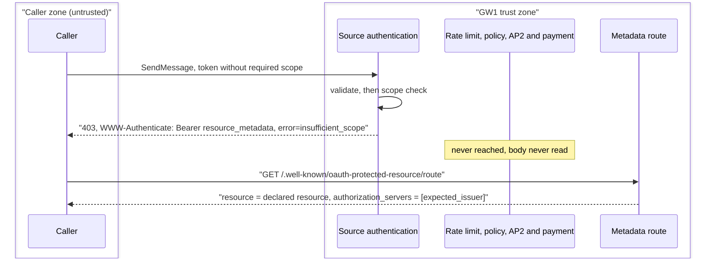
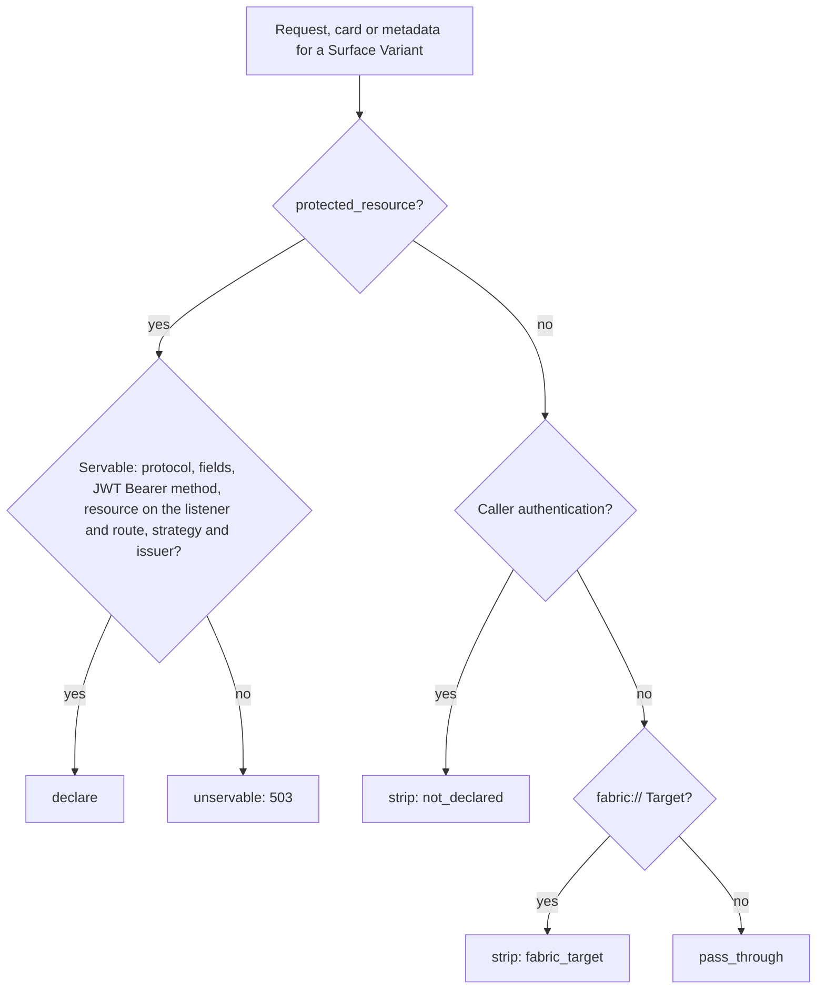
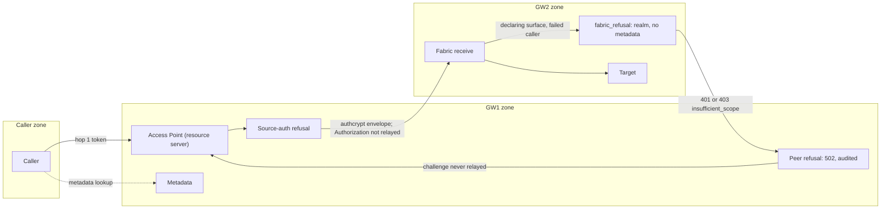

# 3. Specify the hop 1 resource server contract for scopes, challenges, metadata and card declarations

| Field        | Value                                                                   |
| ------------ | ----------------------------------------------------------------------- |
| Owner        | [Kajal Sinha](mailto:kajal.sinha@affinidi.com)                          |
| Team         | TBD (see [Open questions](#open-questions))                             |
| Is Global    | false                                                                   |
| Categories   | authentication, authorization, oauth, a2a, mcp, agent-card, policy, fabric |
| Date         | 2026-10-21                                                              |
| Last Updated | 2026-10-30                                                              |

## Status

Accepted on 2026-10-30. Decisions D1 to D5 follow the recommendations of Anton Iskryzhytskyi
and were agreed by Kajal Sinha. Two defaults inside D2, that an AP2 Access Point declares and that
`scopes_supported` is the union of `required_scopes` and the extra stored scopes, are built but
not agreed: Anton recommended A2A and MCP only, and both stay under
[Open questions](#open-questions).

Extends [1. Adopt OpenID Connect and OAuth 2.0 as a provider-neutral trust plane in Agent Gateway](0001-openid-oauth-agent-gateway.md).

ADR 0001 keeps its decisions A1, B1 and C1 and states the hop 1 contract in one line each. This
ADR gives that contract in full and refines those one-line statements. ADR 0001's Status carries
the matching `Extended by` link. [ADR 0002](0002-hop-two-target-authentication.md) owns hop 2, including the caller
requirement for `credential_provider` on every Surface Variant and on a receiving gateway; this
ADR leaves it unchanged.

Anton Iskryzhytskyi, who owns the MCP protected resource module
(`src/protocols/protected_resource.rs`), recommended an outcome for each of D1 to D5: agree with
D4 and D5, change D1 and D2, adjust D3, and have the sending gateway of a Fabric route answer a
peer's authorization refusal itself. Kajal Sinha agreed all five on 2026-10-30, and the gateway
follows them. The defaults
recorded earlier are kept under [Alternatives](#alternatives) as rejected options, with his
reasons, and the code keeps each choice in the functions named under
[Isolation points](#11-isolation-points), so a different outcome changes only those.

| Decision | Decision taken | Section |
| --- | --- | --- |
| D1. When a failed caller of a declaring Access Point is refused | At source authentication on every protocol, in the order MCP already used: token check and `401`, scope check and `403`, before rate limiting, before the request body is read and before every policy plane, the AP2 gate and payment. Public paths are exempt. | [Decision 2](#2-failure-kind-and-the-source-auth-refusal) |
| D2. How an Access Point declares | One explicit opt-in, `caller_authentication.protected_resource`, on MCP, A2A and AP2 Access Points (AP2 is a built default pending open question 2). `resource` is explicit. The advertised authorization server is the strategy's `expected_issuer` and the advertised scopes start with `required_scopes`, then each extra stored scope (a built default pending open question 3); the stored `authorization_servers` and `scopes` are optional. | [Decision 3](#3-the-declaration-and-its-outcomes) |
| D3. Resource and audience | The stored, declared resource, validated at save against the listener's external URLs and the route; `<resource>$<alias>` per variant; a token is accepted when the resource is one of its `aud` values; one resolver for direct and Fabric requests | [Decision 4](#4-declared-resource-and-audience) |
| D4. Fabric | Only the sending gateway declares and challenges. The receiving gateway refuses without a metadata URL. The sending gateway answers a peer `401`, and a peer `403` with `error="insufficient_scope"`, with `502` and a fixed detail, relays no `WWW-Authenticate` and audits the refusal, on MCP and A2A alike. | [Decision 9](#9-fabric-only-the-sending-gateway-challenges) |
| D5. Surfaces saved through the API | Protected by the D1 refusal exactly as dashboard saves; no generated deny rule | [Decision 2](#2-failure-kind-and-the-source-auth-refusal) |

## Context

### Current state

Before this decision, the gateway had two hop 1 resource server paths, both MCP only, and A2A had none.

| Area | What the code did | Where |
| --- | --- | --- |
| MCP protected resource setting | An MCP Access Point's `caller_authentication.protected_resource` (`resource`, `authorization_servers`, `scopes`) published RFC 9728 metadata naming the configured servers. Saving it on any other protocol, or with a `jwt_bearer` method that sets `forward_header`, failed with 400; a stored record that could not be served answered 503. `bind_audience` replaced the method's audiences with the resource. | `ProtectedResourceConfig`, `supports_protected_resource`, `validate_protected_resource` in `src/protocols/protected_resource.rs`; `AgentSurface::validate_protected_resource` in `src/config/agent_surface.rs` |
| MCP challenge | A missing or invalid token on such an Access Point was refused at source authentication, before policy, with 401 and `WWW-Authenticate: Bearer resource_metadata=...`. On the receiving gateway of a Fabric route the refusal carried `Bearer realm="agent-gateway"` and no metadata URL. A scope shortfall had no source authentication error and the shared challenge builder answered `InsufficientScope` with 503. The challenge's `scope` named `protected_resource.scopes`. | `ProtectedResourceConfig::{challenge, caller_challenge, fabric_refusal}` |
| Metadata route | `/.well-known/oauth-protected-resource` and `/{*path}` were mounted per listener with a GET and HEAD CORS layer, unless a configured prefix covered the path; then that listener published no metadata while its MCP Access Points kept naming it in challenges. | `metadata_path_owner` and `metadata_cors_layer` in `src/proxy/server.rs` |
| Every other Access Point | A caller-attributable source authentication failure became `input.source_auth.method == "failed"` with a free-text reason, and policy decided. A policy denial answered 403. Gateway policy runs before the AP2 gate and payment, and surface policy after them, so a surface-level deny could come after a payment. | `src/proxy/handler.rs`, [`POLICY.md`](../POLICY.md#failed-caller-authentication) |
| Scopes | No `jwt_bearer` method could require a scope. | `src/source_auth/middleware.rs` |
| Relayed challenges | Target `WWW-Authenticate` headers reached the caller unchanged, including ones naming the Target's own authorization server. | `src/proxy/handler.rs` |
| A2A cards | The card's URLs were rewritten; its security and signatures were passed through. | `src/a2a/url_rewriter.rs` |

### Triggering event

ADR 0001 decides that one configuration drives token validation, the card, RFC 9728 metadata and
the challenge, for A2A as well as MCP. Meeting it touches the same failure path, the same URL and
the same response on every protocol, and the existing MCP module already defines part of it. Without
one contract, A2A would grow a second metadata builder, a second challenge and a second audience
rule beside the MCP ones, and the card, the metadata and the validator could drift apart, which is what
ADR 0001 exists to prevent.

The owner of the MCP protected resource module then reviewed the defaults first built for D1 to
D5. His recommendation, agreed by Kajal Sinha, is the decision; the earlier defaults are recorded
as rejected alternatives.

### Glossary

| Term | Meaning |
| --- | --- |
| Hop 1, AS, PRM | As in [ADR 0001](0001-openid-oauth-agent-gateway.md#glossary). |
| Declaring Access Point | An Access Point, for one Surface Variant, whose declaration outcome is `declare`: the gateway is the resource server, publishes its metadata and challenges its failed callers. |
| Declaration | The resource server facts a declaring Access Point publishes: the declared resource, the authorization server (the strategy's `expected_issuer`), the strategy's pinned authorization server metadata when it matches, required scopes and advertised scopes. The card, the metadata, the audience check and the challenge are projections of it. |
| Declaration outcome | `declare`, `strip` (with a reason code), `pass_through` or `unservable`, for one Surface Variant. |
| Declared resource | The `protected_resource.resource` an Access Point stores, or `<resource>$<alias>` for a named Surface Variant. It is the metadata `resource`, the URL in the challenge and the audience a token must carry. |
| Access Point URL | The first external URL of an Access Point's listener, with its route. The dashboard labels it **Entry point URL** ([`CONTEXT.md`](../../CONTEXT.md)). It is the resource the save report suggests and the card URL of an Access Point that does not declare; it is never an audience. |
| Failure kind | Why source authentication failed: `missing`, `invalid` or `insufficient_scope`. |
| Gateway challenge | A `WWW-Authenticate` header the gateway wrote, marked with `GatewayChallenge`. |
| Relayed challenge | A `WWW-Authenticate` header that came back from the Target. |
| Peer authorization refusal | A receiving gateway's `401`, or its `403` with a Bearer `error="insufficient_scope"` challenge, answered over Fabric to the sending gateway. |
| GW1, GW2 | On a Fabric route, the gateway that owns the Access Point the caller reaches (GW1) and the gateway that owns the Target (GW2). |

## Requirements

### Functional

1. **One scope check.** `required_scopes` is checked in exactly one place, and a shortfall
   reaches every consumer as a failure kind, like a missing or invalid token.
2. **One refusal point.** A caller whose source authentication failed on a declaring Access
   Point is answered in one place, by one builder, on every protocol. Every policy stage answers
   with its own 403 and never with a challenge.
3. **Fail closed where the gateway is the resource server.** A declaring Access Point refuses a
   failed caller with no policy attached, before any payment is taken or the Target is reached,
   whether the surface was saved from the dashboard or through the API. It does so in the same
   place for MCP, A2A and AP2, without depending on a policy rule or on the order of the
   listener's `external_urls`.
4. **Compatibility.** A surface that sets none of the new settings answers as before, except
   for the changes listed under [Consequences](#negative-with-mitigations): a `fabric://`
   Target's relayed 401 becomes 502, a Fabric peer's 403 `insufficient_scope` becomes 502,
   `input.channel.variant_alias` is published on direct requests, and a route holding `$` or
   `%24` can no longer be saved. `tests/features/surface/source_authentication_http.feature`
   passes unchanged. An MCP Access Point with `protected_resource` answers as before this
   decision except for the responses listed under [Consequences](#negative-with-mitigations).
5. **One URL.** The card's endpoint, the metadata `resource`, the metadata URL in the challenge
   and the audience a declaring route accepts come from one declared resource and agree byte for
   byte.
6. **Metadata for every declaring Access Point,** A2A, AP2 and MCP, with an absolute
   `resource_metadata` URL in every challenge.
7. **Discovery without required scopes.** An Access Point can publish metadata and challenge
   its failed callers without requiring any scope.
8. **Only usable challenges reach the caller.** Where the gateway is the resource server, a
   Target challenge the caller cannot answer through the gateway never reaches it.
9. **Fabric.** A caller is never sent to fetch a token it cannot use.
10. **Isolation.** Each of D1 to D5 is isolated in the functions named under
    [Isolation points](#11-isolation-points).

### Non-functional

| Area | Requirement |
| --- | --- |
| Security | No hop 1 response carries the internal failure reason, a strategy id, a JWKS host, a key id, or a receiving gateway's realm, error or scopes. Challenge parameters are built only from validated values, by one module. Card bodies are never logged. No anonymous request body is read, parsed or evaluated by policy on a declaring Access Point. |
| Performance | The declaration is resolved once per request from in-memory stores, with no network call on the card, metadata or refusal path. A surface without `protected_resource` never reads the strategy store for a declaration. |
| Availability | A strategy store failure on a declaring Access Point answers 503 and never passes the caller through. A card the gateway cannot process on a declaring Access Point answers 502, never the unrewritten upstream card. |
| Compatibility | Stored surface and strategy JSON written before this change still loads, and no field is added to a record older releases parse with `deny_unknown_fields`. `make mcp-conformance` output differs from the previous release only in the listed responses. |
| Maintainability | `src/protocols/protected_resource.rs` stays the only builder of RFC 6750 and RFC 9728 strings. Existing types (`SourceAuthError`, `SourceAuthContext`, `ProtectedResourceConfig`) are extended rather than duplicated. |

### Impacted teams

| Team | Impact | Contact |
| --- | --- | --- |
| Agent Gateway backend | All of the above | Kajal Sinha; Anton Iskryzhytskyi for the MCP protected resource module and D1 to D5 |
| Dashboard | Caller authentication form, authorization server discovery switch, scope input, card view | See open question 1 |
| Product | Response changes on declaring Access Points | Cosmin Mogos |
| Hosted documentation | Source authentication and policy pages | See open question 1 |

### Out of scope

Each needs its own ADR if it is taken up.

- **The gateway's own STS as an A2A authorization server.** `mcp_http.authorization` is
  unchanged. ADR 0001 open question 6 stays open.
- **Declarations for Transit Points, DID Auth Access Points**, and `apiKey`, `mutualTLS` and
  `http` schemes.
- **Declaring with a first method other than JWT Bearer,** a custom token header or scheme, or
  more than one authorization server per declaration.
- **A policy override of the source-auth refusal** (alternative D1-D). A policy cannot admit a
  failed caller on a declaring Access Point.
- **A network rule (IP allow or deny) that answers before source authentication.** Gateway
  policy runs after it ([open question 6](#open-questions)).
- **Challenges on refusals that are not caller refusals:** 402, 413, 429, 501 (AP2 gate), 500,
  and MCP tool-policy denials returned as JSON-RPC errors keep their responses.
- **A receiving gateway accepting the sending gateway's caller authentication** in place of its
  own. ADR 0002's Fabric caller rule is unchanged.
- **Re-signing cards and filtering extended-card content** (ADR 0001 future work and open
  question 7).

## Alternatives

ADR 0001 chose where configuration lives (A1) and that a declaring Access Point's card replaces
the upstream security (C1). This ADR chooses among options for eight points: three settled with the owner of
the existing MCP module (S, R, M) and the five reviewed decisions (D1 to D5). No option adds infrastructure, so
infrastructure cost is nil throughout. Scores are 1 to 5, where 5 is best; for effort, 5 means
least effort. Effort is in engineer-days. For D1 to D4 the option first built is kept as
"earlier default, rejected"; the option chosen is the one the review recommended.

### S. Where `required_scopes` is enforced

| Option | Description | Pros | Cons | Effort |
| --- | --- | --- | --- | --- |
| **S1 (Chosen)** | The source authentication middleware checks scopes after token validation. A shortfall is a caller-attributable `InsufficientScope` with kind `insufficient_scope`: a declaring Access Point refuses it with 403, any other publishes it to policy. | One failure path for every kind. Surfaces without the setting are unchanged. | On a non-declaring Access Point, enforcement relies on policy | 3 |
| S2 | Hard 403 at source authentication on every Access Point | Enforced with no policy | A second enforcement model beside "OPA decides" on non-declaring surfaces; policy cannot see the shortfall | 2 |
| S3 | Publish `scopes` only and leave every check to Rego | Smallest change | The card and metadata would declare scopes that nothing checks | 1 |

| Aspect | Weight | S1 | S2 | S3 | Info |
| --- | --- | --- | --- | --- | --- |
| Declared scopes enforced | 2.5 | 4 | 5 | 1 | S1 relies on policy where the Access Point does not declare |
| Surfaces without `required_scopes` unchanged | 2 | 5 | 5 | 5 | |
| Policy sees the shortfall | 1.5 | 5 | 1 | 5 | |
| Development effort | 1 | 4 | 5 | 5 | |
| **Summary** | | **31.5** | **29.0** | **25.0** | |

### D1. When a failed caller of a declaring Access Point is refused

| Option | Description | Pros | Cons | Effort |
| --- | --- | --- | --- | --- |
| D1-A (earlier default, rejected) | A built-in refusal. An MCP Access Point refuses at the source authentication stage. Any other refuses after gateway policy and before the AP2 gate, payment and forwarding, and every refusing stage maps its denial to the same challenge. | Fails closed with no policy. Nothing is paid and the Target is never reached. Appliance and gateway policy, and their audit, still see the failed caller. | Anonymous requests are read, parsed as A2A and evaluated by gateway policy. A 403 versus 401 split tells an anonymous caller what gateway policy allows. A gateway rule denying unverified callers answers 403 before the 401, so the client never receives `resource_metadata` (RFC 9728 §5). A second challenge point in the pipeline. | 4 |
| D1-B | Policy decides: the challenge is sent only when a policy denies, at that policy's stage | Keeps "OPA decides" everywhere | A surface without a deny policy forwards failed callers. A surface-plane deny runs after payment, so a failed caller can pay before it is refused. For MCP it needs a policy-deny mapping at the 14 MCP `tools/call` denial sites. | 6 |
| **D1-C (Chosen)** | Refuse at the source authentication step on every protocol, in the order MCP already used: token check and 401, scope check and 403, then rate limit, body read, every policy plane, the AP2 gate, payment and forwarding | Fails closed with no policy. No anonymous body is read or parsed and no policy runs on anonymous input. No 401/403 policy oracle. A gateway deny never hides `resource_metadata`. One challenge point. | Gateway policy and its audit never see a failed caller on a declaring Access Point (the blocking `auth_failed` record still does). A network rule (IP allow or deny) in gateway policy answers 401 to an anonymous caller instead of 403. | 3 |
| D1-D | D1-A plus a policy rule that can admit failed callers, read by the refusal predicate | Fails closed by default and keeps an escape hatch | A new policy contract and a second reading of every plane on the refusal path, on top of D1-A's cons | 8 |

| Aspect | Weight | D1-A | D1-B | D1-C | D1-D | Info |
| --- | --- | --- | --- | --- | --- | --- |
| Fails closed with no policy, for API and dashboard saves | 3 | 5 | 1 | 5 | 4 | D1-D can be reopened by a rule |
| No anonymous body read, parse or policy evaluation; no policy oracle | 2.5 | 2 | 1 | 5 | 2 | |
| Discovery survives a gateway rule denying unverified callers (RFC 9728 §5) | 2 | 2 | 1 | 5 | 2 | |
| One challenge point for MCP and A2A | 1.5 | 2 | 2 | 5 | 2 | |
| Gateway policy and its audit see the failed caller | 1 | 5 | 5 | 1 | 5 | |
| Development effort | 1 | 4 | 3 | 4 | 2 | |
| **Summary** | | **36.0** | **18.5** | **50.0** | **31.0** | |

### D2. How an Access Point declares

| Option | Description | Pros | Cons | Effort |
| --- | --- | --- | --- | --- |
| D2-A (earlier default, rejected) | A declaration derived from one pinned `jwt_bearer` method with `required_scopes` whose `audiences` contain the Access Point URL; an MCP `protected_resource` takes precedence as an explicit source | No setting beyond the method. Older releases load every surface. | Removing `required_scopes` silently turns the refusal and the `aud` binding off, and an API-saved surface without a deny rule then forwards failed tokens. A second trigger needs every save-time check of the explicit setting again. A `required_scopes` trigger cannot express discovery without scopes. | 5 |
| D2-B | Explicit only, every field typed: `protected_resource` allowed on A2A with the `authorization_servers` the operator types | One mechanism | Typed issuers drift from the strategy: a strategy edit re-checks no surface, so the metadata can name an issuer the validator no longer trusts | 4 |
| D2-C | An on/off field inside `protected_resource` that defaults to the derived value | An explicit switch | `ProtectedResourceConfig` and `CallerAuthentication` refuse unknown fields, so an older release skips the whole surface after a downgrade | 4 |
| **D2-D (Chosen)** | One explicit opt-in, `protected_resource`, on MCP and A2A, and on AP2 as a built default pending open question 2. `resource` is explicit. `authorization_servers` is optional and, when sent, must equal the strategy's `expected_issuer`; the gateway always advertises that issuer. `scopes` is optional; the advertised scopes are `required_scopes`, then each extra stored scope (a built default pending open question 3). | Removing scopes cannot switch discovery off. One set of save-time checks. The advertised issuer and scopes cannot drift from what is enforced. Discovery works without required scopes. Existing MCP records load. | A `protected_resource` stored without `authorization_servers`, or on an A2A or AP2 Access Point, cannot be served by an older release | 4 |

| Aspect | Weight | D2-A | D2-B | D2-C | D2-D | Info |
| --- | --- | --- | --- | --- | --- | --- |
| Removing scopes cannot silently switch the refusal and `aud` binding off | 3 | 1 | 5 | 4 | 5 | |
| One set of save-time checks | 2 | 2 | 5 | 3 | 5 | |
| Advertised issuer and scopes cannot drift from what is enforced | 2 | 5 | 2 | 4 | 5 | |
| Discovery without required scopes | 1 | 1 | 5 | 5 | 5 | |
| Existing MCP records stay valid | 1.5 | 5 | 5 | 5 | 5 | |
| An older release still loads the surface | 1 | 5 | 4 | 1 | 3 | |
| Development effort | 1 | 5 | 4 | 3 | 3 | |
| **Summary** | | **35.5** | **49.5** | **42.5** | **53.5** | |

### D3. Resource and audience

| Option | Description | Pros | Cons | Effort |
| --- | --- | --- | --- | --- |
| D3-A (earlier default, rejected) | The resource is the first external URL of the Access Point's listener, plus the route, plus `$alias` for a variant. On a declaring route `bind_audience` replaces the method's audiences with exactly that resource. | A token minted for a sibling resource or another variant is refused. One URL for card, metadata, challenge and audience. | Reordering or adding an external URL changes every audience without a save or a check. A listener with several public hosts declares only its first, and the operator cannot pick the host. | 3 |
| D3-B | Accept any of the listener's external URLs as the resource | Works for multi-host listeners | The metadata, the card and the challenge would name one host while tokens for another pass | 4 |
| D3-C | Keep the method's other audiences on a declaring route, as any-of matching | Audiences such as Entra v2 GUIDs keep working | A token minted for any other listed audience passes the declaring Access Point | 2 |
| **D3-D (Chosen)** | The stored, declared resource, validated at save against the listener's external URLs (any of them) with the route as path; `<resource>$<alias>` per variant; `audiences` must be empty; a token is accepted when the resource is one of its `aud` values | A token for a sibling resource or variant is refused. Audiences do not depend on the order of `external_urls`. One value in the metadata, the card, the dashboard and the authorization server's registration. The operator picks the host. | Providers that put an application GUID in `aud`, such as Entra v2, need an identifier URI equal to the resource | 3 |

| Aspect | Weight | D3-A | D3-B | D3-C | D3-D | Info |
| --- | --- | --- | --- | --- | --- | --- |
| Token for a sibling resource or variant refused | 3 | 5 | 4 | 2 | 5 | |
| Audiences independent of the order of `external_urls` | 2.5 | 1 | 4 | 3 | 5 | |
| One value in metadata, card, dashboard and AS registration | 2 | 5 | 2 | 3 | 5 | |
| Providers that add their own `aud` (Auth0 `/userinfo`) | 1.5 | 5 | 5 | 5 | 5 | Every option matches `aud` as any-of |
| Operator picks the host on a multi-host listener | 1 | 1 | 3 | 3 | 5 | |
| Development effort | 1 | 5 | 3 | 4 | 4 | |
| **Summary** | | **41.0** | **39.5** | **34.0** | **54.0** | |

### D4. Fabric

| Option | Description | Pros | Cons | Effort |
| --- | --- | --- | --- | --- |
| D4-A (earlier default, rejected) | Only GW1 declares and challenges a caller. A declaring surface on GW2 refuses a failed Fabric caller before policy with the realm-only answer (401, or 403 with `error="insufficient_scope"`) and no `resource_metadata`. GW1's relayed-challenge filter drops that challenge: a 401 becomes 502, a 403 reaches the caller without its challenge, and nothing is audited. | A caller is never sent to fetch a token for GW2's resource. GW2 still fails closed. Same shape as the existing MCP Fabric refusal. | Two statuses for one kind of failure the caller cannot fix; GW1 records nothing about where the request failed | 2 |
| D4-B | GW2 challenges with its own `resource_metadata` | GW2 looks like a direct Access Point | The caller fetches a token for GW2 that GW1 never relays, and loops; GW2's setup reaches the caller | 2 |
| D4-C | GW2 never refuses before policy and hands the failure to its policy | Policy decides on GW2 | A GW2 surface without a deny policy forwards a caller that failed its source authentication | 1 |
| **D4-D (Chosen)** | D4-A, plus GW1 answers a peer 401, and a peer 403 with a Bearer `error="insufficient_scope"` challenge, with 502 and a fixed detail, relays no `WWW-Authenticate`, and records the refusal; on MCP and A2A, on every `fabric://` route | One status for every peer authorization refusal. Nothing of GW2's realm, error or scopes reaches the caller. GW1 records where the request failed. | A GW2 403 `insufficient_scope` that reached the caller as 403 now reaches it as 502 | 3 |

| Aspect | Weight | D4-A | D4-B | D4-C | D4-D | Info |
| --- | --- | --- | --- | --- | --- | --- |
| Caller never sent to fetch a token it cannot use | 3 | 5 | 1 | 5 | 5 | |
| Receiving gateway fails closed | 2 | 5 | 5 | 2 | 5 | |
| One status for every peer authorization refusal; nothing of the receiver's setup leaks | 2 | 3 | 1 | 3 | 5 | |
| The sending gateway records where it failed | 1.5 | 2 | 2 | 2 | 5 | |
| Development effort | 1 | 5 | 4 | 4 | 4 | |
| **Summary** | | **39.0** | **22.0** | **32.0** | **46.5** | |

### D5. Protection for surfaces saved through the API

| Option | Description | Pros | Cons | Effort |
| --- | --- | --- | --- | --- |
| **D5-A (Chosen)** | The D1 refusal applies to every declaring Access Point however it was saved. There is no dashboard deny-rule helper. | API and dashboard saves are protected alike. No new concept. | The protection is not a visible policy the operator can edit | 0 beyond D1 |
| D5-B | The dashboard creates a tenant-owned deny-rule policy from a template and attaches it to an empty inbound slot | Visible and removable | An API-only operator gets no protection unless they write the rule; the rule is a surface policy, which runs after payment | 3 |
| D5-C | A gateway-seeded, read-only system policy | One shared rule for every surface | A new "system definition" concept: seeding, read-only enforcement, tenancy and RBAC | 5 |

| Aspect | Weight | D5-A | D5-B | D5-C | Info |
| --- | --- | --- | --- | --- | --- |
| API and dashboard saves protected alike | 3 | 5 | 2 | 5 | |
| No new concept | 2 | 5 | 4 | 2 | |
| Visible and removable by the operator | 1.5 | 2 | 5 | 4 | |
| Development effort | 1 | 5 | 3 | 2 | |
| **Summary** | | **33.0** | **24.5** | **27.0** | |

The review checked that the dashboard adds no rule: the Caller Context editor advises one for an
Access Point that does not declare, and Surface Detail offers a copyable deny rule.

### R. Which Target challenges reach the caller

| Option | Description | Pros | Cons | Effort |
| --- | --- | --- | --- | --- |
| **R1 (Chosen)** | Every gateway-built challenge carries the `GatewayChallenge` marker. On a declaring Access Point and on a `fabric://` Target, the gateway drops every unmarked challenge except `Payment` and logs each dropped scheme; a Target 401 left with no challenge becomes 502. | The caller only sees challenges it can answer through the gateway. Other surfaces relay as before. | Every existing `fabric://` surface's relayed 401 becomes 502 | 3 |
| R2 | Never drop relayed challenges, as before this decision | No change | A caller of a declaring Access Point is pointed at the Target's authorization server, whose tokens the gateway never forwards | 0 |
| R3 | Drop them on every Access Point with caller authentication | Broad | Changes surfaces that set nothing new, including ones that forward the caller's token | 2 |

| Aspect | Weight | R1 | R2 | R3 | Info |
| --- | --- | --- | --- | --- | --- |
| Caller never sees a challenge it cannot answer | 3 | 5 | 1 | 5 | |
| Non-declaring surfaces relay as before | 2 | 4 | 5 | 1 | R1 changes `fabric://` Targets |
| Payment challenges reach the caller | 1.5 | 5 | 5 | 5 | |
| Development effort | 1 | 4 | 5 | 4 | |
| **Summary** | | **34.5** | **25.5** | **28.5** | |

On a `fabric://` Target the peer's 401 and 403 `insufficient_scope` are answered by D4 before
this filter runs.

### M. How the metadata route meets other routes

| Option | Description | Pros | Cons | Effort |
| --- | --- | --- | --- | --- |
| **M1 (Chosen)** | Mount the metadata route on every inbound listener, and refuse anything else at or under the path: at save, on reload and at startup | A challenge never names a metadata URL that the listener does not serve. A reload that would collide is refused before the listener is swapped. | A gateway.json prefix at or under the path now stops startup | 3 |
| M2 | The previous per-listener disable when a prefix covers the path | Existing configurations start | That listener's declaring Access Points keep challenging with a metadata URL it does not serve, silently | 0 |

| Aspect | Weight | M1 | M2 | Info |
| --- | --- | --- | --- | --- |
| Challenge never names unserved metadata | 3 | 5 | 1 | |
| Hot reload cannot take a listener down | 2 | 5 | 5 | M1 checks before the swap |
| An existing colliding prefix keeps starting | 1.5 | 1 | 5 | |
| Development effort | 1 | 3 | 5 | |
| **Summary** | | **29.5** | **25.5** | |

## Argument

- **S1** keeps one failure path: the middleware turns a shortfall into a failure kind, and the
  same refusal that answers a missing token answers it. S2 would enforce scopes on Access Points
  that do not declare, where policy owns the decision today. S3 would let the card declare scopes
  nothing checks.
- **D1-C** meets requirements 2 and 3 with the fewest moving parts: the source authentication
  step is the one place that refuses a failed caller, on every declaring protocol, as it already
  did for MCP. The earlier default, D1-A, kept gateway policy and its audit in front of the
  refusal, and that is its only advantage; the blocking `auth_failed` record keeps the audit. Its
  costs were the ones the review gave: an anonymous body was read, parsed and evaluated by policy;
  the 403 or 401 answer told an anonymous caller what gateway policy allows; a gateway rule
  denying unverified callers answered 403 before the 401, so an RFC 9728 client never learned
  where to get a token; and a second challenge point sat in the pipeline. D1-B fails open without
  a deny policy, and D1-D adds a policy contract no one has asked for.
- **D2-D** meets ADR 0001 requirement 1 and requirement 7 here. The opt-in is one setting that
  only a save can change, so removing `required_scopes` cannot quietly switch off the refusal and
  the `aud` binding (D2-A's flaw), and every save-time check of the setting applies once. The
  advertised issuer is read from the strategy on every request rather than typed beside it, so it
  cannot drift (D2-B's flaw), and a stored list must equal it. D2-C keeps the downgrade hazard of
  an unknown field. D2-D's downgrade cost is smaller and has a rollback step: a record that omits
  `authorization_servers` is unreadable by an older release, so the operator adds it first.
- **D3-D** makes requirement 5 true by construction: the stored resource is the one value, checked
  at save against the listener's external URLs in any order and the route, and the existing
  `bind_audience` enforces it on direct and Fabric requests through one resolver. D3-A is
  rejected for availability (reordering or adding an external URL changes every audience without
  a save or a check) and for operator choice. Matching `aud` as any-of is not new: the validator
  already accepted an array `aud` with one matching entry. D3-C lets a token for a sibling
  resource through, which RFC 8707 audience restriction exists to stop; an operator who needs a
  GUID audience keeps a non-declaring Access Point and a policy.
- **D4-D** meets requirement 9 and closes the gaps D4-A left. GW1 never relays the caller's
  `Authorization` header, so no peer authorization refusal is the caller's to fix: one `502`
  answers all of them, nothing of GW2's realm, error or scopes reaches the caller, and GW1 records
  the refusal. D4-B sends the caller after a token it can never deliver; D4-C makes GW2 fail open
  on its own declaring surface.
- **D5-A** follows from D1-C at no cost. D5-B leaves API saves unprotected and protects dashboard
  saves only after payment; D5-C adds a concept for one rule.
- **R1** meets requirement 8 with the narrowest change: only Access Points where the gateway is
  the resource server, and Fabric routes where the Target is another gateway answering the sending
  gateway's credential. R3 changes surfaces that may legitimately pass the Target's challenge on.
- **M1** removes a silent failure (M2) at the price of a startup error the operator can fix by
  renaming one prefix, and checks reloads before the swap so a collision cannot take a listener
  down.
- **Assumptions.**
  - The A2A 1.0 JSON names for the oauth2 scheme (`oauth2SecurityScheme`, `clientCredentials`,
    `oauth2MetadataUrl`, `securityRequirements` with `schemes`) match the a2a-python and a2a-js
    parsers.
  - An authorization server can mint a token whose `aud` is the declared resource: Hydra and
    Auth0 through the requested audience, Entra through an `https` identifier URI equal to it.
  - Auth0 adds its `/userinfo` audience when `openid` is requested, so `aud` matching is any-of.

## Decision

### 1. Scope enforcement

- `JwtBearerAuthConfig.required_scopes` is checked after token validation and before an identity
  is returned. The check stays out of `validate`, which STS, modern consent and credential
  providers also call.
- Granted scopes are read from the strategy's `scope_claims`, default `scope` then `scp`; the
  first claim present wins. A string is split on spaces, an array of strings is used as is, and
  any other shape grants nothing.
- A shortfall is `SourceAuthError::InsufficientScope`, caller-attributable, with failure kind
  `insufficient_scope` and audit reason `insufficient_scope`.
- Entries are RFC 6749 scope tokens (`%x21 / %x23-5B / %x5D-7E`), 1 to 128 characters, at most
  32, no duplicates, checked on every surface save and at startup. That makes them safe to place
  in a challenge.
- With `required_scopes` set, a token carrying `nonce` or `at_hash`, or whose `typ` header is
  present and is not `at+jwt`, `application/at+jwt` or `JWT`, fails as `invalid`
  ([RFC 9068 §4](https://www.rfc-editor.org/rfc/rfc9068#section-4)).
- Policy input for an authenticated `jwt_bearer` caller carries `scopes` (sorted,
  de-duplicated), `client_id` (`client_id`, then `azp`, then `appid`), `strategy_id` and
  `strategy_tenant_id`.
- The challenge's `scope` names `required_scopes` only, and is left out when there are none. The
  metadata's `scopes_supported` lists `required_scopes`, then any `protected_resource.scopes` not
  already among them, and is left out when that list is empty.

### 2. Failure kind and the source-auth refusal

- A failed caller's policy input carries `kind`: `missing`, `invalid` or `insufficient_scope`.
  `reason` stays for policy authors and logs and is never sent to the caller.
- **The source-auth refusal (D1, D5).** A declaring Access Point refuses a caller whose source
  authentication failed itself, whatever policy says, at the source authentication step, on
  every protocol: before rate limiting, before the request body is read and before every policy
  plane, the AP2 gate, payment and forwarding, directly or over Fabric. No policy ever sees such
  a caller, and a gateway deny never hides the challenge. The one builder is
  `challenge_failed_caller` (`src/proxy/caller_denial.rs`); it records one blocking `auth_failed`
  event and returns the declaration's challenge. This is the rule stated once in
  [`AGENTS.md`](../../AGENTS.md); the other documents link to it.

  | Declaration outcome | Source authentication | Response |
  | --- | --- | --- |
  | `declare` | Failed, kind `missing` | 401, `WWW-Authenticate: Bearer resource_metadata="<url>"`, with `scope="<required>"` when `required_scopes` is set |
  | `declare` | Failed, kind `invalid` | 401, the same challenge with `error="invalid_token"` |
  | `declare` | Failed, kind `insufficient_scope` | 403, the same challenge with `error="insufficient_scope"` |
  | `declare` | Authenticated, or none | The request goes on; a refusing policy stage answers with its own 403 |
  | `strip` or `pass_through` | Failed | Handed to policy as `input.source_auth.method == "failed"`, as before |
  | `unservable` | Any | 503 before source authentication, no challenge |

  - The request order on a declaring Access Point is: routing; the public paths (the agent card,
    DID Auth, onboarding; the metadata route is its own route), which are never challenged;
    declaration resolution; source authentication, token check then scope check; rate limit;
    body read and protocol admission; appliance-wide and gateway policy; the AP2 gate; A2A
    version and validation; payment; forwarding; surface policy.
  - On every protocol the challenged response is a problem (`application/problem+json`,
    `type: about:blank`, `Cache-Control: no-store`) with a fixed detail that never says why a
    token failed, and no `error_description`.
  - A request whose Surface Variant cannot be resolved gets the bare route's challenge from the
    same builder ([decision 10](#10-surface-variants)).
- **Policy refusals.** Each policy stage, the unloaded surface policy and the identity-required
  refusal answer with their own 403 body (`CallerDenial::refusal`) and never a challenge. Only an
  Access Point that does not declare can still bring a failed caller to them.
- **Payment.** Because the refusal comes before payment, a failed caller of a declaring Access
  Point is never charged. A non-declaring Access Point keeps today's order, and an operator who
  must refuse its failed callers before payment puts the rule in the gateway plane, as
  [`POLICY.md`](../POLICY.md#failed-caller-authentication) says.

### 3. The declaration and its outcomes

- One resolver, `resolve_surface_declaration` (`src/source_auth/declaration.rs`), returns the
  outcome for the resolved Surface Variant. The request path, Fabric receive, the metadata route,
  the card and the save report all call it, and the request path stores it once per request.
- An Access Point declares from one source, `caller_authentication.protected_resource` (D2), on
  an MCP, A2A or AP2 Access Point (`supports_protected_resource`,
  `src/protocols/protected_resource.rs`).

  | Field | Required | Meaning |
  | --- | --- | --- |
  | `resource` | Yes | The declared resource ([decision 4](#4-declared-resource-and-audience)) |
  | `authorization_servers` | No | When sent, exactly `["<expected_issuer>"]` of the method's strategy. It is never advertised. |
  | `scopes` | No | Extra scopes the metadata advertises after `required_scopes` |

- **Without `protected_resource`** the resolver reads no strategy and never declares: `strip`
  with `not_declared` when the Access Point has caller authentication, `strip` with
  `fabric_target` when it has none and its Target is `fabric://`, `pass_through` otherwise. A
  Transit Point card uses the reason `transit_point` when its Access Point's cards are secured.
  `strip` and `pass_through` leave the Access Point as it was before this decision: no metadata,
  no challenge, the upstream card, and failed callers handed to policy.
- **With `protected_resource`** the first failed condition makes the outcome `unservable`, which
  answers 503 and never passes the caller through; otherwise it is `declare`:

  | # | Condition | Reason code |
  | --- | --- | --- |
  | 1 | A variant of an Access Point at `/` | `root_variant_resource` |
  | 2 | The protocol is not MCP, A2A or AP2 | `unsupported_protocol` |
  | 3 | A field is invalid | `invalid_protected_resource` |
  | 4 | The first method is not `jwt_bearer` reading `Authorization` with the `Bearer` scheme, it sets `forward_header`, or its `audiences` is not empty | `incompatible_caller_authentication` |
  | 5 | The resource is not on one of the listener's external URLs with the route as path | `resource_mismatch` |
  | 6 | No strategy store, or the store fails | `strategy_store_unavailable` |
  | 7 | The strategy is missing or not referenceable by the surface's tenant | `strategy_unavailable` |
  | 8 | The strategy's `expected_issuer` is not an issuer metadata can name: `https`, or also `http` for a strategy no tenant owns | `issuer_not_advertisable` |
  | 9 | Fabric receive without the network configuration | `network_unavailable` |

- A declaration carries the declared resource, `authorization_servers` = `[expected_issuer]`,
  the strategy's pinned authorization server metadata when its issuer equals `expected_issuer`
  and, for a remote key set, its `jwks_uri` equals the strategy's, `required_scopes`, and the
  advertised scopes. A strategy edit changes the advertised issuer on the next request without a
  surface save.
- **Save.** `validate_protected_resource_strategy` (`src/identity/handlers/surfaces.rs`) refuses
  with 400 a strategy that does not exist, an issuer metadata cannot name, and a stored
  `authorization_servers` other than `["<expected_issuer>"]`. The other save checks apply on
  every declaring protocol: the resource on a listener origin and the route, owned by one
  endpoint, empty `audiences`, no `forward_header`, the `Bearer` scheme, and a route or listen
  address change refused unless `protected_resource` is sent with a new resource or `null`. A PUT
  that rebuilds caller authentication keeps a `protected_resource` the Access Point still
  supports and reports `protected_resource_dropped` otherwise.
- **Report.** A save response and `GET /v1/surfaces/{id}/declarations` list each Surface
  Variant's outcome, reason, resource and, when it declares, the advertised authorization
  servers, scopes and metadata URL, with warnings. Two warnings belong to this decision:
  `authorization_servers_stale` when a stored list no longer names the strategy's issuer, and
  `card_scheme_unavailable` when a declaring A2A or AP2 Access Point's strategy has no matching
  pin, so its card names no scheme.

### 4. Declared resource and audience

- The resource is the stored `protected_resource.resource`: a canonical HTTPS URL
  (`canonical_https_url`, `src/sts/mcp_profile.rs`) on one of the external URLs of the listener
  the Access Point is served on, whatever their order, with the route as path (`/` for an empty
  route). A bind address such as `0.0.0.0:8443` names the listener on that port. The check runs
  at save and again on every resolution (`ProtectedResourceConfig::validate_endpoint`).
- A named Surface Variant's resource is `<resource>$<alias>`.
- On a declaring route `Declaration::bind_audience` replaces the method's audiences, which must
  be empty, with exactly the declared resource. A token is accepted when that resource is one of
  its `aud` values, so a token for any other resource or variant fails as `invalid`.
  `resolve_surface_audience` (`src/source_auth/middleware.rs`) is the one resolver for direct
  and Fabric requests.
- The metadata URL is the resource's origin, then `/.well-known/oauth-protected-resource`, then
  the resource path, as the existing builder does (RFC 9728 §3.1). `%24` in a metadata path is
  decoded to `$`.
- A route holding `$` or `%24` is refused at save with 400, because those characters separate a
  variant alias and such a route could never be reached as written.
- The card served for a declaring Access Point names the declared resource as its URL.

### 5. The caller's token and `forward_header`

- A declaring Access Point never sends the caller's token to the Target or over Fabric
  (`forwards_caller_token`, `src/proxy/handler.rs`); the token was issued for the gateway.
- `protected_resource` with `forward_header` is refused at save with 400, and a stored record
  that combines them is `unservable` and answers 503.

### 6. Protected resource metadata

- `/.well-known/oauth-protected-resource` and `/{*path}` are mounted on every inbound listener,
  with the existing CORS choice for the path. Each request resolves the surface for the path, so hot
  reload applies.
  - A declaring Access Point answers 200 with `resource`, `authorization_servers` (the
    strategy's `expected_issuer`), `scopes_supported` when non-empty, and
    `bearer_methods_supported: ["header"]`, with `Cache-Control: no-store`.
  - A path two endpoints claim, or an unservable declaration, answers 503.
  - Any other path answers 404. A method other than GET and HEAD answers 405.
- Nothing else may sit at or under the path. A gateway.json prefix there stops startup with exit
  code 2 and makes a configuration reload fail with the running configuration kept, checked
  before any listener is swapped. A surface route there is refused at save, and a stored one is
  logged and not mounted. An MCP Proxy there is refused at save.

### 7. Relayed challenges

- Every challenge the gateway builds is marked with `GatewayChallenge` by
  `mark_gateway_challenge` (`src/protocols/protected_resource.rs`). A unit test fails if any
  other non-test code sets `WWW-Authenticate` outside the challenge builders and the payment
  modules.
- On a declaring Access Point and on a `fabric://` Target, `strip_relayed_challenges`
  (`src/source_auth/challenge.rs`) drops every unmarked challenge except `Payment` and logs each
  dropped scheme. A 401 left with no challenge becomes 502 with the detail "The target refused
  the gateway's authorization".
- Every other surface relays the Target's challenges and status as before.

### 8. Card declaration

- The card is secured only when the outcome is `declare` or `unservable` (`secures_cards`,
  `src/a2a/card_security.rs`). It applies to the public and extended card, a card an A2A proxy
  generates, and the declaring Access Point's Transit Point cards.
  - `declare` removes `security`, `securitySchemes`, `securityRequirements`,
    `security_schemes` and `security_requirements` from the card and from every `skills[]`
    entry and removes `signatures`. When the declaration carries a pin it then adds one
    `agent_gateway` oauth2 scheme with `oauth2MetadataUrl` set to the pinned metadata URL and a
    `clientCredentials` flow whose `tokenUrl` is the pinned token endpoint and whose scopes are
    the advertised scopes. The requirement lists `required_scopes`. The shape follows the card's
    era: the 0.3 `type` shape with `security`, the 1.0 `oauth2SecurityScheme` with
    `securityRequirements`, or the flat shape with both for a card of both eras. Without a pin
    there is no token endpoint to name, so the card declares no scheme and the save report warns
    `card_scheme_unavailable`; the metadata and the challenge still work.
  - `unservable` removes the security and signatures and adds no scheme.
  - A Transit Point card of a declaring Access Point loses the partner's security and signatures
    and declares nothing.
  - Every other card keeps the upstream security and signatures.
- The public card of an Access Point with `protected_resource` (`secures_agent_card`,
  `src/proxy/handler.rs`) carries `Cache-Control: no-cache` and a weak ETag over its body, so a
  changed declaration is never served stale: an edit to the strategy can change the scheme
  without the card changing. Such a card the gateway cannot process answers 502; it is never
  served unrewritten. Every other card keeps its cache headers.
- Card bodies are never logged. A served card is logged with its surface, outcome, reason, size
  and SHA-256 digest, and `agent_gateway_card_security_total{outcome,reason}` counts it.

### 9. Fabric: only the sending gateway challenges

- GW1, which owns the Access Point the caller reaches, is the only resource server for the
  caller. Its declaration, metadata and challenge describe GW1's declared resource, and its
  source-auth refusal runs before the Fabric send, so a failed caller never costs a Fabric round
  trip.
- A declaring surface on GW2 refuses a caller-attributable source authentication failure on a
  Fabric request before policy with `fabric_refusal`: 401 with `Bearer realm="agent-gateway"`
  (with `error="invalid_token"` for an invalid token), or 403 with
  `error="insufficient_scope"`. It names no metadata. Since GW1 never relays the caller's
  `Authorization` header, only a credential GW1 injects for GW2's resource can pass.
- GW1 answers a peer 401 that carries no `Payment` challenge, and a peer 403 with a Bearer
  `error="insufficient_scope"` challenge, with 502, `application/problem+json` and the fixed
  detail "The Fabric peer refused the gateway's authorization"
  (`refuse_peer_authorization`, `src/proxy/fabric_peer_refusal.rs`; `peer_refusal`,
  `src/source_auth/challenge.rs`). It relays no `WWW-Authenticate` and records
  `request_rejected` at stage `forward` with reason `peer_token_refused` or
  `peer_scope_refused`. This applies on every `fabric://` route, declaring or not, MCP and A2A
  alike, on legacy responses and on modern MCP streams. A policy 403 and a 402 are passed on
  unchanged.
- A non-declaring GW2 surface hands the failure to its policy, as before. ADR 0002's caller
  requirement for `credential_provider` on GW2 is unchanged.

### 10. Surface Variants

- The declaration, the metadata, the audience binding, the refusal and the card are resolved for
  the Surface Variant the request selects, through its `$alias` URL. Each variant has its own
  resource, `<resource>$alias`.
- Policy input for a request that selects an enabled variant carries
  `input.channel.variant_alias`, on the direct path as over Fabric. An alias that selects no
  enabled variant, including any alias on a surface without variants, is refused at routing and
  never reaches policy.
- On an Access Point whose bare route declares (the route without an alias, served by the
  default variant, else the base surface), a caller that fails source authentication on a URL
  whose variant cannot be resolved gets the bare route's challenge before that refusal, whichever
  alias it named, so it never reaches policy, payment or the Target. When the bare route does not
  declare, or cannot serve its declaration, the refusal answers. Variant aliases are not secret:
  each variant publishes its own metadata and card at `<route>$alias`, and its challenge names
  that resource. Over Fabric the alias is
  the one the sending route's Target pins, not one the caller chose, so the receiving gateway
  refuses an unresolvable variant before source authentication.

### 11. Isolation points

| Decision | Where it lives | What a different choice changes |
| --- | --- | --- |
| D1 | `challenge_failed_caller` (`src/proxy/caller_denial.rs`), called by the `if let Some(declaration)` branch of the source authentication step and by `challenge_before_variant_refusal` in `src/proxy/handler.rs`; `refuses_failed_callers_by_default` (`src/source_auth/declaration.rs`) for the dry run and the save report | D1-A: that branch refuses only on MCP and a refusal after gateway policy returns. D1-B: the branch always hands the failure to policy and each policy denial maps to the challenge. D1-D: the branch reads an admit rule first. |
| D2 | `resolve_surface_declaration` (its branch for an Access Point without `protected_resource`) and `matching_pin` (`src/source_auth/declaration.rs`); `supports_protected_resource` (`src/protocols/protected_resource.rs`); `validate_protected_resource_strategy` (`src/identity/handlers/surfaces.rs`) | D2-A: that branch derives a declaration from `required_scopes`. D2-B: the resolver advertises the stored `authorization_servers` and the save check stops comparing it with the strategy. |
| D3 | `access_point_protected_resource` and `ProtectedResourceConfig::validate_endpoint` (`src/protocols/protected_resource.rs`); `Declaration::bind_audience`; `resolve_surface_audience` (`src/source_auth/middleware.rs`) | D3-A: `access_point_protected_resource` requires the listener's first external URL. D3-B: it accepts any listener origin. D3-C: `bind_audience` keeps the method's audiences. |
| D4 | `Declaration::fabric_refusal` (receiving gateway); `peer_refusal` (`src/source_auth/challenge.rs`) and `refuse_peer_authorization` (`src/proxy/fabric_peer_refusal.rs`), called from `handle_fabric_request` (sending gateway) | D4-A: the two call sites are removed and the relayed-challenge filter answers alone. D4-B: the receiving gateway answers with `caller_challenge`. D4-C: the receiving branch defers to policy. |
| D5 | The same refusal as D1 | D5-B: the D1 branch hands A2A failures to policy and the dashboard attaches a deny-rule policy. |

## Consequences

### Positive

- One refusal point: every source authentication failure, scope shortfalls included, carries a
  structured kind, and a declaring Access Point answers it once, at source authentication, with
  the same problem body on every protocol.
- A declaring Access Point fails closed before rate limiting, the body, every policy plane and
  payment, with no policy, so an operator who saves a surface through the API is protected
  exactly as one who uses the dashboard, and an anonymous caller learns nothing about policy.
- Discovery is one setting the operator turns on or off with a save. It works without required
  scopes, and its issuer follows the strategy without a surface save.
- On a declaring Access Point the card, the metadata, the challenge and the audience use one
  declared resource and one scope list, so they cannot drift apart, and the resource does not
  change when the listener's external URLs are reordered. A2A, AP2 and MCP clients discover the
  gateway's authorization server the same way.
- Over Fabric, every peer authorization refusal reaches the caller as one 502 that leaks nothing
  of the receiving gateway, and the sending gateway records it.
- Surfaces that set none of the new settings answer as before, except for the changes listed
  below, and existing MCP records keep their metadata and challenge.
- Each decision changes only the functions named under Isolation points if it is decided
  differently.

### Negative, with mitigations

| Consequence | Mitigation |
| --- | --- |
| No policy can admit a failed caller on a declaring Access Point | Only Access Points the operator made declare; removing `protected_resource` (PATCH it to `null`) returns to "OPA decides". D1-D is the isolated follow-up if an admit rule is needed. |
| Gateway policy and its audit no longer see failed callers on a declaring A2A or AP2 Access Point, and a gateway rule used as an IP deny list answers such a caller 401 with `resource_metadata` instead of 403 | The blocking `auth_failed` record names every refused caller; the caller is still refused and nothing is forwarded or paid. A pre-sign-in network rule is [open question 6](#open-questions). |
| A failed caller of a declaring Access Point does not count against the surface rate limit | Each refusal costs a JWT parse and a signature check against cached keys, with no network call; the same holds for MCP before this decision. A per-address throttle is [open question 7](#open-questions). |
| MCP responses that differ from the previous release: `InsufficientScope` is 403 instead of 503; the challenge's `scope` names `required_scopes` only; a metadata-path prefix stops startup instead of disabling the listener's metadata; relayed challenges are dropped on a declaring MCP Access Point; the advertised `authorization_servers` is the strategy's `expected_issuer`, not the stored list; a declaring MCP Access Point whose strategy is missing or names an issuer metadata cannot name answers 503 | Each is a changelog entry and is documented in [`MCP_METADATA.md`](../MCP_METADATA.md); the save report warns `authorization_servers_stale`; `make mcp-conformance` differs only in these |
| Every `fabric://` surface's relayed Target 401 becomes 502 | Changelog breaking entry; the 502 detail names the gateway's credential, which the operator fixes |
| A receiving gateway's 403 `insufficient_scope` reaches the sending gateway's caller as 502 | The `request_rejected` record (`peer_scope_refused`) on the sending gateway says which; the caller cannot fix it in either case |
| A sending gateway older than this release still relays the receiving gateway's 401 and its challenge | Upgrade sending gateways before receiving ones ([`FABRIC.md`](../FABRIC.md)) |
| A declaring GW2 surface admits only a credential GW1 injects for GW2's resource | Documented in [`FABRIC.md`](../FABRIC.md); the save report warns `fabric_only_declaration` for a declaration on a surface reached only over Fabric |
| A `protected_resource` without `authorization_servers`, or on an A2A or AP2 Access Point, cannot be served by an older release | Rollback steps under [Migration](#migration-and-change-management) |
| A strategy edit to an issuer metadata cannot name turns its declaring Access Points 503 (`issuer_not_advertisable`), and the strategy save does not warn | The save report and the card metric name the reason; a strategy-save check is [open question 8](#open-questions) |
| A policy keyed on `variant_alias` may now match direct requests | Changelog `changed` entry |
| A surface whose route holds `$` or `%24` can no longer be saved | Such a route was unreachable as written; changelog `fixed` entry |

## Security considerations

- **Triggers:** authentication, authorization, APIs and policy.
- **Trust boundaries:** caller to GW1 Access Point (hop 1); GW1 to GW2 over the Fabric; Target
  to gateway (relayed challenges and cards); management API to surface and strategy stores.

| Threat (STRIDE) | Control |
| --- | --- |
| Spoofing: an ID token, or a token for a sibling resource or variant, accepted as an access token | `bind_audience` narrows a declaring route to exactly its declared resource; with `required_scopes` set, `nonce`, `at_hash` and a non-access-token `typ` fail as invalid |
| Spoofing: a gateway policy trusts an `iss` claim a tenant strategy can also produce | Policy input carries `strategy_id` and `strategy_tenant_id`; [`POLICY.md`](../POLICY.md) tells authors to key on them |
| Spoofing: a Target challenge sends the caller to an authorization server of the Target's choosing | Relayed challenges other than `Payment` are dropped on declaring Access Points and `fabric://` Targets |
| Spoofing: metadata names an issuer the validator does not trust | The advertised issuer is the strategy's `expected_issuer`, read on every request; a stored list must equal it at save |
| Tampering: header injection through `scope` in `WWW-Authenticate` | Scope tokens validated on save and at startup; one module builds the header from validated values |
| Information disclosure: failure reason, key id or JWKS host in a response; full cards in logs | Fixed `detail`, no `error_description`; card bodies replaced by a digest in logs |
| Information disclosure: a 401 or 403 split reveals what gateway policy allows an anonymous caller | No policy runs before the challenge on a declaring Access Point |
| Information disclosure: the receiving gateway's realm, error and scopes reach the caller | The sending gateway answers a peer authorization refusal with 502 and a fixed detail, and relays no challenge |
| Information disclosure: the upstream card names the Target's authorization server | Replaced on a declaring Access Point's cards and its Transit Point cards; other cards are open question 2 of ADR 0001 |
| Elevation of privilege: a failed caller reaches a paid or forwarded stage | Refused at source authentication, before rate limiting, the body, every policy plane, AP2, payment and forwarding, on every declaring Access Point; a store failure answers 503 |
| Elevation of privilege: the caller's gateway-audience token forwarded to the Target | A declaring Access Point never forwards it; `protected_resource` with `forward_header` is refused at save and unservable when stored |
| Elevation of privilege: a GW2 Target reached with a caller GW2 never authenticated | GW2's declaring surface refuses before policy; ADR 0002's caller requirement for `credential_provider` |
| Denial of service: a colliding route takes a listener down on reload | Collisions are refused before the listener is swapped |
| Denial of service: anonymous bodies read and parsed | Refused before the body is read on a declaring Access Point |
| Denial of service: unauthenticated metadata or refusal traffic | No network call on the card, metadata or refusal path; the refusal is not rate limited ([open question 7](#open-questions)) |
| Repudiation | `auth_failed` audit events with the failure kind and whether the gateway refused; `request_rejected` with `peer_token_refused` or `peer_scope_refused` on the sending gateway; the card outcome and reason in logs and metrics |

- **Least privilege and tenancy:** a surface declares only from a strategy its tenant may
  reference (`strategy_unavailable` otherwise); no new permission is granted.
- **Tokens:** algorithm, expiry and issuer checks are ADR 0001's. Hop 1 access tokens stay bearer
  tokens: a replayed token is accepted until its `exp`, with no `jti` cache, and
  sender-constrained tokens ([RFC 9449](https://www.rfc-editor.org/rfc/rfc9449)) are not in
  scope. The caller's token never crosses Fabric.

## Performance, scalability and cost

- The declaration is resolved once per request from the in-memory surface and strategy stores
  and kept on the request state. A surface without `protected_resource` never reads the strategy
  store for a declaration. A declaring one reads the same in-memory strategy store the JWT
  verifier already reads.
- A refused failed caller costs no body read, no rate-limit accounting and no policy evaluation.
- The card, the metadata route and the refusal add no network call and no I/O.
- The target is under 1 ms of added p95 latency per card, metadata or refusal response. It has
  not been measured; the component tests exercise each path.
- Throughput is unchanged: no new per-request dependency.
- No new infrastructure and no new cost.

## Data storage

No new store and no new stored field beyond ADR 0001's `required_scopes` and `scope_claims`.

| Record | Change | Type | Default | Purpose |
| --- | --- | --- | --- | --- |
| `JwtBearerAuthConfig` | `required_scopes` (ADR 0001) | String list, validated | Empty | Scope enforcement and the advertised scopes |
| `JwtVerificationStrategy` | `scope_claims` | String list | Absent, read as `scope` then `scp` | Claims read for granted scopes |
| `ProtectedResourceConfig` | `authorization_servers` becomes optional; the setting is accepted on A2A and AP2 Access Points | `Option<Vec<String>>`, equal to `["<expected_issuer>"]` when present | Absent | Kept for records that list it; never advertised |
| `ProtectedResourceConfig` | `scopes` | String list | Empty | Extra advertised scopes |
| Policy input, failed caller (not stored) | `kind` | `missing`, `invalid`, `insufficient_scope` | n/a | Status and challenge choice |
| Policy input, `jwt_bearer` caller (not stored) | `scopes`, `client_id`, `strategy_id`, `strategy_tenant_id` | Strings | n/a | Provider-neutral policy input |
| Request state (not stored) | The declaration outcome | Enum | n/a | Read by every consumer for the request |
| Audit (not stored by the gateway) | `request_rejected` reasons `peer_token_refused`, `peer_scope_refused` | Strings | n/a | Where a Fabric request failed |

- **Access patterns, TTL, delete, encryption and locality:** unchanged from ADR 0001.
- **Data minimisation:** the declaration is resolved on each request and never stored.

## Migration and change management

The contract ships in one release. What it changes and what gates it:

- **Existing MCP `protected_resource` records** keep their metadata and challenge, except for the
  MCP responses listed under [Consequences](#negative-with-mitigations). A record whose stored
  `authorization_servers` differs from its strategy's issuer loads and advertises the issuer;
  the save report warns `authorization_servers_stale`, and the next save must send the issuer
  or omit the list.
- **Surfaces that set no `protected_resource`** keep their responses, except for the other
  changes listed there. D2-A was never released, so no released record declares through
  `required_scopes` alone, and operators of the previous release see no change in which MCP
  surfaces declare.
- **Upgrade order:** sending gateways of Fabric routes before receiving ones, so a receiving
  gateway's refusal is never relayed to a caller.
- **Conformance:** `make mcp-conformance` differs from the previous release only in the listed
  MCP responses, and the existing MCP discovery tests pass.
- **Gating tests:** unit tests for the refusal order, every declaration outcome and the peer
  refusal mapping; component tests for every declaration outcome, both card eras and the request
  order; BDD features for the A2A challenge, card security, metadata, the opt-in, and an Access
  Point that does not declare; `source_authentication_http.feature` unchanged.

- **Rollback:** as in ADR 0001, plus:
  1. A `protected_resource` stored without `authorization_servers` cannot be read by an older
     release, which skips the surface (404, fail closed). Before rolling back, PATCH it with
     `"authorization_servers": ["<strategy expected_issuer>"]`.
  2. An A2A or AP2 surface with `protected_resource` answers 503 on an older release and cannot
     be saved there. Before rolling back, attach a gateway policy denying
     `input.source_auth.method == "failed"` and PATCH `"protected_resource": null`.
  3. `peer_token_refused` and `peer_scope_refused` records stay in audit sinks; an older sending
     gateway writes none and relays the receiving gateway's 401.
  - Per Access Point, PATCH `protected_resource` to `null`: no metadata, no challenge, the
    upstream card and failed callers handed to policy.
- **Backward compatibility:** surfaces that do not declare keep their responses; existing MCP
  `protected_resource` records keep theirs except the listed responses; no new stored field.
- **Communication:** changelog entries for the opt-in on A2A and AP2, the refusal at source
  authentication, the card, the Fabric peer refusal, the variant alias and each MCP difference,
  with upgrade and rollback notes; the hosted source authentication and policy pages.

## Diagrams

### Failed caller on a declaring A2A Access Point

### Declaration outcome

### Fabric

## References

**Repository:**
- [ADR 0001](0001-openid-oauth-agent-gateway.md)
- [ADR 0002](0002-hop-two-target-authentication.md)
- [`AGENTS.md`](../../AGENTS.md)
- [`SOURCE_AUTH.md`](../SOURCE_AUTH.md)
- [`POLICY.md`](../POLICY.md)
- [`PROTOCOLS.md`](../PROTOCOLS.md)
- [`MCP_METADATA.md`](../MCP_METADATA.md)
- [`FABRIC.md`](../FABRIC.md)
- [`OBSERVABILITY.md`](../OBSERVABILITY.md)
- [`CONTEXT.md`](../../CONTEXT.md)

**Standards and specifications:**
- [RFC 6749 §3.3, scope](https://www.rfc-editor.org/rfc/rfc6749#section-3.3)
- [RFC 6750 §3, the WWW-Authenticate response header](https://www.rfc-editor.org/rfc/rfc6750#section-3)
- [RFC 7519 §4.1.3, the `aud` claim](https://www.rfc-editor.org/rfc/rfc7519#section-4.1.3)
- [RFC 8707](https://www.rfc-editor.org/rfc/rfc8707)
- [RFC 9068, JWT profile for OAuth 2.0 access tokens](https://www.rfc-editor.org/rfc/rfc9068)
- [RFC 9728](https://www.rfc-editor.org/rfc/rfc9728), and [§5, use of WWW-Authenticate](https://www.rfc-editor.org/rfc/rfc9728#section-5)
- [A2A specification](https://a2a-protocol.org/latest/specification/)
- [Microsoft identity platform access token claims](https://learn.microsoft.com/en-us/entra/identity-platform/access-token-claims-reference)

## Open questions

The five recommendations behind D1 to D5 were agreed on 2026-10-30 (see [Status](#status)), except
that the AP2 and scopes union defaults of D2 are open (questions 2 and 3). Each
question below is still open, and the current behaviour it names stays until it is answered.

| # | Question | Owner | Resolves by |
| --- | --- | --- | --- |
| 1 | Which team owns this ADR (the Team field)? Same question as ADR 0001 open question 1. | Kajal Sinha | Before the release that ships this change |
| 2 | Does an AP2 Access Point declare with `protected_resource`? Current behaviour: yes, as an A2A Access Point. | Anton Iskryzhytskyi | Before the release that ships this change |
| 3 | Is `scopes_supported` the union of `required_scopes` and the extra stored `scopes`, or `required_scopes` only? Current behaviour: the union, required first. | Anton Iskryzhytskyi | Before the release that ships this change |
| 4 | Does a declaring A2A Access Point whose strategy has no matching pin declare without a card scheme, or is the save refused? Current behaviour: it declares and the save report warns `card_scheme_unavailable`. | Anton Iskryzhytskyi | Before the release that ships this change |
| 5 | Should a stored surface at the metadata path stop startup rather than be logged and skipped? Current behaviour: logged and skipped. | Kajal Sinha | Before the release that ships this change |
| 6 | Should a network rule (IP allow or deny) run before source authentication, so an anonymous caller a gateway rule denies gets 403 rather than the challenge? Current behaviour: no; gateway policy runs after the refusal. | Kajal Sinha, Anton Iskryzhytskyi | Follow-up ADR if needed |
| 7 | Should anonymous refusals on a declaring Access Point be throttled per address? Current behaviour: not throttled, as for MCP before this decision. | Kajal Sinha | After this release |
| 8 | Should a strategy save refuse or warn when its new issuer would leave declaring Access Points unservable? Current behaviour: no check; the save report names `issuer_not_advertisable`. | Kajal Sinha | After this release |
| 9 | Should a Transit Point's Fabric forward, and the gateway STS as a receiving resource server, take part in the peer refusal and the declaration? Current behaviour: out of scope. | Anton Iskryzhytskyi | Follow-up ADR if needed |
| 10 | Should a deleted strategy (`ConfigNotFound`) on an Access Point that does not declare answer 403 rather than the existing 500? Current behaviour: 500, as before this decision. A declaring one answers 503 (`strategy_unavailable`). | Kajal Sinha | Before the release that ships this change |

## Future work

- A sign-in-required switch for JWT Bearer Access Points that do not publish discovery.
- A pre-sign-in network rule stage (IP allow or deny), if [open question 6](#open-questions)
  needs it.
- A policy rule that admits failed callers on a declaring Access Point (D1-D), if one is needed.
- Gateway-signed cards, and `apiKey`, `mutualTLS` and `http` declarations (ADR 0001 future work).
- Declarations for Transit Points and for the gateway's own STS.
- Carrying the sending gateway's caller authentication outcome over Fabric, and a two-gateway
  test harness that configures a declaring receiving gateway.

Each item gets its own ADR when it changes a contract.
