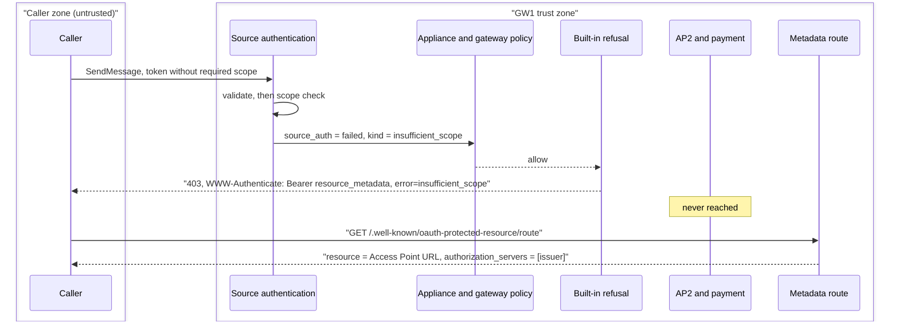
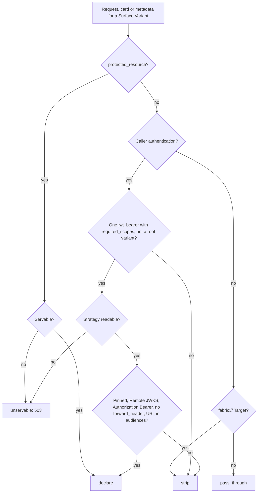
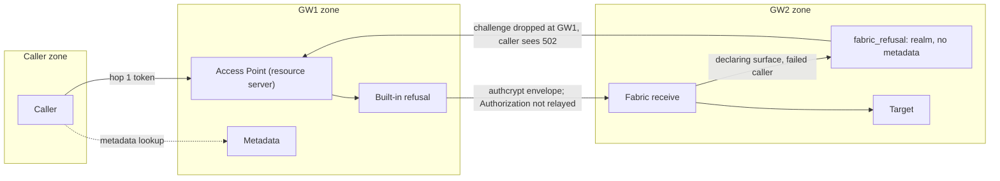

# 3. Specify the hop 1 resource server contract for scopes, challenges, metadata and card declarations

| Field        | Value                                                                   |
| ------------ | ----------------------------------------------------------------------- |
| Owner        | [Kajal Sinha](mailto:kajal.sinha@affinidi.com)                          |
| Team         | TBD (see [Open questions](#open-questions))                             |
| Is Global    | false                                                                   |
| Categories   | authentication, authorization, oauth, a2a, mcp, agent-card, policy, fabric |
| Date         | 2026-10-21                                                              |
| Last Updated | 2026-10-29                                                              |

## Status

Proposed.

Extends [1. Adopt OpenID Connect and OAuth 2.0 as a provider-neutral trust plane in Agent Gateway](0001-openid-oauth-agent-gateway.md).

ADR 0001 keeps its decisions A1, B1 and C1 and states the hop 1 contract in one line each. This
ADR gives that contract in full and refines those one-line statements. ADR 0001's Status carries
the matching `Extended by` link. [ADR 0002](0002-hop-two-target-authentication.md) owns hop 2, including the caller
requirement for `credential_provider` on every Surface Variant and on a receiving gateway; this
ADR leaves it unchanged.

Five of the decisions below (D1 to D5) need the agreement of Anton Iskryzhytskyi, who owns the
MCP protected resource module (`src/protocols/protected_resource.rs`). The gateway is built with
the default recorded for each, and the code keeps each choice in the functions named under
[Isolation points](#11-isolation-points), so a different outcome changes only those.

| Decision | Default built | Section |
| --- | --- | --- |
| D1. When a failed caller of a declaring Access Point is refused | Always, by the gateway: an MCP Access Point at the source authentication stage, any other after gateway policy and before AP2 and payment | [Decision 2](#2-failure-kind-one-deny-mapping-and-the-built-in-refusal) |
| D2. How an Access Point declares | Derived from one pinned `jwt_bearer` method with `required_scopes`; an MCP `protected_resource` stays as an explicit source | [Decision 3](#3-declaration-sources-and-outcomes) |
| D3. Resource and audience | The listener's first external URL, the route and `$alias`; a declaring route's tokens must name it | [Decision 4](#4-access-point-url-and-audience) |
| D4. Fabric | Only the sending gateway declares and challenges | [Decision 9](#9-fabric-only-the-sending-gateway-challenges) |
| D5. Surfaces saved through the API | Protected by the D1 refusal exactly as dashboard saves | [Decision 2](#2-failure-kind-one-deny-mapping-and-the-built-in-refusal) |

## Context

### Current state

Before this decision, the gateway had two hop 1 resource server paths, both MCP only, and A2A had none.

| Area | What the code did | Where |
| --- | --- | --- |
| MCP protected resource setting | An MCP Access Point's `caller_authentication.protected_resource` (`resource`, `authorization_servers`, `scopes`) published RFC 9728 metadata naming the configured servers. Saving it on any other protocol, or with a `jwt_bearer` method that sets `forward_header`, failed with 400; a stored record that could not be served answered 503. `bind_audience` replaced the method's audiences with the resource. | `ProtectedResourceConfig`, `supports_protected_resource`, `validate_protected_resource` in `src/protocols/protected_resource.rs`; `AgentSurface::validate_protected_resource` in `src/config/agent_surface.rs` |
| MCP challenge | A missing or invalid token on such an Access Point was refused at source authentication, before policy, with 401 and `WWW-Authenticate: Bearer resource_metadata=...`. On the receiving gateway of a Fabric route the refusal carried `Bearer realm="agent-gateway"` and no metadata URL. A scope shortfall had no source authentication error and the shared challenge builder answered `InsufficientScope` with 503. The challenge's `scope` named `protected_resource.scopes`. | `ProtectedResourceConfig::{challenge, caller_challenge, fabric_refusal}` |
| Metadata route | `/.well-known/oauth-protected-resource` and `/{*path}` were mounted per listener with a GET and HEAD CORS layer, unless a configured prefix covered the path; then that listener published no metadata while its MCP Access Points kept naming it in challenges. | `metadata_path_owner` and `metadata_cors_layer` in `src/proxy/server.rs` |
| Every other Access Point | A caller-attributable source authentication failure became `input.source_auth.method == "failed"` with a free-text reason, and policy decided. A policy denial answered 403. Gateway policy runs before the AP2 gate and payment, and surface policy after them, so a surface-level deny could come after a payment. | `src/proxy/handler.rs`, [`POLICY.md`](../POLICY.md#failed-caller-authentication) |
| Scopes | No `jwt_bearer` method could require a scope. | `src/source_auth/middleware.rs` |
| Relayed challenges | Target `WWW-Authenticate` headers reached the caller unchanged, including ones naming the Target's own authorization server. | `src/proxy/handler.rs` |
| A2A cards | The card's URLs were rewritten; its security and signatures were passed through. | `src/a2a/url_rewriter.rs` |

### Triggering event

ADR 0001 decides that one configuration drives token validation, the card, RFC 9728 metadata and
the challenge, for A2A as well as MCP. Meeting it touches the same failure path, the same URL and
the same response on every protocol, and the existing MCP module already defines part of it. Without
one contract, A2A would grow a second metadata builder, a second challenge and a second audience
rule beside the MCP ones, and the card, the metadata and the validator could drift apart, which is what
ADR 0001 exists to prevent.

### Glossary

| Term | Meaning |
| --- | --- |
| Hop 1, AS, PRM | As in [ADR 0001](0001-openid-oauth-agent-gateway.md#glossary). |
| Declaring Access Point | An Access Point, for one Surface Variant, whose declaration outcome is `declare`: the gateway is the resource server, publishes its metadata and challenges its failed callers. |
| Declaration | The resource server facts a declaring Access Point publishes: resource, authorization servers, the pinned authorization server metadata when derived, required scopes and advertised scopes. The card, the metadata, the audience check and the challenge are projections of it. |
| Declaration outcome | `declare`, `strip` (with a reason code), `pass_through` or `unservable`, for one Surface Variant. |
| Explicit declaration | An MCP Access Point's `protected_resource` setting. |
| Derived declaration | A declaration built from one pinned `jwt_bearer` method with `required_scopes`. |
| Access Point URL | The canonical HTTPS URL of an Access Point for one Surface Variant. The dashboard labels it **Entry point URL** ([`CONTEXT.md`](../../CONTEXT.md)). |
| Failure kind | Why source authentication failed: `missing`, `invalid` or `insufficient_scope`. |
| Gateway challenge | A `WWW-Authenticate` header the gateway wrote, marked with `GatewayChallenge`. |
| Relayed challenge | A `WWW-Authenticate` header that came back from the Target. |
| GW1, GW2 | On a Fabric route, the gateway that owns the Access Point the caller reaches (GW1) and the gateway that owns the Target (GW2). |

## Requirements

### Functional

1. **One scope check.** `required_scopes` is checked in exactly one place, and a shortfall
   reaches every consumer as a failure kind, like a missing or invalid token.
2. **One deny mapping.** Every stage that refuses a caller answers through one mapping, which
   chooses the status and the challenge from the declaration outcome and the failure kind.
3. **Fail closed where the gateway is the resource server.** A declaring Access Point refuses a
   failed caller with no policy attached, before any payment is taken or the Target is reached,
   whether the surface was saved from the dashboard or through the API.
4. **Compatibility.** A surface that sets none of the new settings answers as before, except
   for the changes listed under [Consequences](#negative-with-mitigations): a `fabric://`
   Target's relayed 401 becomes 502, `input.channel.variant_alias` is published on direct
   requests, and a route holding `$` or `%24` can no longer be saved.
   `tests/features/surface/source_authentication_http.feature` passes unchanged. An MCP Access
   Point with `protected_resource` answers as before this decision except for the responses listed under
   [Consequences](#negative-with-mitigations).
5. **One URL.** The card's endpoint, the metadata `resource`, the metadata URL in the challenge
   and the audience a declaring route accepts come from one resolver and agree byte for byte.
6. **Metadata for every declaring Access Point,** A2A and MCP, with an absolute
   `resource_metadata` URL in every challenge.
7. **Only usable challenges reach the caller.** Where the gateway is the resource server, a
   Target challenge the caller cannot answer through the gateway never reaches it.
8. **Fabric.** A caller is never sent to fetch a token it cannot use.
9. **Isolation.** Each of D1 to D5 is isolated in the functions named under
   [Isolation points](#11-isolation-points).

### Non-functional

| Area | Requirement |
| --- | --- |
| Security | No hop 1 response carries the internal failure reason, a strategy id, a JWKS host or a key id. Challenge parameters are built only from validated values, by one module. Card bodies are never logged. |
| Performance | The declaration is resolved once per request from in-memory stores, with no network call on the card, metadata or refusal path. A surface without `required_scopes` and without `protected_resource` never reads the strategy store. |
| Availability | A strategy store failure on a declaring candidate answers 503 and never passes the caller through. A card the gateway cannot process on a declaring Access Point answers 502, never the unrewritten upstream card. |
| Compatibility | Stored surface and strategy JSON written before this change still loads, and no field is added to a record older releases parse with `deny_unknown_fields`. `make mcp-conformance` output differs from the previous release only in the listed responses. |
| Maintainability | `src/protocols/protected_resource.rs` stays the only builder of RFC 6750 and RFC 9728 strings. Existing types (`SourceAuthError`, `SourceAuthContext`, `ProtectedResourceConfig`) are extended rather than duplicated. |

### Impacted teams

| Team | Impact | Contact |
| --- | --- | --- |
| Agent Gateway backend | All of the above | Kajal Sinha; Anton Iskryzhytskyi for the MCP protected resource module and D1 to D5 |
| Dashboard | Caller authentication form, scope input, card view | See open question 1 |
| Product | Response changes on declaring Access Points | Cosmin Mogos |
| Hosted documentation | Source authentication and policy pages | See open question 1 |

### Out of scope

Each needs its own ADR if it is taken up.

- **The gateway's own STS as an A2A authorization server.** `mcp_http.authorization` is
  unchanged. ADR 0001 open question 6 stays open.
- **Declarations for Transit Points, DID Auth Access Points**, and `apiKey`, `mutualTLS` and
  `http` schemes.
- **Declaring with more than one source authentication method,** a Static JWKS, a custom token
  header or scheme, or more than one authorization server per derived declaration.
- **A policy override of the built-in refusal** (alternative D1-D). A policy cannot admit a
  failed caller on a declaring Access Point.
- **Challenges on refusals that are not caller refusals:** 402, 413, 429, 501 (AP2 gate), 500,
  and MCP tool-policy denials returned as JSON-RPC errors keep their responses.
- **A save-time report** of each Surface Variant's declaration outcome and of policies that admit
  failed callers, and a read endpoint for it (see [Future work](#future-work)).
- **A receiving gateway accepting the sending gateway's caller authentication** in place of its
  own. ADR 0002's Fabric caller rule is unchanged.
- **Re-signing cards and filtering extended-card content** (ADR 0001 future work and open
  question 7).

## Alternatives

ADR 0001 chose where configuration lives (A1) and that a declaring Access Point's card replaces
the upstream security (C1). This ADR chooses among options for eight points: three settled with the owner of
the existing MCP module (S, R, M) and the five open decisions (D1 to D5). No option adds infrastructure, so
infrastructure cost is nil throughout. Scores are 1 to 5, where 5 is best; for effort, 5 means
least effort. Effort is in engineer-days.

### S. Where `required_scopes` is enforced

| Option | Description | Pros | Cons | Effort |
| --- | --- | --- | --- | --- |
| **S1 (Chosen)** | The source authentication middleware checks scopes after token validation. A shortfall is a caller-attributable `InsufficientScope` with kind `insufficient_scope`: a declaring Access Point refuses it with 403, any other publishes it to policy. | One failure path for every kind. Surfaces without the setting are unchanged. | On a non-declaring Access Point, enforcement relies on policy | 3 |
| S2 | Hard 403 at source authentication on every Access Point | Enforced with no policy | A second enforcement model beside "OPA decides" on non-declaring surfaces; policy cannot see the shortfall | 2 |
| S3 | Publish `scopes` only and leave every check to Rego | Smallest change | The card and metadata would declare scopes that nothing checks | 1 |

| Aspect | Weight | S1 | S2 | S3 | Info |
| --- | --- | --- | --- | --- | --- |
| Declared scopes enforced | 2.5 | 4 | 5 | 1 | S1 relies on policy where the Access Point does not declare |
| Surfaces without `required_scopes` unchanged | 2 | 5 | 5 | 5 | |
| Policy sees the shortfall | 1.5 | 5 | 1 | 5 | |
| Development effort | 1 | 4 | 5 | 5 | |
| **Summary** | | **31.5** | **29.0** | **25.0** | |

### D1. When a failed caller of a declaring Access Point is refused

| Option | Description | Pros | Cons | Effort |
| --- | --- | --- | --- | --- |
| **D1-A (Chosen)** | A built-in refusal. An MCP Access Point refuses at the source authentication stage, as before this decision. Any other refuses after gateway policy and before the AP2 gate, payment and forwarding. Every refusing stage shares one mapping, so a gateway policy denial gets the same challenge. | Fails closed with no policy. Nothing is paid and the Target is never reached. Appliance and gateway policy, and their audit, still see the failed caller. | No policy can admit a failed caller on a declaring Access Point | 4 |
| D1-B | Policy decides: the challenge is sent only when a policy denies, at that policy's stage | Keeps "OPA decides" everywhere | A surface without a deny policy forwards failed callers. A surface-plane deny runs after payment, so a failed caller can pay before it is refused. For MCP it needs a policy-deny mapping at the 14 MCP `tools/call` denial sites. | 6 |
| D1-C | Refuse at the source authentication stage on every protocol, the existing MCP model | Simplest ordering | Gateway policy and its audit never see a failed caller on a declaring Access Point, so a gateway deny with its own reason cannot apply | 3 |
| D1-D | D1-A plus a policy rule that can admit failed callers, read by the refusal predicate | Fails closed by default and keeps an escape hatch | A new policy contract and a second reading of every plane on the refusal path | 8 |

| Aspect | Weight | D1-A | D1-B | D1-C | D1-D | Info |
| --- | --- | --- | --- | --- | --- | --- |
| Fails closed with no policy, for API and dashboard saves | 3 | 5 | 1 | 5 | 4 | D1-D can be reopened by a rule |
| Refused before payment and the Target | 2.5 | 5 | 2 | 5 | 5 | |
| Gateway policy and audit still see the failed caller | 1.5 | 5 | 5 | 2 | 5 | |
| Policy can admit some failed callers | 1 | 1 | 5 | 1 | 4 | |
| Development effort | 1 | 4 | 3 | 4 | 2 | |
| **Summary** | | **40.0** | **23.5** | **35.5** | **38.0** | |

### D2. How an Access Point declares

| Option | Description | Pros | Cons | Effort |
| --- | --- | --- | --- | --- |
| **D2-A (Chosen)** | The derived declaration is the source of truth. The existing `protected_resource` stays as written, as an explicit source for MCP that takes precedence when present. There is no new "off" field: removing `required_scopes` switches a derived declaration off. | One configuration (strategy and method) drives the validator, card, metadata and challenge, as ADR 0001 requires. Existing MCP records load and answer as before. Older releases still load every surface. | Two sources for MCP; switching a declaration off means removing the scopes or the pin | 5 |
| D2-B | Explicit only: allow `protected_resource` on A2A, and keep `required_scopes` for enforcement only | One mechanism | The operator types the resource and authorization servers a second time beside the strategy, so the card and the validator can disagree | 4 |
| D2-C | Add an on/off field inside `protected_resource` that defaults to the derived value | An explicit switch | `ProtectedResourceConfig` and `CallerAuthentication` refuse unknown fields, so an older release skips the whole surface after a downgrade | 4 |

| Aspect | Weight | D2-A | D2-B | D2-C | Info |
| --- | --- | --- | --- | --- | --- |
| One configuration drives validator, card, metadata and challenge | 3 | 5 | 3 | 5 | |
| Older releases still load the surface | 2.5 | 5 | 5 | 1 | |
| An existing MCP `protected_resource` answers as before | 2 | 5 | 5 | 5 | |
| Switch off without removing scopes | 1 | 2 | 5 | 5 | |
| Development effort | 1 | 4 | 3 | 3 | |
| **Summary** | | **43.5** | **39.5** | **35.5** | |

### D3. Resource and audience

| Option | Description | Pros | Cons | Effort |
| --- | --- | --- | --- | --- |
| **D3-A (Chosen)** | The resource is the first external URL of the Access Point's listener, plus the route, plus `$alias` for a variant. A derived declaration needs it in `audiences`; on a declaring route the method's audiences are replaced by exactly that resource through the existing `bind_audience`. | A token minted for a sibling resource or another variant is refused. One URL for card, metadata, challenge and audience. | A listener with several public hosts declares only its first. Providers that put an application GUID in `aud`, such as Entra v2, need an identifier URI equal to the Access Point URL. | 3 |
| D3-B | Accept any of the listener's external URLs as the resource | Works for multi-host listeners | The metadata, the card and the challenge would name one host while tokens for another pass | 4 |
| D3-C | Keep the method's other audiences on a declaring route, as any-of matching | Entra v2 GUID audiences keep working | A token minted for any other listed audience passes the declaring Access Point | 2 |

| Aspect | Weight | D3-A | D3-B | D3-C | Info |
| --- | --- | --- | --- | --- | --- |
| Token for a sibling resource or variant refused | 3 | 5 | 4 | 2 | |
| Card, metadata, challenge and audience agree | 2.5 | 5 | 3 | 5 | |
| Listeners with several public hosts | 1.5 | 2 | 5 | 2 | |
| GUID audiences such as Entra v2 | 1 | 1 | 1 | 5 | |
| Development effort | 1 | 4 | 3 | 4 | |
| **Summary** | | **35.5** | **31.0** | **30.5** | |

### D4. Fabric

| Option | Description | Pros | Cons | Effort |
| --- | --- | --- | --- | --- |
| **D4-A (Chosen)** | Only GW1 declares and challenges a caller. A declaring surface on GW2 refuses a failed Fabric caller before policy with the existing realm-only answer (401, or 403 with `error="insufficient_scope"`) and no `resource_metadata`. GW1 drops that challenge as a relayed one, so its caller sees 502. | A caller is never sent to fetch a token for GW2's resource, which GW1 would strip. GW2 still fails closed. Same shape as the existing MCP Fabric refusal. | A declaring GW2 surface admits only a credential GW1 injects for GW2's resource | 2 |
| D4-B | GW2 challenges with its own `resource_metadata` | GW2 looks like a direct Access Point | The caller fetches a token for GW2 that GW1 never relays, and loops | 2 |
| D4-C | GW2 never refuses before policy and hands the failure to its policy | Policy decides on GW2 | A GW2 surface without a deny policy forwards a caller that failed its source authentication | 1 |

| Aspect | Weight | D4-A | D4-B | D4-C | Info |
| --- | --- | --- | --- | --- | --- |
| Caller never sent to fetch a token it cannot use | 3 | 5 | 1 | 5 | |
| GW2 still fails closed | 2 | 5 | 5 | 2 | |
| Same shape as the existing MCP Fabric refusal | 1.5 | 5 | 2 | 2 | |
| Development effort | 1 | 4 | 4 | 4 | |
| **Summary** | | **36.5** | **20.0** | **26.0** | |

### D5. Protection for surfaces saved through the API

| Option | Description | Pros | Cons | Effort |
| --- | --- | --- | --- | --- |
| **D5-A (Chosen)** | The D1 refusal applies to every declaring Access Point however it was saved. There is no dashboard deny-rule helper. | API and dashboard saves are protected alike. No new concept. | The protection is not a visible policy the operator can edit | 0 beyond D1 |
| D5-B | The dashboard creates a tenant-owned deny-rule policy from a template and attaches it to an empty inbound slot | Visible and removable | An API-only operator gets no protection unless they write the rule; the rule is a surface policy, which runs after payment | 3 |
| D5-C | A gateway-seeded, read-only system policy | One shared rule for every surface | A new "system definition" concept: seeding, read-only enforcement, tenancy and RBAC | 5 |

| Aspect | Weight | D5-A | D5-B | D5-C | Info |
| --- | --- | --- | --- | --- | --- |
| API and dashboard saves protected alike | 3 | 5 | 2 | 5 | |
| No new concept | 2 | 5 | 4 | 2 | |
| Visible and removable by the operator | 1.5 | 2 | 5 | 4 | |
| Development effort | 1 | 5 | 3 | 2 | |
| **Summary** | | **33.0** | **24.5** | **27.0** | |

### R. Which Target challenges reach the caller

| Option | Description | Pros | Cons | Effort |
| --- | --- | --- | --- | --- |
| **R1 (Chosen)** | Every gateway-built challenge carries the `GatewayChallenge` marker. On a declaring Access Point and on a `fabric://` Target, the gateway drops every unmarked challenge except `Payment` and logs each dropped scheme; a Target 401 left with no challenge becomes 502. | The caller only sees challenges it can answer through the gateway. Other surfaces relay as before. | Every existing `fabric://` surface's relayed 401 becomes 502 | 3 |
| R2 | Never drop relayed challenges, as before this decision | No change | A caller of a declaring Access Point is pointed at the Target's authorization server, whose tokens the gateway never forwards | 0 |
| R3 | Drop them on every Access Point with caller authentication | Broad | Changes surfaces that set nothing new, including ones that forward the caller's token | 2 |

| Aspect | Weight | R1 | R2 | R3 | Info |
| --- | --- | --- | --- | --- | --- |
| Caller never sees a challenge it cannot answer | 3 | 5 | 1 | 5 | |
| Non-declaring surfaces relay as before | 2 | 4 | 5 | 1 | R1 changes `fabric://` Targets |
| Payment challenges reach the caller | 1.5 | 5 | 5 | 5 | |
| Development effort | 1 | 4 | 5 | 4 | |
| **Summary** | | **34.5** | **25.5** | **28.5** | |

### M. How the metadata route meets other routes

| Option | Description | Pros | Cons | Effort |
| --- | --- | --- | --- | --- |
| **M1 (Chosen)** | Mount the metadata route on every inbound listener, and refuse anything else at or under the path: at save, on reload and at startup | A challenge never names a metadata URL that the listener does not serve. A reload that would collide is refused before the listener is swapped. | A gateway.json prefix at or under the path now stops startup | 3 |
| M2 | The previous per-listener disable when a prefix covers the path | Existing configurations start | That listener's declaring Access Points keep challenging with a metadata URL it does not serve, silently | 0 |

| Aspect | Weight | M1 | M2 | Info |
| --- | --- | --- | --- | --- |
| Challenge never names unserved metadata | 3 | 5 | 1 | |
| Hot reload cannot take a listener down | 2 | 5 | 5 | M1 checks before the swap |
| An existing colliding prefix keeps starting | 1.5 | 1 | 5 | |
| Development effort | 1 | 3 | 5 | |
| **Summary** | | **29.5** | **25.5** | |

## Argument

- **S1** keeps one failure path: the middleware turns a shortfall into a failure kind, and the
  same mapping that answers a missing token answers it. S2 would enforce scopes on Access Points
  that do not declare, where policy owns the decision today. S3 would let the card declare scopes
  nothing checks.
- **D1-A** is the only option that meets requirement 3 without losing gateway policy. A
  dashboard deny rule would not meet it: that rule is a surface policy, which runs after payment,
  and an API save never gets it. Placing the refusal
  after gateway policy keeps "a gateway deny is final" and lets appliance and gateway policy, and
  their audit, see the failed caller first; placing it before AP2 and payment means nothing is
  settled. MCP keeps its existing refusal at source authentication, which already met the requirement. D1-C would hide
  the failed caller from gateway policy; D1-D adds a policy contract that no one has asked for yet
  and that the predicate can read later.
- **D2-A** meets ADR 0001 requirement 1: the strategy and the method are the only inputs, so the
  card, the metadata and the validator cannot disagree. It keeps every existing MCP record as it is.
  D2-C would make a downgrade drop whole surfaces, because older releases refuse unknown fields in
  `protected_resource`. D2-B scores close, but it reintroduces hand-typed authorization servers,
  which is the drift ADR 0001 exists to prevent.
- **D3-A** makes requirement 5 true by construction: one function names the URL, and the existing
  `bind_audience` already enforces it for MCP. D3-C keeps Entra v2 GUID audiences working but lets
  a token for a sibling resource through, which RFC 8707 audience restriction exists to stop; an
  operator who needs a GUID audience keeps a non-declaring Access Point and a policy.
- **D4-A** meets requirement 8. GW1 never relays the caller's `Authorization` header, so a GW2
  challenge with metadata (D4-B) sends the caller after a token it can never deliver. D4-C would
  make GW2 fail open on its own declaring surface.
- **D5-A** follows from D1-A at no cost. D5-B leaves API saves unprotected and protects dashboard
  saves only after payment; D5-C adds a concept for one rule.
- **R1** meets requirement 7 with the narrowest change: only Access Points where the gateway is
  the resource server, and Fabric routes where the Target is another gateway answering the sending
  gateway's credential. R3 changes surfaces that may legitimately pass the Target's challenge on.
- **M1** removes a silent failure (M2) at the price of a startup error the operator can fix by
  renaming one prefix, and checks reloads before the swap so a collision cannot take a listener
  down.
- **Assumptions.**
  - The A2A 1.0 JSON names for the oauth2 scheme (`oauth2SecurityScheme`, `clientCredentials`,
    `oauth2MetadataUrl`, `securityRequirements` with `schemes`) match the a2a-python and a2a-js
    parsers.
  - An authorization server can mint a token whose `aud` is the Access Point URL: Hydra and
    Auth0 through the requested audience, Entra through an `https` identifier URI equal to it.

## Decision

### 1. Scope enforcement

- `JwtBearerAuthConfig.required_scopes` is checked after token validation and before an identity
  is returned. The check stays out of `validate`, which STS, modern consent and credential
  providers also call.
- Granted scopes are read from the strategy's `scope_claims`, default `scope` then `scp`; the
  first claim present wins. A string is split on spaces, an array of strings is used as is, and
  any other shape grants nothing.
- A shortfall is `SourceAuthError::InsufficientScope`, caller-attributable, with failure kind
  `insufficient_scope` and audit reason `insufficient_scope`.
- Entries are RFC 6749 scope tokens (`%x21 / %x23-5B / %x5D-7E`), 1 to 128 characters, at most
  32, no duplicates, checked on every surface save and at startup. That makes them safe to place
  in a challenge.
- With `required_scopes` set, a token carrying `nonce` or `at_hash`, or whose `typ` header is
  present and is not `at+jwt`, `application/at+jwt` or `JWT`, fails as `invalid`
  ([RFC 9068 §4](https://www.rfc-editor.org/rfc/rfc9068#section-4)).
- Policy input for an authenticated `jwt_bearer` caller carries `scopes` (sorted,
  de-duplicated), `client_id` (`client_id`, then `azp`, then `appid`), `strategy_id` and
  `strategy_tenant_id`.
- The challenge's `scope` names `required_scopes` only. The metadata's `scopes_supported` lists
  `required_scopes`, then any `protected_resource.scopes` not already among them.

### 2. Failure kind, one deny mapping and the built-in refusal

- A failed caller's policy input carries `kind`: `missing`, `invalid` or `insufficient_scope`.
  `reason` stays for policy authors and logs and is never sent to the caller.
- Every stage that refuses a caller answers through `caller_deny_response`
  (`src/source_auth/challenge.rs`), reached through `deny_caller` (`src/proxy/caller_denial.rs`)
  with the declaration resolved once for the request: appliance, gateway and surface policy, an
  unloaded surface policy, the identity-required refusal and the built-in refusal, on the direct
  path, the Fabric send path and the proxy paths.

  | Declaration outcome | Source authentication | Response |
  | --- | --- | --- |
  | `declare` | Failed, kind `missing` | 401, `WWW-Authenticate: Bearer resource_metadata="<url>"`, with `scope="<required>"` when `required_scopes` is set |
  | `declare` | Failed, kind `invalid` | 401, the same challenge with `error="invalid_token"` |
  | `declare` | Failed, kind `insufficient_scope` | 403, the same challenge with `error="insufficient_scope"` |
  | `declare` | Authenticated, or none | The stage's 403, unchanged |
  | `strip` or `pass_through` | Any | The stage's 403, unchanged; a failed caller reaches policy as before |
  | `unservable` | Any | 503 before policy, no challenge |

  - On an MCP Access Point the challenged response is the existing MCP problem document with a fixed
    detail. On any other it is the refusing stage's body with the challenge's status and
    `Cache-Control: no-store`. Neither carries `error_description`.
- **The built-in refusal (D1, D5).** A declaring Access Point refuses a failed caller whatever
  policy says. An MCP Access Point does it at the source authentication stage, before policy, as
  before this decision. Any other does it right after gateway policy and before the AP2 gate, payment and
  forwarding, directly or over Fabric, so appliance and gateway policy still see the caller and
  nothing is settled. This is the rule stated once in
  [`AGENTS.md`](../../AGENTS.md); the other documents link to it.
- **Payment.** Because the refusal comes before payment, a failed caller of a declaring Access
  Point is never charged. A non-declaring Access Point keeps today's order, and an operator who
  must refuse its failed callers before payment puts the rule in the gateway plane, as
  [`POLICY.md`](../POLICY.md#failed-caller-authentication) says.

### 3. Declaration sources and outcomes

- One resolver, `resolve_surface_declaration` (`src/source_auth/declaration.rs`), returns the
  outcome for the resolved Surface Variant. The request path, Fabric receive, the metadata route
  and the card all call it, and the request path stores it once per request.
- `declaration_source` chooses the source (D2):
  - **Explicit:** the Access Point has `protected_resource` (MCP only). Its fields and checks
    stay. The outcome is `declare` or `unservable`, never `strip`.
  - **Derived:** no `protected_resource`, exactly one `jwt_bearer` method with non-empty
    `required_scopes`, and not a variant of an Access Point at `/`.
  - **None:** anything else. The resolver reads no strategy and never declares.
- A derived candidate reads its strategy from the in-memory store. A store failure answers 503
  (`unservable`); it never passes the caller through. The first failed condition below strips:

  | # | Condition | Outcome | Reason code |
  | --- | --- | --- | --- |
  | 1 | No caller authentication, and the Target is `fabric://` | `strip` | `fabric_target` |
  | 2 | No caller authentication | `pass_through` | – |
  | 3 | More than one method | `strip` | `multiple_methods` |
  | 4 | The method is not `jwt_bearer` | `strip` | `method_not_declarable` |
  | 5 | `required_scopes` is empty | `strip` | `no_required_scopes` |
  | 6 | A variant of an Access Point at `/` | `strip` | `root_variant` |
  | 7 | The strategy is missing or not referenceable by the surface's tenant | `strip` | `strategy_unavailable` |
  | 8 | The strategy has a Static JWKS | `strip` | `static_jwks` |
  | 9 | No pinned `authorization_server` | `strip` | `not_pinned` |
  | 10 | The pinned issuer differs from `expected_issuer`, or the pinned JWKS URI from the strategy's | `strip` | `pin_mismatch` |
  | 11 | `token_header` is not `Authorization`, or `token_scheme` is not `Bearer` (case-insensitive) | `strip` | `custom_token_header` |
  | 12 | `forward_header` is on | `strip` | `forwards_caller_token` |
  | 13 | No Access Point URL ([decision 4](#4-access-point-url-and-audience)) | `strip` | `no_access_point_url` |
  | 14 | The Access Point URL is not in `audiences` | `strip` | `audience_missing` |
  | 15 | Otherwise | `declare` | – |

  A Transit Point card uses the reason `transit_point` when its Access Point's cards are
  secured.
- `strip` and `pass_through` leave the Access Point as it was before this decision: no metadata,
  no challenge, the upstream card, and failed callers handed to policy.

### 4. Access Point URL and audience

- The origin is the first `external_urls` entry of the listener matched by the Access Point's
  `listen_address`, with trailing slashes trimmed (`access_point_origin`,
  `src/protocols/protected_resource.rs`). Without a match there is no Access Point URL.
- The path is the route, with `/` for an empty route. A named Surface Variant appends `$alias`.
- The result must be a canonical HTTPS URL (`canonical_https_url`, `src/sts/mcp_profile.rs`).
- A derived declaration needs that URL in `audiences`. On a declaring route `bind_audience`
  replaces the method's audiences with exactly that URL, so a token for any other audience or
  variant fails as `invalid`.
- The metadata URL is the origin, then `/.well-known/oauth-protected-resource`, then the resource
  path, as the existing builder does (RFC 9728 §3.1). `%24` in a metadata path is decoded to `$`.
- A route holding `$` or `%24` is refused at save with 400, because those characters separate a
  variant alias and such a route could never be reached as written.
- The card served for a declaring Access Point names the declared resource as its URL.

### 5. The caller's token and `forward_header`

- A declaring Access Point never sends the caller's token to the Target or over Fabric
  (`forwards_caller_token`, `src/proxy/handler.rs`); the token was issued for the gateway.
- A derived candidate with `forward_header` does not declare: it strips with
  `forwards_caller_token` and keeps forwarding the token, as before.
- An explicit `protected_resource` keeps the existing rules: `forward_header` is refused at save with
  400 and a stored record that combines them fails closed with 503.

### 6. Protected resource metadata

- `/.well-known/oauth-protected-resource` and `/{*path}` are mounted on every inbound listener,
  with the existing CORS choice for the path. Each request resolves the surface for the path, so hot
  reload applies.
  - A declaring Access Point answers 200 with `resource`, `authorization_servers`,
    `scopes_supported` when non-empty, and `bearer_methods_supported: ["header"]`, with
    `Cache-Control: no-store`.
  - A path two endpoints claim, or an unservable declaration, answers 503.
  - Any other path answers 404. A method other than GET and HEAD answers 405.
- Nothing else may sit at or under the path. A gateway.json prefix there stops startup with exit
  code 2 and makes a configuration reload fail with the running configuration kept, checked
  before any listener is swapped. A surface route there is refused at save, and a stored one is
  logged and not mounted. An MCP Proxy there is refused at save.

### 7. Relayed challenges

- Every challenge the gateway builds is marked with `GatewayChallenge` by
  `mark_gateway_challenge` (`src/protocols/protected_resource.rs`). A unit test fails if any
  other non-test code sets `WWW-Authenticate` outside the challenge builders and the payment
  modules.
- On a declaring Access Point and on a `fabric://` Target, `strip_relayed_challenges`
  (`src/source_auth/challenge.rs`) drops every unmarked challenge except `Payment` and logs each
  dropped scheme. A 401 left with no challenge becomes 502 with the detail "The target refused
  the gateway's authorization".
- Every other surface relays the Target's challenges and status as before.

### 8. Card declaration

- The card is secured only when the outcome is `declare` or `unservable` (`secures_cards`,
  `src/a2a/card_security.rs`). It applies to the public and extended card, a card an A2A proxy
  generates, and the declaring Access Point's Transit Point cards.
  - `declare` removes `security`, `securitySchemes`, `securityRequirements`,
    `security_schemes` and `security_requirements` from the card and from every `skills[]`
    entry and removes `signatures`. A derived declaration then adds one `agent_gateway` oauth2 scheme with
    `oauth2MetadataUrl` set to the pinned metadata URL and a `clientCredentials` flow whose
    `tokenUrl` is the pinned token endpoint and whose scopes are the advertised scopes. The
    requirement lists `required_scopes`. The shape follows the card's era: the 0.3 `type` shape
    with `security`, the 1.0 `oauth2SecurityScheme` with `securityRequirements`, or the flat shape
    with both for a card of both eras. An explicit declaration has no pinned authorization
    server to name, so it adds no scheme.
  - `unservable` removes the security and signatures and adds no scheme.
  - A Transit Point card of a declaring Access Point loses the partner's security and signatures
    and declares nothing.
  - Every other card keeps the upstream security and signatures.
- The public card of an Access Point with a declaration source (`declaration_source` is not
  `None`), including one whose derived declaration strips, carries `Cache-Control: no-cache` and
  a weak ETag over its body, so a changed declaration is never served stale: an edit to the
  strategy can make it declare without the card changing. Such a card the gateway cannot process
  answers 502; it is never served unrewritten. Every other card keeps its cache headers.
- Card bodies are never logged. A served card is logged with its surface, outcome, reason, size
  and SHA-256 digest, and `agent_gateway_card_security_total{outcome,reason}` counts it.

### 9. Fabric: only the sending gateway challenges

- GW1, which owns the Access Point the caller reaches, is the only resource server for the
  caller. Its declaration, metadata and challenge describe GW1's Access Point URL, and its
  built-in refusal runs before the Fabric send.
- A declaring surface on GW2 refuses a caller-attributable source authentication failure on a
  Fabric request before policy with `fabric_refusal`: 401 with `Bearer realm="agent-gateway"`
  (with `error="invalid_token"` for an invalid token), or 403 with
  `error="insufficient_scope"`. It names no metadata. Since GW1 never relays the caller's
  `Authorization` header, only a credential GW1 injects for GW2's resource can pass.
- GW1 drops that challenge ([decision 7](#7-relayed-challenges)), so its caller sees 502.
- A non-declaring GW2 surface hands the failure to its policy, as before. ADR 0002's caller
  requirement for `credential_provider` on GW2 is unchanged.

### 10. Surface Variants

- The declaration, the metadata, the audience binding, the refusal and the card are resolved for
  the Surface Variant the request selects, through its `$alias` URL. Each variant has its own
  resource, `<route>$alias`.
- Policy input for a request that selects an enabled variant carries
  `input.channel.variant_alias`, on the direct path as over Fabric. An alias that selects no
  enabled variant, including any alias on a surface without variants, is refused at routing and
  never reaches policy.
- On an Access Point whose bare route declares (the route without an alias, served by the
  default variant, else the base surface), a caller that fails source authentication on a URL
  whose variant cannot be resolved gets the bare route's challenge before that refusal, whichever
  alias it named, so it never reaches policy, payment or the Target. When the bare route does not
  declare, or cannot serve its declaration, the refusal answers. Variant aliases are not secret:
  each variant publishes its own metadata and card at `<route>$alias`, and its challenge names
  that resource. Over Fabric the alias is
  the one the sending route's Target pins, not one the caller chose, so the receiving gateway
  refuses an unresolvable variant before source authentication.

### 11. Isolation points

| Decision | Where it lives | What a different choice changes |
| --- | --- | --- |
| D1 | `refuses_failed_callers_by_default` (`src/source_auth/declaration.rs`), read by `default_refusal` in `src/proxy/caller_denial.rs` (reached from `refuse_failed_caller_by_default`, called right after gateway policy) and by the source authentication stage in `src/proxy/handler.rs` for its log and audit record; the MCP refusal at that stage, which checks the declaration and protocol directly | D1-B: the predicate returns false for A2A, and `deny_caller` already sends the challenge at each policy denial; for MCP, the source authentication branch defers and the MCP `tools/call` denial sites gain the mapping. D1-D: the predicate reads the admit rule, and the MCP refusal at the source authentication stage is changed to read the predicate too. |
| D2 | `declaration_source` (`src/source_auth/declaration.rs`) | D2-B: it returns the explicit source only, and `supports_protected_resource` admits A2A. |
| D3 | `Declaration::bind_audience`, `access_point_resource_url` (`src/source_auth/declaration.rs`) and `access_point_origin` (`src/protocols/protected_resource.rs`) | D3-B: `access_point_origin` accepts any listener origin. D3-C: `bind_audience` keeps the method's audiences. |
| D4 | The Fabric receive source authentication branch in `src/gateways/connection_points/message_processor.rs`, and `Declaration::fabric_refusal` | D4-C: the branch defers to policy. D4-B: it answers with `caller_challenge`. |
| D5 | The same predicate as D1 | D5-B: the predicate returns false for A2A and the dashboard attaches a deny-rule policy. |

## Consequences

### Positive

- One failure path: every source authentication failure, scope shortfalls included, carries a
  structured kind, and one mapping turns any refusal into the right status and challenge.
- A declaring Access Point fails closed before payment with no policy, so an operator who saves a
  surface through the API is protected exactly as one who uses the dashboard.
- On a declaring Access Point the card, the metadata, the challenge and the audience use one URL
  and one scope list, so they cannot drift apart. A2A and MCP clients discover the gateway's
  authorization server the same way.
- Surfaces that set none of the new settings answer as before, except for the changes listed
  below, and existing MCP records keep their metadata and challenge.
- Each open decision changes only the functions named under Isolation points if it is decided
  differently.

### Negative, with mitigations

| Consequence | Mitigation |
| --- | --- |
| No policy can admit a failed caller on a declaring Access Point | Only Access Points the operator made declare; removing `required_scopes` or the pin returns to "OPA decides". D1-D is the isolated follow-up if an admit rule is needed. |
| MCP responses that differ from the previous release: `InsufficientScope` is 403 instead of 503; the challenge's `scope` names `required_scopes` only; a metadata-path prefix stops startup instead of disabling the listener's metadata; relayed challenges are dropped on a declaring MCP Access Point; an MCP Access Point without `protected_resource` can declare from `required_scopes` | Each is a changelog entry and is documented in [`MCP_METADATA.md`](../MCP_METADATA.md); `make mcp-conformance` differs only in these |
| Every `fabric://` surface's relayed Target 401 becomes 502 | Changelog breaking entry; the 502 detail names the gateway's credential, which the operator fixes; [open question 3](#open-questions) |
| A declaring GW2 surface admits only a credential GW1 injects for GW2's resource, and its refusal reaches GW1's caller as 502 | Documented in [`FABRIC.md`](../FABRIC.md); a save warning for a declaration on a surface reached only over Fabric is future work |
| Declaring needs non-empty `required_scopes` and a pinned authorization server, so some `jwt_bearer` Access Points strip | The reason code is logged on every card and resolution; a save-time report is future work |
| A listener with several public hosts declares only its first | Documented; D3-B is the isolated alternative |
| A policy keyed on `variant_alias` may now match direct requests | Changelog `changed` entry |
| A surface whose route holds `$` or `%24` can no longer be saved | Such a route was unreachable as written; changelog `fixed` entry |
| An older release does not declare from `required_scopes`, so after a downgrade its failed callers reach policy, and it does not enforce `required_scopes` | ADR 0001 rollback rules; the changelog tells operators to attach a deny policy before rolling back |

## Security considerations

- **Triggers:** authentication, authorization, APIs and policy.
- **Trust boundaries:** caller to GW1 Access Point (hop 1); GW1 to GW2 over the Fabric; Target
  to gateway (relayed challenges and cards); management API to surface and strategy stores.

| Threat (STRIDE) | Control |
| --- | --- |
| Spoofing: an ID token, or a token for a sibling resource or variant, accepted as an access token | `bind_audience` narrows a declaring route to exactly its URL; with `required_scopes` set, `nonce`, `at_hash` and a non-access-token `typ` fail as invalid |
| Spoofing: a gateway policy trusts an `iss` claim a tenant strategy can also produce | Policy input carries `strategy_id` and `strategy_tenant_id`; [`POLICY.md`](../POLICY.md) tells authors to key on them |
| Spoofing: a Target challenge sends the caller to an authorization server of the Target's choosing | Relayed challenges other than `Payment` are dropped on declaring Access Points and `fabric://` Targets |
| Tampering: header injection through `scope` in `WWW-Authenticate` | Scope tokens validated on save and at startup; one module builds the header from validated values |
| Information disclosure: failure reason, key id or JWKS host in a response; full cards in logs | Fixed `detail`, no `error_description`; card bodies replaced by a digest in logs |
| Information disclosure: the upstream card names the Target's authorization server | Replaced on a declaring Access Point's cards and its Transit Point cards; other cards are open question 2 of ADR 0001 |
| Elevation of privilege: a failed caller reaches a paid or forwarded stage | The built-in refusal before AP2, payment and forwarding on every declaring Access Point; a store failure answers 503 |
| Elevation of privilege: the caller's gateway-audience token forwarded to the Target | A declaring Access Point never forwards it; a derived candidate with `forward_header` does not declare |
| Elevation of privilege: a GW2 Target reached with a caller GW2 never authenticated | GW2's declaring surface refuses before policy; ADR 0002's caller requirement for `credential_provider` |
| Denial of service: a colliding route takes a listener down on reload | Collisions are refused before the listener is swapped |
| Denial of service: unauthenticated metadata or refusal traffic | No network call on the card, metadata or refusal path |
| Repudiation | `auth_failed` audit events with the failure kind and whether the gateway refused; the card outcome and reason in logs and metrics |

- **Least privilege and tenancy:** a surface declares only from a strategy its tenant may
  reference (row 7); no new permission is granted.
- **Tokens:** algorithm, expiry and issuer checks are ADR 0001's. Hop 1 access tokens stay bearer
  tokens: a replayed token is accepted until its `exp`, with no `jti` cache, and
  sender-constrained tokens ([RFC 9449](https://www.rfc-editor.org/rfc/rfc9449)) are not in
  scope.

## Performance, scalability and cost

- The declaration is resolved once per request from the in-memory surface and strategy stores
  and kept on the request state. A surface without `required_scopes` and without
  `protected_resource` never reads the strategy store.
- The card, the metadata route and the refusal add no network call and no I/O.
- The target is under 1 ms of added p95 latency per card, metadata or refusal response. It has
  not been measured; the component tests exercise each path.
- Throughput is unchanged: no new per-request dependency.
- No new infrastructure and no new cost.

## Data storage

No new store and no new stored field beyond ADR 0001's `required_scopes` and `scope_claims`.

| Record | Change | Type | Default | Purpose |
| --- | --- | --- | --- | --- |
| `JwtBearerAuthConfig` | `required_scopes` (ADR 0001) | String list, validated | Empty | Scope enforcement and the derived declaration |
| `JwtVerificationStrategy` | `scope_claims` | String list | Absent, read as `scope` then `scp` | Claims read for granted scopes |
| Policy input, failed caller (not stored) | `kind` | `missing`, `invalid`, `insufficient_scope` | n/a | Status and challenge choice |
| Policy input, `jwt_bearer` caller (not stored) | `scopes`, `client_id`, `strategy_id`, `strategy_tenant_id` | Strings | n/a | Provider-neutral policy input |
| Request state (not stored) | The declaration outcome | Enum | n/a | Read by every consumer for the request |

- **Access patterns, TTL, delete, encryption and locality:** unchanged from ADR 0001.
- **Data minimisation:** the declaration is derived on each request and never stored.

## Migration and change management

The contract ships in one release. What it changes and what gates it:

- **Existing MCP `protected_resource` records** keep their metadata and challenge, except for the
  MCP responses listed under [Consequences](#negative-with-mitigations).
- **Surfaces that set neither `required_scopes` nor `protected_resource`** keep their
  responses, except for the other changes listed there.
- **Conformance:** `make mcp-conformance` differs from the previous release only in the listed
  MCP responses, and the existing MCP discovery tests pass.
- **Gating tests:** component tests for every declaration outcome and both card eras; BDD
  features for the A2A challenge, card security, metadata and an Access Point that does not
  declare; `source_authentication_http.feature` unchanged.

- **Rollback:** as in ADR 0001. Per Access Point, removing `required_scopes` or clearing the
  strategy's pin returns it to `strip`: no metadata, no challenge, the upstream card and failed
  callers handed to policy. A release rollback stops the derived declaration and the built-in
  refusal, so attach a deny policy to each declaring Access Point first.
- **Backward compatibility:** surfaces that do not declare keep their responses; existing MCP
  `protected_resource` records keep theirs except the listed responses; no new stored field.
- **Communication:** changelog entries for the declaring Access Point, the A2A challenge, the
  card, the variant alias and each MCP difference, with upgrade notes on breaking entries; the
  hosted source authentication and policy pages.

## Diagrams

### Failed caller on a declaring A2A Access Point

### Declaration outcome

### Fabric

## References

**Repository:**
- [ADR 0001](0001-openid-oauth-agent-gateway.md)
- [ADR 0002](0002-hop-two-target-authentication.md)
- [`AGENTS.md`](../../AGENTS.md)
- [`SOURCE_AUTH.md`](../SOURCE_AUTH.md)
- [`POLICY.md`](../POLICY.md)
- [`PROTOCOLS.md`](../PROTOCOLS.md)
- [`MCP_METADATA.md`](../MCP_METADATA.md)
- [`FABRIC.md`](../FABRIC.md)
- [`CONTEXT.md`](../../CONTEXT.md)

**Standards and specifications:**
- [RFC 6749 §3.3, scope](https://www.rfc-editor.org/rfc/rfc6749#section-3.3)
- [RFC 6750 §3, the WWW-Authenticate response header](https://www.rfc-editor.org/rfc/rfc6750#section-3)
- [RFC 8707](https://www.rfc-editor.org/rfc/rfc8707)
- [RFC 9068, JWT profile for OAuth 2.0 access tokens](https://www.rfc-editor.org/rfc/rfc9068)
- [RFC 9728](https://www.rfc-editor.org/rfc/rfc9728)
- [A2A specification](https://a2a-protocol.org/latest/specification/)
- [Microsoft identity platform access token claims](https://learn.microsoft.com/en-us/entra/identity-platform/access-token-claims-reference)

## Open questions

| # | Question | Owner | Resolves by |
| --- | --- | --- | --- |
| 1 | Which team owns this ADR (the Team field)? Same question as ADR 0001 open question 1. | Kajal Sinha | Before the ADR is accepted |
| 2 | Are the defaults for D1 to D5 accepted? Each alternative is isolated as listed under [Isolation points](#11-isolation-points). | Anton Iskryzhytskyi | Before the ADR is accepted |
| 3 | Should relayed-challenge stripping exclude `fabric://` surfaces whose Access Point forwards the caller's token, so their relayed 401 is kept? Default: every `fabric://` Target strips. | Kajal Sinha | Before the ADR is accepted |
| 4 | Should a stored surface at the metadata path stop startup rather than be logged and skipped? Default: logged and skipped. | Kajal Sinha | Before the ADR is accepted |
| 5 | Should a deleted strategy (`ConfigNotFound`) answer 403 rather than the existing 500? Default: 500, as before this decision. | Kajal Sinha | Before the ADR is accepted |

## Future work

- A save-time report of each Surface Variant's declaration outcome and reason, and of policies
  that admit failed callers on Access Points that do not declare, with a read endpoint that
  recomputes it; a save warning for a declaration on a surface reached only over Fabric.
- The dashboard's caller authentication controls for the derived declaration, and an agent card
  preview.
- A policy rule that admits failed callers on a declaring Access Point (D1-D), if one is needed.
- Gateway-signed cards, and `apiKey`, `mutualTLS` and `http` declarations (ADR 0001 future work).
- Declarations for Transit Points and for the gateway's own STS.
- Carrying the sending gateway's caller authentication outcome over Fabric.

Each item gets its own ADR when it changes a contract.
