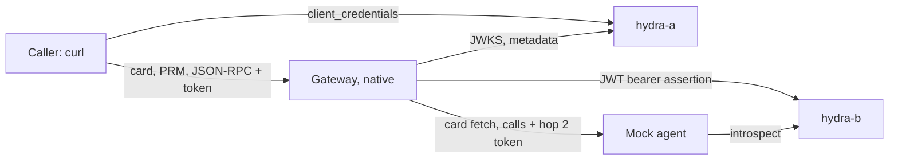

# OIDC demo with Ory Hydra

A scripted demo of the OAuth and OpenID Connect trust plane. A caller finds an A2A agent's
authorization server from the agent card, gets a token from Ory Hydra, and calls the agent
through the gateway. On the second hop the gateway gets its own token from Hydra with the
JWT bearer grant and sends it to the agent, which accepts nothing else. The demo needs Docker for
the two Hydra containers.

Decision records: [ADR 0003](../adrs/0003-hop-one-resource-server-contract.md) (hop 1) and
[ADR 0002](../adrs/0002-hop-two-target-authentication.md) (hop 2). The scripts are in
[`scripts/oidc-demo/`](../../scripts/oidc-demo/).

## What runs where

| Piece | Runs as | Address |
| --- | --- | --- |
| hydra-a, the caller's authorization server | Container `oryd/hydra:v26.2.0` | `http://127.0.0.1:14444/` (admin `14445`) |
| hydra-b, the second server, also the agent's own | Container `oryd/hydra:v26.2.0` | `http://127.0.0.1:14454/` (admin `14455`) |
| Mock A2A agent | Host `python3` | `http://127.0.0.1:19201` |
| Gateway | Native debug build, never Docker | Management API `http://localhost:8808`; Access Point `https://localhost:9171/mock-agent` |
| Client and checks | Host `bash`, `curl`, `jq`, `python3` (standard library), `openssl` | |

Hydra is the only container image. The harness never pulls it: `up.sh` fails unless
`oryd/hydra:v26.2.0` is already present with the pinned image id. Both instances use
in-memory storage, so every start is empty. Override the ports with `OIDC_DEMO_HYDRA_A_PORT`,
`OIDC_DEMO_HYDRA_A_ADMIN_PORT`, `OIDC_DEMO_HYDRA_B_PORT`, `OIDC_DEMO_HYDRA_B_ADMIN_PORT`,
`OIDC_DEMO_AGENT_PORT`, `OIDC_DEMO_GATEWAY_PORT` and `OIDC_DEMO_GATEWAY_HTTPS_PORT`.



Hop 1 (caller to gateway) uses hydra-a. Hop 2 (gateway to agent) uses hydra-b, which also
stands in for the agent's own authorization server. The walkthrough later swaps hop 1 to hydra-b.

## Run it

```bash
make oidc-demo-run
```

This starts the services and the gateway, seeds the gateway, runs the hop 1 walkthrough, then the
hop 2 checks, and stops everything. `OIDC_DEMO_KEEP=1 make oidc-demo-run` leaves the stack up to repeat steps by hand.
Every start runs `cargo build --bin agent-gateway`, so the demo never runs a stale binary. A cold
build takes a while.

| Target | What it does |
| --- | --- |
| `make oidc-demo-up` | Hydra a and b, their clients and trust grant, and the mock agent. `ARGS=--no-hop2` makes the agent open and skips hop 2. |
| `make oidc-demo-seed` | Seeds a running demo gateway. `ARGS=--dry-run` prints the payloads, with secrets redacted, and needs no gateway. |
| `make oidc-demo-run` | Everything: services, gateway (`gateway.sh start --fresh`), seed, walkthrough, hop 2 checks. |
| `make oidc-demo-auth0` | The demo with a live Auth0 tenant as the caller's authorization server. Needs the values file; see _Auth0 mode_. |
| `make oidc-demo-browser` | Leaves the whole demo running in the background for a live look at the Agent card tab. `ARGS=start` (the default), `stop`, `status`, `login`, `break-card`, `fix-card`. See _Showing the Agent card tab_. |
| `make oidc-demo-down` | Stops the containers, the mock agent and the gateway. |
| `make oidc-demo-smoke` | Checks Hydra, the mock agent and the seed dry run. No gateway. |
| `make oidc-ui-e2e` | Drives the dashboard in headless Chromium against the same containers and a gateway of its own, on free ports. See [`TESTING.md`](TESTING.md#live-oidc-dashboard-tests). |
| `make oidc-sdk-check` | Parses fixture cards with the official A2A SDKs. `ARGS="--live <card url>"` checks a live card. See _A2A SDK check_. |

`scripts/oidc-demo/gateway.sh start|stop|status`, `scripts/oidc-demo/walkthrough.sh` and
`scripts/oidc-demo/hop2.sh` run on their own against a stack that is already up.

Generated keys, client secrets and the Hydra system secrets live in `envs/oidc-demo-run/`
(gitignored, mode 600). The Hydra configuration files under `envs/oidc-demo-run/config/` hold no
secret (mode 644). The gateway environment is `tmp/local-oidc-demo/`. Delete both to start from
scratch. Secret values are never printed, and no script puts a secret or bearer token on a command
line: an `Authorization` header reaches `curl` through a mode 600 file (`-H @file`), Hydra client
secrets, JWT bearer assertions and the test-mode token go to `curl` as a config on standard input,
`jq` reads secret values from a file or standard input, `jwt_tools.py` reads a token from standard
input, and the gateway receives its test-mode token through its environment.

## Showing the Agent card tab

```bash
make oidc-demo-browser                      # build what is stale, start everything, seed, return
make oidc-demo-browser ARGS=status          # what runs, and whether the agent refuses the gateway token
make oidc-demo-browser ARGS=break-card      # the agent answers 401 to the gateway's token
make oidc-demo-browser ARGS=fix-card        # the agent checks tokens again
make oidc-demo-browser ARGS=login           # a fresh dashboard session (they last 20 minutes)
make oidc-demo-browser ARGS=stop            # stop the gateway, the mock agent and both containers
```

`start` makes sure the dashboard bundle the gateway serves contains the Agent card tab, runs the same
steps as `make oidc-demo-run` (services, `gateway.sh start --fresh`, `seed.sh`) without the walkthrough,
and returns with everything running (pid files in `envs/oidc-demo-run/` and `tmp/local-oidc-demo/`). It
prints the dashboard URL, `http://localhost:8808/surfaces/oidc-demo-surface`, and the card URLs.

The dashboard needs a session. `start` writes `tmp/local-oidc-demo/dashboard-login.txt` (mode 600) with a
one-line console snippet that stores a test-mode session for the user `oidc-demo`; open
`http://localhost:8808/dashboard`, paste the last line of the file into the browser console and the page
opens the demo surface. The snippet is never printed. `login` rewrites the file with a fresh session.

`break-card` and `fix-card` only call the mock agent's `/_demo/refuse` control and never restart the
gateway. After either one, press **Refresh** in the tab: the first shows the failed fetch (HTTP 401,
no card served), the second shows OK again. The tab allows ten fetches a minute per dashboard user.

## Auth0 mode

`make oidc-demo-auth0` repeats the caller side of the demo with a real Auth0 tenant as the
authorization server, so the gateway's issuer pinning, discovery, JWKS handling and scope checks meet
a production identity provider. Without the values file, or without running this target, nothing about
the Hydra demo changes (`OIDC_DEMO_IDP=auth0` is set only by `scripts/oidc-demo/auth0.sh`).

The gateway to agent hop stays on hydra-b, because Auth0 takes no part in it; hydra-a is not started. Docker is still needed for hydra-b.

### The values file

Create `envs/oidc-demo/auth0.env` (gitignored, mode 600; `OIDC_DEMO_AUTH0_ENV` names another path) with
six keys, one `KEY=value` per line:

| Key | Value |
| --- | --- |
| `AUTH0_DOMAIN` | The tenant domain, for example `your-tenant.eu.auth0.com`, without scheme or slash |
| `AUTH0_API_IDENTIFIER` | The API identifier (audience) of the API below. It must equal the Access Point URL, `https://localhost:9171/mock-agent`. |
| `AUTH0_M2M_CLIENT_ID`, `AUTH0_M2M_CLIENT_SECRET` | The application authorized with the scope |
| `AUTH0_NO_SCOPE_CLIENT_ID`, `AUTH0_NO_SCOPE_CLIENT_SECRET` | The application authorized with no scopes |

In the Auth0 dashboard:

1. Create an API (Applications, APIs) whose identifier is the Access Point URL, with RS256 signing and
   one permission (scope) named `agent:invoke`.
2. Create a Machine to Machine application, authorize it for that API and grant `agent:invoke`.
3. Create a second Machine to Machine application, authorize it for the same API and grant no scopes.
4. Copy the domain, the identifier and the two client id and secret pairs into the file.

`auth0.sh` compares the identifier with the Access Point URL before it requests a token and stops with
a message that names neither value when they differ: the gateway accepts a token only when its audience
holds the Access Point URL, so an API with another identifier cannot work.

Only `scripts/oidc-demo/auth0_tool.py` and `scripts/oidc-demo/auth0_scan.py` (which loads it through
`auth0_tool.py`) read the file. A client id and secret never reach a command line: the token request
body leaves `auth0_tool.py` on standard output of `token-body` and is piped to `curl` on standard input.
The tenant domain and the API identifier are not secrets and do appear in command lines (as URLs and
`jq` arguments). In the seed and walkthrough scripts a bearer token, Auth0's or Hydra's, is never a command-line argument either: `req`
hands `curl` an `Authorization` header through a mode 600 file (`-H @file`), the Hydra client secret and
the test-mode token go to `curl` as a config on standard input, and `jwt_tools.py decode -` reads a
token from standard input.

The harness prints no value from the file: every output of `auth0.sh` passes through
`auth0_tool.py redact`. The gateway logs the verified issuer and subject of each accepted token, which
name the tenant and the app, so `down.sh` masks `gateway.log` and every file under `_storage/logs` of
the demo gateway once it has stopped; `auth0.sh` runs `down.sh` itself. With `OIDC_DEMO_KEEP=1` the
stack stays up and those log files stay unmasked until `make oidc-demo-down`.
`scripts/oidc-demo/auth0_scan.py <values file> <file>...` counts the values, JWT-shaped strings and PEM
text in any file and prints only counts, the way the secret scan of the Hydra demo does for its files
(`report_secret_scan.py`); `auth0.sh` runs it over its result files and fails when a count is not zero.

### What it seeds and proves

`seed.sh` creates the verification strategy through the management API the way the dashboard's
Discover from issuer does: `POST /api/v1/jwt-verification-strategies/discover` for the issuer
`https://<domain>/` (trailing slash included, pinned exactly), then a save with
`discover_metadata: true`. The surface keeps the same route and Target Authentication as the Hydra
demo, and its `jwt_bearer` method requires the scope `agent:invoke`. Its authorization server discovery
(`protected_resource`) names the Access Point URL, which is the API identifier, as the resource, and
the Auth0 issuer comes from the strategy. Auth0's public https endpoints need no egress allowance.

| Step | Asserts |
| --- | --- |
| 1. Card | The card's metadata URL is a well-known document of the Auth0 issuer, lists `agent:invoke`, and its issuer equals the tenant issuer |
| 2. Protected resource metadata | `authorization_servers` is the Auth0 issuer and `scopes_supported` holds `agent:invoke` |
| 3. No token | 401 with a `Bearer` challenge whose `resource_metadata` is the metadata URL |
| 4. Tokens | One `client_credentials` request per app; the scoped token has the right `iss`, `aud` and `scope`, the other has no scope claim |
| 5. Scoped app | 200 through the gateway, the mock agent answers |
| 6. App without scope | 403 with `insufficient_scope` |
| 7. Other issuer | A hydra-b token gets 401 |
| 8. Swap | The surface switches to the hydra-b strategy and back without a restart; the same Auth0 token is refused, then accepted again |
| 9. Hop 2 | The agent saw an authenticated card fetch and call, both as `gateway-hop2` |

Auth0 counts machine to machine token requests against the tenant's monthly quota, and a free tenant
has a small one. The walkthrough requests exactly two tokens per run, one per app, and reuses them for
every call, so run it sparingly.

## Hydra configuration the demo relies on

| Setting | Value | Why |
| --- | --- | --- |
| `strategies.access_token` | `jwt` | Hydra's default is opaque tokens. The gateway validates JWTs. |
| `strategies.jwt.scope_claim` | `list` | Scopes arrive as the array claim `scp`, not a `scope` string. |
| `urls.self.issuer` | `http://127.0.0.1:<port>/` | Hydra advertises exactly this string, trailing slash included, and signs it as `iss`. The gateway compares it exactly. |
| `serve ... --dev` | on | Hydra refuses an `http` issuer outside development mode. |
| `oauth2.grant.jwt` | `jti_optional: false`, `max_ttl: 1h` | The JWT bearer grant requires a `jti`. The gateway's assertions expire 300 seconds after signing, with `iat` 30 seconds earlier, so `exp - iat` is 330 seconds. |
| `dsn` | `memory` | Nothing persists. |

Facts worth knowing about this Hydra version, verified by the smoke checks:

- A token request without `audience` yields an empty `aud`. The clients register the Access Point
  as an allowed audience, and the scripts request it. An audience a client is not
  registered for is refused.
- The access token header `typ` is `JWT`, not `at+jwt`.
- With the JWT bearer grant the token `aud` holds the token endpoint, not the requested audience, so
  the mock agent checks issuer, scope and the introspection result rather than `aud`.
- A JWT bearer assertion needs `aud` equal to the token endpoint URL exactly, a fresh `jti` and a
  trusted issuer grant. `up.sh` registers the gateway's signing key as that grant on hydra-b.

## What gets seeded

`seed.sh` signs in through the test-mode login endpoint, so no passkey is involved, then uses the
management API.

| Object | Detail |
| --- | --- |
| Secrets | The hop 2 signing key (PKCS#8 PEM), client id and client secret. Created through the secrets API, read from `envs/oidc-demo-run/`. |
| Verification strategies | One per Hydra instance, with the authorization server metadata already pinned. Written into the gateway's storage by `gateway.sh start`, not through the API (see below). |
| Policy | `oidc-demo-deny-failed-callers`: denies callers whose authentication failed. The surface declares, so the gateway refuses a missing or bad token itself, before policy; the policy keeps that refusal in place if authorization server discovery is switched off. |
| Credential provider | `oauth2_jwt_bearer` pointing at hydra-b, client authentication by HTTP Basic. Skipped with hop 2 off. |
| Surface | An A2A Access Point at `/mock-agent`: `jwt_bearer` from hydra-a with required scope `agent.read` and authorization server discovery whose resource is the Access Point URL (the authorization server comes from the strategy); no accepted audiences, because the resource is the audience. Target the mock agent, Target Authentication through the provider. |

`gateway.sh start` also registers the `/mock-agent` route in `gateway.json`. Routes are read at
startup, so a surface seeded into a gateway that was not started this way has no listener route.

The Access Point is on the gateway's HTTPS listener, because an Access Point publishes
authorization server discovery on its card and in protected resource metadata only at a canonical `https` URL
(see [`../SOURCE_AUTH.md`](../SOURCE_AUTH.md#declaring-an-access-point)). `gateway.sh start` sets that
listener's external URL to `https://localhost:9171`, and the surface's `listen_address` is the same
origin; the gateway matches them, and a `127.0.0.1` address matches no listener. The listener serves the
development certificate from `tmp/local-oidc-demo/certs/cert.pem`, which the scripts pass to `curl`
with `--cacert`. The management API stays on `http://localhost:8808`.

### The mock agent

`mock_agent.py` mirrors an agent whose card is login-only, as on Vertex AI Agent Engine: both the
card and the JSON-RPC endpoint need a bearer token from hydra-b with scope `agent.invoke`. It checks
tokens by asking hydra-b's admin API to introspect them, which validates signature, expiry and
revocation of a JWT access token, using only the standard library. The card carries its own
`securitySchemes.agent_own_oauth` (an `oauth2` client credentials flow with the token URL
`https://agent-as.internal.example/oauth2/token` and the scope `agent.invoke`), the matching
`security` requirement and a dummy `signatures` entry, so a gateway that rewrites the card has something
to replace and remove. `GET /_demo/log` lists the requests seen, with client ids and no tokens;
`POST /_demo/reset` clears it; `GET /_demo/state` reports whether it is refusing.
`POST /_demo/refuse` with `{"refuse": true}` makes the agent answer 401 with a `Bearer`
`WWW-Authenticate` challenge to every card and JSON-RPC request, whatever token it carries, and logs
it as unauthenticated; `{"refuse": false}` restores the normal checks. Both answer `{"refuse": <bool>}`.
The live UI suite uses the switch to show an agent that rejects the gateway's token.

### Clients on hydra-a

`up.sh` creates the clients on hydra-a, and the live UI suite
([`TESTING.md`](TESTING.md#live-oidc-dashboard-tests)) uses these:

| Client | Gets |
| --- | --- |
| `demo-good` | A token for the Access Point audience with the caller scope |
| `demo-noscope` | A token for the Access Point audience with no scope. Asking for the caller scope is refused with `invalid_scope`. |
| `demo-otheraud` | A token for the audience `https://other.example/resource` only. Asking for the Access Point audience is refused. |

## The test-mode seam is demo-only

Production URL rules refuse loopback hosts and non-https token endpoints. The demo needs both, so
`gateway.sh` starts the gateway with `AG_TEST_MODE=true`, `AG_BDD_OAUTH_ENDPOINT_ALLOWLIST` set to
the two exact token endpoint URLs and `AG_BDD_EGRESS_ALLOWLIST` set to the origins of the mock agent and the two
Hydra instances (a `credential_provider` Target must be https unless its origin is on that list), the same seam the behaviour tests use
([`TESTING.md`](TESTING.md#reaching-loopback-in-a-test)). Three consequences:

- This run proves the protocol flows. It is not proof of production egress, which stays https-only
  with pinned addresses.
- Discovery and JWKS fetches need no seam: their egress policy admits loopback and http.
- The management API's save-time checks reject loopback JWKS and discovery URLs, and no seam covers
  them, which is why the strategies are written into storage.

Test login exists only in debug builds (`AG_TEST_MODE=true`, `AG_TEST_TOKEN`,
`AG_TEST_ALLOW_ROLE_OVERRIDE=true`, all set by `gateway.sh`). Never enable test mode on a real appliance.

### Why http and not a local CA

Hydra and the mock agent stay on http. Hydra can serve TLS with a demo CA, but on macOS the gateway's
HTTP client verifies certificates with the system trust store and ignores `SSL_CERT_FILE`, so trusting
a demo CA would mean changing the system keychain, which the harness never does. The https path is for
Linux CI or a publicly trusted certificate. Only the caller's side of the gateway is https, and the
callers are the scripts, which trust the development certificate per request.

## The walkthrough

`scripts/oidc-demo/walkthrough.sh` runs the hop 1 checks against a stack that is up and seeded, and
`make oidc-demo-run` runs it after seeding, before the hop 2 checks. Each step prints its curl
transcript (tokens redacted), asserts, and exits non-zero on failure.

| Step | Asserts |
| --- | --- |
| 1. Card | Names hydra-a's metadata document and the required scope. The mock agent's scheme, its token URL and the `signatures` are gone. |
| 2. Authorization server metadata | `issuer` equals the issuer in the card's metadata URL, trailing slash included. |
| 3. Protected resource metadata | `resource` is the Access Point URL and `authorization_servers` is hydra-a's issuer. |
| 4. Token | The good client gets a JWT with the Access Point in `aud`, `scp` as a list and the right `iss`. |
| 5. Call | The call with that token returns 200 and the agent's reply. |
| 6. No token | 401 with a `Bearer` challenge whose `resource_metadata` is the metadata URL. |
| 7. Wrong audience | A token for another audience gets 401. |
| 8. Missing scope | A token without `agent.read` gets 403 with `insufficient_scope`. |
| 9. Scope removed | Removing the required scope still answers a caller without a token with 401, a `resource_metadata` challenge and no `scope=`, and the metadata lists no scopes; the scope is then restored. |
| 10. Swap | Patching the surface to the hydra-b strategy changes the card and the metadata, refuses the old token, accepts a hydra-b token, and the gateway process is the same. |
| 11. Hop 2 | After a fresh card fetch and call, the agent's log shows an authenticated card fetch and an authenticated call, both as `gateway-hop2`. |

## The hop 2 checks

`scripts/oidc-demo/hop2.sh` runs against a stack that is up and seeded, and `make oidc-demo-run` runs it
after the walkthrough unless hop 2 is off. Each step prints its curl transcript (tokens redacted), asserts, and
exits non-zero on failure.

| Step | Asserts |
| --- | --- |
| 1. Card fetch | The agent card fetch through the gateway succeeds although the agent's card endpoint needs a hydra-b token. |
| 2. Call | A call through the gateway reaches the agent with a token the agent validated. |
| 3. JWT bearer grant | The gateway obtained its token from hydra-b with the JWT bearer grant. |
| 4. Token reuse | A second call does not reach hydra-b's token endpoint again. |
| 5. Revoked grant | After the trust grant is revoked and the gateway restarted (empty token cache), the call fails with a generic 502 whose body has no key, token or authorization server detail. |
| 6. Gateway log | The gateway log of the granted run and of the refused run holds no private key, JWT, Hydra access token or Hydra error description, and the refused run logs the Target authentication failure. |

It revokes the grant, so run `up.sh`, `gateway.sh start --fresh` and `seed.sh` again before repeating it.

Storage seeded before surfaces declared through `protected_resource` holds a surface that no longer
declares, so re-seed it (`gateway.sh start --fresh`, then `seed.sh`) before running the walkthrough.

## Coverage

`make oidc-demo-run` is the end-to-end check: it runs the ten walkthrough steps, then the hop 2 checks,
against a native debug build of the current tree.

| Piece | Run by |
| --- | --- |
| Hydra a and b: discovery, issuer string, RFC 8414 equals OIDC, JWKS, JWT tokens with `scp`, audience handling, the JWT bearer grant and its replay refusal | `make oidc-demo-smoke` |
| Mock agent: login-only card and calls, caller token from hydra-a refused, hop 2 token accepted, refuse switch, log | `make oidc-demo-smoke` |
| Seed dry run: valid payloads, no secret values | `make oidc-demo-smoke` |
| Walkthrough steps 1 to 10 | `make oidc-demo-run` |
| Hop 2: authenticated card fetch and call, token reuse, and a revoked trust grant answered with the fixed 502 | `make oidc-demo-run`, or `scripts/oidc-demo/hop2.sh` on a freshly seeded stack |
| A2A SDK card parsing of the fixtures and of the live card | `make oidc-sdk-check` |
| ShellCheck on the scripts | `make shellcheck`, where ShellCheck is installed |

## A2A SDK check

`make oidc-sdk-check` fetches an agent card and parses it with the official A2A SDK card resolvers:
a2a-python 1.2.2 and 0.3.25, and a2a-js 1.3.0 (without and with its legacy compatibility layer) and
0.3.13. It needs no gateway or Docker.

The SDKs are not part of the repository. Install them once into one folder and point
`OIDC_SDK_DIR` at it (default `tmp/oidc-sdk`):

```bash
S=tmp/oidc-sdk
python3 -m venv $S/py1  && $S/py1/bin/pip install a2a-sdk==1.2.2
python3 -m venv $S/py03 && $S/py03/bin/pip install a2a-sdk==0.3.25
mkdir -p $S/js1  && (cd $S/js1  && npm init -y && npm install @a2a-js/sdk@1.3.0)
mkdir -p $S/js03 && (cd $S/js03 && npm init -y && npm install @a2a-js/sdk@0.3.13)
```

| Command | Checks |
| --- | --- |
| `make oidc-sdk-check` | The three fixture cards in `scripts/oidc-demo/sdk-check/fixtures`: the 1.0 shape, the 0.3 shape and the dual-era shape (flat `oauth2` scheme with both `security` and `securityRequirements`). |
| `make oidc-sdk-check ARGS="--live https://localhost:9171/mock-agent/.well-known/agent-card.json"` | A live card. `SDK_CHECK_BEARER` is sent as a bearer token when the card needs one and is never printed. For the demo's development certificate set `SSL_CERT_FILE` and `NODE_EXTRA_CA_CERTS` to `tmp/local-oidc-demo/certs/cert.pem`. |

A run passes when the SDK parses the card, the card is self-consistent (a name, interface URLs, and
every requirement naming a declared scheme), and, for fixtures, the parsed card equals
`fixtures/expected.json`. The output is one row per SDK and mode; the a2a-js 1.x scheme shape is
`native` when the SDK translated the card to its own shape and `flat` when it kept the 0.3 shape.

A rejection by an SDK is listed in `scripts/oidc-demo/sdk-check/expected-failures.json` with the
target, SDK, version, mode, a substring of the observed problem and the reason. An unlisted failure
fails the run, and so does a listed failure that passes or does not run, so the list cannot go stale.
Current entries are both SDKs of the 0.3 line reading a pure 1.0 card: a2a-python 0.3.25 raises on the
missing top-level `url`, and a2a-js 0.3.13 accepts the card but reads no interface URL and no security
requirements. Every other combination parses all three fixtures.

## Troubleshooting

| Symptom | Cause and fix |
| --- | --- |
| `up.sh` says the image is not present | Pull `oryd/hydra:v26.2.0` yourself first. The harness never pulls. |
| `up.sh` says the image id differs | The tag moved. The harness is pinned to the id in `up.sh`. |
| Test login fails | The gateway is not a debug build, or was not started by `gateway.sh`. |
| `No route configured for path: /mock-agent/...` | The route is not in `gateway.json`, or the surface's `listen_address` host differs from the listener's external URL. Use `gateway.sh start --fresh`. |
| Seed says a strategy is missing | Start the gateway with `gateway.sh start --fresh`, which writes the strategies. |
| Card fetch returns 401 from the agent | The agent runs with hop 2 on and the gateway has no working JWT bearer provider. Check the provider and the Hydra trust grant, or start with `--no-hop2`. |
| Port already in use | Another run is up: `make oidc-demo-down`, or set the `OIDC_DEMO_*_PORT` variables. |

## Related

- [`TESTING.md`](TESTING.md): test layers and the loopback seam.
- [`../CREDENTIAL_DELEGATION.md`](../CREDENTIAL_DELEGATION.md): credential providers and the JWT bearer type.
- [`../SOURCE_AUTH.md`](../SOURCE_AUTH.md): caller authentication and the failed-caller policy.
