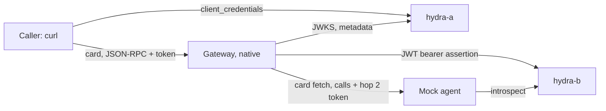

# OIDC demo with Ory Hydra

A scripted demo of the OAuth and OpenID Connect trust plane. A caller gets a token from Ory Hydra
and calls an A2A agent through the gateway. On the second hop the gateway gets its own token from
Hydra with the JWT bearer grant and sends it to the agent, which accepts nothing else.

Decision record: [ADR 0002](../adrs/0002-hop-two-target-authentication.md). The scripts are in
[`scripts/oidc-demo/`](../../scripts/oidc-demo/).

## What runs where

| Piece | Runs as | Address |
| --- | --- | --- |
| hydra-a, the caller's authorization server | Container `oryd/hydra:v26.2.0` | `http://127.0.0.1:14444/` (admin `14445`) |
| hydra-b, the second server, also the agent's own | Container `oryd/hydra:v26.2.0` | `http://127.0.0.1:14454/` (admin `14455`) |
| Mock A2A agent | Host `python3` | `http://127.0.0.1:19201` |
| Gateway | Native debug build, never Docker | Management API `http://localhost:8808`; Access Point `https://localhost:9171/mock-agent` |
| Client and checks | Host `bash`, `curl`, `jq`, `python3` (standard library), `openssl` | |

Hydra is the only container image. The harness never pulls it: `up.sh` fails unless
`oryd/hydra:v26.2.0` is already present with the pinned image id. Both instances use
in-memory storage, so every start is empty. Override the ports with `OIDC_DEMO_HYDRA_A_PORT`,
`OIDC_DEMO_HYDRA_A_ADMIN_PORT`, `OIDC_DEMO_HYDRA_B_PORT`, `OIDC_DEMO_HYDRA_B_ADMIN_PORT`,
`OIDC_DEMO_AGENT_PORT`, `OIDC_DEMO_GATEWAY_PORT` and `OIDC_DEMO_GATEWAY_HTTPS_PORT`.



Hop 1 (caller to gateway) uses hydra-a. Hop 2 (gateway to agent) uses hydra-b, which also
stands in for the agent's own authorization server.

## Run it

```bash
make oidc-demo-run
```

This starts the services and the gateway, seeds the gateway, runs the hop 2 checks and stops
everything. `OIDC_DEMO_KEEP=1 make oidc-demo-run` leaves the stack up to repeat steps by hand.
Every start runs `cargo build --bin agent-gateway`, so the demo never runs a stale binary. A cold
build takes a while.

| Target | What it does |
| --- | --- |
| `make oidc-demo-up` | Hydra a and b, their clients and trust grant, and the mock agent. `ARGS=--no-hop2` makes the agent open and skips hop 2. |
| `make oidc-demo-seed` | Seeds a running demo gateway. `ARGS=--dry-run` prints the payloads, with secrets redacted, and needs no gateway. |
| `make oidc-demo-run` | Everything: services, gateway (`gateway.sh start --fresh`), seed, hop 2 checks. |
| `make oidc-demo-down` | Stops the containers, the mock agent and the gateway. |
| `make oidc-demo-smoke` | Checks Hydra, the mock agent and the seed dry run. No gateway. |
| `make oidc-ui-e2e` | Drives the dashboard in headless Chromium against the same containers and a gateway of its own, on free ports. See [`TESTING.md`](TESTING.md#live-oidc-dashboard-tests). |

`scripts/oidc-demo/gateway.sh start|stop|status` and `scripts/oidc-demo/hop2.sh` run on
their own against a stack that is already up.

Generated keys, client secrets and the Hydra system secrets live in `envs/oidc-demo-run/`
(gitignored, mode 600). The Hydra configuration files under `envs/oidc-demo-run/config/` hold no
secret (mode 644). The gateway environment is `tmp/local-oidc-demo/`. Delete both to start from
scratch. Secret values are never printed, and no script puts a secret or bearer token on a command
line: an `Authorization` header reaches `curl` through a mode 600 file (`-H @file`), Hydra client
secrets, JWT bearer assertions and the test-mode token go to `curl` as a config on standard input,
`jq` reads secret values from a file or standard input, `jwt_tools.py` reads a token from standard
input, and the gateway receives its test-mode token through its environment.

## Hydra configuration the demo relies on

| Setting | Value | Why |
| --- | --- | --- |
| `strategies.access_token` | `jwt` | Hydra's default is opaque tokens. The gateway validates JWTs. |
| `strategies.jwt.scope_claim` | `list` | Scopes arrive as the array claim `scp`, not a `scope` string. |
| `urls.self.issuer` | `http://127.0.0.1:<port>/` | Hydra advertises exactly this string, trailing slash included, and signs it as `iss`. The gateway compares it exactly. |
| `serve ... --dev` | on | Hydra refuses an `http` issuer outside development mode. |
| `oauth2.grant.jwt` | `jti_optional: false`, `max_ttl: 1h` | The JWT bearer grant requires a `jti`. The gateway's assertions expire 300 seconds after signing, with `iat` 30 seconds earlier, so `exp - iat` is 330 seconds. |
| `dsn` | `memory` | Nothing persists. |

Facts worth knowing about this Hydra version, verified by the smoke checks:

- A token request without `audience` yields an empty `aud`. The clients register the Access Point
  as an allowed audience, and the scripts request it. An audience a client is not
  registered for is refused.
- The access token header `typ` is `JWT`, not `at+jwt`.
- With the JWT bearer grant the token `aud` holds the token endpoint, not the requested audience, so
  the mock agent checks issuer, scope and the introspection result rather than `aud`.
- A JWT bearer assertion needs `aud` equal to the token endpoint URL exactly, a fresh `jti` and a
  trusted issuer grant. `up.sh` registers the gateway's signing key as that grant on hydra-b.

## What gets seeded

`seed.sh` signs in through the test-mode login endpoint, so no passkey is involved, then uses the
management API.

| Object | Detail |
| --- | --- |
| Secrets | The hop 2 signing key (PKCS#8 PEM), client id and client secret. Created through the secrets API, read from `envs/oidc-demo-run/`. |
| Verification strategies | One per Hydra instance, with the authorization server metadata already pinned. Written into the gateway's storage by `gateway.sh start`, not through the API (see below). |
| Policy | `oidc-demo-deny-failed-callers`: denies callers whose authentication failed. Source authentication publishes and policy decides, so without it a missing or bad token is not refused. |
| Credential provider | `oauth2_jwt_bearer` pointing at hydra-b, client authentication by HTTP Basic. Skipped with hop 2 off. |
| Surface | An A2A Access Point at `/mock-agent`: `jwt_bearer` from hydra-a with audience equal to the Access Point URL, target the mock agent, Target Authentication through the provider. |

`gateway.sh start` also registers the `/mock-agent` route in `gateway.json`. Routes are read at
startup, so a surface seeded into a gateway that was not started this way has no listener route.

The Access Point is on the gateway's HTTPS listener. `gateway.sh start` sets that
listener's external URL to `https://localhost:9171`, and the surface's `listen_address` is the same
origin; the gateway matches them, and a `127.0.0.1` address matches no listener. The listener serves the
development certificate from `tmp/local-oidc-demo/certs/cert.pem`, which the scripts pass to `curl`
with `--cacert`. The management API stays on `http://localhost:8808`.

### The mock agent

`mock_agent.py` mirrors an agent whose card is login-only, as on Vertex AI Agent Engine: both the
card and the JSON-RPC endpoint need a bearer token from hydra-b with scope `agent.invoke`. It checks
tokens by asking hydra-b's admin API to introspect them, which validates signature, expiry and
revocation of a JWT access token, using only the standard library. `GET /_demo/log` lists the requests seen,
with client ids and no tokens, and `POST /_demo/reset` clears it.

## The test-mode seam is demo-only

Production URL rules refuse loopback hosts and non-https token endpoints. The demo needs both, so
`gateway.sh` starts the gateway with `AG_TEST_MODE=true`, `AG_BDD_OAUTH_ENDPOINT_ALLOWLIST` set to
the two exact token endpoint URLs and `AG_BDD_EGRESS_ALLOWLIST` set to the origins of the mock agent and the two
Hydra instances (a `credential_provider` Target must be https unless its origin is on that list), the same seam the behaviour tests use
([`TESTING.md`](TESTING.md#reaching-loopback-in-a-test)). Three consequences:

- This run proves the protocol flows. It is not proof of production egress, which stays https-only
  with pinned addresses.
- Discovery and JWKS fetches need no seam: their egress policy admits loopback and http.
- The management API's save-time checks reject loopback JWKS and discovery URLs, and no seam covers
  them, which is why the strategies are written into storage.

Test login exists only in debug builds (`AG_TEST_MODE=true`, `AG_TEST_TOKEN`,
`AG_TEST_ALLOW_ROLE_OVERRIDE=true`, all set by `gateway.sh`). Never enable test mode on a real appliance.

### Why http and not a local CA

Hydra and the mock agent stay on http. Hydra can serve TLS with a demo CA, but on macOS the gateway's
HTTP client verifies certificates with the system trust store and ignores `SSL_CERT_FILE`, so trusting
a demo CA would mean changing the system keychain, which the harness never does. The https path is for
Linux CI or a publicly trusted certificate. Only the caller's side of the gateway is https, and the
callers are the scripts, which trust the development certificate per request.

## The hop 2 checks

`scripts/oidc-demo/hop2.sh` runs against a stack that is up and seeded, and `make oidc-demo-run` runs it
after seeding unless hop 2 is off. Each step prints its curl transcript (tokens redacted), asserts, and
exits non-zero on failure.

| Step | Asserts |
| --- | --- |
| 1. Card fetch | The agent card fetch through the gateway succeeds although the agent's card endpoint needs a hydra-b token. |
| 2. Call | A call through the gateway reaches the agent with a token the agent validated. |
| 3. JWT bearer grant | The gateway obtained its token from hydra-b with the JWT bearer grant. |
| 4. Token reuse | A second call does not reach hydra-b's token endpoint again. |
| 5. Revoked grant | After the trust grant is revoked and the gateway restarted (empty token cache), the call fails with a generic 502 whose body has no key, token or authorization server detail. |

It revokes the grant, so run `up.sh`, `gateway.sh start --fresh` and `seed.sh` again before repeating it.

## Coverage

`make oidc-demo-run` is the end-to-end check: it runs the hop 2 checks against a native debug build of
the current tree.

| Piece | Run by |
| --- | --- |
| Hydra a and b: discovery, issuer string, RFC 8414 equals OIDC, JWKS, JWT tokens with `scp`, audience handling, the JWT bearer grant and its replay refusal | `make oidc-demo-smoke` |
| Mock agent: login-only card and calls, caller token from hydra-a refused, hop 2 token accepted, log | `make oidc-demo-smoke` |
| Seed dry run: valid payloads, no secret values | `make oidc-demo-smoke` |
| Hop 2: authenticated card fetch and call, token reuse, and a revoked trust grant answered with the fixed 502 | `make oidc-demo-run`, or `scripts/oidc-demo/hop2.sh` on a freshly seeded stack |
| ShellCheck on the scripts | `make shellcheck`, where ShellCheck is installed |

## Troubleshooting

| Symptom | Cause and fix |
| --- | --- |
| `up.sh` says the image is not present | Pull `oryd/hydra:v26.2.0` yourself first. The harness never pulls. |
| `up.sh` says the image id differs | The tag moved. The harness is pinned to the id in `up.sh`. |
| Test login fails | The gateway is not a debug build, or was not started by `gateway.sh`. |
| `No route configured for path: /mock-agent/...` | The route is not in `gateway.json`, or the surface's `listen_address` host differs from the listener's external URL. Use `gateway.sh start --fresh`. |
| Seed says a strategy is missing | Start the gateway with `gateway.sh start --fresh`, which writes the strategies. |
| Card fetch returns 401 from the agent | The agent runs with hop 2 on and the gateway has no working JWT bearer provider. Check the provider and the Hydra trust grant, or start with `--no-hop2`. |
| Port already in use | Another run is up: `make oidc-demo-down`, or set the `OIDC_DEMO_*_PORT` variables. |

## Related

- [`TESTING.md`](TESTING.md): test layers and the loopback seam.
- [`../CREDENTIAL_DELEGATION.md`](../CREDENTIAL_DELEGATION.md): credential providers and the JWT bearer type.
- [`../SOURCE_AUTH.md`](../SOURCE_AUTH.md): caller authentication and the failed-caller policy.
