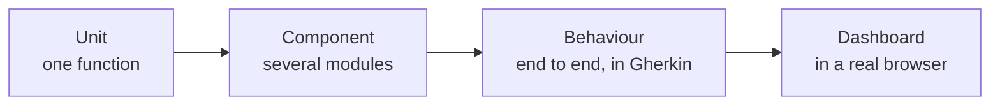

# Testing

Four test layers, what belongs in each, and how to run them.

[`CONTRIBUTING.md`](../../CONTRIBUTING.md) states the requirement: cover changes with
tests, positive and negative cases, and assert returned values rather than the absence of
an error. This page says which layer to put them in.

## Layers

| Layer | Lives in | Covers | Needs |
| --- | --- | --- | --- |
| Unit | `#[cfg(test)] mod tests` inline in each module | One function or type in isolation | Nothing |
| Component | [`src/component_tests/`](../../src/component_tests/) | A flow across several modules | Nothing |
| Behaviour | [`tests/`](../../tests/) with Gherkin features under [`tests/features/`](../../tests/features/) | A described behaviour end to end, in the project's own vocabulary | A built binary, and containers for the federation suite |
| Dashboard | [`ui-tests/`](../../ui-tests/) | The dashboard in a real browser | A running gateway and Playwright |

Around 300 source files carry inline test modules; component tests, feature files and
Playwright specs each have their own directory.



Left to right, each layer is slower and covers more at once.

## Choosing a layer

Work down this list and stop at the first one that fits.

| The change is | Test it as |
| --- | --- |
| A pure function, a parser, a validator, a conversion | Unit |
| A new field with validation rules | Unit, positive and negative |
| Two or more modules agreeing on something, such as a pipeline stage calling a store | Component |
| A protocol exchange over a real listener | Component |
| A behaviour an operator would recognise and describe, such as "a caller without a valid token is refused" | Behaviour |
| Anything crossing two gateways | Behaviour, in the `g2g` feature set |
| A dashboard page, form, or interaction | Dashboard |

A change that adds a stage to the request pipeline usually needs two: a unit test for the
logic, and a component test proving the stage runs in the right place.

## Unit tests

Inline, in the module they cover.

```rust
#[cfg(test)]
mod tests {
    use super::*;

    #[test]
    fn rejects_a_name_longer_than_the_cap() { /* … */ }
}
```

Run all of them, or one module:

```bash
make test-unit
cargo test --bin agent-gateway "<module name>"
```

For a compile check without running anything, `cargo test --no-run`.

## Component tests

[`src/component_tests/`](../../src/component_tests/) holds flows that cross module
boundaries but need no Docker. Shared setup is in
[`src/component_tests/helpers/`](../../src/component_tests/helpers/).

Existing files show the intended granularity: one per flow, such as `channel_e2e.rs`,
`mcp_policy_e2e.rs`, `trust_check_e2e.rs`, `access_tokens_pat.rs`, `mtls.rs`.

They compile into the binary's test target, so they run with the unit tests:

```bash
cargo test --bin agent-gateway component_tests
```

### Authorization server fixture

[`helpers/mock_auth_server.rs`](../../src/component_tests/helpers/mock_auth_server.rs) is an
in-process OAuth 2.0 authorization server on a loopback port.

| It serves | Detail |
| --- | --- |
| Discovery | RFC 8414 and OpenID Connect documents for a configurable issuer: plain origin, trailing slash, or a path issuer. A provider can serve only one of the two documents. |
| JWKS | An RSA (RS256) and an EC (ES256) key. `rotate_keys(true)` publishes the retired keys alongside the new ones; `rotate_keys(false)` replaces them. A server supports one rotation. The keys are generated once per test process, so no private key is committed. |
| `client_credentials` | HTTP Basic or form client authentication; the access token is a JWT signed by the current key. |
| `jwt-bearer` | RFC 7523. Verifies the assertion signature, then `iss`, `sub`, `aud` (the token endpoint only, unless `accept_issuer_audience(true)` is set on the builder), `iat` (at most 60 s in the future), `exp` (at most 3600 s from now and from `iat`), `kid` and `jti`, with a distinct `invalid_grant` description for each failure and replay refusal on `jti`. |
| Faults | `set_fault(endpoint, fault)` makes discovery, JWKS or the token endpoint answer 404, answer with a body over the 64 KiB cap, or report a mismatched issuer. A path issuer with `DiscoveryDocs::OpenIdOnly` stands in for a tenant-specific Entra authority. |
| Observation | `requests()`, `request_count(endpoint)` and `token_request_count()`. The log holds no secrets or assertions. `accepted_assertions()` returns the verified claims of every accepted jwt-bearer assertion. |

`helpers/oidc_keys.rs` holds the RS256 and ES256 signing fixtures the mock uses; tests use them
to sign client assertions.

### Reaching loopback in a test

The fetch paths differ, and a test reaches loopback differently on each:

| Fetch | Validator | Reaching loopback http |
| --- | --- | --- |
| Authorization server discovery and JWKS | `egress::pinned_forward_client` | Needs nothing. The cloud-metadata-only policy blocks metadata addresses and allows http, loopback and RFC 1918. A probe by a tenant-scoped PAT uses `egress::pinned_strict_client` and never reaches loopback, so a test of that path asserts `blocked`, or `invalid_url` for an `http` issuer, which strict discovery refuses before any lookup. Saving a strategy through the management API still refuses a loopback `jwks_uri` (400, `jwks_uri rejected`), whatever the allow-lists say. A test that needs one stores the record directly, or posts a placeholder https `jwks_uri` and lets `discover_metadata` pin the mock's endpoints. |
| OAuth token endpoint | `url_validation::validate_oauth_endpoint_url` (save, refresh); `egress::pinned_configured_client` (grant) | `AG_TEST_MODE=true` plus `AG_BDD_OAUTH_ENDPOINT_ALLOWLIST`: list the exact token endpoint URLs, because the save-time and JWT bearer checks match exactly. |
| `credential_provider` Target | `target_credentials::permits_credential_provider_target` | `AG_TEST_MODE=true` plus an origin-only entry for the Target in `AG_BDD_EGRESS_ALLOWLIST`; a path-bearing entry does not admit it. |
| Configured-policy egress | `egress::pinned_configured_client` | `AG_TEST_MODE=true` plus `AG_BDD_EGRESS_ALLOWLIST`: an exact URL, or an origin to admit every path on it. |

The two allow-lists are read only when `AG_TEST_MODE=true`.

Cloud metadata endpoints are never admitted, whatever the allow-lists say. A bare
`AG_TEST_MODE=true`, or an allow-list without `AG_TEST_MODE=true`, changes nothing. A run
that uses this seam proves the protocol flow, not production egress.

In a component test, `TestModeEnv::enabled_for(&server)` sets the variables for the test,
serialises against every test that holds `auth::test_auth::tests::TEST_LOCK`, and restores them
on drop. `TestModeEnv::with(..)` sets arbitrary values, which the negative tests use. In a
behaviour scenario, pass the fixture's token endpoint and egress entries to the gateway child
process as `AG_BDD_OAUTH_ENDPOINT_ALLOWLIST` and `AG_BDD_EGRESS_ALLOWLIST`, as
`tests/g2g_bdd/harness/multi_gateway.rs` does. The demo sets the same variables in
`scripts/oidc-demo/gateway.sh`. `MockAuthServer` is available only to component tests.

## Behaviour tests

Two Cucumber suites, both declared as harness-free test targets in
[`Cargo.toml`](../../Cargo.toml).

| Suite | Features | Step definitions | Scope |
| --- | --- | --- | --- |
| `surface_bdd` | [`tests/features/surface/`](../../tests/features/surface/) | `tests/surface_bdd/`, `tests/surface_bdd_support.rs` | One gateway: surfaces, source auth, policy, MCP, STS, trust recording |
| `g2g_bdd` | [`tests/features/g2g/`](../../tests/features/g2g/) | `tests/g2g_bdd/`, `tests/g2g_bdd_support.rs` | Two gateways over the fabric, with a managed DIDComm mediator |

```bash
cargo test --test surface_bdd
make gw-e2e
```

`make gw-e2e` starts mediator containers, sets `FABRIC_BDD_MANAGED_MEDIATOR`, and runs
with `G2G_BDD_PARALLELISM` scenarios at once, 8 by default. Set
`G2G_BDD_PARALLELISM=1` when a failure is hard to attribute.

Target Authentication through a credential provider is covered by the `surface_bdd` feature
`target_authentication_provider` (the gateway token on the card fetch and on calls, token reuse
and the `reject` and `passthrough` fallbacks). The local provider in
[`tests/bdd_support/oidc.rs`](../../tests/bdd_support/oidc.rs) counts token requests, which is
how a scenario asserts that one token served several requests. The `g2g_bdd` provider scenarios
cover the card fetch across the Fabric.

Feature files use the vocabulary in [`CONTEXT.md`](../../CONTEXT.md). Use the glossary's
terms rather than code identifiers, so a scenario reads as behaviour rather than
implementation. [`scripts/bdd-gherkin.py`](../../scripts/bdd-gherkin.py) generates a step
inventory, which is the quickest way to find an existing step before writing a new one.

## Dashboard tests

Playwright, in [`ui-tests/`](../../ui-tests/), with specs under `ui-tests/specs/`. `make ui-test`
skips `specs/oidc-live/`, which runs through `make oidc-ui-e2e` (see _Live OIDC dashboard tests_).

```bash
make ui-test
make ui-test-headed
make ui-test-report
```

`make ui-test` boots a gateway in test mode, runs the suite, and tears it down.

Every interactive element ships with a `data-testid`, and these tests are the consumer.
The naming convention is in [`ui-tests/README.md`](../../ui-tests/README.md): page roots
are `page-<area>`, actions are `<area>-<verb>-button`, list items are
`<area>-card-<id>` or `<area>-row-<id>`, and wizards use `wizard-<name>` with
`wizard-next`, `wizard-back`, and `wizard-submit`.

## Live OIDC dashboard tests

`make oidc-ui-e2e` drives the real dashboard in headless Chromium against live Ory Hydra. Nothing
on the identity side is mocked: two `oryd/hydra:v26.2.0` containers (hydra-a for callers, hydra-b
for the gateway's own token and as the agent's authorization server), the mock A2A agent from the
[demo harness](OIDC_DEMO.md) and a native debug gateway in test mode. It needs Docker, the pinned
image already pulled, and Chromium for Playwright already installed. It is separate from
`make ui-test`, whose config ignores `specs/oidc-live/`, and is not part of `make test`.

```bash
make oidc-ui-e2e                                   # the whole suite
make oidc-ui-e2e ARGS="specs/oidc-live/06-use-it.spec.ts"
make oidc-ui-e2e ARGS="--grep 'trailing slash'"
OIDC_E2E_KEEP=1 make oidc-ui-e2e                   # leave the stack up afterwards
(source tmp/oidc-ui-e2e/stack.env && scripts/oidc-demo/down.sh)   # stop a kept stack
```

[`scripts/oidc-demo/run-ui-e2e.sh`](../../scripts/oidc-demo/run-ui-e2e.sh) runs an incremental
`cargo build`, rebuilds the dashboard only when its sources are newer than `www/default/build`,
picks free ports, starts the containers, the agent and a gateway with no
stored configuration in `tmp/oidc-ui-e2e/`, runs
[`ui-tests/playwright.oidc-live.config.ts`](../../ui-tests/playwright.oidc-live.config.ts), and stops
everything again, also when the run fails or is interrupted. `OIDC_E2E_SKIP_BUILD=1` skips both
builds. The HTML report is written to `html` under `OIDC_E2E_RESULT_DIR` (default
`tmp/oidc-ui-e2e/results`); when the stack stops, the runner deletes everything else under
`tmp/oidc-ui-e2e/` (the gateway storage, the harness keys and secrets, the throwaway key and
`stack.env`) unless `OIDC_E2E_KEEP=1` is set.

Secrets are generated at run time. The specs type them into the secret editor with `fillSecret`
(`helpers/oidc-live/ui.ts`), not `locator.fill`, because Playwright titles a fill step with the typed
value and the HTML report would hold it. Traces, screenshots and videos are off because a page in
this suite can show secret material. After Playwright exits, the runner checks every result file,
including the archive embedded in the HTML report, for a PEM private key, a JWT, a Hydra token and
each of the run's own secrets
([`scripts/oidc-demo/report_secret_scan.py`](../../scripts/oidc-demo/report_secret_scan.py)), and fails
the run if it finds one. Use `fillSecret` for any new secret field.

The config has a world setup project that creates the OAuth clients, a throwaway RSA key and the
RFC 7523 trust grant through the Hydra admin API, and a teardown project that removes them and
everything the suite created in the gateway. The specs in `ui-tests/specs/oidc-live/` run in order on
one worker, and each one prepares what it needs through the API when an earlier spec has not run.

| Spec | Covers |
| --- | --- |
| `01-ory-setup` | The clients, audiences, scopes and the trust grant behave as the later specs rely on |
| `02-secrets` | Client secrets and the signing key in the secret editor; no value is shown again |
| `03-strategies` | Discover from issuer, the pinned metadata, a trailing-slash issuer, an unreachable issuer, an http issuer |
| `04-credential-providers` | A client credentials and a JWT bearer provider from the stored secrets |
| `05-surface-builder` | An A2A surface with Target Authentication |
| `06-use-it` | The card fetch and calls carry a hydra-b token, 200, hop 2 token reuse |
| `07-dashboard-evidence` | Turning on the policy decision and failed authentication audit events in Settings; the audit page lists the allowed call with its caller and the denied call with its decision, the Allow and Deny filters, and the gateway log lines for the same requests |
| `08-strategy-swap` | Pointing the surface at the second Hydra changes the accepted tokens without a restart |
| `09-hop2-revocation` | A revoked trust grant makes a cold hop 2 token fail with the generic gateway error; restoring it recovers the same provider once its failure backoff has passed |
| `10-edit-delete` | Changing a strategy's issuer, and deleting strategies, providers, secrets and surfaces |

Two things differ from a production setup, because Hydra and the mock agent are plain http on
loopback and the suite changes no system trust:

- The dashboard accepts only an https issuer for Discover and only an https Target for a credential
  provider. The suite's scheme bridge (`helpers/oidc-live/bridge.ts`) rewrites `https://127.0.0.1:<port>`
  to `http://127.0.0.1:<port>` in those request bodies on their way to the gateway; the gateway and Hydra
  answer for real.
- The management API refuses a loopback JWKS URI at save time, so the two strategies for the local
  Hydra instances are written into the gateway's storage, which the gateway reads within one second
  (`cache_refresh_interval_secs = 1`, set by the runner). The dashboard still shows them, with the
  pinned metadata, in the strategy list and the Caller Context panel.

The gateway runs with the loopback test seam described in [`OIDC_DEMO.md`](OIDC_DEMO.md#the-test-mode-seam-is-demo-only).
Counting hydra-b token requests reads the container log after a unique marker request has appeared in
it, because Docker delivers logs late.

## Frontend unit tests

Jest, alongside the dashboard source:

```bash
make npm-test
```

## Demo harness

`make oidc-demo-smoke` checks the Ory Hydra demo's two authorization servers, its protected mock
agent and its seeding payloads without a gateway, and `make oidc-demo-run` runs the scripted demo
and its hop 2 checks against a native gateway. It needs the pinned Hydra image already pulled and
Docker, and it is not part of `make test`. See [`OIDC_DEMO.md`](OIDC_DEMO.md).
`make oidc-ui-e2e` runs the dashboard against the same containers (see _Live OIDC dashboard tests_).

## Running everything

| Command | Runs |
| --- | --- |
| `make test` | All Rust tests. `make test test=<filter>` narrows by name. |
| `make test-unit` | The binary's tests only |
| `make test-policies` | The OPA policy engine tests |
| `make test-all` | Rust, frontend, and dashboard tests |
| `make test-rust-ci` | The CI flow locally: coverage plus `surface_bdd`, against the coverage threshold |
| `make test-junit` | Nextest with a JUnit report at `test-results.xml` |
| `make test-coverage` | Coverage at `coverage.xml` plus the JUnit report |

Each of these depends on `config-test`, which only prepares the local certs and keys
(`make config-certs`). Rust tests build their own temporary environments, and `make ui-test`
wipes and prepares `tmp/local-ui-tests` (HTTP port 8711) at the start of each run and keeps
it afterwards for debugging, so a test run never touches a development instance.

## Before opening a pull request

The checks from [`CONTRIBUTING.md`](../../CONTRIBUTING.md):

```bash
cargo clippy --all-targets --all-features
cargo fmt --all
cargo test --no-fail-fast --all-targets --all-features
```

And, when `www/default/` changed:

```bash
cd www/default && npx prettier --write src && npm run lint
```

## Related

- [`DEVELOPMENT.md`](DEVELOPMENT.md): running the gateway, Docker, and debugging.
- [`OIDC_DEMO.md`](OIDC_DEMO.md): the Ory Hydra demo harness.
- [`../../CONTRIBUTING.md`](../../CONTRIBUTING.md): what a contribution has to include.
- [`../../CONTEXT.md`](../../CONTEXT.md): the vocabulary feature files use.
