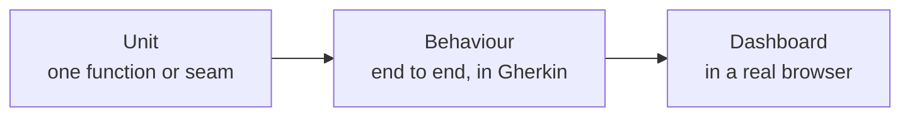

# Testing

Three test layers and the frozen legacy component tests: what belongs in each, and how to run
them.

[`CONTRIBUTING.md`](../../CONTRIBUTING.md) states the requirement: cover changes with
tests, positive and negative cases, and assert returned values rather than the absence of
an error. This page says which layer to put them in.

## Layers

| Layer | Lives in | Covers | Needs |
| --- | --- | --- | --- |
| Unit | `#[cfg(test)] mod tests` inline in each module | One function or type, or an in-process seam where real collaborators from several modules meet | Nothing |
| Behaviour | [`tests/`](../../tests/) with Gherkin features under [`tests/features/`](../../tests/features/) | A described behaviour end to end, in the project's own vocabulary. This is the acceptance layer | A built binary, and containers for the federation suite |
| Dashboard | [`ui-tests/`](../../ui-tests/) | The dashboard in a real browser | A running gateway and Playwright |
| Legacy component (frozen) | [`src/component_tests/`](../../src/component_tests/) | Flows written before the Behaviour layer existed; takes no additions | Nothing |



Left to right, each layer is slower and covers more at once.

## Choosing a layer

Work down this list and stop at the first one that fits.

| The change is | Test it as |
| --- | --- |
| A pure function, a parser, a validator, a conversion | Unit |
| A new field with validation rules | Unit, positive and negative |
| Two or more modules agreeing on something, such as a pipeline stage calling a store | Unit, at the seam where they meet |
| A protocol exchange over a real listener | Behaviour |
| A behaviour an operator would recognise and describe, such as "a caller without a valid token is refused" | Behaviour |
| Anything crossing two gateways | Behaviour, in the `g2g` feature set |
| A dashboard page, form, or interaction | Dashboard |

A change that adds a stage to the request pipeline usually needs two: a unit test for the
logic, and a scenario proving the stage runs in the right place. Nothing new goes into
`src/component_tests/`.

## Unit tests

Inline, in the module they cover.

```rust
#[cfg(test)]
mod tests {
    use super::*;

    #[test]
    fn rejects_a_name_longer_than_the_cap() { /* … */ }
}
```

Run all of them, or one module:

```bash
make test-unit
cargo test --bin agent-gateway "<module name>"
```

For a compile check without running anything, `cargo test --no-run`.

A seam test lives in the module that owns the seam, such as the store that notifies a
registry. It wires the real collaborators in process, keeps storage in a temporary
directory, and fakes only what sits outside the gateway, through its trait. Fixtures
shared across a module's tests go in a `test_support` module beside it, as
[`src/secrets/test_support.rs`](../../src/secrets/test_support.rs) does, never in
`src/component_tests/helpers/`.

## Behaviour tests

The acceptance layer. Every behaviour an operator or caller can observe is described as a
Gherkin scenario here, and a change that used to get a component test now gets a scenario
plus a unit test at the narrowest seam.

Two Cucumber suites, both declared as harness-free test targets in
[`Cargo.toml`](../../Cargo.toml).

| Suite | Features | Step definitions | Scope |
| --- | --- | --- | --- |
| `surface_bdd` | [`tests/features/surface/`](../../tests/features/surface/) | `tests/surface_bdd/`, `tests/surface_bdd_support.rs` | One gateway: surfaces, source auth, policy, MCP, STS, trust recording |
| `g2g_bdd` | [`tests/features/g2g/`](../../tests/features/g2g/) | `tests/g2g_bdd/`, `tests/g2g_bdd_support.rs` | Two gateways over the fabric, with a managed DIDComm mediator |

```bash
cargo test --test surface_bdd
make gw-e2e
```

`make gw-e2e` starts mediator containers, sets `FABRIC_BDD_MANAGED_MEDIATOR`, and runs
with `G2G_BDD_PARALLELISM` scenarios at once, 8 by default. Set
`G2G_BDD_PARALLELISM=1` when a failure is hard to attribute.

Feature files use the vocabulary in [`CONTEXT.md`](../../CONTEXT.md). Use the glossary's
terms rather than code identifiers, so a scenario reads as behaviour rather than
implementation. Each scenario describes one behaviour, exercises the real gateway through
its public interfaces, and asserts what the caller or operator observes rather than
internal state.

[`scripts/bdd-gherkin.py`](../../scripts/bdd-gherkin.py) generates a step inventory, which
is the quickest way to find an existing step before writing a new one, and lints features
against their bindings. Run the lint after adding or changing a `.feature` file or a step
binding; errors block, and CI runs the same check.

```bash
python3 scripts/bdd-gherkin.py --inventory
python3 scripts/bdd-gherkin.py --lint
```

## Legacy component tests

[`src/component_tests/`](../../src/component_tests/) holds flows written before the
Behaviour layer existed. It is frozen: no new files, test functions or helpers. Existing
tests may be fixed when the code they cover changes, or deleted once a scenario covers the
same behaviour. The `freeze` tests in
[`src/component_tests/mod.rs`](../../src/component_tests/mod.rs) pin each file's number of
tests in `FROZEN_FILES`. They fail when a file is added, a file gains a test, or a test or
file is deleted without lowering or removing its pin. New helpers are caught in review, not
by the tests.

Pins only go down. A change that deletes tests lowers the pin in the same change. Raising a
pin needs a stated reason in the pull request; the usual one is a rebase that brings in a
test main already added.

They compile into the binary's test target, so they still run with the unit tests:

```bash
cargo test --bin agent-gateway component_tests
```

## Dashboard tests

Playwright, in [`ui-tests/`](../../ui-tests/), with specs under `ui-tests/specs/`.

```bash
make ui-test
make ui-test-headed
make ui-test-report
```

`make ui-test` boots a gateway in test mode, runs the suite, and tears it down.

Every interactive element ships with a `data-testid`, and these tests are the consumer.
The naming convention is in [`ui-tests/README.md`](../../ui-tests/README.md): page roots
are `page-<area>`, actions are `<area>-<verb>-button`, list items are
`<area>-card-<id>` or `<area>-row-<id>`, and wizards use `wizard-<name>` with
`wizard-next`, `wizard-back`, and `wizard-submit`.

## Frontend unit tests

Jest, alongside the dashboard source:

```bash
make npm-test
```

## Running everything

| Command | Runs |
| --- | --- |
| `make test` | All Rust tests. `make test test=<filter>` narrows by name. |
| `make test-unit` | The binary's tests only |
| `make test-policies` | The OPA policy engine tests |
| `make test-all` | Rust, frontend, and dashboard tests |
| `make test-rust-ci` | The CI flow locally: coverage plus `surface_bdd`, against the coverage threshold |
| `make test-junit` | Nextest with a JUnit report at `test-results.xml` |
| `make test-coverage` | Coverage at `coverage.xml` plus the JUnit report |

Each of these depends on `config-test`, which only prepares the local certs and keys
(`make config-certs`). Rust tests build their own temporary environments, and `make ui-test`
wipes and prepares `tmp/local-ui-tests` (HTTP port 8711) at the start of each run and keeps
it afterwards for debugging, so a test run never touches a development instance.

## Before opening a pull request

Run the checks listed under _Before Opening A Pull Request_ in
[`CONTRIBUTING.md`](../../CONTRIBUTING.md#before-opening-a-pull-request).

## Related

- [`DEVELOPMENT.md`](DEVELOPMENT.md): running the gateway, Docker, and debugging.
- [`../../CONTRIBUTING.md`](../../CONTRIBUTING.md): what a contribution has to include.
- [`../../CONTEXT.md`](../../CONTEXT.md): the vocabulary feature files use.
